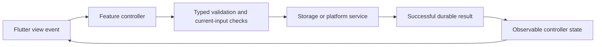

# Automated Software Generator Requirements

Created 25 October 2026. This is the ordered feature queue for the 15 minute development schedule. The product specification below supplies the broader scope. Existing work takes precedence over starting a new item.

## Completion and selection rules

Read this document on every scheduled run. First reconcile any active issue or PR against GitHub and current origin/main. Finish that work before selecting another feature. Select the first queued feature whose dependencies are satisfied; split large features into one coherent issue at a time. Do not mark a whole feature done when only an increment is delivered.

Statuses: Queued, In progress, Blocked, Awaiting merge, Done. A checked box means Done only. Before marking Done, verify acceptance criteria, actual relevant tests, independent final-revision review, required CI, and the PR merge into main. Record issue, PR, merge SHA, validation and completion date. Implementation or an open PR alone is not completion. Do not start the next task until the previous task is completed and merged into main. If blocked, record the blocker and resume it on the next run rather than silently advancing. If another run owns active work, avoid overlapping changes.

Update this document with task selection and delivery evidence, alongside [agent memory](history/AGENT_MEMORY.md) and [progress](history/PROGRESS.md). Preserve unrelated edits. Include status updates in the relevant branch/PR where possible; reconcile the verified merge on the next run. Never overwrite this document from an older branch.

## Ordered feature queue

- [x] F01 Structured requirements and task board — Done
  - Persist requirement IDs, acceptance criteria, task dependencies and task status per project; expose them in the workspace with edit and reopen support.
  - Accept when edits survive restart, invalid dependencies are rejected, and requirements changes invalidate affected approvals. Include a readable project requirements document with task progress.
- [ ] F02 Executable approved plans — In progress; depends on F01
  - Convert saved plans into validated, structured tasks bound to the exact requirements and approval revision.
  - Accept when only the current explicitly approved plan can start Build; withdrawn, stale and unapproved plans cannot execute. Show task progress and failures.
- [ ] F03 Resumable bounded execution — Queued; depends on F02
  - Persist tool actions, results, limits and checkpoints; support stop, cancel and safe resume after interruption.
  - Accept when duplicate side effects are prevented on resume, out-of-project paths and unauthorized commands are rejected, and time/output/tool-call limits are enforced.
- [ ] F04 Model assisted Flutter source edits — Queued; depends on F03
  - Extend the fixed generator with reviewed, scoped source changes driven by approved tasks and a visible diff.
  - Accept when a real local-model request changes an independent Flutter project, passes analysis/tests/build and refreshes its actual preview; preserve the last working output on failure.
- [ ] F05 Bounded automatic build repairs — Queued; depends on F04
  - Diagnose actual build/test errors and repair within a maximum of three attempts per failure category.
  - Accept when every attempt and exit result is saved, cancellation works, exhausted repairs stop honestly, and success requires rerunning the failing checks.
- [ ] F06 Build history and last working version — Queued; depends on F01
  - Keep timestamped build/test outcomes linked to input revisions and preview artifacts, with a last-successful-version entry.
  - Accept when history survives restart, stale or missing artifacts are explicit, and rollback requires a visible selection and preserves current work.
- [ ] F07 Existing project import — Queued; depends on F01
  - Inspect an existing Flutter repository without overwriting it; identify toolchains, project metadata and unsupported capabilities.
  - Accept when users can select and reopen an imported project, inspect findings and approve a plan before any source modification; invalid folders fail without writes.
- [ ] F08 Portable project backup and restore — Queued; depends on F01
  - Export and restore requirements, conversations, decisions, tasks and revision metadata with versioned manifests.
  - Accept when round trips preserve records, corrupt/incompatible archives fail safely, secrets are excluded and existing projects are never silently replaced.
- [ ] F09 Runtime diagnostics and resource controls — Queued
  - Show actual model connectivity, active request, cancellation scope, request limits and actionable setup failures.
  - Accept when offline, timeout and cancellation states are truthful, settings persist, and diagnostics omit secrets and private prompt content.
- [ ] F14 Resizable and collapsible workspace panes — Queued; depends on F01
  - Priority: after active F02 and existing higher-priority F03–F09 work; does not interrupt active delivery.
  - Source/evidence: product specification §4.3 requires resizable/collapsible panels. `lib/views/project_workspace.dart` currently uses a clamped 40% width and a static VerticalDivider, with narrow-screen tabs; no resize/collapse controls exist. Existing F01–F13 do not cover pane layout controls. No second GitHub issue created in the #50 run.
  - Scope/value: let users allocate desktop chat/preview space and collapse/restore a pane while keeping narrow-screen tabs and working state.
  - Accept when pointer and keyboard controls resize within usable minimums, collapse/restore retains conversation/prototype state, and narrow/enlarged-text layouts remain accessible without overflow. Add controller/widget interaction and responsive regressions; run format/analyze/tests/web build. Create/reuse a scoped issue only when this task is selected.
- [ ] F10 Deterministic requirements review — Queued; depends on F04 and F06
  - Map each requirement to concrete checks and saved evidence; distinguish automated verification from advisory model feedback.
  - Accept when failed, missing and stale evidence cannot yield a verified requirement, and reports link to exact revisions and test results.
- [ ] F11 Additional project adapters — Queued; depends on F04 and F05
  - Add one complete adapter at a time, beginning with Python, then React/Next.js, then native targets when their toolchains are available.
  - Accept each adapter only after real creation, analysis/tests, execution and preview or runnable output; label other types unsupported until verified. Track each adapter as its own increment.
- [ ] F12 Isolated self development — Queued; depends on F03, F05, F06 and F10
  - Propose changes to ASG in an isolated checkout with independent review and protected PR delivery.
  - Accept when the installed stable application remains usable, failed candidates are recoverable, and merging requires independent approval and passing required checks.

- [x] F13 Consolidate project documentation — Done
  - Delivered user request: keep one requirements and task document, organize supporting documents, remove redundant copies, and update the scheduled workflow.
  - Acceptance: one requirements file; unique original product scope and foundation history retained; maintained local documentation links resolve; the active 15 minute automation reads this file, deduplicates new tasks and checks Done only after verified merge.
  - Delivered 25 October 2026 via [issue #32](https://github.com/arpit-it/ASG/issues/32), branch `codex/32-documentation-queue`, [PR #33](https://github.com/arpit-it/ASG/pull/33). Independent review approved head `ec9b561f12d1edd9439d100dadae52afe3a90ab9`; required Flutter checks/web build (real Chrome storage and generated-project verification) and Python fixtures passed in CI run `40172035200`. Remote merge `3b4333286e0c3ef8c6543501c2bba6721e714035` at 2026-10-25 07:18:39 UTC and issue closure verified; local main synchronized before F01.

## Adding new tasks

On every scheduled run compare the current implementation, user requests, open issues and review findings with this queue. Add a task only for a user-requested capability, an unmet product specification or a reproducible defect. First search all queued, active and completed entries plus GitHub issues/PRs; extend or reopen an existing task when it covers the same work. Do not add speculative features or duplicate issues.

Use the next unused F number, never renumber or reuse IDs. Record the problem and supporting evidence, user value, priority, dependencies, bounded scope, testable acceptance criteria and validation plan. Link a supporting specification section or reproduction and the matching issue when created. Add at most one justified new task per run. If no justified gap exists, add nothing. Insert the task by dependency and priority, retaining its stable ID. A new task does not interrupt active work: finish and verify its merge first.

A task moves Queued → In progress → Awaiting merge → Done; use Blocked with evidence and the required next action when progress cannot continue. Keep completed entries and merge evidence permanently. Code generation, local test success, issue closure alone or an unmerged PR never checks the Done box. If a delivered feature regresses, add a linked repair task or reopen the affected entry with the reason; preserve prior delivery history.

## Active task and delivery ledger

Active: F02 remains In progress. Issue #52, branch `codex/52-verification-approval`, is Awaiting merge for verification approval boundaries; see evidence below. Issue #50, branch `codex/50-prototype-plan-context`, delivered via independently reviewed PR #51, verified merged as `195c6bfc1ad1118bba23e9e2b513fbd8adb6cd8f`; issue closed. Prototype-bound Plan approval and the user-requested documentation/architecture update are delivered; evidence below. Issue #48, branch `codex/48-plan-execution-preview`, delivered via independently reviewed PR #49, verified merged as `34da5bebf1728e969d9c43a661d30e4454e13f09`; issue closed. Prior issue #46, branch `codex/46-plan-task-proposals`, delivered via independently reviewed PR #47, verified merged as `938c0633f67fb544687822ef8b8ac29ebe9caac6`; issue closed. General executable adapter mapping remains unmet. Prior issue #44, branch `codex/44-unambiguous-build-contract`, delivered via independently reviewed PR #45, verified merged as `0d570585aad7dab7249536b9fef54adaab4bb846`; issue closed. Validated Plan task contract [issue #42](https://github.com/arpit-it/ASG/issues/42), branch `codex/42-plan-task-contract`, independently reviewed and merged via PR #43 as `b30d6bca269876be1ad8d925df347a253d73645f`; issue #42 closed. Prior #40 / PR #41 independently reviewed and verified merged as `88e7dbb7dfdf936361739f31ca5a15415e86762a`; issue #40 closed. General Plan conversion remains unmet; resume F02 before F03.

For each increment append: feature ID; status; scope; dependencies; issue; branch; PR; tested revision; checks and limitations; reviewer verdict; merge SHA; completion date; blocker or next step. Keep completed entries as history.

## Current product decisions

ASG is a Flutter application targeting Android, iOS, web, macOS, Windows and Linux. Included platform runners do not establish tested device support. Managed MLX setup and the current independent Flutter web generator host are macOS-specific; other platforms retain supported app features and runtime connection controls.

Use Flutter across six platforms under the display name Automated Software Generator. The direct Flutter request supersedes the attached SwiftUI framework choice. Implemented scope includes guided creation/session restore, durable interpreted prototypes, structured requirements/tasks, Discuss/Plan/advisory Review, explicit approval, and the fixed Flutter web source-generation/verification slice. General source synthesis and other queued capabilities remain future work.

## Current application architecture and implemented behavior

This section describes the implemented baseline and the issue #50 change under PR #51; it is the current architectural interpretation of the product specification. The ordered F queue above is the only development queue. A feature listed as a future goal in the original brief is not implemented merely because its architecture is described here. PR #51 was independently reviewed and verified merged as `195c6bfc1ad1118bba23e9e2b513fbd8adb6cd8f` on 25 October 2026; its prototype-bound approval change is delivered.

### Product and platform contract

Automated Software Generator is a local-first **Flutter/Dart application targeting Android, iOS, web, macOS, Windows and Linux**. Flutter 3.47.6 / Dart 3.13.5 is the pinned development/CI baseline. The package is `asg`; its Flutter root is `asg/`. The development machine being a Mac does not make the product a macOS-only application. A project's selected target platforms are saved intent, not proof that the corresponding generated apps exist or build.

| Capability | Current platform scope | Evidence and limits |
| --- | --- | --- |
| Flutter app shell, guided creation, project records, prototype UI and planning/requirements screens | Shared application code and six platform runners | Earlier Android debug/macOS debug and current web builds passed. iOS, Windows and Linux application builds and physical-device launches are not established. Responsive widget tests do not establish device acceptance. |
| Durable local records | Native Sembast file; browser IndexedDB | Real native close/reopen and Chrome IndexedDB tests. Single application isolate/session contract; no cross-process or live multi-tab synchronization. |
| Runtime connection controls | Shared UI, subject to reachable endpoint/platform network policy | macOS and localhost browser use host loopback; Android Emulator uses its host alias. Physical-phone connectivity is not configured. No phone-local 9B inference is claimed. |
| Managed model scanning, explicit download, prepare/start/stop | macOS host integration | Existing Qwen3.5-9B 4-bit MLX setup on Apple Silicon; compatible selected Python/checkpoint required. Other targets show an explicit unsupported-managed-setup explanation and connection controls. |
| Independent source generation and compiled preview | macOS-hosted fixed Flutter **web** adapter | Creates a separate new project, executes trusted offline Flutter verification and serves compiled web output. This does not generate macOS/native applications or execute arbitrary repositories. Linux CI fixtures do not change the product host gate. |

### MVC boundaries and data flow

Use Flutter MVC with integration services, `ChangeNotifier`/`BaseController` observable state and constructor/factory injection. Do not replace this with SwiftUI/MVVM or introduce a new state framework without a concrete requirement.

| Layer | Current components | Required responsibility |
| --- | --- | --- |
| Models (`lib/models/`) | StudioProject, ProjectBlueprint, AppDefinition/AppElement, ChatMessage, RequirementsBoard/ProjectRequirement/DevelopmentTask, PlanApproval, PlanTaskProposal, BuildPlan/BuildTask, GeneratedProject, runtime/settings types | Immutable typed data, pure validation and versioned serialization. No widgets, HTTP or storage plugins. |
| Views (`lib/views/`) | StudioHome, Dashboard, ProjectWizard, ProjectWorkspace, LiveApplicationView, ModelChat, RequirementsScreen, SourceGenerationScreen, RuntimeSetupScreen and focused status/dialog views | Render actual state, collect input, own widget/navigation/text/focus lifecycle and delegate actions. No persistence/network/business-rule implementation in callbacks. |
| Controllers (`lib/controllers/`) | StudioSessionController, ProjectWizardController, AppWorkspaceController, ChatController, RequirementsController, SourceGenerationController, RuntimeSetupController, ProjectDetailsController | Coordinate validation/services, busy/error/progress state, commit ordering and cancellation/disposal. No widgets, BuildContext or navigation. |
| Services (`lib/services/`) | RecordStorage/StudioDatabase and stores, ApplicationEditor/LocalApplicationActions, ModelProvider/LocalModel, PlanApprovalStore/PlanTaskImport, GenerationInput/GenerationHost, runtime/folder-picker adapters | Own transactional persistence, transport, platform processes/filesystem integrations and enforce execution-boundary checks. Conditional factories expose honest unsupported-host behavior. |

Success must publish only after validation and the required write succeed. Failed/partial/model-cancelled updates preserve the last committed prototype and history. Async work prevents duplicate submissions, respects disposal and keeps errors visible. Source generation and model transport are distinct workflows; no model prose grants a tool permission.

### Implemented user workflows

1. **Create and reopen:** describe intent, choose suggested experience/features, review project metadata/platforms/location, then save and open the workspace. Suggestions are deterministic. A saved-but-not-opened failure offers selection-only retry without duplicate creation. Session restore rereads the canonical project and preserves the prior workspace on failed selection.
2. **Edit the prototype:** desktop chat appears left of the live interpreted prototype; narrow layouts use state-preserving Chat/Preview tabs. Common exact instructions use validated local actions; custom edits use streamed bounded model proposals. The definition supports headings, text, task lists/completion, counters, notes and bounded buttons, with indigo/green/orange/pink themes. Validated edits and conversations save before revision/preview refresh; interactions use serialized/coalesced durable writes with explicit retry.
3. **Maintain requirements:** the F01 board stores stable requirement IDs, titles and acceptance criteria; development tasks have stable IDs, requirement references, dependency IDs and manual queued/in-progress/blocked/done status. Reject duplicate/missing IDs and dependency cycles; reopening/changing prerequisites invalidates dependent completion. A successful board write increments its revision and invalidates prior Plan approval. Manual Done is not automated verification.
4. **Discuss, Plan and Review:** separate saved assistance history supports Discuss, Plan and advisory Review. These modes have no application/source/command tools. Review reads fresh bounded prototype and historical verification evidence, states limitations, and does not run tests or mark requirements verified. Completed replies whose final write fails remain visibly unsaved with save-only retry; mode/navigation/new requests wait until save finishes.
5. **Import proposed tasks:** one bounded `asg-tasks` version-1 fence may propose up to 200 queued planning tasks against existing requirement IDs. Preview before explicit additive import. Re-read exact latest durable Plan/project/board context; reject collisions, unknown fields/status/commands, duplicate JSON members and invalid graphs. Atomic import preserves existing tasks, changes board revision and requires a fresh Plan before approval. Imported tasks do not become executable commands.
6. **Approve a Plan:** only an app-marked completed saved Plan is eligible. Persist exact message index/content/context, explicit approve/withdraw decision and recording time. New drafts or changed project/board inputs invalidate consent. PR #51 also binds validated prototype definition/revision, including revision-only edits/reverts, and rejects stale captured Build-screen definitions. Unreadable evidence fails closed. Legacy history stays readable but requires a new draft under the current context.
7. **Generate and verify:** explicitly request the fixed Flutter web MVC starter in Plan, inspect its validated task/dependency preview, approve that exact draft, then separately consent in the generation form. Build rechecks current durable approval/inputs before host work and after asynchronous preparation. It accepts exactly one bounded `asg-build` version-1 `flutter-starter` contract with the canonical resolve → analyze → test → build graph; malformed/ambiguous/unsupported contracts and duplicate JSON members cannot execute.
8. **Inspect actual output:** generation writes a new folder exclusively, serializes user/model strings as JSON data and runs trusted Flutter operations via argument arrays. Each operation has a 180-second deadline and 64 KiB captured-output limit. Saved step results derive pending/running/passed/failed/blocked/interrupted task state. Saved outcomes carry exact approval provenance and source/dependency/output fingerprints. Only verified unchanged artifacts can be served by the owned loopback preview; the prototype pane is a different interpreted output. Retry needs unchanged inputs and the same approval identity; it is not checkpoint resume.

The desktop chat width currently follows a clamped 40% split with a static divider. Resizing/collapse is the bounded queued F14 requirement, not an implemented control. Linking a folder only saves its location; existing-source import is F07.

### Persistence and compatibility contract

Production records use `RecordStorage` backed by Sembast (`studio-v2.db` in native app support; IndexedDB on web). Retained preferences migrate atomically; no fallback reset or silent corruption overwrite is permitted. Browser storage is origin/port-specific and can be cleared. Storage is unencrypted application data, not secret storage.

| Record namespace | Stored state |
| --- | --- |
| `studio.projects.v1` | Project identity, name, description, type, platform intent and location |
| `studio.lastProject.v1` | Selected project ID for session restore |
| `studio.application.v1.<id>` | Validated prototype definition, edit messages and revision |
| `studio.chat.v1.<id>` | Separate assistance conversation and optional app-written Plan context |
| `studio.requirements.v1.<id>` | Schema/revision, structured requirements and dependency/status task board |
| `studio.planApproval.v1.<id>` | Exact saved Plan consent/withdrawal identity and time |
| `studio.generation.v1.<id>` | Latest generated outcome, provenance/task graph, actual step results, fingerprints and failure state |
| `studio.localModel.v1` / `studio.runtimeSetup.v1` | Model connection and runtime setup configuration |

Preserve existing keys/payload readability. New approval context does not backfill consent into legacy prose. Per-project damaged application/generation/approval/board evidence remains retained and isolated; invalid global migration data or physical database corruption can stop startup visibly. Only the latest generation outcome is retained; full timestamped history, rollback, portable backup and resumable action journals remain F06/F08/F03.

### Local inference contract

The current selected model is the existing Qwen3.5-9B, locally converted to 4-bit MLX; original weights and runtime environments remain outside Git. `ModelProvider` abstracts the configured endpoint/model. The bridge supports SSE status/token/heartbeat/completion/error events with one active worker. UI progress represents processing stages and human-readable streamed summaries, not private reasoning. Apply only complete validated edits after successful save.

Current client limits are 15 seconds for connection/headers, 30 seconds for stream inactivity and an absolute 180-second total deadline across response modes. The bridge bounds input to 4096 tokens and output to at most 2048 tokens. Cancellation closes transport and is checked at bounded server generation/prefill points; a native kernel cannot be interrupted mid-execution. Explicit model downloads/setup require a selected destination/environment and never run just by opening setup. macOS host integration uses owner-approved host-user permissions, not an execution sandbox.

Earlier real MLX custom-edit/Plan/Review streaming checks passed. In this issue #50 run, the endpoint refused connection; no fresh inference is verified. Larger contexts, arbitrary tool use and other model/framework support remain proposed capabilities until their own acceptance evidence exists.

### Validation and remaining boundaries

Issue #50 code validation passed formatter, analyzer, 200 default tests (four opt-in skips) and web build. Tests cover prototype/revision/corrupt/legacy approval inputs, stale Build screens with preview/history preservation, fresh approval recovery and actual native database reopen. Final PR checks must also include actual Chrome storage, real independent generated-project verification and Python runtime/process fixtures; independent final-head review precedes merge. CI fixtures or skipped live tests do not verify current model availability.

Current architecture does not deliver general task-to-executable adapter mapping (remaining F02), action checkpoints/resume (F03), model source edits (F04), automatic repair (F05), full build-history rollback (F06), source import (F07), portable backup (F08), comprehensive diagnostics/resource controls (F09), deterministic requirement verification (F10), other adapters (F11), isolated self-development (F12) or user-resizable panes (F14). These stay in the existing queue; no duplicate task document is introduced.

Detailed contracts: [MVC architecture](architecture/ARCHITECTURE.md), [storage](architecture/STORAGE.md), [generation](architecture/GENERATION.md), [workspace](architecture/LIVE_WORKSPACE.md), [runtime setup](setup/RUNTIME_SETUP.md), [streaming](setup/QWEN_STREAMING.md), [test strategy](development/TEST_STRATEGY.md) and [CI](development/CI.md).

## Foundation acceptance context

These criteria describe earlier increments; their presence does not mark the feature queue complete.

Historical foundation increment: empty dashboard is honest; blank project name is rejected; target selection is required; project record saves before appearing; saved records load at startup; search filters names; unsupported automation displays explicit status. Editable settings are now implemented; existing-source import remains F07. Generated applications, Git initialization, and successful builds must never be claimed based only on record creation.

App-led workspace increment: user describes intent before technical configuration; recommendations can be changed and reviewed; selected platforms/features persist; creation opens the workspace; re-entry restores the current project; desktop chat is left of the live prototype; phone tabs preserve both panes; supported instructions apply and refresh visible version state; invalid edits/failed saves preserve the working version. Independent source generation/building is not part of this increment.

# Product specification and original brief

The user subsequently selected Flutter, the ASG repository, existing Qwen3.5-9B, an app-led creation flow, and chat-left/live-preview-right. These direct requirements supersede conflicting SwiftUI-first details below. The original brief is retained for product scope and provenance, not as a command to restart old milestones. Current MVC standards, the 15 minute task-selection rules above and the repository independent-review/merge workflow govern execution; the original manual-only merge language is superseded by the user-authorized independent reviewer merge process. This brief defines the broader product vision, not a claim of completed functionality.

# CODEX MASTER PROMPT — AI PROJECT STUDIO

## Historical original brief (framework/platform choice superseded)

The original brief proposed SwiftUI and a native macOS-first application; its framework/platform instructions below are now explicitly reconciled to Flutter, while preserving product scope. The current product is Flutter for Android, iOS, web, macOS, Windows and Linux; only specifically documented host integrations remain macOS-specific. Retain the original scope as provenance, not current framework/platform instructions.

## 1. Project Overview

You are the Lead Software Architect, Senior Flutter Engineer, AI Agent Engineer, QA Engineer, and Technical Project Manager responsible for building **AI Project Studio**.

Build a production-oriented Flutter application for Android, iOS, web, macOS, Windows and Linux that allows users to create, develop, test, run, and maintain software projects through natural-language conversations without needing to view or manually edit source code.

The application must also support **Self-Development Mode**, allowing its AI agent to implement, test, and propose changes to AI Project Studio's own source code.

**Primary development environment:**
- Hardware: Apple MacBook Pro M4 Max, 36 GB unified memory.
- Operating system: macOS.
- Primary application framework: Flutter and Dart (supersedes the original SwiftUI choice).
- Current coding/planning model: existing Qwen3.5-9B, locally converted to 4-bit MLX. The original Qwen3-Coder 30B-A3B proposal was superseded; other models require explicit compatibility evidence.
- Current runtime: project-local MLX bridge with SSE streaming; legacy Torch fallback. Additional runtimes require compatibility testing.
- Application targets: Android, iOS, web, macOS, Windows and Linux; local-first storage. Managed inference and the initial generator host are macOS-specific.
- License requirement: Commercially usable dependencies and model checkpoints.
- Development tools: Xcode, Swift Package Manager, Git, Flutter SDK, Python and Node.js where available.

The application should remain functional without cloud services after initial setup and model downloads.

## 2. Development Methodology

Use a hybrid software development lifecycle combining:

1. Agile iterative development.
2. Spiral risk-driven prototyping.
3. DevSecOps automation.
4. Verification and validation practices.
5. AI-assisted software engineering.
6. Human approval at important decision and release boundaries.

Every feature must follow:

**Discovery → Requirements → Feasibility → Architecture → Design → Implementation → Testing → Review → User Acceptance → Release → Maintenance**

Each iteration must produce a working, verifiable increment.

Maintain the following documents:

- `docs/REQUIREMENTS.md`
- `docs/architecture/ARCHITECTURE.md`
- `docs/development/SDLC.md`
- `docs/architecture/TECHNICAL_DECISIONS.md`
- `docs/development/SECURITY.md`
- `docs/history/ROADMAP.md`
- `docs/development/TEST_STRATEGY.md`
- `docs/history/PROGRESS.md`

Do not treat documentation as a substitute for implementing working software.

## 3. Product Vision

The user should be able to launch AI Project Studio and:

1. Create or open a software project.
2. Select the project type and destination folder.
3. Describe the intended application in natural language.
4. Discuss requirements with the AI.
5. Review and approve the requirements and implementation plan.
6. Ask the AI to create a working prototype.
7. Observe autonomous coding, building, testing, and debugging.
8. Interact with the running application through a preview.
9. Request improvements through chat.
10. Maintain project history, versions, and development progress.
11. Resume interrupted development sessions.
12. Build new features for AI Project Studio itself.

Users should not need a code editor.

Provide access to source files and technical logs through optional advanced views, but do not make them part of the normal user experience.

## 4. Flutter Application Interface

Implement the application using Flutter with responsive layouts for Android, iOS, web, macOS, Windows and Linux.

### 4.1 Project Dashboard

Display:

- Existing projects.
- Create New Project.
- Open Existing Project.
- Recent activity.
- Project status.
- Current development phase.
- Last successful build.
- Resume development.
- Application settings.

### 4.2 Project Creation Wizard

Collect:

- Project name.
- Project description.
- Project type.
- Target platforms.
- Storage location using a platform-supported native folder picker, with explicit unsupported-platform behavior.
- Optional Git repository initialization.
- Optional starter template.

Initially support these project types in the architecture:

- Flutter.
- SwiftUI macOS.
- SwiftUI iOS.
- React / Next.js.
- Python.
- Kotlin / Spring Boot.

Implement at least one complete project generator in the first milestone. The implemented initial adapter generates Flutter web MVC projects using a macOS host; other adapters remain subject to F11 acceptance.

Other project types may initially be registered as unsupported or experimental, but must not falsely report successful generation.

### 4.3 Main Project Workspace

Design a three-panel interface:

**Left Panel — Project Navigation**
- Project overview.
- Requirements.
- Architecture.
- Development tasks.
- Test results.
- Version history.
- Project settings.

**Center Panel — AI Conversation**
- Natural-language chat.
- Requirements discussion.
- Clarification questions.
- Implementation plans.
- User approvals.
- Task progress.
- Error explanations.
- Development summaries.

**Right Panel — Live Application Output**
- Running application preview.
- Build status.
- Test results.
- Runtime errors.
- Restart controls.
- Preview controls.

Allow panels to be resized and collapsed.

### 4.4 Conversation Modes

Implement four distinct modes:

**Discuss**
- Understand requirements.
- Ask relevant clarification questions.
- Record decisions.
- No source modifications.

**Plan**
- Produce structured requirements.
- Analyze feasibility.
- Recommend architecture.
- Create task breakdowns.
- Define acceptance criteria.
- Require approval before implementation.

**Build**
- Execute approved tasks.
- Modify project files.
- Run builds and tests.
- Diagnose and repair failures.
- Update progress automatically.

**Review**
- Compare implementation against requirements.
- Execute verification checks.
- Identify defects and missing functionality.
- Produce review reports.
- Recommend follow-up work.

Use explicit state transitions between modes. Do not rely exclusively on LLM-generated text to determine permissions.

## 5. Local LLM Runtime

Implement a provider-independent model runtime interface.

Suggested interface capabilities:

- Load model.
- Unload model.
- Generate text.
- Stream tokens.
- Submit structured tool results.
- Cancel generation.
- Report model status.
- Report memory usage.
- Configure context length.
- Configure sampling parameters.

Use a typed model configuration.

Do not hardcode a model name into the agent orchestration layer.

The current selected model is the existing Qwen3.5-9B 4-bit MLX conversion, through the configurable provider interface; the earlier 30B-A3B candidate is historical.

Before integration:

1. Verify the exact model identifier and license.
2. Identify a compatible Apple Silicon inference runtime.
3. Confirm the checkpoint can load within available memory.
4. Benchmark generation and tool-call behavior.
5. Test a 16K context window.
6. Record memory consumption and token throughput.
7. Document any compatibility limitations.

Start with an existing local runtime rather than developing a new inference engine.

The UI must remain responsive during model inference.

Support graceful cancellation and recoverable model errors.

Do not require Ollama if a suitable MLX or llama.cpp implementation is available.

## 6. Agent Architecture

Implement logical agent roles with shared project state.

### Product Analyst

Responsibilities:
- Gather requirements.
- Identify missing information.
- Maintain requirement records.
- Define acceptance criteria.
- Detect conflicting requirements.

### Solution Architect

Responsibilities:
- Analyze feasibility.
- Choose frameworks and dependencies.
- Design components and interfaces.
- Identify security and performance risks.
- Record architecture decisions.

### Project Manager

Responsibilities:
- Maintain the development backlog.
- Track task dependencies.
- Schedule implementation stages.
- Monitor completion status.
- Identify blocked tasks.

### Coding Agent

Responsibilities:
- Inspect existing project structure.
- Read relevant source files.
- Generate new files.
- Modify existing code.
- Refactor components.
- Implement features.
- Diagnose compiler errors.

### QA Agent

Responsibilities:
- Generate tests.
- Execute tests.
- Analyze failures.
- Validate acceptance criteria.
- Detect regressions.

### Reviewer Agent

Responsibilities:
- Review implementation quality.
- Inspect changed files.
- Identify security concerns.
- Check requirement coverage.
- Produce a review report.

For V1, these roles may be implemented as separate orchestration stages using one locally loaded model.

Do not require multiple large models to remain loaded simultaneously.

## 7. Agent Execution Engine

Build an autonomous, observable, resumable execution loop.

The loop should:

1. Read the current task and approved requirements.
2. Inspect relevant project state.
3. Request a structured action from the LLM.
4. Validate the action against the tool schema and permission policy.
5. Execute the authorized tool.
6. Capture stdout, stderr, exit codes, and artifacts.
7. Return results to the model.
8. Continue until the task is completed, blocked, cancelled, or exceeds its limits.
9. Verify the result using deterministic checks.
10. Persist the outcome.

Implement structured tools for:

- List directory.
- Read file.
- Search project.
- Create file.
- Edit file.
- Delete file.
- Run authorized command.
- Run build.
- Run tests.
- Start preview.
- Stop preview.
- Inspect process status.
- Read logs.
- Create Git checkpoint.
- Inspect Git diff.
- Restore checkpoint.

Use structured tool calls with validated arguments, not unvalidated shell commands extracted from prose.

Set configurable limits for:
- Maximum tool calls.
- Maximum repair attempts.
- Execution timeout.
- CPU and memory usage where enforceable.
- Output size.
- Filesystem scope.

The default automatic repair limit should be three attempts per failure category.

Persist task state so interrupted work can resume.

## 8. Project Memory

Each project must maintain durable, versioned records of:

- Project identity and configuration.
- User requirements.
- Approved architecture.
- Design decisions.
- Task backlog.
- Task execution history.
- AI conversation history.
- Build history.
- Test history.
- Known issues.
- Git checkpoints.
- Last successful application state.

Do not depend on the LLM context window as the only source of project memory.

Use structured local storage such as SQLite for application state and Markdown/JSON artifacts for portable project documentation.

Keep generated project files separate from Studio's internal metadata.

## 9. Project Generation

Implement a template-based project creation engine.

The engine should:

1. Validate the project name and destination.
2. Confirm the destination is safe to use.
3. Create the project directory.
4. Generate the starter application.
5. Initialize version control if requested.
6. Create initial requirements and metadata.
7. Detect required toolchains.
8. Install or resolve dependencies with appropriate approval.
9. Compile the starter project.
10. Run starter tests.
11. Launch the application preview.
12. Record the outcome.

Never overwrite an existing directory without explicit approval.

Project creation must be idempotent or recoverable after partial failure.

## 10. Build, Test, and Repair

Implement a build orchestration service.

Supported operations should include:

- Build.
- Clean.
- Run.
- Stop.
- Test.
- Inspect logs.
- Retry failed operation.
- Restore last known good state.

The AI must be able to inspect compiler output and apply targeted fixes.

Do not mark a task complete merely because code was generated.

The definition of done must include:

- Approved requirements implemented.
- Successful compilation.
- Relevant automated tests passing.
- No unresolved critical errors.
- Required security checks passing.
- Running preview available when supported.
- Review results recorded.

If repeated repair attempts fail, mark the task blocked and explain the reason.

## 11. Live Application Preview

Implement a preview abstraction supporting multiple runtime types.

### Web Applications

Use a managed local development server and WKWebView.

Support:
- Live preview.
- Refresh.
- Console logs.
- Runtime errors.
- Restart.

### Native macOS Applications

Compile and launch the generated application as a separate process.

Provide:
- Launch and stop controls.
- Process status.
- Logs.
- Screenshot or preview capture where permitted.
- Window activation.

Do not assume arbitrary native macOS windows can be embedded directly into the Flutter workspace; native-window preview adapters need an explicit supported integration.

### Mobile Applications

Design the architecture for:
- iOS Simulator.
- Android Emulator.
- Flutter development workflow.

These may be implemented after the initial macOS vertical slice.

The preview must display the actual running application, not an AI-generated representation.

## 12. Self-Development Mode

Implement an architecture that allows AI Project Studio to work on its own source repository.

Self-development must use the same SDLC and agent engine as ordinary projects.

Required workflow:

1. User describes a new Studio feature.
2. AI analyzes the existing Studio repository.
3. AI gathers requirements.
4. AI proposes an implementation plan.
5. User approves the plan.
6. System creates an isolated Git worktree or equivalent development workspace.
7. AI implements the feature in that workspace.
8. AI generates and executes tests.
9. AI builds a separate development version.
10. AI launches the development version.
11. Automated checks validate the change.
12. User reviews the results.
13. Approved changes may be merged through a controlled process.

The stable running application must remain unchanged during development.

The AI must not directly overwrite its installed executable or automatically replace the production release.

Use separate application identifiers, data directories, and process management for stable and development builds where necessary.

Design for future signed updates and rollback, but do not implement automatic self-updating without an explicit approval mechanism.

## 13. Security Requirements

Treat generated code, dependencies, repository content, and LLM tool requests as potentially untrusted.

Required safeguards:

- Restrict project filesystem access.
- Validate and canonicalize paths.
- Prevent path traversal and symlink escapes.
- Keep secrets out of model prompts and logs where possible.
- Redact sensitive values.
- Restrict command execution.
- Apply process timeouts.
- Require approval for destructive operations.
- Require approval for network access or dependency installation according to policy.
- Separate trusted application state from generated projects.
- Use isolated build environments where feasible.
- Prevent generated code from modifying Studio's trusted runtime.
- Maintain audit logs.
- Provide rollback checkpoints.

Do not claim a process is sandboxed unless isolation is actually enforced.

If secure execution isolation cannot be implemented in the first milestone, use restricted commands and clearly document the remaining risk. Do not silently execute arbitrary untrusted project code with unrestricted access.

## 14. Commercial Readiness

Use commercially compatible libraries and frameworks.

Maintain a dependency and license inventory.

Design for future features such as:

- Multiple LLM providers.
- Optional cloud inference.
- Model download management.
- Project export.
- GitHub integration.
- Team collaboration.
- Additional programming languages.
- Deployment pipelines.
- Plugin-based project templates.
- Paid subscription capabilities.

Do not implement billing, accounts, cloud infrastructure, or collaboration in the initial milestone.

Focus on a reliable local development experience first.

## 15. Initial Implementation Milestones

### Milestone 0 — Environment and Feasibility

Inspect the development environment.

Check:
- macOS version.
- Xcode and Swift availability.
- Swift Package Manager.
- Git.
- Python.
- Local inference runtimes.
- Available memory.
- Existing repository contents.

Do not assume dependencies are installed.

Verify model availability and runtime compatibility.

Create the initial architecture and implementation plan.

### Milestone 1 — Flutter Application Foundation

Implement:
- Flutter application with Android, iOS, web, macOS, Windows and Linux runners.
- Project dashboard.
- Project creation wizard.
- Native directory picker.
- Local project metadata.
- Project persistence.
- Basic navigation.
- Application settings.

Ensure the application builds and launches.

### Milestone 2 — AI Conversation

Implement:
- Local LLM provider abstraction.
- Streaming chat interface.
- Project-specific conversation history.
- Discuss and Plan modes.
- Requirements persistence.
- Plan approval workflow.

Provide a mock model provider for deterministic tests.

### Milestone 3 — First Autonomous Development Workflow

Implement a complete vertical slice:

User requests:

"Create a macOS task manager with a task list and an Add Task button."

The application must:

1. Discuss the request.
2. Generate a requirements specification.
3. Produce a short implementation plan.
4. Wait for user approval.
5. Create a Flutter starter project using the supported adapter (currently Flutter web on a macOS host).
6. Generate or modify required source files.
7. Build the project.
8. Execute automated tests.
9. Attempt repairs if compilation fails.
10. Launch the generated application.
11. Show build and test results.
12. Record the final project state.

### Milestone 4 — Self-Development Proof of Concept

Use AI Project Studio's own repository as a development target.

Test feature request:

"Add a project search field to the project dashboard."

The system must:
- Analyze the existing dashboard.
- Create an approved plan.
- Create an isolated worktree.
- Implement project search.
- Generate relevant tests.
- Build the modified Studio.
- Run tests.
- Launch the development version.
- Show the implementation summary and Git diff.
- Request approval before merging.

Use the current independent-review workflow: an independent reviewer may merge only after final-revision approval and required passing checks; the implementer must not self-merge.

## 16. Coding Standards

Use:

- Dart asynchronous work with explicit cancellation/disposal and platform integrations where required.
- Flutter MVC with services, as specified in development/CODING_STANDARDS.md.
- Constructor/factory dependency injection with typed Dart interfaces.
- Modular services.
- Structured error handling.
- Structured logging.
- Unit and integration tests.
- Clear separation between UI, agent orchestration, inference, and execution.

Avoid:
- Massive view controllers.
- Unnecessary third-party dependencies.
- Hardcoded paths.
- Hardcoded model names.
- Blocking inference on the UI thread.
- Silent failures.
- Unbounded autonomous loops.
- Fake test results.
- Mock-only features presented as complete implementations.

Keep the application buildable after each milestone.

## 17. Codex Execution Instructions

Begin by inspecting the current repository and development environment.

The existing repository already contains the Flutter application in `asg/`; preserve it and extend the active requirements task. A new empty repository would use Flutter runners for Android, iOS, web, macOS, Windows and Linux.

Then:

1. Identify missing dependencies.
2. Verify the proposed model and runtime.
3. Create the SDLC documentation.
4. Define the modular architecture.
5. Establish the testing strategy.
6. Create the initial project backlog.
7. Implement Milestone 1.
8. Build and test Milestone 1.
9. Fix any discovered compilation errors.
10. Report completed work, tests, limitations, and next steps.

Do not stop after writing documentation.

Do not attempt to implement every milestone in one uncontrolled change.

Do not install system-wide software, download large models, execute destructive commands, or modify files outside the selected workspace without approval.

Maintain `docs/history/PROGRESS.md` after every completed milestone.

If the environment does not support a required operation, report the limitation and continue with independently testable work.

At the end of each milestone, provide:

- Features implemented.
- Files created or modified.
- Build status.
- Test results.
- Known issues.
- Risks.
- Next milestone.

## 18. Original foundation task — historical, already delivered in increments

The original foundation task below is retained as acceptance context; current work follows the ordered queue, with F02 active.

Create the Flutter Automated Software Generator application for Android, iOS, web, macOS, Windows and Linux, including a working project dashboard, project creation wizard, persistent project records, native folder selection, and the foundational architecture for future local LLM integration.

Run the available build and tests.

The deliverable is a real Flutter application foundation, with build/run evidence reported separately for each verified platform.

Preserve all progress in the repository and report what was verified versus what remains unimplemented.

### F01 increment — 25 October 2026

Done, issue #34, branch `codex/34-requirements-board`. Scope: typed per-project requirement IDs/criteria, task IDs/dependencies/status, workspace edit/reopen, readable requirements document and revision-bound Plan approval. Additive `studio.requirements.v1.<projectId>` record, bounded content, dependency cycle/missing-reference rejection, prerequisite completion guards, transitive reopen, atomic writes, stale-editor exclusion, preserved corrupt records. Manual task progress is explicitly not deterministic test evidence. Existing prototype creation/chat/preview remains supported; executable plans remain F02. Validated: nine new regressions; formatter/analyzer; 167 default tests passed (four opt-in skips); actual Chrome storage reopen/corruption test; web/macOS debug builds; live existing Qwen Review streaming/persistence smoke (35s). Final delivery verified 25 October 2026: issue #34 closed/completed; branch `codex/34-requirements-board`; [PR #35](https://github.com/arpit-it/ASG/pull/35) merged by independent reviewer as `6f2dc2bf9168b4a1142f61cf4f24b82a3e8c11a5` at 07:40:50 UTC. Tested published head `0907ed31800db403498d01cbd3eb10d82266fbce` (local equivalent `64b7f33e949980d9fe7c7b703776ffbd540aa1b8`), tested/merged tree `1eaf96f1dad317a95a7c7db545f1a91cf7fbb9f3`. Independent final approval review `5642100543`, detailed review `5642093911`: no blockers; 31 focused tests passed (one live skip), plus delayed-disposal and narrow doubled-text failed-draft probes. Required CI run `40173354018`: Flutter job `121108718986` and Python fixtures job `121108718774` passed, including actual Chrome storage and independent generated-project resolve/analyze/test/web-build. Parent independently verified remote merge/issue closure and synchronized main safely. Local formatter/analyzer, 167 tests (four opt-in skips), Chrome storage, web/macOS debug builds and existing live Qwen Review smoke passed. No blocker. F02 is next eligible task for a subsequent run.

### F02 Build authorization increment — 25 October 2026

In progress, [issue #36](https://github.com/arpit-it/ASG/issues/36), branch `codex/36-build-plan-gate`; depends on delivered F01. Observed gap: fixed generation and verification accepted operation consent without reading Plan approval. Scope/acceptance: both entry points must require explicit operation consent plus the exact latest saved plan approved for the current saved project/requirements revision; reject absent, corrupt, withdrawn, replaced and stale evidence before host work. Recheck approval after asynchronous preparation and before verification. A rejected retry preserves saved build history. Generation UI displays the approved draft or actionable lock reason. Withdrawal prevents subsequent starts, not commands already running. Existing actual per-command results remain visible.

Four new regressions cover denied generation/retry, replacement/corruption/withdrawal, requirements changes, missing project and withdrawal during preparation. Final local formatter/analyzer and default suite pass (171 tests, four opt-in skips). Web and macOS debug builds passed. Exact tested revision/PR/review/CI/merge will be recorded in the linked PR. Existing Qwen runtime reports ready/idle; no fresh inference was run, no model download or stable-app replacement. This increment gates the existing fixed template only; conversion of model plans into validated structured executable tasks remains F02 In progress. Do not check F02 Done or start F03.

### F02 authorization increment verified delivery

F02 authorization increment delivered via [PR #37](https://github.com/arpit-it/ASG/pull/37), issue #36 closed/completed, branch `codex/36-build-plan-gate`. Exact published/tested head `dcd43986d7c2ed712422799acce7db4a579f0d27` (local equivalent `ed038b7`), tested/merged tree `66af194fa7910248eb8d46f89be336b3c478fe65`. Independent final review `5642176906` approved with no blockers after 47 focused tests (one live skip) and a delayed-preview-stop withdrawal race probe; initial detailed review `5642171429`. Required CI run `40175011702` passed Flutter job `121113688406` (real Chrome storage, web and independent generated-project verification included) and Python fixtures job `121113688577`. Reviewer merged as `b1a08f120ed22babbc53704bbe1d76c25516ea10` at 2026-10-25 08:05:45 UTC. Parent independently verified remote merge/issue closure and fast-forwarded local main, 0/0 divergence and exact tested tree. Local formatter/analyzer, 171 default tests (four opt-in skips), web and macOS debug builds passed. No fresh inference claim. F02 remains In progress: structured task conversion/execution is next, and F03 must wait. No further issue created this run.

Post-merge evidence retained locally for the next normal reviewed F02 increment branch/PR; preserve it when changing checkouts.

## F02 exact Build provenance increment — issue #38 (25 October 2026)

Awaiting merge; branch `codex/38-build-provenance`, depends on delivered F01 and F02 approval boundary PR #37 (verified merged b1a08f120ed22babbc53704bbe1d76c25516ea10). No competing active ASG run or open issue/PR at selection. Evidence: old generated source could be retried under a replacement approved Plan because outcomes lacked approval identity. Scope/acceptance: persist exact authorizing Plan index/content/context/timestamp through progress/failure/reopen; reject mismatched, reapproved, legacy or changed-input retries before host work while preserving history; preserve legacy preview and expose provenance in UI. Corrupt provenance fails closed. New generation still needs current durable approval and separate operation consent. Only fixed starter verification is implemented; structured task conversion/execution remains F02 In progress, F03 not started.

Four new controller/model regressions plus extended UI and actual Chrome persistence coverage pass. Final formatter/analyzer, 175 default tests (four opt-in skips), real Chrome IndexedDB test, web and macOS debug builds passed. Existing local Qwen3.5-9B MLX health ready/idle; no fresh inference/model download/stable-app replacement. Required CI, independent exact-head review and remote merge evidence will be recorded in the linked PR before completion. Prior post-merge #36 evidence included, unrelated IDE edits excluded. No second issue created.

### F02 provenance increment verified delivery

Issue #38 completed via [PR #39](https://github.com/arpit-it/ASG/pull/39), branch `codex/38-build-provenance`. Tested published head `884db42ebf48a5522fb0e037bb6d16c28d6f090e` (local equivalent `6add93e`); tested/merged tree `7fb3ad0a4542d308b5c42372674228e14d4dae77`. Independent final-revision approval review `5642229009` (initial `5642217813`), no blockers; 32 focused tests plus delayed-preview-stop reapproval race probe passed. Required CI run `40175924414` passed Flutter job `121116458725` (real Chrome storage, web and independent generated resolve/analyze/test/build/serve included) and Python job `121116458853`. Linux default suite 173 passed/6 skipped; local macOS 175 passed/4 skipped because of platform exclusions. Reviewer merged as `594ffd28d84cffe3b3c91b088ba04f69604a93c5` at 2026-10-25 08:19:42 UTC. Parent independently verified remote merge/issue closure and safely fast-forwarded local main, 0/0 divergence and exact tested tree. No fresh inference claim. F02 remains In progress: structured task conversion/execution is pending; no F03 or second issue started. Schedule/notification preference unchanged.

Post-merge evidence retained locally for the next normal reviewed F02 increment branch/PR. Preserve these documentation edits and the unrelated IDE edits; no direct-main publication.

## F02 structured starter tasks increment — issue #40 (25 October 2026)

Awaiting merge; branch `codex/40-structured-build-tasks`. No competing ASG run/open issue/PR at selection; prior PR #39 merge `594ffd28d84cffe3b3c91b088ba04f69604a93c5` verified in fetched origin/main. Preserved its post-merge evidence and unrelated IDE edits. Scope/acceptance: typed allowlisted fixed-starter tasks with stable IDs/dependencies, persisted alongside exact Plan approval; malformed task graph/missing approval rejected; native verification consumes graph; saved actual command results drive pending/running/passed/failed/blocked/interrupted UI; legacy history remains readable. Dependency-failure history cannot claim downstream results. This verifies the fixed starter only; general Plan-to-task conversion remains F02 In progress and F03 must wait.

Validation: five new model regressions and extended controller/reopen, native execution/failure, widget progress and actual Chrome IndexedDB coverage. Final formatter/analyzer, 180 default tests (four opt-in skips), Chrome storage and web/macOS debug builds passed; exact tested revision recorded in PR. Initial test typing and lazy-list scroll failures corrected and retested. Existing Qwen3.5-9B MLX health ready/idle; no fresh inference, model download or stable-app replacement. Required CI, independent exact-revision approval and remote merge evidence will be recorded in linked PR before delivery. One issue only, schedule/notification preference unchanged.

### F02 structured starter tasks verified delivery

Issue #40 completed via [PR #41](https://github.com/arpit-it/ASG/pull/41), branch `codex/40-structured-build-tasks`. Tested published head `91a790a767840735dbd5a6d7b5c151617e41988f` (local equivalent `55b37aba03da6f931556309a3162ad4d5b57afb5`), tested/merged tree `88c66f096587c9b11211bb17c91612bcff1a2d33`. Independent exact-revision final approval review `5642284128` (detailed `5642278464`), no blockers; 37 focused tests (one live skip) plus interrupted/active/preview-work and narrow doubled-text failure-progress probes passed. Required CI run `40176955225` passed Flutter job `121119586502` (real Chrome, web and independent generated-project verification included) and Python fixtures job `121119586233`. Reviewer merged normally through protection as `88e7dbb7dfdf936361739f31ca5a15415e86762a` at 2026-10-25 08:35:10 UTC. Parent independently verified remote merge/issue closure and fast-forwarded local main, 0/0 divergence and exact tested tree. Local formatter/analyzer, 180 default tests (four opt-in skips), Chrome and web/macOS debug builds passed. No fresh inference claim. F02 remains In progress: general structured Plan-to-task conversion remains unmet; do not start F03. No second issue created; schedule/notification preference unchanged.

Post-merge evidence retained locally for the next normal reviewed F02 increment branch/PR; preserve it and unrelated IDE edits. No direct-main publication.

## F02 validated Plan task contract — issue #42 (25 October 2026)

Awaiting merge; branch `codex/42-plan-task-contract`. Verified prior PR #41 merge `88e7dbb7dfdf936361739f31ca5a15415e86762a`, issue #40 closed, no open work or competing run. Gap: Build attached fixed tasks to any approved prose Plan without converting its contents. Scope/acceptance: Plan instructions propose exactly one bounded versioned `asg-build` JSON contract only for explicitly requested fixed Flutter starter generation/verification; Build parses adapter/version/canonical allowlisted graph before generation or retry and consumes its tasks. Missing, malformed, duplicate, oversized, unsupported and changed graphs fail before host work; preserve preview and durable history. Existing approval/context/provenance and operation consent gates remain. Old prose stays readable/approvable but requires a new structured Plan before Build. No arbitrary source synthesis or commands. F02 remains In progress for general Plan conversion; no F03.

Validation: four new parser/prompt regressions and a controller no-side-effect/history/preview regression; existing reopen/retry/widget coverage updated. Real existing Qwen3.5-9B streamed and persisted a valid four-task Plan contract in 29 seconds. Web and macOS debug builds passed. Final formatter/analyzer, 185 default tests (four opt-in skips), actual Chrome IndexedDB storage test, web and macOS debug builds passed; exact tested revision is recorded in linked PR. Initial guidance-copy and lazy-list scroll-target test failures were corrected and retested. No model download, stable-app replacement or schedule/notification changes. Independent final-revision review, required CI and verified remote merge remain required before delivery.

### F02 Plan contract increment verified delivery

Issue #42 completed via [PR #43](https://github.com/arpit-it/ASG/pull/43), branch `codex/42-plan-task-contract`. Tested published head `9a8c68be533f361e61cf3b8f8477ad508a864bd9` (local equivalent `54a0550`); tested/merged tree `edffe0ab0b14bc477b9dc9cdd3e611cf6497435b`. Independent exact-revision final approval review `5642331821` (detailed `5642319901`), no blockers; 40 focused tests independently passed. Required CI run `40177926302`: Python fixtures job `121122545692` and Flutter job `121122545890` passed, including actual Chrome storage, web build and independent generated-project verification. Reviewer merged normally through protection as `b30d6bca269876be1ad8d925df347a253d73645f` at 2026-10-25 08:51:22 UTC. Parent independently verified PR merge/issue closure, fetched and fast-forwarded local main (0/0 divergence, exact tested tree), preserving unrelated IDE edits. Local formatter/analyzer, 185 default tests (four opt-in skips), Chrome, web/macOS debug builds and real Qwen Plan contract streaming/persistence passed. F02 remains In progress: general Plan conversion still unmet; resume F02 before F03. No second issue started, schedule/notification preference unchanged.

Post-merge evidence retained locally for the next normal reviewed F02 branch/PR; no direct-main publication.

## F02 unambiguous Build contracts — issue #44 (25 October 2026)

Awaiting merge; branch `codex/44-unambiguous-build-contract`; extends F02 and delivered #42 / PR #43. Prior PR #43 remote merge b30d6bca269876be1ad8d925df347a253d73645f verified, no open issue/PR or competing active run at selection. Evidence: jsonDecode accepted repeated object keys by keeping the last value, allowing conflicting version/adapter/task fields to pass the contract boundary. Scope/acceptance: reject duplicate members at every object depth, including identical and Unicode-escaped equivalent names, while preserving valid escaped keys, malformed-JSON rejection and fixed adapter limits. Controller regression verifies denied generation and retry preserve preview/history and do no host work. No new executor capability.

Final formatter/analyzer, 187 default tests (four opt-in skips), and web build passed. Two parser regressions plus expanded controller coverage. Existing Qwen3.5-9B MLX health ready/idle; no fresh inference or download. Stable app and unrelated IDE edits preserved. Includes retained PR #43 final review/CI/merge evidence. Exact tested revision, independent review, required CI and verified merge will be recorded in linked PR before delivery. F02 remains In progress; general Plan conversion is still pending, F03 not started. Schedule/notification preference unchanged.

### F02 unambiguous Build contracts verified delivery

Issue #44 completed via [PR #45](https://github.com/arpit-it/ASG/pull/45), branch `codex/44-unambiguous-build-contract`. Tested published head `ae6dd9dd3341edec05d7ef38feb7604afca03fe7` (local equivalent `11194a8216115f13aa148f105aeea5cf776beb00`), tested/merged tree `958ce3cdfc54b99f22fe4324a82930467f70f89d`. Independent final-revision approval review `5642370723` (detailed `5642362242`), no blockers; 35 focused tests passed (one opt-in skip), with additional fully Unicode-escaped canonical graph and eight nested duplicate/string escape probes. Required CI run `40178731220` passed Flutter job `121124991170` (actual Chrome storage, web build and independent generated-project verification included) and Python fixtures job `121124991210`. Reviewer merged normally through protection as `0d570585aad7dab7249536b9fef54adaab4bb846` at 2026-10-25 09:02:18 UTC. Parent independently verified remote merge and issue #44 closed/completed, safely fast-forwarded local main (0/0 divergence, exact tested tree), preserving unrelated IDE edits. Local formatter/analyzer, 187 default tests (four opt-in skips) and web build passed. Existing Qwen health ready/idle; no fresh inference claim. F02 remains In progress: broader Plan conversion remains unmet; no F03 or second issue started. Schedule and notification preference unchanged.

Post-merge evidence retained locally for the next normal reviewed F02 branch/PR; no direct-main publication.

## F02 saved Plan task import — issue #46 (25 October 2026)

Awaiting merge; branch `codex/46-plan-task-proposals`, extends F02 after verified #44 / PR #45 merge `0d570585aad7dab7249536b9fef54adaab4bb846`. No competing active ASG run/open work at selection. Evidence: general saved Plans had no structured task conversion; board tasks required manual entry. Scope/acceptance: optional bounded versioned `asg-tasks` proposal referencing existing requirements; preview then explicit additive import; reject duplicate JSON keys, unknown fields/status/commands, ID collisions, missing references and cycles. Re-read exact latest durable typed Plan/project/requirements context; fail closed for replaced/stale/legacy/corrupt evidence. Atomic board save preserves existing tasks and completion, imports queued tasks, increments revision and invalidates old approval. No inferred approval, arbitrary execution or new executor. F02 remains In progress: general task-to-executable adapter mapping remains unmet; F03 not started.

Validation: six new tests covering graph/parser boundaries, actual native database reopen, approval invalidation, stale/replaced/corrupt evidence preservation, failed save retry/overlap/disposal, preview-before-explicit-import and narrow enlarged-text layout. Final formatter/analyzer, 193 default tests (four opt-in skips), real Chrome storage, web and macOS debug builds passed. Initial database fixture API errors and always-visible panel layout regressions fixed and full suite rerun. Existing local model endpoint `127.0.0.1:8765` refused connection; no fresh inference claim or runtime replacement/download. Stable installed app unchanged, unrelated IDE edits preserved. Retained prior PR #45 final review/CI/merge evidence included. Exact tested head, independent final review, required CI and verified remote merge will be recorded in linked PR before completion. Schedule and notification preference unchanged.

### F02 Plan task import verified delivery

Issue #46 completed via [PR #47](https://github.com/arpit-it/ASG/pull/47), branch `codex/46-plan-task-proposals`. Tested published head `14c412e423fe7794eaeb82c26cb99b881e4e4745` (local equivalent `14c4fe7`), tested/merged tree `0378129562b4d5604082fcd50c4a95da1bb7b9b9`. Independent exact-revision approval reviews `5642423553` and final `5642440677`, no blockers; 37 focused tests (one opt-in skip) and two additional concurrency/parser/Build-isolation probes passed. Required CI run `40179934650`: Flutter job `121128632794` (real Chrome storage, web build and independent generated-project verification included) and Python fixtures job `121128633043` passed. Reviewer merged normally through protection as `938c0633f67fb544687822ef8b8ac29ebe9caac6` at 2026-10-25 09:21:15 UTC; issue #46 closed/completed. Parent independently verified remote merge/issue closure and safely fast-forwarded local main, 0/0 divergence and exact tested tree, preserving unrelated IDE edits. Local formatter/analyzer, 193 default tests (four opt-in skips), Chrome and web/macOS debug builds passed. Model endpoint refused connection; no fresh inference claim. F02 remains In progress for general executable adapter mapping; no F03 or second issue started. Schedule and notification preference unchanged.

Post-merge evidence retained locally for the next normal reviewed F02 branch/PR; no direct-main publication.

## F02 executable Plan preview — issue #48 (25 October 2026)

Awaiting merge; branch `codex/48-plan-execution-preview`; extends F02 / §4.4 after verified PR #47 merge `938c0633f67fb544687822ef8b8ac29ebe9caac6`, issue #46 closed. No other active ASG run or open issue/PR at selection. Evidence: approval UI exposed raw saved Plan text while executable contract validation appeared only after opening Build. Scope/acceptance: readable four-task fixed-starter preview with operation labels/dependencies beside approval; missing/advisory, malformed/unsupported, stale/replaced/corrupt evidence cannot appear validated. Separate operation consent and existing Build gates retained; approval remains available for advisory plans. No added execution capability. F02 remains In progress for general executable adapter mapping; F03 not started.

Validation: four new controller/widget regressions cover durable current context, invalid/advisory contract approval, missing/corrupt/replaced evidence, read-only preview and narrow enlarged-text approval. Final formatter/analyzer, 197 default tests (four opt-in skips), and web build passed. Initial missing test import and first-draft streaming visibility regression fixed and full suite retested; preview panel appears only for an existing saved Plan. Existing model endpoint refused connection; no fresh inference, runtime download or stable-app replacement. Prior PR #47 final review/CI/merge evidence retained. Exact tested head, independent final-revision review, required CI and remote merge will be recorded in linked PR before delivery. Schedule/notification preference unchanged.

### F02 executable Plan preview verified delivery

Issue #48 completed via [PR #49](https://github.com/arpit-it/ASG/pull/49), branch `codex/48-plan-execution-preview`. Tested published head `436f3267fd7a83b332c83c9e5d1bfd176c56318c` (local equivalent `b1c26af`), tested/merged tree `3c3bf2971db7eec37934438253a1ca6a94155542`. Independent final-revision approval review `5642524001` (detailed `5642503320`), no blockers; 54 focused tests passed (one live opt-in skip), formatter passed independently. Required CI run `40180984555`: Flutter job `121131800468` (actual Chrome storage, web build and independent generated-project verification included) and Python fixtures job `121131800593` passed. Reviewer merged through normal protection as `34da5bebf1728e969d9c43a661d30e4454e13f09` at 2026-10-25 09:36:01 UTC; issue #48 closed/completed. Parent independently verified remote merge and closure, safely fast-forwarded local main (0/0 divergence and exact tested tree), preserving unrelated IDE edits. Local formatter/analyzer, 197 default tests (four opt-in skips), web build passed. Model endpoint refused connection; no fresh inference claim. F02 remains In progress for general executable adapter mapping; no F03 or second issue started. Schedule/notification preference unchanged.

Post-merge evidence retained locally for the next normal reviewed F02 branch/PR; no direct-main publication.

## F02 prototype-bound Plan approval — issue #50 (25 October 2026)

Awaiting merge; branch `codex/50-prototype-plan-context`, extends F02 / §4.4 after verified PR #49 merge `34da5bebf1728e969d9c43a661d30e4454e13f09`, issue #48 closed. No competing active ASG run/open task at selection. Evidence: current Plan context bound project and board only, so editing the saved prototype retained approval for changed generation inputs. Scope/acceptance: new Plan contexts capture exact validated prototype definition and revision (including unsaved starter fallback); changed, revision-only or corrupt evidence invalidates approval/executable preview. Generation/retry must reject stale screen inputs before stopping preview/host work, preserving history. Fresh Plan/approval and current screen work; native reopen retains identity. Legacy Plan/history stays readable; fresh draft required for legacy context. No new executor; F02 remains In progress, F03 not started.

Validation: three added regressions cover prototype edits/revision-only changes/corruption, legacy context refusal, and stale Build input denial with preview/history preservation and fresh approval/reopen recovery; extended actual native database reopen and existing planning fixture. Final formatter/analyzer, full default suite and web build evidence recorded in linked PR. Initial invalid test fixtures corrected and suite retested. Existing model endpoint refused connection; no fresh inference claim or runtime replacement. Required CI, independent final-revision approval and verified merge are required before delivery. Prior PR #49 final delivery evidence retained; unrelated IDE edits preserved. Schedule and notification preferences unchanged.

### Documentation audit requested during issue #50

Audited both entry READMEs and every maintained document under docs, plus contribution/security guidance and repository instructions. Reconciled current Flutter six-platform scope, MVC/planning/storage/generator boundaries, approval/prototype provenance, CI/live-test distinction, dependency inventory and historical-versus-current evidence. Preserved original history and brief; removed stale current claims that storage/approval/generation or MLX verification were absent. Added only F14 for the concrete uncovered §4.3 pane resize/collapse requirement; existing tasks already cover other known gaps, so no duplicate queue or second issue. Documentation changes share PR #51 and require fresh final-head independent review.

### F02 prototype-bound approval and documentation verified delivery

Issue #50 completed through [PR #51](https://github.com/arpit-it/ASG/pull/51), branch `codex/50-prototype-plan-context`. Final published/tested head `0e658f600cd31c887f15876df040b820c42e5254` (local equivalent `6840fd8`), tested/merged tree `657779cef6839b4c1fcee16099bda5f40b9c5704`. Independent final-revision approval review `5642649010` recorded an explicit no-blockers COMMENT verdict because shared-owner identity cannot submit GitHub APPROVE; 51 focused tests passed, one live opt-in skip. Required CI run `40182861107` passed Flutter job `121137420448` (actual Chrome storage, web build and independent generated-project verification) and Python fixtures job `121137420605`. Reviewer merged normally as `195c6bfc1ad1118bba23e9e2b513fbd8adb6cd8f` at 2026-10-25 10:03:09 UTC; issue #50 closed/completed. Parent independently verified remote merge/closure, safely fast-forwarded local main (0/0 divergence) and confirmed exact tested tree, preserving unrelated IDE edits. Local formatter/analyzer, 200 default tests (four opt-in skips) and web build passed. Model endpoint unavailable; no fresh inference claim.

User-requested documentation/platform and canonical architecture updates delivered in the same PR: audited 27 documents, 113 resolving local links, 14 unique task IDs; added only queued F14 for documented pane resize/collapse gap. F02 remains In progress for broader executable adapter mapping; no F03 or second issue started. Schedule and notification preference unchanged. Post-merge status/evidence retained locally for the next normal reviewed increment; no direct-main publication.

## F02 verification approval boundaries — issue #52 (25 October 2026)

Awaiting merge; branch `codex/52-verification-approval`. Prior PR #51 verified remotely merged as `195c6bfc1ad1118bba23e9e2b513fbd8adb6cd8f`; no competing active run/open task at selection. F02 gap: approval was checked before verification only, so withdrawal during resolve still allowed analyze/test/build. Scope/acceptance: reread exact durable approval at progress and native operation boundaries for generation and retry; stop later commands on withdrawal, reapproval, changed requirements/prototype or corrupt evidence; retain completed command results and failed outcome across reopen. An already running command may finish; no process cancellation/resume or new executor added. F02 remains In progress for general executable adapter mapping; F03 not started.

Validation: ten controller regressions cover five approval changes for generation/retry, plus native pre-command refusal regression. Focused 36 tests passed (one opt-in skip), formatter/analyzer passed; 211 default tests (four opt-in skips) and web build passed; macOS debug build result recorded in linked PR. Existing model endpoint refused connection; no fresh inference/runtime replacement/download or stable-app replacement. Retained prior post-merge documentation evidence and unrelated IDE edits. Exact published tested head, required CI, independent final-revision review and verified merge will be recorded in the PR before delivery. Schedule and notification preferences unchanged.

Review correction for #52 / [PR #53](https://github.com/arpit-it/ASG/pull/53): independent reviewer reproduced a launch-preparation race at original published head `15bd710b484f882b34b18af20cc24c59801887cb` and recorded blocking COMMENT review `5642706233`. The default native runner now rechecks consent immediately before Process.start, after async SDK/helper preparation. Retained a trusted SDK marker regression that fails on the original head and passes with the fix; a withdrawn approval cannot launch that command. Initial direct-loader regression was corrected to exercise the real default helper path. Final formatter/analyzer and 212 default tests (four opt-in skips) pass; web/macOS debug rebuilds also pass. Fresh exact-head review/CI are required and recorded in the PR. No running-process cancellation claim. F02 remains In progress.
