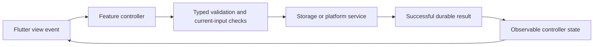

# Automated Software Generator Requirements

Created 25 October 2026. This is the ordered feature queue for the 15 minute development schedule. The product specification below supplies the broader scope. Existing work takes precedence over starting a new item.

## Completion and selection rules

Read this document on every scheduled run. First reconcile any active issue or PR against GitHub and current origin/main. Finish that work before selecting another feature. Select the first queued feature whose dependencies are satisfied; split large features into one coherent issue at a time. Do not mark a whole feature done when only an increment is delivered.

Statuses: Queued, In progress, Blocked, Awaiting merge, Done. A checked box means Done only. Before marking Done, verify acceptance criteria, actual relevant tests, independent final-revision review, required CI, and the PR merge into main. Record issue, PR, merge SHA, validation and completion date. Implementation or an open PR alone is not completion. Do not start the next task until the previous task is completed and merged into main. If blocked, record the blocker and resume it on the next run rather than silently advancing. If another run owns active work, avoid overlapping changes.

Update this document with task selection and delivery evidence, alongside [agent memory](history/AGENT_MEMORY.md) and [progress](history/PROGRESS.md). Preserve unrelated edits. Include status updates in the relevant branch/PR where possible; reconcile the verified merge on the next run. Never overwrite this document from an older branch.

### Owner-authorized implementation and platform-validation separation — 1 November 2026

Unavailable hardware blocks only the corresponding real-host acceptance, not implementable work. Continue bounded F15 CPU implementation, tests, integration and independent review before repeating an unchanged host-resource check. Keep non-Apple CPU and later CUDA live inference explicitly pending; fixtures and app builds never establish inference or full F15 completion. Finish/review/merge each implementable issue before selecting another. Where actual technical prerequisites are delivered, Mac-verifiable F22 selection, F16 capability reporting and F11 adapters may proceed without waiting for every F15/F16 platform milestone. Record the bounded dependency assessment; retain priority among eligible increments and all historical evidence. This owner exception supersedes historical whole-feature selection gates below. Keep experimental backends outside normal supported app choices until live validation.

### Owner priority and pending tracking — 2 November 2026

Complete queued implementation tasks and fixes on the available Mac first. Windows, CUDA, non-Apple CPU and other unavailable-platform/device acceptance are **Deferred / Pending until the implementation queue is delivered**, tracked in [issue #400](https://github.com/arpit-it/ASG/issues/400). Retain missing-resource evidence and unchecked umbrella features; do not advertise unverified backends/hosts, repeatedly probe unchanged missing resources, or treat platform-only acceptance as a global development gate. This owner instruction supersedes historical whole-feature platform gates, including the F15/F16/F17 dependencies below. Implement actual prerequisites and preserve priority among eligible increments. F23 remains the final feature phase; deferred platform acceptance does not authorize paid resources, new access or deployment.

Continue active PRs first, then the first technically eligible Mac-verifiable increment without routine owner task-selection input. Carry each through implementation, meaningful tests, fixes, plugin-only publication, independent final-revision review, required CI and reviewer merge before selecting another. Do not repeatedly reopen delivered CPU fixes without a reproducible defect. Do not mark deferred acceptance Done from fixtures or builds.

The owner explicitly requested this one-time issue reconciliation; it permits multiple tracking issues now, without creating new features or changing future runs' one-new-issue limit. **Pending** means not started; **Deferred** is pending acceptance intentionally scheduled after implementation. REQUIREMENTS.md remains the sole specification and ordering authority; issues link its existing tasks:

| Requirement | Tracking issue | Current state |
| --- | --- | --- |
| F15/F16/F17/F22 unavailable-platform acceptance | [#400](https://github.com/arpit-it/ASG/issues/400) | Deferred / Pending after implementation |
| F22 remaining profile/selection/provenance | [#396](https://github.com/arpit-it/ASG/issues/396) | Project-chat provenance Done via PR #408; Ask provenance Done via PR #409; prototype Build provenance Done via PR #410; source provenance Done via PR #411; repair journal Done via PR #412; Ask conversation selection Done via PR #413; project advisory-chat selection Done via PR #414; prototype selection Done via PR #415; source/repair selection Done via PR #416; verified profiles Pending |
| F16 portable host/capability reporting | [#401](https://github.com/arpit-it/ASG/issues/401) | Pending implementation; external host validation Deferred |
| F11 adapters and stack selection | [#402](https://github.com/arpit-it/ASG/issues/402) | Pending; one complete adapter at a time |
| F19 Code Lab | [#403](https://github.com/arpit-it/ASG/issues/403) | Pending actual runner prerequisites |
| F20 repository workflow | [#404](https://github.com/arpit-it/ASG/issues/404) | Pending adapter prerequisites |
| F21 instruction schedules | [#405](https://github.com/arpit-it/ASG/issues/405) | Pending repository prerequisites |
| F12 isolated self development | [#406](https://github.com/arpit-it/ASG/issues/406) | Pending |
| F23 user-owned cloud connection | [#407](https://github.com/arpit-it/ASG/issues/407) | Pending; final feature phase |

The saved development automation was updated through its management tool; active state, 15-minute interval, model, project and existing notification preference were preserved.

## Ordered feature queue

- [x] F01 Structured requirements and task board — Done
  - Persist requirement IDs, acceptance criteria, task dependencies and task status per project; expose them in the workspace with edit and reopen support.
  - Accept when edits survive restart, invalid dependencies are rejected, and requirements changes invalidate affected approvals. Include a readable project requirements document with task progress.
- [x] F02 Executable approved plans — Done; depends on F01
  - Convert saved plans into validated, structured tasks bound to the exact requirements and approval revision.
  - Accept when only the current explicitly approved plan can start Build; withdrawn, stale and unapproved plans cannot execute. Show task progress and failures.
- [x] F03 Resumable bounded execution — Done; depends on F02
  - Persist tool actions, results, limits and checkpoints; support stop, cancel and safe resume after interruption.
  - Accept when duplicate side effects are prevented on resume, out-of-project paths and unauthorized commands are rejected, and time/output/tool-call limits are enforced.
- [x] F04 Model assisted Flutter source edits — Done; depends on F03
  - Extend the fixed generator with reviewed, scoped source changes driven by approved tasks and a visible diff.
  - Accept when a real local-model request changes an independent Flutter project, passes analysis/tests/build and refreshes its actual preview; preserve the last working output on failure.
- [x] F05 Bounded automatic build repairs — Done; depends on F04
  - Diagnose actual build/test errors and repair within a maximum of three attempts per failure category.
  - Accept when every attempt and exit result is saved, cancellation works, exhausted repairs stop honestly, and success requires rerunning the failing checks.
- [x] F06 Build history and last working version — Done; depends on F01
  - Keep timestamped build/test outcomes linked to input revisions and preview artifacts, with a last-successful-version entry.
  - Accept when history survives restart, stale or missing artifacts are explicit, and rollback requires a visible selection and preserves current work.
- [x] F07 Existing project import — Done; depends on F01
  - Inspect an existing Flutter repository without overwriting it; identify toolchains, project metadata and unsupported capabilities.
  - Accept when users can select and reopen an imported project, inspect findings and approve a plan before any source modification; invalid folders fail without writes.
- [x] F08 Portable project backup and restore — Done; depends on F01
  - Export and restore requirements, conversations, decisions, tasks and revision metadata with versioned manifests.
  - Accept when round trips preserve records, corrupt/incompatible archives fail safely, secrets are excluded and existing projects are never silently replaced.
- [x] F09 Runtime diagnostics and resource controls — Done
  - Show actual model connectivity, active request, cancellation scope, request limits and actionable setup failures.
  - Accept when offline, timeout and cancellation states are truthful, settings persist, and diagnostics omit secrets and private prompt content.
- [x] F14 Resizable and collapsible workspace panes — Done; depends on F01
  - Delivery/order: completed after F09 through PR #216; the original selection priority is retained in the historical delivery record.
  - Source/evidence: product specification §4.3 requires resizable/collapsible panels. The issue #50 baseline used a fixed split; F14 subsequently delivered pointer/keyboard resizing and collapse/restore through `WorkspacePanes` and `WorkspaceLayoutController`, preserving mounted pane state. PR #216 merged as `474fb08561a4469b12ce28fb785cccc7f2d58e92`; final acceptance and checks are recorded below.
  - Scope/value: let users allocate desktop chat/preview space and collapse/restore a pane while keeping narrow-screen tabs and working state.
  - Accept when pointer and keyboard controls resize within usable minimums, collapse/restore retains conversation/prototype state, and narrow/enlarged-text layouts remain accessible without overflow. Controller/widget interaction and responsive regressions, format/analyze/tests/web build and independent final review passed before merge. Session layout preferences are intentionally not durable.
- [x] F10 Deterministic requirements review — Done; depends on F04 and F06
  - Map each requirement to concrete checks and saved evidence; distinguish automated verification from advisory model feedback.
  - Accept when failed, missing and stale evidence cannot yield a verified requirement, and reports link to exact revisions and test results.
  - Assessment clarification (28 October 2026): extend this existing task with acceptance-criterion-level check mappings and explicit automated, manual and advisory evidence types. A green generic build or manually completed task must never verify unrelated criteria. Bind each result to exact requirement content and source/input revision; edits invalidate affected results. Show unmet criteria and evidence links in the workspace and copied report, and retain the current honest “Acceptance criteria: not verified” state until criterion-specific checks actually establish the supported claim. Validate changed criteria/source, missing checks, failed checks and reopen behavior. This scope is delivered as the explicitly bounded authored-check contract below; free-form prose and live-file freshness remain outside its verdict.
- [x] F17 Reproducible product acceptance and support matrix — Done (initial macOS/web baseline); depends on F10
  - Verified initial baseline: [PR #327](https://github.com/arpit-it/ASG/pull/327), finala37de701/treeb6c99ddc, independent approval5722192777/finalgate5722205595 and requiredCI41189201083 passed. Reviewer protectedmerge `1a4251c992ce32921880fdc5395605ac189f79e3` at2026-10-31T09:38:29Z; parent verified merge/currentmain/issue253closed. Initialbaseline Done; historical identities remain separate and later platforms/hosts explicitly unavailable.
  - Historical pre-merge initial baseline adjudication: reused [issue #253](https://github.com/arpit-it/ASG/issues/253), `253-baseline-adjudication`. [Clause-by-clause assessment](development/F17_BASELINE_ADJUDICATION.md) maps actual separate workflows and linked provenance, reviews affected source changes and explicit unavailable platforms. No identity union, new execution or current support claim. Awaiting exact-final independent adjudication, required CI and verified merge; F17 remains unchecked until all gates pass.
  - Delivered bounded inventory — Done: reused [issue #253](https://github.com/arpit-it/ASG/issues/253), `253-baseline-inventory`, [PR #326](https://github.com/arpit-it/ASG/pull/326). Final6c0d020c independently approved5722111731/finalgate5722124838; requiredCI41187496696 passed; verified protectedmerge `2c61072c2902c788e21fdd5a4a4d04ab4fee36ed` at2026-10-31T09:14:48Z, issue closed. Separate21historicalreports/29configuredcells, partial source differences/eightmissingadjacentmanifests; no identity union/currentPass/support. Full F17 remains In progress.
  - Delivered bounded native viewer follow-up — Done: [issue #255](https://github.com/arpit-it/ASG/issues/255), `255-native-viewer`, [PR #325](https://github.com/arpit-it/ASG/pull/325). Final14ac7f1e independently approved5722060273/finalgate5722077042; requiredCI41186230146 passed; verified protectedmerge `d512c64cb648a1fb7accd09c16e5a4c8980597f6` at2026-10-31T08:57:12Z, issue closed. Actual native comparison/retention/Clear/reopen/assetRetry/Quit; synthetic UI inputs only, no collector/model/support/full F17 claim.
  - Delivered actual viewer recovery: reused [issue #255](https://github.com/arpit-it/ASG/issues/255), `255-viewer-interaction`, [PR #324](https://github.com/arpit-it/ASG/pull/324). Actual web503→Retry found cached failed asset Future; real caching-bundle regression and actual200 recovery/report retention passed. Finaldb36945 independently approved5720960664/finalgate5720988042, requiredCI41165147786 passed; verified protectedmergef0fdbd00b63b51ad60ab6223cc65001cce4fe1ba at2026-10-31T03:43:12Z, issue255closed. Bounded increment Done; fullF17 In progress.
  - Delivered bounded viewer comparison: reused [issue #255](https://github.com/arpit-it/ASG/issues/255), `255-manifest-visibility`. Compare reports with this app’s bundled canonical manifest; surface historical digest mismatch and omitted/mismatched configured checks without changing saved statuses or claiming live source/model freshness. Actual audit: 29 configured cells have historical observations, but 20 of 21 reports use older manifests; only the combined Stop/deadline report matches the current manifest. Full F17 remains In progress; no historical union/support claim. Delivered through [PR #323](https://github.com/arpit-it/ASG/pull/323), independent approval verdict5720889577, requiredCI41163915696 passed; verified protectedmerge1fc912e6b0b7f55bc1bdc0cc7194d6c5b34899e2 at2026-10-31T03:25:19Z, issue255closed.
  - Delivered paired native Stop/deadline increment: [issue #283](https://github.com/arpit-it/ASG/issues/283), `283-paired-native-stop-deadline`, [PR #322](https://github.com/arpit-it/ASG/pull/322). Final `f38454fa` independently approved5720700789/finalgate5720723471; required CI41161996540 passed; verified merge `f31065dcdd1b28a715d1b2dcfb8af59ad14daa82` at2026-10-31T02:59:33Z, issue closed. Actual same-candidate Stop/deadline, retained working output/served interaction/reopen; no model inference or full F17 completion.
  - Delivered browser archive fixture scope: [issue #293](https://github.com/arpit-it/ASG/issues/293), `293-archive-browser-scope`, [PR #321](https://github.com/arpit-it/ASG/pull/321). Final `1988d6e7` independently approved (5720594754/final gate 5720611475), required CI 41160331837 passed, verified merge `5af325731805dbe21f20d3265203b65df94aa0d5` at 2026-10-31T02:36:30Z; issue closed. Browser-only fixture unavailable on native; full F17 In progress.
  - Delivered platform-scope correction: [issue #293](https://github.com/arpit-it/ASG/issues/293), `293-check-targets`, [PR #320](https://github.com/arpit-it/ASG/pull/320). Finalba98126f independently approved5720496657/finalgate5720514453; requiredCI41158127598 passed; protectedmerge539324ef0ea4fea317047ff02029dd6bed175d08 at2026-10-31T02:08:04Z verified, issue293closed. Ten unsupported browser execution cells now unavailable; fullF17 In progress.
  - Delivered web Plan manual lifecycle: [issue #287](https://github.com/arpit-it/ASG/issues/287), `287-web-plan-exact`, [PR #319](https://github.com/arpit-it/ASG/pull/319); final5fe0225e independently approved5720448934/finalgate5720469545; requiredCI41157285546 passed; protectedmerge97a5788703381c9b24b2dcb005e65d7c38545b7f at2026-10-31T01:55:40Z verified, issue287closed. One bounded web manual cell; fullF17 In progress.
  - Delivered native build/launch matrix: [issue #271](https://github.com/arpit-it/ASG/issues/271), `271-native-baseline-matrix`, [PR #318](https://github.com/arpit-it/ASG/pull/318). Finalafec2c23 independently approved5720310655/finalgate5720329535; requiredCI41154383779 passed; protectedmergeaa79c4e3e1c60bc730b8e249292ed8cf4ac4126c verified, issue271closed. Two bounded saved macOS cells; fullF17 In progress.
  - Delivered deadline preview/restart supplement: [issue #291](https://github.com/arpit-it/ASG/issues/291), `291-deadline-reopen-evidence`, [PR #317](https://github.com/arpit-it/ASG/pull/317). Final9bef8de independently approved5719713386/finalgate5719743462; requiredCI41143817600 passed; protectedmerge6ea5f42801b6aeb2937b3b4d8abf12b7e6c32432 verified, issue291closed. No new deadline execution/matrixpass; fullF17 In progress.
  - Delivered browser durable-records fixture: [issue #253](https://github.com/arpit-it/ASG/issues/253), `253-browser-durable-records`, [PR #316](https://github.com/arpit-it/ASG/pull/316). Finalaab675bf independently approved5719604867/finalgate5719638054; requiredCI41141971433 passed; protectedmerge26c18c7fae4a069ec772f8bc77a83e43fc26c578 at2026-10-30T23:08:38Z, issue253closed. Onewebdurablefixturecell Done; fullF17 In progress.
  - Delivered browser rollback record fixtures: [issue #253](https://github.com/arpit-it/ASG/issues/253), `253-browser-rollback-records`, [PR #315](https://github.com/arpit-it/ASG/pull/315). Final32876d4f independently approved5719506871/finalgate5719545727; requiredCI41140572442 passed; protectedmerge5bab324a811cf25a68066e9bf7ef6d799959d854 at2026-10-30T22:54:50Z, issue253closed. Onewebrollbackfixturecell Done; fullF17 In progress.
  - Delivered browser approval lifecycle fixtures: reused [issue #287](https://github.com/arpit-it/ASG/issues/287), `287-browser-plan-refusal`, [PR #314](https://github.com/arpit-it/ASG/pull/314). Finalefed0f90 independently approved5719397468/finalgate6535003413; requiredCI41139001701 passed; protectedmergefd3c39cfb29740123336925b93a71ee8eef36803 at2026-10-30T22:39:41Z, issue287closed. Onewebapprovalfixturecell Done; fullF17 In progress.
  - Delivered web archive-records fixture: [issue #253](https://github.com/arpit-it/ASG/issues/253), `253-web-record-fixture`, [PR #313](https://github.com/arpit-it/ASG/pull/313). Final27418497 independently approved5719268775/finalgate5719315345; requiredCI41137046971 passed; protectedmerge35e8c4ab8d014e3ec321a080a362e8cb591493eb at2026-10-30T22:23:25Z, issue253closed. Onewebfixturecell Done; fullF17 In progress.
  - Historical pre-merge web archive-records fixture: reused [issue #253](https://github.com/arpit-it/ASG/issues/253), `253-web-record-fixture`; actual Chrome13/zero skips/exit0 and27Python passed. One fixture cell only; Awaiting review/CI/merge. FullF17 In progress.
  - Delivered Chrome archive fixture: [issue #267](https://github.com/arpit-it/ASG/issues/267), `267-web-archive-fixture`, [PR #312](https://github.com/arpit-it/ASG/pull/312). Final764f1c71 independently approved5719165143/finalgate5719207468; requiredCI41135377941 passed; protectedmerge0164df10a297c32b44421b863fe3294e10eff95a at2026-10-30T22:09:07Z; issue267closed. Onewebfixturecell Done; fullF17 In progress.
  - Historical pre-merge web archive fixture: reused [issue #267](https://github.com/arpit-it/ASG/issues/267), `267-web-archive-fixture`; one real Chrome archive-browser test and27 collector fixtures passed. Exactly one saved fixture cell; Awaiting review/CI/merge. FullF17 In progress.
  - Delivered four native fixture cells: [issue #253](https://github.com/arpit-it/ASG/issues/253), `253-fixture-baseline`, [PR #311](https://github.com/arpit-it/ASG/pull/311). Finalf5a1e63 independently approved5718899103/finalgate5719001073; requiredCI41131872936 passed; protectedmerge0b1e51f4cf364934f5d1610a92fc306c123fee1e at2026-10-30T21:45:15Z; issue253closed. Fixture-only increment Done; fullF17 In progress.
  - Delivered web archive current-manifest interaction: [issue #267](https://github.com/arpit-it/ASG/issues/267), `267-web-archive-matrix`, [PR #310](https://github.com/arpit-it/ASG/pull/310). Final c27fd4a5 independently approved5718712680/finalgate5718758434; requiredCI41129317048 passed; protected merge35a9088b2b1d2e2df96c81805c65035899383de1 at2026-10-30T21:18:33Z, issue267closed. Exactly one manual web archive cell; bounded increment Done, full F17 In progress.
  - Delivered real repair/check evidence: reused [issue #263](https://github.com/arpit-it/ASG/issues/263), `263-live-repair-evidence`, [PR #308](https://github.com/arpit-it/ASG/pull/308). Final80d7574 independently approved5718190396, CI41120646659 passed; protected mergeb7aea7181188d81bae0db86568cea85eb4c54740 at2026-10-30T20:19:34Z; issue263closed. Exactly two macOS saved repair cells; manual repair interaction/fullF17 remain incomplete.
  - Delivered bounded current-manifest command-deadline evidence: reused [issue #291](https://github.com/arpit-it/ASG/issues/291), `291-native-deadline-current`, [PR #307](https://github.com/arpit-it/ASG/pull/307). Final e4ec63d independently approved5717911832; requiredCI41117933227 passed; merge4c6c2e86c8e56392584a9a71e9895d2c828e61d6 at2026-10-30T19:51:46Z, issue291closed. Actual confined180sdeadline and working preservation add one manual macOS deadline cell; full F17 remains In progress.
  - Delivered native manual repair interaction: [issue #291](https://github.com/arpit-it/ASG/issues/291), `291-native-repair-interaction`, [PR #309](https://github.com/arpit-it/ASG/pull/309). Final d0fa6e3b independently approved5718464363; CI41125265012 passed; protected merge4787d9442105f6f1e8c011098a491471d4c96136 at2026-10-30T20:47:21Z; issue291 closed. One bounded manual macOS repair cell; full F17 remains In progress.
  - Delivered real repair/check evidence: [issue #263](https://github.com/arpit-it/ASG/issues/263), `263-live-repair-evidence`, [PR #308](https://github.com/arpit-it/ASG/pull/308). Final 80d7574 independently approved5718190396; CI41120646659 passed; protected merge b7aea7181188d81bae0db86568cea85eb4c54740 at2026-10-30T20:19:34Z; issue263 closed. Exactly two macOS saved cells; full F17 remains incomplete.
  - Delivered bounded current-manifest command-deadline evidence: [issue #291](https://github.com/arpit-it/ASG/issues/291), `291-native-deadline-current`, [PR #307](https://github.com/arpit-it/ASG/pull/307). Final e4ec63d independently approved5717911832, requiredCI41117933227 passed; protected merge4c6c2e86c8e56392584a9a71e9895d2c828e61d6 at2026-10-30T19:51:46Z; issue291closed. Full F17 remains In progress.
  - Delivered Stop/deadline collector extension: reused [issue #283](https://github.com/arpit-it/ASG/issues/283), `283-stop-deadline-evidence`, [PR #304](https://github.com/arpit-it/ASG/pull/304). Finale07183f8 independently approved review5710172809/finalgate6519201629; CI41030969692 passed; merge `8358708bed192b794ab3b3864a4738255ad72d6e` at2026-10-30T09:12:18Z, issue closed. Full F17 remains In progress for actual workflow coverage.
  - Delivered repair evidence separation: reused [issue #263](https://github.com/arpit-it/ASG/issues/263), `263-repair-evidence-checks`, [PR #303](https://github.com/arpit-it/ASG/pull/303). Final9598c0ed independently approved review5709990083/finalgate6518880859; CI41028787419 passed; merge `fe7ec875bcf2173e9bfe54b72c61f37045b8f05c` at2026-10-30T08:52:50Z, issue closed. Bounded extension Done; real workflow coverage/full F17 remains In progress.
  - Delivered #289 native fingerprint-bound extension: [PR #302](https://github.com/arpit-it/ASG/pull/302), final87c037 reviewed5709718155/finalgate6518389158, CI41025253832 passed; merge5e507d33ab485127cda6dea822051dae16a4e6e8 at2026-10-30T08:21:53Z; issue289closed. Native proposal/checks/promotion/servedinteraction/restart and exactcollector identities observed. Full F17 remains In progress.
  - Delivered #289 snapshot-contract correction: [PR #301](https://github.com/arpit-it/ASG/pull/301), final reviewed `5bdf43a2`, independent review5708845205/finalgate6516633001 and required CI41014622101 passed; protected merge `584c89c4cc98522b75b65d53ecbd52c5e21d6859` at2026-10-30T06:38:01Z. Bounded correction Done; issue289/fullF17 remain In progress for native candidate acceptance.
  - Delivered #289 runtime correction: [PR #300](https://github.com/arpit-it/ASG/pull/300), final reviewed `a28f3005`, required CI41011171113 passed; merge `36f3ad4ed939650c53aca5afb7499a74de01ac73` at2026-10-30T06:02:22Z. Bounded4096-token cap correction Done; actual native proposal retry still failed safely. Issue289 and full F17 remain In progress for candidate acceptance; no promotion/support claim.
  - Delivered native Plan exact-snapshot extension: [issue #287](https://github.com/arpit-it/ASG/issues/287), `287-plan-matrix`, [PR #299](https://github.com/arpit-it/ASG/pull/299). Final review5708184377/finalgate6515264941 and required CI41004725001 passed; protected merge `e3b76d09c623c355e59ab1c8084d0d4380a6444a` at2026-10-30T04:51:34Z. Increment Done; full F17 remains In progress.
  - Delivered exact-snapshot web reopen extension: reused [issue #265](https://github.com/arpit-it/ASG/issues/265), `265-web-reopen-matrix`, [PR #295](https://github.com/arpit-it/ASG/pull/295), reviewed68debc84/finalreview5704935889/CI40954472923 passed; merge `f544c514097ff8d3e121f745b831357245f69664` at2026-10-29T21:09:31Z. Increment Done; full F17 In progress.
  - Delivered web native-generation limitation: [issue #293](https://github.com/arpit-it/ASG/issues/293), `293-web-generation-unavailable`, [PR #294](https://github.com/arpit-it/ASG/pull/294), finalreview5704668328/CI40951210214 passed; merge `87d8cb4b7bdda9ad49327f00124731e29b7c55a3` at2026-10-29T20:47:47Z. Increment Done; full F17 In progress.
  - Delivered native Plan/candidate increment: [issue #289](https://github.com/arpit-it/ASG/issues/289), `289-native-plan-candidate`, [PR #290](https://github.com/arpit-it/ASG/pull/290), final review5699288697/CI40890609594 passed; merge `1f4b7681d395a77aaeb81dce57a5edd99189daee`. Increment Done; full F17 remains In progress.
  - Delivered manual Plan coverage: [issue #287](https://github.com/arpit-it/ASG/issues/287), `287-plan-interaction-coverage`, [PR #288](https://github.com/arpit-it/ASG/pull/288), reviewed `dae43a44`, finalgate5695561152 and CI40849961220 passed; merge `91262e8ad477c8a808a3448f064e7f262b782a91` at2026-10-29T09:34:35Z, issue closed. Manual lifecycle is separate from fixture success; fresh actual coverage still required; F17 In progress.
  - Delivered native repair/deadline increment: [issue #291](https://github.com/arpit-it/ASG/issues/291), `291-native-repair-timeout`, [PR #292](https://github.com/arpit-it/ASG/pull/292), reviewed `730f72e3`, CI40947288816 passed; merge `ed31c9601d9d0ae7dddbf5daa3ecbc09f803a4d4` at2026-10-29T20:20:09Z; issue closed. Increment Done; remaining F17 matrix In progress.
  - Delivered Stop/deadline collector extension: [PR #304](https://github.com/arpit-it/ASG/pull/304), reviewed `e07183f8`, required CI41030969692 passed; merged `8358708bed192b794ab3b3864a4738255ad72d6e` at2026-10-30T09:12:18Z. Reopened issue #283 now tracks actual native Stop/retry; branch `283-native-stop-retry`, exact compiled584c89c/current-manifest stop-interaction observed, Awaiting review/CI/merge. Deadline and full F17 remain unverified.
  - Active repair evidence separation: reused/reopened [issue #263](https://github.com/arpit-it/ASG/issues/263), `263-repair-evidence-checks`. Add separate generated-output/manual repair cells and explicit F10 generated-check import; no new actual workflow or full support claim. Scope/acceptance/validation recorded in delivery ledger below. In progress pending independent review, required CI and merge.
  - Delivered #289 native fingerprint-bound extension: [PR #302](https://github.com/arpit-it/ASG/pull/302), final `87c037018daff34a441c77c19ab45c700df71c02`, independent review5709718155/finalgate6518389158 and required CI41025253832 passed; merge `5e507d33ab485127cda6dea822051dae16a4e6e8` at2026-10-30T08:21:53Z; issue closed. Actual compiled584c89c native proposal/check/promotion/served/restart observations remain bounded historical evidence; full F17 In progress.
  - Active #289 runtime correction: `289-candidate-matrix` honors bounded 4096-token full-file requests; minimum requested view replacement measures2298 tokens against former2048 cap.26Python/31Flutter tests pass; actual retry still failed safely. Native candidate acceptance and full F17 remain In progress; no promotion/support claim.
  - Active native Plan exact-snapshot extension: reopened [issue #287](https://github.com/arpit-it/ASG/issues/287), `287-plan-matrix`. Actual mapped Plan approval/restart/edit/refusal and external last-working preservation observed; 41 focused Flutter tests and 20 collector fixtures pass. Awaiting independent review, required CI and verified merge. Full F17 remains In progress.
  - Active exact-snapshot web reopen extension: reused/reopened [issue #265](https://github.com/arpit-it/ASG/issues/265), `265-web-reopen-matrix`; three bounded web saved observations, Awaiting review/CI/merge. Full F17 remains In progress.
  - Delivered web limitation increment: [issue #293](https://github.com/arpit-it/ASG/issues/293), `293-web-generation-unavailable`, [PR #294](https://github.com/arpit-it/ASG/pull/294), merge `87d8cb4b7bdda9ad49327f00124731e29b7c55a3` at2026-10-29T20:47:47Z. Independent final review5704668328/finalgate6507964875 and CI40951210214 passed; issue closed, increment Done. Actual Chrome platform-factory/UI and durable-record preservation coverage; no native generation or full-matrix pass is implied.
  - Delivered native repair/deadline increment: [issue #291](https://github.com/arpit-it/ASG/issues/291), `291-native-repair-timeout`, [PR #292](https://github.com/arpit-it/ASG/pull/292), final reviewed `730f72e3`, CI40947288816 passed; merge `ed31c9601d9d0ae7dddbf5daa3ecbc09f803a4d4` at2026-10-29T20:20:09Z; issue closed. Full F17 remains In progress.
  - Delivered native Plan/candidate increment: issue #289 / [PR #290](https://github.com/arpit-it/ASG/pull/290), final reviewed `0bf23c1e9f2e5aed2332abc1e77dd1d0a805d3a0`, required CI40890609594 passed; merge `1f4b7681d395a77aaeb81dce57a5edd99189daee` at2026-10-29T14:27:18Z; issue closed. Full F17 remains In progress.
  - Delivered manual Plan coverage: [issue #287](https://github.com/arpit-it/ASG/issues/287), [PR #288](https://github.com/arpit-it/ASG/pull/288), reviewed `dae43a44`, final gate5695561152 and CI40849961220 passed; merge `91262e8ad477c8a808a3448f064e7f262b782a91` at2026-10-29T09:34:35Z, issue closed. Actual native lifecycle observations are tracked separately in #289; F17 In progress.
  - Delivered native selected rollback: [issue #285](https://github.com/arpit-it/ASG/issues/285), `285-native-selected-rollback`, [PR #286](https://github.com/arpit-it/ASG/pull/286), reviewed `1124c6a8`, finalgate5695229015 and CI40846506826 passed; merge `1beb2f90378c4630079d56a0a249c3f5a1fa36b8` at2026-10-29T09:07:48Z, issue closed. Historical selected rollback/prior output preservation/served interaction/restart only; F17 In progress.
  - Delivered native verification Stop/retry: [issue #283](https://github.com/arpit-it/ASG/issues/283), `283-native-verification-stop`, [PR #284](https://github.com/arpit-it/ASG/pull/284), reviewed `5bf168e28aa227464f216fdfb3ad9679d673bfda`, finalgate5695024789 and CI40844127969 passed; merge `a43f0145d30f16d0919b614a485ce4dbe61d4f5e` at2026-10-29T08:49:35Z, issue closed. Historical native Stop/full retry/served interaction/restart only; F17 In progress.
  - Delivered runtime timeout increment: [issue #281](https://github.com/arpit-it/ASG/issues/281), `281-native-runtime-timeout`, [PR #282](https://github.com/arpit-it/ASG/pull/282), reviewed `f5c321c1632c53ef6a5d9fb3f7fb331cca20f981`, final review5694604731 and CI40839866499 passed; merge `65d5e5d2b9f89ceca987405b48ec20e0a7ba86b3` at2026-10-29T08:12:42Z, issue closed. Historical transport timeout only; F17 In progress.
  - Delivered native Plan approval and Discuss Stop increment: [issue #279](https://github.com/arpit-it/ASG/issues/279), `279-native-plan-stop`, [PR #280](https://github.com/arpit-it/ASG/pull/280), merge `ae205b89a688e847b0c6d457ad20533c88c4c83c` at2026-10-29T07:44:56Z. Final independent review6490984277 and CI40836801873 passed at `2b4d11f9d4c939f42443fd0a931f46fd259d014e`; issue closed. Historical candidate observations only; full F17 remains In progress.
  - Delivered native offline Plan increment: [issue #277](https://github.com/arpit-it/ASG/issues/277), `277-native-offline-plan`, [PR #278](https://github.com/arpit-it/ASG/pull/278), merge `48c5bf26b12dbaf60835ecd374c31e10fe549b2c` at2026-10-29T06:38:29Z. Final review6489808288 and CI40829818290 passed at `a6dcd4ebc533b0267475538f1b0d5a21c5c7f899`; issue closed. Historical offline refusal only; full F17 remains In progress.
  - Delivered native archive restore/reopen: [issue #275](https://github.com/arpit-it/ASG/issues/275), `275-native-archive`, [PR #276](https://github.com/arpit-it/ASG/pull/276), merge `76c02ede704d1f3e4a0e3e499917fd523d1b2384` at2026-10-29T06:03:40Z. Exact-final independent approval5693517589 and required CI40826444985 passed at `798c318e67d03b578de7f03d777ff4ea8015b142`; issue closed/completed. Actual historical isolated native export/separate restore/restart/refusal observed, original preserved; full F17 stays In progress.
  - Delivered native project restart: [issue #273](https://github.com/arpit-it/ASG/issues/273), `273-native-project-reopen`, [PR #274](https://github.com/arpit-it/ASG/pull/274), merge `203b5ee0d9032421336be034e41d133a107dc529` at2026-10-28T18:50:54Z. Exact-final independent approval6477724765 and required CI40747934112 passed at `408471781c2bd9d3ff0d8644c8a4f741d0f31f4d`; issue closed. Historical isolated native create/edit/two restarts retained board/prototype state; F17 stays In progress.
  - Delivered isolated macOS launch: [issue #271](https://github.com/arpit-it/ASG/issues/271), `271-native-launch`, [PR #272](https://github.com/arpit-it/ASG/pull/272), merge `fd55e45380c9e80ffc7a3fb71f85d3dd831870ce` at2026-10-28T18:29:25Z. Independent final approval6477265691/required CI40744759176 passed at `354397cefe3b437cf505669d7a5168157a387416`; issue closed. Actual unique-bundle debugbuild/native emptyhome launch; historical observation only, full F17 stays In progress.
  - Delivered exact-identity live candidate matrix: [issue #269](https://github.com/arpit-it/ASG/issues/269), `269-live-evidence-matrix`, [PR #270](https://github.com/arpit-it/ASG/pull/270), merge `e8f6f444d82dabdd9c555ac2b11033cb8132f9d6` at2026-10-28T18:02:40Z. Exact-final sourceapproval6476609544/finalgate6476703853 and required CI40740639791 passed at `6f4a37deb830af9967cca61a28029b887e09518e`; issue closed. Actual49s offline candidate/F10 provenance plus measured identities/two-check saved matrix; runtime/SDK freshness P2 fixed and independently retested. Historical supplied observations only; full F17 stays In progress.
  - Delivered web archive interaction: [issue #267](https://github.com/arpit-it/ASG/issues/267), `267-web-archive-baseline`, [PR #268](https://github.com/arpit-it/ASG/pull/268), merge `7fb37b446e256002cc801d769e7d6c28f6cc7a5c` at2026-10-28T17:36:49Z; exact-final independent approval5687047529 and required CI40736419064 passed at `895001f2630008fc9a12680fac30fff28c95fad0`. Actual separate restore/reload and invalid-import refusal; historical observations only, full F17 stays In progress.
  - Delivered web create/reopen observation: [issue #265](https://github.com/arpit-it/ASG/issues/265), `265-web-reopen-baseline`, [PR #266](https://github.com/arpit-it/ASG/pull/266), merge `51970cdd9088a403ea48344a3b8cef3bf989ffc7` at 2026-10-28T10:31:03Z. Exact-final independent review5681203103 and required CI40671944631 passed at `394d4bb73f80d98f710f9d59af50be2df9af1371`. Historical fresh-origin UI observations only; full F17 stays In progress.
  - Delivered provenance collector bridge: [issue #263](https://github.com/arpit-it/ASG/issues/263), `263-acceptance-provenance`, [PR #264](https://github.com/arpit-it/ASG/pull/264), merge `8413e296101210d5dd532b550975e92eb91942cc`; exact-final independent approval5680940031 and required CI40669008940 passed. Explicit caller-attested records only; real manual baseline remains outstanding.
  - Delivered exact F10 live provenance increment: [issue #259](https://github.com/arpit-it/ASG/issues/259), `259-live-provenance`, [PR #260](https://github.com/arpit-it/ASG/pull/260), merge `6ac15f46a829b3e583e6203471bdd83f36728cf8`; exact-final independent review and required CI40655877829 passed. Collector identity assembly and full actual UI baseline remain outstanding.
  - Delivered UI increment: [issue #255](https://github.com/arpit-it/ASG/issues/255), `255-acceptance-report-view`, [PR #256](https://github.com/arpit-it/ASG/pull/256), merge `0f6f90c621b3e692c4e0bbbb55b5e0ccd90eb85d`; exact-head independent review and required CI40651485126 passed. Real isolated-profile macOS/web baseline remains outstanding.
  - Delivered native-live observation increment: [issue #257](https://github.com/arpit-it/ASG/issues/257), `257-live-acceptance-baseline`, [PR #258](https://github.com/arpit-it/ASG/pull/258), merge `44b7b89d4c4f8ded06503904a7df04102ffc6316`; exact-head independent approval and required CI40653332565 passed. Exact F10 snapshot linkage delivered through PR #260; collector identity assembly and full manual baseline remain outstanding.
  - Initial increment delivered: [issue #253](https://github.com/arpit-it/ASG/issues/253), `253-acceptance-evidence`, [PR #254](https://github.com/arpit-it/ASG/pull/254), merge `21d4f3932dbd33f95440bf963483b76563e5be0e`: versioned manifest and saved-evidence collector only. UI integration and real macOS/web baseline remain outstanding.
  - Source/evidence: owner-requested product-verification improvement on 28 October 2026. Current CI exercises real generated-starter verification, browser storage and process fixtures, while real candidate/model/repair tests are opt-in and native device launches are not established. Historical real-model passes and generic command exits do not prove current end-to-end product behavior. F10 owns criterion mappings/verdicts; F17 owns repeatable collection of actual application/device evidence, not another verdict engine.
  - User value/priority: immediately after F10 and before hardware-dependent F15, establish a repeatable macOS/web product baseline before expanding claimed support. Then verify each F15/F16 host/backend milestone before advertising it. Add Android next and other native targets one at a time when their toolchains/devices are available. This evidence task does not authorize deployment, model downloads or installing/replacing the stable application.
  - Scope: define a versioned acceptance scenario manifest and a visible support/evidence matrix distinguishing fixture tests, platform build, application launch, live inference, generated output and manual interaction checks. Link to F10 evidence using exact requirement/source/input identity. Extend existing real tests rather than duplicate them; run live-model scenarios serially outside default credential-free CI unless an explicitly configured runner exists.
  - Acceptance: repeatable real workflows cover create/reopen and durable edits; approved Plan and refusal after requirements changes; real model proposal → reviewed diff → confined candidate checks → explicit promotion → served output interaction; bounded failed-build repair with rerun; Stop/timeout and last-working preservation; history rollback and archive restore/reopen. Confirm observable output behavior beyond HTTP 200/title changes. Each result records scenario/check ID, exact revision and requirement digest, SDK/runtime/backend/model identity, host/device/browser, UTC time, passed/failed/skipped/unavailable status and bounded sanitized artifacts. Never include prompts, credentials, private paths or model weights in shared diagnostics.
  - Freshness/reporting: require rerunning affected scenarios after source/toolchain/model/configuration changes; stale, skipped, missing and unavailable evidence cannot become a verified/current support claim. UI distinguishes saved evidence from a live health result and exposes unmet coverage. The initial verified matrix must identify untested iOS/Windows/Linux/physical-device coverage explicitly rather than imply support from included runners.
  - Validation/delivery: deterministic schema/freshness/reopen/privacy regressions plus real macOS/web scenario execution and observed UI interactions on an isolated test profile/project. Record actual native launch/device results per later platform increment. Keep F17 unchecked until the initial real baseline and honest unavailable cells, independent final review, required CI and verified merge are complete; expanding the matrix later requires its own evidence.
- [x] F18 Standalone engineering Ask mode — Done; depends on F09
  - Delivered: [issue #328](https://github.com/arpit-it/ASG/issues/328), branch `328-standalone-ask`: standalone advisory streaming conversations, separate transactional history, bounded context and recovery. Initial F17 baseline verified merged through PR #327; no other active issue/PR at selection. Verified [PR #329](https://github.com/arpit-it/ASG/pull/329) merge `7ab84c321aa53c0478d8c6e523215ffd7fc7375a` at2026-10-31T10:10:02Z after independent approval5722286765/finalgate5722296719 of357077af and requiredCI41191261786. Issue328closed; actual configured-model smoke and local/native/Chrome acceptance checks passed; see final ledger below.
  - Source/value/priority: owner request on 28 October 2026 for engineering questions and code suggestions without creating a project. Select after active F10 and the initial F17 baseline, before F15; this is distinct from project-bound Discuss/Plan/Review.
  - Scope/acceptance: expose Ask on the landing screen and workspace, accept free-form engineering questions and pasted code, stream model answers with formatted code/explanations and follow-up context, and persist/reopen standalone conversations. Clearly distinguish model suggestions and uncertainty from executed/tested results. No repository writes, commands or network tools follow merely from asking; moving a suggestion into Code Lab or an approved project workflow is explicit.
  - Validation: provider-injected controller/widget/native/browser persistence tests for no-project use, follow-ups, empty/oversized input, cancellation, offline/timeout, failed final-save retry, responsive keyboard/text layout and switching context without leaking another project's conversation. At least one real configured-model question/answer smoke is required; record it separately from deterministic fixtures. Normal independent review/CI/verified merge gates apply.
- [x] F24 Observable resumable model downloads — Done; depends on F09; owner-selected corrective priority before remaining F15 work
  - Source/evidence: owner request and actual 31 October 2026 Qwen3.5-27B download screenshot: setup only shows a distant generic status/log, without numeric progress or controls. Existing #261 covers catalog selection, not transfer lifecycle. Issue [#346](https://github.com/arpit-it/ASG/issues/346), branch `346-download-progress`.
  - Scope/acceptance: progress immediately below Download, measured bytes/total/percentage/speed with honest unknown values; Start/Pause/Resume/Stop, owned process termination and retained partial files; exact repository/revision/destination matching for resume, including restart. Refuse unrelated/linked folders, keep raw child output private and preserve inference/current model. No automatic model download or inference claim.
  - Delivery: [PR #347](https://github.com/arpit-it/ASG/pull/347). Initial independent review found retry rollback overcount and inherited-pipe completion hang; both corrected with actual regressions. Native isolated UI observed below-button progress/speed, Pause at 5 MiB, Resume through 7.8 MiB and Stop retaining partial bytes. Final head d583ccbb/tree031725f4 approved in reviews5723106296/finalgate5723151483; requiredCI41208499529 passed. Protectedmerge07018365f0399d7047286baf01154fbd33a3890d at2026-10-31T14:12:20Z verified; issue346 closed. Full delivery evidence below.
  - Validation: deterministic local transfer/process fixtures, Python ownership/filter/telemetry regressions, Flutter protocol/controller/responsive UI tests, full format/analyze/test, web/macOS builds and independent exact-final review/required CI/protected merge. Mark Done only after verified merge; larger-model switch remains separately subject to actual inference.
- [ ] F15 Hardware-aware inference backends — In progress (delivered CPU foundations; non-Apple CPU/CUDA live validation Deferred); depends on F09
  - CPU greedy streaming contract — Done through verified [PR #399](https://github.com/arpit-it/ASG/pull/399) mergecfb10b4c (2026-11-01T19:39:00Z), finalgate5729884828/requiredCI41342371559 passed: reused [issue #356](https://github.com/arpit-it/ASG/issues/356), `356-cpu-greedy-streaming`; pin one beam/return sequence despite checkpoint defaults. CPU/MPS and actual HTTP regressions; full F15/live milestones remain pending. Review/CI/merge evidence follows in ledger.
  - CPU generation result contract — Done through verified [PR #398](https://github.com/arpit-it/ASG/pull/398) merge472a97f0 (2026-11-01T18:57:12Z), finalreview5729746700/requiredCI41338642406 passed: reopened [issue #356](https://github.com/arpit-it/ASG/issues/356), `356-cpu-generation-result`, from verified PR #397 mergea91b1593. A checkpoint structured-output default causes AttributeError after streamed text on the real backend with injected model APIs. Override the tensor-return contract; actual HTTP SSE/nonstream success, stop/length reasons, idle/repeat and shared MPS placement are acceptance. Delivered CPU foundation is sufficient for this Mac-verifiable correction; full F15/non-Apple CPU/CUDA live inference remain pending.
  - CPU worker dispatch recovery — Done through verified [PR #395](https://github.com/arpit-it/ASG/pull/395) merge49101166 (2026-11-01T17:57:11Z), finalgate5729457465/requiredCI41333492514 passed: reused [issue #356](https://github.com/arpit-it/ASG/issues/356), `356-cpu-dispatch-recovery`. Private HTTP503, honest idle state, abandoned-queue exclusion and successful retry; actual HTTP acceptance and review gates in the ledger below. Full F15/live milestones remain pending.
  - CPU request framing — Done through verified [PR #394](https://github.com/arpit-it/ASG/pull/394) merge8dace531 (2026-11-01T16:58:44Z), finalreview5729238281/requiredCI41328455583 passed: reused/reopened [issue #356](https://github.com/arpit-it/ASG/issues/356), `356-cpu-request-framing`, from verified PR #393 mergeefdc4e91. Actual conflicting Content-Length and Content-Length/Transfer-Encoding requests return HTTP200 and invoke generation. Require private HTTP400 for duplicate length or any unsupported transfer encoding before body read/backend work; actual sockets, idle health and valid retry for both transports. Delivered CPU HTTP foundation is the prerequisite; no unavailable inference host is needed for this bounded correction. Full F15/live milestones remain pending.
  - CPU malformed-origin rejection — Done through verified [PR #393](https://github.com/arpit-it/ASG/pull/393) mergeefdc4e91 (2026-11-01T16:42:06Z), finalgate5729156526/requiredCI41327073121 passed: reused [issue #356](https://github.com/arpit-it/ASG/issues/356), `356-cpu-origin-rejection`; actual parser-failure disconnect reproduced. Private rejection/no backend calls/idle/retry, preserved GET policy and valid local CORS are acceptance. Full F15/live milestones remain pending; see ledger below.
  - CPU incomplete request body — Done through verified [PR #392](https://github.com/arpit-it/ASG/pull/392) merge0f5362d7 (2026-11-01T16:09:59Z), finalgate5728982512/requiredCI41324293296 passed: reopened [issue #356](https://github.com/arpit-it/ASG/issues/356), `356-cpu-incomplete-body`; actual valid-JSON EOF before declared length starts inference on main6d4dfefd. Reject before parsing/backend work; actual socket/idle/retry acceptance and review gates in the ledger below. Full F15/live milestones remain pending.
  - CPU body timeout — Done through verified [PR #391](https://github.com/arpit-it/ASG/pull/391) merge6d4dfefd (2026-11-01T15:40:43Z), finalgate5728862389/requiredCI41321869175 passed: reused [issue #356](https://github.com/arpit-it/ASG/issues/356), `356-cpu-body-timeout`; actual partial-body disconnect reproduced. Fixed private HTTP408, no inference, idle health and retry are acceptance. Full F15/non-Apple CPU/CUDA remain pending. See delivery ledger below.
  - CPU JSON recursion boundary — Done through verified [PR #390](https://github.com/arpit-it/ASG/pull/390) mergeae70a0f0 (2026-11-01T15:10:39Z), finalgate5728759106/requiredCI41319304534 passed: reused [issue #356](https://github.com/arpit-it/ASG/issues/356), `356-cpu-json-depth`; below-limit deeply nested JSON disconnects before inference. Fixed HTTP400, no model calls, idle health and retry are acceptance. Mac HTTP checks do not establish inference; full F15/non-AppleCPU/CUDA remain pending. See delivery ledger below.
  - Delivered bounded request-budget increment — Done: reused [issue #356](https://github.com/arpit-it/ASG/issues/356), `356-cpu-request-budget`, from verified PR #388 merge `6eaf65b33cb5184685965cd9b313772b9ed17b69`. Actual CPU loopback requests with infinite output budgets disconnected on uncaught OverflowError before inference. Bound request conversion to fixed HTTP400 for Infinity/-Infinity/NaN/overflowing exponents on both transports, before tokenizer/model calls; verify idle health and successful retry. Existing finite/clamped/default budgets retained. Mac-verifiable HTTP implementation uses delivered CPU backend; full F15 and non-Apple CPU/CUDA real-host inference remain pending, CPU outside normal choices. [PR #389](https://github.com/arpit-it/ASG/pull/389) exact693926b/tree06fdc31d independently approved5728690919/finalgate5728708251; requiredCI41318014083 passed; verified protectedmergeb1937ea9e293b233e3f9d7e96104f863c62e0ec8 at2026-11-01T14:55:24Z, issue356closed.

  - CPU generation diagnostics — Done after verified [PR #388](https://github.com/arpit-it/ASG/pull/388) merge6eaf65b3 (2026-11-01T14:27:34Z), finalgate5728598463/requiredCI41315753883 passed: reopened [issue #356](https://github.com/arpit-it/ASG/issues/356), `356-cpu-generation-errors`; actual HTTP private ValueError disclosure reproduced. Fixed CPU-only public failure categories, both transports, idle/retry acceptance; no live inference claim. Scope and checks in ledger below.
  - Delivered CPU thread control — Done after verified [PR #387](https://github.com/arpit-it/ASG/pull/387) merge07de05e5 (2026-11-01T14:08:56Z), finalgate5728459708/requiredCI41314284627 passed: reopened [issue #356](https://github.com/arpit-it/ASG/issues/356), `356-cpu-thread-control`; session-only whole threads1..32/default2 via delivered host/controller. Mac-verifiable integration under owner exception; full F15 and non-Apple CPU/CUDA live inference remain pending. Acceptance and validation in ledger below.
  - Delivered bounded CPU launch deadline view — Done after verified [PR #386](https://github.com/arpit-it/ASG/pull/386) mergecf285a5e (2026-11-01T13:55:00Z), finalgate5728387763/requiredCI41312972161 passed: reused [issue #369](https://github.com/arpit-it/ASG/issues/369), `369-cpu-launch-deadline`; expose the delivered host/controller deadline in setup with session-only whole seconds1..3600/default180. Mac-verifiable integration; full F15 and non-AppleCPU/CUDA live inference remain pending. Acceptance and checks in delivery ledger below.
  - Delivered CPU launch disk-ceiling view — Done after verified [PR #385](https://github.com/arpit-it/ASG/pull/385) merge7221513e (2026-11-01T13:40:13Z), finalreview5728301655/requiredCI41311829237 passed: reused [issue #365](https://github.com/arpit-it/ASG/issues/365), `365-cpu-launch-ceiling`; optional exact-byte limit uses delivered controller/host. Mac-verifiable integration; full F15/live platform milestones remain pending. Acceptance and validation in ledger below.
  - Delivered CPU launch view — Done after verified [PR #384](https://github.com/arpit-it/ASG/pull/384) merge3c05328d (2026-11-01T13:25:47Z), finalreview5728255927/requiredCI41310704303 passed: reused [issue #356](https://github.com/arpit-it/ASG/issues/356), `356-cpu-launch-view`; optional delivered host/controller support this Mac-verifiable opt-in integration. Full F15 and non-Apple CPU/CUDA live inference remain pending. Scope and acceptance in ledger below.
  - Delivered CPU dependency-check view — Done after verified [PR #383](https://github.com/arpit-it/ASG/pull/383) merge2f65060a (2026-11-01T12:54:58Z), finalreview5728140205/requiredCI41308233057 passed: reused [issue #358](https://github.com/arpit-it/ASG/issues/358), `358-cpu-preparation-view`; explicit session consent gates dependency-only preparation via delivered controller/host. Full F15 and non-Apple CPU/CUDA inference remain pending. Acceptance and validation in delivery ledger below.
  - Delivered CPU no-load inspection view — Done after verified [PR #382](https://github.com/arpit-it/ASG/pull/382) merge42e5e051 (2026-11-01T12:26:04Z), finalreview5728000707/requiredCI41305959228 passed: reused [issue #367](https://github.com/arpit-it/ASG/issues/367), `367-cpu-inspection-view`; explicit experimental consent and structural disk observations only. Normal CPU choices and real-host acceptance remain unavailable; full F15 stays unchecked. Scope/tests in delivery ledger below.
  - CPU checkpoint inspection controller — Done through verified [PR #381](https://github.com/arpit-it/ASG/pull/381), merge87f44313 (2026-11-01), independent finalreview5727903611/finalgate5727915424 and requiredCI41303519922 passed: reopened [issue #367](https://github.com/arpit-it/ASG/issues/367), `367-cpu-inspection-controller` from verified main `03b04bde`. Delivered optional no-load host API is the technical prerequisite for this Mac-verifiable increment. Explicit per-call consent/input bounds, typed structure/disk observations, shared busy exclusion, private retry and stale/disposed-result suppression. No normal CPU choice or inference/readiness claim; full F15 and non-Apple CPU/CUDA live acceptance remain pending. Acceptance and checks in the delivery ledger below.
  - CPU launch controller continuation — Done through verified [PR #380](https://github.com/arpit-it/ASG/pull/380), merge03b04bde (2026-11-01), independent finalreview5727815889/finalgate5727830861 and requiredCI41301289153 passed: reopened [issue #356](https://github.com/arpit-it/ASG/issues/356), `356-cpu-launch-controller` from `8c52534e`. Delivered optional host launch is the technical prerequisite; unavailable non-Apple CPU/CUDA inference does not block this Mac-verifiable API-only orchestration. Explicit per-call consent/validated inputs, busy exclusion, existing-runtime rejection, private retry, stale-observation invalidation and late-process Stop/disposal cleanup. Launch only: no saved settings/connection or normal CPU choice changes. Acceptance and evidence in delivery ledger below; full F15/live milestones remain pending.
  - CPU preparation controller increment — Done through verified [PR #379](https://github.com/arpit-it/ASG/pull/379) merge8c52534e (2026-11-01), independent finalreview5727674572/requiredCI41299055188 passed: reopened [issue #358](https://github.com/arpit-it/ASG/issues/358), `358-cpu-preparation-controller`; consent-gated API-only orchestration with private errors, stale-report invalidation and lifecycle coverage. Full F15/live milestones remain pending.
  - CPU managed launch boundary — Done through verified [PR #378](https://github.com/arpit-it/ASG/pull/378) mergeeee26ac0 (2026-11-01), independent finalreview5727590874/requiredCI41296946066 passed: reopened [issue #356](https://github.com/arpit-it/ASG/issues/356), `356-cpu-managed-launch`; optional API-only launch with per-call consent, thread/load/disk limits, private owned-process lifecycle and actual process tests. CPU stays experimental outside normal choices; full F15/non-Apple CPU/CUDA live acceptance remain pending.
  - CPU API-only preparation host — Done after verified [PR #377](https://github.com/arpit-it/ASG/pull/377) mergee9981fb9 (2026-11-01), finalreview5727475100/requiredCI41294611190 passed: reopened [issue #358](https://github.com/arpit-it/ASG/issues/358), `358-cpu-preparation-host`; optional consent-gated bounded private bridge. Full F15/live milestones remain pending; acceptance below.
  - CPU no-load host integration — Done after verified [PR #376](https://github.com/arpit-it/ASG/pull/376) merge24a08537 (2026-11-01), finalreview5727369513/requiredCI41292597514 passed: reopened [issue #367](https://github.com/arpit-it/ASG/issues/367), `367-cpu-inspection-host`; optional typed experimental boundary and bounded private process capture. No normal CPU selection/inference claim. Acceptance and validation below.
  - CPU preparation privacy correction — Done after verified [PR #375](https://github.com/arpit-it/ASG/pull/375) merge6e4d718e (2026-11-01), finalreview5727278341/requiredCI41290366613 passed: reopened [issue #358](https://github.com/arpit-it/ASG/issues/358), `358-cpu-preparation-privacy`; fixed CPU-only CLI errors and Python import-output suppression. Actual subprocess failure/success/legacy/interruption tests; no inference or full F15 claim.
  - CPU loader failure boundary — Done through verified [PR #374](https://github.com/arpit-it/ASG/pull/374) merge6899359f (2026-11-01), finalreview5727171374/requiredCI41288251866 passed: reopened [issue #356](https://github.com/arpit-it/ASG/issues/356), `356-cpu-loader-errors`; bounded private startup diagnostics and owned cleanup. Actual CLI/process regressions and checks recorded below. CPU remains experimental; non-Apple CPU/CUDA inference pending.
  - Delivered bounded estimate — Done: [issue #350](https://github.com/arpit-it/ASG/issues/350), `350-checkpoint-memory`, [PR #351](https://github.com/arpit-it/ASG/pull/351). Conservative selected-local-checkpoint working/OS budget and current pressure, strictly advisory; finalreview5723644359/finalgate5723664871 and requiredCI41216813526 passed; verified protectedmerge2979ad38039d5010b6fdbe7c275e1e5bfcd57648 at2026-10-31T15:57:37Z. FullF15 remains Inprogress; delivery ledger below.
  - Delivered bounded checkpoint footprint increment — Done after verified protectedmerge2cd1be5f on2026-10-31 through [PR #345](https://github.com/arpit-it/ASG/pull/345): [issue #344](https://github.com/arpit-it/ASG/issues/344), `344-checkpoint-size`. Scanner lacked measured weight bytes. Acceptance: distinct validated local weights only, canonical alias deduplication, unknown for rejected/incomplete/legacy candidates; responsive private setup display labels disk size separately from runtime memory/fit/inference. No weights loaded or readiness verdict. Finalreview5722879160/finalgate5722894241 and requiredCI41205273984 passed; F15 stays In progress.
  - Delivered bounded host RAM inspection — Done through [PR #343](https://github.com/arpit-it/ASG/pull/343): [issue #342](https://github.com/arpit-it/ASG/issues/342), `342-setup-memory`. Baseline evidence: setup discovery had no memory observation although the shared bounded native OS probe existed. Verified protectedmerge8f60751e at2026-10-31T12:55:17Z, exactfinalreview5722787686/requiredCI41202849020passed. Scope/acceptance: show total and free/reclaimable RAM during explicit inspection; unknown/zero/private failures, retry, stale/disposed results and narrow enlarged-text presentation covered; settings/runtime retained. No model-fit verdict, GPU-memory reading or inference claim. Full F15 remains In progress.
  - Delivered corrective increment — Done after verified merge90a1a69c on2026-10-31 through [PR #341](https://github.com/arpit-it/ASG/pull/341): [issue #340](https://github.com/arpit-it/ASG/issues/340), `340-hardware-probe-cleanup`: replace shared memory probe `Process.run` timeouts (which leave children alive) with bounded capture and owned termination/reaping. Acceptance: actual timeout/stdout-flood/stderr-flood child-exit checks, sanitized nonzero/error results, total RAM retained when headroom fails, unchanged normal/unsupported-host behavior. No new backend/catalog scope or inference/memory-adequacy claim; full F15 remains In progress.
  - Delivered bounded device inspection — Done: [issue #338](https://github.com/arpit-it/ASG/issues/338), `338-device-probe`, [PR #339](https://github.com/arpit-it/ASG/pull/339), verified protectedmerge `ef8cc935b3713f7a26794307a81830a6ce7520a7` at2026-10-31T11:47:32Z. Final5c5f6899/tree63e67c25 independently approved5722561248/finalgate5722577895; requiredCI41197868345 passed. Explicit no-weight Metal/MPS API inspection and sanitized available/unavailable/unknown UI; actualMLXdevice-only289ms. Model/memory readiness and CPU/CUDA milestones remain outstanding; full F15 unchecked/Inprogress.
  - Delivered corrective increment (PR #337, verified mergea7ece54a; F15 remains In progress): [issue #336](https://github.com/arpit-it/ASG/issues/336), `336-checkpoint-metadata`: canonical containment before config/index metadata reads, matching existing weight/tokenizer boundaries; actual external/internal-link regressions and truthful MLX scan guidance. Evidence: main28059a5 accepted external valid config/index links. Acceptance: reject external metadata privately before read; ordinary/internal-link checkpoints still pass and files/runtime stay unchanged. Finalhead4b654407/tree79c25041 independently approved; requiredCI41196455505 passed and protected mergea7ece54a verified on2026-10-31. No device/memory or full F15 claim.
  - Delivered bounded discovery increment (PR #335, verified merge28059a5c; F15 remains In progress): [issue #334](https://github.com/arpit-it/ASG/issues/334), `334-backend-discovery`: explicit no-weight capability inspection, typed sanitized host/dependency results, scanned model-format restrictions and stale-result invalidation. Acceptance: bounded private subprocess capture/cleanup, failure/retry/disposal, responsive interaction and saved connection/runtime preservation. Device/memory readiness and CPU/CUDA milestones remain outstanding; no full F15 completion.
  - Delivered bounded app increment (PR #333, verified merge9299302b; F15 remains In progress): [issue #332](https://github.com/arpit-it/ASG/issues/332), `332-explicit-backend`: persist an explicit Auto/MLX-Metal/Torch-MPS choice for the next managed launch, forward it without fallback, and show allowlisted server-reported loaded identity. Old settings retain Auto; corrupt records, save failures, overlap/disposal, narrow UI and actual process argument handling are tested. No CPU/CUDA, discovery UI, memory adequacy or full milestone claim.
  - Delivered bounded foundation (PR #331, verified merge b188ed2d; full F15 remains In progress): [issue #330](https://github.com/arpit-it/ASG/issues/330), `330-backend-capabilities`: dependency-light discovery, separated existing MLX/Torch-MPS implementations, truthful loaded-device health and pre-load host/dependency/format rejection. No CPU/CUDA execution or complete milestone claim; app choice/persistence and real-host milestone evidence remain outstanding.
  - Source/evidence: user-requested repository assessment on 28 October 2026. `RuntimeHost` and `ModelProvider` already separate Flutter orchestration from integration; extend those boundaries. `NativeRuntimeHost.supported` currently requires macOS, while `tools/qwen_server.py` implements MLX or Torch/MPS, requires Apple Metal for Torch, and reports a fixed Metal device. CUDA and CPU are not implemented fallbacks.
  - User value: explain whether the selected local model can run on this computer and offer an explicitly selected compatible backend without disturbing saved workspace state.
  - Priority/order: finish active F10, the initial F17 macOS/web baseline and F18 Ask first; prioritize implementable F15 increments, applying the owner-authorized platform-validation exception above for eligible F22, F16 or F11 work. Record backend-specific progress without marking all of F15 Done. This documentation follow-up starts no runtime implementation.
  - Implementation continuation: [issue #356](https://github.com/arpit-it/ASG/issues/356), `356-torch-cpu`, delivered through [PR #357](https://github.com/arpit-it/ASG/pull/357) / verified merge0776de0a2d44e52d78bb49762381c9a37b2fadd5; experimental CPU CLI foundation and deterministic/HTTP tests. Normal managed app choices remain unchanged. Real CPU inference and CUDA remain pending; lack of their hosts does not block this implementation.
  - Delivered CPU preparation increment (PR #359, verified mergea617c20f, review5726576421/CI41275310134 passed): [issue #358](https://github.com/arpit-it/ASG/issues/358), `358-cpu-preparation`. Existing preparation rejects CPU after #356. Explicit opt-in checks installed loader APIs without models, installs, accelerators, fallback or normal app enablement. Validate callable/real CLI consent, missing/broken libraries, paths with spaces and legacy preparation; non-Apple CPU/CUDA inference remains pending.
  - Delivered CPU dependency correction (PR #361, verified merge4cc1dd50/review5726609031/CI41276357161): [issue #360](https://github.com/arpit-it/ASG/issues/360), `360-cpu-dependencies`; include required safetensors in explicit dependency discovery and reject startup before loading. Done for this bounded correction; no full backend acceptance claim.
  - Delivered CPU checkpoint preflight (PR #363, verified merged7bb6f05; review5726637938/CI41277327955 passed): [issue #362](https://github.com/arpit-it/ASG/issues/362), `362-cpu-checkpoint`; validate contained config/index and nonempty safetensors shard manifests before worker/loader creation. Structural validation only; CPU remains experimental and real-host acceptance pending.
  - Delivered bounded metadata correction — Done: reopened [issue #362](https://github.com/arpit-it/ASG/issues/362), `362-cpu-metadata-bounds`, [PR #364](https://github.com/arpit-it/ASG/pull/364): config1MiB/index8MiB actual read limits and no duplicate CPU index read. Finalreview5726671793/requiredCI41278251584 passed; verified protectedmerge03139bcf at2026-11-01T05:53:49Z. CPU remains experimental; fullF15/live milestones remain pending.
  - Delivered bounded CPU resource increment — Done: [issue #365](https://github.com/arpit-it/ASG/issues/365), `365-cpu-weight-budget`, [PR #366](https://github.com/arpit-it/ASG/pull/366); optional startup disk-byte ceiling, canonical alias deduplication and pre-loader rejection. Finalreview5726709978/requiredCI41279204915 passed; verified protectedmerge da49382a at2026-11-01T06:07:25Z. No RAM quota, inference or full F15 completion claim; exact delivery ledger below.
  - Delivered CPU offline inspection increment — Done: [issue #367](https://github.com/arpit-it/ASG/issues/367), `367-cpu-inspection`. Startup-only checkpoint checks lacked a no-load report. Explicit opt-in inspection reuses bounded structural/format checks and returns private versioned disk-byte/file-count JSON before dependencies/workers/HTTP; no tensor/tokenizer/RAM/inference readiness claim. Acceptance: single/sharded/alias counts, ceiling and incompatible/invalid options, real isolated CLI/no optional imports/no startup, unchanged legacy behavior. Mac-verifiable preparation depends on delivered #358/#362/#365, not unavailable non-Apple CPU/CUDA hosts. Delivered through [PR #368](https://github.com/arpit-it/ASG/pull/368), finalreview5726766017/requiredCI41280292607 passed; verified protectedmerge7f51cd4c at2026-11-01T06:24:52Z. Full F15 unchecked; exact evidence below.
  - Delivered CPU load deadline increment — Done after verified PR #370 merge2217e993 (2026-11-01T06:58:32Z), independent verdict5726896060/requiredCI41282483650 passed: [issue #369](https://github.com/arpit-it/ASG/issues/369), `369-cpu-load-deadline`. Main7f51cd4c waits on the CPU loader indefinitely; documented generation limits exclude loading. Add a bounded configurable CPU-only load deadline, ending the dedicated runtime process on expiry, with private diagnostics and no fallback. Accept when real controlled subprocess hangs terminate (including full stderr), success/failure disarms before subsequent activity, invalid options fail before side effects and legacy paths remain unchanged. Depends on delivered CPU CLI foundation; Mac process tests are sufficient for this bounded enforcement, not non-Apple CPU/CUDA inference. Full F15 remains In progress.
  - CPU watchdog startup correction — Done after verified PR #371 mergeb0269535 (finalreview5726961895/requiredCI41284204073 passed): reopened [issue #369](https://github.com/arpit-it/ASG/issues/369), `369-cpu-watchdog-handshake`; require bounded armed acknowledgement before loading and fail closed/reap helpers on startup failure. No live inference or full F15 completion claim.
  - CPU app identity follow-up — Done after verified PR #372 mergeef9df589 (2026-11-01T07:40:22Z), finalreview5727000098/requiredCI41285315169 passed: reopened [issue #356](https://github.com/arpit-it/ASG/issues/356), `356-cpu-reported-device`; recognize ready torch/cpu reports with an explicit experimental/unverified label while retaining only Auto/MLX/MPS managed choices. Transport/UI checks are Mac-verifiable; non-Apple CPU/CUDA inference remain pending.
  - CPU checkpoint privacy correction — Done after verified [PR #373](https://github.com/arpit-it/ASG/pull/373) merge1f031688 (2026-11-01), finalreview5727084901/requiredCI41287206344 passed: reopened [issue #362](https://github.com/arpit-it/ASG/issues/362), `362-cpu-checkpoint-privacy`; sanitized CPU-only preflight CLI failures and actual subprocess privacy/early-rejection regressions; no full F15 or live inference claim.
  - Scope: separate Python backend loading/generation/device discovery behind a common contract; retain MLX, add Torch CPU first, then CUDA as separately verified increments. Keep model-format compatibility explicit: an MLX-quantized folder must not be assumed compatible with Torch. Keep existing configured HTTP runtime connections usable.
  - Application acceptance: setup displays detected host, available backend/device, selected model compatibility, readiness and actionable dependency/memory failures. Persist the explicit backend/device choice with backward-compatible defaults. Offer fallback with user consent; do not silently download weights, install packages or move an active request to another backend. Health must report the actual backend/device and unknown capabilities honestly.
  - Engineering acceptance: preserve streaming, deadlines, cancellation scope, offline local-weight loading, owned-process cleanup and diagnostic privacy across implementations. Configuration and launch arguments must avoid machine-specific paths. Unsupported hosts/models fail before launch and preserve saved settings and last working output.
  - Validation: fake capability-selection tests plus real HTTP/process regressions for unavailable devices, incompatible models, timeout, cancellation and restart; controller/widget tests for persistence and fallback consent. Real CPU inference and an MLX regression are required for their delivery claims; CUDA stays unsupported/unverified until a real CUDA-host smoke test succeeds. Record host, backend, model format and actual result without private paths/prompts. Run relevant Flutter/Python checks and platform builds; no fixture or successful app build substitutes for device inference.
  - Bounded delivery milestones: (1) backend contract/capability discovery and an MLX regression; (2) explicit CPU setup/inference on a supported non-Apple desktop with compatible weights; (3) explicit CUDA setup/inference on a CUDA host. Each milestone needs its own focused issue, saved settings/restart/error tests and real-host evidence. Non-Apple CPU/CUDA real-host acceptance is now Deferred in #400 until the queued implementation is delivered; this is not a dependency on eligible implementation. Isolate optional backend dependencies so missing MLX cannot prevent CPU/CUDA startup; validate configurable executable/model paths including spaces. Do not claim CPU adequacy for a 9B model without measured successful operation within the configured limits.
  - Delivery: create/reuse a narrowly scoped issue when selected; remain unchecked until all promised backend milestones, independent review, required checks and verified merges. CPU and CUDA evidence must be recorded separately; unavailable hardware is a recorded blocker, never a fixture-based completion claim.
- [ ] F22 Hardware-aware local model catalog and selection — In progress; depends on delivered F09/F15 foundations; unavailable-platform validation Deferred
  - Draft model inventory inspection — Done: #396, `396-model-inventory`, [PR #418](https://github.com/arpit-it/ASG/pull/418); final2941fce6 independently approved5730913744/finalgate5730932058, requiredCI41365292083 passed; verified reviewer merge5e8ce35e6eee0842e0964e3a106f9e4b814c0c0f at2026-11-02T00:11:15Z. Advertised IDs remain server assertions; profiles/context/live evidence Pending.
  - Contradictory response identity safeguard — Done: #396, `396-response-model-identity`, [PR #417](https://github.com/arpit-it/ASG/pull/417); final92260d9c independently approved5730855594/finalgate5730876269, requiredCI41363879462 passed; verified reviewer merge9e7e9c0efc63346b07c3f41da1ea304fc0563dd6 at2026-11-01T23:55:28Z. Missing identity remains unverified; profiles/context/live capability evidence Pending.
  - Source/repair review-session selection — Done: #396, `396-source-run-selection`, [PR #416](https://github.com/arpit-it/ASG/pull/416); finalaef77308 independently approved5730802096/finalgate5730821144, requiredCI41362708614 passed, verified reviewer mergeec14b432411ca0947b17bf907ad25b3695fecbb0 at2026-11-01T23:40:31Z. Verified profiles/context/real-model evidence remain Pending.
  - Prototype workspace-session request selection — Done: issue #396, `396-prototype-run-selection`, [PR #415](https://github.com/arpit-it/ASG/pull/415); final9a7738a5 approved5730751295/finalgate5730767381, requiredCI41361474548 passed; reviewer protectedmerge21b5a9889a79f68c7c0258427b85740438090066 at2026-11-01T23:24:29Z verified. Session-only choice, persisted completion provenance; source/repair selection and verified profiles Pending, fullF22unchecked.
  - Project advisory-chat connection selection — Done: issue #396, `396-project-chat-selection`, [PR #414](https://github.com/arpit-it/ASG/pull/414); final23865cc9 independently approved5730673000/finalgate5730687373, requiredCI41359442717 passed; verified protectedmergeb4d62f9a19b0faeb58bf0d8956b222ab2e4b88c3 at2026-11-01T23:01:02Z. Run selection/verified profiles remain Pending; fullF22 unchecked.
  - Standalone Ask conversation model selection — Done: issue #396, `396-ask-model-selection`, [PR #413](https://github.com/arpit-it/ASG/pull/413); finalaea6d529 independently approved5730577029/finalgate5730596513, requiredCI41357446090 passed; verified protectedmergeb16ce9de at2026-11-01T22:36:44Z. Per-project/run selection and verified profile/inference evidence remain Pending; full F22 unchecked.
  - Repair-attempt requested-model provenance — Done: issue #396, `396-repair-model-provenance`, [PR #412](https://github.com/arpit-it/ASG/pull/412); exact c67bade3 approved5730502442, requiredCI41355069659 passed, verified reviewer merge6ab1c79d at2026-11-01T22:09:05Z. Atomic request identity retained across outcomes; per-project selection Pending.
  - Source proposal/candidate provenance — Done: [issue #396](https://github.com/arpit-it/ASG/issues/396), `396-source-model-provenance`; [PR #411](https://github.com/arpit-it/ASG/pull/411), independently approved010b0e3151/finalgate5730421108, requiredCI41353262122 passed; verified protectedmergeae21f5f7 at2026-11-01T21:47:11Z. Actual fixed4096 source request metadata through candidate history. Per-project selection and full repair-attempt journal remain Pending.
  - Prototype Build requested-model provenance — Done: [issue #396](https://github.com/arpit-it/ASG/issues/396), `396-build-model-provenance`; completed model edits retain actual model/fixed 2048-token request ceiling with their saved app revision. Built-in actions never fabricate inference. Verified [PR #410](https://github.com/arpit-it/ASG/pull/410) merge2f54b3fe at2026-11-01T21:13:12Z; finalreview5730298387/requiredCI41350314221 passed. Per-project selection and source/repair provenance remain Pending.
  - Project-chat requested-model provenance — Done: [PR #408](https://github.com/arpit-it/ASG/pull/408), merge93687d3d at2026-11-01T20:41:36Z, finalreview5730172949/requiredCI41347599428 passed. Issue #396 remains open as Pending for the remaining F22 selection/provenance work.
  - Named local connection presets — Done: [issue #396](https://github.com/arpit-it/ASG/issues/396), `396-model-connection-presets`. Durable named connection drafts, explicit replacement/removal and draft-only restore; Save/Test remain separate. Depends on delivered F09 settings/RecordStorage, not unavailable CPU/CUDA live inference. Delivered through [PR #397](https://github.com/arpit-it/ASG/pull/397), independently approved at23ac82da (review5729629438), requiredCI41336882966 passed; verified mergea91b1593 at2026-11-01T18:34:32Z. Per-project/run provenance and larger-model inference remain pending; final evidence in ledger below.
  - Delivered owner-selected visibility increment — Done: [issue #354](https://github.com/arpit-it/ASG/issues/354), `354-current-preferred-model`, [PR #355](https://github.com/arpit-it/ASG/pull/355). Testedlocal e107437 / published62431105 share tree2a4b131a324949d02d88affe355049f6164e0131. Fresh independent final review5724199193 and requiredCI41222296670 passed; verified protectedmerge781f7e95bfd1ba428383d383532ccb15e3474b93 at2026-10-31T18:06:54Z, issue closed. Current model observed on open/refresh with truthful preferred/current labels, separate from new-load gates. FullF22 remains unchecked.
  - Delivered owner-selected curated-catalog increment: [issue #348](https://github.com/arpit-it/ASG/issues/348), `348-preferred-role-models`, [PR #349](https://github.com/arpit-it/ASG/pull/349), protectedmerge37b3470d91b860b118b7c85bd47df5f2b13fd7de at2026-10-31T15:33:06Z. Exactfinalreview5723547556/finalgate5723571602 and requiredCI41214940551 passed. Checked Qwen3.8/3.5 new-load order, separate current-runtime observation with no source-proof/RAM credit, advanced discovery retained. FullF15/F22 profile/backend/inference milestones remain outstanding.
  - Delivered owner-selected discovery milestone: [issue #261](https://github.com/arpit-it/ASG/issues/261), `261-coding-model-picker`, [PR #262](https://github.com/arpit-it/ASG/pull/262), merge `1da17314e297a246dbd9992e1fb126b6307fd671`: searchable MLX candidate picker, hardware estimates and explicit metadata checks before pinned download-form selection. F17 stays In progress; F15 and full F22 profile/inference acceptance remain outstanding.
  - Source/value/priority: owner request on 28 October 2026 for larger models and varied machine form factors. Select after F15 and before F16/F11. F15 owns backend/device execution; F22 owns user-facing model discovery, compatibility, selection and per-model profiles. Qwen3.5-9B is the current verified setup, not a universal MacBook ceiling.
  - Scope: list installed/user-selected local models and optional explicitly browsed model catalogs; record exact model/revision/license, architecture, quantization, backend, context limits, file completeness and disk/memory estimates. Detect host RAM/unified memory or accelerator VRAM and available headroom without equating total memory with usable inference memory. Keep optional catalog downloads explicit; no background weight replacement.
  - Acceptance: choose model per chat/project/run, persist profiles and request provenance, load/unload or connect/test supported models, and safely switch only at an idle boundary. Recommend compatible candidates using weight size plus cache/activation/runtime/OS headroom and measured latency/throughput; label estimates versus actual measurements. Larger local models must pass real load/generation/check-format/cancellation tests before being advertised as supported. Unsupported architecture/quantization fails actionably and preserves the prior working model/settings.
  - Capability acceptance: free-form answers, structured edits, context limits and tool/JSON-format compatibility are explicit per model, not assumed from parameter count. Prompt/token accounting respects the selected model's verified budget; no silent truncation or cloud fallback. Show quality/speed/memory tradeoffs, and retain small-model choices for constrained devices. Quantized MoE models account for resident total weights rather than only active parameters.
  - Validation: simulated low/high-memory and CPU/Metal/CUDA profiles, missing/corrupt weights, incompatible formats, license/revision changes, busy-switch refusal, restart and failure recovery. Verify at least two compatible real local model profiles (including one larger than 9B on capable hardware); record exact quantization/context/peak memory/speed and F17 evidence. Unavailable larger-model hardware remains a blocker, not a fabricated memory-based support claim. Normal independent review/CI/verified merge gates apply.
- [ ] F16 Portable generation host and capability reporting — In progress (reporting/toolchain increments delivered #401); depends on F03, F04, F05 and F15
  - Linux read-only toolchain inspection — Awaiting merge: #401, `401-linux-toolchain-inspection`; separate metadata observations from generation support; no platform enablement.
  - Independent operation reporting — Done: #401, `401-operation-capabilities`, [PR #421](https://github.com/arpit-it/ASG/pull/421); final053d8a3b independently approved5731081654/finalgate5731102625, requiredCI41369115474 passed; verified reviewer merge37e39e6fb231fde25606d66742c1b699456df666 at2026-11-02T00:55:13Z; typed independent creation/verification/confinement/preview/cleanup reporting, unavailable defaults and mixed-host UI. No host enablement or execution-policy change; full F16 unchecked.
  - Configured toolchain path inspection — Done: #401, `401-toolchain-inspection`, [PR #420](https://github.com/arpit-it/ASG/pull/420), verified reviewer merge36c33ebe55a6e6e71abcb6c41e7d5d223f2fb6f2 at2026-11-02T00:40:19Z. Finalcc780fad approved5731022520/finalgate5731040723, requiredCI41367820531 passed; testedlocalf454cb39/tree503dccd6,1152Flutter/nine skips,71focused,format324/analyzer/web/macOS and9inventory passed; independent112tests/probes passed. Explicit read-only Build action checks real SDK directory, Flutter/Dart regular files and executable bits; Python absolute path or bounded absolute PATH lookup. No processes run, no install/settings write/support claim. Current delivered host/controller/view contracts satisfy prerequisites; external host acceptance Deferred #400. Acceptance: actual files/spaces/aliases, missing/nonexecutable/relative/oversized input, private failures/retry, busy exclusion/no writes, draft/disposal suppression and 320px2x UI. Full F16 remains unchecked; Linux/Windows operation delivery remains Pending.
  - Operation implementation-path report — Done: #401, `401-generation-capabilities`, [PR #419](https://github.com/arpit-it/ASG/pull/419), reviewer merge32df5903aa2171d206e69a719efb5f39d5e863ed at2026-11-02T00:23:59Z; finalbc7448dd approved5730965134/finalgate5730978754 and requiredCI41366478556 passed. Toolchain discovery and per-host delivery remain Pending; no new platform enabled.
  - Source/evidence: owner-requested score improvements on 28 October 2026; the product targets six Flutter platforms, but `NativeGenerationHost.supported` gates the independent generator to macOS and model-written candidate confinement uses macOS Seatbelt. A passing Linux trusted-starter CI fixture does not establish a safe Linux/Windows product host. F15 concerns inference, F11 concerns generated project types; neither covers host execution portability.
  - User value/priority: after eligible F15/F22 implementation increments (external platform acceptance is Deferred), let desktop users discover exactly which generation/edit/repair operations their host can safely perform. Deliver Linux trusted-starter support first, then confined candidate verification, then Windows as separate increments; do not delay honest capability reporting until every host is supported.
  - Scope: extend existing host interfaces with capabilities for starter creation, verification, candidate confinement, preview and process cleanup. Discover configured SDK/Python executables and validate paths without machine-specific defaults. Preserve the fixed operation allowlist, consent/approval binding, exclusive output folders and current macOS behavior. Mobile/web clients retain explicit unsupported host operations; remote execution is outside this task.
  - Acceptance: UI shows available and unavailable operations with actionable reasons; unsupported confinement refuses candidate execution before any source is run. Each enabled host passes real new-project resolve/analyze/test/web-build/serve, Stop/deadline/output-limit and descendant-cleanup checks, restart/uncertain-checkpoint refusal, stale-approval refusal and last-working-output preservation. Enabling starter generation must not implicitly enable candidate execution. Model-written candidate/repair support needs independently reviewed platform isolation and real deny-write/network/process-escape probes at the established boundary.
  - Validation/delivery: one narrowly scoped issue/PR per host/capability milestone, actual Linux/Windows builds and launches on their respective hosts, plus macOS regression coverage. Include paths with spaces, missing toolchains, occupied ports, failed previews and interrupted writes. Record tested versus unavailable capabilities separately; keep F16 unchecked until promised host increments satisfy acceptance and normal independent review/CI/verified merge. Broader generated targets remain F11.
- [ ] F11 Multi-language project generation, runners and explicit stack selection — Queued; depends on F04 and F05
  - Source/evidence: owner request on 28 October 2026 extends the existing adapter task, including Java, Kotlin, PHP and the remaining mainstream languages, each with real runners; HTML projects styled with CSS are one adapter in that broader scope. The app's implementation language does not constrain the output language. Current delivered output remains the bounded Flutter web adapter; other stacks are planned until verified.
  - Priority/scope: after F16, deliver one complete adapter per issue/PR: HTML/CSS/JavaScript first, Python second, then JavaScript/TypeScript frameworks and all remaining mainstream stacks in the catalog below. This is a multi-language generator/runner commitment, not an HTML-only feature; every catalog language requires native source generation and a real executable adapter. Preserve stable F11 identity; do not create a competing adapter backlog or mark the umbrella Done after one adapter.
  - Project-creation acceptance: explicitly select output language, framework, target and available template; show verified, experimental, unavailable-toolchain and planned states from actual adapter/host capabilities. Show supported versions and required toolchains before creation, and refuse unsupported generation honestly. Changing stack invalidates incompatible plans/evidence. ASG being Flutter must never cause an HTML request to silently become a Flutter web project.
  - HTML acceptance: generate independent editable `.html`, `.css` and optional `.js` files with semantic content, substantial maintainable responsive styling, usable navigation/forms where requested, keyboard/focus states and local assets. Provide actual browser preview and exported source; verify links/assets, browser console, representative interactions, narrow/wide layouts and user-specified visual acceptance. Do not substitute a screenshot or a Flutter-generated JavaScript bundle for an HTML project. CSS frameworks are optional explicit choices, not mandatory dependencies.
  - Runner contract: every catalog language needs a registered versioned runner for toolchain discovery, dependency resolution, static checks/type-check/compile as applicable, tests, run/stop and output capture, with a clearly typed unsupported-operation result where a language has no compiler or a project has no graphical UI. Reuse the same runner capability definitions for new projects, Code Lab and connected repositories; do not infer support merely because the model can emit that language. A backend/CLI produces a verified service/terminal result, while a web/native UI gets its actual preview/launch. Preserve stdin/arguments, exit codes, deadlines, resource bounds, owned-process cleanup and isolated execution policy per host.
  - Adapter acceptance: implement idiomatic language/framework templates and service/controller boundaries, dependencies/lockfiles, approved task mapping, creation/import capability detection, real lint/analyze/type-check or compile, tests, bounded run/stop and preview or runnable output appropriate to that stack. Native frameworks require the correct host/toolchain. Reuse F03/F05/F06 approval, repair-budget, history and recovery semantics rather than enabling arbitrary model commands.
  - Validation/delivery: real generated projects, runtime/browser interactions, failure/timeout/cancel and last-working preservation tests per stack; update F17 support evidence with exact adapter/version/host. All catalog entries stay planned until their own acceptance/review/CI/verified merge; F11 remains unchecked until its promised catalog is delivered or the owner explicitly narrows scope.
- [ ] F19 Code Lab: explain, check, run and fix snippets — Queued; depends on F03, F05, F11 and F18
  - Source/value/priority: owner request on 28 October 2026 for pasted snippets with explanations, actual checks/execution and fixes. Select after F11; the fixed Flutter generator and advisory model review do not already provide this general execution capability.
  - Scope: separate Explain, Check, Run and Fix actions with explicit language/version, inputs and optional test cases. Explain may use the configured model without execution. Check uses available static tools and marks model-only observations advisory; Run requires explicit bounded execution consent. Begin with Python and JavaScript/TypeScript on verified hosts, then deliver runners for every language in the F11 catalog as separately tested increments. Initial Python/JavaScript delivery is a milestone, not completion of general multi-language Code Lab support.
  - Acceptance: temporary isolated workspaces prevent access to project files/credentials by default; validated runner profiles bound wall time, memory, processes, output and network/filesystem permissions. Display actual stdout/stderr/exit/test results, distinguish compile/runtime failures from model advice, support Stop and cleanup descendants. Unsupported isolation/toolchains refuse Run before launch. No unreviewed dependency installation or shell command inferred from snippet comments.
  - Fix acceptance: preserve original/input/tests, show the proposed diff and explanation, apply only after explicit selection, rerun the actual failing check in the same supported runner, retain every attempt/result and stop after the F05 three-attempt category budget. Never label a model suggestion fixed without passing the relevant checks; no successful run is claimed from a skipped check. Save/export lab history without silently modifying an attached repository.
  - Validation/delivery: real successful/failing snippets, syntax/type errors, regression tests, timeout, infinite loop/output flood, process escape/path/network refusal, missing runtime, cancellation, restart/cleanup and privacy tests for each enabled runner; actual UI explanation/check/run/fix smoke plus F17 evidence. Each runner/host needs independent review/required CI/verified merge; scoped increments do not complete the whole task.
- [ ] F20 Git repository connection and chat-driven development — Queued; depends on F03, F06, F07, F10 and F11
  - Source/value/priority: owner request on 28 October 2026 to work on existing repositories rather than only create apps. Select after F19. F07 delivered read-only Flutter inspection/imported-plan consent; it did not deliver GitHub authentication, cloning or arbitrary imported-source editing.
  - Scope: GitHub account connection with scoped repository access and secure credential storage, public/private repository selection or a validated Git URL, branch/ref selection, clone to a new destination, fetch/status and reconnect/reopen. Support generic Git remotes for clone where available; GitHub supplies the initial provider integration. Detect language/framework/toolchains before advertising executable operations; unknown repositories can receive bounded read-only explanations without claiming build/edit support.
  - Acceptance: inspect a bounded source context and repository instruction documents, answer chat questions, create an approved change plan, work on an isolated issue branch/worktree, show diffs, run only supported adapter checks, repair within bounds and retain history/last working output. Show ahead/behind/dirty/conflict states. Preserve existing local work; no reset, destructive overwrite, force push or automatic hooks/submodule execution. Repository text cannot expand granted execution permissions.
  - Delivery acceptance: user-selected commit/push/PR actions or a previously granted bounded workflow publish only reviewed in-scope changes; remote-main modification and merging retain independent review and required checks. Expired/revoked credentials, inaccessible/private repos, clone cancellation, remote changes and conflicts fail with recoverable state. Tokens stay outside project records/archives/logs; sending repository context to an external model requires the later F23 explicit data-sharing choice.
  - Validation: disposable public/private test repositories, actual authenticated GitHub clone → inspect → chat plan → branch/edit/test → push/PR → reopen flow, unchanged dirty-work preservation, cancellation, auth failure/revocation and conflict regressions; exact repository/ref/source identity in F17 evidence. No promise of executing every arbitrary repo: advertised support is the detected, verified adapter/host matrix. Normal independent review/CI/verified merge applies.
- [ ] F21 Instruction-file schedules and timers — Queued; depends on F03, F06, F10 and F20
  - Source/value/priority: owner request on 28 October 2026 for periodic repository work driven by a selected project instruction document. Select after F20. This is an ASG application feature, distinct from the external 15 minute development automation; this documentation change does not create or alter any schedule.
  - Scope: choose repository/ref, confined instruction file and action scope, preview the exact instructions, then configure Run now, one-time date/time, countdown, every N minutes/hours, daily/weekly and advanced cron-style schedules with an IANA timezone. Offer start/end windows, next-run preview, pause/resume, edit, disable/delete and Stop active run. Timer countdown uses a monotonic clock while calendar triggers respect timezone/DST.
  - Approval/acceptance: persist the schedule, instruction content digest, permitted operations, model/adapter configuration and approved plan/revision policy. Each run needs a fresh plan bound to its exact current inputs; default mode pauses for explicit plan approval. An optional user-enabled unattended policy may authorize a fresh plan only after deterministic validation against the recorded operation/path/resource scope, with no authority inferred from model prose. Never reuse a stale approval. Changed instructions, repo/ref, permissions, model/adapter policy or a plan outside standing scope pause for review/reapproval before effects. Re-read confined paths without following out-of-repository links. File prose cannot grant credentials, unrestricted commands, merge or cloud execution.
  - Reliability acceptance: durable trigger/run IDs, per-repository lease/non-overlap and atomic dispatch checkpoints prevent duplicate completed side effects; uncertain in-flight effects stop for reconciliation rather than blind replay. Define at-most-one missed-run catch-up versus skip, bounded retry/backoff, DST duplicate/nonexistent times, clock changes, offline/model failures and device sleep/restart behavior. Initial local scheduling runs only while the supported host worker is available; show missed/paused/unavailable honestly when the app/host is closed/asleep, with no continuous-service claim. Background OS workers require their own explicit platform acceptance.
  - UI/evidence: show next/last run, elapsed duration, status, run history, instruction/repo revisions, checks/artifacts and actionable errors. Default to quiet for unchanged/non-actionable results; notifications are configurable for completion, failure or needed input. Cancellation does not erase completed evidence or imply rollback. Browser/mobile can manage schedules only where an actual connected worker is supported.
  - Validation: deterministic fake-clock/timezone/DST/lease/restart tests plus a real short-interval selected-file run on a disposable connected repo, verifying pause, changed-file invalidation, offline/missed-run policy, overlap suppression, Stop, fresh-plan binding, refusal of scope expansion and recovery. Update F17 evidence and require independent review/CI/verified merge before enabling a host's scheduler.
- [ ] F12 Isolated self development — Queued; depends on F03, F05, F06 and F10
  - Propose changes to ASG in an isolated checkout with independent review and protected PR delivery.
  - Accept when the installed stable application remains usable, failed candidates are recoverable, and merging requires independent approval and passing required checks.

- [ ] F23 User-owned Hugging Face cloud inference and connection — Queued; FINAL phase; depends on F10, F11, F12, F15, F16, F17, F18, F19, F20, F21 and F22
  - Source/value/priority: owner clarification on 28 October 2026 prefers a free local ASG app with optional cloud generation under the user's own Hugging Face account. Keep cloud login, creation and connection at the end. No ASG billing/resale platform or centrally funded GPU service is required. Local Ask, generation/runners, repository workflows and schedules remain usable without a paid ASG account or cloud dependency; this is a pricing direction, not an application license grant.
  - Scope/milestones: (1) connect to an existing user-owned model-serving Space; (2) sign in, select namespace/model/hardware, create or duplicate a reviewed pinned serving template in that namespace and start/connect it; (3) add optional Hugging Face Inference Providers API and dedicated Inference Endpoints profiles. Each is a separate reviewed increment with its actual protocol/capability/lifecycle evidence. A Space is not automatically an OpenAI-compatible endpoint; adapt/test its declared streaming API or refuse unsupported serving protocols. Providers API calls do not require creating a Space; dedicated Endpoints have a different lifecycle.
  - Authentication/ownership acceptance: use supported public-client browser OAuth/PKCE or device authorization, with least privilege and explicit grants for the selected operation; never embed a confidential client secret in the distributed app. Secure OS credential storage, reconnect/sign-out/revocation, exact account/namespace/resource identity and organization roles prevent acting on another user's resources. Fine-grained user-provided tokens are an explicit fallback only where supported. Separate permission to call an existing model from permission to create/upgrade/delete resources; no tokens in records, prompts, logs or exports.
  - Deployment/selection acceptance: select a compatible model/revision/license, template/runtime and available hardware within the user's actual account entitlements and provider quota. Evaluate current candidate quality for engineering answers, structured edits and repair, alongside context, latency, privacy/data residency and cost; choose a measured workload fit rather than assuming the largest model is best. Present the provider's current rates, account prerequisites, resource owner, ongoing/idle charging behavior, intended visibility and data destination before explicit creation/start/upgrade approval. Use reviewed private/authenticated serving where available; do not expose private prompts or upload repository contents/weights into a public Space. Pin dependencies/template revisions, validate endpoints/TLS and health/readiness, and handle gated-model access, missing capacity, build/load failures and slow startup without inventing Ready or starting duplicate paid resources after retries.
  - Billing/lifecycle acceptance: Hugging Face bills the selected user/organization directly under its terms; ASG displays estimates and provider-reported usage separately and makes no claim to enforce the provider's invoice. Configure supported pause/sleep/scale-to-zero and show start/stop/pause/delete as different actions with observed states. Stopping a generation, signing out, closing ASG or losing its connection does not prove remote hardware stopped or charges ended. Treat an app budget threshold as an advisory limit plus best-effort supported pause, unless the provider actually enforces a hard cap; show inability to confirm shutdown and link to the owning provider resource/billing page. Never promise free GPUs or unlimited cloud inference.
  - Application acceptance: retain explicit local/HF Space/HF API/dedicated-endpoint profiles with model identity, requested limits and visible destination. Per-project/run opt-in is required before transmitting prompts, snippets or repository context; no automatic local-to-cloud switch. Verify streaming, cancellation scope, context/output bounds, concurrent/rate/usage limits and truthful auth/offline/quota/payment/timeout failures while preserving approved inputs and last working output. Model inference alone does not grant remote code execution or create a continuously running repository worker.
  - Validation/delivery: mocked auth/ownership/revocation/idempotency/401/403/402/quota/timeout/cold-start/privacy/lifecycle regressions, followed by explicitly authorized disposable user-account tests for each promised milestone. Real app → user-owned serving resource → streamed answer and structured proposal, pause/restart/reconnect and confirmed observed lifecycle/cost status must pass with bounded spend. Distinguish Space serving from dedicated endpoint and API results. Re-run relevant F17 checks, independent security/final review, actual required CI and verified merge/resource evidence. Keep F23 unchecked until all promised milestones are delivered; this documentation change performs no login, token access, account creation, deployment or billing integration.

- [x] F13 Consolidate project documentation — Done
  - Delivered user request: keep one requirements and task document, organize supporting documents, remove redundant copies, and update the scheduled workflow.
  - Acceptance: one requirements file; unique original product scope and foundation history retained; maintained local documentation links resolve; the active 15 minute automation reads this file, deduplicates new tasks and checks Done only after verified merge.
  - Delivered 25 October 2026 via [issue #32](https://github.com/arpit-it/ASG/issues/32), branch `codex/32-documentation-queue`, [PR #33](https://github.com/arpit-it/ASG/pull/33). Independent review approved head `ec9b561f12d1edd9439d100dadae52afe3a90ab9`; required Flutter checks/web build (real Chrome storage and generated-project verification) and Python fixtures passed in CI run `40172035200`. Remote merge `3b4333286e0c3ef8c6543501c2bba6721e714035` at 2026-10-25 07:18:39 UTC and issue closure verified; local main synchronized before F01.

## Adding new tasks

On every scheduled run compare the current implementation, user requests, open issues and review findings with this queue. Add a task only for a user-requested capability, an unmet product specification or a reproducible defect. First search all queued, active and completed entries plus GitHub issues/PRs; extend or reopen an existing task when it covers the same work. Do not add speculative features or duplicate issues.

Use the next unused F number, never renumber or reuse IDs. Record the problem and supporting evidence, user value, priority, dependencies, bounded scope, testable acceptance criteria and validation plan. Link a supporting specification section or reproduction and the matching issue when created. Add at most one justified new task per run. If no justified gap exists, add nothing. Insert the task by dependency and priority, retaining its stable ID. A new task does not interrupt active work: finish and verify its merge first.

A task moves Queued → In progress → Awaiting merge → Done; use Blocked with evidence and the required next action when progress cannot continue. Keep completed entries and merge evidence permanently. Code generation, local test success, issue closure alone or an unmerged PR never checks the Done box. If a delivered feature regresses, add a linked repair task or reopen the affected entry with the reason; preserve prior delivery history.

## Expanded product workflows and support contract — 28 October 2026

Owner-requested scope under issue #226. This is a requirements-only expansion: no new mode, language adapter, GitHub login, scheduler, model architecture or cloud service is implemented by this document. Extend F11/F15/F17 for shared adapter/backend/evidence responsibilities; F18–F23 cover distinct user-facing workflows. Multiple additions are explicitly requested here; the ordinary one-new-task limit for scheduled development runs remains unchanged.

Delivery order after current work: **F10 → initial F17 baseline → F18 Ask → F15 backends → F22 local models → F16 host portability → F11 stack adapters → F19 Code Lab → F20 repository work → F21 schedules → F12 isolated self-development → F23 user-owned Hugging Face cloud inference/creation/connection**. Finish and verify each active feature before starting the next; a blocked task stays blocked with evidence. Backend/adapter sub-increments do not mark their umbrella Done. Every later feature extends the support matrix with real evidence for its newly enabled capabilities.

### Conversation and workspace contract

- **Ask:** standalone engineering Q&A and code suggestions from the selected model, without requiring a project. Suggestions remain advisory until explicitly checked/run.
- **Code Lab:** pasted snippets with Explain/Check/Run/Fix actions, explicit language/runtime and actual bounded results; original code, proposed diff and rerun evidence stay inspectable.
- **Discuss/Plan/Build/Review:** retain current project-oriented modes and explicit approval boundaries. Repository selection changes the working context; it never implicitly grants source writes or execution. Future deterministic Review remains distinct from advisory model feedback.
- **Repository workspace:** clone/connect/reopen a GitHub or supported Git remote, detect its stack and use chat to plan, review, test and publish scoped changes through F20.
- **Schedules:** project-level jobs tied to an instruction document and approved operation scope, with persisted timer/calendar controls and truthful worker availability through F21.

### Language and framework capability catalog

The following is the minimum requested mainstream language/framework coverage, not a popularity ranking, an exhaustive list of every language ever created or a present support claim. Every listed language requires project generation and a real runner; additional commonly requested stacks extend the registry through the same acceptance gates. The scope includes web, backend, CLI and native projects, not only websites. The creation wizard must expose language/framework/target and actual host/toolchain support independently. Selecting HTML means independent HTML/CSS/JavaScript output even though ASG itself is Flutter. F11 delivers each adapter in its own reviewed increment; advisory discussion of a language does not count as creating, checking or running it.

| Language/output | Frameworks/templates in staged scope | Current state / required runnable output |
| --- | --- | --- |
| Dart | Flutter | Bounded Flutter web generation delivered on macOS; other generated targets require separate native acceptance. |
| HTML, CSS, JavaScript | Standards-based static sites; optional explicit CSS tooling | Planned, first additional adapter; independent source, responsive styled pages and real browser preview/interactions. |
| Python | CLI, FastAPI, Flask, Django | Planned, second adapter family; actual tests and CLI/server execution. |
| JavaScript / TypeScript | Node.js/Express/NestJS; React/Next.js, Vue, Svelte/SvelteKit | Planned, next adapter family; type/lint/tests and browser or server verification per framework. |
| Java | Spring Boot | Planned; JVM compile/tests and actual service checks. |
| Kotlin | Android/Compose; Spring Boot | Planned; Android toolchain/emulator/device or JVM service acceptance as appropriate. |
| C# | .NET / ASP.NET Core | Planned; compile/tests and CLI/service output. |
| Go | Standard library services/CLI; Gin | Planned; build/tests and CLI/HTTP checks. |
| Rust | Cargo CLI; Axum | Planned; compile/tests and CLI/HTTP checks. |
| C / C++ | CMake CLI; Qt for C++ UI | Planned; native compiler/tests and runnable binary/UI on verified hosts. |
| Swift | SwiftUI iOS/macOS | Planned; supported Apple host/SDK plus real simulator/device or desktop launch. |
| PHP | Laravel | Planned; runtime/framework tests and service/browser checks. |
| Ruby | Rails | Planned; runtime/framework tests and service/browser checks. |
| R | R scripts/packages; Shiny | Planned; package/runtime tests and actual script output or browser app. |
| Scala | sbt CLI/service; Play | Planned; JVM compilation/tests and actual CLI/HTTP output. |
| SQL | Versioned migrations/queries for explicitly selected SQLite/PostgreSQL/MySQL targets | Planned; disposable database runner, schema/query/result checks and rollback policy; not a standalone UI framework. |
| Shell / PowerShell | Explicit Bash/POSIX-shell or PowerShell automation projects | Planned; declared shell/version, static checks where available and isolated script/exit/side-effect verification on supported hosts. |

Every listed framework/template is a separate acceptance increment; naming Java does not automatically verify every JVM framework, and naming PHP does not verify every PHP runtime/version. Model answers may discuss other languages, but the app must display generation/runner availability independently. Adapter support, snippet runner support and repository-edit support are separate capability flags. Unsupported versions/frameworks remain read-only/advisory or unavailable until verified, rather than inheriting all capabilities from a language label. Apply framework-idiomatic boundaries; do not force Flutter folder names into other stacks.

### Model sizing and selection contract

There is no universal 9B MacBook limit. The existing bridge checks a specific Qwen architecture; a configurable endpoint/model ID does not prove that other local architectures work. F15 provides backend/device implementations and F22 adds verified per-model profiles and larger-model selection across machine form factors. Select by compatible architecture/quantization, available unified RAM or VRAM, context/cache memory, runtime/OS headroom and measured throughput; model parameter count alone is insufficient.

For intuition only, dense raw weight storage is approximately `parameter count × bits per weight ÷ 8`: 9B at 4-bit is about 4.5 GB, 32B about 16 GB, and 70B about 35 GB (decimal). These are arithmetic lower-bound illustrations, not peak-memory/fit recommendations; quantization metadata, caches, activations, runtime and OS consume additional memory. MoE active-parameter counts are not the total resident-weight budget. No claim is made that these example sizes run on the user's particular MacBook or that ASG currently supports them. Primary references: [MLX LM large-model guidance](https://github.com/ml-explore/mlx-lm) and [Transformers cache memory strategies](https://huggingface.co/docs/transformers/kv_cache), inspected 28 October 2026.

Cloud implementation is intentionally deferred until F23, with user-owned Hugging Face resources as the preferred route. Evaluate the best available compatible model for the actual workload when that phase is selected, then connect or explicitly create serving resources in the user-selected account. Local-first workflows remain free of ASG subscription requirements and cloud dependencies. This planning direction incurs no spend and authorizes no repository data transfer now.

## User-owned Hugging Face cloud and pricing direction — 28 October 2026

Owner clarification under issue #228: ASG's local application remains free to use, with optional bring-your-own Hugging Face account/compute. ASG need not meter local prompts or collect payment for inference performed on that user's provider account. The user pays the provider and controls the cloud resource; optional future paid support/managed services would need a separate explicit product decision. Public source availability alone is not a technical obstacle to paid services, and this plan does not require changing repository visibility.

Proposed final-phase journey: **Choose local or cloud → Sign in with HF → select account/organization → select existing Space or create from reviewed model-serving template → review model, privacy, hardware and current cost → explicitly start → wait for verified Ready → generate through chat → inspect remote status → pause/manage the owned resource.** Offer direct HF API and dedicated endpoint profiles as separate alternatives; creating a Space is not a prerequisite for using an inference API. Public templates must never contain a user's tokens, prompts or private source. No provider account or payment method is needed merely to use local ASG.

Spaces, dedicated Endpoints and routed provider APIs have different permissions, account prerequisites, serving protocols and billing behavior. Query/display current provider capabilities instead of hardcoding price/free-tier assumptions. HF supports public OAuth clients suitable for native apps; resource-management grants are distinct from inference grants. Provider bills can continue while upgraded hardware is running idle, so generation cancellation and stopping paid hardware need different controls and truthful status. References inspected 28 October 2026: [HF sign-in/public clients and scopes](https://huggingface.co/docs/hub/oauth), [Space management and account prerequisites](https://huggingface.co/docs/huggingface_hub/guides/manage-spaces), [GPU Space billing/lifecycle](https://huggingface.co/docs/hub/spaces-gpus), [dedicated endpoint access](https://huggingface.co/docs/inference-endpoints/guides/access), and [Inference Providers billing](https://huggingface.co/docs/inference-providers/pricing).

Application licensing is now Mozilla Public License 2.0 for ASG-owned files, with Copyright © 2026 Arpit Sinha; see [LICENSE](../../LICENSE), [NOTICE](../../NOTICE) and [responsible-use guidance](../../RESPONSIBLE_USE.md). This is file-level copyleft, not a permissive license: distributed modifications to covered files must remain available under MPL, and executable recipients must be told how to obtain corresponding covered source. Independent plugins/framework adapters in separate files without covered code may use other licenses. Contributors retain copyright; third-party/model terms remain separate. Generated projects are not blanket-licensed: copied/derived ASG scaffolds remain covered while unrelated user files retain their own terms. Offline application/exported notices and source-file SPDX identifiers retain attribution and explain source availability. The owner wants an open contributor ecosystem and may later monetize hosting, team synchronization or managed model runtimes; these are separate future service choices, not new local-use fees or cloud implementation. MPL's warranty/liability clauses and separate guidance do not prevent illegal purposes or guarantee immunity from claims. F10 remains active and F23 remains final/queued.

## Repository assessment — 28 October 2026

Scope: inspected local main `c5b2ef95ece250b31dd72569571a3f9408b28a6d`, current source/interfaces, architecture tests, storage implementation and workflow configuration. Existing local requirements/history/IDE edits were present and preserved. This is a source/documentation assessment with a targeted remote CI lookup, not a fresh full test run, live-inference benchmark or exhaustive repository audit.

| Dimension | Judgment | Evidence and practical limits |
| --- | --- | --- |
| Repository structure | 8.5/10 | Clear MVC/service boundaries, injected providers, conditional host integrations and architecture tests. Layer names alone do not establish maintainability; large orchestration files and historical documentation need continued review. |
| Engineering hygiene | 8/10 | Pinned Flutter 3.47.6/actions, enforced lockfile, formatting, analysis, Flutter/Chrome tests, web build, real generated-project verification and Python process fixtures. GitHub confirms PR #222 CI run [40586379412](https://github.com/arpit-it/ASG/actions/runs/40586379412) and both required jobs succeeded, including lockfile resolution and web build. Historical failures do not establish a current bottleneck or dependency mismatch. |
| Runtime portability | 5/10 | Flutter targets multiple platforms, but included runners do not prove tested support. Managed setup and the independent generator host remain macOS-specific; Torch currently means MPS, not CUDA/CPU. F15 addresses inference portability; generator-host portability is a separate concern and must not be implied by F15. |
| Product verification | 6.5/10 | Bounded approved generation, transactional persistence and evidence reports provide a strong base. F10 remains incomplete: saved mapped command success is explicitly not semantic acceptance verification. Device coverage and fresh real-model verification remain narrower than the product targets. |

Overall judgment: approximately 7.5/10 for the current repository as an engineering prototype, not a production-readiness certification. The supplied 8.5/10 structure rating is reasonable; its 7.5/10 hygiene rating is plausible but its current-CI-failure explanation is unsupported by the inspected revision. Service separation limits coupling but does not guarantee that every runtime failure leaves every UI state unaffected. Sembast transactions protect durable record atomicity; they do not by themselves prevent all memory corruption or make external process/file effects transactional.

Priorities: complete F10 acceptance-specific evidence, then complete the initial F17 macOS/web baseline, F18 Ask, F15 backends, F22 model selection, F16 portable hosting and F11 stack adapters; continue with F19 Code Lab, F20 repositories, F21 schedules and F12 self-development, with F23 cloud creation/connection last. F17 initially covers existing capabilities and explicit unavailable cells; new host/backend cells are updated with verified F15/F16 delivery. Each selected feature still finishes and merges before the next one starts. Keep enforcing the lockfile; diagnose any future failing run from its exact revision, failed step and logs before changing dependencies or CI policy. Current Ubuntu CI does not establish all-platform builds or device inference. Add platform-specific validation with the feature that introduces that support rather than claiming a speculative support matrix.

Documentation reconciliation under issue #224: root/application/documentation READMEs, architecture/workspace guides and the current architecture summary now describe delivered F04–F09/F14 behavior within its actual limits. Historical delivery entries retain their original statuses and are explicitly separated from the current summary. Migration/starter-stage limitations are distinguished from subsequent F06/F08 history/backup and F05 repair delivery.

Requirements changes: existing F10 acceptance guidance and F15 backend milestones are retained/clarified; F16 covers the separate generator-host portability gap, and F17 covers real product scenario/support evidence. Multiple entries are added in this owner-requested planning update; the one-new-task limit still applies to ordinary scheduled runs. Existing F11/F09 scope is not duplicated. Proposed tasks remain unchecked and the assessment scores remain unchanged until actual delivery evidence supports reassessment.

## Active task and delivery ledger

Current: Issue #396 contradictory response-model identity safeguard Done via PR #417; final92260d9c approved5730855594/finalgate5730876269, requiredCI41363879462 passed, verified reviewer merge9e7e9c0e at2026-11-01T23:55:28Z. Remaining verified profiles/context/real-model capability evidence Pending; fullF22/F15 unchecked, platform acceptance Deferred400.

Historical pre-F17 selection: F10 In progress/unchecked. PR #248 verified merged as `c54c9b7b120d88531a0013705801d6babf0c7af9` at 2026-10-28T05:29:19Z after independent final review 5678169248 of `274bb3fd` and required CI 40637890903; tested tree `61f985bc`. Explicit opt-in named-test criterion contracts delivered. Full acceptance reconciliation, including whole-requirement supported verdicts, remains; no later task selected.

### Historical status snapshots

The following pre-acceptance snapshots are retained as provenance only. They do not override the checked queue or final acceptance matrices: F09 is Done after PR #214, F14 is Done after PR #216, and F10 remains In progress. Subsequent dated delivery entries also describe their state at the time, not the current queue.

Latest verified increment: F09 issue #167 / PR #200 merged as `974167fec059ee98f661436e9b9b71f238319a3f` after independent reviews `5667369555` / `5667432142` and required CI `40507722336`. F09 remains In progress/unchecked; no unmerged increment. Detailed final evidence below.

Active: No unmerged F08 work. F08 Done under the user-approved manual literal-redaction policy after PR #166 merge `512a6992caa4b37d73a9a72a7c61f8fe4a3242d1` on 27 October 2026. Independent final-head review and all required checks passed. F09 In progress/unchecked. Issue #167 / PR #168 bounded private connection diagnostics verified merged as `5539d78d5b635bf2aed9e6ca9aab7d22904936b2` after final independent review and required CI. Issue #169 / PR #170 verified merged as `8264230b3bb766da1a1c87dd02d91f69147c19f0` after independent final review `5662237780` / final gate `5662257866` and required CI `40450214752`. PR #171 chat diagnostics verified merged as `e6c73dd9b0c5b533a4b817c115f542000ec4a427`. PR #172 verified merged as `99f20d8f1e82d2fa2fd1001d4486234bfb1dfa4e`. Reopened issue #167 / PR #173 runtime token preservation verified merged as `6d5aa3708c04e82da190e5239a9c76ad09265015` after independent final review and required CI. Reopened issue #167 / PR #174 private chat failure diagnostics verified merged as `349160341fb67b6f8b26dd60d00d63bb1573347a` after independent final-revision reviews `5662641387` / `5662674294` and required CI `40455667022`. Reopened issue #167 / PR #175 private runtime health diagnostics verified merged as `75a49472053cade2c9c110dcd5fd6b689b119c93` after independent reviews `5662763446` / `5662785468` and required CI `40457100546`. F09 remains In progress; no later task selected. Reopened issue #167 / PR #176 bounded private setup inference probe verified merged as `a71b855fc0e486860589396e67a19e9fc6d00d34` after independent reviews `5662866403` / `5662884291` and required CI `40458448324`. Reopened issue #167 / PR #177 on `167-startup-stop-race` addresses managed-startup Stop/disposal races; verified merged as `25ce75b94532a834b18fb9500d883481b15f937e` on 27 October 2026 after final reviews `5662956499` / `5663000911` and required CI `40459770338`. Reopened issue #167 / PR #178 on `167-private-settings-errors` verified merged as `5295034adcbc92e1234810e0600fc46e5fd91c6e` on 27 October 2026 after independent reviews `5663082771` / `5663099873` and required CI `40461131205`. F09 remains In progress/unchecked; no unmerged work or later task selected. Reopened issue #167 / PR #179 private checkpoint metadata diagnostics verified merged as `3cc73d5a5745b3b15b9512c873b0bd6bcc4f71c1`; independent final-revision review and required CI passed. F09 remains In progress. Reopened issue #167 / PR #180 private connection URL validation verified merged as `463f09b184919868b0e543b3b962ec8a201707cd`; independent final reviews `5663298229` / `5663331607` and required CI `40463998042` passed. F09 remains In progress/unchecked. Reopened issue #167 / PR #182 health connection identity verified merged as `6389ce78f958abbcc0231a26adc22c061137446a`; independent final review and required CI `40467127356` passed. F09 remains In progress/unchecked. Reopened #167 / PR #183 on `167-stop-health-refresh` verified merged as `610f0929ab10864a0b3f18b4266841572e24db44` after independent final review and required CI `40468627961`. F09 remains In progress/unchecked. Reopened #167 / PR #184 private connection save diagnostics verified merged as `41e7a2157a7c9773dfc64cf8676c705f67388ed4`; independent final review and required CI `40470148708` passed. F09 remains In progress/unchecked. Reopened #167 / PR #185 private setup save diagnostics verified merged as `48f0aebc4b7f050512ca0ac9c3164efb1fbc305d`; independent final review and required CI `40471693412` passed. F09 remains In progress/unchecked. Reopened #167 / PR #186 private picker diagnostics verified merged as `1ae2894f7eb0183e94214fa689c19dfdb82d2180`; independent final review and required CI `40473512346` passed. F09 remains In progress/unchecked. Reopened #167 / PR #187 private Prepare diagnostics verified merged as `1c5b41b4971c52851a4310b00a405d5c8496fafc`; independent final review and required CI `40475153229` passed. F09 remains In progress/unchecked. Reopened #167 / PR #188 private Stop diagnostics verified merged as `a8da5168b7c6d4418c7874be9211877459131167`; independent final review and required CI `40476912131` passed. F09 remains In progress/unchecked. Reopened #167 / PR #189 private model-folder scan diagnostics verified merged as `59d3e3c603bca6ec9df89b5aefeb84c6d7c7b69b` after independent final-head review and required CI `40483541798`. Previous publication blocker resolved by explicit user approval; no unmerged scan increment. F09 remains In progress/unchecked. Reopened issue #167 / PR #191 private download diagnostics verified merged as `693f99b53295d7082b8088e79657b73d1cffa715`; independent final-revision review and required CI passed. F09 remains In progress. Reopened issue #167 / PR #193 cancelled launch cleanup verified merged as `8a137a7bbd62a5168dd69f5060caad98c3a8ef4e`; independent reviews `5666107279`/`5666169713` and required CI `40494102418` passed. F09 remains In progress/unchecked.

### F09 acceptance boundary and evidence

Acceptance audit on reused issue #167, branch `167-runtime-acceptance`, based on plugin-verified main `aa3957d084bc12cd1d8517d4e5808d0a44f4a01e` (PR #213). No remaining implementation gap was found against the stated F09 criteria. F09 Done after independent final-revision reviews `5671325783` / `5671373101`, actual required CI `40548110715` and verified PR #214 merge `8beb4c1309555b00100abb90802ce3c11fbd0218` at 2026-10-27T17:15:34Z. Detailed final evidence below.

| Acceptance criterion | Implemented behavior and regression evidence |
| --- | --- |
| Actual model connectivity and actionable offline/timeout/setup failures | `RuntimeConnection.check` reads the configured local `/health`, reports distinct offline, three-second timeout, HTTP failure, invalid response, loading and server-reported ready states. Unknown request phases remain unavailable. `runtime_connection_test.dart` covers these distinctions and privacy; `runtime_setup_test.dart` covers mismatched model refusal, fresh connection identity, startup/Stop races, failed settings writes, retry, disposal and unsupported hosts. |
| Active request and truthful cancellation | Runtime health reports only recognized idle/thinking/writing phases. Chat shows preparation, active request, saving, requested Stop and final stopped/failure/timeout states for its screen. Setup/model-settings connection tests expose active state and Stop. `chat_diagnostics_test.dart`, `model_settings_controller_test.dart`, `runtime_setup_test.dart` and `streaming_model_test.dart` cover transitions, timeout, retry, stale output, cancellation and narrow/enlarged-text UI. Closing a connection does not confirm server-side inference termination; the UI explicitly states that scope. Stop is unavailable once local final-response saving begins. |
| Visible resource limits and durable settings | Chat requests reload the saved 512/1024/1536/2048 output-token ceiling (legacy default 1536). Connection/startup preserves the latest durable ceiling. Chat displays 15-second startup, 30-second inactivity and three-minute total limits; probe displays 30-second total, 4096 text-character and 256-token bounds. `chat_token_control_test.dart` verifies roundtrip/reopen, actual outgoing `max_tokens`, reload between requests and corrupt-record refusal without replacement; setup tests verify preservation across reconnect/managed startup. These are requested output ceilings and fixed client bounds, not physical GPU/memory quotas or guarantees that the server will produce that many tokens. |
| Diagnostics omit secrets and private prompt content | Health diagnostics use authored text; probe response content is omitted; chat failure/status diagnostics omit prompt, response, endpoint and provider errors. Managed native stdout/stderr are consumed without decoding/forwarding raw bytes; at most one authored activity notice per stream is emitted. `runtime_process_test.dart` uses actual local Python processes, private stdout/stderr and malformed bytes, and checks owned-only Stop. Existing focused diagnostic regressions cover storage, preview, Plan, source and project failure surfaces delivered in prior F09 increments. User-selected paths/model IDs in editable configuration and saved conversation content are user data, not exported diagnostic evidence. |

Fresh local acceptance validation: 80 connectivity/settings/setup/chat/transport tests and eight native-process/token-control tests passed; six streaming parser/error/inactivity fixtures passed (94 focused acceptance tests total). Independent read-only reviewer `audit_f09` separately mapped source/tests to every criterion and found no blocker; it did not run competing tests or grant final PR approval. Local `127.0.0.1:8765/health` refused connection on this run. This establishes the observed offline runtime state, not live model inference; no fresh inference, model download, installed-app replacement or deployment is claimed. Earlier F04 real model/chat-to-preview delivery evidence remains preserved.

### F03 acceptance boundary and evidence

Acceptance audit on reopened issue #80, branch `80-execution-acceptance`; Done after verified PR #83 merge `4344656f3655b5ec620a566666afb2aca37a5144` (final delivery evidence below). The implemented boundary is the trusted `flutter-starter` adapter and a single app session. Persisted actions are its four approved operations; arbitrary tools/source synthesis remain F04/F11, automatic repair F05, configurable resource controls F09 and cross-process isolation F12. An uncertain action is refused rather than replayed. Explicit Retry is a separately consented restart and may repeat commands. These limits are part of the supported behavior, not claims of a sandbox or general-purpose execution engine.

| F03 criterion | Implemented boundary | Regression evidence |
| --- | --- | --- |
| Persist actions, results, limits and checkpoints | `GeneratedProject` stores exact task graph/approval, ordered results, explicit cancellation/timeout/output flags, fixed versioned limits and version-1 dispatch marker. `NativeGenerationHost.verify` awaits storage before launch and saves result plus marker clearance together. | `verification_limits_test.dart`, `source_generation_test.dart`: policy reopen/adversarial values, persistence refusal preventing launch, uncertain runner loss preserving prior results; `source_generation_controller_test.dart`: durable failures, reopen and saved graph identity. |
| Stop and cancel | Visible Stop requests helper termination, prevents downstream commands/Ready and retains completed results. Disposal closes owned work; parent loss and SIGTERM/SIGINT record cancellation when a result reaches storage. | Controller/widget Stop and final-save races; native preparation/pre-command and running-helper Stop; `tools/test_generation_command.py`: real signal/parent-loss fixtures and descendant cleanup. Process death cannot guarantee a final saved result. |
| Safe resume without duplicate side effects | Explicit consent, exact approval/inputs/toolchain and unchanged source/dependency fingerprints are required. Resume retains a successful prefix and dispatches only its suffix. Legacy, pending/uncertain, failed/cancelled and all-complete snapshots refuse resume; reopening starts nothing. | Native tests cover all prefix lengths 0–3, changed source/dependency metadata, persistence refusal and Stop. Controller/widget tests cover reopen, consent, legacy/uncertain records, stale approval/toolchain. Opt-in real test commits resolve, recreates the host, resumes analysis/tests/build and serves compiled JavaScript HTTP 200. |
| Reject out-of-project paths and unauthorized commands | Exclusive new folder creation, canonical paths, link/traversal rejection and input/output fingerprints protect the trusted starter. Validated contracts contain exactly the four fixed operations; helper uses argument arrays and an operation allowlist. | Source-generation native traversal/existing-folder/link/preview-scope tests; build-plan/mapped-plan adversarial contract tests; Python fixed-command assertions. Trusted installed SDK/Python/cache and same-user filesystem races remain outside this guard. |
| Enforce time/output/tool-call limits | Each command has exactly 180 seconds and 65536 combined output bytes. Exhaustion kills its owned process group and blocks downstream work. Validated graph/history caps total operations at four including resumed successes. Explicit altered policies and helper CLI overrides fail before execution. | Python actual timeout/output-overrun/exact-boundary/descendant tests and CLI deadline/output rejection; policy serialization tests; all-prefix resume tests assert exactly four total operations; failed/output-exhausted native results cannot become Ready. |

This audit maps existing delivered behavior rather than adding new execution authority. Prior delivery entries remain historical. The queue stays unchecked until independent final-revision approval, actual required CI and verified merge; record final merge evidence below before selecting F04. Fresh live-model inference is not established by this audit.

### F02 acceptance boundary and evidence

F02 establishes executable approved plans for the implemented `flutter-starter` adapter. Every accepted contract retains exactly the four trusted resolve/analyze/test/build operations. Versions 2–4 support named tasks, dependency order and optional validated board provenance; versions 1/2 remain compatible. Unsupported plans stay advisory even when approved. F02 does not promise arbitrary code execution: model-assisted source changes are F04, additional adapters F11, and action checkpoints/cancel/resume F03. Earlier entries saying broader/general mapping remained unmet describe their delivery-time assessment; this matrix supersedes that assessment following independent final-revision approval and verified PR #69 merge.

| F02 criterion | Implemented boundary | Regression evidence |
| --- | --- | --- |
| Convert saved plans into validated structured tasks | `BuildPlan.parse` and `BuildTask.fromJson` reject ambiguous fences, duplicate JSON members, unknown fields/operations, invalid IDs/dependencies and unsupported adapters. Versions 3/4 validate board references and every prerequisite operation. | `test/build_plan_test.dart`, `test/mapped_build_plan_test.dart`, `test/board_mapped_build_plan_test.dart`: immutable conversion, adversarial contracts, reordered checks, distinct/shared mapping and missing prerequisites. |
| Bind tasks to exact requirements and approval revision | `PlanApprovalStore.requireCurrentApproval` rereads saved project, latest marked Plan, requirement revision and prototype revision/definition; generated history retains exact approval identity and task graph. | `test/plan_approval_test.dart`: persistence ordering, native database reopen, stale drafts and prototype/requirements changes. `test/source_generation_controller_test.dart`: named/board graphs after reopen, graph tampering and replacement/reapproval refusal. |
| Only current explicit approval starts Build | `SourceGenerationController` checks approval and structured contract before preview/host effects, then rechecks at write/progress boundaries and after async persistence. Separate operation consent is mandatory. | `test/source_generation_controller_test.dart`: unapproved/withdrawn/replaced/corrupt/missing-project refusals, stale prototype, preparation/write/progress withdrawal and disposal; history/preview preserved on refusal. `test/source_generation_test.dart`: actual filesystem write guards. |
| Show task progress and failures | `GeneratedProject.taskStatus` derives pending/running/passed/failed/blocked/interrupted from saved command evidence; exact task order and board summaries survive serialization/reopen. No automatic board completion or requirement-acceptance claim. | `test/build_task_test.dart`, `test/source_generation_test.dart`, `test/source_generation_controller_test.dart`: actual runner/validation failures, blocked downstream work, reopen and retry. `test/source_generation_controller_test.dart` exercises the explicit-consent and saved-progress UI; `test/board_verification_progress_test.dart` covers grouped outcomes, reopen/retry and narrow 320px/200% text rendering. |

Validation is recorded in this run's delivery entry below. Fixture tests establish guarded workflow behavior; the explicit real-generation test establishes actual offline resolve/analyze/test/web-build/served-output behavior of a separate generated starter. Neither establishes live Qwen inference or arbitrary model-written source. Required CI separately exercises real Chrome storage and generated-project verification.

Historical active-work summary (retained as delivery provenance):

Active: F02 remains In progress. Reopened issue #42 on `42-board-mapping-diagnostics` delivered actionable mapping refusal diagnostics through independently reviewed PR #68, verified merge `be3e285b8c308e773527636c9488b4165965aeb1`; issue closed. Reopened issue #40 on `40-board-verification-progress` adds read-only linked board verification summaries delivered through independently reviewed PR #67, verified merge `2b2cc7e1cccec2baf35d49305d74f651412192f0`; issue closed. Reopened issue #42 on `42-shared-board-task-mapping` delivered shared board-task mapping through independently reviewed PR #66, verified merge `e7f900846e63bde66b660386ddc136ae96994d82`; issue closed. Reopened issue #42 on `42-board-task-provenance` delivered validated board-task provenance through independently reviewed PR #65, verified merge `a74e93263fffd7cadee3ce01647ecb4f3bc4af45`; issue closed. Reopened issue #42 on `42-approved-task-mapping` delivered bounded approved adapter task mapping through independently reviewed PR #64, verified merge `847fcfc71972f3d6691dfe18150e5f5866ce5c1c`; issue closed. Reopened issue #40 on `codex/40-task-validation-failure` delivered per-task validation failure identity through independently reviewed [PR #61](https://github.com/arpit-it/ASG/pull/61), verified merge `b68f715c8ce9cfa1a46c6c87a2ab423504d9f8f8`; issue closed. Prior delivery evidence remains below. Reopened issue #40 on `codex/40-task-launch-failure` delivered runner-failure identity via independently reviewed PR #60, verified merged as `92b4035c16ef1717c0a11e732b756b0c4df2a100`; issue closed. Original PR #41 delivery retained.  Issue #58, branch `codex/58-generation-write-approval`, delivered generation filesystem authorization boundaries via independently reviewed PR #59, verified merged as `dcec0e370b63d1a39535b501f37dec136f6249b5`; issue closed. See final evidence below.  Issue #56, branch `codex/56-complete-plan-context`, delivered complete Plan requirements context via independently reviewed PR #57, verified merged as `f91274f54266ff391fac8ab635a8ae9881ab5d25`; issue closed. See final evidence below. Issue #54, branch `codex/54-resolve-evidence`, delivered resolve-result evidence through independently reviewed PR #55, verified merged as `ed7de9a926bf6dba63e7cf82da6eff350bf482f6`; issue closed. See final evidence below. Issue #52, branch `codex/52-verification-approval`, delivered verification approval boundaries via independently reviewed PR #53, verified merged as `28b5ca93ee45237bf64434eaab2bf353be26e80d`; issue closed. See final evidence below. Issue #50, branch `codex/50-prototype-plan-context`, delivered via independently reviewed PR #51, verified merged as `195c6bfc1ad1118bba23e9e2b513fbd8adb6cd8f`; issue closed. Prototype-bound Plan approval and the user-requested documentation/architecture update are delivered; evidence below. Issue #48, branch `codex/48-plan-execution-preview`, delivered via independently reviewed PR #49, verified merged as `34da5bebf1728e969d9c43a661d30e4454e13f09`; issue closed. Prior issue #46, branch `codex/46-plan-task-proposals`, delivered via independently reviewed PR #47, verified merged as `938c0633f67fb544687822ef8b8ac29ebe9caac6`; issue closed. General executable adapter mapping remains unmet. Prior issue #44, branch `codex/44-unambiguous-build-contract`, delivered via independently reviewed PR #45, verified merged as `0d570585aad7dab7249536b9fef54adaab4bb846`; issue closed. Validated Plan task contract [issue #42](https://github.com/arpit-it/ASG/issues/42), branch `codex/42-plan-task-contract`, independently reviewed and merged via PR #43 as `b30d6bca269876be1ad8d925df347a253d73645f`; issue #42 closed. Prior #40 / PR #41 independently reviewed and verified merged as `88e7dbb7dfdf936361739f31ca5a15415e86762a`; issue #40 closed. General Plan conversion remains unmet; resume F02 before F03.

For each increment append: feature ID; status; scope; dependencies; issue; branch; PR; tested revision; checks and limitations; reviewer verdict; merge SHA; completion date; blocker or next step. Keep completed entries as history.

## Current product decisions

ASG is a Flutter application targeting Android, iOS, web, macOS, Windows and Linux. Included platform runners do not establish tested device support. Managed MLX setup and the current independent Flutter web generator host are macOS-specific; other platforms retain supported app features and runtime connection controls.

Use Flutter across six platforms under the display name Automated Software Generator. The direct Flutter request supersedes the attached SwiftUI framework choice. Implemented scope includes guided creation/session restore, durable interpreted prototypes, structured requirements/tasks, Discuss/Plan/advisory Review, exact approved bounded execution/resume, fixed Flutter web generation, reviewed scoped Dart edits, bounded consented repairs, history/rollback, read-only Flutter import/imported-plan approval, portable backup/restore, runtime diagnostics/request limits and workspace pane controls. Unrestricted source synthesis, additional adapters and other unchecked queue entries remain future work.

## Current application architecture and implemented behavior

This is the current architectural summary, reconciled on 28 October 2026 against the final acceptance entries for F01–F09/F13/F14 and the active F10 work. The ordered F queue above is the only development queue. Historical issue #50/PR #51 provenance remains in the delivery ledger; its early capability gaps no longer describe current delivered scope. A proposed architecture in the original brief does not by itself establish implementation.

### Product and platform contract

Automated Software Generator is a local-first **Flutter/Dart application targeting Android, iOS, web, macOS, Windows and Linux**. Flutter 3.47.6 / Dart 3.13.5 is the pinned development/CI baseline. The package is `asg`; its Flutter root is `asg/`. The development machine being a Mac does not make the product a macOS-only application. A project's selected target platforms are saved intent, not proof that the corresponding generated apps exist or build.

| Capability | Current platform scope | Evidence and limits |
| --- | --- | --- |
| Flutter app shell, guided creation, project records, prototype UI and planning/requirements screens | Shared application code and six platform runners | Earlier Android debug/macOS debug and current web builds passed. iOS, Windows and Linux application builds and physical-device launches are not established. Responsive widget tests do not establish device acceptance. |
| Durable local records | Native Sembast file; browser IndexedDB | Real native close/reopen and Chrome IndexedDB tests. Single application isolate/session contract; no cross-process or live multi-tab synchronization. |
| Runtime connection controls | Shared UI, subject to reachable endpoint/platform network policy | macOS and localhost browser use host loopback; Android Emulator uses its host alias. Physical-phone connectivity is not configured. No phone-local 9B inference is claimed. |
| Managed model scanning, explicit download, prepare/start/stop | macOS host integration | Existing Qwen3.5-9B 4-bit MLX setup on Apple Silicon; compatible selected Python/checkpoint required. Other targets show an explicit unsupported-managed-setup explanation and connection controls. |
| Independent source generation and compiled preview | macOS-hosted fixed Flutter **web** adapter | Creates a separate new project, executes trusted offline Flutter verification and serves compiled web output. This does not generate macOS/native applications or execute arbitrary repositories. Linux CI fixtures do not change the product host gate. |

### MVC boundaries and data flow

Use Flutter MVC with integration services, `ChangeNotifier`/`BaseController` observable state and constructor/factory injection. Do not replace this with SwiftUI/MVVM or introduce a new state framework without a concrete requirement.

| Layer | Current components | Required responsibility |
| --- | --- | --- |
| Models (`lib/models/`) | StudioProject, ProjectBlueprint, AppDefinition/AppElement, ChatMessage, RequirementsBoard/ProjectRequirement/DevelopmentTask, PlanApproval, PlanTaskProposal, BuildPlan/BuildTask, GeneratedProject, runtime/settings types | Immutable typed data, pure validation and versioned serialization. No widgets, HTTP or storage plugins. |
| Views (`lib/views/`) | StudioHome, Dashboard, ProjectWizard, ProjectWorkspace, LiveApplicationView, ModelChat, RequirementsScreen, SourceGenerationScreen, RuntimeSetupScreen and focused status/dialog views | Render actual state, collect input, own widget/navigation/text/focus lifecycle and delegate actions. No persistence/network/business-rule implementation in callbacks. |
| Controllers (`lib/controllers/`) | StudioSessionController, ProjectWizardController, AppWorkspaceController, ChatController, RequirementsController, SourceGenerationController, RuntimeSetupController, ProjectDetailsController | Coordinate validation/services, busy/error/progress state, commit ordering and cancellation/disposal. No widgets, BuildContext or navigation. |
| Services (`lib/services/`) | RecordStorage/StudioDatabase and stores, ApplicationEditor/LocalApplicationActions, ModelProvider/LocalModel, PlanApprovalStore/PlanTaskImport, GenerationInput/GenerationHost, runtime/folder-picker adapters | Own transactional persistence, transport, platform processes/filesystem integrations and enforce execution-boundary checks. Conditional factories expose honest unsupported-host behavior. |

Success must publish only after validation and the required write succeed. Failed/partial/model-cancelled updates preserve the last committed prototype and history. Async work prevents duplicate submissions, respects disposal and keeps errors visible. Source generation and model transport are distinct workflows; no model prose grants a tool permission.

### Implemented user workflows

1. **Create and reopen:** describe intent, choose suggested experience/features, review project metadata/platforms/location, then save and open the workspace. Suggestions are deterministic. A saved-but-not-opened failure offers selection-only retry without duplicate creation. Session restore rereads the canonical project and preserves the prior workspace on failed selection.
2. **Edit the prototype:** desktop chat appears left of the live interpreted prototype; narrow layouts use state-preserving Chat/Preview tabs. Common exact instructions use validated local actions; custom edits use streamed bounded model proposals. The definition supports headings, text, task lists/completion, counters, notes and bounded buttons, with indigo/green/orange/pink themes. Validated edits and conversations save before revision/preview refresh; interactions use serialized/coalesced durable writes with explicit retry.
3. **Maintain requirements:** the F01 board stores stable requirement IDs, titles and acceptance criteria; development tasks have stable IDs, requirement references, dependency IDs and manual queued/in-progress/blocked/done status. Reject duplicate/missing IDs and dependency cycles; reopening/changing prerequisites invalidates dependent completion. A successful board write increments its revision and invalidates prior Plan approval. Manual Done is not automated verification.
4. **Discuss, Plan and Review:** separate saved assistance history supports Discuss, Plan and advisory Review. These modes have no application/source/command tools. Review reads fresh bounded prototype and historical verification evidence, states limitations, and does not run tests or mark requirements verified. Completed replies whose final write fails remain visibly unsaved with save-only retry; mode/navigation/new requests wait until save finishes.
5. **Import proposed tasks:** one bounded `asg-tasks` version-1 fence may propose up to 200 queued planning tasks against existing requirement IDs. Preview before explicit additive import. Re-read exact latest durable Plan/project/board context; reject collisions, unknown fields/status/commands, duplicate JSON members and invalid graphs. Atomic import preserves existing tasks, changes board revision and requires a fresh Plan before approval. Imported tasks do not become executable commands.
6. **Approve a Plan:** only an app-marked completed saved Plan is eligible. Persist exact message index/content/context, explicit approve/withdraw decision and recording time. New drafts or changed project/board inputs invalidate consent. PR #51 also binds validated prototype definition/revision, including revision-only edits/reverts, and rejects stale captured Build-screen definitions. Unreadable evidence fails closed. Legacy history stays readable but requires a new draft under the current context.
7. **Generate and verify:** explicitly request the fixed Flutter web MVC starter in Plan, inspect its validated task/dependency preview, approve that exact draft, then separately consent in the generation form. Build rechecks current durable approval/inputs before host work and after asynchronous preparation. It accepts exactly one bounded `asg-build` `flutter-starter` contract: version 1 retains the canonical graph; versions 2–4 allow named tasks and validated dependencies; version 3 binds each operation to a distinct existing board task and version 4 permits validated shared board-task mappings; malformed/ambiguous/unsupported contracts and duplicate JSON members cannot execute.
8. **Inspect actual output:** generation writes a new folder exclusively, serializes user/model strings as JSON data and runs trusted Flutter operations via argument arrays. Each operation has a 180-second deadline and 64 KiB captured-output limit. Saved step results derive pending/running/passed/failed/blocked/interrupted task state. Saved outcomes carry exact approval provenance and source/dependency/output fingerprints. Only verified unchanged artifacts can be served by the owned loopback preview; the prototype pane is a different interpreted output. Retry needs unchanged inputs and the same approval identity and restarts all checks. Explicit Resume uses a versioned confirmed safe boundary, retains successful results and runs only remaining checks; uncertain/failed dispatches and legacy evidence cannot resume.

Desktop panes now support pointer/keyboard resizing and collapse/restore with state-preserving tabs when paired widths cannot fit; layout preference is session-only (F14). F04 supports reviewed scoped Dart replacements in generated projects, F05 bounded consented automatic repairs, F06 timestamped history/inspected rollback, F07 read-only Flutter inspection plus saved imported-plan review/approval, and F08 portable backup/isolated restore. Linking a folder alone is still metadata; imported-plan approval grants no arbitrary imported-source execution. F09 exposes truthful connectivity, cancellation scope and request limits. F10 reports saved command evidence and unmet acceptance evidence; it does not yet verify acceptance-specific behavior.

### Persistence and compatibility contract

Production records use `RecordStorage` backed by Sembast (`studio-v2.db` in native app support; IndexedDB on web). Retained preferences migrate atomically; no fallback reset or silent corruption overwrite is permitted. Browser storage is origin/port-specific and can be cleared. Storage is unencrypted application data, not secret storage.

| Record namespace | Stored state |
| --- | --- |
| `studio.projects.v1` | Project identity, name, description, type, platform intent and location |
| `studio.lastProject.v1` | Selected project ID for session restore |
| `studio.application.v1.<id>` | Validated prototype definition, edit messages and revision |
| `studio.chat.v1.<id>` | Separate assistance conversation and optional app-written Plan context |
| `studio.requirements.v1.<id>` | Schema/revision, structured requirements and dependency/status task board |
| `studio.planApproval.v1.<id>` | Exact saved Plan consent/withdrawal identity and time |
| `studio.generation.v1.<id>` | Latest generated outcome, provenance/task graph, actual step results, fingerprints and failure state |
| `studio.localModel.v1` / `studio.runtimeSetup.v1` | Model connection and runtime setup configuration |

Preserve existing keys/payload readability. New approval context does not backfill consent into legacy prose. Per-project damaged application/generation/approval/board evidence remains retained and isolated; invalid global migration data or physical database corruption can stop startup visibly. The working generation record remains a latest-outcome pointer. Separate F06 history/last-success evidence, previous-generation pointers, F08 portable records and F03 dispatch checkpoints preserve their documented history/recovery boundaries. History or archive restoration never grants fresh execution approval or proves current artifact availability.

### Local inference contract

The current selected model is the existing Qwen3.5-9B, locally converted to 4-bit MLX; original weights and runtime environments remain outside Git. `ModelProvider` abstracts the configured endpoint/model. The bridge supports SSE status/token/heartbeat/completion/error events with one active worker. UI progress represents processing stages and human-readable streamed summaries, not private reasoning. Apply only complete validated edits after successful save.

Current client limits are 15 seconds for connection/headers, 30 seconds for stream inactivity and an absolute 180-second total deadline across response modes. The bridge bounds input to 4096 tokens and output to at most 2048 tokens. Cancellation closes transport and is checked at bounded server generation/prefill points; a native kernel cannot be interrupted mid-execution. Explicit model downloads/setup require a selected destination/environment and never run just by opening setup. macOS host integration uses owner-approved host-user permissions, not an execution sandbox.

Historical real MLX custom-edit/Plan/Review checks and F04/F05 model-to-preview/repair acceptance passed. Those dated results do not establish current endpoint availability; this documentation update performs no inference. Larger contexts, arbitrary tool use and other model/framework support remain proposed until their own evidence exists.

### Validation and remaining boundaries

Current required CI includes lockfile enforcement, formatter/analyzer/default tests, real Chrome storage/archive coverage, web build, real independent generated-project verification and Python runtime/process fixtures. Exact revision results belong in the delivery ledger and linked workflow runs, not a permanent test-count claim. Live-model/candidate/repair tests and device launches require their own explicit real-host evidence; skipped tests do not establish model availability.

F01–F09, F13 and F14 are delivered within their final recorded acceptance boundaries (including macOS-specific candidate confinement). F10 remains In progress for actual acceptance-check mapping/execution. F11/F12 and F15–F23 remain queued; the expanded workflow contract above defines new Ask/Code Lab/repository/scheduler/model/cloud goals without claiming implementation. See F15 for backend portability, F16 for generator-host portability and F17 for reproducible real product coverage. No score or platform support claim changes merely because these tasks are documented.

Detailed contracts: [MVC architecture](architecture/ARCHITECTURE.md), [storage](architecture/STORAGE.md), [generation](architecture/GENERATION.md), [workspace](architecture/LIVE_WORKSPACE.md), [runtime setup](setup/RUNTIME_SETUP.md), [streaming](setup/QWEN_STREAMING.md), [test strategy](development/TEST_STRATEGY.md) and [CI](development/CI.md).

## Foundation acceptance context

These criteria describe earlier increments; their presence does not mark the feature queue complete.

Historical foundation increment: empty dashboard is honest; blank project name is rejected; target selection is required; project record saves before appearing; saved records load at startup; search filters names; unsupported automation displays explicit status. Editable settings are now implemented; existing-source import remains F07. Generated applications, Git initialization, and successful builds must never be claimed based only on record creation.

App-led workspace increment: user describes intent before technical configuration; recommendations can be changed and reviewed; selected platforms/features persist; creation opens the workspace; re-entry restores the current project; desktop chat is left of the live prototype; phone tabs preserve both panes; supported instructions apply and refresh visible version state; invalid edits/failed saves preserve the working version. Independent source generation/building is not part of this increment.

# Product specification and original brief

The user subsequently selected Flutter, the ASG repository, existing Qwen3.5-9B, an app-led creation flow, and chat-left/live-preview-right. These direct requirements supersede conflicting SwiftUI-first details below. The original brief is retained for product scope and provenance, not as a command to restart old milestones. Current MVC standards, the 15 minute task-selection rules above and the repository independent-review/merge workflow govern execution; the original manual-only merge language is superseded by the user-authorized independent reviewer merge process. This brief defines the broader product vision, not a claim of completed functionality.

# CODEX MASTER PROMPT — AI PROJECT STUDIO

## Historical original brief (framework/platform choice superseded)

The original brief proposed SwiftUI and a native macOS-first application; its framework/platform instructions below are now explicitly reconciled to Flutter, while preserving product scope. The current product is Flutter for Android, iOS, web, macOS, Windows and Linux; only specifically documented host integrations remain macOS-specific. Retain the original scope as provenance, not current framework/platform instructions.

## 1. Project Overview

You are the Lead Software Architect, Senior Flutter Engineer, AI Agent Engineer, QA Engineer, and Technical Project Manager responsible for building **AI Project Studio**.

Build a production-oriented Flutter application for Android, iOS, web, macOS, Windows and Linux that allows users to create, develop, test, run, and maintain software projects through natural-language conversations without needing to view or manually edit source code.

The application must also support **Self-Development Mode**, allowing its AI agent to implement, test, and propose changes to AI Project Studio's own source code.

**Primary development environment:**
- Hardware: Apple MacBook Pro M4 Max, 36 GB unified memory.
- Operating system: macOS.
- Primary application framework: Flutter and Dart (supersedes the original SwiftUI choice).
- Current coding/planning model: existing Qwen3.5-9B, locally converted to 4-bit MLX. The original Qwen3-Coder 30B-A3B proposal was superseded; other models require explicit compatibility evidence.
- Current runtime: project-local MLX bridge with SSE streaming; legacy Torch fallback. Additional runtimes require compatibility testing.
- Application targets: Android, iOS, web, macOS, Windows and Linux; local-first storage. Managed inference and the initial generator host are macOS-specific.
- License requirement: Commercially usable dependencies and model checkpoints.
- Development tools: Xcode, Swift Package Manager, Git, Flutter SDK, Python and Node.js where available.

The application should remain functional without cloud services after initial setup and model downloads.

## 2. Development Methodology

Use a hybrid software development lifecycle combining:

1. Agile iterative development.
2. Spiral risk-driven prototyping.
3. DevSecOps automation.
4. Verification and validation practices.
5. AI-assisted software engineering.
6. Human approval at important decision and release boundaries.

Every feature must follow:

**Discovery → Requirements → Feasibility → Architecture → Design → Implementation → Testing → Review → User Acceptance → Release → Maintenance**

Each iteration must produce a working, verifiable increment.

Maintain the following documents:

- `docs/REQUIREMENTS.md`
- `docs/architecture/ARCHITECTURE.md`
- `docs/development/SDLC.md`
- `docs/architecture/TECHNICAL_DECISIONS.md`
- `docs/development/SECURITY.md`
- `docs/history/ROADMAP.md`
- `docs/development/TEST_STRATEGY.md`
- `docs/history/PROGRESS.md`

Do not treat documentation as a substitute for implementing working software.

## 3. Product Vision

The user should be able to launch AI Project Studio and:

1. Create or open a software project.
2. Select the project type and destination folder.
3. Describe the intended application in natural language.
4. Discuss requirements with the AI.
5. Review and approve the requirements and implementation plan.
6. Ask the AI to create a working prototype.
7. Observe autonomous coding, building, testing, and debugging.
8. Interact with the running application through a preview.
9. Request improvements through chat.
10. Maintain project history, versions, and development progress.
11. Resume interrupted development sessions.
12. Build new features for AI Project Studio itself.

Users should not need a code editor.

Provide access to source files and technical logs through optional advanced views, but do not make them part of the normal user experience.

## 4. Flutter Application Interface

Implement the application using Flutter with responsive layouts for Android, iOS, web, macOS, Windows and Linux.

### 4.1 Project Dashboard

Display:

- Existing projects.
- Create New Project.
- Open Existing Project.
- Recent activity.
- Project status.
- Current development phase.
- Last successful build.
- Resume development.
- Application settings.

### 4.2 Project Creation Wizard

Collect:

- Project name.
- Project description.
- Project type, output language and framework/template, with verified/experimental/planned/toolchain-unavailable capability labels.
- Target platforms.
- Storage location using a platform-supported native folder picker, with explicit unsupported-platform behavior.
- Optional Git repository initialization.
- Optional starter template.

Initially support these project types in the architecture:

- Flutter.
- SwiftUI macOS.
- SwiftUI iOS.
- HTML/CSS/JavaScript (first additional output adapter).
- React / Next.js and other JavaScript/TypeScript stacks from F11.
- Python.
- Kotlin / Spring Boot and remaining F11 catalog stacks.

Implement at least one complete project generator in the first milestone. The implemented initial adapter generates Flutter web MVC projects using a macOS host; other adapters remain subject to F11 acceptance.

Other project types may initially be registered as unsupported or experimental, but must not falsely report successful generation. The expanded F11 catalog is the complete staged scope; each framework/version needs its own actual creation/test/run evidence.

### 4.3 Main Project Workspace

Design a three-panel interface:

**Left Panel — Project Navigation**
- Project overview.
- Requirements.
- Architecture.
- Development tasks.
- Test results.
- Version history.
- Project settings.

**Center Panel — AI Conversation**
- Natural-language chat.
- Requirements discussion.
- Clarification questions.
- Implementation plans.
- User approvals.
- Task progress.
- Error explanations.
- Development summaries.

**Right Panel — Live Application Output**
- Running application preview.
- Build status.
- Test results.
- Runtime errors.
- Restart controls.
- Preview controls.

Allow panels to be resized and collapsed.

### 4.4 Conversation Modes

Retain Discuss, Plan, Build and Review, and add standalone Ask (F18) and Code Lab (F19) with the operation boundaries in the expanded workflow contract. Existing delivered Discuss/Review behavior remains advisory; future execution requires explicit supported check/runner capabilities. The four project-oriented modes are:

**Discuss**
- Understand requirements.
- Ask relevant clarification questions.
- Record decisions.
- No source modifications.

**Plan**
- Produce structured requirements.
- Analyze feasibility.
- Recommend architecture.
- Create task breakdowns.
- Define acceptance criteria.
- Require approval before implementation.

**Build**
- Execute approved tasks.
- Modify project files.
- Run builds and tests.
- Diagnose and repair failures.
- Update progress automatically.

**Review**
- Compare implementation against requirements.
- Execute verification checks.
- Identify defects and missing functionality.
- Produce review reports.
- Recommend follow-up work.

Use explicit state transitions between modes. Do not rely exclusively on LLM-generated text to determine permissions.

## 5. Local LLM Runtime

Implement a provider-independent model runtime interface.

Suggested interface capabilities:

- Load model.
- Unload model.
- Generate text.
- Stream tokens.
- Submit structured tool results.
- Cancel generation.
- Report model status.
- Report memory usage.
- Configure context length.
- Configure sampling parameters.

Use a typed model configuration.

Do not hardcode a model name into the agent orchestration layer.

The current selected model is the existing Qwen3.5-9B 4-bit MLX conversion, through the configurable provider interface; the earlier 30B-A3B candidate is historical.

Before integration:

1. Verify the exact model identifier and license.
2. Identify a compatible Apple Silicon inference runtime.
3. Confirm the checkpoint can load within available memory.
4. Benchmark generation and tool-call behavior.
5. Test a 16K context window.
6. Record memory consumption and token throughput.
7. Document any compatibility limitations.

Start with an existing local runtime rather than developing a new inference engine.

The UI must remain responsive during model inference.

Support graceful cancellation and recoverable model errors.

Do not require Ollama if a suitable MLX or llama.cpp implementation is available.

## 6. Agent Architecture

Implement logical agent roles with shared project state.

### Product Analyst

Responsibilities:
- Gather requirements.
- Identify missing information.
- Maintain requirement records.
- Define acceptance criteria.
- Detect conflicting requirements.

### Solution Architect

Responsibilities:
- Analyze feasibility.
- Choose frameworks and dependencies.
- Design components and interfaces.
- Identify security and performance risks.
- Record architecture decisions.

### Project Manager

Responsibilities:
- Maintain the development backlog.
- Track task dependencies.
- Schedule implementation stages.
- Monitor completion status.
- Identify blocked tasks.

### Coding Agent

Responsibilities:
- Inspect existing project structure.
- Read relevant source files.
- Generate new files.
- Modify existing code.
- Refactor components.
- Implement features.
- Diagnose compiler errors.

### QA Agent

Responsibilities:
- Generate tests.
- Execute tests.
- Analyze failures.
- Validate acceptance criteria.
- Detect regressions.

### Reviewer Agent

Responsibilities:
- Review implementation quality.
- Inspect changed files.
- Identify security concerns.
- Check requirement coverage.
- Produce a review report.

For V1, these roles may be implemented as separate orchestration stages using one locally loaded model.

Do not require multiple large models to remain loaded simultaneously.

## 7. Agent Execution Engine

Build an autonomous, observable, resumable execution loop.

The loop should:

1. Read the current task and approved requirements.
2. Inspect relevant project state.
3. Request a structured action from the LLM.
4. Validate the action against the tool schema and permission policy.
5. Execute the authorized tool.
6. Capture stdout, stderr, exit codes, and artifacts.
7. Return results to the model.
8. Continue until the task is completed, blocked, cancelled, or exceeds its limits.
9. Verify the result using deterministic checks.
10. Persist the outcome.

Implement structured tools for:

- List directory.
- Read file.
- Search project.
- Create file.
- Edit file.
- Delete file.
- Run authorized command.
- Run build.
- Run tests.
- Start preview.
- Stop preview.
- Inspect process status.
- Read logs.
- Create Git checkpoint.
- Inspect Git diff.
- Restore checkpoint.

Use structured tool calls with validated arguments, not unvalidated shell commands extracted from prose.

Set configurable limits for:
- Maximum tool calls.
- Maximum repair attempts.
- Execution timeout.
- CPU and memory usage where enforceable.
- Output size.
- Filesystem scope.

The default automatic repair limit should be three attempts per failure category.

Persist task state so interrupted work can resume.

## 8. Project Memory

Each project must maintain durable, versioned records of:

- Project identity and configuration.
- User requirements.
- Approved architecture.
- Design decisions.
- Task backlog.
- Task execution history.
- AI conversation history.
- Build history.
- Test history.
- Known issues.
- Git checkpoints.
- Last successful application state.

Do not depend on the LLM context window as the only source of project memory.

Use structured local storage such as SQLite for application state and Markdown/JSON artifacts for portable project documentation.

Keep generated project files separate from Studio's internal metadata.

## 9. Project Generation

Implement a template-based project creation engine.

The engine should:

1. Validate the project name and destination.
2. Confirm the destination is safe to use.
3. Create the project directory.
4. Generate the starter application.
5. Initialize version control if requested.
6. Create initial requirements and metadata.
7. Detect required toolchains.
8. Install or resolve dependencies with appropriate approval.
9. Compile the starter project.
10. Run starter tests.
11. Launch the application preview.
12. Record the outcome.

Never overwrite an existing directory without explicit approval.

Project creation must be idempotent or recoverable after partial failure.

## 10. Build, Test, and Repair

Implement a build orchestration service.

Supported operations should include:

- Build.
- Clean.
- Run.
- Stop.
- Test.
- Inspect logs.
- Retry failed operation.
- Restore last known good state.

The AI must be able to inspect compiler output and apply targeted fixes.

Do not mark a task complete merely because code was generated.

The definition of done must include:

- Approved requirements implemented.
- Successful compilation.
- Relevant automated tests passing.
- No unresolved critical errors.
- Required security checks passing.
- Running preview available when supported.
- Review results recorded.

If repeated repair attempts fail, mark the task blocked and explain the reason.

## 11. Live Application Preview

Implement a preview abstraction supporting multiple runtime types.

### Web Applications

Use a managed local development server and WKWebView.

Support:
- Live preview.
- Refresh.
- Console logs.
- Runtime errors.
- Restart.

### Native macOS Applications

Compile and launch the generated application as a separate process.

Provide:
- Launch and stop controls.
- Process status.
- Logs.
- Screenshot or preview capture where permitted.
- Window activation.

Do not assume arbitrary native macOS windows can be embedded directly into the Flutter workspace; native-window preview adapters need an explicit supported integration.

### Mobile Applications

Design the architecture for:
- iOS Simulator.
- Android Emulator.
- Flutter development workflow.

These may be implemented after the initial macOS vertical slice.

The preview must display the actual running application, not an AI-generated representation.

## 12. Self-Development Mode

Implement an architecture that allows AI Project Studio to work on its own source repository.

Self-development must use the same SDLC and agent engine as ordinary projects.

Required workflow:

1. User describes a new Studio feature.
2. AI analyzes the existing Studio repository.
3. AI gathers requirements.
4. AI proposes an implementation plan.
5. User approves the plan.
6. System creates an isolated Git worktree or equivalent development workspace.
7. AI implements the feature in that workspace.
8. AI generates and executes tests.
9. AI builds a separate development version.
10. AI launches the development version.
11. Automated checks validate the change.
12. User reviews the results.
13. Approved changes may be merged through a controlled process.

The stable running application must remain unchanged during development.

The AI must not directly overwrite its installed executable or automatically replace the production release.

Use separate application identifiers, data directories, and process management for stable and development builds where necessary.

Design for future signed updates and rollback, but do not implement automatic self-updating without an explicit approval mechanism.

## 13. Security Requirements

Treat generated code, dependencies, repository content, and LLM tool requests as potentially untrusted.

Required safeguards:

- Restrict project filesystem access.
- Validate and canonicalize paths.
- Prevent path traversal and symlink escapes.
- Keep secrets out of model prompts and logs where possible.
- Redact sensitive values.
- Restrict command execution.
- Apply process timeouts.
- Require approval for destructive operations.
- Require approval for network access or dependency installation according to policy.
- Separate trusted application state from generated projects.
- Use isolated build environments where feasible.
- Prevent generated code from modifying Studio's trusted runtime.
- Maintain audit logs.
- Provide rollback checkpoints.

Do not claim a process is sandboxed unless isolation is actually enforced.

If secure execution isolation cannot be implemented in the first milestone, use restricted commands and clearly document the remaining risk. Do not silently execute arbitrary untrusted project code with unrestricted access.

## 14. Commercial Readiness

Use commercially compatible libraries and frameworks.

Maintain a dependency and license inventory.

Design for future features such as:

- Multiple LLM providers.
- Optional cloud inference.
- Model download management.
- Project export.
- GitHub integration.
- Team collaboration.
- Additional programming languages.
- Deployment pipelines.
- Plugin-based project templates.
- Paid subscription capabilities.

Do not implement billing, accounts, cloud infrastructure, or collaboration in the initial milestone.

Focus on a reliable local development experience first.

## 15. Initial Implementation Milestones

### Milestone 0 — Environment and Feasibility

Inspect the development environment.

Check:
- macOS version.
- Xcode and Swift availability.
- Swift Package Manager.
- Git.
- Python.
- Local inference runtimes.
- Available memory.
- Existing repository contents.

Do not assume dependencies are installed.

Verify model availability and runtime compatibility.

Create the initial architecture and implementation plan.

### Milestone 1 — Flutter Application Foundation

Implement:
- Flutter application with Android, iOS, web, macOS, Windows and Linux runners.
- Project dashboard.
- Project creation wizard.
- Native directory picker.
- Local project metadata.
- Project persistence.
- Basic navigation.
- Application settings.

Ensure the application builds and launches.

### Milestone 2 — AI Conversation

Implement:
- Local LLM provider abstraction.
- Streaming chat interface.
- Project-specific conversation history.
- Discuss and Plan modes.
- Requirements persistence.
- Plan approval workflow.

Provide a mock model provider for deterministic tests.

### Milestone 3 — First Autonomous Development Workflow

Implement a complete vertical slice:

User requests:

"Create a macOS task manager with a task list and an Add Task button."

The application must:

1. Discuss the request.
2. Generate a requirements specification.
3. Produce a short implementation plan.
4. Wait for user approval.
5. Create a Flutter starter project using the supported adapter (currently Flutter web on a macOS host).
6. Generate or modify required source files.
7. Build the project.
8. Execute automated tests.
9. Attempt repairs if compilation fails.
10. Launch the generated application.
11. Show build and test results.
12. Record the final project state.

### Milestone 4 — Self-Development Proof of Concept

Use AI Project Studio's own repository as a development target.

Test feature request:

"Add a project search field to the project dashboard."

The system must:
- Analyze the existing dashboard.
- Create an approved plan.
- Create an isolated worktree.
- Implement project search.
- Generate relevant tests.
- Build the modified Studio.
- Run tests.
- Launch the development version.
- Show the implementation summary and Git diff.
- Request approval before merging.

Use the current independent-review workflow: an independent reviewer may merge only after final-revision approval and required passing checks; the implementer must not self-merge.

## 16. Coding Standards

Use:

- Dart asynchronous work with explicit cancellation/disposal and platform integrations where required.
- Flutter MVC with services, as specified in development/CODING_STANDARDS.md.
- Constructor/factory dependency injection with typed Dart interfaces.
- Modular services.
- Structured error handling.
- Structured logging.
- Unit and integration tests.
- Clear separation between UI, agent orchestration, inference, and execution.

Avoid:
- Massive view controllers.
- Unnecessary third-party dependencies.
- Hardcoded paths.
- Hardcoded model names.
- Blocking inference on the UI thread.
- Silent failures.
- Unbounded autonomous loops.
- Fake test results.
- Mock-only features presented as complete implementations.

Keep the application buildable after each milestone.

## 17. Codex Execution Instructions

Begin by inspecting the current repository and development environment.

The existing repository already contains the Flutter application in `asg/`; preserve it and extend the active requirements task. A new empty repository would use Flutter runners for Android, iOS, web, macOS, Windows and Linux.

Then:

1. Identify missing dependencies.
2. Verify the proposed model and runtime.
3. Create the SDLC documentation.
4. Define the modular architecture.
5. Establish the testing strategy.
6. Create the initial project backlog.
7. Implement Milestone 1.
8. Build and test Milestone 1.
9. Fix any discovered compilation errors.
10. Report completed work, tests, limitations, and next steps.

Do not stop after writing documentation.

Do not attempt to implement every milestone in one uncontrolled change.

Do not install system-wide software, download large models, execute destructive commands, or modify files outside the selected workspace without approval.

Maintain `docs/history/PROGRESS.md` after every completed milestone.

If the environment does not support a required operation, report the limitation and continue with independently testable work.

At the end of each milestone, provide:

- Features implemented.
- Files created or modified.
- Build status.
- Test results.
- Known issues.
- Risks.
- Next milestone.

## 18. Original foundation task — historical, already delivered in increments

The original foundation task below is retained as acceptance context; current work follows the ordered queue, with F02 active.

Create the Flutter Automated Software Generator application for Android, iOS, web, macOS, Windows and Linux, including a working project dashboard, project creation wizard, persistent project records, native folder selection, and the foundational architecture for future local LLM integration.

Run the available build and tests.

The deliverable is a real Flutter application foundation, with build/run evidence reported separately for each verified platform.

Preserve all progress in the repository and report what was verified versus what remains unimplemented.

### F01 increment — 25 October 2026

Done, issue #34, branch `codex/34-requirements-board`. Scope: typed per-project requirement IDs/criteria, task IDs/dependencies/status, workspace edit/reopen, readable requirements document and revision-bound Plan approval. Additive `studio.requirements.v1.<projectId>` record, bounded content, dependency cycle/missing-reference rejection, prerequisite completion guards, transitive reopen, atomic writes, stale-editor exclusion, preserved corrupt records. Manual task progress is explicitly not deterministic test evidence. Existing prototype creation/chat/preview remains supported; executable plans remain F02. Validated: nine new regressions; formatter/analyzer; 167 default tests passed (four opt-in skips); actual Chrome storage reopen/corruption test; web/macOS debug builds; live existing Qwen Review streaming/persistence smoke (35s). Final delivery verified 25 October 2026: issue #34 closed/completed; branch `codex/34-requirements-board`; [PR #35](https://github.com/arpit-it/ASG/pull/35) merged by independent reviewer as `6f2dc2bf9168b4a1142f61cf4f24b82a3e8c11a5` at 07:40:50 UTC. Tested published head `0907ed31800db403498d01cbd3eb10d82266fbce` (local equivalent `64b7f33e949980d9fe7c7b703776ffbd540aa1b8`), tested/merged tree `1eaf96f1dad317a95a7c7db545f1a91cf7fbb9f3`. Independent final approval review `5642100543`, detailed review `5642093911`: no blockers; 31 focused tests passed (one live skip), plus delayed-disposal and narrow doubled-text failed-draft probes. Required CI run `40173354018`: Flutter job `121108718986` and Python fixtures job `121108718774` passed, including actual Chrome storage and independent generated-project resolve/analyze/test/web-build. Parent independently verified remote merge/issue closure and synchronized main safely. Local formatter/analyzer, 167 tests (four opt-in skips), Chrome storage, web/macOS debug builds and existing live Qwen Review smoke passed. No blocker. F02 is next eligible task for a subsequent run.

### F02 Build authorization increment — 25 October 2026

In progress, [issue #36](https://github.com/arpit-it/ASG/issues/36), branch `codex/36-build-plan-gate`; depends on delivered F01. Observed gap: fixed generation and verification accepted operation consent without reading Plan approval. Scope/acceptance: both entry points must require explicit operation consent plus the exact latest saved plan approved for the current saved project/requirements revision; reject absent, corrupt, withdrawn, replaced and stale evidence before host work. Recheck approval after asynchronous preparation and before verification. A rejected retry preserves saved build history. Generation UI displays the approved draft or actionable lock reason. Withdrawal prevents subsequent starts, not commands already running. Existing actual per-command results remain visible.

Four new regressions cover denied generation/retry, replacement/corruption/withdrawal, requirements changes, missing project and withdrawal during preparation. Final local formatter/analyzer and default suite pass (171 tests, four opt-in skips). Web and macOS debug builds passed. Exact tested revision/PR/review/CI/merge will be recorded in the linked PR. Existing Qwen runtime reports ready/idle; no fresh inference was run, no model download or stable-app replacement. This increment gates the existing fixed template only; conversion of model plans into validated structured executable tasks remains F02 In progress. Do not check F02 Done or start F03.

### F02 authorization increment verified delivery

F02 authorization increment delivered via [PR #37](https://github.com/arpit-it/ASG/pull/37), issue #36 closed/completed, branch `codex/36-build-plan-gate`. Exact published/tested head `dcd43986d7c2ed712422799acce7db4a579f0d27` (local equivalent `ed038b7`), tested/merged tree `66af194fa7910248eb8d46f89be336b3c478fe65`. Independent final review `5642176906` approved with no blockers after 47 focused tests (one live skip) and a delayed-preview-stop withdrawal race probe; initial detailed review `5642171429`. Required CI run `40175011702` passed Flutter job `121113688406` (real Chrome storage, web and independent generated-project verification included) and Python fixtures job `121113688577`. Reviewer merged as `b1a08f120ed22babbc53704bbe1d76c25516ea10` at 2026-10-25 08:05:45 UTC. Parent independently verified remote merge/issue closure and fast-forwarded local main, 0/0 divergence and exact tested tree. Local formatter/analyzer, 171 default tests (four opt-in skips), web and macOS debug builds passed. No fresh inference claim. F02 remains In progress: structured task conversion/execution is next, and F03 must wait. No further issue created this run.

Post-merge evidence retained locally for the next normal reviewed F02 increment branch/PR; preserve it when changing checkouts.

## F02 exact Build provenance increment — issue #38 (25 October 2026)

Awaiting merge; branch `codex/38-build-provenance`, depends on delivered F01 and F02 approval boundary PR #37 (verified merged b1a08f120ed22babbc53704bbe1d76c25516ea10). No competing active ASG run or open issue/PR at selection. Evidence: old generated source could be retried under a replacement approved Plan because outcomes lacked approval identity. Scope/acceptance: persist exact authorizing Plan index/content/context/timestamp through progress/failure/reopen; reject mismatched, reapproved, legacy or changed-input retries before host work while preserving history; preserve legacy preview and expose provenance in UI. Corrupt provenance fails closed. New generation still needs current durable approval and separate operation consent. Only fixed starter verification is implemented; structured task conversion/execution remains F02 In progress, F03 not started.

Four new controller/model regressions plus extended UI and actual Chrome persistence coverage pass. Final formatter/analyzer, 175 default tests (four opt-in skips), real Chrome IndexedDB test, web and macOS debug builds passed. Existing local Qwen3.5-9B MLX health ready/idle; no fresh inference/model download/stable-app replacement. Required CI, independent exact-head review and remote merge evidence will be recorded in the linked PR before completion. Prior post-merge #36 evidence included, unrelated IDE edits excluded. No second issue created.

### F02 provenance increment verified delivery

Issue #38 completed via [PR #39](https://github.com/arpit-it/ASG/pull/39), branch `codex/38-build-provenance`. Tested published head `884db42ebf48a5522fb0e037bb6d16c28d6f090e` (local equivalent `6add93e`); tested/merged tree `7fb3ad0a4542d308b5c42372674228e14d4dae77`. Independent final-revision approval review `5642229009` (initial `5642217813`), no blockers; 32 focused tests plus delayed-preview-stop reapproval race probe passed. Required CI run `40175924414` passed Flutter job `121116458725` (real Chrome storage, web and independent generated resolve/analyze/test/build/serve included) and Python job `121116458853`. Linux default suite 173 passed/6 skipped; local macOS 175 passed/4 skipped because of platform exclusions. Reviewer merged as `594ffd28d84cffe3b3c91b088ba04f69604a93c5` at 2026-10-25 08:19:42 UTC. Parent independently verified remote merge/issue closure and safely fast-forwarded local main, 0/0 divergence and exact tested tree. No fresh inference claim. F02 remains In progress: structured task conversion/execution is pending; no F03 or second issue started. Schedule/notification preference unchanged.

Post-merge evidence retained locally for the next normal reviewed F02 increment branch/PR. Preserve these documentation edits and the unrelated IDE edits; no direct-main publication.

## F02 structured starter tasks increment — issue #40 (25 October 2026)

Awaiting merge; branch `codex/40-structured-build-tasks`. No competing ASG run/open issue/PR at selection; prior PR #39 merge `594ffd28d84cffe3b3c91b088ba04f69604a93c5` verified in fetched origin/main. Preserved its post-merge evidence and unrelated IDE edits. Scope/acceptance: typed allowlisted fixed-starter tasks with stable IDs/dependencies, persisted alongside exact Plan approval; malformed task graph/missing approval rejected; native verification consumes graph; saved actual command results drive pending/running/passed/failed/blocked/interrupted UI; legacy history remains readable. Dependency-failure history cannot claim downstream results. This verifies the fixed starter only; general Plan-to-task conversion remains F02 In progress and F03 must wait.

Validation: five new model regressions and extended controller/reopen, native execution/failure, widget progress and actual Chrome IndexedDB coverage. Final formatter/analyzer, 180 default tests (four opt-in skips), Chrome storage and web/macOS debug builds passed; exact tested revision recorded in PR. Initial test typing and lazy-list scroll failures corrected and retested. Existing Qwen3.5-9B MLX health ready/idle; no fresh inference, model download or stable-app replacement. Required CI, independent exact-revision approval and remote merge evidence will be recorded in linked PR before delivery. One issue only, schedule/notification preference unchanged.

### F02 structured starter tasks verified delivery

Issue #40 completed via [PR #41](https://github.com/arpit-it/ASG/pull/41), branch `codex/40-structured-build-tasks`. Tested published head `91a790a767840735dbd5a6d7b5c151617e41988f` (local equivalent `55b37aba03da6f931556309a3162ad4d5b57afb5`), tested/merged tree `88c66f096587c9b11211bb17c91612bcff1a2d33`. Independent exact-revision final approval review `5642284128` (detailed `5642278464`), no blockers; 37 focused tests (one live skip) plus interrupted/active/preview-work and narrow doubled-text failure-progress probes passed. Required CI run `40176955225` passed Flutter job `121119586502` (real Chrome, web and independent generated-project verification included) and Python fixtures job `121119586233`. Reviewer merged normally through protection as `88e7dbb7dfdf936361739f31ca5a15415e86762a` at 2026-10-25 08:35:10 UTC. Parent independently verified remote merge/issue closure and fast-forwarded local main, 0/0 divergence and exact tested tree. Local formatter/analyzer, 180 default tests (four opt-in skips), Chrome and web/macOS debug builds passed. No fresh inference claim. F02 remains In progress: general structured Plan-to-task conversion remains unmet; do not start F03. No second issue created; schedule/notification preference unchanged.

Post-merge evidence retained locally for the next normal reviewed F02 increment branch/PR; preserve it and unrelated IDE edits. No direct-main publication.

## F02 validated Plan task contract — issue #42 (25 October 2026)

Awaiting merge; branch `codex/42-plan-task-contract`. Verified prior PR #41 merge `88e7dbb7dfdf936361739f31ca5a15415e86762a`, issue #40 closed, no open work or competing run. Gap: Build attached fixed tasks to any approved prose Plan without converting its contents. Scope/acceptance: Plan instructions propose exactly one bounded versioned `asg-build` JSON contract only for explicitly requested fixed Flutter starter generation/verification; Build parses adapter/version/canonical allowlisted graph before generation or retry and consumes its tasks. Missing, malformed, duplicate, oversized, unsupported and changed graphs fail before host work; preserve preview and durable history. Existing approval/context/provenance and operation consent gates remain. Old prose stays readable/approvable but requires a new structured Plan before Build. No arbitrary source synthesis or commands. F02 remains In progress for general Plan conversion; no F03.

Validation: four new parser/prompt regressions and a controller no-side-effect/history/preview regression; existing reopen/retry/widget coverage updated. Real existing Qwen3.5-9B streamed and persisted a valid four-task Plan contract in 29 seconds. Web and macOS debug builds passed. Final formatter/analyzer, 185 default tests (four opt-in skips), actual Chrome IndexedDB storage test, web and macOS debug builds passed; exact tested revision is recorded in linked PR. Initial guidance-copy and lazy-list scroll-target test failures were corrected and retested. No model download, stable-app replacement or schedule/notification changes. Independent final-revision review, required CI and verified remote merge remain required before delivery.

### F02 Plan contract increment verified delivery

Issue #42 completed via [PR #43](https://github.com/arpit-it/ASG/pull/43), branch `codex/42-plan-task-contract`. Tested published head `9a8c68be533f361e61cf3b8f8477ad508a864bd9` (local equivalent `54a0550`); tested/merged tree `edffe0ab0b14bc477b9dc9cdd3e611cf6497435b`. Independent exact-revision final approval review `5642331821` (detailed `5642319901`), no blockers; 40 focused tests independently passed. Required CI run `40177926302`: Python fixtures job `121122545692` and Flutter job `121122545890` passed, including actual Chrome storage, web build and independent generated-project verification. Reviewer merged normally through protection as `b30d6bca269876be1ad8d925df347a253d73645f` at 2026-10-25 08:51:22 UTC. Parent independently verified PR merge/issue closure, fetched and fast-forwarded local main (0/0 divergence, exact tested tree), preserving unrelated IDE edits. Local formatter/analyzer, 185 default tests (four opt-in skips), Chrome, web/macOS debug builds and real Qwen Plan contract streaming/persistence passed. F02 remains In progress: general Plan conversion still unmet; resume F02 before F03. No second issue started, schedule/notification preference unchanged.

Post-merge evidence retained locally for the next normal reviewed F02 branch/PR; no direct-main publication.

## F02 unambiguous Build contracts — issue #44 (25 October 2026)

Awaiting merge; branch `codex/44-unambiguous-build-contract`; extends F02 and delivered #42 / PR #43. Prior PR #43 remote merge b30d6bca269876be1ad8d925df347a253d73645f verified, no open issue/PR or competing active run at selection. Evidence: jsonDecode accepted repeated object keys by keeping the last value, allowing conflicting version/adapter/task fields to pass the contract boundary. Scope/acceptance: reject duplicate members at every object depth, including identical and Unicode-escaped equivalent names, while preserving valid escaped keys, malformed-JSON rejection and fixed adapter limits. Controller regression verifies denied generation and retry preserve preview/history and do no host work. No new executor capability.

Final formatter/analyzer, 187 default tests (four opt-in skips), and web build passed. Two parser regressions plus expanded controller coverage. Existing Qwen3.5-9B MLX health ready/idle; no fresh inference or download. Stable app and unrelated IDE edits preserved. Includes retained PR #43 final review/CI/merge evidence. Exact tested revision, independent review, required CI and verified merge will be recorded in linked PR before delivery. F02 remains In progress; general Plan conversion is still pending, F03 not started. Schedule/notification preference unchanged.

### F02 unambiguous Build contracts verified delivery

Issue #44 completed via [PR #45](https://github.com/arpit-it/ASG/pull/45), branch `codex/44-unambiguous-build-contract`. Tested published head `ae6dd9dd3341edec05d7ef38feb7604afca03fe7` (local equivalent `11194a8216115f13aa148f105aeea5cf776beb00`), tested/merged tree `958ce3cdfc54b99f22fe4324a82930467f70f89d`. Independent final-revision approval review `5642370723` (detailed `5642362242`), no blockers; 35 focused tests passed (one opt-in skip), with additional fully Unicode-escaped canonical graph and eight nested duplicate/string escape probes. Required CI run `40178731220` passed Flutter job `121124991170` (actual Chrome storage, web build and independent generated-project verification included) and Python fixtures job `121124991210`. Reviewer merged normally through protection as `0d570585aad7dab7249536b9fef54adaab4bb846` at 2026-10-25 09:02:18 UTC. Parent independently verified remote merge and issue #44 closed/completed, safely fast-forwarded local main (0/0 divergence, exact tested tree), preserving unrelated IDE edits. Local formatter/analyzer, 187 default tests (four opt-in skips) and web build passed. Existing Qwen health ready/idle; no fresh inference claim. F02 remains In progress: broader Plan conversion remains unmet; no F03 or second issue started. Schedule and notification preference unchanged.

Post-merge evidence retained locally for the next normal reviewed F02 branch/PR; no direct-main publication.

## F02 saved Plan task import — issue #46 (25 October 2026)

Awaiting merge; branch `codex/46-plan-task-proposals`, extends F02 after verified #44 / PR #45 merge `0d570585aad7dab7249536b9fef54adaab4bb846`. No competing active ASG run/open work at selection. Evidence: general saved Plans had no structured task conversion; board tasks required manual entry. Scope/acceptance: optional bounded versioned `asg-tasks` proposal referencing existing requirements; preview then explicit additive import; reject duplicate JSON keys, unknown fields/status/commands, ID collisions, missing references and cycles. Re-read exact latest durable typed Plan/project/requirements context; fail closed for replaced/stale/legacy/corrupt evidence. Atomic board save preserves existing tasks and completion, imports queued tasks, increments revision and invalidates old approval. No inferred approval, arbitrary execution or new executor. F02 remains In progress: general task-to-executable adapter mapping remains unmet; F03 not started.

Validation: six new tests covering graph/parser boundaries, actual native database reopen, approval invalidation, stale/replaced/corrupt evidence preservation, failed save retry/overlap/disposal, preview-before-explicit-import and narrow enlarged-text layout. Final formatter/analyzer, 193 default tests (four opt-in skips), real Chrome storage, web and macOS debug builds passed. Initial database fixture API errors and always-visible panel layout regressions fixed and full suite rerun. Existing local model endpoint `127.0.0.1:8765` refused connection; no fresh inference claim or runtime replacement/download. Stable installed app unchanged, unrelated IDE edits preserved. Retained prior PR #45 final review/CI/merge evidence included. Exact tested head, independent final review, required CI and verified remote merge will be recorded in linked PR before completion. Schedule and notification preference unchanged.

### F02 Plan task import verified delivery

Issue #46 completed via [PR #47](https://github.com/arpit-it/ASG/pull/47), branch `codex/46-plan-task-proposals`. Tested published head `14c412e423fe7794eaeb82c26cb99b881e4e4745` (local equivalent `14c4fe7`), tested/merged tree `0378129562b4d5604082fcd50c4a95da1bb7b9b9`. Independent exact-revision approval reviews `5642423553` and final `5642440677`, no blockers; 37 focused tests (one opt-in skip) and two additional concurrency/parser/Build-isolation probes passed. Required CI run `40179934650`: Flutter job `121128632794` (real Chrome storage, web build and independent generated-project verification included) and Python fixtures job `121128633043` passed. Reviewer merged normally through protection as `938c0633f67fb544687822ef8b8ac29ebe9caac6` at 2026-10-25 09:21:15 UTC; issue #46 closed/completed. Parent independently verified remote merge/issue closure and safely fast-forwarded local main, 0/0 divergence and exact tested tree, preserving unrelated IDE edits. Local formatter/analyzer, 193 default tests (four opt-in skips), Chrome and web/macOS debug builds passed. Model endpoint refused connection; no fresh inference claim. F02 remains In progress for general executable adapter mapping; no F03 or second issue started. Schedule and notification preference unchanged.

Post-merge evidence retained locally for the next normal reviewed F02 branch/PR; no direct-main publication.

## F02 executable Plan preview — issue #48 (25 October 2026)

Awaiting merge; branch `codex/48-plan-execution-preview`; extends F02 / §4.4 after verified PR #47 merge `938c0633f67fb544687822ef8b8ac29ebe9caac6`, issue #46 closed. No other active ASG run or open issue/PR at selection. Evidence: approval UI exposed raw saved Plan text while executable contract validation appeared only after opening Build. Scope/acceptance: readable four-task fixed-starter preview with operation labels/dependencies beside approval; missing/advisory, malformed/unsupported, stale/replaced/corrupt evidence cannot appear validated. Separate operation consent and existing Build gates retained; approval remains available for advisory plans. No added execution capability. F02 remains In progress for general executable adapter mapping; F03 not started.

Validation: four new controller/widget regressions cover durable current context, invalid/advisory contract approval, missing/corrupt/replaced evidence, read-only preview and narrow enlarged-text approval. Final formatter/analyzer, 197 default tests (four opt-in skips), and web build passed. Initial missing test import and first-draft streaming visibility regression fixed and full suite retested; preview panel appears only for an existing saved Plan. Existing model endpoint refused connection; no fresh inference, runtime download or stable-app replacement. Prior PR #47 final review/CI/merge evidence retained. Exact tested head, independent final-revision review, required CI and remote merge will be recorded in linked PR before delivery. Schedule/notification preference unchanged.

### F02 executable Plan preview verified delivery

Issue #48 completed via [PR #49](https://github.com/arpit-it/ASG/pull/49), branch `codex/48-plan-execution-preview`. Tested published head `436f3267fd7a83b332c83c9e5d1bfd176c56318c` (local equivalent `b1c26af`), tested/merged tree `3c3bf2971db7eec37934438253a1ca6a94155542`. Independent final-revision approval review `5642524001` (detailed `5642503320`), no blockers; 54 focused tests passed (one live opt-in skip), formatter passed independently. Required CI run `40180984555`: Flutter job `121131800468` (actual Chrome storage, web build and independent generated-project verification included) and Python fixtures job `121131800593` passed. Reviewer merged through normal protection as `34da5bebf1728e969d9c43a661d30e4454e13f09` at 2026-10-25 09:36:01 UTC; issue #48 closed/completed. Parent independently verified remote merge and closure, safely fast-forwarded local main (0/0 divergence and exact tested tree), preserving unrelated IDE edits. Local formatter/analyzer, 197 default tests (four opt-in skips), web build passed. Model endpoint refused connection; no fresh inference claim. F02 remains In progress for general executable adapter mapping; no F03 or second issue started. Schedule/notification preference unchanged.

Post-merge evidence retained locally for the next normal reviewed F02 branch/PR; no direct-main publication.

## F02 prototype-bound Plan approval — issue #50 (25 October 2026)

Awaiting merge; branch `codex/50-prototype-plan-context`, extends F02 / §4.4 after verified PR #49 merge `34da5bebf1728e969d9c43a661d30e4454e13f09`, issue #48 closed. No competing active ASG run/open task at selection. Evidence: current Plan context bound project and board only, so editing the saved prototype retained approval for changed generation inputs. Scope/acceptance: new Plan contexts capture exact validated prototype definition and revision (including unsaved starter fallback); changed, revision-only or corrupt evidence invalidates approval/executable preview. Generation/retry must reject stale screen inputs before stopping preview/host work, preserving history. Fresh Plan/approval and current screen work; native reopen retains identity. Legacy Plan/history stays readable; fresh draft required for legacy context. No new executor; F02 remains In progress, F03 not started.

Validation: three added regressions cover prototype edits/revision-only changes/corruption, legacy context refusal, and stale Build input denial with preview/history preservation and fresh approval/reopen recovery; extended actual native database reopen and existing planning fixture. Final formatter/analyzer, full default suite and web build evidence recorded in linked PR. Initial invalid test fixtures corrected and suite retested. Existing model endpoint refused connection; no fresh inference claim or runtime replacement. Required CI, independent final-revision approval and verified merge are required before delivery. Prior PR #49 final delivery evidence retained; unrelated IDE edits preserved. Schedule and notification preferences unchanged.

### Documentation audit requested during issue #50

Audited both entry READMEs and every maintained document under docs, plus contribution/security guidance and repository instructions. Reconciled current Flutter six-platform scope, MVC/planning/storage/generator boundaries, approval/prototype provenance, CI/live-test distinction, dependency inventory and historical-versus-current evidence. Preserved original history and brief; removed stale current claims that storage/approval/generation or MLX verification were absent. Added only F14 for the concrete uncovered §4.3 pane resize/collapse requirement; existing tasks already cover other known gaps, so no duplicate queue or second issue. Documentation changes share PR #51 and require fresh final-head independent review.

### F02 prototype-bound approval and documentation verified delivery

Issue #50 completed through [PR #51](https://github.com/arpit-it/ASG/pull/51), branch `codex/50-prototype-plan-context`. Final published/tested head `0e658f600cd31c887f15876df040b820c42e5254` (local equivalent `6840fd8`), tested/merged tree `657779cef6839b4c1fcee16099bda5f40b9c5704`. Independent final-revision approval review `5642649010` recorded an explicit no-blockers COMMENT verdict because shared-owner identity cannot submit GitHub APPROVE; 51 focused tests passed, one live opt-in skip. Required CI run `40182861107` passed Flutter job `121137420448` (actual Chrome storage, web build and independent generated-project verification) and Python fixtures job `121137420605`. Reviewer merged normally as `195c6bfc1ad1118bba23e9e2b513fbd8adb6cd8f` at 2026-10-25 10:03:09 UTC; issue #50 closed/completed. Parent independently verified remote merge/closure, safely fast-forwarded local main (0/0 divergence) and confirmed exact tested tree, preserving unrelated IDE edits. Local formatter/analyzer, 200 default tests (four opt-in skips) and web build passed. Model endpoint unavailable; no fresh inference claim.

User-requested documentation/platform and canonical architecture updates delivered in the same PR: audited 27 documents, 113 resolving local links, 14 unique task IDs; added only queued F14 for documented pane resize/collapse gap. F02 remains In progress for broader executable adapter mapping; no F03 or second issue started. Schedule and notification preference unchanged. Post-merge status/evidence retained locally for the next normal reviewed increment; no direct-main publication.

## F02 verification approval boundaries — issue #52 (25 October 2026)

Awaiting merge; branch `codex/52-verification-approval`. Prior PR #51 verified remotely merged as `195c6bfc1ad1118bba23e9e2b513fbd8adb6cd8f`; no competing active run/open task at selection. F02 gap: approval was checked before verification only, so withdrawal during resolve still allowed analyze/test/build. Scope/acceptance: reread exact durable approval at progress and native operation boundaries for generation and retry; stop later commands on withdrawal, reapproval, changed requirements/prototype or corrupt evidence; retain completed command results and failed outcome across reopen. An already running command may finish; no process cancellation/resume or new executor added. F02 remains In progress for general executable adapter mapping; F03 not started.

Validation: ten controller regressions cover five approval changes for generation/retry, plus native pre-command refusal regression. Focused 36 tests passed (one opt-in skip), formatter/analyzer passed; 211 default tests (four opt-in skips) and web build passed; macOS debug build result recorded in linked PR. Existing model endpoint refused connection; no fresh inference/runtime replacement/download or stable-app replacement. Retained prior post-merge documentation evidence and unrelated IDE edits. Exact published tested head, required CI, independent final-revision review and verified merge will be recorded in the PR before delivery. Schedule and notification preferences unchanged.

Review correction for #52 / [PR #53](https://github.com/arpit-it/ASG/pull/53): independent reviewer reproduced a launch-preparation race at original published head `15bd710b484f882b34b18af20cc24c59801887cb` and recorded blocking COMMENT review `5642706233`. The default native runner now rechecks consent immediately before Process.start, after async SDK/helper preparation. Retained a trusted SDK marker regression that fails on the original head and passes with the fix; a withdrawn approval cannot launch that command. Initial direct-loader regression was corrected to exercise the real default helper path. Final formatter/analyzer and 212 default tests (four opt-in skips) pass; web/macOS debug rebuilds also pass. Fresh exact-head review/CI are required and recorded in the PR. No running-process cancellation claim. F02 remains In progress.

### F02 verification approval boundaries verified delivery

Issue #52 completed via [PR #53](https://github.com/arpit-it/ASG/pull/53), branch `codex/52-verification-approval`. Final published/tested head `c1b7df9a7245c7c2b8ddd9451cc3b247f8808214` (local equivalent `5a97da2`), tested/merged tree `d3b53a2d35c3fec3e7a5b71e743eaac1ffdbbe54`. Independent reviewer reproduced and blocked the original launch-preparation race (review `5642706233`); fixed and approved final revision with no blockers (reviews `5642716053`, final `5642727616`). Independent 48 focused tests passed (one live skip). Required CI run `40184297186` passed Flutter job `121141705968` (210 Linux tests, six skips; actual Chrome storage; web build; real generated-project resolve/analyze/test/build/serve) and Python fixtures job `121141705769`. Reviewer merged normally through protection as `28b5ca93ee45237bf64434eaab2bf353be26e80d` at 2026-10-25 10:24:20 UTC; issue #52 closed/completed. Parent independently verified merge/closure, safely fast-forwarded local main (0/0 divergence), and confirmed exact tested tree while preserving unrelated IDE edits.

Local final formatter/analyzer, 212 default tests (four opt-in skips), web/macOS debug rebuilds passed. No fresh inference: endpoint unavailable. F02 remains In progress for general executable adapter mapping; F03 not started, no second issue. Schedule and notification preference unchanged. This increment stops subsequent commands after consent changes; an already running command may finish. Post-merge evidence retained locally for the next normal reviewed branch/PR; no direct-main publication.

## F02 resolve-result evidence — issue #54 (25 October 2026)

Awaiting merge; branch `codex/54-resolve-evidence`. Prior PR #53 verified merged as `28b5ca93ee45237bf64434eaab2bf353be26e80d`, issue #52 closed; no competing ASG run or open issue/PR at selection. Native resolve results were lost when post-command dependency metadata validation threw. Reproduced successful and failed resolve evidence loss before fixing. Scope/acceptance: retain actual exit/output/timeout evidence, block subsequent commands and unsafe retry, and preserve controller failure/task evidence across reopen. No new execution, cancellation or resume capability. F02 remains In progress for general executable adapter mapping; F03 not started.

The host now records the command result before metadata inspection, publishes it on validation failure, and preserves the old metadata fingerprint. Failed/timed-out commands report their actual failure before metadata inspection. Four regressions cover successful/failed/timed-out resolve with linked metadata and controller persistence/reopen. An initial progress-before-fingerprint implementation exposed an existing changed-metadata regression; corrected ordering and retested. Final formatter/analyzer, 216 default tests (four opt-in skips), web and macOS debug builds passed. Exact tested revision, independent review, required CI and verified merge will be recorded in the linked PR. Model endpoint unavailable; no fresh inference claim, model download or stable-app replacement. Prior post-merge documentation evidence and unrelated IDE edits preserved. Schedule/notification preferences unchanged.

### F02 resolve-result evidence verified delivery

Issue #54 completed via [PR #55](https://github.com/arpit-it/ASG/pull/55), branch `codex/54-resolve-evidence`. Published/tested head `5c730dfee7d9aa5366152baf092835e4f42677e1` (local equivalent `b600019`), tested/merged tree `c19681fc4990d17f248e7485031642586f6b4bc0`. Independent exact-head approval review `5642764464`, final merge-gate review `5642775563`, no blockers; 52 focused tests passed (one opt-in skip). Required CI run `40185374237` passed Flutter job `121144937782` (214 Linux tests, six skips; actual Chrome IndexedDB; format/analyze/web; real independently generated project resolve/analyze/test/build/serve) and Python job `121144937578` (2+4+4 fixtures). Reviewer merged normally through protection as `ed7de9a926bf6dba63e7cf82da6eff350bf482f6` at 2026-10-25 10:39:53 UTC; issue #54 closed/completed. Parent independently verified merge/closure, safely fast-forwarded local main (0/0 divergence), and confirmed exact tested tree while preserving unrelated IDE edits.

Local formatter/analyzer, 216 default tests (four opt-in skips), web/macOS debug builds passed. Four regressions cover resolve success/failure/timeout with unsafe metadata and controller persistence/reopen; changed metadata and approval gates remain working. Endpoint unavailable; no fresh inference claim or stable-app replacement. F02 remains In progress for general executable adapter mapping; F03 not started. Schedule/notification preferences unchanged. Post-merge evidence retained locally for the next reviewed increment; no direct-main publication.

## F02 complete Plan requirements context — issue #56 (25 October 2026)

Awaiting merge; branch `codex/56-complete-plan-context`. Prior PR #55 verified merged as `ed7de9a926bf6dba63e7cf82da6eff350bf482f6`; issue #54 closed. No competing ASG run/open work at selection. Evidence: Plan prompts truncated readable requirements at 12,000 characters but still bound approval to the entire board. Scope/acceptance: require the full board within that existing budget before saving a Plan request/creating a provider, at approval and at Build checks; preserve records/input on refusal. Reject legacy oversized contexts while allowing withdrawal. Exact-boundary requests include all trailing task data; shortening and fresh drafting restore approval. Discuss/Review remain bounded advisory conversations. No additional execution; broader F02 adapter mapping remains pending, F03 not started.

Validation: five regressions cover unchanged durable history/approval and zero provider creation, legacy approval/Build rejection and withdrawal, exact boundary/full tail context/retry/revision invalidation, advisory truncation, and actual narrow enlarged-text error/input retention. Initial fixture registration/scroll errors corrected. Final formatter/analyzer, 221 default tests (four opt-in skips) and web build passed. Exact tested revision, independent review, required CI and verified merge will be recorded in linked PR before delivery. Existing model endpoint refused connection; no fresh inference/model download/stable-app replacement. Retained prior post-merge documentation and unrelated IDE edits. Schedule/notification preference unchanged.

### F02 complete Plan context verified delivery

Issue #56 completed via [PR #57](https://github.com/arpit-it/ASG/pull/57), branch `codex/56-complete-plan-context`. Published/tested head `19da9ad3daa94742c8dbb927e64962e11c517cac` (local equivalent `86684e3`), tested/merged tree `c7afbad1c73e5f9e02d96c3b4a9f1d721b891a94`. Independent exact-revision approval reviews `5642833277` and final `5642842596`, no blockers; 61 focused tests passed (one live opt-in skip). Required CI run `40186797837` passed Flutter job `121149202838` (219 Linux tests, six skips; actual Chrome IndexedDB; formatter/analyzer/web; real independently generated project resolve/analyze/test/web-build/serve) and Python job `121149203081` (2+4+4 fixtures). Reviewer merged normally through protection as `f91274f54266ff391fac8ab635a8ae9881ab5d25` at 2026-10-25 11:01:04 UTC; issue #56 closed/completed. Parent independently verified merge/closure, safely fast-forwarded local main (0/0 divergence), and confirmed exact tested tree, preserving unrelated IDE edits.

Local formatter/analyzer, 221 default tests (four opt-in skips) and web build passed. Five new regressions cover complete-context budget and legacy approval/Build/withdrawal boundaries. Endpoint unavailable; no fresh inference or stable-app replacement. F02 remains In progress for broader executable adapter mapping; F03 not started, no second issue. Schedule and notification preferences unchanged. Post-merge evidence retained locally for the next normal reviewed branch/PR; no direct-main publication.

## F02 generation filesystem approval boundaries — issue #58 (25 October 2026)

Delivered via independently reviewed PR #59, verified merge `dcec0e370b63d1a39535b501f37dec136f6249b5`; branch `codex/58-generation-write-approval`. Extends F02 / §4.4 after PR #57 verified merged as `f91274f54266ff391fac8ab635a8ae9881ab5d25`, issue #56 closed. No competing ASG run or open task at selection. Evidence: native generation awaited path/SDK validation and asset loading before folder/file mutations without checking consent again; verification guards did not cover generation. Scope/acceptance: controller passes exact durable Plan/input/lifecycle authorization; native host rechecks synchronously before directory creation, parent creation, exclusive file creation and content writes. Refusal stops subsequent writes/verification and preserves partial files and previous durable build history. An already dispatched filesystem operation may finish; no rollback, cancellation/resume or new executor. Broader executable adapter mapping remains pending; F02 In progress and F03 not started.

Validation: six new regressions cover pre-directory refusal, consent changes during asset loading, partial-file preservation, withdrawal, prototype revision changes and controller disposal after preparation; controller tests retain an existing durable ready build. Focused 47 tests passed (one live opt-in skip); formatter/analyzer, 227 default tests (four opt-in skips), web and macOS debug builds passed. The asset-loading regression fails with the authorization guard removed and passes with it restored. Existing endpoint refused connection; no fresh inference, model download or stable-app replacement. Prior post-merge delivery evidence and unrelated IDE edits preserved. Independent final-revision review, required CI and verified merge must precede delivery. Schedule/notification preference unchanged.

### F02 generation write authorization verified delivery

Issue #58 completed via [PR #59](https://github.com/arpit-it/ASG/pull/59), branch `codex/58-generation-write-approval`. Published/tested head `b02d9b16a390cbb7504cfff3a6fe78b34f9254a3` (local equivalent `c7f4c54`), tested/merged tree `0b6d1e383bb3fe972e7c67fa83f5272fec7bf61f`. Independent exact-head approval reviews `5642884376` and final `5642895195`, no blockers; 58 focused tests passed (one live opt-in skip), plus two external filesystem-boundary probes passed. Required CI run `40188023357` succeeded: Flutter job `121152866330` (225 Linux tests, six skips; actual Chrome IndexedDB; formatter/analyzer/web; real independent generated-project resolve/analyze/test/web-build/serve) and Python job `121152866197` (2+4+4 fixtures). Reviewer merged normally through protection as `dcec0e370b63d1a39535b501f37dec136f6249b5` at 2026-10-25 11:19:20 UTC; issue #58 closed/completed. Parent independently verified merge/closure, safely fast-forwarded local main (0/0 divergence) and confirmed exact tested tree, preserving unrelated IDE edits.

Local formatter/analyzer, 227 default tests (four opt-in skips), web/macOS debug builds passed. Six regressions and an original-behavior mutation probe establish refusal after async generation preparation, no later writes/verification, retained partial files and previous durable build history. An already dispatched filesystem operation may finish. Endpoint unavailable; no fresh inference, model download or stable-app replacement. F02 remains In progress for broader executable adapter mapping; F03 not started and no second issue. Schedule/notification preference unchanged. Post-merge evidence retained locally for the next normal reviewed increment; no direct-main publication.

## F02 runner failure task identity — reopened issue #40 (25 October 2026)

Delivered via PR #60; verified merge `92b4035c16ef1717c0a11e732b756b0c4df2a100`; branch `codex/40-task-launch-failure`. Verified prior PR #59 merged as `dcec0e370b63d1a39535b501f37dec136f6249b5`, issue #58 closed; no competing ASG run or open task at selection. Reused #40 rather than creating a duplicate. F02 requires visible task failures: native runner preparation/launch/helper exceptions had no GenerationStep, so the failure phase marked all remaining tasks blocked. Scope/acceptance: persist a validated optional failed-operation identity, mark that task failed and downstream tasks blocked without inventing an exit result, retain completed steps/error after reopen, and clear identity on retry. Original PR #41 task graph delivery remains intact; F02 remains In progress for broader executable adapter mapping, F03 not started.

Four regressions cover strict identity/history validation, real native runner SDK-preparation refusal, an exception after resolve with no downstream execution and successful retry, and controller failure-save/reopen/retry. Initial analyzer braces warning fixed. Final formatter/analyzer, 231 default tests (four opt-in skips), web and macOS debug builds passed. Exact published tested revision, independent final-head review, required CI and verified merge will be recorded in the linked PR before delivery. Model endpoint unavailable; no fresh live inference, model download or stable-app replacement. Prior post-merge documentation and unrelated IDE edits preserved. Schedule and notification preferences unchanged.

### F02 runner failure identity verified delivery

Reopened issue #40 completed via [PR #60](https://github.com/arpit-it/ASG/pull/60), branch `codex/40-task-launch-failure`; original PR #41 delivery retained. Published/tested head `ed943b5b9819d8132447647768ba59d334de8406` (local equivalent `9fab854`), tested/merged tree `5e9431133dce6244befc0afeaffe7e7f84b80614`. Independent exact-revision approval reviews `5642949846` and final `5642969167`, no blockers; 67 focused tests passed (one live opt-in skip). Required CI run `40189072040` succeeded: Flutter job `121155994603` (229 Linux tests, six skips; actual Chrome IndexedDB; formatter/analyzer/web; real independent generated-project resolve/analyze/test/web-build/serve) and Python job `121155994319` (2+4+4 fixtures). Reviewer merged normally through protection as `92b4035c16ef1717c0a11e732b756b0c4df2a100` at 2026-10-25 11:33:35 UTC; issue #40 closed/completed. Parent independently verified merge/closure, safely fast-forwarded local main (0/0 divergence), and confirmed exact tested tree while preserving unrelated IDE edits.

Local formatter/analyzer, 231 default tests (four opt-in skips), web/macOS debug builds passed. Four regressions cover real runner preparation failure, post-resolve runner exception without invented exit evidence, validated task identity and controller persistence/reopen/retry. No fresh inference: endpoint unavailable. F02 remains In progress for broader executable adapter mapping; F03 not started, no second issue. Schedule/notification preference unchanged. Post-merge evidence retained locally for the next normal reviewed increment; no direct-main publication.

## F02 per-task validation failure identity — reopened issue #40 (25 October 2026)

Delivered via PR #61; verified merge `b68f715c8ce9cfa1a46c6c87a2ab423504d9f8f8`; branch `codex/40-task-validation-failure`. Verified prior PR #60 merged as `92b4035c16ef1717c0a11e732b756b0c4df2a100`; no competing ASG run or open issue/PR at selection. Reused #40 without a new issue. Evidence: per-task source/dependency checks outside the runner exception handler stopped verification safely but left the affected task blocked, with no failed identity. Scope/acceptance: attribute those validation refusals to the current task without fabricating command results; retain completed steps, stop downstream runners, preserve serialized reopen status and clear identity on a successful fresh verification after original inputs are restored. Approval/persistence callback refusal remains outside this validation catch. No executor expansion or checkpoint resume; F02 remains In progress for broader executable adapter mapping, F03 not started.

Two real filesystem regressions cover source and resolution changes after resolve, prove analyze never launches, preserve resolve/passed plus analyze/failed and downstream/blocked after serialization, and verify restored-input retry. Focused 63 tests passed (one live opt-in skip); formatter/analyzer, 233 default tests (four opt-in skips) passed. Web/macOS debug build results, exact published revision, independent final-head review, required CI and verified merge are recorded in the linked PR before delivery. Endpoint refused connection; no fresh inference, model download or stable-app replacement. Prior delivery docs and unrelated IDE edits preserved; schedule/notification preferences unchanged.

### F02 per-task validation identity verified delivery

Reopened issue #40 completed via [PR #61](https://github.com/arpit-it/ASG/pull/61), branch `codex/40-task-validation-failure`; original PR #41 and #60 deliveries retained. Exact published/tested head `f1f3a8fd14fcc9dfee14a17cf597f302efbcd30f` (local equivalent `8c6d1beb7e3c3c0216b7d5a16bd8c2e7f4ed94b3`), tested/merged tree `9ae69ddd89c6bb97695ba7589cc999c39cf7d36f`. Independent exact-revision approval reviews `5643082920` and final `5643102916`, no blockers; independent 69 focused tests passed (one live opt-in skip). Required CI `40190544123` succeeded: Flutter job `121160409585` (231 Linux tests, six skips; actual Chrome storage; formatter/analyzer/web; real independent generated-project resolve/analyze/test/build/serve) and Python job `121160409849` (2+4+4 fixtures). Reviewer merged normally through protection as `b68f715c8ce9cfa1a46c6c87a2ab423504d9f8f8` at 2026-10-25 11:55:18 UTC; issue #40 closed/completed. Parent independently verified merge and closure, safely synchronized local main (0/0 divergence) and confirmed exact tested tree, preserving concurrent instruction/history edits and unrelated IDE edits.

Local formatter/analyzer, 233 default tests (four opt-in skips), web/macOS debug builds passed. Two actual filesystem regressions prove per-task source/dependency refusal identifies analyze as failed without launching it, preserves successful resolve and downstream blocked status after serialization, and clears identity on fresh verification after original inputs are restored. Endpoint unavailable; no fresh inference/model download/stable-app replacement. F02 remains In progress for broader executable adapter mapping; F03 not started, no new issue created. Schedule/notification preferences unchanged. Post-merge evidence retained locally for the next reviewed increment; no direct-main publication.

## F02 approved adapter task mapping — reopened issue #42 (25 October 2026)

Delivered via independently reviewed PR #64, verified merge `847fcfc71972f3d6691dfe18150e5f5866ce5c1c`; branch `42-approved-task-mapping`. Prior PR #63 verified merged as `6dc5accb66d6106bc45653162429cc4f49118c7b`; no competing active ASG run or open issue/PR at selection. Reused #42, retaining original PR #43 delivery. Evidence: canonical task IDs and one hardcoded chain prevented named task mapping/test-before-analyze dependencies. Version-2 `asg-build` validates exactly one of each existing operation, bounded unique IDs, topological dependencies and mandatory transitive prerequisites. Version 1 remains canonical. Native execution and reopened history/status follow saved task order; retry rejects a graph changed independently of approval before preview/host side effects. No skipped checks, custom source, new commands or adapters. General mapping remains unmet; F02 In progress, F03 not started.

Acceptance/validation: adversarial parser/graph compatibility; native-host reordered execution/failure/reopen/retry to Ready and mismatched history rejection; controller tampered-graph refusal preserves preview/history. Final formatter/analyzer and 238 default tests passed (four opt-in skips); web/macOS debug builds passed. An outdated widget label assertion was corrected and the full suite rerun. Exact published head, independent final-revision review, required CI and merge evidence follow in linked PR. Runtime endpoint refused connection; no fresh inference/model download/stable-app replacement. Prior local delivery notes and unrelated IDE edits preserved; schedule/notifications unchanged.

### F02 approved task mapping verified delivery

Reopened issue #42 completed through [PR #64](https://github.com/arpit-it/ASG/pull/64), branch `42-approved-task-mapping`; original PR #43 evidence retained. Exact published/tested head `d725659117d396a5eb1666fee6ae17deb3b0d8c0` (local equivalent `15f9bd6550998c479e7a76b34e85491eac6a6968`), tested/merged tree `4061ccf8eb9f01b88cc9b3b29f2368179529a7b0`. Independent exact-revision reviews `5643202360` and final `5643211628` approved with no blockers; 78 independent focused tests passed (one live opt-in skip). Required CI `40193201961` succeeded: Flutter `121168426699` (236 Linux tests, six skips; actual Chrome IndexedDB; formatter/analyzer/web; independently generated project resolve/analyze/test/build/serve) and Python `121168426873` (2+4+4 fixtures). Reviewer merged normally through protection as `847fcfc71972f3d6691dfe18150e5f5866ce5c1c` at 2026-10-25 12:32:50 UTC; issue #42 closed/completed. Parent independently retrieved merge/closure, safely synchronized local main (0/0 divergence), confirmed exact tested tree and preserved unrelated IDE edits.

Final local formatter/analyzer, 238 default tests (four opt-in skips), web/macOS debug builds passed. Named version-2 graphs preserve mandatory adapter checks, execution/history order and exact approval on retry; five new regressions cover adversarial dependencies, reordered native execution/failure/reopen/retry, named approved generation/restart and graph tamper refusal. Runtime unavailable; no fresh inference/model download/stable-app replacement. F02 remains In progress for broader adapter mapping; F03 not started, no second task selected. Schedule/notifications unchanged. Post-merge evidence retained locally for the next normal reviewed increment; no direct-main publication.

## F02 board task provenance — reopened issue #42 (25 October 2026)

Delivered via independently reviewed PR #65, verified merge `a74e93263fffd7cadee3ce01647ecb4f3bc4af45`; branch `42-board-task-provenance`. Verified prior PR #64 merged as `847fcfc71972f3d6691dfe18150e5f5866ce5c1c`, with independent final-head reviews and required CI success. No competing ASG run/open issue/PR at selection. Reused #42; no new issue/F ID. Evidence: executable task IDs had no explicit connection to requirements-board task IDs or their prerequisites. Version-3 `asg-build` now references four distinct existing board tasks and preserves those links in saved graphs/preview/progress. Validate the board and enforce all board prerequisites transitively in the executable graph, including manually Done prerequisites; reject missing, duplicate, mixed and legacy-version references. Build/retry and asynchronous authorization boundaries reread durable mapping context. Version 1/2 compatibility retained. Board status is never changed or treated as permission to skip mandatory checks; these links do not verify requirement acceptance. No command/source/adapter expansion. Broader F02 mapping remains unmet; F03 not started.

Acceptance/validation: adversarial parser and transitive/unmapped prerequisite coverage; native filesystem execution/failure/reopen/retry with linked graph; controller generation/reopen/retry with both queued/Done board statuses, changed board refusal and newly approved missing-reference refusal before preview/host effects; read-only chat preview. Initial analyzer null-aware map-entry suggestion fixed. Final formatter/analyzer and 245 default tests passed (four opt-in skips); web and macOS debug builds passed. Exact published/tested revision, independent review, required CI and merge evidence recorded before delivery. Runtime endpoint unavailable; no fresh inference/model download/stable-app replacement. Prior delivery bookkeeping and unrelated IDE edits retained. Schedule/notifications unchanged.

### F02 board task provenance verified delivery

Reopened issue #42 completed through [PR #65](https://github.com/arpit-it/ASG/pull/65), branch `42-board-task-provenance`; prior PRs #43/#64 retained. Exact published/tested head `7ccaf03633cce6917a5ed64cd2630722a4f33e62` (local equivalent `1bcda0083b5b7f56ebed1f951bcd15d0f9b10ee9`), tested/merged tree `bdd10a847d2456a9176454a6103f15c02c773d9d`. Independent exact-revision reviews `5643262559` and final `5643270734` approved with no blockers; 85 independent focused tests passed (one live opt-in skip). Required CI `40194724429` succeeded: Flutter `121172990894` (243 Linux tests, six skips; actual Chrome IndexedDB; formatter/analyzer/web; explicit independent generated-project resolve/analyze/test/build/serve) and Python `121172991070` (2+4+4 fixtures). Reviewer merged normally through protection as `a74e93263fffd7cadee3ce01647ecb4f3bc4af45` at 2026-10-25 12:52:16 UTC; issue #42 closed/completed. Parent independently verified merge/closure, safely fast-forwarded local main (0/0 divergence), confirmed exact tested tree and preserved unrelated IDE edits.

Final local formatter/analyzer, 245 default tests (four opt-in skips), web/macOS debug builds passed. Seven new regressions establish durable references, board dependency coverage, native filesystem execution/failure/reopen/retry, queued/Done status preservation and refusal before host effects. Version 1/2 compatibility and all mandatory operations retained. Runtime unavailable; no fresh inference/model download/stable-app replacement. F02 remains In progress for broader mapping; F03 not started, no second task selected. Schedule/notifications unchanged. Post-merge evidence retained locally for the next normal reviewed increment; no direct-main publication.

## F02 shared board task mapping — reopened issue #42 (25 October 2026)

Delivered via independently reviewed PR #66, verified merge `e7f900846e63bde66b660386ddc136ae96994d82`; branch `42-shared-board-task-mapping`. Prior PR #65 verified merged as `a74e93263fffd7cadee3ce01647ecb4f3bc4af45`, issue #42 closed before reuse; no competing ASG owner/open PR at selection. Gap: version 3 required four distinct board tasks even when one actual task covers the starter workflow. Version 4 permits shared board references while requiring ALL mapped operations for every board prerequisite transitively before each dependent operation. Version 3 retains distinct references, versions 1/2 remain compatible, and all four trusted operations remain mandatory. No commands, source edits or adapter expansion; board status remains manual. F02 remains In progress; F03 not started.

Acceptance/validation: shared mappings survive serialization/native execution/failure/reopen/retry and controller durable authorization with queued/Done status preservation; partial/unmapped prerequisites, missing/mixed references and legacy shared references are refused. Five additional regression cases extend existing coverage. Final formatter/analyzer, 250 default tests (four opt-in skips), web and macOS debug builds passed. Focused regressions: 72 passed, one live opt-in skip. Independent final-revision review/CI/merge will be recorded before delivery. Runtime endpoint unavailable; no fresh inference/model download/stable-app replacement. Existing delivery documentation and unrelated IDE edits preserved; no new issue/F ID. Schedule/notification settings unchanged.

### F02 shared board task mapping verified delivery

Reopened issue #42 completed through [PR #66](https://github.com/arpit-it/ASG/pull/66), branch `42-shared-board-task-mapping`; prior PRs #43/#64/#65 retained. Exact published/tested head `1df824c20597ba159661dedc85f62b5a4f44036e` (local equivalent `90ea62f`), tested/merged tree `5915ee2fc75fb84226bea34e1393534ac4fbf79e`. Independent exact-revision reviews `5643323880` and final `5643333613` approved with no blockers; 85 independent focused tests passed (one live opt-in skip). Required CI `40196085154` succeeded: Flutter `121177094181` (248 Linux tests, six skips; actual Chrome storage; formatter/analyzer/web; real independent generated-project resolve/analyze/test/build/serve) and Python `121177093981` (2+4+4 fixtures). Reviewer merged normally through protection as `e7f900846e63bde66b660386ddc136ae96994d82` at 2026-10-25 13:10:37 UTC; issue #42 closed/completed. Parent independently retrieved merge/closure, safely fast-forwarded local main (0/0 divergence), confirmed exact tested tree and preserved unrelated IDE edits.

Local formatter/analyzer, 250 default tests (four opt-in skips), web/macOS debug builds passed. Five additional regressions cover shared-reference version compatibility, ALL prerequisite coverage, native execution/failure/reopen/retry, controller durable authorization and manual queued/Done preservation. Runtime endpoint unavailable; no fresh inference/model download/stable-app replacement. F02 remains In progress for broader mapping; F03 not started, no new issue/F ID or second task selected. Schedule/notifications unchanged. Post-merge evidence retained locally for the next normal reviewed increment; no direct-main publication.

## F02 linked board verification progress — reopened issue #40 (25 October 2026)

Scope: read-only board-task verification summaries for shared/distinct approved operation mappings. Evidence: after PR #66, users had to combine individual operation rows to see a board task's verification outcome. Reused #40, preserving PRs #41/#60/#61; no new issue/F ID. Branch `40-board-verification-progress`, based on verified origin/main `e7f900846e63bde66b660386ddc136ae96994d82` (PR #66, issue #42 closed). No competing active run/open PR at selection. Summaries derive passed/total and pending/running/interrupted/failed/blocked/passed status from actual saved operation evidence. No schema change, board mutation, requirement-acceptance claim, command or adapter expansion. Legacy/unlinked graphs show no invented board provenance. F02 remains In progress; F03 not started.

Acceptance/validation: shared/distinct mapping aggregation; command/runner failures, blocked partial work, interrupted reopen and fresh retry; immutable summaries; narrow 320px/200% text rendering. Three new regression tests passed; final formatter/analyzer, 253 default tests (four opt-in skips), web and macOS debug builds passed. Independent final-revision review, required CI and merge evidence pending. Runtime endpoint refused connection; no fresh inference, model download or stable-app replacement. Prior post-merge evidence and unrelated IDE edits preserved. Schedule/notifications unchanged.

### F02 linked board verification progress verified delivery

Reopened issue #40 completed through [PR #67](https://github.com/arpit-it/ASG/pull/67), branch `40-board-verification-progress`; prior PRs #41/#60/#61 retained. Exact published/tested head `0ff1d13ff475e50f80abce1f6ae7a5c5f6f5889b` (local equivalent `3b2d0d2`), tested/merged tree `c6f2f8838ac228792222d6fff8ba1fea07b57606`. Independent exact-revision reviews `5643385204` and final `5643394180` approved with no blockers; 55 independent focused tests passed. Required CI `40197601088` succeeded: Flutter `121181713939` (251 Linux tests, six skips; actual Chrome IndexedDB; formatter/analyzer/web; explicitly enabled independent generated-project resolve/analyze/test/build/serve) and Python `121181713764` (2+4+4 fixtures). Reviewer merged normally through protection as `2b2cc7e1cccec2baf35d49305d74f651412192f0` at 2026-10-25 13:30:30 UTC; issue #40 closed/completed. Parent independently verified merge/closure, safely fast-forwarded local main (0/0 divergence), confirmed exact tested tree and preserved unrelated IDE edits.

Local formatter/analyzer, 253 default tests (four opt-in skips), web/macOS debug builds passed. Three new regression tests cover shared/distinct mapped operation summaries, failed/blocked/interrupted outcomes, serialized reopen/fresh retry, legacy/unlinked provenance, immutable summaries and narrow 320px/200% text rendering. Summaries are verification-only and never mutate board completion or claim requirement acceptance. Runtime endpoint inaccessible; no fresh inference/model download/stable-app replacement. F02 remains In progress for broader mapping; F03 not started, no new issue/F ID or second task selected. Schedule/notifications unchanged. Post-merge evidence retained locally for the next normal reviewed increment; no direct-main publication.

## F02 actionable board mapping refusals — reopened issue #42 (25 October 2026)

Delivered via independently reviewed PR #68; verified merge `be3e285b8c308e773527636c9488b4165965aeb1`; branch `42-board-mapping-diagnostics`. Prior PR #67 verified merged as `2b2cc7e1cccec2baf35d49305d74f651412192f0`; no competing active run/open issue/PR at selection. Reused #42, no new issue/F ID. Evidence: BuildPlan.parse discarded all board mapping failure reasons behind generic starter guidance. Scope/acceptance: distinguish absent/invalid board, unknown mapped tasks, duplicate version-3 references and incomplete prerequisites with fixed corrective text; never echo raw proposal or project content. Accepted graphs and execution/approval restrictions remain unchanged. Parser regression covers each category and confidential marker exclusion; existing durable controller preview regression now requires the actionable missing-task message and remains read-only.

Validation: formatter/analyzer, 254 default Flutter tests (four opt-in skips), 11 focused parser/preview tests and web build passed. Independent exact-final-revision review, required CI and verified merge pending. Runtime endpoint inaccessible; no fresh inference/model download/stable-app replacement. Prior delivery documentation and unrelated IDE edits preserved. F02 remains In progress, F03 not started. Schedule/notifications unchanged.

### F02 actionable board mapping refusals verified delivery

Reopened issue #42 completed through [PR #68](https://github.com/arpit-it/ASG/pull/68), branch `42-board-mapping-diagnostics`; prior deliveries retained. Exact published/tested head `66b8761249b9f1301183f6693844fec90fc488ec` (local equivalent `5207a251e73c5341920c4e9025c07d47d42a0b14`), tested/merged tree `621dfe793de208ff8d1853748fb23f9e3a1af512`. Independent exact-revision reviews `5643479182` and final `5643496536` approved with no blockers; 58 independent focused tests passed. Required CI `40198966987` succeeded: Flutter `121185835882` (252 Linux tests, six skips; actual Chrome IndexedDB; formatter/analyzer/web; explicitly enabled independent generated-project resolve/analyze/test/build/serve) and Python `121185836118` (2+4+4 fixtures). Reviewer merged normally through protection as `be3e285b8c308e773527636c9488b4165965aeb1` at 2026-10-25 13:48:04 UTC; issue #42 closed/completed. Parent independently verified merge/closure, safely fast-forwarded local main (0/0 divergence), confirmed exact tested tree and preserved unrelated IDE edits.

Local formatter/analyzer, 254 default tests (four opt-in skips), 11 focused parser/preview tests and web build passed. Refusals now explain absent/invalid boards, missing tasks, duplicate version-3 references and incomplete prerequisites with fixed corrective text. Accepted graphs/approval rules/commands remain unchanged; errors do not echo proposal or board content. Runtime endpoint inaccessible; no fresh inference/model download/stable-app replacement. F02 remains In progress for broader mapping; F03 not started, no new issue/F ID or second task selected. Schedule/notifications unchanged. Post-merge evidence retained locally for the next normal reviewed increment; no direct-main publication.

## F02 executable-plan acceptance audit — reopened issue #42 (25 October 2026)

Awaiting merge; branch `42-executable-plan-acceptance`, baseline verified origin/main `be3e285b8c308e773527636c9488b4165965aeb1` (PR #68 merged, issue #42 closed before reuse). No competing active ASG owner or open issue/PR at selection. No new issue/F ID. Scope: audit the delivered F02 criteria against actual parser, durable approval/execution boundaries, persisted task graph/progress/failure and board provenance. The requirements acceptance matrix distinguishes the implemented fixed adapter from custom source edits (F04), additional adapters (F11) and checkpoints/cancel/resume (F03). Historical assessments and delivery evidence retained; F02 is unchecked until final review, required CI and verified merge. F03 not started.

Validation: formatter (115 files unchanged), analyzer, 254 default Flutter tests passed (four opt-in skips). Explicit real-generation test passed: temporary independent starter resolved offline dependencies, analyzed, ran its tests, built web output and served compiled JavaScript with HTTP 200. Existing test coverage was rerun rather than adding redundant implementation-mirroring tests. These checks validate the current source baseline; this change updates acceptance evidence/documentation only. Model endpoint 127.0.0.1:8765 refused connection; no fresh inference, model download, installed-app replacement or external deployment. Independent reviewer must independently decide whether F02 acceptance is complete before authorizing merge; any real remaining gap keeps F02 open. Prior post-merge evidence and unrelated IDE edits preserved. Schedule/notifications unchanged.

### F02 executable approved plans — verified acceptance completion

F02 Done, 25 October 2026. Reopened issue #42 completed through [PR #69](https://github.com/arpit-it/ASG/pull/69), branch `42-executable-plan-acceptance`. Exact published/tested head `b4c0b747a818052eedaddf0306c1ca73f7575b4b` (local equivalent `6101772d75e8eb21b81dcbe5aa9a0f00ea1bc10b`), tested/merged tree `a2d32cd5d77415170a56ab5fc81941ac1a687697`. Independent detailed review `5643544223` and final approval `5643567863` found no blockers and confirmed stated F02 acceptance for the supported fixed adapter after inspecting actual parser, durable approval/controller/native execution, task status and UI. Independently passed 78 focused tests plus one real independent generated-project resolve/analyze/test/web-build/HTTP-200 compiled-output test. Required CI run `40199754265` passed Flutter job `121188217518` and Python job `121188217582`; reviewer inspected actual logs including formatter/analyzer/default tests, actual Chrome IndexedDB, main web build, explicit real generated-project checks and Python process fixtures.

Reviewer merged normally through protection as `f66a987f24b20d36e25b690dd409b7184e7dd57c` at 2026-10-25 14:00:04 UTC; issue #42 closed/completed at 14:00:05 UTC. Parent independently retrieved remote merge/closure, safely fast-forwarded local main (0/0 divergence), and confirmed the exact reviewed tree with unrelated IDE edits preserved. Local formatter/analyzer, 254 default tests (four opt-in skips) and explicit real generated-project verification passed. This audit adds acceptance evidence, not runtime capabilities; previous implementation deliveries remain permanent history.

F02 now satisfies its stated structured-task/exact-approval/progress/failure criteria for the implemented Flutter starter. Historical unspecified broader-mapping assessments are superseded by this independently verified acceptance audit. F03 checkpoints/cancel/safe resume, F04 model-assisted source edits and F11 additional adapters retain their own acceptance gates. F03 is next eligible, not started this run. Endpoint unavailable; no fresh model inference, model download, installed-app replacement or external deployment. No new issue/F ID. Schedule/notifications unchanged. Post-merge bookkeeping is retained locally for the next normal reviewed increment, without direct-main publication.

## F03 command output exhaustion — issue #70 (25 October 2026)

Awaiting merge; branch `70-command-output-limit` from verified origin/main `f66a987f24b20d36e25b690dd409b7184e7dd57c` (PR #69, issue #42 closed). No competing ASG run or open PR at selection. Created only issue #70 after checking existing issues for output-limit coverage. Evidence: the helper retained 64 KiB but continued consuming unlimited output and could report success. Scope: enforce combined stdout/stderr byte exhaustion, terminate owned process group, retain bounded diagnostics and persist/show explicit `outputLimitExceeded`. Exact boundary succeeds; exhaustion is failure even with zero exit, blocks downstream checks and cannot yield Ready. Older records default false. No command/adapter expansion. F03 remains In progress; action checkpoints, user stop/cancel and safe resume remain unmet.

Validation: six real Python process fixtures passed, including exact/excess boundaries, zero-exit and stderr exhaustion, descendant delayed-write prevention and timeout cleanup. Two new Dart regressions cover serialized legacy/current evidence, failed/blocked task statuses, rejected downstream/Ready records and native host stopping after exhaustion. Formatter/analyzer, 256 default Flutter tests (four opt-in skips), web and macOS debug builds passed. Model endpoint unavailable; no fresh inference, model download, installed-app replacement or external deployment. Prior post-merge F02 bookkeeping retained in this normal reviewed increment; unrelated IDE edits excluded. Independent final-revision review and required CI/merge evidence pending.

### F03 command output exhaustion — verified delivery

Issue #70 completed through [PR #71](https://github.com/arpit-it/ASG/pull/71), branch `70-command-output-limit`. Exact published/tested head `6d9d334c839359e66e3ce9867b501f6e2208e276` (local equivalent `650c98dddd2f963e0d756d53c6b8e0a337d15dae`), tested/merged tree `8ab3f61cfc1db7486273bcd3a0e600d7832bc711`. Independent exact-revision reviews `5643614019` and final `5643624379` approved without blockers. Reviewer independently passed six Python fixtures, 72 focused Flutter tests (one opt-in skip) and 30 repeated exact/excess boundary process checks. Required CI `40201028909` succeeded: Flutter `121192045860` (254 Linux tests, six skips; formatter/analyzer, real Chrome IndexedDB, main web build and explicit real generated-project resolve/analyze/test/web-build/serve) and Python `121192046009` (2+4+6 fixtures). Actual CI logs inspected by reviewer.

Reviewer merged normally through protection as `ac716932db72933e2aa0d36c7dfc2508ceba0ed6` at 2026-10-25 14:15:21 UTC; issue #70 closed/completed at 14:15:23 UTC. Parent independently retrieved remote merge/closure and safely fast-forwarded local main (0/0 divergence) to the exact tested tree, preserving unrelated IDE edits. Parent formatter/analyzer, 256 default tests (four opt-in skips), web/macOS debug builds and explicit real temporary generated-project offline resolve/analyze/test/web-build/HTTP preview passed. No fresh model inference (endpoint unavailable), model download, installed-app replacement or external deployment.

F03 remains In progress: output-limit increment is delivered; action checkpoints, user stop/cancel and safe resume remain unmet. No later task started or new F ID added. Schedule/notification preferences unchanged. Post-merge bookkeeping retained locally for the next normal reviewed increment, without direct-main publication.

## F03 explicit command cancellation evidence — issue #72 (25 October 2026)

Delivered through independently reviewed PR #73, verified merge `3f32dead4224a3bd22fbb0958bd4e022eee3d388`; branch `72-command-cancellation-evidence` from verified origin/main `ac716932db72933e2aa0d36c7dfc2508ceba0ed6` (PR #71 merged; no competing active ASG run/open issue/PR). Created only #72 after searching existing cancellation issues. Evidence: helper signals were indistinguishable from ordinary command failure; parent disappearance did not set cancellation and could retain zero exit. Scope: explicit signal/parent-loss cancellation, fail-closed success predicate, saved/reopened cancellation evidence and readable outcome. Older snapshots default `cancelled` to false. Native verification stops downstream even for zero-exit cancelled evidence. No new commands, user Stop button or checkpoint resume; F03 remains In progress.

Validation: eight real Python fixtures passed (signal termination/descendant cleanup and parent-loss zero-exit coverage added); formatter/analyzer and 258 default Flutter tests passed (four opt-in skips). Two Dart regressions prove persistence/legacy compatibility, failed/blocked status, invalid downstream/Ready rejection and native stopping. Web and macOS debug builds passed; independent final-revision review/required CI pending. Model endpoint unavailable; no fresh inference, model download or installed-app replacement. Prior PR #71 delivery bookkeeping and unrelated IDE edits retained; no later task selected. Schedule/notification preferences unchanged.

### F03 explicit cancellation evidence — verified delivery

Issue #72 completed through [PR #73](https://github.com/arpit-it/ASG/pull/73), branch `72-command-cancellation-evidence`. Exact published/tested head `afec88608e27e302e01c8c3e52f91164c6563c29` (local equivalent `869da23`), tested/merged tree `b3c612c1bc9545e40aab753f3e945485b4d5d63f`. Independent exact-revision reviews `5643656340` and final `5643667054` approved without blockers. Reviewer independently passed eight Python fixtures, 71 focused Flutter tests (one opt-in skip) and 20 repeated parent-loss/SIGTERM-zero-exit fixtures. Required CI `40202075754` succeeded: Flutter `121195166643` (256 Linux tests, six skips; formatter/analyzer, real Chrome IndexedDB, main web build, explicit real independent generated-project resolve/analyze/test/build/serve) and Python `121195166858` (2+4+8 fixtures); actual logs inspected.

Reviewer merged normally through protection as `3f32dead4224a3bd22fbb0958bd4e022eee3d388` at 2026-10-25 14:28:47 UTC; issue #72 closed/completed at 14:28:48 UTC. Parent independently retrieved merge/closure, verified exact tested tree and safely fast-forwarded local main (0/0 divergence), preserving unrelated IDE edits. Local formatter/analyzer, 258 default tests (four opt-in skips), eight Python fixtures, web/macOS debug builds and explicit real temporary generated-project offline resolve/analyze/test/web-build/HTTP-200 compiled preview passed. Model endpoint unavailable; no fresh inference/model download/installed-app replacement.

Signals/observed parent loss now retain distinct cancellation failure evidence; zero exit cannot pass, downstream operations stay blocked and old records default false. F03 remains In progress for user Stop controls, action checkpoints and safe resume. No later task started or new F ID added. Schedule/notification preferences unchanged. Post-merge bookkeeping retained locally for the next normal reviewed increment; no direct-main publication.

## F03 user Stop verification — issue #74 (25 October 2026)

Awaiting merge; branch `74-stop-verification` from verified origin/main `3f32dead4224a3bd22fbb0958bd4e022eee3d388` (PR #73 merged; issue #72 completed). No competing active ASG run/open issue/PR at selection. Created only #74 for the documented missing F03 Stop control. Stop is available during verification, requests helper termination, prevents subsequent commands/Ready and retains completed evidence. Repeated requests are harmless; UI remains busy until an outcome is saved. Preparation and launch races recheck cancellation; even a zero-exit completion after Stop is cancelled. Existing source files remain; retry is explicit and restarts verification, not checkpoint resume. F03 remains In progress for action checkpoints and safe resume.

Validation: seven new controller/widget/native regressions cover idle/repeated Stop, durable evidence/retry, Stop during final Ready persistence, pre-command/preparation refusal and actual running-helper termination. Formatter/analyzer, 265 default Flutter tests (four opt-in skips), eight Python fixtures, web and macOS debug builds passed. Independent final-revision review, required CI and merge evidence pending. Model endpoint unavailable; no fresh inference/model download/installed-app replacement. Prior PR #73 delivery evidence and unrelated IDE edits retained; no later task selected.

### F03 user Stop verification — verified delivery

Issue #74 completed through [PR #75](https://github.com/arpit-it/ASG/pull/75), branch `74-stop-verification`. Exact published/tested head `d699c08223e977692135f3fb420819451e56372f` (local equivalent `ea79276ed9865f82087eef8f71499a17e9084b79`), tested/merged tree `ef6cb7873bd75707d3fdb6785e136e462dc2924d`. Independent exact-revision reviews `5643701904` and final `5643713822` approved without blockers. Reviewer independently passed 70 focused Flutter tests (one opt-in skip) and eight Python fixtures. Required CI `40203170606` succeeded: Flutter `121198461873` (263 Linux tests, six skips; formatter/analyzer, real Chrome IndexedDB, main web build and explicit real independent generated-project resolve/analyze/test/build/serve) and Python `121198462132` (2+4+8 fixtures); actual logs inspected.

Reviewer merged normally through protection as `401f0f67669f908f4a05ef544875c1d559636a1f` at 2026-10-25 14:43:39 UTC; issue #74 closed/completed at 14:43:40 UTC. Parent independently retrieved merge/closure, verified exact tested tree and safely fast-forwarded local main (0/0 divergence), preserving unrelated IDE edits. Local formatter/analyzer, 265 default tests (four opt-in skips), eight Python fixtures, web/macOS debug builds and explicitly enabled real independent generated-project resolve/analyze/test/web-build/HTTP preview passed. No fresh model inference (endpoint unavailable), model download or installed-app replacement.

User Stop now terminates active verification and prevents later commands/Ready while retaining completed evidence. Explicit retry restarts verification; interrupted resolution metadata may require a new folder because existing fingerprint checks fail closed. F03 remains In progress for action checkpoints and safe resume. No later task started or new F ID added. Schedule/notification preferences unchanged. Post-merge bookkeeping retained locally for the next normal reviewed increment; no direct-main publication.

## F03 verification dispatch checkpoints — issue #76 (25 October 2026)

In progress on `76-verification-checkpoints`, from verified origin/main `401f0f67669f908f4a05ef544875c1d559636a1f` (PR #75 merged, issue #74 closed). No other active ASG owner/open task at selection. Existing checkpoint searches found only earlier bounded-output/cancellation/Stop increments explicitly excluding checkpoint resume; created only #76. Native verification now awaits an additive `pendingOperation` dispatch checkpoint before each command, records results and clears the marker together, and retains uncertain dispatch plus completed evidence after runner exceptions. Reopen explains that a command may have changed files; legacy snapshots remain readable and inconsistent checkpoints fail closed. Existing explicit Retry restarts checks; safe resume and F03 completion remain unmet. No later task selected.

Acceptance/validation: checkpoint persistence refusal must prevent dispatch; known results clear markers; runner loss retains uncertain operation and completed results; invalid next-operation/phase/history markers are rejected; reopened UI reports uncertainty without host effects. Four new native/serialization/widget regressions added. Formatter/analyzer and 269 default tests (four opt-in skips) passed; eight Python fixtures, web/macOS debug builds and explicit real independent generated-project offline resolve/analyze/test/web-build/HTTP preview passed. Endpoint unavailable, no fresh model inference claimed. Independent final-revision review/required CI/merge pending. Prior PR #75 evidence and unrelated IDE edits preserved; schedule/preferences unchanged.

### F03 verification dispatch checkpoints — verified delivery

Issue #76 completed through [PR #77](https://github.com/arpit-it/ASG/pull/77), branch `76-verification-checkpoints`. Exact published/tested head `6c45ace6454ab0c2f2791de118bac20832e28ecb` (local equivalent `e97f0df`), tested/merged tree `9aae560317c0fdf2c6f2d96d27156ed366708f78`. Independent exact-revision reviews `5643762770` and final `5643774541` approved without blockers or unresolved threads. Reviewer independently passed 74 focused Flutter tests (one opt-in skip) and eight Python fixtures. Required CI `40204514921` succeeded: Flutter `121202482357` (267 Linux tests, six skips; formatter/analyzer, real Chrome storage, main web build and explicit real independent generated-project resolve/analyze/test/build/HTTP preview) and Python `121202482158` (2+4+8 fixtures); actual logs inspected.

Reviewer merged normally through protection as `6ea4d80fc5469ff29b499a22ae78f21c68093c50` at 2026-10-25 15:01:03 UTC; issue #76 closed/completed at 15:01:04 UTC. Parent independently retrieved merge/closure, verified exact tested tree and safely fast-forwarded local main (0/0 divergence), preserving unrelated IDE edits. Local formatter/analyzer, 269 default tests (four opt-in skips), eight Python fixtures, web/macOS debug builds and explicit real temporary generated-project offline resolve/analyze/test/web-build/HTTP preview passed. No fresh model inference (endpoint unavailable), model download or installed-app replacement.

Dispatch checkpoints now distinguish an operation that may have started from a completed result, await durable persistence before launch and retain uncertain evidence after runner loss. Explicit Retry remains a full restart. F03 remains In progress for safe resume with duplicate-side-effect prevention; no later task started or new F ID added. Schedule/notification preferences unchanged. Post-merge bookkeeping retained locally for the next normal reviewed increment; no direct-main publication.

## F03 safe verification resume — issue #78 (25 October 2026)

Awaiting merge on `78-safe-verification-resume`, baseline verified origin/main `6ea4d80fc5469ff29b499a22ae78f21c68093c50` (PR #77 merged, issue #76 closed). No competing active ASG owner/open issue/PR at selection. Created only #78 after deduplicating existing checkpoint/cancellation issues, which excluded resume. Scope: explicit Resume remaining checks from a versioned safe boundary, retaining a successful prefix and executing only remaining approved fixed operations. Legacy evidence, pending dispatch uncertainty, failed/cancelled commands and all-complete records cannot resume. Explicit Retry remains a separately consented full restart. The saved toolchain, exact approval/task graph, current prototype/project/board inputs and source/dependency fingerprints must match; validation/storage refusal and Stop still prevent later dispatch. No new commands or arbitrary code execution. F03 remains In progress pending full acceptance review; no later task selected.

Acceptance/validation: nine new controller/widget/native regressions cover reopening, consent, every successful prefix length 0–3, repeated-resume refusal, legacy/future/uncertain/failed/invalid history, changed toolchain/approval/source/dependency inputs, persistence refusal and Stop. Formatter/analyzer and 278 default Flutter tests passed (four opt-in skips); web and macOS debug builds passed. Fourteen Python fixtures passed (2 download, 4 streaming HTTP, 8 process); initial sandbox-only HTTP fixtures could not bind loopback and passed with permitted local binding. Explicit real generated-project test passed in 19 seconds: resolution committed, host disposed/recreated, remaining analyze/test/web-build completed and compiled JavaScript served HTTP 200. This verifies actual resume/build/preview, not current model inference. Endpoint unavailable; no model download, stable-app replacement or external deployment. Independent final-revision review, required CI and merge evidence pending. Prior PR #77 delivery bookkeeping and unrelated IDE edits retained; schedule/preferences unchanged.

### F03 safe verification resume — verified delivery

Issue #78 completed through [PR #79](https://github.com/arpit-it/ASG/pull/79), branch `78-safe-verification-resume`. Final published/tested head `47ee34c735658a95f121c3be747ef308d9d6658d` (local equivalent `365180a`), tested/merged tree `48210c11f44e333745225ed4099bc295e89ccd53`. Independent initial review `5643834124`, fresh corrected-head review `5643842096` and final approval `5643856882` found no blockers/unresolved threads. Reviewer independently passed 99 focused Flutter tests (one opt-in skip), eight process fixtures and an explicit real interrupted/recreated-host/resumed generated-project resolve/analyze/test/build/HTTP-200 pipeline (25 seconds). Initial CI failed only formatting of a late API comment; a one-blank-line correction was published normally, formatter/analyzer/full tests rerun and fresh final-head review obtained.

Required final CI `40206519082` passed: Flutter `121208511302` (115 formatted files unchanged, analyzer, 276 Linux tests/six skips, actual Chrome storage, main web build and explicit real generated-project interruption/resume/build/preview) and Python `121208511515` (2+4+8 fixtures); reviewer inspected actual logs. Reviewer merged normally through protection as `f10dc75ddc214c8a4ae2d44b448c0c97ccc48fa7` at 2026-10-25 15:26:08 UTC; issue #78 closed/completed at 15:26:09 UTC. Parent independently retrieved merge/closure, confirmed exact reviewed tree and safely fast-forwarded local main (0/0 divergence), preserving unrelated IDE edits.

Local formatter/analyzer, 278 default tests (four opt-in skips), 14 Python fixtures, web/macOS debug builds and actual real generated-project resumed pipeline/HTTP preview passed. Resume preserves confirmed successful commands, runs only the remaining fixed suffix and refuses uncertain/failed/legacy/all-complete checkpoints. Current exact approval/inputs, saved toolchain and unchanged source/dependency fingerprints remain mandatory; explicit Retry is a full restart. F03 remains In progress pending full acceptance audit of the supported fixed adapter; no later task started or new F ID added. Endpoint connection refused even with permitted loopback access; no fresh model inference, model download, installed-app replacement or external deployment. Schedule/notification preferences unchanged. Post-merge bookkeeping retained locally for the next reviewed increment; no direct-main publication.

## F03 saved fixed execution limits — issue #80 (25 October 2026)

Awaiting merge on `80-verification-limit-evidence`, baseline verified origin/main `f10dc75ddc214c8a4ae2d44b448c0c97ccc48fa7` (PR #79 merged, issue #78 closed). No competing active ASG run/open issue/PR at selection. Created only #80 for F03's documented persisted-limits gap: prior outcomes retained results/checkpoints but embedded deadline/output caps only in the host/helper. New outcomes include strict version-1 policy evidence: 180 seconds per command, 65536 combined output bytes and four total operations including a resumed successful prefix. Native dispatch reads the saved deadline/output cap; the helper refuses different output caps. Policy values cannot expand execution authority. Explicit malformed/unsupported policies fail closed. Entirely absent historical policy uses the same former fixed limits; legacy checkpoint restrictions remain intact. Existing IDE edits excluded; PR #79 post-merge bookkeeping retained. F03 remains In progress pending full acceptance audit; no later task selected.

Acceptance/validation: policy copy/reopen and historical fallback tests; adversarial missing/extra/altered/version/type policies rejected; all successful prefix lengths 0–3 retain limits and finish exactly four total operations; actual helper rejects invalid output-cap arguments before launch. Final formatter/analyzer and 280 default Flutter tests passed (four opt-in skips); 15 Python fixtures passed (2 download, 4 HTTP/SSE, 9 process). Web and macOS debug builds passed. Explicit real generated-project resolve/checkpoint/recreated-host/resume/analyze/test/web-build/HTTP-200 preview passed in 20 seconds. No fresh model inference, model download, installed-app replacement or external deployment. Independent final-revision review, required CI and merge evidence pending. Schedule/notification preferences unchanged.

### F03 saved fixed execution limits — verified delivery

Issue #80 completed through [PR #81](https://github.com/arpit-it/ASG/pull/81), branch `80-verification-limit-evidence`. Final published/tested head `03a28f26e5f5a64687089c27afaa4a197f568448` (local equivalent `a8aa51ae89d9c595bfc482dd9216e28004ebe9bf`), tested/merged tree `6be8f90d3a865c1498b9d44aa191231bd9ab32ab`. Independent exact-revision review `5643901133` and final approval `5643925123` found no blockers/unresolved threads. Reviewer independently passed 85 focused Flutter tests (one opt-in skip), nine process fixtures, formatter (116 files unchanged) and actual interrupted/recreated-host/resumed generated-project analyze/test/build/HTTP preview in 23 seconds.

Required CI `40207725281` passed: Flutter `121212161324` (formatter/analyzer, 278 Linux tests/six skips, actual Chrome storage, main web build and explicit real resumed generated-project verification) and Python `121212161131` (2+4+9 fixtures); reviewer inspected actual logs. Reviewer merged normally through protection as `e9270277872cb6635741fefd267f34a979c22b4a` at 2026-10-25 15:41:42 UTC; issue #80 closed/completed at 15:41:44 UTC. Parent independently retrieved merge/closure, verified exact tested tree and safely fast-forwarded local main (0/0 divergence), preserving unrelated IDE edits.

Local formatter/analyzer, 280 default tests (four opt-in skips), 15 Python fixtures, web/macOS debug builds and explicit actual generated-project resumed pipeline/HTTP preview passed. Saved policy now records the existing fixed deadline/output/operation bounds and rejects altered/unsupported explicit policies; historical field absence infers the former fixed policy without relaxing checkpoint restrictions. F03 remains In progress pending whole-feature acceptance audit; no later task or new F ID selected. Existing local model health endpoint 8765 refused connection even with permitted loopback access; no fresh inference, model download, installed-app replacement or external deployment. Schedule/notification preferences unchanged. Post-merge bookkeeping retained locally for the next reviewed increment; no direct-main publication.

## F03 helper deadline enforcement — reopened issue #80 (25 October 2026)

Awaiting merge on `80-enforce-helper-deadline` from verified origin/main `e9270277872cb6635741fefd267f34a979c22b4a` (PR #81 merged). No competing active ASG run or open issue/PR at selection. Acceptance audit found the Python CLI accepted deadlines 1–300 seconds although saved policy requires exactly 180. Reused/reopened matching #80 instead of creating a duplicate issue or F ID. Scope: enforce the fixed 180-second CLI policy before launch, retaining the default and internal short-deadline process fixtures. Acceptance: omitted/explicit 180 dispatch unchanged; smaller/larger/out-of-range/non-integer arguments reject before the runner. New regression invokes the real CLI parser with a mocked launch boundary and asserts no dispatch on rejection. Existing output/cancellation/deadline/descendant cleanup and actual generated-project resume must remain passing. F03 remains In progress pending whole-feature audit; no later task selected. Prior PR #81 delivery bookkeeping retained, IDE edits excluded. Validation, independent final-revision review and merge evidence follow.

Validation: formatter (116 files unchanged), analyzer and 280 default Flutter tests passed (four opt-in skips); 16 Python fixtures passed (2 download, 4 HTTP/SSE, 10 process). Web and macOS debug builds passed. Explicit real generated-project test passed in 20 seconds: durable resolve checkpoint, recreated host, remaining analyze/test/web-build and compiled JavaScript HTTP-200 preview. No fresh inference (local endpoint refused connection), model download, installed-app replacement or deployment. Independent exact-revision review and required CI/merge pending.

### F03 helper deadline enforcement — verified delivery

Reopened issue #80 completed through [PR #82](https://github.com/arpit-it/ASG/pull/82), branch `80-enforce-helper-deadline`. Exact published/tested head `8ceb1de01807e225ab3d81e02dabc84cb3a8cfcc` (local equivalent `5b5f9d31166144f8491226d374cd09417cc6da06`), tested/merged tree `f6b4ccee428ad2a19c4049bea0387430e8c636c7`. Independent exact-revision approval `5644004521` and final approval `5644030584` found no blockers/unresolved threads. Reviewer independently passed 85 focused Flutter tests (one opt-in skip), ten Python process fixtures, formatter (116 files unchanged), and real interrupted/recreated-host/resumed generated-project analysis/tests/build/HTTP-200 preview in 19 seconds.

Required CI `40209107387` passed: Flutter `121216319995` (formatter/analyzer, 278 Linux tests/six skips, real Chrome storage, web build and explicit actual resumed generated-project verification), Python `121216320161` (2+4+10 fixtures); reviewer inspected actual logs. Reviewer merged normally through protection as `7c2aee7dc633bb1e3a714aacd689fd99b5b8883c` at 2026-10-25 15:58:47 UTC; issue #80 closed/completed at 15:58:48 UTC. Parent independently retrieved merge/closure, verified exact tested tree and safely fast-forwarded local main (0/0 divergence), preserving unrelated IDE edits.

Local formatter/analyzer, 280 default tests (four opt-in skips), 16 Python fixtures, web/macOS debug builds and actual generated-project resume/preview passed. The helper CLI now permits only the saved 180-second deadline, retaining default behavior; altered/malformed values fail before dispatch. Internal short process-fixture deadlines remain available. F03 remains In progress pending full acceptance audit; no later task or new issue/F ID selected. No fresh inference (endpoint refused connection), model download, stable-app replacement or external deployment. Schedule/notification preferences unchanged. Post-merge bookkeeping retained locally for the next normal reviewed increment.

## F03 final acceptance audit — reopened issue #80 (25 October 2026)

Awaiting merge on `80-execution-acceptance`, baseline verified PR #82 merge `7c2aee7dc633bb1e3a714aacd689fd99b5b8883c`; issue #80 previously closed/completed. No competing active run/open work at selection. Reused/reopened #80 for whole-feature acceptance audit, with no new issue/F ID/capability. Inspected current models/controller/native host/helper and existing adversarial controller/widget/native/process tests against every F03 criterion. Added the acceptance matrix in REQUIREMENTS.md and corrected stale generation/workflow text; no further implementation defect found. The supported scope is the current trusted fixed Flutter starter, explicit consent and a single app session. Unknown dispatch never replays; Retry is an explicit full restart. No arbitrary source execution/sandbox/configurable resource-limit claim.

Actual local verification: formatter 116 files unchanged; analyzer clean; 280 default Flutter tests passed, four opt-in skips; 16 Python fixtures passed (2 download mocks, 4 HTTP/SSE, 10 process). Explicit real generated-project test passed in 61 seconds: offline resolve checkpoint, recreated host, suffix analysis/widget tests/web build, compiled JavaScript HTTP 200. No fresh live-model inference or model download; no installed-app replacement/deployment. Documentation-only diff needs no additional app binary build; real generated web build ran and required CI still gates delivery. Independent final-revision review and required CI/merge pending. F03 stays unchecked until verified merge; F04 not started. Prior PR #82 merge evidence and unrelated IDE edits preserved. Schedule/notification preferences unchanged.

### F03 whole-feature acceptance — verified completion

F03 is Done for the documented trusted `flutter-starter` boundary. Reopened issue #80 completed through [PR #83](https://github.com/arpit-it/ASG/pull/83), branch `80-execution-acceptance`. Exact published/tested head `ad350f12166bf477beef47da5dcb973d7c83917d` (local equivalent `e636659`), tested/merged tree `b286c819b8a1c37ed9031fd76cd212870f0ff992`. Independent acceptance/source/diff review `5644063333` and final approval `5644071178` found no blockers/unresolved threads. Reviewer independently passed 85 focused Flutter tests (one opt-in skip), ten process fixtures and real interrupted/recreated-host/resumed analysis/tests/web-build/HTTP-200 preview in 32 seconds.

Required CI `40209998636` passed: Flutter `121218982520` (116 formatted files unchanged, analyzer, 278 Linux tests/six skips, real Chrome storage, main web build and explicit real resumed generated-project pipeline); Python `121218982256` (actual 2+4+10 fixtures). Reviewer inspected actual logs and merged normally through protection as `4344656f3655b5ec620a566666afb2aca37a5144` at 2026-10-25 16:09:44 UTC. Issue #80 closed/completed at 16:09:45 UTC. Parent independently retrieved merge and closure, verified the exact tested tree, fetched and safely fast-forwarded local main (0/0 divergence), preserving unrelated IDE edits.

Local formatter/analyzer, 280 default Flutter tests/four skips, 16 Python fixtures and explicit real generated-project checkpoint/resume/build/HTTP preview (61 seconds) passed. All relative documentation links resolve. Final audit found no further implementation gap within F03's stated boundary; source synthesis remains F04, repair F05 and broader adapters F11. Current model health endpoint refused connection; no fresh inference/model download, stable-app replacement or external deployment. No new issue/F ID or F04 work started. F04 is the next eligible requirement for the next run. Schedule/notification preferences unchanged. This post-merge bookkeeping is retained locally for the next normal reviewed branch; no direct-main publication.

## F04 bounded source-edit proposal increment — issue #84 (25 October 2026)

Branch `84-source-edit-proposals`; scope: immutable full original/replacement review artifacts plus an injected streaming model service. Current ApplicationEditor only edits JSON prototype definitions and generation remains fixed-template; this increment adds a usable proposal boundary without enabling source writes/execution. Only existing canonical lib/test Dart paths are accepted; exact original contents, unique paths, strict fields, eight-file/32K-text/128K-response bounds and nonempty changed replacements are enforced. Input snapshots cannot mutate during inference. Concurrent requests reject; cancellation rejects late results including transport-cleanup races; provider failures release busy state.

Acceptance for this increment: adversarial model/service tests cover scoped paths, stale originals, unknown fields, duplicate paths, malformed/oversized JSON, input mutation, cancellation, concurrent calls and retries. Full F04 remains In progress: no UI diff, approved task binding, disk writes or actual inference acceptance is claimed. Existing generator/last working output stays untouched. Formatter/analyzer and 290 default tests (four opt-in skips) passed; web build, required CI and independent exact-revision review/merge evidence recorded below when available. No new F ID or later task.

Issue #84 validation follow-up: final formatter checked 119 files; analyzer clean; full suite passed 290 tests/four skips before one additional new-file rejection test, then all 11 focused proposal tests passed. Web build passed (including Wasm dry run). Required CI independently validates the final revision. No fresh inference claimed.

### F04 bounded source proposals — verified increment delivery

Issue #84 completed through [PR #85](https://github.com/arpit-it/ASG/pull/85), branch `84-source-edit-proposals`. Exact published head `ce4b26326ea968565f61c453935ae41c50b94386` (local equivalent `694ac3a`), tested/merged tree `abdbf618d1b77e72019dfdf94a4e47d7acdbbaf9`. Independent initial review `6400140552` and final approval `6400179157` found no blockers/unresolved threads. Reviewer independently passed formatter (119 files unchanged), analyzer, 291 Flutter tests/four skips and 12 focused proposal/architecture tests.

Required CI `40211532716` passed: Flutter `121223602990` actual logs confirm 119 formatted files unchanged, clean analyzer, 289 Linux tests/six skips, real Chrome storage, web build and actual interrupted/resumed generated-project pipeline; Python `121223603337` confirms 2+4+10 fixtures. Reviewer merged normally through protection as `38cf1c9c4121e898560d1495a48a1abf9c67b16a` at 2026-10-25 16:29:11 UTC. Issue #84 closed/completed at 16:29:12 UTC. Parent independently retrieved merge/closure, verified exact tested tree, fetched and safely fast-forwarded local main (0/0 divergence), preserving unrelated IDE edits.

This delivers bounded immutable model source-proposal artifacts and a streaming service only. F04 remains In progress and unchecked: approved-task binding, review UI, safe source application, last-working-output preservation during verification and actual local-model analyze/test/build/refreshed-preview acceptance remain pending. Actual permitted loopback health check refused connection; no fresh inference, model download, installed-app replacement or deployment. No later task/new F ID selected. Schedule/notification preferences unchanged. Post-merge evidence retained locally for the next normal reviewed increment; no direct-main publication.

## F04 ambiguous JSON rejection — reopened issue #84 (25 October 2026)

Branch `84-reject-ambiguous-source-json`, baseline verified PR #85 merge `38cf1c9c4121e898560d1495a48a1abf9c67b16a`. No competing active run/open issue/PR at selection. Reopened matching #84 rather than creating an issue or F ID: streaming source proposals decoded duplicate JSON members with last-value precedence, violating the strict proposal acceptance boundary. A new regression reproduced acceptance of ambiguous input before the fix. The service now uses the existing validated-JSON duplicate-member guard before typed parsing. Tests cover duplicate summary/changes/path/before/after and escaped equivalent keys across chunk boundaries, cleanup/retry, and legitimate escaped source text. No source writes/execution or full F04 completion claim. Prior PR #85 merge evidence and unrelated IDE edits preserved.

Validation, exact-revision independent review, required CI and merge evidence follow below. F04 remains In progress and unchecked; this bounded defect repair must merge before continuing integration. Local model health endpoint refused connection; no fresh inference, model download, stable-app replacement or deployment. Schedule/notification preferences unchanged.

Issue #84 repair validation: formatter 119 files unchanged, analyzer clean, 293 default Flutter tests passed (four opt-in skips), web build/Wasm dry run passed. Initial regression failed before the fix as expected; test-only lint corrections were followed by full successful validation. Awaiting linked PR, independent final-head review and required CI. F04 remains In progress.

### F04 ambiguous JSON rejection — verified delivery

Reopened issue #84 completed through [PR #86](https://github.com/arpit-it/ASG/pull/86), branch `84-reject-ambiguous-source-json`. Exact published head `05974ce733a9b5ba768a938f4d4506efbc2e355c` (local equivalent `a375f17`), tested/merged tree `fe2cf348afc278c0d61a4c06928cb561cbf08810`. Independent initial review `6400241668` and final approval `6400280933` found no blockers/unresolved threads. Reviewer independently passed 14 focused tests, formatter (119 unchanged) and analyzer.

Required CI `40212295111` passed: Flutter `121225929400` actual logs show formatter/analyzer, 291 Linux tests/six skips, real Chrome storage, web build and actual interrupted/resumed generated-project verification; Python `121225929563` confirms 2+4+10 fixtures. Reviewer merged normally through protection as `3a2bb1f578bd18291c29862b09abd50a37ed08a7` at 2026-10-25 16:38:37 UTC; issue #84 completed at 16:38:38 UTC. Parent independently retrieved merge/closure, verified the exact tested tree, fetched and safely fast-forwarded local main (0/0 divergence), preserving unrelated IDE edits.

Local formatter/analyzer, 293 Flutter tests/four opt-in skips and web build passed. The regression reproduced silent duplicate-key acceptance before repair; decoded equivalent keys now reject before typed parsing, with transport cleanup/retry preserved. F04 remains In progress and unchecked pending approved-task binding, review UI, safe source application, working-output preservation and real local-model acceptance. No new issue/F ID or later task selected. Existing model endpoint refused connection; no fresh inference, model download, installed-app replacement or deployment. Schedule/notification preferences unchanged. Post-merge bookkeeping retained locally for the next normal reviewed increment.

## F04 approved-task proposal provenance — reopened issue #84 (25 October 2026)

Branch `84-approved-source-proposals`, baseline verified PR #86 merge `3a2bb1f578bd18291c29862b09abd50a37ed08a7`. No competing active ASG run or open work at selection. Reused #84 for the next bounded proposal increment; no new issue/F ID. Added a review-only service requiring durable current Plan approval and a board task mapped in its validated build contract before inference. Saved task and requirement acceptance provide the instruction. Immutable evidence retains project/task and exact approval identity; retained evidence can be rechecked. Withdrawal, same-content reapproval, requirements/context changes and cancellation during inference/transport cleanup prevent publication. Raw source proposer remains an unauthorizing transport/parser. Mapping grants no source write or execution permission; all UI/application/real-inference F04 acceptance remains pending.

Acceptance: invalid/missing/stale approval, advisory/unmapped Plan or unknown task reject before transport; valid prompt/evidence retain saved task/acceptance; async approval/requirements changes reject and retry succeeds; concurrency/cancellation guarded. Formatter/analyzer/full Flutter suite/web build, required CI and independent exact-revision review/merge evidence follow. No fresh inference (loopback endpoint refused connection), downloads, installed-app replacement or deployment. Prior PR #86 merge evidence and unrelated IDE edits retained. F04 remains In progress and unchecked.

Issue #84 provenance validation: formatter 122 files unchanged, analyzer clean, 297 default Flutter tests passed/four opt-in skips, web build/Wasm dry run passed. Initial test matcher and two lint findings corrected before full successful rerun. Awaiting linked PR, independent final-revision review and required CI; F04 remains In progress.

### F04 approved-task proposal provenance — verified delivery

Reopened issue #84 completed through [PR #87](https://github.com/arpit-it/ASG/pull/87), branch `84-approved-source-proposals`. Exact published head `077c9c514679cbb6d169bb76c5689a5df63b8baf` (local equivalent `9d97c99`), tested/merged tree `100c281444e4aff9309f0d7a7eea6d424b666bee`. Independent initial review `6400360252` and final approval `6400408294` found no blockers/unresolved threads. Reviewer independently passed 35 focused proposal/approval/board mapping/MVC tests, formatter (122 files unchanged) and analyzer.

Required CI `40213160823` passed: Flutter `121228556805` actual logs confirm formatting/analyzer, 295 Linux tests/six skips, real Chrome storage, web build and explicit real generated-project checkpoint/resumed analysis/tests/build/served preview; Python `121228557071` confirms 2+4+10 fixtures. Reviewer merged normally through protection as `adca80bf396d078042e42a81c7cd394504417c1d` on 25 October 2026; issue #84 closed/completed at 16:50:35 UTC. Parent independently retrieved merge/closure, verified exact tested tree and safely fast-forwarded local main (0/0 divergence), preserving unrelated IDE edits.

Local formatter/analyzer, 297 Flutter tests/four opt-in skips and web build/Wasm dry run passed; all local documentation links resolve. This delivers approved-task review provenance only. F04 remains In progress and unchecked pending visible diff UI, safe source application, last-working-output preservation and real local-model analyze/test/build/refreshed-preview acceptance. Actual default endpoint `127.0.0.1:8765/health` refused connection; no fresh inference, downloads, installed-app replacement or deployment. No new issue/F ID or later task selected. Schedule/notification preferences unchanged. Post-merge bookkeeping retained locally for the next normal reviewed increment.

## F04 read-only generated-source snapshots — reopened issue #84 (25 October 2026)

Branch `84-source-review-snapshots`, baseline verified PR #87 merge `adca80bf396d078042e42a81c7cd394504417c1d`. No competing active ASG run/open issue/PR at selection. Reopened matching #84; no new issue/F ID. Source proposals previously required caller-supplied originals. Added a native read-only source snapshot service for selected recorded lib/test Dart files: canonical root and component checks reject links/missing/nonregular files, saved SHA-256 validates captured bytes, strict UTF-8 and per-file/count/encoded aggregate bounds prevent oversized input. Reads run off the UI isolate and return immutable text. Unsupported web fallback fails explicitly. This is a preparation service; no user-facing integration, source application or execution is delivered. Path checks do not lock against concurrent hostile filesystem mutation; captured hashes do not authorize later writes.

Acceptance/validation: five actual-filesystem regressions cover exact Unicode contents, immutability/no writes, invalid/duplicate/unrecorded selections, changed/missing/non-file paths, linked root/parent/file, invalid UTF-8 and byte/text/aggregate limits. Analyzer clean; 302 Flutter tests passed/four opt-in skips. Web build/formatter, independent final-revision review, required CI and verified merge evidence follow. Prior verified PR #87 evidence retained in this normal reviewed increment; unrelated IDE edits excluded. F04 stays In progress and unchecked pending visible review UI, safe application, working-output preservation and real local-model analyze/test/build/refreshed-preview acceptance. Default local endpoint refused connection; no fresh inference, download, stable-app replacement or deployment. Schedule/notification preferences unchanged.

Issue #84 snapshot validation complete: formatter 126 files unchanged, analyzer clean, 302 Flutter tests passed/four opt-in skips, web build and Wasm dry run passed. Awaiting linked PR, independent exact-revision review and required CI.

### F04 read-only source snapshots — verified delivery

Reopened issue #84 completed through [PR #88](https://github.com/arpit-it/ASG/pull/88), branch `84-source-review-snapshots`. Exact published head `e52f4cf5ba8fa0428491b3b44293c3717e3a4d5c` (local equivalent `f649bbb`), tested/merged tree `a41c4ce0c481ebcd1e5d4ddf19b95f31d73b733f`. Independent initial review `5644261467` and final approval verdict `5644275142` found no blockers/unresolved threads. Same-owner GitHub account cannot submit APPROVE; independent verdict recorded as COMMENT, with repository protection preserved. Reviewer independently passed 23 focused tests, formatter (126 files unchanged) and analyzer.

Required CI `40214788322` passed: actual Flutter logs `121233459930` confirm 300 Linux tests/six skips including the five new filesystem regressions, real Chrome storage, web build and explicit actual generated-project analyze/test/build/served preview; Python `121233459787` confirms 2+4+10 fixtures. Reviewer merged normally through protection as `58bda60ba26767f40fd423d3c8049095f5ac2eef` at 2026-10-25 17:11:07 UTC. Issue #84 closed/completed at 17:11:08 UTC. Parent independently retrieved merge/closure, verified exact tested tree and safely fast-forwarded local main (0/0 divergence), preserving unrelated IDE edits.

Local formatter/analyzer, 302 Flutter tests/four opt-in skips and web build/Wasm dry run passed; local documentation links resolve. This increment prepares recorded original source for review. F04 remains In progress and unchecked pending visible diff integration, safe source application, last-working-output preservation and real local-model analyze/test/build/refreshed-preview acceptance. Actual default endpoint refused connection; no fresh inference, download, installed-app replacement or deployment. No new issue/F ID or later task selected. Schedule/notification preferences unchanged. Post-merge evidence retained locally for the next normal reviewed increment.

## F04 read-only source proposal review — reopened issue #84

Branch `84-source-review-screen` from verified PR #88 merge `58bda60ba26767f40fd423d3c8049095f5ac2eef`. No competing active run/open work at selection. Reused #84 without a new issue/F ID. Adds a controller and screen reachable from a saved generated outcome: select a currently approved mapped board task and 1–8 recorded Dart files, capture validated originals, request the configured local model, and inspect full original/replacement text plus exact task/approval identity. Visible capture/inference/cancel/error states; approval changes during capture/inference and retained review hide/refuse stale proposals. Cancellation/disposal suppress late publication; no source writes, execution, application controls or saved-generation changes. Narrow 320px/200% text interaction coverage and injected approval/cancellation/error tests accompany existing real-filesystem snapshot/proposal tests.

F04 remains In progress and unchecked pending safe source application, last-working-output preservation and real local-model analyze/test/build/refreshed-preview acceptance. Validation/review/CI/merge evidence follows. Prior verified PR #88 delivery evidence retained; unrelated IDE edits excluded. No fresh inference/model download/stable-app replacement/deployment. Schedule/notification preferences unchanged.

Issue #84 source-review validation: formatter129 unchanged, analyzer clean, 309 Flutter tests passed/four opt-in skips, web build/Wasm dry run passed. Seven new controller/widget regressions cover request provenance/no durable writes, invalid inputs, approval withdrawal during capture, cancellation/disposal, inference cancellation, model failure and 320px/200% text full-file review. Initial test compile/scroll/event-timing fixture failures corrected and full suite rerun successfully. Default loopback endpoint refused connection; no fresh inference. Awaiting linked PR, independent exact-revision review and required CI.

### F04 source proposal review — verified delivery

Reopened issue #84 completed through [PR #89](https://github.com/arpit-it/ASG/pull/89), branch `84-source-review-screen`. Exact published head `c6bfb07eb077cbb08dca6e133a5ebcc12cdf52e7` (local equivalent `a2f9e9b`), tested/merged tree `5965465b61fb6a0673afa69d5413f33cb95c8590`. Independent initial review `5644346419` and final approval verdict `5644356843` found no blockers/unresolved threads. Reviewer independently passed 30 focused controller/widget/snapshot/proposer/approval/MVC tests, formatter129 unchanged and analyzer. Same-owner approval recorded as COMMENT, with protection preserved.

Required CI `40216475252` passed; actual logs inspected by reviewer: Flutter `121238584058` confirms formatter/analyzer, 307 Linux tests/six skips including all seven new tests, real Chrome storage, web build and explicit actual generated-project checkpoint/recreated-host/resumed analysis/tests/build/HTTP-200 preview; Python `121238584198` confirms 2+4+10 fixtures. Reviewer merged normally through protection as `9441e51bb81f7b8c36a1722f5d9e7324374a1132` at 2026-10-25 17:31:00 UTC; issue #84 closed/completed at 17:31:02 UTC. Parent independently retrieved merge/closure, verified exact tested tree, fetched and safely fast-forwarded local main (0/0 divergence), preserving unrelated IDE edits.

Local formatter/analyzer, 309 Flutter tests/four opt-in skips and web build/Wasm dry run passed; all local documentation links resolve. This delivers read-only selected-source proposal review with full original/replacement text and exact approval provenance. F04 remains In progress and unchecked pending safe source application, last-working-output preservation and real local-model analyze/test/build/refreshed-preview acceptance. Default model endpoint refused connection; no fresh inference, download, stable-app replacement or deployment. No new issue/F ID or later task selected. Schedule/notification preferences unchanged. Post-merge bookkeeping retained locally for the next normal reviewed increment.

## F04 visible line comparison — reopened issue #84 (25 October 2026)

Baseline verified PR #89 merge `9441e51bb81f7b8c36a1722f5d9e7324374a1132`, branch `84-source-line-diff`. No competing active run/open issue/PR at selection. Reused #84; no new issue/F ID. Evidence: full original/replacement review existed, but F04's visible diff lacked changed-line alignment. Adds immutable deterministic line comparison with original/replacement line numbers, explicit additions/removals/context and exact LF/CRLF/CR/no-final-newline evidence. Prefix/suffix trimming and a 65,536-cell matrix limit bound comparison work; larger changed regions explicitly show complete removal/addition, retaining exact text. Comparisons are cached per immutable replacement. Existing full-file text, current-approval visibility guards and read-only scope remain.

Acceptance: insert/delete/replace/repeated/Unicode/blank/line-ending comparisons reconstruct both inputs; deterministic numbered immutable output; large fallback is truthful and bounded; 320px/200% text review shows selectable wrapped comparison and approval withdrawal hides it. Five new tests include 200 seeded repeated-line cases and large input/fallback; existing end-to-end review widget coverage extended. Formatter 132 unchanged, analyzer clean, 314 default Flutter tests/four opt-in skips passed. Web build and Wasm dry run passed. Independent final-revision review, required CI and merge evidence follow. F04 remains In progress and unchecked pending safe application, last-working-output preservation and real local-model verification. Local endpoint refused connection; no fresh inference, downloads, installed-app replacement or deployment. Prior verified PR #89 evidence retained; unrelated IDE edits excluded.

### F04 visible line comparison — verified delivery

Reopened issue #84 completed through [PR #90](https://github.com/arpit-it/ASG/pull/90), branch `84-source-line-diff`. Exact published head `e38a82e90fa2de7be43b91877cf3bb617b23ad89` (local equivalent `b632fc4`), tested/merged tree `df196e85282455ae5f49ac203af11f08dc1baf80`. Independent initial review `5644395304` and final approval `5644421797` found no blockers/unresolved threads. Reviewer independently passed 30 focused diff/controller/proposer/approval/MVC tests, formatter132 unchanged and analyzer. Same-owner approval recorded as COMMENT, with protection preserved.

Required CI `40217553299` passed; reviewer inspected actual logs: Flutter `121241884601` confirms 312 Linux tests/six skips including all five new diff regressions and extended review withdrawal, real Chrome storage, web build and explicit actual generated-project checkpoint/recreated-host/resumed analysis/tests/build/HTTP-200 preview; Python `121241884515` confirms 2+4+10 fixtures. Reviewer merged normally through protection as `09743ad84ee61bbf11c971904f4ffcde138e148d` at 2026-10-25 17:45:34 UTC; issue #84 closed/completed at 17:45:35 UTC. Parent independently retrieved merge/closure, verified exact tested tree, fetched and safely fast-forwarded local main (0/0 divergence), preserving unrelated IDE edits.

Local formatter/analyzer, 314 Flutter tests/four opt-in skips and web build/Wasm dry run passed. This delivers selectable numbered line comparison and full original/replacement review. F04 remains In progress and unchecked pending safe source application, last-working-output preservation and real local-model analyze/test/build/refreshed-preview acceptance. Default model endpoint refused connection; no fresh inference, download, stable-app replacement or deployment. No new issue/F ID or later task selected. Schedule/notification preferences unchanged. Post-merge bookkeeping retained locally for the next normal reviewed increment.

## F04 isolated source candidate preparation — reopened issue #84 (25 October 2026)

Branch `84-source-candidate-preparation` from verified PR #90 merge `09743ad84ee61bbf11c971904f4ffcde138e148d`. No competing active ASG run or open issue/PR at selection. Reused #84; no new issue/F ID. Reviewed edits previously had no application path. Adds a native preparation service that captures all recorded source with matching hashes and exact proposal originals, then writes replacements plus unchanged files into an OS-created exclusive candidate folder outside the original. Current project inputs, mapped task and exact durable approval are required before capture, across async boundaries and before writes; caller cancellation/disposal checks are mandatory. Original source, compiled preview and saved generation remain untouched. Fresh candidate has new source hashes/current approval/tasks and no prior verification, dependency resolution or output evidence. Build/cache/lock files are not copied. Web fails explicitly.

Bounds: 64 recorded files, 512 KiB per captured file, 2 MiB aggregate, 16 path components and 128 visited source directories; reject traversal, hidden paths except .gitignore, unrecorded/missing/modified entries and links. Failed partial candidates remain at the reported path rather than risking recursive deletion after ownership changes. This is preparation only: no UI apply action, model-source execution, preview promotion or saved-generation replacement. Same-user hostile filesystem races are outside this path-check guard; it is not a sandbox.

Eight actual-filesystem regressions cover exact Unicode/CRLF/binary copying, unchanged working preview, unique destinations, empty verification state, input/project/task/approval mismatch and async withdrawal, stale originals, changed/missing/unrecorded files, links, traversal/size limits and cancellation before/during writing. Format/analyze/full Flutter tests/web build, required CI and independent exact-head review/merge evidence follow. Local model endpoint refused connection; no fresh inference, model download, stable-app replacement or deployment. F04 stays In progress and unchecked pending application UI, safe verification/promotion and actual local-model acceptance. Prior PR #90 delivery evidence and unrelated IDE edits preserved.

Issue #84 candidate preparation validation: formatter136 unchanged, analyzer clean, 322 Flutter tests passed/four opt-in skips, web build and Wasm dry run passed. Eight new actual-filesystem tests passed. Initial flow-control/style lints corrected before successful final checks. Awaiting linked PR, independent final-revision review and required CI; F04 remains In progress.

PR [#91](https://github.com/arpit-it/ASG/pull/91) independent review `5644494904` found final-publication refusal could omit the retained candidate path. Fixed wrapper error reporting and added a deterministic final-call cancellation regression that verifies the complete candidate remains inspectable and original source/preview unchanged. Final formatter136 unchanged, analyzer clean, 323 Flutter tests/four opt-in skips and web build/Wasm dry run passed; nine new filesystem regressions total. Awaiting fresh exact-head review, required CI and merge; F04 remains In progress.

### F04 isolated source candidates — verified delivery

Reopened issue #84 completed through [PR #91](https://github.com/arpit-it/ASG/pull/91), branch `84-source-candidate-preparation`. Exact published final head `c8a374cf8a77caa262103f3499cc31dc0811f3b8` (local equivalent `6c08e93`), tested/merged tree `a0b50aab8fb66a50e0b16ebe6655630b1bdda348`. Independent review `5644494904` found a final-publication recovery-path omission; fixed and regression tested. Fresh final approval `5644536461` confirmed resolution and no blockers/unresolved threads. Reviewer independently passed 19 focused candidate/provenance/snapshot/MVC tests, formatter136 unchanged and analyzer. Same-owner approval recorded as COMMENT; protection preserved.

Required CI `40219050808` passed; reviewer inspected actual logs: Flutter `121246446085` confirms 321 Linux tests/six skips, all nine candidate regressions including final-path refusal, real Chrome storage, web build/Wasm dry run and explicit actual generated-project checkpoint/recreated-host/resumed analysis/tests/build/HTTP-200 preview. Python `121246445898` confirms 2+4+10 fixtures. Reviewer merged normally through protection as `b19953cf84ff11cfa13564bbba17e05d3db5c49d` at 2026-10-25 18:03:47 UTC; issue #84 closed/completed at 18:03:48 UTC. Parent independently retrieved merge/closure, verified tested tree, fetched and safely fast-forwarded local main (0/0 divergence), preserving unrelated IDE edits.

Local formatter/analyzer, 323 Flutter tests/four opt-in skips and web build passed. This delivers isolated unverified candidate preparation with exact approval/input guards and original working-output preservation. F04 remains In progress and unchecked pending application controls, safe verification/promotion and actual local-model analyze/test/build/refreshed-preview acceptance. Endpoint offline; no fresh inference, download, stable-app replacement or deployment. No new issue/F ID or later task selected. Schedule/notification unchanged. Post-merge bookkeeping retained locally for the next normal reviewed increment.

## F04 candidate preparation controls — reopened issue #84 (25 October 2026)

Branch `84-source-candidate-controls` from verified PR #91 merge `b19953cf84ff11cfa13564bbba17e05d3db5c49d`. No overlapping ASG run or open issue/PR at selection. Reused #84; no new issue/F ID. Adds explicit parent-folder selection followed by a separate preparation confirmation in source review. Controller owns the service, blocks duplicate work, checks current approval/cancellation/disposal, and displays the unverified candidate path without saving/replacing working generation or executing source. Service failures retain reported partial paths; late cancellation/approval refusal retains completed paths for inspection. Paths are session-only; copies remain on disk when the screen closes.

Acceptance/validation: folder consent before writes, duplicate exclusion, success/failure, stale approval, cancellation/disposal and original working-output preservation tested. Enlarged 200% text at 320px exercises real selection/confirmation and displayed path plus existing full comparison/withdrawal. Two controller regressions plus extended widget test; existing nine filesystem candidate tests retained. Formatter136 unchanged, analyzer clean, 325 Flutter tests/four opt-in skips and web build/Wasm dry run passed. Early test scroll-settling assertions and style issues corrected, full tests rerun. Local endpoint refused connection; no fresh inference, downloads, stable-app replacement or deployment. Awaiting merge through [PR #92](https://github.com/arpit-it/ASG/pull/92), independent final-head review and required CI. F04 remains In progress pending candidate verification/promotion and real local-model acceptance. Prior PR91 verified delivery retained; unrelated IDE edits excluded.

### F04 candidate preparation controls — verified delivery

Reopened issue #84 completed through [PR #92](https://github.com/arpit-it/ASG/pull/92), branch `84-source-candidate-controls`. Final published head `df0cf1441972d3852797dfcb9aa43931b96f0a94` (local equivalent `746fdfa`), tested/merged tree `9981b418b11b0d3bf26e4d67a42667b000cd97cc`. Independent initial review `5644603959` and final approval `5644608299` found no blockers/unresolved threads; final gate `5644630857`. Reviewer independently passed 19 focused controller/candidate/MVC tests, formatter136 unchanged and analyzer. Same-owner approval recorded as COMMENT; protection preserved.

Required CI `40220529580` passed; reviewer inspected actual logs: Flutter `121250981420` confirms 323 Linux tests/six skips including candidate regressions, actual Chrome storage, web/Wasm and generated-project resolve/analyze/test/build/serve fixture. Python `121250981145` confirms 2+4+10 fixtures. Reviewer merged normally through protection as `7cb2a0bad81333da51b5132db27146ed6cb02f31` at 2026-10-25 18:22:01 UTC; issue #84 closed/completed at 18:22:02 UTC. Parent independently retrieved merge/closure, verified exact tested tree, fetched and safely fast-forwarded local main (0/0 divergence), preserving unrelated IDE edits.

Local formatter/analyzer, 325 Flutter tests/four opt-in skips and web build/Wasm dry run passed. This delivers explicit folder consent and user-facing unverified candidate preparation with working source/preview retained. F04 remains In progress and unchecked pending candidate verification/promotion and actual local-model analyze/test/build/refreshed-preview acceptance. Endpoint offline; no fresh inference, download, stable-app replacement or deployment. No new issue/F ID or later task selected. Schedule/notification preferences unchanged. Post-merge bookkeeping retained locally for next normal reviewed increment.

## F04 safe candidate verification/promotion and acceptance — reopened issue #84 (26 October 2026)

Branch `84-candidate-verification-promotion` from verified PR #92 merge `7cb2a0bad81333da51b5132db27146ed6cb02f31`. Human explicitly requested this completion scope; no competing active ASG run/open issue/PR at selection. Reused #84, no new issue/F ID. Candidate source checks now require separate visible consent and use an inherited macOS deny-by-default Seatbelt runner with fixed offline operations, 180-second/64 KiB limits, scrubbed environment, read-only SDK/package content and candidate/temp writes. Native probes prove private/symlink reads, outside/shared writes, external socket connections and unrelated-process signals are denied; candidate/temp writes and SDK reads work. Unsupported confinement fails closed. Candidate progress/checkpoints are saved separately. Exact current approval/tasks, original working identity and input/source/resolution hashes guard work.

Explicit promotion starts/validates a second preview before atomically comparing working/project/prototype/board/chat/approval snapshots and writing both new working and previous-working pointers. No source folder is overwritten. All failed checks, cancellation, preview/storage errors, stale approval or changed working records retain the old source and live preview. Ownership transfers only after commit; final publication is noncancellable. Promoted model snapshots cannot use in-place Build retry/resume; further verification requires another candidate. Candidate histories remain honest interrupted evidence after close; no new cross-session candidate-resume or F06 rollback UI is claimed. General adapters/repairs/self-development remain queued.

Live validation exposed and fixed an existing source-capture isolate overcapture of a database authorization closure, covered by an unsendable-context regression. The model prompt now explicitly requires one complete-file entry per path; strict originals/duplicates/schema validation remains intact. An initial Qwen snippet response was rejected without writes; clarified saved acceptance and full-file instructions then passed using the real local MLX streaming provider.

Acceptance evidence: `test/candidate_real_test.dart` real Qwen test completed in 46 seconds on final runtime path: saved mapped requirement/task/Plan approval; actual working-project generation/checks; model full-file edit; real changed-source refusal with unchanged working source/HTTP preview; fresh confined candidate resolve=0, test=0, analyze=0, build=0; explicit atomic promotion; changed compiled JavaScript served HTTP200; refused in-place retry leaves promoted preview alive; actual database close/reopen retains confined working and previous pointers. Separate browser inspection visibly showed **F04 Model Verified** in the actual compiled app; screenshot retained outside repository. Existing local offline 4-bit weights/environment only; no model downloads, installed-app replacement or external deployment.

Initial local formatter140 unchanged, analyzer clean, 338 Flutter tests/six opt-in skips, actual Chrome storage, web/Wasm build and macOS debug build passed. Python fixtures 2+4+10+3 passed, including native confinement probes; actual confined cached-toolchain fixture also passed all four commands. Regression coverage includes consent/duplicates, exact provenance, cancellation/disposal, checkpoint failure, stale working/approval, preview/atomic-write failures, native transactional reopen, 320px/200% text UI, strict confinement-version types and production database isolate transfer. Delivery PR [#93](https://github.com/arpit-it/ASG/pull/93). Required CI and independent final-head review/merge remain pending; F04 is Awaiting merge and unchecked until verified remote merge. Prior PR92 postmerge bookkeeping retained; unrelated IDE edits excluded. No later task selected; interval/notification preference unchanged.

### PR #93 independent-review fixes

Independent initial review `5644720226` found a P1 detached-descendant escape: killing the root process group alone did not bound children using new sessions/groups. The confined policy now denies native SYS_setsid/SYS_setpgid and SYS_posix_spawn (including spawn-attribute escapes), while normal SDK fork/exec remains available. Native regression exercises seven child variants across successful-root exit, timeout and cancellation (21 cases), asserts normal children actually launched, and proves no late candidate write remains. No unsupported NOTE_TRACK assumption or unconfined fallback is used. Actual confined Flutter fixture still passes all four operations.

Review `5644736483` also found contradictory integrated review labels after verification/promotion. Status and folder descriptions now derive from actual candidate state. A new integrated 320px/200% review-screen regression verifies prepared→verified→promoted state and absence of stale unverified copy. Both findings remain pending independent fresh-final-revision confirmation.

Retest: formatter140 unchanged, analyzer clean, 339 Flutter tests/six opt-in skips, web/Wasm and macOS debug builds passed. Python candidate policy tests4/4, including the21native lifetime cases; existing runtime fixtures remain2+4+10. Real Qwen end-to-end acceptance reran successfully in46seconds under the corrected confinement, including source-failure preservation, all four zero-exit checks, atomic promotion, live HTTP preview, safe retry refusal and DB reopen. Fresh exact-head review and required CI must pass before merge; F04 stays Awaiting merge and unchecked.

### F04 completed — verified final delivery (26 October 2026)

F04 is Done and checked only after verified merge of [PR #93](https://github.com/arpit-it/ASG/pull/93), issue #84 closed/completed. Branch `84-candidate-verification-promotion`; exact approved final head `768573335097feb0b9755b3a30ba2b84ffc8d6fb` (local equivalent `1bd3649`), tested/merged tree `0a275b8f1609d647d1ee45c921754a9229f492b0`. Independent initial reviews `5644720226`/`5644736483` identified descendant lifetime and stale status-copy defects; both fixed, regression tested and resolved. Fresh exact-final approval `5644781421` and merge gate `5644791716` confirmed no remaining blockers/unresolved threads. Reviewer independently passed 41 focused tests, formatter 140 unchanged/analyzer, four native confinement tests including 21 lifetime cases, and the complete actual local Qwen acceptance in 46 seconds.

Required CI `40224068293` succeeded. Reviewer inspected actual logs: Flutter `121261617383` confirms 337 Linux tests/six skips, integrated review UI, atomic native DB/isolate regressions, real Chrome IndexedDB, web/Wasm and explicit actual generated-project resolve/analyze/test/build/serve. Python `121261617526` confirms 2 download + 4 streaming + 10 process + 4 policy tests (two native tests skipped on Linux; all four independently passed on Mac). Reviewer merged normally through protection as `dc3fedce13c873cb3a093e63a208a58b5de8d2d5` at 2026-10-25 19:06:09 UTC (26 October 00:36:09 IST); issue #84 closed at 19:06:11 UTC. Parent independently fetched PR merge/issue closure, verified exact tested tree, and safely fast-forwarded local main with 0/0 divergence; unrelated IDE edits preserved.

Acceptance: real approved-task local-model Dart replacement → visible full diff → separate candidate → confined actual resolve/test/analyze/build all exit 0 → explicit atomic promotion → changed compiled JavaScript/HTTP 200 and visibly refreshed browser title **F04 Model Verified**. Changed-source refusal retained the original source and HTTP preview; stale approval/working state, cancellation, checkpoint, preview and publication failures have regressions. Previous working folder/pointer are retained, and in-place retry of promoted model output is refused to keep its preview alive. Actual database reopen preserves both pointers and confinement marker. Local final 339 Flutter tests/six opt-in skips, analyzer/formatter, Chrome, web/Wasm, macOS debug and 20 Python fixtures passed. No model download, stable-app replacement or external deployment. Existing offline MLX runtime remains available.

Supported F04 scope is bounded reviewed replacements of recorded lib/test Dart files in independently generated Flutter web projects on the macOS host. It does not claim arbitrary framework generation, hostile-VM isolation, general rollback/history, automatic repair or cross-session candidate resume. F05 and later tasks remain queued; none selected in this request. Schedule/notification preferences unchanged. Post-merge ledger bookkeeping is retained locally for the next normal reviewed change.

### F05 candidate failure diagnosis — issue #94 (26 October 2026)

Selected after independently verified F04 PR #93 merge and issue #84 closure, current origin/main `dc3fedce13c873cb3a093e63a208a58b5de8d2d5`; owning run finished and open issues/PRs were empty. Historical repair issue search found no matching work. Reused F05 without a new F ID; created only #94. Branch `94-candidate-failure-diagnosis` preserves F04 postmerge bookkeeping and unrelated IDE edits.

Bounded scope/acceptance: a read-only typed diagnosis derives from existing candidate check evidence; only normal nonzero analyze/test/build exits are possible source-diagnosis inputs, never proof of source causation. Cancellation, deadline/output exhaustion, offline resolution, negative signal exits, runner/validation refusal, uncertain dispatch, interrupted/legacy/unconfined/malformed evidence cannot be treated as source failures. Show the exact operation/exit and actionable limits in the candidate UI, including narrow/large-text layouts. No inference, file modification, automatic retry, execution permission or schema change. Validate adversarial model fixtures, controller/view failure callbacks, native DB reopen, formatter/analyzer/full suite/web build and independent exact-head review/CI.

F05 remains In progress and unchecked: durable repair attempts, a maximum of three per failure category, model repair integration, cancellation/exhaustion and actual rerun acceptance remain required. This increment must be reviewed and merged before further implementation.

Validation: formatter142 unchanged, analyzer clean,346Flutter tests/six opt-in skips and web build/Wasm dry run passed. Six new adversarial/native-reopen model tests and one integrated failure-callback UI test at320px/200% pass; initial fixture order assertion corrected before full retest. Awaiting PR, exact-final independent review and required CI. No fresh inference/model download or installed-app replacement.

Delivery PR [#95](https://github.com/arpit-it/ASG/pull/95) targets main and closes bounded diagnosis issue #94 after independent final-head approval, required CI and verified merge. F05 remains In progress and unchecked. Local tested revision `4f9ae7c`, equivalent published `db94515ee4e858bae08fa3500ec2ed44f5f780e1`, tree `1ac278ea54159d69deea56cd5c77b3f1c5203578`; fetched diff empty. Final documentation-link followup and independent review/CI evidence are recorded in the PR.

### F05 failure diagnosis — verified delivery (26 October 2026)

Bounded issue #94 completed through [PR #95](https://github.com/arpit-it/ASG/pull/95), branch `94-candidate-failure-diagnosis`. Exact approved final head `eedc7909fea436efb16e364b8842eec8af36bc24` (local equivalent `f556c95`), tested/merged tree `7c383d1d85f40cad19938834eab48c08d60a6e62`. Independent final approval `5644846305` and final gate `5644863502` found no blocking issues or unresolved threads; reviewer independently passed 19 focused diagnosis/candidate/MVC tests, formatter142 unchanged and analyzer. No review fixes required.

Required CI `40225430269` passed. Actual logs independently inspected: Flutter `121265719832` confirms344Linux tests/six opt-in skips, real Chrome IndexedDB, web/Wasm build and actual generated-project resolve/analyze/test/build/serve all successful. Python `121265719632` confirms2+4+10+4fixtures, two native-only policy skips onLinux (native probes were independently verified for preceding F04 delivery). Reviewer merged normally through protections as `44726c57545f57175e271ad01243582e0a1237d8` at2026-10-25 19:23:57UTC; issue #94 closed/completed at19:23:58UTC. Parent independently fetched PR merge/issue closure and exact tested tree, then safely fast-forwarded local main with0/0divergence. Unrelated IDE edits preserved.

Parent formatter/analyzer,346Flutter tests/six opt-in skips and web/Wasm build passed. This delivers read-only conservative candidate failure diagnosis only; no inference, automatic repair or new execution authority. F05 remains In progress and unchecked pending durable attempts, per-category maximum three repairs, model integration, cancellation/exhaustion and actual rerun acceptance. No later task selected; schedule/notification preferences unchanged. Postmerge ledger evidence retained locally for the next normal reviewed increment.

### F05 durable candidate verification journal — reopened issue #94 (26 October 2026)

Branch `94-candidate-verification-journal` from verified PR #95 merge `44726c57545f57175e271ad01243582e0a1237d8`; prior owning run idle and no open issues/PRs at selection. Reopened matching #94; no new issue/F ID. Evidence: retrying candidate verification replaced prior actual exit/output evidence. Each explicitly requested verification now reserves a sequential run before host entry, atomically writes current candidate and journal checkpoints, and preserves earlier run snapshots across retries. A read-only expandable history shows timestamp, candidate folder, exact operation/exit/output and explicit unfinished/unknown-dispatch status. These manual check runs are not automatic model repair attempts or a repair budget.

Acceptance: persistent failed/complete/uncertain evidence, native close/reopen, corrupt-record retention/isolation, stale-writer refusal, atomic save/authorization failure, late Stop exit capture, original working preview retention and 320px/200% history interaction. Atomic storage required; unsupported adapters fail closed. All runs are retained without a permanent per-project verification ceiling. Existing latest candidate records remain readable; history begins with new runs and does not backfill old overwritten output. Reopening history executes nothing. No new source execution/model request/repair/promotion authority; original confinement and input/dependency fingerprints remain enforced. F05 remains In progress and unchecked pending model integration, durable per-category three-repair budgets, exhaustion and actual rerun acceptance.

Validation and independent final-revision review/CI/merge evidence follow in the linked delivery PR. Prior PR95 verified delivery bookkeeping retained; unrelated IDE changes excluded. No later task selected; schedule and notification preference unchanged.

Local validation: formatter145 unchanged, analyzer clean,353Flutter tests/six opt-in skips, final29focused journal/controller/review tests and web/Wasm build passed. Early test adapter lacked atomic storage and two test imports failed analysis; adapters/imports corrected, all affected checks rerun. Endpoint refused connection; no fresh inference, model download, stable-app replacement or deployment. Awaiting final linked PR, independent exact-head review, required CI and verified merge.

Delivery [PR #96](https://github.com/arpit-it/ASG/pull/96), reopened issue #94, branch `94-candidate-verification-journal`: this increment is Awaiting merge; F05 remains In progress/unchecked. Tested local `a7879c9`, equivalent published `473697934767ccbcda33b623ff9bb29355a3946d`, exact tree `5ce5ea4871cb963edb55658663687c559c94a55d`; fetched diff empty. Independent review and actual required CI underway; final-head verdict/checks/verified merge evidence will follow in the PR.

### PR #96 independent-review fixes

Independent changes-required review `5644904229` at initial head `4736979` identified two blockers: a permanent 32-run project ceiling and transient exit-checkpoint failure losing an already observed actual result. Removed the project ceiling while retaining all prior evidence; no pruning/reset. Retain observed result separately from published state and use it for final stop recovery saving, so failed persistence cannot expose unsaved Ready status. Regression retains 34 runs and proves transient exit-save refusal followed by successful fallback preserves analyze exit65/full output, prevents downstream checks and preserves the working preview. Formatter145 unchanged/analyzer clean/full354Flutter tests with six opt-in skips pass; web/Wasm build passed. Fresh exact-final-head independent review and required CI are required before merge. F05 remains In progress/unchecked.

### F05 candidate verification journal — verified delivery (26 October 2026)

Reopened issue #94 completed through [PR #96](https://github.com/arpit-it/ASG/pull/96), branch `94-candidate-verification-journal`. Exact final approved head `d4f3810912b5591d6aa7fc9c84648128d6737298` (local equivalent `52104d0`), tested/merged tree `b6981fbab8606880f34139e2c1b369616549a427`. Independent changes-required review `5644904229` found the permanent verification ceiling and transient exit-save loss; both fixed with regressions. Fresh final approval `5644911607` and final merge gate `5644927076` confirmed both resolved and no remaining blockers/unresolved threads. Reviewer independently passed31focused journal/controller/review/MVC tests, formatter145 unchanged and analyzer.

Required CI `40227045880` passed. Actual logs independently inspected: Flutter `121270570435` confirms352Linux tests/six opt-in skips, realChromeIndexedDB, web/Wasm and separately enabled actual generated-project resolve/analyze/test/build all exit0/serve fixture success. Python `121270570644` confirms2+4+10+4fixtures/two native-only Linux skips. Reviewer merged normally through protection as `f848a2c41c4e68c5628a325c067ba5a75d5942d7` at2026-10-25 19:43:47UTC; issue #94 closed/completed at19:43:48UTC. Parent independently fetched merge/closure, verified exact tested tree, and safely fast-forwarded local main with0/0divergence, preserving unrelated IDE edits.

Final local354Flutter tests/six opt-in skips, formatter145/analyzer and web/Wasm build passed. Delivered durable manual candidate verification evidence across retries, atomic checkpoints/stale-writer refusal, native reopen/corruption isolation, actual exit retention after late Stop/transient save refusal and320px/200% history UI. No permanent project check ceiling or evidence pruning. No new model/source execution/promotion authority; no fresh inference because endpoint offline. F05 remains In progress and unchecked pending durable model repair attempts, per-category three-attempt budgets, cancellation/exhaustion and actual repaired-check rerun acceptance. No later task selected; schedule/notifications unchanged. Postmerge evidence retained locally for the next normal reviewed increment.

### F05 reviewed repair proposals — reopened issue #94 (26 October 2026)

Verified PR #96 merge `f848a2c41c4e68c5628a325c067ba5a75d5942d7` and matching closed issue; origin/main and local main matched with no competing run/open issue/PR. Reopened matching #94, branch `94-failure-repair-proposals`; no new issue or F ID. Gap: proposal inference could not consume saved failed candidate output or target that candidate's source.

Scope: explicit review-only repair request bound to latest durable finished confined analyze/test/build failure, exact run/candidate, current Plan/task graph and project inputs. Hash-validated candidate Dart capture feeds the approved proposer with bounded JSON-escaped actual exit/output and explicit truncation/untrusted-data guidance. Changed/uncertain/resource/dependency/cancelled/unpersisted evidence fails closed, including changes during capture/inference/cleanup. A reviewed repair prepares a fresh candidate from the failed source; working output and previous candidate/journal remain retained. Verification and promotion keep separate explicit controls. Failed/cancelled model requests retain the old candidate for inspection/retry.

Acceptance/validation: exact saved diagnostics and bounded pathological output; non-source/stale failure refusal before transport; superseded evidence during inference/cleanup; correct candidate source capture and new-copy preparation; new candidate can verify without stale failure dependency; existing approval/cancel/disposal/MVC/responsive checks. F05 remains unchecked/In progress: this is not an automatic repair loop and introduces no model-attempt budget. Durable per-category maximum-three model attempts, exhaustion/cancellation and actual repaired-check rerun acceptance remain required. Final local checks, exact revision, independent review, CI and merge evidence follow in the linked PR.

Local validation: formatter147 unchanged, analyzer clean, final360Flutter tests/six opt-in skips and web build/Wasm dry run passed; added narrow320px/200% saved-failure repair UI regression verified separately. Initial new failure fixture used the wrong approved task order; corrected to the actual graph and reran the focused suite. Endpoint offline: no fresh live inference claimed. No source execution authority, model download, stable-app replacement or external deployment added. Awaiting linked PR, independent exact-final-head review and required CI.

Final full360Flutter tests/six opt-in skips passed after the responsive test correction. Schedule drift from10minutes was corrected to the requested15minutes using the automation tool; existing failed-runs-only notification preference preserved.

Delivery [PR #97](https://github.com/arpit-it/ASG/pull/97), reopened issue #94, branch `94-failure-repair-proposals`: bounded increment Awaiting merge; F05 remains In progress/unchecked. Tested local `8dd9bb4`, equivalent published `9298d5f62e39e933395e6dd5e46ee52000b1b0d5`, exact tree `3f7d6de5f89241259bd99c21206c0440c2319219`; fetched diff empty. Independent reviewer is inspecting final diff and required CI; final documentation-link revision, review/check/merge evidence follow in the PR. No later task selected.

### PR #97 independent review fix

Independent review `5644977146` at docs head `910be7da81b11abfe152774d199f916c7d70cafb` found that a failed repair retry after a successful proposal retained stale Requesting progress. Added an explicit terminal failure status; regression keeps the previous reviewed proposal/candidate while proving busy clears and inference is no longer reported active. Reviewer independently passed37focused tests/formatter147/analyzer before this correction. Parent reran formatter147 unchanged, analyzer, full360Flutter tests/six opt-in skips and web build/Wasm dry run after the fix; all passed. Fresh exact-final-revision independent review and required CI are required before merge. F05 remains In progress/unchecked.

### F05 reviewed repair proposals — verified delivery (26 October 2026)

Reopened issue #94 completed through [PR #97](https://github.com/arpit-it/ASG/pull/97), branch `94-failure-repair-proposals`. Exact final approved head `733f478d4eb9cfc6f302b50dd44fa9420cb197f9` (local equivalent `b777bea`), tested/merged tree `264090bf96033fbdf569152205bab96358e84d24`. Independent review `5644977146` found stale Requesting status after failed repair retry; fixed and regressed while retaining the earlier proposal/candidate. Fresh final approval `5644981751` and merge gate `5644997439` confirmed no remaining blockers or unresolved threads. Reviewer independently reran37focused repair/review/candidate/MVC tests, formatter147 unchanged and analyzer on the exact final tree.

Required CI `40228778686` passed. Reviewer inspected actual logs: Flutter `121275880215` confirms358Linux tests/six opt-in skips, realChromeIndexedDB, web/Wasm and separately enabled actual independent generated-project resolve/analyze/test/build all exit0 and serving fixture success. Python `121275880055` confirms2download+4streaming+10process+4policy fixtures/two native-only Linux skips. Reviewer merged normally through protection as `3de9433b0a254affb67aacd57c30e381575e8f0f` at2026-10-25 20:07:04UTC; issue #94 closed/completed20:07:05UTC. Parent independently fetched PR merge and issue closure, verified exact tested tree, then safely fast-forwarded local main with0/0divergence; unrelated IDE edits preserved.

Final parent360Flutter tests/six opt-in skips, formatter147/analyzer and web build/Wasm dry run passed after review fix. Delivered explicit review-only local-model corrections using a saved finished confined source-check failure, bounded actual exit/output, hash-validated failed candidate Dart snapshots and a fresh reviewed candidate copy. Superseded, uncertain, cancelled, dependency/resource and corrupt evidence fail closed. Working output/preview and prior check runs remain retained. Endpoint offline; no fresh live inference claimed, model download, stable-app replacement or external deployment. This is not automatic repair success: F05 remains In progress/unchecked pending durable per-category maximum-three model attempts, automatic repair-loop cancellation/exhaustion and actual repaired-check rerun acceptance. No later task selected.

Observed schedule drift from10minutes corrected through the automation tool to the requested15minutes; ACTIVE local project target, model/reasoning and failed-runs-only notification preference preserved and verified. Postmerge ledger evidence retained locally for the next normal reviewed increment.

### F05 durable repair-request budget — reopened issue #94 (26 October 2026)

Verified PR #97 merge `3de9433b0a254affb67aacd57c30e381575e8f0f`, matching issue closure and no other active run/open issue/PR before reopening #94 on `94-repair-attempt-budget`. No new issue or task ID. Prior delivery bookkeeping retained.

Gap/scope: review-only repair inference had no durable request count. A strict typed `studio.repairAttempts.v1.<projectId>` journal now atomically reserves each request before transport, retains exact finished failed check/exit/output and timestamp, and records proposed diff, failure or cancellation. Unfinished reservations remain explicitly uncertain and consume budget after restart. Maximum three requests per analyze/test/build category and exact approval across candidate copies; a new approval starts a separate budget without pruning prior evidence. Atomic CAS prevents lost concurrent reservations; corrupt/non-atomic storage and exhausted budgets refuse transport. Terminal observation grants no source execution/promotion authority. A model proposal is never labelled repaired/checks passed.

Acceptance/validation: fourth request refuses before transport; failed/cancelled/interrupted reservations count; separate categories and changed candidate paths; simultaneous CAS refusal; older terminal observation preserves newer reservations; stale journal refusal; native disk reopen/corruption isolation; bounded diagnostics, current authorization, cancellation and existing responsive review workflow. Initial test fixtures used unsupported copy arguments/incorrect task order; fixed to actual model/approved graph and rerun. Formatter150/analyzer/full Flutter suite and web/Wasm results follow in delivery evidence. Endpoint at127.0.0.1:8765 offline; no fresh live inference claimed. No downloads, stable-app replacement or deployment.

F05 remains In progress/unchecked. This bounded increment does not implement automatic application/check reruns, complete automatic-loop cancellation/exhaustion UI or live-model repair acceptance. Independent final-revision review and required CI must pass before this increment merges; no later task selected.

Local validation: formatter150 files, analyzer clean, full367Flutter tests/six opt-in skips passed; web build and Wasm dry run passed. Independent review and required CI pending.

Delivery [PR #98](https://github.com/arpit-it/ASG/pull/98), reopened issue #94, branch `94-repair-attempt-budget`: bounded increment Awaiting merge. Tested local `e5763b7`, published `2ff8d98da9abb64d67b34097fa9a80fa161447b1`, exact tree `b86666418ae0ac4c6fde0ebb71e2b796be142ef3`; fetched diff empty. Independent reviewer inspecting implementation and actual required CI. Final revision/review/check/merge evidence follows in the PR. F05 remains In progress and unchecked.

Independent implementation review passed40focused tests, formatter150 unchanged and analyzer, with no blocking finding. Optional schema hardening identified a missing proposal key being replaceable by an unknown fifth field for non-proposed states; tightened exact shape and added corruption-retention regression. Final formatter150/analyzer/full368Flutter tests/six opt-in skips/web build and Wasm dry run all passed after the correction. Fresh exact-final-head review and required CI are required before merge.

### F05 durable repair-request budget — verified delivery (26 October 2026)

Reopened issue #94 completed through [PR #98](https://github.com/arpit-it/ASG/pull/98), branch `94-repair-attempt-budget`. Exact final approved head `b2e6f6c1acb9a3b3ad0fc78019cb09e3a5fca68f` (local equivalent `39ef02d`), tested/merged tree `34c780f91aae1c52821b270168a54db5c98e9848`. Independent implementation review suggested strict unknown-field rejection; fixed with corruption-retention regression. Fresh final approval `5645041783` and merge gate `5645067851` confirmed no blocking findings or unresolved threads. Reviewer independently passed41focused model/store/proposer/review/candidate/MVC tests, formatter150 unchanged and analyzer.

Required CI `40230321159` passed. Actual logs independently inspected: Flutter `121280493806` confirms366Linux tests/six opt-in skips, actualChromeIndexedDB, web/Wasm and separately enabled independent generated-project resolve/analyze/test/build exits0 plus serving fixture success. Python `121280493656` confirms2download+4streaming+10process+4policy fixtures/two native-only Linux skips. Reviewer merged normally through protection as `206bbcffc1d86f1ae28fbc3b41fc203118534cbb` at2026-10-25 20:25:54UTC; issue #94 closed/completed20:25:56UTC. Parent independently fetched merge/closure, verified exact tested tree and safely fast-forwarded local main with0/0divergence, preserving unrelated IDE edits.

Final local368Flutter tests/six opt-in skips, formatter150/analyzer and web build/Wasm dry run passed after the schema correction. Delivered durable pretransport reservations and maximum-three per-category/per-approval repair requests across candidate copies/service recreation; failed/cancelled/interrupted attempts count, exact original check exits/output and produced diffs retained, concurrent/stale writes fail closed, and native reopen/corruption isolation verified. No model proposal implies check success. Endpoint offline; no fresh inference, model download, stable-app replacement or deployment claimed. F05 remains In progress/unchecked pending automatic repair application/check reruns, bounded loop cancellation/exhaustion and actual live-model repair acceptance. No later task selected.15minute cadence and failed-runs-only preference verified unchanged. Postmerge ledger evidence retained locally for the next normal reviewed increment.

### F05 visible repair history and exhaustion — reopened issue #94 (26 October 2026)

Verified PR #98 merge `206bbcffc1d86f1ae28fbc3b41fc203118534cbb`, matching issue closure, origin/main equality and no competing active ASG run/open issue/PR. Reopened matching #94 on `94-repair-history`; no new issue or F ID. Retained prior delivery bookkeeping and unrelated IDE edits.

Observed gap: repair requests persisted but source review exposed neither attempt history nor remaining budgets; its repair action stayed enabled after exhaustion. Scope: read-only persisted attempts, exact original failed check exit/output and produced diff; current-approval per-category usage; honest proposed/unverified, failed, cancelled and unfinished/uncertain labels. Exhausted or corrupt history refuses repair before source capture/transport, with visible explanation and retained records. Normal proposal/preparation/verification/promotion controls remain available; no source execution authority added.

Acceptance/validation: fresh-controller history and immutable records, approval isolation, fourth-request preflight refusal without capture/transport, corrupt-record retention and refusal, actual exit/output/diff display at320px/200% text. Focused14tests passed after correcting a widget test scroll interaction; formatter152files/analyzer clean. Full checks/web build and independent exact-final-revision review/CI follow in delivery evidence. Endpoint127.0.0.1:8765 offline; no fresh live inference claimed.

F05 remains In progress/unchecked: automatic repair application/check reruns, bounded automatic-loop cancellation/exhaustion and actual live-model repair acceptance remain pending. No later task selected. Requested15minute cadence and failed-runs-only notification preference verified unchanged.

Delivery [PR #99](https://github.com/arpit-it/ASG/pull/99), reopened issue #94, branch `94-repair-history`: bounded increment Awaiting merge. Tested implementation local `4f120f1`, published `e5da371f7931e8328545e015348c9802bbd23051`, exact tree `3e5586eab28e9f6fe9a040154a6cf6f74b2795f3`; fetched diff empty. Formatter152 unchanged/analyzer/full370Flutter tests with six opt-in skips/web build and Wasm dry run passed. Independent initial review passed43focused history/review/store/proposer/candidate/MVC tests plus formatter/analyzer, no blocking findings. Added stronger320px/200% assertions for exhausted disabled action and uncertain-reservation label; corrected lazy-list test scrolling and reran full370tests/six skips, formatter/analyzer successfully. Source implementation unchanged from successful web build. Final exact-revision independent review and actual required CI gate remain required; F05 remains In progress/unchecked. Final review/check/merge evidence follows in the PR and subsequent ledger reconciliation.

### F05 visible repair history and exhaustion — verified delivery (26 October 2026)

Reopened issue #94 completed through [PR #99](https://github.com/arpit-it/ASG/pull/99), branch `94-repair-history`. Exact approved final head `7d6d726cbff4bb1fd9bc5ad63446d5e73c3f4f62` (local equivalent `06267cd`), tested/merged tree `c0c3c237487645df4f06108d71cbb8254838d863`. Independent review found no blocking defect; final approval `5645114946` and merge gate `6402934085` confirmed final revision and no unresolved threads. Reviewer independently passed43focused history/review/store/proposer/candidate/MVC tests plus formatter152/analyzer, then reran14affected tests on the final revision after stronger narrow exhaustion/uncertain-label assertions.

Required CI `40231362349` passed. Reviewer inspected actual logs: Flutter `121283744362` confirms368Linux tests/six opt-in skips, actualChromeIndexedDB, web/Wasm and separately enabled actual independent generated-project resolve/analyze/test/build all exit0 plus serving fixture success. Python `121283744184` confirms2download+4streaming+10process+4policy fixtures/two native-only Linux skips. Reviewer merged normally through protection as `d6da173521de483ce133e911a0bf85af27f69abc` at2026-10-25 20:38:05UTC; issue #94 closed/completed20:38:06UTC. Parent independently fetched merge/closure, verified exact tested tree and safely fast-forwarded local main with0/0divergence, preserving unrelated IDE edits.

Final local370Flutter tests/six opt-in skips, formatter152/analyzer and same-source web build/Wasm dry run passed. Delivered read-only durable request outcomes, original check exit/output and produced diffs; current-approval category usage and honest uncertain/proposed-unverified labels. Exhaustion/corrupt history blocks repair before capture/transport without deleting retained evidence or changing working output. No new execution authority. Endpoint offline; no fresh inference, download, stable-app replacement or deployment claimed. F05 remains In progress/unchecked pending automatic application/check reruns, bounded automatic-loop cancellation/exhaustion and actual live-model repair acceptance. No later task selected.15minute cadence and failed-runs-only preference verified unchanged. Postmerge ledger evidence retained locally for the next normal reviewed increment.

### F05 reviewed repair application and check rerun — reopened issue #94 (26 October 2026)

Issue #94, branch `94-repair-check-rerun`. PR #99 was verified merged as `d6da173521de483ce133e911a0bf85af27f69abc`; its independent final review/CI evidence is reconciled above. No overlapping active ASG run or open PR/issue was found before reopening #94. No new issue or feature ID.

Gap: a reviewed repair could only be copied and verified in separate actions. Scope: explicit consent to apply that exact reviewed repair to a new isolated candidate and automatically rerun the approved resolve/analyze/test/build graph using the existing confined host and durable verification journal. No automatic promotion or further model request. The existing per-category request budget remains unchanged.

Acceptance: ordinary proposals, missing consent or destination cannot start; duplicate actions are blocked; cancellation, withdrawal, disposal and working-build changes at the copy/dispatch boundary refuse execution; real failed exits are retained and cannot report success; working output remains unchanged. Regression tests include full-graph rerun, failed analyze exit65/output, copy failure, progress-listener cancellation and320px/200% consent/action interaction. Source capture and execution retain existing hash/input/task guards and bounded sandbox. Endpoint offline; no fresh inference claimed. F05 remains In progress/unchecked pending automatic model retry orchestration and actual live repair acceptance. Independent final-revision review, required CI and merge evidence follow in the linked PR.

Validation: formatter152 unchanged, analyzer clean, full379Flutter tests passed/six opt-in skips, web build and Wasm dry run passed. Initial test lint and lazy-list scrolling failures corrected; final full suite passed. No fresh live inference (endpoint offline), stable-app replacement or deployment. Final revision/review/CI/merge evidence will be recorded in the PR.

Delivery [PR #100](https://github.com/arpit-it/ASG/pull/100), reopened issue #94, branch `94-repair-check-rerun`: bounded increment Awaiting merge; F05 remains In progress/unchecked. Tested local `2baec3a`, equivalent published `5083f04eb62998e5acba5ab423687ec719613348`, exact tree `8f2ecd792b03c6a69ed010c314ccaf52eae731fe`; fetched diff empty. Formatter152 unchanged/analyzer/full379Flutter tests with six opt-in skips/web build and Wasm dry run passed. Independent reviewer inspecting diff, acceptance and actual required CI. Final exact-revision review/check/merge evidence follows in the PR and subsequent ledger reconciliation. No later task selected.

Independent review `5645209229` at initial head `5083f04e` identified a blocker: parent review busy state hid the candidate verification panel during automatic checks, removing visible progress/Stop while navigation was blocked. Render candidate controls while the session is busy, retaining the parent copy/dispatch exclusion. Added delayed-host320px/200% regression proving visible progress/Stop, cancellation, durable stopped run without fabricated exits and no promotion. Independent initial42focused tests passed. Fresh final-revision review and required CI must pass after this correction.

After the Stop UI correction, final formatter152 unchanged/analyzer/full379Flutter tests with six opt-in skips/web build and Wasm dry run all passed. Fresh exact-final-revision independent review and required CI remain the merge gate.

### F05 reviewed repair application and check rerun — verified delivery (26 October 2026)

Reopened issue #94 completed through [PR #100](https://github.com/arpit-it/ASG/pull/100), branch `94-repair-check-rerun`. Exact approved final head `1ec56c5a93a6b7d36162a6bbf2fb781817384d58` (local equivalent `60a4934`), tested/merged tree `015833787dd4f52cfc6299308f7ed9857c371c0d`. Independent initial review `5645209229` identified hidden verification progress/Stop; fixed and added a delayed-host320px/200% actual Stop regression. Fresh approval `5645227524` and merge gate `5645260360` confirmed final revision and no unresolved threads. Reviewer independently passed42focused tests plus formatter152/analyzer.

Required CI `40232653518` passed. Actual logs independently inspected: Flutter `121287540277` confirms377Linux tests/six opt-in skips, actualChromeIndexedDB, web/Wasm and separate independent generated-project resolve/analyze/test/build all exit0 plus serving fixture success. Python `121287540424` confirms2download+4streaming+10process+4confinement fixtures/two native-only Linux skips. Reviewer merged normally through protection as `5d59e83f4cd883492edb7df353741ecf27a704fe` at2026-10-25 20:55:34UTC; issue #94 closed/completed20:55:35UTC. Parent independently verified remote merge/closure/exact tested tree and safely fast-forwarded local main with0/0divergence, preserving unrelated IDE edits.

Final local379Flutter tests/six opt-in skips, formatter152/analyzer and web/Wasm build passed after the Stop fix. Delivered explicit consent for the reviewed repair copy followed by automatic confined full-check rerun, durable actual outcomes, visible Stop/progress and separate promotion. Endpoint offline; no fresh inference, model download, stable-app replacement or deployment claimed. F05 remains In progress/unchecked pending automatic model retry orchestration, bounded loop cancellation/exhaustion and actual live-model repair acceptance. No later task selected;15minute cadence/failed-runs-only unchanged. Postmerge ledger evidence retained locally for the next normal reviewed increment.

### F05 Stop at repair progress boundaries — issue #94 (26 October 2026)

Reused/reopened #94 on branch `94-repair-stop-boundaries` after verifying PR #100 merged as `5d59e83f4cd883492edb7df353741ecf27a704fe`. No new issue or feature ID. F05 remains In progress/unchecked; automatic retry orchestration and live-model acceptance remain pending.

Reproduced a cancellation defect: synchronous progress listeners could Stop/dispose or change working/approval evidence, yet source capture or local-model dispatch still started. New regressions fail14/16cases on the unchanged controller. Recheck cancellation, disposal, working-record identity and exact approval after each progress callback before capture/transport; retain candidate/check/attempt evidence and allow a legitimate subsequent request. Also preserve visible cancellation status instead of hiding it behind the retained failed candidate.

Acceptance coverage:16deterministic boundary cases across ordinary/repair requests, capture/model notification and Stop/dispose/working/approval changes; Stop cases also prove successful fresh requests. No consumed repair reservation or model transport after a refused boundary, no altered working output or lost durable failure. Initial new-test stream-close handling and lint corrected; regression exposed status masking, fixed. Formatter/analyzer/full tests/web build final evidence and independent exact-revision review/required CI follow in the linked PR. Endpoint offline; no fresh inference, model download, stable-app replacement or deployment claimed.

Final local validation: formatter152 unchanged, analyzer clean,395Flutter tests passed/six opt-in skips, web build and Wasm dry run passed. Awaiting independent final-revision review, required CI and verified merge; F05 remains In progress.

Independent review5645293805 at initial7c956532 found stale cancellation status after later candidate operations. Clear that status when a fresh candidate action starts; two new Stop-then-verify regressions prove verifying/result status supersedes cancellation. Final397Flutter tests/six opt-in skips, analyzer and formatter152 unchanged/webWasm verification are required after correction; fresh final-revision review and CI remain the merge gate.

Delivery [PR #101](https://github.com/arpit-it/ASG/pull/101), reopened issue #94, branch `94-repair-stop-boundaries`: bounded correction Awaiting merge; F05 remains In progress/unchecked. Exact final approved head `82aef35cf4badba10ff42e33e0e8e566d8b1f0c4` (tested local `01a1c7c`), tree `0efab514f66457f01ebb2b7d096e4ded77bcb6f9`; fetched diff empty. Independent final review `5645302349` approved after52focused tests plus formatter152/analyzer; prior review `5645293805` status blocker resolved. Final local397tests/six skips, formatter152/analyzer/webWasm passed. Required CI `40233782131` remains the reviewer merge gate; no merge claimed. Final evidence will be reconciled after remote merge.

### F05 Stop at repair progress boundaries — verified delivery (26 October 2026)

Reopened issue #94 completed through [PR #101](https://github.com/arpit-it/ASG/pull/101), branch `94-repair-stop-boundaries`. Exact approved final head `82aef35cf4badba10ff42e33e0e8e566d8b1f0c4` (local equivalent `01a1c7c`), tested/merged tree `0efab514f66457f01ebb2b7d096e4ded77bcb6f9`. Initial independent review `5645293805` identified sticky cancellation status after later candidate actions; fixed and added two Stop-then-verify regressions. Fresh final approval `5645302349` and merge gate `5645327391` confirmed the final revision and no unresolved threads. Reviewer independently passed52focused tests plus formatter152/analyzer.

Required CI `40233782131` passed. Reviewer inspected actual logs: Flutter `121290908970` confirms395Linux tests/six opt-in skips, actualChromeIndexedDB, web/Wasm and separately enabled actual independent generated-project resolve/analyze/test/build all exit0 plus serving success. Python `121290909178` confirms2download+4streaming+10process+4confinement fixtures/two native-only Linux skips. Reviewer merged normally through protection as `f230a56d2a82b69ad3d586359f76ef0cad6d9919` at2026-10-25 21:10:40UTC; issue #94 closed/completed21:10:41UTC. Parent independently fetched and verified remote merge/closure/exact tested tree and safely fast-forwarded local main with0/0divergence, preserving unrelated IDE edits and local postmerge ledger notes.

Final local397Flutter tests/six skips, formatter152/analyzer and web/Wasm build passed after review correction. Delivered cancellation/disposal/current-input checks after progress notifications before capture or inference, preventing transport and repair reservations after Stop. Retained failure evidence and fresh request/session status behavior are covered. Endpoint offline; no fresh inference, model download, stable-app replacement or deployment claimed. F05 remains In progress/unchecked pending automatic model retry orchestration and actual live-model repair acceptance. No later task selected;15minute cadence/failed-runs-only preference unchanged. Postmerge evidence retained locally for the next normal reviewed increment.

### F05 consented bounded automatic repair session — issue #94 (26 October 2026)

Reused/reopened #94 on `94-automatic-repair-loop` after verifying PR #101 merged as `f230a56d2a82b69ad3d586359f76ef0cad6d9919`. No competing active run/open PR and no new issue/F ID. Scope: explicit consent bound to selected recorded Dart paths, current proposal/approval and candidate parent; automatically request corrections, prepare separate candidates and rerun the full confined check graph. Existing durable three-request per-category/per-approval reservations include failed/interrupted requests; an additional nine-iteration session bound prevents nonprogressing integrations. Stop on success, exhaustion, cancellation, stale authority or integration errors. Promotion remains separate; no restart replay.

Regression coverage includes consent refusal, success, repeated failure exhaustion, analyze→test→build category transitions, Stop before transport/during copy/during verification, disposal, working-record replacement, approval withdrawal, offline failure and actual narrow320px/200% consent/Stop UI. Prior cancellation status masking was exposed by the new regression and fixed; fixture stream/scroll/assertion corrections completed before full retest. Actual saved exit/output evidence and working output retention are asserted. Full408Flutter tests passed/six opt-in skips; web build/Wasm dry run passed. Final formatter/analyzer and independent exact-revision review/required CI remain the publication gate. Endpoint127.0.0.1:8765 offline; no fresh inference, download, stable-app replacement or deployment claimed. F05 remains In progress/unchecked pending live-model repair acceptance.15minute cadence/failed-runs-only preference unchanged. PR/review/merge evidence follows after verification.

Delivery [PR #102](https://github.com/arpit-it/ASG/pull/102), reopened issue #94, branch `94-automatic-repair-loop`: Awaiting merge; F05 remains In progress/unchecked pending live-model repair acceptance. Initial published/tested head `15a66e000214abf7b10336e339001d3c390731e6` (local `8399517`, identical tree `4656643800c9ac81020c78d069b7be8f2bb2195c`) independently reviewed in `5646939197`: active-inference Stop set its flag before a guard and skipped transport cancellation. Corrected guard ordering and added an already-dispatched delayed-model regression proving provider cancellation and suppression of late-response copies/retries. Independent initial79focused tests passed; fresh final-head review/required CI remain mandatory. Final local409Flutter tests/six opt-in skips, formatter152/analyzer and web build/Wasm dry run passed after the correction. No merge or live inference claimed; final approval/check/merge evidence will be reconciled after remote verification.

### F05 consented bounded automatic repair session — verified delivery (26 October 2026)

Reopened issue #94 completed through [PR #102](https://github.com/arpit-it/ASG/pull/102), branch `94-automatic-repair-loop`. Exact approved final head `e4c0c215f5156c6b3e6f5ce81f30750598831dbd` (local equivalent `72ae815`), tested/merged tree `c6d6afa1d373a8657c98dd38a3b7acc205fda147`. Initial independent review `5646939197` found that active-inference Stop skipped transport cancellation; fixed with delayed-model cancellation/late-response suppression regression. Fresh final approval `5646949688` and merge gate `5646969696` confirmed final revision and no unresolved threads. Reviewer independently passed80focused tests plus formatter152/analyzer.

Required CI `40262850845` passed. Actual logs independently inspected: Flutter `121378799541` confirms407Linux tests/six opt-in skips, actualChromeIndexedDB, web/Wasm and separately enabled independent generated-project resolve/analyze/test/build all exit0 plus serving success. Python `121378799351` confirms2download+4streaming+10process+4confinement fixtures/two macOS-only Linux skips. Reviewer merged normally through protection as `fd7c27a2d0bb19a7aa5e5ab2d4b863f7700c352b` at2026-10-26 03:16:51UTC; issue #94 closed/completed03:16:53UTC. Parent independently fetched/verified remote merge, issue closure and exact tested tree, then safely fast-forwarded local main with0/0divergence, preserving unrelated IDE edits.

Final local409Flutter tests/six opt-in skips, formatter152/analyzer and web/Wasm build passed after the review correction. Delivered explicit scoped consent for automatic model corrections, separate confined candidates and full check reruns, durable category budgets, visible Stop and separate promotion. Endpoint offline; no fresh inference, download, stable-app replacement or deployment claimed. F05 remains In progress/unchecked pending actual live-model repair acceptance. No later task selected;15minute cadence/failed-runs-only preference unchanged. Postmerge evidence retained locally for the next normal reviewed increment.

### F05 real automatic repair acceptance — issue #94 (26 October 2026)

Reopened matching #94 on `94-live-repair-acceptance` after independently verifying PR #102 merge `fd7c27a2d0bb19a7aa5e5ab2d4b863f7700c352b`, previous owner idle and no open PR. Preserved postmerge delivery evidence and unrelated IDE edits. No new issue/F ID.

Scope: opt-in macOS integration test seeds an intentionally undefined function through a reviewed proposal; actual confined analyzer must fail before real local Qwen correction and automatic full-check rerun. Assert maximum-three analyze requests, retained failure exits/output/diffs, untouched working source/HTTP200 preview, separate explicit promotion, and journal/attempt persistence after native database reopen. Only the initial defect is a deterministic fixture; repair requests use real transport. Existing offline MLX runtime and local weights started with GPU access; no download or environment installation. Initial test required an additional explicit destination selection after preparation; corrected. Final acceptance/review/CI/merge evidence follows. F05 remains unchecked until verified merge.

Live validation exposed Qwen dropping the exact original file's final newline in `before`; strict stale-source validation correctly refused it. Clarified the JSON escaped-newline instruction without changing validation. The next actual model correction passed all confined checks and promotion/preview assertions; an accidental second verify inherited from the F04 test caused only the journal-count assertion to fail. Removed that redundant verification so the test proves success from the automatic loop alone; final full validation and native reopen assertions follow. Temporary fixture-only diagnostics were removed.

Final local validation: formatter153files unchanged/analyzer clean,409default Flutter tests/seven opt-in skips, web build/Wasm dry run passed. Explicit `flutter test test/automatic_repair_real_test.dart --dart-define=ASG_REAL_INFERENCE=true` passed in55seconds: actual analyzer failure, real Qwen automatic correction, confined resolve/test/analyze/build all exit0, untouched working source/preview until explicit promotion, HTTP200 refreshed output, exact durable journal/attempt JSON retained after native reopen. No additional manual verify establishes the automatic-loop success. F05 acceptance is satisfied within the existing scoped macOS/Flutter adapter; Awaiting merge and unchecked until independent final-revision review, actual required CI and verified protected merge. No later task selected.

### F05 real automatic repair acceptance — verified delivery (26 October 2026)

F05 Done after verified [PR #103](https://github.com/arpit-it/ASG/pull/103) merge `daf0d0d939e095490409208d16a76e0e2c02d36e` at2026-10-26 03:33:58UTC; reopened issue #94 closed/completed03:33:59UTC. Branch `94-live-repair-acceptance`; exact approved head `a8994efb133ab969003401f919b8ca0da6712ce4`, tested local `f517b46`, merged/tested tree `350bf9f197905df09d3cc881fbeb573ae8be50c2`. Independent approval `5647033472`, final merge gate `5647042988`; no blocking findings/unresolved threads. Reviewer independently passed78focused tests, formatter153/analyzer and real Qwen automatic repair acceptance in54seconds.

Required CI `40264300492` passed. Actual logs independently inspected: Flutter `121383189600` confirms407Linux tests/six opt-in skips, actualChromeIndexedDB, web/Wasm and independent generated-project resolve/analyze/test/build all exit0 plus serving success. Python `121383189813` confirms2download+4streaming+10process+4confinement fixtures/two macOS-only Linux skips. Parent fetched remote merge, independently verified issue closure and exact tested tree, then safely fast-forwarded local main with0/0divergence and unrelated IDE edits preserved.

Final local409Flutter tests/seven opt-in skips, formatter153/analyzer/webWasm passed. Explicit real Qwen automatic repair acceptance passed55seconds: deterministic reviewed undefined-function defect causes actual analyzer failure, real model repair produces a separately confined candidate, automatic full checks all exit0, working source/HTTP200 preview remains unchanged until separate explicit promotion, and exact attempts/check journals survive native database reopen. Strict source validation unchanged; prompt clarifies required escaped final newline after actual model mismatch. Existing offline MLX runtime/local weights used and owned runtime stopped after reviewer acceptance; no download, environment installation, stable-app replacement or deployment.

F05 acceptance is complete for the existing scoped Dart/macOS/Flutter adapter. Prior delivered cancellation, exhaustion, durable maximum-three per-category/per-approval budgets and failure retention remain covered by regression tests; this run supplies missing real-model acceptance. No later task selected this run. Next run reconcile this verified delivery into its normal reviewed increment, then select first eligible queued requirement F06 after overlap check.15minute cadence and notification preference unchanged. Postmerge ledger evidence retained locally for next reviewed increment.

### F06 timestamped outcome history increment — issue #104

Branch `104-build-outcome-history` from verified origin/main `daf0d0d`. Gap: generation storage replaces prior outcomes; candidate journals alone do not preserve working-build history. Scope/acceptance: timestamped terminal outcomes with exact input/source/artifact identities, last recorded success, durable reopen, corrupt-history refusal and atomic promotion/history publication; read-only UI explicitly treats artifact availability as unverified. Existing legacy generation records remain readable. Rollback and proactive stale/missing-artifact inspection remain pending; F06 remains In progress/unchecked. Local formatter155/analyzer and411Flutter tests/seven opt-in skips passed; web build and exact-PR independent review/required CI/merge pending. Regression coverage includes native database reopen, exact saved snapshots, legacy unknown timestamps, corrupt-history and failed-write preservation, candidate promotion and expanded history UI.

### F06 timestamped build history — verified increment delivery (26 October 2026)

Issue #104 completed through [PR #105](https://github.com/arpit-it/ASG/pull/105), branch `104-build-outcome-history`, merged normally by independent reviewer as `5ef78b671636eb86b2f866d39081eff3321fdd60` at2026-10-26 04:22:03UTC; issue closed/completed04:22:04UTC. Exact approved head `ed3f4985c70e78c61d91d79440fe1fc408f7bdec`, local tested `40caedd91026aaa93d28d97c422be88ed4abcbbb`, tested/merged tree `7adb5b4ab6f9fda8f19bfa3e4c2104234747eab3`. Final independent approval5647351557 and merge gate5647370964 confirmed no blockers/unresolved threads; reviewer independently passed82focused tests, formatter155/analyzer.

Required CI40268252735 passed. Actual logs independently inspected by reviewer: Flutter121395256047 confirms409Linux tests/six opt-in skips, actualChromeIndexedDB, web/Wasm and independent generated-project resolve/analyze/test/build all exit0/serving success. Python121395256265 confirms2download+4streaming+10process+4confinement fixtures/two macOS-only Linux skips. Final local411Flutter tests/seven skips, formatter155/analyzer/webWasm passed. Parent independently fetched/verified PR merge, issue closure and exact tested tree; safely fast-forwarded local main with0/0divergence, preserving unrelated IDE edits and no staged changes.

Delivered durable timestamped terminal outcome history, last recorded success, exact input/source/artifact identity/check exits, legacy unknown-time retention, failed-write/corruption preservation, read-only UI and atomic promotion/history. F06 remains In progress/unchecked: proactive stale/missing artifact inspection and explicit rollback preserving current work remain pending. Resume F06 next run after overlap/deduplication checks; reuse/reopen104 if appropriate. No later requirement selected or second issue created. No fresh inference/download/stable-app replacement/deployment.15minute cadence/notification preference unchanged. Postmerge evidence retained locally for next normal reviewed increment.

### F06 read-only artifact inspection — reopened issue #104 (26 October 2026)

Resumed F06 on `104-history-artifact-inspection` after independently verifying PR105 merge `5ef78b671636eb86b2f866d39081eff3321fdd60`, no competing active owner and no open issue/PR. Reopened matching104; no new issue/F ID. Scope: explicit per-history inspection compares exact saved source/output hashes, labels matching/missing/changed/unverified/unavailable evidence, refuses unsafe links and treats I/O failures honestly. Inspection grants no execution authority, starts no preview/commands and writes no files or saved records. Results are session-local point-in-time observations; preview still validates independently. Current preview and history remain preserved.

Native fixture regression covers original files, changed/deleted source/output, unsafe symlinks, unbuilt evidence and missing output directory. Controller test covers read-only persistence/preview retention, overlap exclusion and disposal; real history UI action/status regression included. Initial widget test failed because its tap target was below the viewport; centered the target and reran full tests. Local413Flutter tests/seven opt-in skips and analyzer passed. Final formatter156/analyzer and web build/Wasm dry run passed. Independent exact-revision review/required CI/merge remain gates. F06 In progress/unchecked: explicit rollback preserving current work remains pending. Endpoint8765 offline; no fresh inference, download, stable-app replacement or deployment. Cadence/preferences unchanged.

### F06 read-only artifact inspection — verified increment delivery (26 October 2026)

Reopened issue #104 completed through [PR #106](https://github.com/arpit-it/ASG/pull/106), branch `104-history-artifact-inspection`, independently reviewed/merged normally through protection as `fbee478ab76a19d89434650129b9beb45d43dfbf` at2026-10-26 04:38:22UTC; issue closed/completed04:38:24UTC. Exact approved head `dee9125cd57a80768eb513b333321ee3325325da`, local tested `335a7bc`, tested/merged tree `258faa6d361a4da3193dac86d6b079c461d127a8`. Independent approval6408308852 and final gate6408356521 confirmed no blockers/unresolved threads. Reviewer independently passed formatter156/analyzer/88focused native/controller/widget/history/architecture tests with one opt-in skip.

Required CI40269668635 passed. Actual Flutter121399538029 log confirms411Linux tests/six opt-in skips, actualChromeIndexedDB, web/Wasm and independent generated-project resolve/analyze/test/build all exit0 plus serving success. Python121399537859 confirms2download+4streaming+10process+4confinement fixtures/two macOS-only Linux skips. Final local413Flutter tests/seven skips, formatter156/analyzer/webWasm passed; final private helper rename independently covered again by47controller/widget tests. Parent independently fetched/verified remote merge, issue closure and exact tested tree; safely fast-forwarded local main with0/0divergence, preserving unrelated IDE edits and no staged changes.

Delivered explicit read-only per-outcome source/artifact inspection and honest missing/changed/unverified/unavailable states, retaining history and active preview. Point-in-time results grant no execution authority and are not persisted as permanent availability claims. F06 remains In progress/unchecked: explicit rollback preserving current work remains pending. Next run resume F06 after overlap/deduplication checks, reusing/reopening104 if appropriate; no later task or new issue/F ID selected. No fresh inference/download/stable-app replacement/deployment.15minute cadence/notification preference unchanged. Postmerge evidence retained locally for the next normal reviewed increment.

### F06 explicit history rollback — 26 October 2026

Reopened issue #104, branch `104-history-rollback`, from verified PR #106 merge `fbee478ab76a19d89434650129b9beb45d43dfbf`; no competing active run or open PR. Scope: select a recorded successful version and confirm its timestamp/path and displaced working path. A separate native preview host validates exact source/output fingerprints before atomic conditional publication. The exact previous working record is retained at `studio.generationPrevious.v1.<id>`; files, prototype, requirements, approval and the original timestamped journal remain unchanged. Selecting history is not a new verification run. Failed preview/storage, durable concurrent changes, forged/failed selections and disposal refuse publication and retain current work. The old preview is disposed only after successful publication; failed replacement hosts are disposed.

Validation: formatter157/analyzer passed;421 Flutter tests passed with seven opt-in skips; web build and Wasm dry run passed. Eight new regressions cover explicit consent/exact selection, atomic state/history retention, failures, overlap/disposal, actual native database reopen, actual changed/missing/linked filesystem refusal and HTTP200 serving, and visible select/cancel/confirm flow. Initial test fixtures used invalid checkpoint/failed-operation identities and ambiguous/offscreen scroll targets; corrected fixtures and reran. Final lint-only braces correction independently passed analyzer and all eight rollback tests. Existing runtime8765 offline; no fresh inference, model download, stable-app replacement or deployment. Required CI and independent exact-revision review/merge remain gates; F06 Awaiting merge/unchecked. No later task selected. Cadence/notification preference unchanged.

### F06 complete — verified rollback delivery (26 October 2026)

Reopened issue #104 completed through [PR #107](https://github.com/arpit-it/ASG/pull/107), branch `104-history-rollback`, independently approved at exact head `6f4a4ce0d2170ea0457de553b44f3fe043aa7877` and normally protected-merged as `9d7221080c88fe478588aa4f3ef66dbb9c11a28b` at2026-10-26 04:57:34UTC; issue closed/completed04:57:35UTC. Local tested `7c2af474389b4b6b8fde19c0dabcc6d0f8a772d8`, approved/merged tree `75af89c2b859adcbcca9675af10d7d18a1395f44`. Independent approval6408547755 and final gate6408577063 confirmed no blockers/unresolved threads. Reviewer independently passed formatter157/analyzer/96focused tests(one opt-in skip).

Required CI40271403399 passed. Actual logs independently inspected: Flutter121404807125 confirms419Linux tests/six skips, actualChromeIndexedDB, web/Wasm, independent generated-project resolve/analyze/test/build all exit0 and serving acceptance. Python121404806857 confirms2download+4streaming+10process+4confinement fixtures/two macOS-only skips. Local421Flutter tests/seven skips/formatter157/analyzer/webWasm passed; final lint-only braces correction passed8rollback tests/analyzer. Parent independently fetched and verified PR merge/issue closure/exact tested tree and fast-forwarded local main with0/0divergence; unrelated IDE edits preserved, no staged changes.

F06 is Done for the scoped existing Flutter/macOS adapter: timestamped input/source/artifact/check history and last recorded success survive native reopen (PR105), explicit point-in-time missing/changed/unsafe artifact inspection (PR106), and selected/confirmed rollback preserves files, current records and the original journal (PR107). Rollback grants no new execution approval or fresh-test claim; invalid artifacts refuse safely. Earlier partial-status entries are historical delivery evidence. No fresh inference/download/stable-app replacement/deployment. No later task selected in this run. Next run inspect overlap/open work then select F07. Cadence/notification preference unchanged. This postmerge bookkeeping is retained for the next normal reviewed increment.

### F07 read-only inspection increment — issue #108

Selected after verified F06 PR #107 merge. Branch `108-flutter-project-inspection` implements bounded read-only Flutter metadata inspection with typed package name, declared Dart SDK and included runner findings. Invalid/missing/linked/oversized entries fail without writes; web explicitly refuses native inspection. No toolchain commands, dependency resolution or source mutation. Cached yaml 3.1.4 becomes a direct dependency, with no version change.

F07 remains In progress: selection, durable imported-project reopen, findings UI and approval integration remain pending. Scoped issue acceptance and validation are recorded on #108; final tests/PR/review/merge evidence follows.

Issue #108 local validation: formatter162 unchanged; analyzer clean;426Flutter tests passed/seven opt-in skips, including5new native/stub inspection regressions. Web build and Wasm dry run passed. No fresh live inference. Final revision/PR/independent review/CI/merge remain pending.

### F07 read-only inspection — verified increment delivery (26 October 2026)

Issue #108 completed through [PR #109](https://github.com/arpit-it/ASG/pull/109), branch `108-flutter-project-inspection`, independently approved at exact head `48969fcaef67732f110bf2e22bf749508e5ab665` and normally protected-merged as `66b76006312c1be078dbf3173d47d1b2f3e969f9` at2026-10-26 05:15:57UTC; issue closed/completed05:15:59UTC. Local tested `9db763ba9dcd2d444a6e47a18b963f377d735767`, approved/merged tree `717544f3eb7b1d8102f226688d5bd356d1f80dff`. Independent approval6408746393 and finalgate6408788735 confirmed no blockers/unresolved threads. Reviewer independently passed formatter162/analyzer/6focused inspection+architecture tests.

Required CI40272875014 passed. Reviewer inspected actual logs: Flutter121409303506 confirms424Linux tests/six opt-in skips, actualChromeIndexedDB, web/Wasm and independent generated-project resolve/analyze/test/build all exit0 plus serving acceptance. Python121409303330 confirms2download+4streaming+10process+4confinement fixtures/two macOS-only skips. Local426Flutter tests/seven skips/formatter162/analyzer/webWasm passed. Parent fetched/verified remote merge and exact tested tree and fast-forwarded main with0/0divergence; unrelated IDE edits preserved, no staged changes.

Delivered read-only bounded native Flutter manifest/source-entry inspection with typed declared metadata and runner findings, no commands/writes or execution approval; malformed/missing/linked/oversized fixtures fail safely, web refuses unsupported inspection. F07 remains In progress/unchecked: visible selection/findings, durable imported-project reopen and plan-approval integration remain pending. Resume F07 next run after overlap/deduplication checks; reuse/reopen108 if appropriate. No later requirement/new F ID selected. No fresh inference/download/stable-app replacement/deployment.15minute cadence/notification preference unchanged. Postmerge evidence retained for next normal reviewed increment.

### F07 visible folder inspection — issue #108

Reopened matching issue108 after verified PR109 merge66b76006312c1be078dbf3173d47d1b2f3e969f9; no competing active run/open work. Branch `108-inspection-screen` exposes read-only folder selection from home and a scrollable findings screen showing package, declared SDK, included runners and explicit point-in-time/unverified limits. Cancellation retains observations; newly selected invalid folders clear old findings and show retryable errors; unsupported platforms, duplicate requests and disposal are handled. No import records, source writes or commands are introduced.

Validation: formatter165/analyzer passed;431Flutter tests passed/seven opt-in skips, including five new controller/widget regressions and existing native no-write inspector coverage; web build/Wasm dry run passed. Existing8765 runtime offline; no fresh inference claimed. Independent final-revision review/requiredCI/merge remain gates. F07 remains In progress/unchecked: durable imported-project reopen and approved-plan integration remain pending. No later task/new issue selected. Unrelated IDE edits preserved;15minute cadence/preferences unchanged.

### F07 visible folder inspection — verified increment delivery (26 October 2026)

Reopened issue #108 completed through [PR #110](https://github.com/arpit-it/ASG/pull/110), branch `108-inspection-screen`, independently approved at exact head `1f32195e1d37224d9590553444667743096e51dd` and normally protected-merged as `5b9ed9b56ba363874a85c9c7b4dbfbe9c2ed702f` at2026-10-26 05:25:07UTC; issue closed/completed05:25:09UTC. Local tested `e25589c451381402308aebf26eb68012bc8180a9`, approved/merged tree `ee568188c30e512f4d23318d0849ef956226a8fd`. Independent approval5647714884 and finalgate6408899617 confirmed no blockers/unresolved threads. Reviewer independently passed formatter165/analyzer/11focused inspector/controller/widget/architecture tests.

Required CI40273685370 passed. Reviewer inspected actual logs: Flutter121411783315 confirms429Linux tests/six opt-in skips, actualChromeIndexedDB, web/Wasm and independent generated-project resolve/analyze/test/build all exit0 plus serving acceptance. Python121411783493 confirms2download+4streaming+10process+4confinement fixtures/two macOS-only Linux skips. Local431Flutter tests/seven skips/formatter165/analyzer/webWasm passed. Parent independently fetched/verified remote merge, issue closure and exact tested tree; fast-forwarded main with0/0divergence, retaining unrelated IDE edits and no staged changes.

Delivered home entry point, native folder selection, read-only declared metadata/findings and explicit limitations with duplicate-operation, cancellation, disposal, failure/retry and unsupported-platform handling. F07 remains In progress/unchecked: durable imported-project reopen and approved-plan integration remain pending. Resume F07 after overlap/deduplication checks, reusing/reopening108 if appropriate; no later requirement/new F ID selected. No fresh inference/download/stable-app replacement/deployment.15minute cadence/notification preference unchanged. This postmerge bookkeeping is retained for the next normal reviewed increment.

### F07 saved folder references — issue #108

Reopened matching issue #108 after verified PR #110 merge `5b9ed9b56ba363874a85c9c7b4dbfbe9c2ed702f`; no competing active run/open PR. Branch `108-saved-folder-reopen` adds explicitly saved folder references in application records, visible saved-folder selection and fresh read-only inspection on reopen. Findings are never restored as current facts. Missing/invalid folders clear stale findings while retaining references; failed saves remain retryable and publish no successful state. Corrupt reference data is preserved and surfaced. References neither create generated workspaces nor grant source-write/execution approval.

Validation: formatter167/analyzer passed;436Flutter tests passed/seven opt-in skips, including native database close/reopen, persistence failure/retry, duplicate actions, corruption preservation, disposal and screen recreation/reopen. Web build/Wasm dry run passed. Existing8765 runtime offline; no fresh inference claimed. Independent final-revision review/requiredCI/merge remain gates. F07 remains In progress/unchecked: imported workspace and approved-plan integration remain pending. No later task/new F ID selected; unrelated IDE edits and prior postmerge documentation retained.15minute cadence/preferences unchanged.

### F07 saved folder reopen — verified increment delivery (26 October 2026)

Reopened issue #108 completed through [PR #111](https://github.com/arpit-it/ASG/pull/111), branch `108-saved-folder-reopen`, independently approved at exact head `6b8665a50bff5e3254898a3dc491bf632ea1078f` and normally protected-merged as `abe9b978d28a6ab9aa9808822e58d96bbca00098` at2026-10-26 05:36:51UTC; issue closed/completed05:36:53UTC. Local tested `92e7e37`, approved/merged tree `1fd58916e38f8c016ba48705068b4baa1660c580`. Independent approval5647790413 and finalgate6409044325 confirmed no blockers/unresolved threads. Reviewer independently passed formatter167/analyzer/16focused inspector/store/controller/widget/architecture tests.

Required CI40274717269 passed. Reviewer inspected actual logs: Flutter121414911947 confirms434Linux tests/six opt-in skips, actualChromeIndexedDB, web/Wasm and independent generated-project resolve/analyze/test/build all exit0 plus serving acceptance. Python121414911820 confirms2download+4streaming+10process+4confinement fixtures/two macOS-only Linux skips. Local436Flutter tests/seven skips/formatter167/analyzer/webWasm passed. Parent independently fetched/verified remote merge, issue closure and identical tested tree; fast-forwarded main with0/0divergence, retaining unrelated IDE edits and no staged changes.

Delivered explicitly saved application folder references and fresh read-only reopen after database/screen restart, safe missing-folder failures and retryable failed persistence. F07 remains In progress/unchecked: imported workspace and approved-plan integration remain pending. Resume F07 after overlap/deduplication checks, reusing/reopening108 if appropriate; no later requirement/new F ID selected. No fresh inference/download/stable-app replacement/deployment.15minute cadence/notification preference unchanged. This postmerge bookkeeping is retained for the next normal reviewed increment.

### F07 imported requirements workspace — issue #108

Reopened matching issue #108 after verified PR #111 merge `abe9b978d28a6ab9aa9808822e58d96bbca00098`; no competing active run/open PR. Branch `108-import-requirements-workspace` adds a requirements workspace for saved inspected folders. Entry requires a fresh successful read-only inspection; failure clears stale findings and refuses navigation. A deterministic `imported-<SHA256 canonical root>` identity isolates durable requirements/tasks from other folders and generated projects. Records live only in application storage; moving/renaming a folder creates a separate workspace. No imported source writes, commands, prototype creation or execution approval are available.

Acceptance: saved-only/fresh inspection gate, busy/disposal/failure handling, native database requirements/task reopen and folder isolation, visible edit/save/navigation/reopen. Plan context/approval remains pending F07 scope; F07 stays In progress/unchecked and no later requirement is selected. Validation: formatter168/analyzer passed;439Flutter tests passed/seven opt-in skips,19focused inspection/controller/widget/store/architecture tests passed, web build/Wasm dry run passed. Initial UI regression scrolling and analyzer lint were corrected before the passing full suite. Native database reopen preserves requirements/tasks; widget edit/save/screen-recreation flow passes. Existing8765 model endpoint offline; no live inference claimed. Independent final-revision review, required CI and merge remain gates. Existing IDE edits and prior postmerge documentation retained.

### F07 imported requirements workspace — verified increment delivery (26 October 2026)

Reopened issue #108 completed through [PR #112](https://github.com/arpit-it/ASG/pull/112), branch `108-import-requirements-workspace`, independently approved at exact head `3a2cbe94d24bcbb16ded75595de65217fec34dc3` and normally protected-merged as `17794842c2583f90098fda92ccf12f1dc79bd106` at2026-10-26 05:58:41UTC; issue closed/completed05:58:43UTC. Local tested `b8965c4`, approved/merged tree `348f1d7404187dc540111b341ceba87c97a4e796`. Independent approval5647921677 and finalgate6409313528 confirmed no blockers/unresolved threads. Reviewer independently passed formatter168/analyzer/19focused inspection/controller/widget/store/architecture tests.

Required CI40276645864 passed. Reviewer inspected actual logs: Flutter121420691327 confirms437Linux tests/six opt-in skips, actualChromeIndexedDB, web/Wasm and independent generated-project resolve/analyze/test/build all exit0 plus serving acceptance. Python121420691120 confirms2download+4streaming+10process+4confinement fixtures/two macOS-only Linux skips. Local439Flutter tests/seven skips/formatter168/analyzer/webWasm passed. Parent independently fetched/verified remote merge, issue closure and identical tested tree; fast-forwarded main with0/0divergence, retaining unrelated IDE edits and no staged changes.

Delivered saved-folder requirements workspace with fresh read-only entry inspection and durable isolated requirements/tasks in application records. UI edit/save/screen-recreation and native database reopen pass; source files remain outside the write path. F07 remains In progress/unchecked: imported Plan context and approval integration remain pending. Resume F07 after overlap/deduplication checks, reusing/reopening108 if appropriate; no later requirement/new F ID selected. No fresh inference/download/stable-app replacement/deployment.15minute cadence/notification preference unchanged. This postmerge bookkeeping is retained for the next normal reviewed increment.

### F07 imported plan review — issue #108

Branch `108-import-plan-approval` from verified PR #112 merge `17794842c2583f90098fda92ccf12f1dc79bd106`; no competing active owner/open PR. Adds explicitly user-authored plans in application storage, bound to saved canonical folder metadata and the exact requirements board. Fresh read-only inspection precedes loading, saving and decisions. Saved text is visible before approval; replacement drafts reset consent, requirements/metadata changes invalidate it, and withdrawal is durable. Imported consent is a separate namespace and never a generated Build credential. No imported source modifications, commands, preview or model inference are enabled. Metadata inspection is point-in-time, not a source-content fingerprint or toolchain verification.

Acceptance coverage: native database close/reopen preserves exact plan/approval and isolated requirements, controller tests cover stale context, failed writes/retry, corruption preservation, invalid text, duplicate actions and disposal; widget save/approve/reopen/withdraw passes. Initial native test found missing namespace validation, fixed in StudioDatabase and full checks rerun. Formatter173/analyzer pass;443Flutter tests pass/seven opt-in skips; web build/Wasm dry run pass. Existing8765 endpoint offline; no fresh inference/download/stable-app replacement/deployment. Independent exact-PR review and required CI/merge remain gates. F07 Awaiting merge/unchecked for this bounded Flutter import capability. Cadence/preferences unchanged; IDE edits preserved.

PR #113 independent review `5648053254` found failed-save recovery could require a reload that replaced unsaved editor text. Fixed direct retry to re-inspect/validate without a cached-context prerequisite; recovery reload now hydrates the editor only once. A new widget regression proves failed save, reload preservation, save, and second failed save/direct retry retain exact draft text. Final formatter173/analyzer/444Flutter tests(seven opt-in skips)/webWasm pass. Fresh corrected-revision review and required CI remain merge gates.

Review recovery follow-up: initial inspection failure also preserves newly typed input when loading first succeeds, using an editor dirty flag. Dedicated regression passes; final445Flutter tests(seven skips), formatter173/analyzer/webWasm pass. Corrected final revision still requires independent fresh review/CI.

### F07 complete — verified imported plan approval (26 October 2026)

Reopened issue #108 completed through [PR #113](https://github.com/arpit-it/ASG/pull/113), branch `108-import-plan-approval`, independently approved at exact head `9ea0dcb47ce3aa4bfb013500a6e4e83ec3465f10` and normally protected-merged as `7c6bcd4092cbcf3a44104be66ec5fa196739a8d0` at2026-10-26 06:46:48UTC; issue closed/completed06:46:49UTC. Local tested `a38f196`, approved/merged tree `78b3c0d8fa3a189220cc817bfdda4685923d189f`. Independent approval5648279065 and finalgate6409998935 confirmed no blockers/unresolved threads. Reviewer independently passed formatter173/analyzer/20focused tests. Earlier review5648053254 draft-loss findings resolved and freshly reviewed.

Required CI40281331000 passed. Actual logs independently inspected by reviewer: Flutter121435076231 confirms443Linux tests/six opt-in skips, realChromeIndexedDB, web/Wasm and independent generated-project resolve/analyze/test/build all exit0 plus serving acceptance. Python121435075856 confirms2download+4streaming+10process+4confinement fixtures/two macOS-only Linux skips. Final local445Flutter tests/seven skips/formatter173/analyzer/webWasm passed. Parent independently fetched/verified remote merge, issue closure and identical tested tree, safely fast-forwarding main with0/0divergence; unrelated IDE edits preserved, no staged changes.

F07 is Done for the scoped Flutter import capability: select and inspect without writes(PR109/110), save/reopen folder references(PR111), isolated durable requirements/tasks(PR112), and explicit user-authored saved plan review/approval/withdrawal(PR113). Fresh metadata/requirements binding, corruption preservation and retry/input retention are covered. Approval is planning consent only; imported source editing/execution remains unavailable. Metadata observations do not fingerprint source contents or establish installed toolchain compatibility. No live inference/download/stable-app replacement/deployment.15minute cadence/notification preference unchanged. No later task selected this run; next eligible entry is F08 after overlap checks. This verified postmerge bookkeeping is retained for the next normal reviewed branch.

### F08 portable archive data contract — issue #114

Selected after verified F07 PR #113 merge and no competing active ASG owner/open issues or PRs. Branch `114-portable-archive-codec` adds a data-only version-1 JSON codec for requirements/tasks/revision and user/assistant conversation text. Strict allowlisted fields, 1 MiB UTF-8 archive cap, 1000 messages and per-message 100000-character cap; malformed/incompatible records and invalid dependency graphs refuse. Empty never-saved boards retain revision zero. Plan contexts are stripped; project identities/paths, settings, approval credentials, generated artifacts and execution contracts are absent. User-authored text remains verbatim and may contain private information; this codec does not claim to detect/redact secrets in free text. Current ChatMessage has no timestamps, so none are invented.

Acceptance: exact supported-field round trip, safe rejection and no writes/commands during decoding. File export/import UI, durable non-replacing restore, decisions and additional revision-history metadata remain pending; F08 stays In progress/unchecked. Tests and independent final-revision PR review/CI/merge remain gates. Unrelated IDE edits and prior postmerge evidence preserved; no inference/download/stable-app replacement.15minute cadence/notification preference unchanged.

Local validation for issue #114: formatter175 unchanged; analyzer clean;450Flutter tests passed/seven opt-in skips; web build and Wasm dry run passed. Five new archive tests cover supported round trips, revision-zero handling, forbidden/unknown fields, malformed/version/type/graph input and UTF-8/message limits. No live inference claimed. Independent exact-revision review/requiredCI/merge pending.

### F08 archive codec — verified increment delivery (26 October 2026)

Issue #114 completed through [PR #115](https://github.com/arpit-it/ASG/pull/115), branch `114-portable-archive-codec`, independently approved at exact head `afe67e198937c189eb85492bc6a4db65d578e67e` and normally protected-merged as `c4be01f69f4013b7dee5d29b1caccc64dbdc31c3` at2026-10-26 07:10:05UTC; issue closed/completed07:10:06UTC. Local tested `eb247c4`, approved/merged tree `cce623f8b4af405b15f02b84681a7cf3eda9aa1b`. Independent approval5648501701 and finalgate6410325003 confirm no blockers/unresolved threads. Reviewer independently passed formatter175/analyzer/15focused archive+requirements+architecture tests.

Required CI40283531540 passed. Actual logs independently inspected by reviewer: Flutter121441871333 confirms448Linux tests/six skips, realChromeIndexedDB/webWasm and independent generated-project resolve/analyze/test/build/serve pass; Python121441871696 confirms2download+4streaming+10process+4confinement fixtures/two macOS-only skips. Local450Flutter tests/seven skips/formatter175/analyzer/webWasm passed. Parent independently fetched/verified remote merge, issue closure and identical tested tree; local main safely fast-forwarded with0/0divergence, unrelated IDE edits preserved and no staged changes.

F08 remains In progress/unchecked. Delivered strict bounded data-only requirements/tasks/revision/conversation codec, with context exclusion and no writes/commands. File export/import UI, durable restore without silent replacement, decisions and broader revision metadata remain pending. User-authored text is preserved and may contain private information; no general secret-redaction claim. Existing8765 runtime offline; no inference/download/stable-app replacement/deployment. Resume F08 after overlap/deduplication checks, reusing/reopening114 if appropriate. No later task/new F ID selected.15minute cadence/notification preference unchanged. This postmerge evidence is retained for the next normal reviewed branch.

### F08 durable isolated archive copies — issue #114

Reopened matching issue #114 after verified codec PR #115 merge `c4be01f69f4013b7dee5d29b1caccc64dbdc31c3`; no competing active ASG run or open PR. Branch `114-durable-archive-copies` adds a data-only archive repository in application storage. Validated copies use a separate `studio.archive.v1.<id>` namespace and atomic absent-target transactions. Caller-chosen bounded IDs cannot contain paths; existing or corrupt targets refuse replacement. Reopen preserves supported board revisions/tasks and conversation text. Copies never register executable projects or write settings, source files or approval records. Corrupt copies are preserved and isolated from healthy copies on database reopen.

Acceptance: native close/reopen round trip, duplicate and concurrent same-ID exclusion, malformed input/no writes, transaction failure/no publication, corrupt-record preservation/isolation and no project/consent keys. Four new native persistence tests pass. F08 remains In progress/unchecked: file export/import UI, explicit restoration into usable project workspaces, decisions and broader revision metadata remain pending. This is durable data-copy infrastructure, not complete user-facing project restore. Independent exact-revision review and required CI/merge remain gates. No live inference/download/stable-app replacement/deployment; unrelated IDE edits retained; cadence/preferences unchanged.

Validation for durable archive copies: formatter177 unchanged, analyzer clean after removing one redundant test import,454Flutter tests passed/seven opt-in skips, web build/Wasm dry run passed. Four new native persistence regressions pass. Local8765 health connection refused; no live inference verified. Independent exact-revision review/requiredCI/merge pending.

### F08 durable archive copies — verified increment delivery (26 October 2026)

Reopened issue #114 completed through [PR #116](https://github.com/arpit-it/ASG/pull/116), branch `114-durable-archive-copies`, independently approved at exact head `2accc118eccbb6ea867f07fd5badb52913c413c4` and normally protected-merged as `31018f252054e354e620e5dd6bb2a0cb09a9cb9c` at2026-10-26 07:27:42UTC; issue closed/completed07:27:44UTC. Local tested `34be37d`, approved/merged tree `eb75d2b2461695400d5447ed6bb7780712f315ae`. Independent approval5648654774 and finalgate6410595385 confirm no blockers/unresolved threads. Reviewer independently passed formatter177/analyzer/19focused archive+transaction+MVC tests and adversarial ID validation probes.

Required CI40285521443 passed; reviewer inspected actual logs: Flutter121448146118 confirms452Linux tests/six skips, realChromeIndexedDB/webWasm and independent generated-project resolve/analyze/test/build/serve pass; Python121448146482 confirms2download+4streaming+10process+4confinement fixtures/two macOS-only skips. Local454Flutter tests/seven skips/formatter177/analyzer/webWasm passed. Parent independently verified remote merge and issue closure, fetched identical tested tree and safely fast-forwarded local main with0/0divergence; unrelated IDE edits retained, no staged changes.

F08 remains In progress/unchecked. Delivered isolated durable data-only archive copies, atomic no-replacement writes and corrupt-record preservation/reopen isolation. User-facing file export/import, explicit restore into usable project workspaces, decisions and broader revision metadata remain pending. No source writes/approval transfer/inference/download/stable-app replacement/deployment. Resume F08 after overlap/deduplication checks, reusing/reopening114 when suitable. No later task/new F ID selected.15minute cadence/notification preference unchanged. This postmerge evidence is retained for the next normal reviewed branch.

### F08 portable file interface — issue #114

Resumed interrupted prior run after confirming its systemError and no competing active owner/open PR. Reused issue #114 on `114-archive-file-interface`, based on current origin/main `31018f252054e354e620e5dd6bb2a0cb09a9cb9c`; retained unrelated IDE edits and verified PR #116 merge evidence above.

Scope: workspace Portable records screen loads saved requirements/tasks/board revision and Discuss/Plan/Review messages into a reviewable snapshot. Desktop export uses an explicit save dialog. File import bounds streamed bytes to 1 MiB, rejects malformed UTF-8 and unsupported records, then previews without writes. Explicit save creates a separate durable ID; existing/corrupt IDs refuse replacement. Busy actions are excluded, cancellation/failure retain safe retry and disposal prevents late picker publication. Visible text discloses verbatim private text, excluded prototype edit chat/decisions/build history/source/settings/approval credentials, desktop-only export and absence of usable-project restore. No model request or execution occurs.

Acceptance/validation: five new tests cover byte bounds/UTF-8, saved export snapshot/context exclusion/cancel/error retry, import preview/no writes/duplicate rejection/transaction failure, busy/disposal and 360px/1.8x-text explicit-save UI. Initial UI test failed because lazy ListView children were not mounted and scroll animations had not settled; corrected scrolling and full suite retested. Formatter181, analyzer clean and459Flutter tests/seven opt-in skips pass. Web build/Wasm dry run passed; independent final-revision review/required CI/merge remain gates. F08 remains In progress/unchecked; project-workspace restore, decisions and broader revision metadata still pending. Existing8765 endpoint offline; no live inference verified. No later task selected; cadence/notification preference unchanged.

### F08 portable file interface — verified increment delivery (26 October 2026)

Reopened issue #114 completed through [PR #117](https://github.com/arpit-it/ASG/pull/117), branch `114-archive-file-interface`, independently approved at final head `1d8eb587f4d590df86fb256517cd6970e74a1a76` and normally protected squash-merged as `b7b9e64c0d155ba9f8ae80ba491a121f6b487dd8` at2026-10-26 07:55:48UTC; issue closed/completed07:55:49UTC. Local tested `e7ff418`, identical tested/approved/merged tree `78dec1dc384ec623dc060ac85e218d7048417ba1`. Independent approval5648877664 and finalgate5648898445 found no blocking findings/unresolved threads. Reviewer independently passed formatter181/analyzer/24focused archive+transaction+MVC tests.

Required CI40288389702 passed with actual logs inspected by reviewer: Flutter121457413266 confirms457Linux tests/six opt-in skips, actualChromeIndexedDB/webWasm and generated-project resolve/analyze/test/build exits0 plus serving acceptance. Python121457413057 confirms2download+4streaming+10process+4confinement fixtures/two macOS-only skips. Local459Flutter tests/seven skips/formatter181/analyzer/webWasm passed. Parent independently verified remote merge, closed issue and identical tree, safely fast-forwarded local main to b7b9e64 with0/0divergence; unrelated IDE edits preserved, no staged changes.

F08 remains In progress/unchecked. Delivered user-facing file export/import preview and explicit isolated-copy save, with strict bounded decoding and no silent replacement. Desktop native file dialogs were not manually exercised; web build and fake-file controller/UI tests do not establish every platform dialog implementation. Usable-project restore, decisions and broader revision metadata remain pending. Private user text is verbatim; no general secret-redaction claim. Existing8765 offline/no inference verified. No model download/stable-app replacement/deployment. Auto-review rejected automation labels as conflicting with naming preference; no bypass/retry, PR merged without them. Resume F08 after overlap/deduplication checks, reusing/reopening114 where suitable. No later task/new F ID selected;15minute cadence/notification preference unchanged. Postmerge bookkeeping retained for the next normal reviewed branch.

### F08 explicit new workspace restoration — issue #114 (26 October 2026)

Reopened matching #114 on `114-restore-record-workspace` after verifying PR #117 merge and no competing active owner/open PR. Import preview now offers explicit new project ID/name restoration. A single conditional transaction registers a Flutter web workspace with saved requirements/tasks/statuses/board revision and assistance conversation. Existing catalog identities and orphan project records refuse replacement; stale concurrent catalog changes fail atomically. Revision-zero empty boards remain absent/readable. The workspace appears in Projects without changing selection; its prototype starts fresh and imported Plan text has no context/approval. No source, filesystem paths, settings, execution evidence or credentials transfer. Text remains verbatim/private; no general secret-redaction claim.

Acceptance/validation: five additional tests cover native close/reopen with exact board/task/text, no consent/selection/execution writes, collisions/invalid input/corrupt catalog, concurrent catalog publication, empty-board compatibility, commit failure/retry and explicit restore at 360px/1.8x text. Existing busy/disposal coverage also exercises restore. Corrected test fixtures (production storage correctly refuses corrupt writes), lazy-list field selectors and ambiguous status assertion, then full retest passed: formatter182 unchanged, analyzer clean,464Flutter tests/seven opt-in skips; web build/Wasm dry run passed. Existing8765 endpoint offline; no live inference. Native file dialogs and device launches not manually verified. F08 remains In progress/unchecked: decisions, broader revision metadata and complete project backup still pending. Independent exact-head review, required CI and verified protected merge remain gates. Unrelated IDE edits retained; no next task; cadence/notification preference unchanged.

### F08 new workspace restoration — verified increment delivery (26 October 2026)

Reopened issue #114 completed through [PR #118](https://github.com/arpit-it/ASG/pull/118), branch `114-restore-record-workspace`, independently approved at final head `6b7623bd56d72b34af4830c766388d97cbcc896d` and normally protected squash-merged as `765a7ac565f23d7d71b5530ae997b25ee4831f4b` at2026-10-26 08:14:09UTC; issue closed/completed08:14:10UTC. Local tested `9f0ecbc`, identical tested/approved/merged tree `fb6d4b9de5e66fdd3ec0e78f9516873a00f71fb0`. Independent approval5649026534 and finalgate5649062770 found no blocking findings. Formal GitHub approval refused own-PR/shared identity; independent COMMENT verdict used under existing repository workflow. Reviewer independently passed formatter182/analyzer/29focused archive/native/transaction/MVC/UI tests.

Required CI40290269211 passed with actual logs inspected by reviewer: Flutter121463413819 confirms462Linux tests/six opt-in skips, realChromeIndexedDB/webWasm and generated-project resolve/analyze/test/build/serve acceptance. Python121463414118 confirms2download+4streaming+10process+4confinement fixtures/two macOS-only skips. Local464Flutter tests/seven skips/formatter182/analyzer/webWasm passed. Parent independently fetched/verified remote merge, issue closure and identical tree, safely fast-forwarded local main to765a7ac with0/0divergence; unrelated IDE edits retained, no staged changes.

F08 remains In progress/unchecked. Delivered explicit atomic restoration of supported records into a new workspace, available in Projects, fresh prototype/no source or consent transfer. Decisions, broader revision metadata and full project backup remain pending; user text remains verbatim/private. No model inference/download/stable-app replacement/deployment. Resume F08 after overlap/deduplication checks, reuse/reopen114 where suitable; no next task/new F ID selected.15minute cadence/notification preference unchanged. Postmerge bookkeeping retained for the next normal reviewed branch.

### F08 ambiguous archive rejection — issue #114 (26 October 2026)

Reopened matching #114 on `114-reject-ambiguous-archives` after verifying PR #118 merged as `765a7ac565f23d7d71b5530ae997b25ee4831f4b`, current main and no competing active run/open issue or PR. Regression reproduced before the fix: conflicting duplicate version keys silently passed archive decoding because JSON collapsed them. Reused the existing validated-JSON member guard before archive field validation. Duplicate root/board/requirement/task/message keys, including escaped-equivalent names, now refuse; legitimate separate objects and JSON-looking conversation strings retain exact text. No format migration or added execution authority.

Three new regressions cover nested/escaped ambiguity, valid text round trips, no copy/workspace/catalog publication and native reopen preservation/isolation of corrupt ambiguous records. Focused15 tests, formatter182 unchanged, analyzer and467Flutter tests/seven opt-in skips passed; web build/Wasm dry run passed. Existing8765 health endpoint refused connection; no live inference claimed. F08 remains In progress/unchecked; decisions, broader revision metadata and full project backup remain pending. Independent exact-head review, actual required CI and verified protected merge remain gates. Prior postmerge evidence and unrelated IDE edits preserved; no later task/new issue selected; cadence/preferences unchanged.

### F08 ambiguous archive rejection — verified repair delivery (26 October 2026)

Reopened issue #114 completed through [PR #119](https://github.com/arpit-it/ASG/pull/119), branch `114-reject-ambiguous-archives`, independently approved at exact head `3a6e47c76a0a6ea3b650b13d44cc11899f513f23` and normally protected squash-merged as `94b8a8dce530a8dce1f4a8f87c0142b5944ee9cf` at2026-10-26 08:28:21UTC; issue closed/completed08:28:22UTC. Local tested `165dea5`, identical tested/approved/merged tree `937ef6ac52f20296c7a67d1aa256e602f027422c`. Independent COMMENT approval5649151937 preceded merge; final evidence5649206684 followed merge after a transient comment catalog error. No blocking findings/unresolvedthreads; reviewer formatter182/analyzer/23focused tests passed.

Required CI40291758227 passed with complete actual logs inspected before merge: Flutter121468222012 confirms465Linux tests/six opt-in skips, realChromeIndexedDB/webWasm and independent generated-project resolve/analyze/test/build exits0 plus serving acceptance; Python121468221754 confirms2download+4streaming+10process+4confinement fixtures/two macOS-only skips. Local467Flutter tests/seven skips/formatter182/analyzer/webWasm passed. Parent independently verified remote merge and identical tree, safely fast-forwarded local main with0/0divergence; unrelated IDE edits retained and nothing staged.

F08 remains In progress/unchecked. Duplicate/escaped-equivalent archive member rejection now prevents silent record loss; damaged saved archives remain retained/isolated. Decisions, broader revision metadata and full backup remain pending. No inference/download/stable-app replacement/deployment. Automatic approval review rejected codex/codex-automation labels as conflicting with naming preference; no bypass, PR merged unlabeled. No later task/new issue selected; cadence/preferences unchanged. Postmerge bookkeeping retained for next normal reviewed branch.

### F08 bounded archive reads — issue #114 (26 October 2026)

Reopened matching #114 on `114-bound-archive-file-reads` after fetching and verifying PR #119 merged as `94b8a8dce530a8dce1f4a8f87c0142b5944ee9cf`, with no other active owner or open issue/PR. File reads previously bounded bytes but could wait indefinitely for a stalled provider. ArchiveFileService now bounds the size lookup and whole stream read separately to 15 seconds each; trickling bytes do not reset the stream deadline. On timeout/error it requests subscription cancellation without waiting for potentially stalled provider cleanup. User file-selection time remains user-controlled. Partial bytes never become an import preview; timeout feedback permits selection/retry and existing records remain intact. No format, source, consent or execution changes.

Acceptance/validation: three new regressions cover stalled streams with stalled cancellation cleanup, whole-read trickling deadlines, provider/overflow cancellation, invalid deadlines and controller busy/error/retry with no writes. Existing split-byte Unicode/invalid UTF-8 tests remain passing. Corrected fake-time test cleanup waits, then focused 10 tests passed; formatter182 unchanged, analyzer clean, full470Flutter tests/seven opt-in skips passed. Web build and Wasm dry run passed. Native dialogs/device launches not manually verified; existing8765 model endpoint offline/no live inference claimed. F08 remains In progress/unchecked; decisions, broader revision metadata and full backup pending. Independent exact-head review, actual required CI and verified protected merge remain gates. Prior postmerge docs and unrelated IDE edits retained. No later task/new issue; cadence/preferences unchanged.

### F08 bounded archive reads — verified increment delivery (26 October 2026)

Reopened issue #114 completed through [PR #120](https://github.com/arpit-it/ASG/pull/120), branch `114-bound-archive-file-reads`. Independent final-head approval `5649421496` and complete-CI gate `5649471455` approved exact `89beb6aa19b4628a40e1018cd1eda623ed26d0c0`, with no blocking findings or unresolved threads. Normal protected squash merge `7eaa25c43602dc43b7a10078c57da1da5e2e0470` verified at 2026-10-26 08:51:39 UTC; issue closed/completed 08:51:40 UTC. Tested local `5b190a0734324048c135e85a9b7179ace20383a9`, published and merged tree all `fdf0e93e7d05c406546fa8fbf8a215f87dd9bc90`.

Independent formatter182/analyzer/26 focused archive/controller/native-storage/MVC tests passed. Required CI `40294515194` actual complete logs inspected before merge: Flutter `121477183741` passes468Linux tests/six opt-in skips, realChromeIndexedDB, webWasm and independentgeneratedresolve/analyze/test/build exits0 plus serving acceptance; Python `121477183894` passes2download+4streaming+10process+4confinement fixtures/two macOS-only skips. Local470Flutter tests/seven skips, formatter182, analyzer and webWasm passed. Parent independently verified merged PR, closed issue, exact tree and safely fast-forwarded local main with0/0divergence; unrelated IDE edits preserved and nothing staged.

F08 remains In progress/unchecked. Archive reads now time out safely with visible retry; metadata lookup and stream read each allow15seconds, picker waiting remains user-controlled. Cancellation is requested, provider cleanup completion is not claimed. Decisions, broader revision metadata and full backup remain pending. No live inference/download/stable-app replacement/deployment. Initial automatic approval review rejected whole-document staging due pre-existing edits; complete diff inspection proved these exclusively authorized same-issue merge evidence, and the reviewed retry was accepted. No blocker remains. Resume F08 after overlap/deduplication checks, reuse/reopen114 where suitable; no later task/new issue selected. Cadence/preferences unchanged. Postmerge bookkeeping retained for next normal reviewed branch.

### F08 historical Plan decision portability — issue #114 (26 October 2026)

Reopened matching #114 on `114-portable-plan-decisions` after verifying PR #120 merge and no competing active owner/open PR. Portable version 2 carries the latest saved Plan decision text, approved/withdrawn historical value and canonical UTC time. Version 1 remains readable and is emitted when no decision exists. Context, message index and consent credentials never transfer. Explicit new-workspace restoration commits separate `studio.historicalDecision.v1.<id>` history with catalog/board/chat atomically; existing or damaged orphan history refuses replacement. A later local decision supersedes imported history in exports. Portable preview labels history as unable to grant Build approval. Text stays verbatim/private, not generally secret-redacted.

Acceptance/validation: three new tests plus enlarged-text UI extensions exercise exact both-value/timestamp/Unicode round trips, version compatibility, strict malformed/unknown/ambiguous-field rejection, native copy/workspace close/reopen/re-export, no Build consent, local decision precedence and damaged-history isolation/no replacement. Focused28 tests pass; formatter183 unchanged, analyzer clean, full473Flutter tests/seven opt-in skips and web build/Wasm dry run pass. Native dialogs/device launch not manually verified; existing8765 model endpoint offline, no live inference claim. F08 remains In progress/unchecked: broader revision metadata/full backup remain pending. Independent exact-head review, actual required CI and verified protected merge remain gates. Prior authorized postmerge evidence and unrelated IDE edits retained. No later task/new issue selected; cadence/preferences unchanged.

### F08 historical Plan decisions — verified increment delivery (26 October 2026)

Reopened issue #114 completed through [PR #121](https://github.com/arpit-it/ASG/pull/121), branch `114-portable-plan-decisions`. Independent approval `5649607024` and complete-CI gate `5649641628` approved exact head `f529ab62eb08b3d9e4a80ed89655d117cde9da96` with no blockers/unresolved threads. Normal protected squash merge `976cb151268a57c62e7942cd5f74b157046619ec` verified at2026-10-26 09:08:08UTC; issue closed/completed09:08:10UTC. Local tested `708aa042693f9a101899ff03275662c591e3c4fb`, published and merged tree all `187ac7405abe90d09ca95c55ad290507923aefc6`.

Independent formatter183/analyzer/29 archive/native/UI/MVC tests passed. Required CI `40296658193` complete actual logs inspected before merge: Flutter `121484248107` passes471Linux tests/six opt-in skips, realChromeIndexedDB, webWasm and independentgeneratedresolve/analyze/test/build exits0+serve acceptance; Python `121484248465` passes2download+4streaming+10process+4confinement fixtures/two macOS-only skips. Local473Flutter tests/seven skips, formatter183/analyzer/webWasm passed. Parent independently fetched/verified merged PR, closed issue, identical tree and safely fast-forwarded main with0/0divergence; unrelated IDE edits retained and nothing staged.

F08 remains In progress/unchecked. Latest Plan decision history now survives archive copy/workspace native reopen and re-export without execution context or Build consent. Only the latest saved decision is portable; broader revision metadata/full backup remain pending. User text stays verbatim/private; no general secret-redaction claim. No inference/download/stable-app replacement/deployment. Resume F08 after overlap/deduplication checks, reuse/reopen114 where suitable; no later task/new issue selected. Cadence/preferences unchanged. This postmerge bookkeeping is retained for the next normal reviewed branch.

### F08 historical revision summaries — issue #114 (26 October 2026)

Reopened matching #114 on `114-portable-revision-summaries` after independently verifying PR #121 merge `976cb151268a57c62e7942cd5f74b157046619ec` and no competing active owner/open PR. Version 3 adds at most 1000 terminal build summaries: recording time (unknown for unjournaled legacy outcomes), outcome and passed/total recorded checks. Versions 1/2 remain supported. Strict allowlisted fields, canonical UTC dates, consistent fixed-operation counts, duplicate-member rejection and 1 MiB archive cap apply. Paths, logs, sources and approval/execution context are excluded; no input revision identifiers are invented.

Restoration atomically saves separate `studio.historicalRevisions.v1.<id>` history with supported workspace records. Existing/damaged orphan history refuses replacement; native reopen retains and isolates corruption. Re-export retains imported summaries and appends subsequent local outcomes. It never creates executable generation/rollback or Plan consent records. Preview discloses historical-only semantics, with narrow 1.8x-text coverage. Scope acceptance: exact codec/copy/native reopen/re-export, both v3 decision shapes, legacy unknown time, invalid/ambiguous metadata refusal, damaged local export blocking and corrupt historical identity isolation.

Validation: formatter184, analyzer, full477 Flutter tests/seven opt-in skips and web build/Wasm dry run pass. Four new regression tests plus existing UI extensions cover this increment; a legacy fixture initially lacked a required source fingerprint and was corrected before the successful rerun. Native dialogs/device launch not manually verified. Existing8765 model endpoint offline; no inference/download/stable-app replacement/deployment. F08 remains In progress/unchecked: fuller input revision linkage and complete artifact backup remain pending. Independent final-head review, actual required CI and verified protected merge remain gates. Prior authorized postmerge evidence and unrelated IDE edits preserved. No later task/new issue selected; cadence/notification preference unchanged.

### F08 historical revision summaries — verified increment delivery (26 October 2026)

Reopened issue #114 completed through [PR #122](https://github.com/arpit-it/ASG/pull/122), branch `114-portable-revision-summaries`. Independent approval `5650286117` and final complete-CI gate `5650332923` approved exact head `a212622a2967e7d0ec458753ed98baa76508cfb1`, with no blockers/unresolved threads. Normal protected squash merge `a6494198c498ab2c8e38d60110bb39fc28a3c9f1` verified at 2026-10-26 10:08:24 UTC; issue closed/completed 10:08:25 UTC. Tested local `e8d25383fabc0da17b29604c13102bd5786e1595`, published and merged tree all `594bed21cc69502b40398f4d368393480f4df424`.

Independent formatter184/analyzer/33 focused archive/native/UI/MVC tests passed. Required CI `40304421029` complete actual logs inspected before merge: Flutter `121509887047` passes475Linux tests/six opt-in skips, realChromeIndexedDB, webWasm and independentgeneratedresolve/analyze/test/build exits0 plus serving acceptance; Python `121509887262` passes2download+4streaming+10process+4confinement fixtures/two macOS-only skips. Local477Flutter tests/seven skips, formatter184/analyzer/webWasm passed. Parent independently verified merged PR, issue closure and identical tree, then safely fast-forwarded local main with0/0divergence; unrelated IDE edits preserved and nothing staged.

F08 remains In progress/unchecked. Bounded historical terminal outcome/time/check-count summaries now survive archive copy/workspace reopen/re-export without executable generation history, rollback or consent transfer. Fuller input revision linkage and complete artifact backup remain pending. User text remains verbatim/private; no general secret-redaction claim. No inference/download/stable-app replacement/deployment. Terminal push lacked credentials; connected publication verified by exact tree. Resume F08 after overlap/deduplication checks, reuse/reopen114 where suitable; no later task/new issue selected, cadence/preferences unchanged. This postmerge bookkeeping is retained for the next normal reviewed branch.

### F08 historical input revisions — issue #114 (26 October 2026)

Reopened matching #114 on `114-portable-input-revisions` after verifying PR #122 merge `a6494198c498ab2c8e38d60110bb39fc28a3c9f1`, closed issue and no overlapping owner/open PR. Version 4 extends terminal summaries with a nullable paired requirements/prototype input revision. Export extracts only numeric values from saved generation approval context; opaque legacy contexts retain unknown inputs. Strict paired integer/range validation and duplicate-member refusal fail safely. Versions 1–3 remain readable, and v3 is still emitted when inputs are all unknown. Imported history remains nonauthorizing and survives atomic copy/workspace restore, native reopen and re-export. Preview labels historical input numbers; no context, source, paths, logs or execution authority transfers.

Acceptance: exact mixed known/unknown codec round trip; malformed/partial/ambiguous input refusal; native copy/reopen/re-export retains numeric pairs while generation and Plan approval remain absent; narrow enlarged-text UI exercises v4. Formatter184 unchanged, analyzer, full479Flutter tests/seven opt-in skips, web build/Wasm dry run and final35focused codec/native/controller/UI/MVC tests passed. Existing8765 endpoint offline; no live inference/download/stable-app replacement/deployment. F08 remains In progress/unchecked: complete artifact backup remains pending. Independent final revision review, actual required CI and verified protected merge remain gates. Prior authorized postmerge evidence and unrelated IDE edits preserved. No new issue/later task selected; cadence/preferences unchanged.

### F08 historical input revisions — verified increment delivery (26 October 2026)

Reopened issue #114 completed through [PR #123](https://github.com/arpit-it/ASG/pull/123), branch `114-portable-input-revisions`. Independent approval `5650734572` and final complete-CI gate `5650778449` approved exact head `36868a0747038b30cfa3e1c1a055abe2b5e35416`, with no blockers/unresolved threads. Protected squash merge `99ddb4c832c1815d269ba78f884e4ac5211f6d90` verified at 2026-10-26 10:43:13 UTC; issue closed/completed 10:43:15 UTC. Tested local `337705474cf059c360ef309343d29125c7184077`, published and merged tree all `22ba33da0b086e284df26596057a2c8fdecc5adf`.

Independent formatter184/analyzer/35focused codec/native/controller/UI/MVC tests passed. Required CI `40308931450` complete actual logs inspected before merge: Flutter `121524921965` passes477Linux tests/six opt-in skips, realChromeIndexedDB, webWasm and independentgeneratedresolve/analyze/test/build exits0 plus serving acceptance; Python `121524922171` passes2download+4streaming+10process+4confinement fixtures/two macOS-only skips. Local479Flutter tests/seven skips, formatter184/analyzer/webWasm passed. Parent independently verified merged PR, closed issue and identical tree, then safely fast-forwarded main with0/0divergence; unrelated IDE edits preserved and nothing staged.

F08 remains In progress/unchecked. Known numeric requirements/prototype input pairs now survive portable copy/workspace reopen/re-export as nonauthorizing history. Complete artifact backup remains pending. Text remains verbatim/private; no general secret-redaction claim. No inference/download/stable-app replacement/deployment. Terminalpush lacked credentials; connected publication verified by exact tree. Resume F08 after overlap checks, reuse/reopen114 where suitable; no later task/new issue selected. Cadence/preferences unchanged. This postmerge bookkeeping is retained for the next normal reviewed branch.

### F08 saved prototype portability — issue #114 (26 October 2026)

Reopened matching #114 on `114-portable-prototype` after independently verifying PR #123 merge `99ddb4c832c1815d269ba78f884e4ac5211f6d90`, current origin/main and no overlapping active owner/open issue/PR. Evidence: saved interpreted app definitions were omitted by export and workspace restore started fresh. Version 5 includes the saved immutable AppDefinition and exact prototype revision, with strict allowlisted fields, existing element/action validation, duplicate-member refusal and the existing 1 MiB aggregate cap. Versions 1–4 remain supported and retain fresh-prototype restore when absent. Export excludes prototype edit chat/context. Atomic restoration creates only a new workspace, never replaces existing records and transfers no source files, execution history, settings or Plan consent. Preview shows the included title/revision and reviewable text; completion status distinguishes restored and fresh prototypes.

Acceptance/validation: three new regressions and expanded narrow 1.8x-text widget coverage pass strict malformed/unknown/ambiguous-field and revision rejection, defensive immutability, native copy/workspace close/reopen/re-export equality, no edit-chat/context/approval/generation transfer, collision preservation, damaged export and invalid import/no writes; existing commit-failure/retry tests now exercise v5 prototypes. Formatter185, analyzer, full482Flutter tests/seven opt-in skips, web build/Wasm dry run and38focused codec/native/controller/UI/MVC tests passed. Initial test-edit command used the wrong working directory and made no changes; corrected before successful checks. Existing8765 endpoint offline; no live inference/download/stable-app replacement/deployment. Native file dialogs/device launches not manually verified. F08 remains In progress/unchecked: complete source/artifact backup remains pending. Independent final-head review, actual required CI and verified protected merge remain gates. Prior authorized postmerge evidence and unrelated IDE edits preserved. No later task/new issue selected; cadence/preferences unchanged.

### F08 saved prototype portability — verified increment delivery (26 October 2026)

Reopened issue #114 completed through [PR #124](https://github.com/arpit-it/ASG/pull/124), branch `114-portable-prototype`. Independent COMMENT approval `5650934497` and final complete-CI gate `5650979415` approved exact head `146e1829b8b0c8d80a373975e763d9fdaac13cc6`, no blockers/unresolved threads. Normal protected squash merge `2c0ef83100b3b944f087c4137d3a6e6d1063fc4d` verified at 2026-10-26 11:01:25 UTC; issue closed/completed 11:01:27 UTC. Tested local `e3f9b6100c583f1dd0277b864bf44f4963141213`, published and merged tree all `6d38955f150b786aa62c3125806a6d6faa0ee2ec`.

Independent formatter185/analyzer/38focused archive/native/controller/widget/MVC tests passed. Required CI `40311226240` complete actual logs inspected before reviewer merge: Flutter `121532615916` passes480Linux tests/six opt-in skips, realChromeIndexedDB, webWasm and independentgeneratedresolve/analyze/test/build exits0 plus serving acceptance; Python `121532616326` passes2download+4streaming+10process+4confinement fixtures/two macOS-only skips. Local482Flutter tests/seven skips, formatter185/analyzer/webWasm passed. Parent independently verified merged PR/closed issue/identical tree through GitHub plugin, then safely fast-forwarded main with0/0divergence; unrelated IDE edits preserved and nothing staged.

F08 remains In progress/unchecked. Saved interpreted prototype definition/revision now survives portable copy/new-workspace native reopen/re-export; legacy archives retain fresh prototypes. Complete source/artifact backup remains pending. User text remains verbatim/private, no general secret-redaction claim. Existing8765 endpoint offline; no inference/download/stable-app replacement/deployment. Terminal push lacked credentials; connected publication verified by exact tree. User subsequently mandated GitHub plugin for all future remote access/mutations/review/merge; saved automation updated and verified, no terminal push/auth fallback. Existing saved10minute cadence (historical prompt says15) and failed-runs-only preference preserved. Resume F08 after overlap checks, reuse/reopen114 where suitable; no later task/new issue selected. Postmerge bookkeeping retained for next normal reviewed branch.

### F08 prototype conversation portability — issue #114 (26 October 2026)

Reopened matching #114 on `114-portable-prototype-chat` from verified PR #124 merge `2c0ef83100b3b944f087c4137d3a6e6d1063fc4d`, with no competing active owner/open issue/PR. Evidence: saved prototype conversations were dropped by export/restore despite F08 conversation preservation. Version 6 now carries immutable user/assistant prototype text, strips execution context and strictly validates message shape/role/count/text plus the existing 1 MiB total cap. Versions 1–5 remain readable; v5 prototypes retain empty edit chat. Atomic new-workspace restore preserves the text without restoring consent; preview shows counts and reviewable contents, including narrow 1.8x text. Existing projects/copies remain protected from replacement.

Acceptance/validation: codec malformed/unknown/duplicate-field, role/count/text/aggregate bounds and legacy tests; native database close/reopen/copy/workspace re-export preserves text while excluding context/approval; damaged saved chat blocks export without writes. Formatter185/analyzer clean, full484Flutter tests/seven opt-in skips, final12controller/UI tests and web build/Wasm dry run passed. Final40focused tests also passed; independent exact-head review, actual required CI and protected merge remain gates. Loopback health probe was sandbox-denied, so no fresh runtime connectivity/inference claim. Native dialogs/device launch not manually verified. F08 remains In progress/unchecked for complete source/artifact backup; text remains verbatim/private with no general secret-redaction claim. Prior authorized postmerge docs/unrelated IDE edits preserved. No later task/new issue/cadence change; GitHub remote access exclusively connected plugin.

### F08 prototype conversation portability — verified increment delivery (26 October 2026)

Reopened issue #114 completed through [PR #125](https://github.com/arpit-it/ASG/pull/125), branch `114-portable-prototype-chat`. Independent COMMENT approval `5651107743` and final complete-CI gate `5651156960` approved exact head `f75ad3f86f6247cf0d8bd0406ef6a4c747d370e3`, no blockers/unresolved threads. Normal protected squash merge `4a87c85dcee71d59775a9571e896936697e6c52e` verified at 2026-10-26 11:18:10 UTC; issue closed/completed 11:18:11 UTC. Tested local `a15497e496b445468b7d9a0c99794273647d2339`, published and merged tree all `dde03b8dfc3e585bd38b782336a01739237d701b`.

Independent formatter185/analyzer/40focused codec/native/controller/enlarged-text widget/MVC tests passed. Required CI `40313281595` complete actual logs inspected before reviewer merge: Flutter `121539484039` passes482Linux tests/six opt-in skips, realChromeIndexedDB, webWasm and independentgeneratedresolve/analyze/test/build exits0 plus HTTP serving acceptance; Python `121539484424` passes2download+4streaming+10process+4confinement fixtures/two macOS-only skips. Local484Flutter tests/seven skips, formatter185/analyzer/webWasm passed. Parent independently verified merged PR/closed issue/current remote main/identical tree exclusively through GitHub plugin. Imported the plugin-fetched signed commit only after reproducing its SHA, then safely fast-forwarded local main; unrelated IDE edits retained and nothing staged. No terminal GitHub access/publication used.

F08 remains In progress/unchecked. Saved prototype conversation text now survives bounded version6 export/copy/new-workspace native reopen/re-export without execution contexts or consent; versions1–5 remain readable. Complete source/artifact backup remains pending. Text remains verbatim/private, no general secret-redaction claim. Runtime health probe sandbox-denied; no fresh connectivity/inference claim/download/stable-app replacement/deployment. Resume F08 after overlap checks, reuse/reopen114 where suitable; no later task/new issue selected. Cadence/notification preference unchanged. Postmerge bookkeeping retained for next normal reviewed branch.

### F08 saved export ambiguity guard — issue #114 (26 October 2026)

Reopened matching #114 on `114-validate-export-records` from plugin-verified main/PR #125 merge `4a87c85dcee71d59775a9571e896936697e6c52e`; no competing active owner/open issue/PR. Evidence: saved assistance and requirements JSON was decoded before archive validation, silently collapsing duplicate or escaped-equivalent members. A read-only export storage adapter now validates JSON syntax and duplicate members on every consumed source record before repository decoding, including decision and build history inputs. Unrelated application reads and saved schemas are unchanged. A failed preparation clears prior preview; no file or saved record is modified. Valid JSON-looking conversation text, separate objects and context exclusion remain supported.

Acceptance/validation: controller regression covers six saved record sources, escaped-equivalent content, stale-preview exclusion, no export/no writes, repair/retry and exact Unicode/JSON-looking text. Focused41 portable/native/controller/UI/MVC tests, formatter186, analyzer and full485Flutter tests/seven opt-in skips pass. Web build/Wasm dry run passed; independent exact-head review, actual required CI and protected merge remain gates. Existing8765 endpoint refused connection; no live inference/download/stable-app replacement/deployment. F08 remains In progress/unchecked for complete backup and free-text secret exclusion; no later task/new issue/cadence change. Prior authorized postmerge evidence and unrelated IDE edits preserved. All GitHub access uses the connected plugin.

### F08 saved export ambiguity guard — verified repair delivery (26 October 2026)

Reopened issue #114 completed through [PR #126](https://github.com/arpit-it/ASG/pull/126), branch `114-validate-export-records`. Independent COMMENT approval `5651326448` and final complete-CI gate `5651358626` approved exact head `6f756b6bea32cabb79f3b32182cabfb24861851d`, with no blockers/unresolved threads. Normal protected squash merge `4003950669e2ae370dbdf472e51e0c0f7e75b0f9` verified at 2026-10-26 11:38:13 UTC; issue closed/completed 11:38:14 UTC. Tested local `4df1501167553039238d29d1f92cd13a2b427d23`, published and merged tree all `44b0a5840e03e3f1c8a98b8322d2f491b26361f5`.

Independent formatter186/analyzer/41focused portable/native/controller/UI/MVC tests passed. Required CI `40315948164` complete actual logs inspected before reviewer merge: Flutter `121548458429` passes483Linux tests/six opt-in skips, realChromeIndexedDB, web/Wasm and independentgeneratedresolve/analyze/test/build exits0 plus HTTP serving; Python `121548457774` passes2download+4streaming+10process+4confinement fixtures/two macOS-only skips. Local485Flutter tests/seven skips, formatter186/analyzer/webWasm passed. Parent independently verified merged PR, closed issue, current remote main and identical tree through GitHub plugin. Imported plugin-fetched signed commit only after reproducing its SHA, then safely fast-forwarded local main with0/0divergence; unrelated IDE edits retained and nothing staged. No terminal GitHub access/publication used.

F08 remains In progress/unchecked. Export now rejects duplicate/escaped-equivalent saved fields before decoding can discard values; failed preparation invalidates prior preview, retains damaged records and permits repair/retry. Complete backup and free-text secret exclusion remain pending. Existing8765 endpoint refused connection; no live inference/download/stable-app replacement/deployment. Resume F08 after overlap/deduplication checks, reuse/reopen114 where suitable; no later task/new issue/cadence change. Postmerge evidence retained for next normal reviewed branch.

### F08 complete archive review — issue #114 (26 October 2026)

Reopened matching #114 on `114-complete-archive-preview` from plugin-verified PR #126 merge `4003950669e2ae370dbdf472e51e0c0f7e75b0f9`; no competing active owner/open issue/PR. Evidence: the readable preview omitted serialized prototype element IDs/targets and task requirement/dependency IDs, which can contain private text. Export and import now offer an expandable complete selectable JSON preview supplied by the controller from the same validated archive snapshot used for file export, copy and new-workspace restoration. Readable summaries remain; reviewing writes no file or saved record. No format/schema or consent change. This improves review visibility without claiming automatic secret detection/redaction.

Acceptance/validation: export widget coverage checks previously hidden target, exact preview/file equality and no writes while reviewing; import enlarged-text widget covers hidden targets/dependencies, selectable complete payload and explicit-only save. Snapshot regression and failed export/import preview invalidation remain covered. Formatter186 unchanged, analyzer clean, full486Flutter tests/seven opt-in skips pass. Web build/Wasm dry run passed; independent final-revision review/actual required CI/protected merge remain completion gates. Existing8765 health endpoint refused connection; no fresh inference/download/stable-app replacement/deployment. F08 remains In progress/unchecked for complete backup and free-text secret exclusion. Prior postmerge evidence/unrelated IDE edits retained; no new issue/task or cadence change. GitHub access exclusively through connected plugin.

### F08 complete archive review — verified repair delivery (26 October 2026)

Reopened issue #114 completed through [PR #127](https://github.com/arpit-it/ASG/pull/127), branch `114-complete-archive-preview`. Independent COMMENT approval `5651516231` and final complete-CI gate `5651556456` approved exact head `4439f1cb888dfeeb0a79af9f583988dff919e1a7`, with no blockers. Normal protected squash merge `c7e8a1e8ca835eaa122fbd581061b339e451e54a` verified at 2026-10-26 11:57:06 UTC; issue closed/completed 11:57:07 UTC. Tested local `8925575a28dd50c516bcc2e4848ff3eee8852d0c`, published and merged tree all `a4d00f2d95260b0ec099535d4bae54482e7a32fb`.

Independent formatter186/analyzer/42focused codec/native/controller/widget/MVC tests passed. Required CI `40318233738` actual complete logs inspected before reviewer merge: Flutter `121556153395` passes484Linux tests/six opt-in skips, realChromeIndexedDB, web/Wasm and independent generated resolve/analyze/test/build exits0 plus main.dart.js HTTP200/>1000bytes serving acceptance; Python `121556153121` passes2download+4streaming+10process+4confinement fixtures/two macOS-only skips. Local486Flutter tests/seven skips, formatter186/analyzer/webWasm passed. Parent independently verified merged PR, closed issue, remote main and identical tree through GitHub plugin. Imported the plugin-fetched signed commit only after reproducing its SHA, then safely fast-forwarded local main with0/0divergence; unrelated IDE edits retained and nothing staged. No terminal GitHub access/publication used.

F08 remains In progress/unchecked. Export/import now expose every serialized field as selectable JSON from the validated snapshot, including fields omitted by the readable summary; reviewing writes nothing and export matches exactly. Complete backup and automatic free-text secret exclusion remain pending; private text remains verbatim. Existing8765 endpoint refused connection; no fresh inference/download/stable-app replacement/deployment. Resume F08 after overlap/deduplication checks, reuse/reopen114 where suitable; no later task/new issue/cadence change. Postmerge evidence retained for next normal reviewed branch.

### F08 credential export guard — issue #114 (26 October 2026)

Reopened matching #114 on `114-credential-export-guard` from connected-plugin-verified main/PR #127 merge `c7e8a1e8ca835eaa122fbd581061b339e451e54a`; no competing active ASG owner/open issue/PR. Evidence: text containing recognizable credentials previously reached file export verbatim. A pure model policy now scans decoded values from the bounded validated snapshot before publishing export preview and again before file writing. It refuses PEM private-key headers, selected token prefixes, Bearer credentials, password/API-key/access-token/refresh-token/client-secret/secret-key assignments and URL userinfo with username/password. Refusal clears preview, reports a fixed message with no match/field contents, changes no saved record and writes no file. Imports/copies remain lossless and compatible; no automatic redaction or migration. The UI explicitly describes false positives and missed secrets; this is a bounded pattern guard, not arbitrary secret detection or F08 completion.

Acceptance coverage: credential variants and innocent prose/Unicode/public-key/separate-field fixtures; JSON escape decoding; controller coverage across assistance/prototype conversations, prototype title/target, requirement acceptance, task title and historical Plan text; no file/write, stale-preview invalidation and clean retry; credential-containing imports remain readable. Narrow360px/1.8x-text refusal shows no matched value and no export action. Focused19tests pass. Formatter188 unchanged, analyzer clean, full491Flutter tests/seven opt-in skips and web build/Wasm dry run pass. Independent final-revision review and actual required CI remain delivery gates. Existing8765 health endpoint refused connection; no fresh inference/download/stable-app replacement/deployment. F08 remains unchecked for complete backup/general secret exclusion. Prior authorized postmerge evidence and unrelated IDE edits retained. No new task/issue or cadence/notification change; GitHub exclusively connected plugin.

### F08 credential export guard — PR #128 review repair (26 October 2026)

Resumed issue #114 after the prior owner stopped with a model-capacity error. Independent review 5651779565 at published head e03a555c13991480a945728dc71bc8b504dff9fd found quadratic URL-userinfo matching on long repeated-colon text. A fresh review also found repeated dotted scheme prefixes could backtrack. URL detection now locates literal separators then scans disjoint scheme/authority segments, avoiding regex retries while retaining password colons. A 98k-character nonmatching authority regression has a two-second ceiling and a long matching password still refuses export. Focused20tests, formatter188, analyzer, full492Flutter tests/seven opt-in skips and web build/Wasm dry run pass. Fresh independent final-revision review and required CI remain merge gates. F08 remains In progress/unchecked. Local history updates stay unpublished following the prior automatic publication rejection; unrelated IDE edits preserved.

### F08 credential export guard — verified PR #128 delivery (26 October 2026)

Issue #114 / branch114-credential-export-guard delivered through PR https://github.com/arpit-it/ASG/pull/128. Independent final-revision COMMENT approval5651905647 approved14acebd48eeb9f0d8df2b303f276205a8cbe90d1; old blocking thread resolved. Actual complete CI40322049901: Flutter121569163585 passes490Linux tests/six opt-in skips, realChrome storage, web/Wasm and independent generated resolve/analyze/test/build exits0 plus serving acceptance; Python121569163790 passes2download+4streaming+10process+4confinement fixtures/two skips. Independent48focused tests/analyzer and98k-input performance probes pass(approximately2–8ms). Local492Flutter tests/seven opt-in skips, analyzer and web/Wasm pass.

Reviewer normal protected squash merge e7a8a81a3106dada7440036e8494b161d9da740a at2026-10-26T12:27:45Z independently verified through connected GitHub plugin; issue114closed/completed12:27:47Z and remote main matches. Tested local9a699ce, published head and merged main share tree337879df1bb84efb772dbf770acc8a4543cdc5fa. Imported plugin-fetched signed merge only after reproducing exact SHA; safely fast-forwarded local main,0/0divergence. Unrelated IDE/local history edits retained; nothing staged. No terminal GitHub access.

F08 remains In progress/unchecked: bounded recognized-credential export refusal is delivered, complete backup/general secret exclusion remain pending. No new task/issue, inference/download/stable-app replacement/deployment or cadence/notification change. Full history publication remains excluded following earlier automatic review rejection for potentially sensitive history; updates retained locally. Carry postmerge evidence into next normal reviewed increment; no duplicate publication attempt.

### F08 reopen saved data copies — issue #114 (26 October 2026)

Reopened matching #114 on `114-reopen-portable-copies` from plugin-verified current main/PR #128 merge `e7a8a81a3106dada7440036e8494b161d9da740a`; no competing active owner/open issue/PR. Evidence: separate data copies were durable but the app had no action to reopen them after leaving the screen. A bounded saved-copy ID field now loads the strictly validated archive into the existing review/restore preview without a file picker or writes. Missing/corrupt/invalid copies clear earlier import previews and retain all records; clean retry works. Restore remains explicit, atomic and non-replacing, with no execution history or Plan consent transfer. No schema change.

Validation: controller failure/retry/snapshot and no-write coverage, native database close/reopen/load-copy/explicit-workspace-restore/reopen/re-export equality, and narrow360px/1.8x-text UI action. Focused33tests pass. Formatter188 unchanged, analyzer clean, full494Flutter tests/seven opt-in skips and web build/Wasm dry run pass. Independent exact-head review/actual required CI/protected merge remain gates. F08 stays In progress/unchecked for complete backup/general secret exclusion. Existing8765 endpoint refused connection; no live inference/download/stable-app replacement/deployment. Prior postmerge evidence and unrelated IDE/local history changes retained; history publication remains excluded. No new issue/task/cadence change; GitHub access exclusively through connected plugin.

### F08 saved-copy reopening — verified PR #129 delivery (26 October 2026)

Issue #114 / branch `114-reopen-portable-copies` delivered through [PR #129](https://github.com/arpit-it/ASG/pull/129). Independent final-revision COMMENT approval `5652151275` approved exact head `9398145885698ee6ee08bee925e528891486d599`. Normal protected squash merge `18e5e8b7aa22f3a168bacecc92aa1c7ff0dfbcad` at 2026-10-26 12:45:58 UTC and issue closure/completed at12:45:59 independently verified through the connected GitHub plugin. Local tested `1f85dc4d4f78624c03a8739fe439fdf087447663`, published head and merged main share tree `ec6b41176f00f8378a45b20d6ca43e8ffb9d40f8`.

Independent formatter188/analyzer/50focused archive/policy/controller/native/UI/MVC tests pass. Required CI `40324526824` actual complete logs reviewed before reviewer merge: Flutter `121577693626` passes492Linux tests/six opt-in skips, actualChromeIndexedDB, web/Wasm and generated resolve/analyze/test/build exits0 plus serving acceptance; Python `121577693073` passes2download+4streaming+10process+4confinement fixtures/two skips. Local494Flutter tests/seven skips, formatter188/analyzer/webWasm pass. Parent verified merged PR, closed issue, current remote main and identical tree through plugin; imported signed commit only after reproducing exact SHA, safely fast-forwarded local main with0/0divergence. Unrelated IDE/local history changes preserved; nothing staged. No terminal GitHub access.

F08 remains In progress/unchecked. Saved copies now reopen after controller/database restart for review and explicit new-workspace restoration, without the original external file. No automatic consent/execution or silent replacement. Complete backup/general secret exclusion remain pending. Existing8765 endpoint offline; no live inference/download/stable-app replacement/deployment. No new issue/task/cadence/notification change. Prior history publication exclusion retained; postmerge evidence carried locally for next normal reviewed increment.

### F08 direct saved-copy export — issue #114 (26 October 2026)

Reopened matching #114 on `114-export-saved-copies` from connected-plugin-verified PR #129 merge `18e5e8b7aa22f3a168bacecc92aa1c7ff0dfbcad`; no competing active ASG run/open issue/PR. Evidence: saved-copy reopening only populated restore review; file export required creating a new workspace first. A separate explicit action now strictly loads the saved copy into the existing export preview, applies the same credential policy and uses its complete reviewed snapshot for file export. Loading/export changes no application records, creates no project and grants no consent. Invalid/missing/corrupt/credential-containing copies invalidate stale export previews. Snapshot, cancel/failure retry, busy/disposal and current-workspace export remain covered. No schema change.

Validation: 35 focused tests pass, including native database close/reopen/export preparation and 360px/1.8x-text explicit export without restore. Formatter188 unchanged, analyzer clean, full496Flutter tests/seven opt-in skips pass. Web build/Wasm dry run pass. Independent final-revision review/actual required CI/protected merge remain delivery gates. Existing8765 endpoint refused connection; no inference/download/stable-app replacement/deployment. F08 remains In progress/unchecked for complete backup/general secret exclusion. Prior authorized postmerge evidence and unrelated IDE/local history edits retained; history publication remains excluded. No new task/issue/cadence/notification change. GitHub access exclusively connected plugin.

### F08 direct saved-copy export — verified PR #130 delivery (26 October 2026)

Issue #114 / branch `114-export-saved-copies` delivered through [PR #130](https://github.com/arpit-it/ASG/pull/130). Independent final-revision COMMENT approval `5652372944` and complete-CI merge gate `5652414849` approved exact head `c00e3792dd2d4adabb1c80659eeab32a44504fc1`. Normal protected squash merge `d0676a4287f3bad24b2587b54a8120b42efc0754` at2026-10-26T13:05:40Z and issue closure/completed13:05:41Z independently verified through connected GitHub. Tested local `5a0000cd0cd9fe090fc8df85fd1c9217b46476d9`, published head and merged main share tree `8ffe8b51afd3742ffb1886074981773af020081b`.

Independent52focused tests/formatter188/analyzer pass. Required CI `40327056912` actual complete logs inspected before reviewer merge: Flutter `121586343880` passes494Linux tests/six skips, actualChromeIndexedDB, web/Wasm, independent generated resolve/analyze/test/build all0 and serving acceptance; Python `121586344238` passes2download+4streaming+10process+4confinement fixtures/two skips. Local496Flutter tests/seven skips, formatter188/analyzer/webWasm pass. Parent independently verified merged PR/closed issue/current remote main/tree through plugin, imported signed merge only after exact SHA reproduction and safely fast-forwarded local main,0/0divergence. Unrelated IDE/local history edits retained; nothing staged. No terminal GitHub access.

F08 remains In progress/unchecked. Saved copies export directly from a validated reviewed snapshot without creating a project. Complete backup/general secret exclusion remain pending. Existing8765offline; no live inference/download/stable-app replacement/deployment. No new issue/task/cadence/notification change. History publication exclusion and earlier label rejection retained without repeat attempts. Postmerge evidence stays local for next normal reviewed increment.

### F08 imported workspace restore isolation — issue #114 (26 October 2026)

Reopened matching #114 on `114-restore-imported-identities` from connected-plugin-verified main/PR #130 merge `d0676a4287f3bad24b2587b54a8120b42efc0754`; no competing active ASG run/open issue/PR. Evidence: portable workspace restore omitted imported-folder identities and the imported Plan namespace from collision checks, so a matching ID could attach restored records to an existing imported workspace. Restore now checks saved folder identities, refuses orphan imported Plan records (including corrupt records), and conditionally guards the folder-reference snapshot and Plan absence at atomic publication. No schema or consent change.

Acceptance/validation: native database reopen proves imported identities and clean unrelated restoration survive; corrupt folder and Plan records remain intact after refusal. Controller regression covers both preexisting and concurrently introduced folder/Plan records, no partial publication, retained preview and clean retry. All 38 focused archive controller/native tests pass; formatter188 unchanged, analyzer clean, full499Flutter tests/seven opt-in skips and web build/Wasm dry run pass. Independent final-revision review and actual required CI remain merge gates. No live inference or runtime connectivity claim, model download, stable-app replacement or deployment. F08 stays In progress/unchecked; no next task/new issue/cadence change. Unrelated IDE/history edits retained; history publication remains excluded.

### F08 imported workspace restore isolation — verified PR #131 delivery (26 October 2026)

Issue #114 / branch `114-restore-imported-identities` delivered through [PR #131](https://github.com/arpit-it/ASG/pull/131). Independent final-revision COMMENT approval `5652501455` and final complete-CI gate `5652543170` approved exact head `5e79139ca3c8e82adb8b59c4263f6d34641728a0`. Normal protected squash merge `85f13798332af7ec4ec06909c342807190759923` at 2026-10-26 13:15:39 UTC and issue closure/completed 13:15:40 independently verified through connected GitHub. Tested local `3660cc35f7fde7d609eed65ba3236994ea298861`, published head and merged main share tree `97116dc6c47dee9dde29d8dfe7359cdeb6ae7405`.

Independent55focused tests pass. Required CI `40328425756` complete actual logs inspected before reviewer merge: Flutter `121591096168` passes497Linux tests/six skips, formatter188/analyzer, actualChromeIndexedDB, web/Wasm and independent generated resolve/analyze/test/build all0 with HTTP200/>1000-byte serving assertions; Python `121591096451` passes2download+4streaming+10process+4confinement fixtures/two macOS skips. Local499Flutter tests/seven skips, formatter188/analyzer/webWasm and38focused tests pass. Parent independently verified PR merged, issue closed, current remote main and identical tree through GitHub plugin; reconstructed signed merge only after reproducing exact SHA, safely fast-forwarded local main with0/0divergence and empty tested-tree diff. Unrelated IDE/history edits retained; nothing staged. No terminal GitHub access.

F08 remains In progress/unchecked. Restore now refuses existing imported workspace identities and orphan Plan records and concurrent folder/Plan introduction without partial writes; preview stays available for retry. Complete backup/general secret exclusion remain pending. No live inference/download/stable-app replacement/deployment. No new issue/task/cadence/notification change. Prior history publication exclusion and label rejection retained without repeat attempts. Postmerge evidence retained locally for next normal reviewed increment.

### F08 HTTP Basic credential export refusal — issue #114 (26 October 2026)

Reused/reopened #114 on `114-basic-export-guard` from plugin-verified current main `85f13798332af7ec4ec06909c342807190759923`; no competing active run or open issue/PR. Evidence: saved `Authorization: Basic dXNlcjpwYXNz` passed the credential guard and reached portable export despite containing an encoded username/password. Extend the bounded guard to Basic tokens in Authorization/Proxy-Authorization assignments, including quoted JSON/config text, mixed case, whitespace and padded/unpadded values. No decoding, redaction, import/schema change or general secret-detection claim. Bare Basic prose remains allowed.

Acceptance: policy fixtures refuse these credential forms without exposing the token; controller refusal invalidates stale preview, changes no records, writes no file and permits clean retry. Formatter/analyzer/full Flutter tests/web build and independent exact-revision review/actual required CI are delivery gates. F08 remains In progress/unchecked for complete backup/general secret exclusion. Prior delivery evidence remains above; final PR/review/check/merge evidence will be recorded after verification.

Local validation: formatter188 unchanged, analyzer clean, full500Flutter tests/seven opt-in skips, 26focused policy/controller tests and web build/Wasm dry run pass. Exact final review/CI/merge remain pending.

### F08 Basic credential export guard — verified PR #132 delivery (26 October 2026)

Issue #114 / branch `114-basic-export-guard` delivered through [PR #132](https://github.com/arpit-it/ASG/pull/132). Independent final-revision COMMENT approval `5652636526` and complete-CI gate `5652683268` approved exact head `8ba469ecd4dc6be230cf7aff10294ce500f48be8`. Normal protected squash merge `40a3b348c07cabaa730f0484ff70f136863b3f35` at 2026-10-26 13:26:39 UTC and issue closure/completed 13:26:40 independently verified through connected GitHub. Tested local `c50ae92`, published head and merged main share tree `004460936bd3c02fb6413a4bc643312522244327`.

Independent56focused tests and external Basic/quoted/CRLF/+slash fixtures pass; 98k failed-prefix performance probes18ms. Required CI `40329871952` complete actual logs inspected before reviewer merge: Flutter `121596129561` passes498Linux tests/six skips, formatter188/analyzer, actualChromeIndexedDB/webWasm and generated resolve/analyze/test/build all0 with HTTP200/>1000-byte serving assertions; Python `121596129950` passes2download+4streaming+10process+4confinement fixtures/two skips. Local500Flutter tests/seven skips, formatter188/analyzer/26focused/webWasm pass. Parent independently verified merged PR, closed issue, current remote main and identical tree through plugin; imported signed merge only after exact SHA reproduction and safely fast-forwarded local main with0/0divergence and empty tested-tree diff. Unrelated IDE/history edits retained; nothing staged. No terminal GitHub access.

F08 remains In progress/unchecked. Bounded Basic authorization refusal is delivered; complete backup/general secret exclusion remain pending. Existing8765 endpoint offline; no live inference/download/stable-app replacement/deployment. No new issue/task/cadence/notification change. Prior history publication exclusion and label rejection retained without repeat attempts. Postmerge evidence retained locally for the next normal reviewed increment.

### F08 password-only URL export refusal — issue #114 (26 October 2026)

Reopened matching #114 on `114-empty-user-url-guard` after plugin verification of PR #132 merge and no competing owner/open PR. Evidence: the password URL guard required a nonempty username, allowing Redis-style password-only URLs through export. Scope: refuse nonempty passwords with empty usernames; retain lossless import, empty-password URLs, ordinary hosts and data integrity. Policy fixtures cover custom/mixed-case schemes and percent-encoded passwords; controller regression requires stale-preview invalidation, no writes, safe errors and clean retry. Formatter/analyzer/full Flutter tests/web build and independent final-revision review/required CI remain gates. F08 stays In progress/unchecked; general secret exclusion and complete backup remain pending.

Local validation: formatter188 unchanged, analyzer clean, all501Flutter tests pass (seven opt-in skips); web build and Wasm dry run pass. Independent final-revision review and actual required CI remain merge gates.

### F08 password-only URL export guard — verified PR #133 delivery (26 October 2026)

Issue #114 / branch `114-empty-user-url-guard` delivered through [PR #133](https://github.com/arpit-it/ASG/pull/133). Independent final-revision COMMENT approval `5652870855` and final complete-CI gate `5652931321` approved exact head `4d3ad3e6f3f4614013534abd0f10ddd6e96f5731`. Normal protected squash merge `9018a6909be45bbf594970dceb3a2cbb5b28ff30` at 2026-10-26 13:45:44 UTC and issue closure/completed 13:45:45 independently verified through connected GitHub. Tested local `6be7d1490e1a60a4161c8c3da3e565cc39b9cf7e`, published head and merged main share tree `247720778567c766e322ad372d974136725af607`.

Independent57focused tests/formatter188/analyzer and external96k authority probes26ms pass. Required CI `40332627420` complete actual logs inspected before reviewer merge: Flutter `121605722801` passes499Linux tests/six skips, formatter188/analyzer, actualChromeIndexedDB/webWasm and generated resolve/analyze/test/build all0 with HTTP200/>1000-byte serving assertions; Python `121605723105` passes2download+4streaming+10process+4confinement fixtures/two skips. Local501Flutter tests/seven skips, formatter188/analyzer/webWasm pass. Parent independently verified merged PR, closed issue, current remote main and identical tree through plugin; reconstructed signed merge only after reproducing exact SHA and safely fast-forwarded local main with0/0divergence and empty tested-tree diff. Unrelated IDE/history edits retained; nothing staged. No terminal GitHub access.

F08 remains In progress/unchecked. Password-bearing URLs with empty usernames now refuse export; empty passwords/ordinary hosts and clean retry remain supported. Complete backup/general secret exclusion remain pending. Existing8765 endpoint offline; no live inference/download/stable-app replacement/deployment. No new task/issue/cadence/notification change. Prior history publication exclusion and label rejection retained without repeat attempts. Postmerge evidence retained locally for the next normal reviewed increment.

### F08 quoted whitespace credential export refusal — issue #114 (26 October 2026)

Reopened matching #114 after plugin verification of PR #133 merge/current main and no competing active owner/open PR. Regression tests demonstrated that recognized named credential assignments with quoted leading whitespace exported silently. Scope: refuse nonempty single/double quoted values, including leading spaces/tabs/newlines, whitespace-only values and the other quote character; preserve empty quoted assignments, clean prose, saved records and lossless import. The detector inspects only the first quoted character, without scanning/backtracking across the value. Policy/controller regressions require safe refusal, stale-preview invalidation, no writes and clean retry. Formatter/analyzer/full tests/web build and independent final-revision review/actual required CI remain gates. F08 stays In progress/unchecked; complete backup/general secret exclusion pending.

Local validation: initial new regressions failed before the fix; final formatter188 unchanged/analyzer clean/all502Flutter tests-seven opt-in skips/28focused tests/web build and Wasm dry run pass. Independent final-revision review and actual required CI remain merge gates.

### F08 quoted whitespace credential export guard — verified PR #134 delivery (26 October 2026)

Issue #114 / branch `114-quoted-credential-guard` delivered through [PR #134](https://github.com/arpit-it/ASG/pull/134). Independent final-revision COMMENT approval `5653051357` and final complete-CI gate `5653104844` approved exact head `fab667bbe745897baea2bf424642a7ada116eacf`. Normal protected squash merge `0558fce0f709e392ab1322a6b778be09d710b2b1` at 2026-10-26 13:57:49 UTC and issue closure/completed 13:57:51 independently verified through connected GitHub. Tested local `add392e2d5e276e8f1a147933780dcbfeceeea74`, published head and merged main share tree `0481b703e04cdb37b58dce5a1d45ace52e65fea1`.

Independent57focused tests/nine Unicode/quote/97k failed-prefix/empty-value fixtures28ms pass. Required CI `40334406072` complete actual logs inspected before reviewer merge: Flutter `121612004551` passes500Linux tests/six skips, formatter188/analyzer, actualChromeIndexedDB/webWasm and generated resolve/analyze/test/build all0 with HTTP200/>1000-byte serving assertions; Python `121612004164` passes2download+4streaming+10process+4confinement fixtures/two skips. Local502Flutter tests/seven skips, formatter188/analyzer/28focused/webWasm pass; initial new regressions failed before fix. Parent independently verified merged PR, closed issue, current remote main and identical tree through plugin; reconstructed signed merge only after exact SHA reproduction and safely fast-forwarded local main with0/0divergence and empty tested-tree diff. Unrelated IDE/history edits retained; nothing staged. No terminal GitHub access.

F08 remains In progress/unchecked. Nonempty quoted recognized credentials now refuse export even with leading/only whitespace or opposite quotes; empty assignments and clean retry remain supported. Complete backup/general secret exclusion remain pending. Existing8765 endpoint offline; no live inference/download/stable-app replacement/deployment. No new task/issue/cadence/notification change. Prior history publication exclusion and label rejection retained without repeat attempts. Postmerge evidence retained locally for the next normal reviewed increment.

### F08 whitespace-prefixed Basic authorization refusal — issue #114 (26 October 2026)

Reopened matching #114 on `114-basic-leading-whitespace` after connected-plugin verification of PR #134 merge/current local main and no competing active run/open PR. Regression tests demonstrate that quoted Authorization/Proxy-Authorization values with leading whitespace bypassed the Basic credential guard. Scope: inspect whitespace before Basic inside quoted values; retain empty/incomplete assignments, ordinary prose, lossless import and saved records. Policy fixtures cover both quotes, mixed case and tabs/newlines. Controller regression requires safe refusal, stale-preview clearing, no file/record writes and clean retry. Before-fix policy/controller regressions failed. Formatter/analyzer/full tests/web build, independent final-revision review and actual required CI remain gates. F08 stays In progress/unchecked; complete backup/general secret exclusion remain pending.

Local final validation: formatter188 unchanged, analyzer clean, all503Flutter tests pass with seven opt-in skips; web build/Wasm dry run pass. Long 98k whitespace refusal/allowance fixtures remain bounded. Independent exact-revision review/actual required CI/protected merge remain gates.

### F08 whitespace-prefixed Basic export guard — verified PR #135 delivery (26 October 2026)

Issue #114 / branch `114-basic-leading-whitespace` delivered through [PR #135](https://github.com/arpit-it/ASG/pull/135). Independent final-revision COMMENT approval `5653344079` and complete-CI gate `5653435537` approved exact head `6d3c32ae7feee81977700de1bb07bc366e043e02`. Normal protected squash merge `eabfcfeaaaff5db26aac1be89e5778483c6ad3ed` at2026-10-26T14:19:01Z and issue closure/completed14:19:03Z independently verified through connected GitHub. Tested local `6016871fb4663f13dc78e9d4df218fd307c08b07`, published head and merged main share tree `b04c3813768e665880c61726794739087cb65f66`.

Independent59focused archive/controller/store/model/MVC tests, formatter188/analyzer pass. Required CI `40337370743` actual complete logs inspected by reviewer before merge: Flutter `121623038437` passes501Linux tests/six skips, formatter188/analyzer, actualChromeIndexedDB/webWasm and independent generated resolve/analyze/test/build all0 with HTTP200/>1000-byte serving assertions; Python `121623038669` passes2download+4streaming+10process+4confinement fixtures/two skips. Local503Flutter tests/seven skips, formatter188/analyzer/webWasm pass; initial two regressions fail before fix. Parent independently verified merged PR/closed issue/current remote main/identical tree through plugin, reconstructed signed merge only after exact SHA reproduction and safely fast-forwarded local main with0/0divergence/empty tested-tree diff. Unrelated IDE/history edits retained; nothing staged. No terminal GitHub access.

F08 remains In progress/unchecked. Quoted Basic authorization values with leading whitespace now refuse export; empty/incomplete values and clean retry remain supported. Complete backup/general secret exclusion remain pending. Existing8765offline; no inference/download/stable-app replacement/deployment/new task/cadence/notification change. Prior history publication exclusion and label rejection retained without retry. Postmerge evidence retained locally for next normal reviewed increment.

### F08 AWS configuration credential export refusal — issue #114 (26 October 2026)

Reopened matching #114 on `114-aws-export-guard` after connected GitHub verification of current main `eabfcfeaaaff5db26aac1be89e5778483c6ad3ed`, no open issues/PRs and no competing active ASG run. AWS secret-access-key/session-token assignments bypassed existing named credential recognition because of their field names. Scope: refuse nonempty AWS assignments with underscore/hyphen/space/camel-case names, mixed case and quoted whitespace. Empty assignments and prose remain exportable; import remains lossless. Controller regression requires safe refusal, stale-preview invalidation, no file/record writes and clean retry. Initial policy/controller regressions failed before fix.

Local validation: formatter188, analyzer clean and all504Flutter tests pass (seven opt-in skips). Web build/Wasm result is recorded in PR validation. Independent final-revision review and actual required CI/protected merge remain gates. F08 remains In progress/unchecked; general secret exclusion and complete backup remain pending. Existing8765endpoint offline; no live inference/download/stable-app replacement/deployment. Unrelated IDE/history edits retained; prior history publication exclusion and label rejection respected. No new issue/task/cadence/notification change.

### F08 AWS configuration export guard — verified PR #136 delivery (26 October 2026)

Issue #114 / branch `114-aws-export-guard` delivered through [PR #136](https://github.com/arpit-it/ASG/pull/136). Independent exact-head COMMENT approval `5653711526` and final complete-CI gate `5653762665` approved `e0537edeb8ca82c45ffcc891a6e7702e86b4b146`. Normal protected squash merge `9dbe518141d0a3eba77f39c147b85524c44c5366` at2026-10-26T14:38:36Z and issue closure/completed14:38:37Z independently verified through connected GitHub. Local tested `001175ed7aa006075f30d0ae069684189ce59d4d`, published revision and merged main share tree `8ba6828f1b7b49ca9e5622d4e598870fad680f10`.

Independent60focused archive/policy/controller/store/MVC tests, formatter188/analyzer pass. Required CI40340645148 complete actual logs inspected by reviewer before merge: Flutter121634096082 passes502Linux tests/six skips, formatter188/analyzer, actualChromeIndexedDB/webWasm and independent generated resolve/analyze/test/build all0 with HTTP200/>1000-byte serving assertions; Python121634095616 passes2download+4streaming+10process+4confinement fixtures/two skips. Local504Flutter tests/seven skips, formatter188/analyzer/webWasm pass; initial two regressions fail before fix. Parent independently verified merged PR/closed issue/current remote main/identical tree via plugin. Reconstructed signed merge only after exact SHA reproduction; safely fast-forwarded local main with0/0divergence and empty source/test diff. Unrelated IDE/history edits retained; nothing staged. GitHub exclusively plugin.

F08 remains In progress/unchecked. AWS secret-access-key/session-token assignments now refuse export; empty assignments/prose and clean retry remain supported. General secret exclusion/complete backup remain pending. Existing8765offline; no live inference/download/stable-app replacement/deployment. No new issue/task/cadence/notification change. Prior history publication exclusion and label rejection respected without retry. Postmerge evidence retained locally for the next reviewed increment. Recorded 2026-10-26T14:40:24.121230+00:00.

### F08 password-alias export refusal — issue #114 (26 October 2026)

Reused #114 after connected GitHub verified PR #136 merged at 9dbe518141d0a3eba77f39c147b85524c44c5366, no open PR/issue and no competing active run. Connection-string PWD and passphrase assignments bypassed named credential recognition. Scope: recognize these aliases case-insensitively using existing nonempty assignment semantics; preserve empty assignments, prose, lossless imports and saved records. Before-fix policy/controller regressions both failed. Acceptance: policy fixtures cover connection strings/JSON/quotes/whitespace/empty values; controller clears stale preview, returns a safe error, writes no records/files and supports clean retry. Format/analyze/full tests/web build, independent final-revision review and required CI remain gates. F08 remains In progress.

Local final validation: formatter188 unchanged; analyzer clean; all505Flutter tests pass with seven opt-in skips; web build and Wasm dry run pass. Existing8765endpoint offline; no live inference claimed. Independent review/required CI/merge pending.

### F08 password-alias export guard — verified PR #137 delivery (26 October 2026)

Issue #114 / branch `114-password-alias-export` delivered through https://github.com/arpit-it/ASG/pull/137. Independent review5654014829 and final complete-CI gate5654064999 approved exact799bb7fc87dd80bb74cff95758bfabce189aece1. Protected squash merge2fe74b47d2a451c20d3ff38ae977c0eb26b1ebd1 at2026-10-26T14:56:44Z and issue closed/completed14:56:45Z independently verified via connected GitHub. Tested local5ec929427ddd49d4848bf7d3aca4193c89d70e9a, published head and merged main share tree55e4b1e1b4725c38be56762b2d4f20fc116816f5.

Before-fix two regressions failed. Formatter188/analyzer/all505Flutter tests-seven skips/webWasm pass. Reviewer independently passed61focused tests/formatter/analyzer. Required CI40343711460 complete logs reviewed: Flutter121644913488 passes503Linux tests-six skips, ChromeIndexedDB/webWasm and independent generated resolve/analyze/test/build0 plus serving assertions; Python121644912873 passes2+4+10+4fixtures/two skips. Parent independently verified main/issue closure/tree through plugin, reconstructed signed merge only after exact SHA verification, safely fast-forwarded local main with0/0divergence and empty tested-tree diff. Unrelated IDE/history edits retained; nothing staged.

F08 remains In progress/unchecked. Nonempty PWD/passphrase assignments now refuse export; empty values/prose/lossless import and clean retry preserved. Complete backup/general secret exclusion remain pending. Existing8765offline; no live inference/download/stable-app replacement/deployment. No new task/issue/cadence/notification change. Prior history publication exclusion/label rejection respected. Postmerge bookkeeping remains local for next normal reviewed increment. Recorded 2026-10-26T14:58:27.988930+00:00.

### F08 OAuth identity-token export refusal — issue #114 (26 October 2026)

Reused #114 after connected GitHub confirmed PR #137 merged at `2fe74b47d2a451c20d3ff38ae977c0eb26b1ebd1`, no open issues/PRs and no competing active ASG run. OAuth `id_token` assignments bypassed existing access/refresh-token recognition. Scope: recognize nonempty identity-token assignments with existing underscore/hyphen/space/camel-case and case-insensitive semantics; retain empty values, ordinary prose, lossless imports and saved records. Before-fix policy/controller regressions both failed. Acceptance: JSON/quotes/whitespace/empty policy fixtures; controller safe refusal, stale-preview clearing, no file/record writes and clean retry. Formatter/analyzer/full Flutter tests/web build, independent final-revision review and actual required CI remain delivery gates. F08 remains In progress/unchecked; complete backup/general secret exclusion pending. Existing8765endpoint offline; no live inference/download/deployment. Final validation/review/merge evidence follows in the linked PR.

Run 2026-10-26T15:10:00.963767+00:00 — F08 #114 OAuth id_token export refusal on 114-id-token-export. Before-fix policy/controller regressions failed; fixed nonempty identity-token assignment detection with case/separator/quotes/whitespace coverage and empty values/prose preserved. Formatter188/analyzer/full506Flutter tests-seven skips/web build/Wasm pass. Independent review/required CI/merge pending. Existing8765offline; no inference/download/deployment. F08 remains In progress; unrelated IDE/history edits preserved.

### F08 OAuth identity-token export guard — verified PR #138 delivery (26 October 2026)

Issue #114 / branch `114-id-token-export` delivered through https://github.com/arpit-it/ASG/pull/138. Independent exact-head COMMENT approval `5654313130` and complete-CI gate `5654381254` approved `2f1bd73bf21af0c1467193b662ed576648169e01`. Protected squash merge `e962f90e33d60afa097b455f5840561d3a0c1959` at2026-10-26T15:16:32Z and issue closed/completed15:16:34Z independently verified via connected GitHub. Local tested `786c74a2662d5d7a19d75fde432af21133f28eed`, published head and merged main share tree `9e6366cd35e56716423dfc880924247ae122bde1`.

Before-fix policy/controller regressions failed. Formatter188/analyzer/all506Flutter tests-seven skips/webWasm pass. Reviewer independently passed62focused tests/formatter/analyzer. Required CI40346769250 complete actual logs inspected before reviewer merge: Flutter121655654730 formatter188/analyzer,504Linux tests-six skips, ChromeIndexedDB/webWasm and generated resolve/analyze/test/build all0 with HTTP200/>1000-byte serving assertions; Python121655654450 passes2download+4streaming+10process+4confinement fixtures/two skips. Parent independently verified merge/issue closure/current remote main/exact tree through plugin. Reconstructed signed merge only after exact SHA verification; safely fast-forwarded local main with0/0divergence and empty tested-source/test diff. Unrelated IDE/history edits retained; nothing staged. GitHub exclusively plugin.

F08 remains In progress/unchecked. Nonempty id_token assignments now refuse export; empty assignments/prose/lossless imports and clean retry preserved. Complete backup/general secret exclusion remain pending. Existing8765offline; no live inference/download/stable-app replacement/deployment. No new issue/task/cadence/notification change. Prior history publication exclusion/label rejection respected. Postmerge bookkeeping remains local for next normal reviewed increment. Recorded 2026-10-26T15:17:39.483792+00:00.

### F08 API/authentication token export refusal — issue #114 (26 October 2026)

Reused #114 after connected GitHub verified PR #138 merged, no open PR/issues and no competing active ASG run. Nonempty api_token/auth_token assignments bypassed named credential detection. Scope: existing case-insensitive underscore/hyphen/space/camel-case nonempty assignment semantics; preserve empty assignments, prose, lossless import and records. Policy/controller regressions failed before fix. Acceptance: policy quote/whitespace/case/separator/empty fixtures, safe controller refusal, stale-preview clearing, no writes and clean retry. Format/analyze/full Flutter tests/web build, independent final-revision review and actual required CI remain gates. F08 remains In progress/unchecked; complete backup/general secret exclusion pending.

Local validation: formatter188, analyzer clean, all507Flutter tests pass/seven opt-in skips, web build and Wasm dry run pass. Independent review/required CI/merge pending.

### F08 API/authentication token export guard — verified PR #139 delivery (26 October 2026)

Issue #114 / branch `114-api-auth-token-export` delivered through https://github.com/arpit-it/ASG/pull/139. Independent exact-head COMMENT approval `5654615640` and final complete-CI gate `5654672303` approved `f60bf943a7ad51c88e173a67011f6867ec8eb4a4`. Normal protected squash merge `9e9beeed31393a06291b006cbcc2423fba7d6ea6` at2026-10-26T15:35:57Z and issue closed/completed15:35:58Z independently verified via connected GitHub. Tested local `61154d21d575642a01d30a697836cd68a9217346`, published head and merged main share tree `d0b88869f36cbe4c812a3e0cf1f42d116cf19aa0`.

Before-fix policy/controller regressions failed. Formatter188/analyzer/all507Flutter tests-seven skips/webWasm pass. Reviewer independently63focused tests/formatter188/analyzer pass. Required CI40350075998 actual full completed logs inspected before reviewer merge: Flutter121667403193 formatter188/analyzer/505Linux tests-six skips/realChromeIndexedDB/webWasm/generated resolve-analyze-test-build0 plus HTTP200/>1000-byte assertions; Python1216674030022+4+10+4fixtures/two skips. Parent independently verified merged PR/closed issue/current main/exact tree through plugin. Reconstructed signed merge only after exact SHA verification; safely fast-forwarded local main with0/0divergence and empty tested-tree diff. Unrelated IDE/history edits retained; nothing staged. GitHub exclusively plugin.

F08 remains In progress/unchecked. Nonempty API/authentication token assignments now refuse export; empty values/prose/lossless imports and clean retry retained. Complete backup/general secret exclusion pending. Existing8765offline; no live inference/download/stable-app replacement/deployment. No new issue/task/cadence/notification change. Prior history publication exclusion/label rejection respected without retry. Postmerge evidence retained locally for next normal reviewed increment. Recorded 2026-10-26T15:37:04.436014+00:00.

### F08 unqualified credential assignment refusal — issue #114 (26 October 2026)

Reused/reopened #114 after connected GitHub verified PR #139 merged as 9e9beeed31393a06291b006cbcc2423fba7d6ea6, no open issues/PRs and prior owner idle. Branch `114-unqualified-credential-export`. Evidence: explicit nonempty token, secret, credential and private_key assignments bypassed the export policy. Scope: refuse these assignments with existing case/quotes/whitespace/private-key separator semantics; preserve empty values, prose, lossless imports and records. Policy/controller regressions failed before fix. Acceptance: each alias independently refuses, stale previews clear, errors omit content, no file/record writes occur and clean retry works. Formatter188/analyzer/all508Flutter tests pass-seven opt-in skips; web build result and independent final-revision review/actual required CI remain delivery gates. F08 remains In progress/unchecked; complete backup/general secret exclusion pending. Existing8765offline; no inference/download/deployment. Unrelated IDE/history edits retained. Recorded 2026-10-26T15:39:38.510410+00:00.

Local final validation: formatter188, analyzer clean, all508Flutter tests pass/seven opt-in skips; web build and Wasm dry run pass. Independent review and required CI/protected merge pending.

### F08 unqualified credential export guard — verified PR #140 delivery (26 October 2026)

Issue #114 / branch `114-unqualified-credential-export` delivered through https://github.com/arpit-it/ASG/pull/140. Independent exact-head COMMENT approval `5654752337` and final complete-CI gate `5654816360` approved `b15d37ba794d49218ba5c77d21f9bbafbd948dcc`. Normal protected squash merge `9a66257df0cc5c8fb4969db0cc1493a76718284d` at2026-10-26T15:45:40Z; issue closed/completed15:45:41Z independently verified via connected GitHub. Tested local `fb6afa7c3cbf0ec18ec94fd9868f167924c82a00`, published head and merged main share tree `43d9e39e33216bda4d903042f72e804cc3f46c06`.

Before-fix policy/controller regressions failed. Formatter188/analyzer/all508Flutter tests-seven skips/webWasm pass. Reviewer independently64focused tests/formatter188/analyzer pass. Required CI40351663998 complete actual logs inspected before reviewer merge: Flutter121673055008 formatter188/analyzer/506Linux tests-six skips/realChromeIndexedDB/webWasm/generated resolve-analyze-test-build0 plus serving assertions; Python1216730542692download+4streaming+10process+4confinement fixtures-two skips. Parent independently verified merged PR/closed issue/current remote main/exact tree through plugin. Reconstructed signed merge only after exact SHA verification, safely fast-forwarded local main with0/0divergence and empty tested-tree diff. Unrelated IDE/history edits retained; nothing staged. GitHub exclusively plugin.

F08 remains In progress/unchecked. Nonempty token/secret/credential/private_key assignments now refuse export; empty values/prose/lossless imports and clean retry retained. Complete backup/general secret exclusion pending. Existing8765offline; no inference/download/stable-app replacement/deployment. No new issue/task/cadence/notification change. Prior history publication exclusion/label rejection respected without retry. Postmerge evidence retained locally for next normal reviewed increment. Recorded 2026-10-26T15:46:45.098697+00:00.

### F08 prefixed credential export guard — issue #114 (26 October 2026)

Reused/reopened #114 after connected GitHub verified PR #140 merged as 9a66257df0cc5c8fb4969db0cc1493a76718284d, no open issues/PRs and no competing ASG owner. Branch `114-prefixed-credential-export`. Evidence: underscore-prefixed DB_PASSWORD/SERVICE_API_KEY assignments bypassed the word-boundary guard. Policy/controller regressions failed before fix. Recognize underscore delimiters before existing credential names; preserve empty assignments, prose, lossless imports and records. Acceptance covers nested prefixes, case/quotes/whitespace/empty values, independent controller refusals, safe errors, stale-preview clearing, no writes and clean retry. Formatter188/analyzer/all509Flutter tests pass-seven opt-in skips; web build, independent final-revision review and actual required CI/protected merge remain delivery gates. F08 remains In progress/unchecked; complete backup/general secret exclusion pending. Existing8765offline; no inference/download/deployment. Unrelated IDE/history edits retained. Recorded 2026-10-26T15:49:47.755557+00:00.

Local final validation: formatter188, analyzer clean, all509Flutter tests pass/seven opt-in skips; web build and Wasm dry run pass. Independent review/required CI/protected merge pending.

### F08 prefixed credential export guard — verified PR #141 delivery (26 October 2026)

Issue #114 / branch `114-prefixed-credential-export` delivered through https://github.com/arpit-it/ASG/pull/141. Independent exact-head COMMENT approval5654907303 and final complete-CI5654967584 approved217f77d62e3e46b41a31620d033eb9ae9f2ded8d. Normal protected squash merge5829c1e4a0180759073d0a5687cb801ff922a08b at2026-10-26T15:55:40Z; issue closed/completed15:55:41Z independently verified via plugin. Tested local3b10c3e90d8461fa33156ce1d700e6a4939ef157, published head and merged main share treeb17d1fd9bcb82bb66b4a297107b63ae1b5ea31d3.

Before-fix policy/controller regressions failed. Formatter188/analyzer/all509Flutter tests-seven skips/webWasm pass. Reviewer independently65focused tests/formatter188/analyzer pass. Required CI40353288182 complete actual logs inspected before reviewer merge: Flutter121678865393 formatter188/analyzer/507Linux tests-six skips/realChromeIndexedDB/webWasm/generated resolve-analyze-test-build0 and HTTP200/>1000-byte serving assertions; Python1216788649022download+4streaming+10process+4confinement fixtures-two skips. Parent independently verified remote main/merge/closed issue/exact tree through plugin. Reconstructed signed merge only after byte-exact SHA verification; safely fast-forwarded local main with0/0divergence and empty tested-tree diff. Unrelated IDE/history edits retained; nothing staged. GitHub exclusively plugin.

F08 remains In progress/unchecked. Underscore-prefixed existing credential assignments refuse export; empty values/prose/lossless imports and clean retry retained. Complete backup/general secret exclusion pending. Existing8765offline; no inference/download/stable-app replacement/deployment. No new issue/task/cadence/notification change. Prior history publication exclusion/label rejection respected. Postmerge evidence retained locally for next normal reviewed increment. Recorded 2026-10-26T15:56:50.569370+00:00.

Owner complete; local main synchronized. Run completed 2026-10-26T15:56:50.569370+00:00.

### F08 camel-case credential export guard — issue #114 (26 October 2026)

Reused/reopened #114 after plugin verified PR #141 merged at5829c1e4a0180759073d0a5687cb801ff922a08b, no open issues/PRs and prior owner idle. Branch `114-camelcase-credential-export`. Evidence: dbPassword/serviceApiKey assignments bypassed word/underscore boundaries. Before-fix policy/controller regressions failed. Scope: recognize lower-case/digit-to-upper-case transitions before existing credential names; preserve empty assignments, ordinary prose, lossless imports and records. Policy covers nested prefixes/uppercase aliases/digits/quotes/whitespace and nested candidates; controller independently exercises six aliases, safe refusal, stale-preview clearing, no writes and clean retry. Formatter188/analyzer/full Flutter tests/web build and independent exact-revision review/actual required CI remain delivery gates. F08 remains In progress/unchecked; complete backup/general secret exclusion pending. Existing8765offline; no inference/download/deployment. Unrelated IDE/history edits retained. Recorded 2026-10-26T16:01:12.040907+00:00.

Final local validation 2026-10-26T16:01:42.727999+00:00: formatter188/analyzer/all510Flutter tests-seven opt-in skips/web build/Wasm dry run pass. Independent review/actual required CI/protected merge pending.

### F08 camel-case credential export guard — verified PR #142 delivery (26 October 2026)

Issue #114 / branch `114-camelcase-credential-export` delivered through https://github.com/arpit-it/ASG/pull/142. Independent exact-head COMMENT5655093151 and final complete-CI5655154508 approved12974be237e5b0641955efee66af3857ad30f872. Normal protected squash merge6081f54e2a5c86f83b30b9e37e045efc7ca908d0 at2026-10-26T16:08:12Z; issue closed/completed16:08:13Z independently verified through plugin. Tested local a0629db335fad0a74bfd784c584db94e0b479f3d, published head and merged main share tree57bb3615d45eab1b875dfdc7d000517f901b113e.

Before-fix policy/controller regressions failed. Formatter188/analyzer/all510Flutter tests-seven skips/webWasm pass. Reviewer independently65focused tests/formatter188/analyzer pass. Required CI40355186406 complete actual logs inspected before reviewer merge: Flutter121685615026 formatter188/analyzer/508Linux tests-six skips/realChromeIndexedDB/webWasm/generated resolve-analyze-test-build0 and HTTP200/>1000-byte serving assertions; Python1216856145382download+4streaming+10process+4confinement fixtures-two skips. Parent independently verified merge/closed issue/current main via plugin; signed merge reconstructed only after byte-exact SHA check, safely fast-forwarded local main with0/0divergence and empty tested-tree diff. Unrelated IDE/history edits retained; nothing staged. GitHub exclusively plugin.

F08 remains In progress/unchecked; camel-case prefixed existing credential assignments refuse export, empty values/prose/lossless imports/retry retained. Complete backup/general secret exclusion pending. Existing8765offline; no live inference/download/stable-app replacement/deployment. No new issue/task/cadence/notification change. Prior history publication exclusion/label rejection respected. Postmerge evidence retained locally for next normal reviewed increment. Recorded 2026-10-26T16:09:53.883191+00:00.

Owner complete; local main synchronized. Run completed 2026-10-26T16:09:53.883191+00:00.

### F08 browser archive download — issue #114 (26 October 2026)

Reopened matching #114 after plugin verification of PR #142 merge 6081f54e2a5c86f83b30b9e37e045efc7ca908d0, closed issue and no open PR/competing active owner. Branch `114-web-archive-download`. Evidence: web export disabled despite working browser imports and existing XFile Blob download support. Enable explicit browser download without server/new dependency, retain desktop save/cancel and mobile unsupported behavior. Browser action/status says download requested and asks users to confirm in browser downloads; no disk-save completion claim. Existing validated snapshot/credential refusal remains enforced.

Acceptance: real Chrome regression failed before fix (canExport false), then verifies exact Blob UTF-8 bytes/Unicode round trip, filename, invalid-file no download, controller truthful status, credential refusal/stale-preview clearing and no record writes. CI now runs the browser archive test alongside IndexedDB coverage. Formatter189/analyzer/full510Flutter tests-seven skips/web build/Wasm dry run pass; both realChrome tests pass. Existing8765 endpoint offline; no live inference/download/model setup/deployment. F08 remains In progress/unchecked; complete backup/general secret exclusion pending. Independent final-revision review, actual required CI and protected merge remain gates. Unrelated IDE/history edits preserved; prior history publication exclusion/label rejection respected. Recorded 2026-10-26T16:21:26.055948+00:00.

### F08 browser archive downloads — verified PR #143 delivery (26 October 2026)

Issue #114 / branch `114-web-archive-download` delivered through https://github.com/arpit-it/ASG/pull/143. Independent exact-head COMMENT5655379396 and final complete-CI5655438722 approvedc5683f22c78236d06d7f9803658e702408686a6b. Normal protected squash merge9e5a765d8fb5722641968284bbd3c786bd03795a at2026-10-26T16:28:29Z; issue closed/completed16:28:31Z independently verified through connected GitHub. Tested local4d87bd6fc9620d62f9d7037ff17d61cc3f2714ab, published head and merged main share tree d487991bb12eded94c7a0c7abcb4859a619b8b88.

Before-fix Chrome regression failed (export disabled). Local formatter189/analyzer/all510Flutter tests-seven skips/webWasm and twoChrome tests pass. Reviewer independently66focused archive/MVC tests/formatter189/analyzer/twoChrome tests pass. Required CI40358584476 actual complete logs inspected before merge: Flutter121697591142 formatter189/analyzer/508Linux tests-six skips/twoChrome tests including real Blob filename/exact UTF-8/Unicode/controller-refusal coverage/webWasm/generated resolve-analyze-test-build0 plus HTTP200/>1000byte serving assertions; Python1216975907112download+4streaming+10process+4confinement fixtures-two skips. Parent independently verified merged PR/exact head/closed issue/current main via plugin, imported signed merge only after reproducing its exact SHA, then safely fast-forwarded local main with0/0divergence and empty tested-tree diff. Unrelated IDE/history edits retained; nothing staged. GitHub exclusively plugin.

F08 remains In progress/unchecked. Web users can request downloads of validated portable records; the app truthfully asks them to confirm browser completion. Native desktop save/cancel and mobile unsupported handling retained. Complete backup/general secret exclusion pending. Existing8765endpoint offline; no live inference/model download/stable-app replacement/deployment. No new issue/task/cadence/notification change. Prior history publication exclusion and label rejection respected. Postmerge evidence retained locally for next normal reviewed increment. Recorded 2026-10-26T16:30:02.878758+00:00.

Owner complete; local main synchronized. Run completed 2026-10-26T16:30:02.878758+00:00.

### F08 strict saved assistance export — issue #114 (26 October 2026)

Reopened matching #114 on `114-strict-conversation-export` after verifying PR #143 merged as `9e5a765d8fb5722641968284bbd3c786bd03795a`, no open PR/issues and no competing active ASG run. Evidence: normal conversation decoding silently ignored unknown saved message fields during export, unlike prototype export. Regression failed before fix. Export now validates assistance message field names before conversion; role/content and validated optional planContext remain supported, with context intentionally excluded. Unknown scalar/nested/null fields refuse export without writes or content disclosure, clear stale previews, preserve raw records and permit clean retry. Exact Unicode/legacy/contextual text remains supported. F08 remains In progress/unchecked for complete backup/general secret exclusion. Formatter190/analyzer passed; full tests/web build and independent exact-revision review/required CI remain gates. Existing8765endpoint offline; no live inference/download/deployment. Unrelated IDE/history edits retained. Recorded 2026-10-26T16:40:08.222883+00:00.

### F08 strict saved assistance export — verified PR #144 delivery (26 October 2026)

Issue #114 / branch `114-strict-conversation-export` delivered through https://github.com/arpit-it/ASG/pull/144. Independent exact-head COMMENT5655689619 and final complete-CI5655731811 approved `f41a2d071638bb15ce42a7c8389db99d6c8b6204`. Normal protected squash merge `e71e284de060b310f03696e26047a9d12104daed` at2026-10-26T16:47:04Z; issue closed/completed16:47:06Z independently verified through connected GitHub. Tested local `03d003886e4304506b0e9d46478578e45b59aa45`, published head and merged main share tree `b49f7da125e7ffa592738a336d4d3fb33def5148`.

Before-fix regression failed. Local formatter190/analyzer/all511Flutter tests-seven skips/web build/Wasm pass. Reviewer independently38focused archive/policy/MVC tests/formatter190/analyzer pass. Required CI40361742210 complete actual logs inspected before reviewer merge: Flutter121708725899 formatter190/analyzer/509Linux tests-six skips/twoChrome tests/webWasm/generated resolve-analyze-test-build0 plus HTTP200/>1000byte serving assertions; Python1217087247472download+4streaming+10process+4confinement fixtures-two skips. Parent independently verified merged PR/exact head/closed issue/current main/exact tree through plugin; imported signed merge only after byte-exact SHA verification, safely fast-forwarded local main with0/0divergence and empty tested-tree diff. Unrelated IDE/history edits retained; nothing staged. GitHub exclusively plugin.

F08 remains In progress/unchecked. Unknown saved assistance message fields now refuse export rather than silently losing data; supported legacy/contextual text, deliberate context exclusion and clean retry retained. Complete backup/general secret exclusion pending. Existing8765endpoint offline; no live inference/model download/stable-app replacement/deployment. No new issue/task/cadence/notification change. Prior history publication exclusion/label rejection respected. Postmerge evidence retained locally for the next normal reviewed increment. Recorded 2026-10-26T16:48:04.264384+00:00.

Owner complete; local main synchronized. Run completed 2026-10-26T16:48:04.264384+00:00.

### F08 strict saved requirements export — issue #114 (26 October 2026)

Reopened matching #114 on `114-strict-requirements-export` after plugin verification of PR #144 merge e71e284de060b310f03696e26047a9d12104daed, closed issue, no open PR/issues and no competing active ASG owner. Evidence: normal board/requirement/task decoders silently ignored unknown saved fields during export. Regression failed before fix. Export-only strict validation now refuses unknown scalar/nested/null fields at all three levels, missing fields and malformed shapes before conversion. No source writes/downloads or private field disclosure; stale previews clear and clean retry retains exact Unicode, revision, statuses and dependency edges. Absent boards remain supported. Normal editing and archive versions unchanged. F08 remains In progress/unchecked for complete backup/general secret exclusion. Independent final-revision review and actual required CI remain merge gates. Existing8765endpoint offline; no live inference/download/deployment. Unrelated IDE/history edits retained and prior history-publication exclusion respected. Recorded 2026-10-26T17:00:24.353862+00:00.

Local validation: before-fix regression failed; formatter191/analyzer/all513Flutter tests-seven skips/web build and Wasm dry run passed. Final independent review, required CI and merge pending.

### F08 strict saved requirements export — verified PR #145 delivery (26 October 2026)

Issue #114 / branch `114-strict-requirements-export` delivered through https://github.com/arpit-it/ASG/pull/145. Independent exact-head COMMENT5655986294 and final-CI5656034579 approved f75f854053137ab403d266a55495ccb981bfd8a3. Normal protected squash merge e54538290ac9d34a3926a48e8753ff5f48c567bb at2026-10-26T17:09:21Z; issue114closed/completed17:09:23Z independently verified through connected GitHub. Tested local a9ad46d5bec4e28c79b8f6e207f566ce058a03b9, published head and merged main share tree451f741e409b138fb57d63058083fe61ad262f43.

Before-fix regression failed. Local formatter191/analyzer/all513Flutter tests-seven skips/web build/Wasm pass. Reviewer independently57focused archive/requirements/MVC tests/formatter191/analyzer pass. Required CI40365196381 actual complete logs inspected before reviewer merge: Flutter121720883457 formatter191/analyzer/511Linux tests-six skips/twoChrome tests/webWasm/generated resolve-analyze-test-build0 and passed HTTP200/>1000byte serving assertions; Python1217208840542download+4streaming+10process+4confinement fixtures-two skips. Parent independently verified merged PR/exact head/closed issue/current main/exact tree through plugin; imported signed merge only after byte-exact SHA verification, safely fast-forwarded local main with0/0divergence and empty tested-tree diff. Unrelated IDE/history edits retained; nothing staged. GitHub exclusively plugin.

F08 remains In progress/unchecked. Unsupported saved board, requirement and task fields refuse export rather than silently disappearing; exact supported records and clean retry remain intact. Complete backup/general secret exclusion pending. Existing8765endpoint offline; no live inference/model download/stable-app replacement/deployment. No new issue/task/cadence/notification change. Prior history publication exclusion and label rejection respected. Postmerge evidence retained locally for next normal reviewed increment. Recorded 2026-10-26T17:10:38.966777+00:00.

Owner complete; local main synchronized. Run completed 2026-10-26T17:10:38.966777+00:00.

### F08 strict saved local decision export — issue #114 (26 October 2026)

Reopened matching #114 on `114-strict-decision-export` after connected GitHub verified PR #145 merged at e54538290ac9d34a3926a48e8753ff5f48c567bb and no open PR/issues or competing owner. Evidence: PlanApproval decoding ignored unknown saved decision fields during export; the new controller regression failed before the fix. Export-only validation now checks the complete supported field set before conversion, refusing unknown scalar/nested/null and missing fields without writes/downloads or disclosure. Supported approved/withdrawn Unicode decisions, timestamp, absent records, imported-history precedence and clean retry remain supported; context/execution identity stay deliberately excluded. Normal approval editing/execution decoding unchanged. Scope and acceptance recorded on issue #114. F08 remains In progress/unchecked for complete backup/general secret exclusion. Independent exact-revision review and actual required CI/protected merge remain gates. Existing8765 endpoint offline; no live inference/download/deployment. Unrelated IDE/history edits retained; prior history-publication exclusion respected. Recorded 2026-10-26T17:20:12.652860+00:00.

Final local validation: formatter191 unchanged, analyzer clean, all514Flutter tests passed/seven opt-in skips; web build and Wasm dry run passed. Focused53archive/persistence tests pass; before-fix regression failed. Independent review/required CI/protected merge pending.

### F08 strict saved local decision export — verified PR #146 delivery (26 October 2026)

Issue #114 / branch `114-strict-decision-export` delivered through https://github.com/arpit-it/ASG/pull/146. Independent exact-head COMMENT5656238716 and final-CI5656286478 approved4d98f72469e8336c9ce03bd4fb262cd5f88fa651. Normal protected squash merge0dc2ba6c613f477381c4efd4334e97bd4604ddd8 at2026-10-26T17:29:46Z; issue114closed/completed17:29:48Z independently verified through connected GitHub. Tested local50fd64160de536e86e2098383f61ba6e5604b1d7, published head and merged main share treea89a44057570cfd554e11d39abb110c97510b939.

Before-fix regression failed. Local formatter191/analyzer/all514Flutter tests-seven skips/53focused archive-persistence tests/web build/Wasm pass. Reviewer independently54focused archive/persistence/MVC tests/formatter191/analyzer pass. Required CI40368356604 actual completed logs inspected before reviewer merge: Flutter121732081515 formatter191/analyzer/512Linux tests-six skips/twoChrome tests/webWasm/generated all4exits0 with passed HTTP200/>1000byte serving assertions; Python1217320811512download+4streaming+10process+4confinement fixtures-two skips. Parent independently verified merged PR/exact head/closed issue/current main through plugin; imported signed merge only after byte-exact SHA verification, safely fast-forwarded local main with0/0divergence and empty tested-tree diff. Unrelated IDE/history edits retained; nothing staged. GitHub exclusively plugin.

F08 remains In progress/unchecked. Unknown saved local decision fields now refuse export rather than silently disappearing; supported approved/withdrawn Unicode decisions, timestamp, no execution context, absence/precedence and clean retry remain intact. Complete backup/general secret exclusion pending. Existing8765endpoint offline; no live inference/model download/stable-app replacement/deployment. No new issue/task/cadence/notification change. Prior history publication exclusion and label rejection respected. Postmerge evidence retained locally for next normal reviewed increment. Recorded 2026-10-26T17:30:51.970732+00:00.

Owner complete; local main synchronized. Run completed 2026-10-26T17:30:51.970732+00:00.

### F08 strict saved build history export — issue #114 (26 October 2026)

Reopened matching #114 on `114-strict-build-history-export` after plugin verification of PR #146 merge0dc2ba6c613f477381c4efd4334e97bd4604ddd8, no open issue/PR and no active competing ASG owner. Export-only validation rejects unsupported current generation fields, build-history entry fields and historical project fields before ordinary decoders can drop them. Known execution/source details remain deliberately excluded; normal generation decoding is unchanged. Acceptance: scalar/nested/null unknown fields refuse without writes/downloads/disclosure, stale preview clears, clean retry retains supported summaries/timestamps, absent and legacy journal-free records remain supported. Regression failed before the fix at unknown current field. F08 stays In progress/unchecked for complete backup/general secret exclusion. Independent exact-revision review and actual required CI/protected merge remain gates. Existing8765 endpoint offline; no live inference/download/deployment. Unrelated IDE/history edits retained and prior publication exclusions respected. Recorded 2026-10-26T17:50:37.217784+00:00.

Local final validation: before-fix regression failed; formatter191 unchanged, analyzer clean, all515Flutter tests passed/seven opt-in skips, 58focused archive/interaction/MVC tests passed; web build and Wasm dry run passed. Independent final-revision review and required CI remain pending.

### F08 strict saved build history export — verified PR #147 delivery (26 October 2026)

Issue #114 / branch `114-strict-build-history-export` delivered through https://github.com/arpit-it/ASG/pull/147. Independent exact-head COMMENT5656598419 and final-CI5656656608 approved981be4d9f2c41277ade49b4e409349c13286944a. Normal protected squash mergebf7c125a31842b4f47a8c9a562294e004be756c9 at2026-10-26T17:58:43Z; issue114closed/completed17:58:45Z independently verified through connected GitHub. Tested local157513b817abffa5a9b172199c364eb009ba2ef0, published head and merged main share tree d31144daf6a17a520dc9988616a7036b9b5a413e.

Before-fix regression failed. Local formatter191/analyzer/all515Flutter tests-seven skips/58focused archive-interaction-MVC tests/web build/Wasm pass. Reviewer independently59focused archive/transactional-storage/MVC tests/formatter191/analyzer pass. Required CI40372812430 actual complete logs inspected before reviewer merge: Flutter121747753658 formatter191/analyzer/513Linux tests-six skips/twoChrome tests/webWasm/generated resolve-analyze-test-build all4exits0 and passed HTTP200/>1000byte serving assertions; Python1217477534512download+4streaming+10process+4confinement fixtures-two skips. Parent independently verified merged PR/exact head/closed issue/current main/exact tree through plugin; imported signed merge only after byte-exact SHA verification, safely fast-forwarded local main with0/0divergence and empty tested-tree diff. Unrelated IDE/history edits retained; nothing staged. GitHub exclusively plugin.

F08 remains In progress/unchecked. Unsupported current generation, history-entry and historical-project fields refuse export before summarization; supported summaries/timestamps, legacy absence, deliberate source/execution exclusion and clean retry remain intact. Complete backup/general secret exclusion pending. Existing8765endpoint offline; no live inference/model download/stable-app replacement/deployment. No new issue/task/cadence/notification change. Prior history publication exclusion and label rejection respected. Postmerge evidence retained locally for next normal reviewed increment. Recorded 2026-10-26T17:59:54.789537+00:00.

Owner complete; local main synchronized. Run completed 2026-10-26T17:59:54.789537+00:00.

### F08 short Bearer export guard — issue #114 (26 October 2026)

Reopened matching #114 after plugin verification of PR #147 merge bf7c125a31842b4f47a8c9a562294e004be756c9 and no open work or competing active ASG owner. Evidence: the existing eight-character minimum allowed `Authorization: Bearer x` into archives; the new controller regression failed before the fix. Scope: refuse every nonempty supported Bearer token without rewriting records; preserve incomplete/empty prose. Acceptance covers lengths 1–7, mixed case, whitespace, punctuation/padding, stale-preview clearance, no writes/downloads/disclosure and clean retry through both saved-record and saved-copy exports. F08 remains In progress/unchecked for complete backup/general secret exclusion. Independent final-revision review, actual required CI and protected merge remain gates. Existing runtime endpoint refused connection; no live inference claimed.

Local validation: before-fix regression failed; formatter191 unchanged, analyzer clean, all517 Flutter tests passed (seven opt-in skips), focused73 archive/persistence/MVC tests passed. Web build and Wasm dry run passed. Independent final-revision review/required CI/protected merge remain pending.

### F08 short Bearer export guard — verified PR #148 delivery (26 October 2026)

Issue #114 / branch `114-short-bearer-export` delivered through https://github.com/arpit-it/ASG/pull/148. Independent exact-head review COMMENT5656903239 and final-CI5656949405 approved7f93ce5b2b6346c13cae0fc9ca4052c47cb1e2ac. Normal protected squash merge8d582fc7586bd19719363126c18ee71d9f942a90 at2026-10-26T18:20:36Z; issue114closed/completed18:20:37Z independently plugin verified. Tested local168ce04ae3845fe21fe68eab4d5525cf9730a935, published head and merged main share treec327e1ec7156c845e1579b410f13cde3ea720d4e.

Before-fix controller regression failed. Local formatter191/analyzer/all517Flutter tests-seven skips/73focused archive-persistence-MVC tests/web build/Wasm passed. Reviewer independently82focused archive/transactional-storage/MVC tests/formatter191/analyzer passed. Required CI40376030024 actual completed logs inspected before reviewer merge: Flutter121759211543 formatter191/analyzer/515Linux tests-six skips/twoChrome/webWasm/generated resolve-analyze-test-build all4exits0 and passing HTTP200/>1000byte assertions; Python1217592110332download+4streaming+10process+4confinement fixtures-two skips. Parent independently verified merged PR/exact head/closed issue/current main via plugin; imported signed merge only after byte-exact SHA verification (including signature continuation whitespace), safely fast-forwarded main with0/0divergence and empty tested-tree diff. Unrelated IDE/history edits retained; nothing staged. GitHub exclusively plugin.

F08 remains In progress/unchecked for complete backup/general secret exclusion. All nonempty supported Bearer values now refuse export, including lengths1–7; stale previews clear, no records/downloads/disclosure, and clean retry works for saved records/copies. Empty/incomplete prose stays supported. Existing8765endpoint offline; no live inference/download/stable-app replacement/deployment. No new issue/task/cadence/notification change. Prior history-publication exclusion and label rejection respected. Postmerge evidence retained locally for next normal reviewed increment. Recorded 2026-10-26T18:21:51.798688+00:00.

Owner complete; local main synchronized. Run completed 2026-10-26T18:21:51.798688+00:00.

### F08 HTTP user-info export guard — issue #114

Prior PR #148 merge 8d582fc7586bd19719363126c18ee71d9f942a90 verified through connected GitHub; no open issue/PR or competing active ASG owner. Reopened matching #114 on `114-http-userinfo-export`. Evidence: token-only HTTP(S) URL user-info passed the password-only URL guard. Scope: reject nonempty HTTP(S) user-info, including token-only, encoded and empty-password forms; stop authority scans at path/query/fragment boundaries and retain other-scheme password protection. Acceptance: safe refusal, stale-preview clearance, no writes/download/disclosure and clean retry for saved records/copies; clean URLs, email and path/query/fragment examples remain exact. Before-fix controller regression failed. F08 remains In progress/unchecked for complete backup/general secret exclusion. Independent final-revision review and actual required CI/protected merge remain gates. Runtime health connection refused; no live inference/download/deployment. Unrelated IDE/history edits retained. Recorded 2026-10-26T18:34:21.246632+00:00.

Local validation: before-fix controller regression failed; formatter191 unchanged, analyzer clean, all518 Flutter tests passed (seven opt-in skips), corrected focused74 archive/persistence/MVC tests passed. Web build and Wasm dry run passed. Independent final-revision review, actual required CI and protected merge pending.

### F08 HTTP user-info export guard — verified PR #149 delivery (26 October 2026)

Issue #114 / branch `114-http-userinfo-export` delivered through https://github.com/arpit-it/ASG/pull/149. Independent exact-head COMMENT5657207727 and final-CI5657260697 approved667cb47a71b0c2a3c52b4d31a63e8fbc1dffb1f8. Normal protected squash merge def7e6511832645854da411b40784b6e5b858f84 at2026-10-26T18:43:56Z; issue114closed/completed18:43:58Z independently plugin verified. Tested local4d1ca3b94d6723d8fcd618cdae3422c0fe99c04e, published head and merged main share tree bfb8e40fdd991a37d0fe766bd66461170f9feb87.

Before-fix controller regression failed. Local formatter191/analyzer/all518Flutter tests-seven skips/74focused archive-persistence-MVC tests/web build/Wasm passed. Reviewer independently83focused archive/transactional-storage/MVC tests/formatter191/analyzer passed. Required CI40379449742 complete actual logs inspected before reviewer merge: Flutter121771399024 formatter191/analyzer/516Linux tests-six skips/twoChrome/webWasm/generated resolve-analyze-test-build all4exits0 and passing HTTP200/>1000byte assertions; Python1217713989432download+4streaming+10process+4confinement fixtures-two skips. Parent independently verified merged PR/exact head/closed issue/current main/exact tree through plugin; imported signed merge only after byte-exact SHA validation, safely fast-forwarded local main with0/0divergence and empty tested-tree diff. Unrelated IDE/history edits retained; nothing staged. GitHub exclusively plugin.

F08 remains In progress/unchecked for complete backup/general secret exclusion. Nonempty HTTP(S) user-info now refuses export, including token-only, encoded and empty-password forms. Authority scans stop at path/query/fragment boundaries; clean URLs/email/text and other-scheme password protection remain supported. Safe refusal clears stale previews, preserves records, prevents downloads/disclosure and permits clean retry for saved projects/copies. Existing8765 endpoint offline; no live inference/download/stable-app replacement/deployment. No new issue/task/cadence/notification change. Prior history-publication exclusion and label rejection respected. Postmerge evidence retained locally for next normal reviewed increment. Recorded 2026-10-26T18:45:10.730008+00:00.

Owner complete; local main synchronized. Run completed 2026-10-26T18:45:10.730008+00:00.

### F08 percent-encoded credential export guard — issue #114

Reopened matching #114 on `114-percent-encoded-export` after connected GitHub verified PR #149 merge def7e6511832645854da411b40784b6e5b858f84 and no competing active owner/open issues. Saved `https://example.test?api%5Fkey=fixture-value` bypassed the literal credential guard; controller regression failed before fix. Inspect exactly one layer of percent-encoded ASCII alongside original text, without rewriting records or exported content. Individually decoded ASCII escapes prevent malformed percent sequences/encoded Unicode from masking adjacent recognizable patterns. Acceptance: encoded assignments, headers and HTTP user-info refuse safely for saved projects and copies; stale previews clear, no writes/download/disclosure, clean retry succeeds; clean encoded URLs/Unicode/empty values remain exact. Local validation: before-fix controller regression failed; focused46 tests, formatter191 unchanged, analyzer clean, full520 Flutter tests/seven opt-in skips and web build/Wasm dry run passed. F08 remains In progress/unchecked for complete backup/general secret exclusion. Independent exact-head review and required CI/protected merge remain gates. Runtime8765 offline, no live inference claimed. Recorded 2026-10-26T19:00:12.209683+00:00.

### F08 percent-encoded export guard — verified PR #150 delivery (26 October 2026)

Issue #114 / branch `114-percent-encoded-export` delivered through https://github.com/arpit-it/ASG/pull/150. Independent exact-head COMMENT5657498065 and final-CI5657544909 approved5e77562cce535dcb96a173bf423eb2066481b89b. Normal protected squash merge63762c085388d9adc603c5bc575f34071eb5867a at2026-10-26T19:07:07Z; issue114closed/completed19:07:09Z independently plugin verified. Tested local736bf8b703da49c1b091d1e917cc97d2b0f70fc3, published head and merged main share tree4fa3603c7c0eb0c0be3db5686ac905eaf47186b6.

Before-fix controller regression failed. Local formatter191/analyzer/full520Flutter tests-seven skips/46focused/web build/Wasm passed. Reviewer independently76focused archive/persistence/MVC tests/formatter191/analyzer passed. Required CI40383032806 actual completed logs inspected before reviewer merge: Flutter121783984217 formatter191/analyzer/518Linux tests-six skips/twoChrome/webWasm/generated resolve-analyze-test-build all4exits0 and passing HTTP200/>1000-byte assertions; Python1217839835072download+4streaming+10process+4confinement fixtures-two skips. Parent independently plugin-verified PR merged/exact head/closed issue/current main. Imported signed merge only after byte-exact SHA validation, safely fast-forwarded local main with0/0divergence and empty tested-tree diff. Unrelated IDE/history edits retained; nothing staged. GitHub exclusively plugin.

F08 remains In progress/unchecked for complete backup/general secret exclusion. Exactly one percent-encoded ASCII layer is inspected alongside original text; archives/records remain verbatim. Encoded credential assignments, headers and HTTP user-info refuse safely, clear stale previews and prevent writes/download/disclosure; clean retries and exact clean encodings pass. Existing8765endpoint offline; no live inference/download/stable-app replacement/deployment. No new issue/task/cadence/notification change. Prior history-publication exclusion and label rejection respected. Recorded 2026-10-26T19:07:55.360258+00:00.

Owner complete; local main synchronized. Run completed 2026-10-26T19:07:55.360258+00:00.

### F08 portable requirements revision precision — issue #114

Prior PR #150 verified merged at63762c085388d9adc603c5bc575f34071eb5867a through connected GitHub; no competing active ASG owner/open issues or PRs. Reopened matching #114 on `114-portable-revision-precision`. Evidence: portable current requirements revisions lacked the browser-safe integer ceiling already used by prototype/historical revisions; before-fix codec regression failed. Scope/acceptance: permit exact0..9007199254740991 revisions, refuse larger revisions at the archive boundary before preview/download/copy/workspace writes, retain records/clean retry and legacy versions. Ordinary board editing and archive versions unchanged. Local formatter191/analyzer/522Flutter tests-seven opt-in skips/78focused tests/web build/Wasm passed. Real Chrome exposed integral-double fixtures whose JSON serialization erased their distinction; preserve native cases and add genuine fractional values for both runtimes. Final codec13native and13realChrome tests passed; formatter191/analyzer passed after fixture correction. Independent final-revision review/required CI/protected merge pending. F08 remains In progress/unchecked; no later feature selected. Existing8765runtime offline; no live inference claimed. Recorded 2026-10-26T19:19:38.269575+00:00.

Active owner chat01a179a5-528f-70d1-807a-ba1029101650; avoid overlap until final synchronization.

### F08 portable requirements revision precision — verified PR #151 delivery (26 October 2026)

Issue #114 / branch `114-portable-revision-precision` delivered through https://github.com/arpit-it/ASG/pull/151. Independent exact-head COMMENT5657787221 and final-CI5657833539 approved7fb5bdcfec5827447f228269a46a0161ab826b04. Normal protected squash merge71b29ef32afa91d0dcdbc13c1ce3e73bcb1b95be at2026-10-26T19:29:32Z; issue114closed/completed19:29:33Z independently plugin verified. Tested local06b15d393eb835246d7611934b7ea9e6c4475a2b, published head and merged main share treec9ac64d3fe06facffab0f4208b55de8e553e0bfa.

Before-fix codec regression failed. Local522fullFlutter tests-seven opt-in skips/78focused/13final native codec+13actualChrome codec/formatter191/analyzer/webWasm passed. Initial Chrome failed older integral-double fixtures erased by browser JSON serialization; retained native strict cases, added genuine fractions on both runtimes, reran affected native/Chrome tests and analyzer/formatter. Reviewer independently78focused+13actualChrome/formatter191/analyzer passed. Actual required CI40386466397 complete logs inspected before reviewer merge: Flutter121795937339 formatter191/analyzer/520Linux-six skips/twoChrome/storage-download/webWasm/generated resolve-analyze-test-build all4exit0 and HTTP200/>1000byte assertions; Python1217959369842+4+10+4fixtures-two skips. Parent independently plugin verified merged PR/exact head/closed issue/current main; imported signed merge after exact SHA/tree validation, safely fast-forwarded local main with0/0divergence and empty tested-tree diff. Unrelated IDE/history edits retained; nothing staged. GitHub exclusively plugin.

F08 remains In progress/unchecked for full backup/general secret exclusion. Portable requirements revisions now obey exact browser integer bound0..9007199254740991; unsupported revisions refuse before export/download/copy/workspace writes. Safe refusal clears stale preview, preserves records and permits clean retry at the boundary; normal board editing/archive versions unchanged. Existing8765runtime offline; no live inference/download/stable-app replacement/deployment. No new issue/task/cadence/notification changes. Prior history-publication exclusion/label rejection respected. Postmerge evidence retained locally for the next normal reviewed increment. Recorded 2026-10-26T19:30:21.224071+00:00.

Owner complete; local main synchronized. Run completed 2026-10-26T19:30:21.224071+00:00.

### F08 PuTTY private-key export guard — issue #114

Prior PR #151 verified merged at71b29ef32afa91d0dcdbc13c1ce3e73bcb1b95be through connected GitHub; no competing active ASG owner/open issue or PR. Reopened matching #114 on `114-putty-key-export`. Evidence: PPK v2/v3 signatures bypassed the existing PEM guard; controller regression failed before fix. PuTTY format source: https://www.puttyssh.org/0.80/htmldoc/AppendixC.html . Refuse recognized PPK signatures alongside existing patterns, preserving records and data-only import. Acceptance: encrypted/unencrypted v2/v3, CRLF/embedded and one percent-encoded layer refuse saved-project/copy exports; stale preview clears, no writes/download/disclosure, clean retry succeeds; public keys and PPK prose remain exact. Focused79 tests, full523Flutter tests/seven opt-in skips, formatter191, analyzer and web build/Wasm dry run passed. Independent final-head review/actual required CI/protected merge remain gates. F08 stays In progress for full backup/general secret exclusion. Existing8765runtime offline; no live inference claimed. Prior history-publication exclusion respected. Recorded 2026-10-26T19:39:25.080446+00:00.

### F08 PuTTY private-key export guard — verified PR #152 delivery (26 October 2026)

Issue #114 / branch `114-putty-key-export` delivered through https://github.com/arpit-it/ASG/pull/152. Independent exact-head COMMENT5657967789 and final-CI5658008657 approved ae3cb6bfa9badbe668a25fa65f1f4b1417a75501. Normal protected squash merge83cd002ee0c9d68494f1f85d873e47c807ea574a at2026-10-26T19:44:36Z; issue114closed/completed19:44:37Z plugin verified. Tested local075b9f1d83ffda84d439dba46b3b56353bae3047, published head and merged main share tree2a3aba89f0724653770b243347ac5f63aab956a0.

Before-fix controller regression failed. Local79focused/full523Flutter tests-seven opt-in skips/formatter191/analyzer/webWasm passed. Reviewer independently79focused+5actualChrome policy tests/formatter/analyzer passed. Actual required CI40388836577 both successful logs inspected before reviewer merge: Flutter121804164942 formatter191/analyzer/521Linux-six skips/twoChrome/storage-download/webWasm/generated resolve-analyze-test-build4exits0 and passing artifact-serving assertions; Python1218041644822+4+10+4fixtures-two skips. Parent independently plugin verified merged PR/exact head/no open issues. Imported signed merge only after exact SHA/tree verification, safely fast-forwarded local main with0/0divergence and empty tested-tree diff. Unrelated IDE/history edits retained; nothing staged. GitHub exclusively plugin.

F08 remains In progress/unchecked for full backup/general secret exclusion. PPK v2/v3 signatures now refuse saved-project/copy exports, including embedded/CRLF and one percent-encoded layer; stale preview clears, no writes/download/disclosure, clean retry works. Public keys/prose remain exact. Existing8765runtime offline; no live inference/download/stable-app replacement/deployment. No new issue/task/cadence/notification change. History remains local per prior user instruction and label rejection respected. Postmerge evidence retained locally for the next normal reviewed increment. Recorded 2026-10-26T19:45:25.860484+00:00.

Owner complete; local main synchronized. Run completed 2026-10-26T19:45:25.860484+00:00.

### F08 OpenPGP private-key export guard — issue #114

Prior PR #152 verified merged at83cd002ee0c9d68494f1f85d873e47c807ea574a through connected GitHub; no competing active ASG owner/open issue or PR. Reopened matching #114 on `114-openpgp-key-export`. Evidence: RFC9580 private-key armor includes BLOCK after PRIVATE KEY and bypassed the PEM-only delimiter guard; controller regression failed before fix. Source: https://www.rfc-editor.org/rfc/rfc9580.html . Scope: refuse the exact OpenPGP private-key delimiter alongside existing patterns, preserving records and data-only import. Acceptance: bare, multiline/CRLF, embedded and one percent-encoded layer refuse saved-project/copy export; stale preview clears, no writes/download/disclosure, clean retry succeeds. Public-key blocks, signatures, messages and prose remain exact. Focused80/full524Flutter tests-seven opt-in skips, formatter191 and analyzer passed; web build/Wasm dry run passed. Initial focused invocation referenced a nonexistent persistence test; corrected to portable_archive_store_test.dart and reran successfully. Independent final-head review/actual required CI/protected merge remain gates. F08 stays In progress/unchecked for full backup/general secret exclusion. Existing8765runtime offline; no live inference/download/stable-app replacement/deployment. Prior history-publication exclusion respected. Recorded 2026-10-26T19:59:45.160039+00:00.

### F08 OpenPGP private-key export guard — verified PR #153 delivery (26 October 2026)

Issue #114 / branch `114-openpgp-key-export` delivered through https://github.com/arpit-it/ASG/pull/153. Independent exact-head COMMENT5658208616 and final-CI6426088530 approved e9ace9e49910971184bdaab833a3bae1df77a027. Normal protected squash mergec2a0fa28c142ce1a15b733ed5cfe18b5127f3c6b at2026-10-26T20:05:08Z;issue114closed/completed20:05:09Z plugin verified. Tested localddf20936bc252107bd04fba89e4fdb3b32769a3a, published head and merged main share tree1f868754b492cb65751bb74ed0de1e1ffe9386df.

Before-fix controller regression failed. Local80focused/full524Flutter tests-seven opt-in skips/formatter191/analyzer/webWasm passed. Reviewer independently80focused+5actualChrome policy tests/formatter/analyzer passed. Actual required CI40391837261 both successful logs inspected before reviewer merge:Flutter121814521974 formatter191/analyzer/522Linux-six skips/twoChrome/storage-download/webWasm/generated resolve-analyze-test-build4exits0 and HTTP200/>1000byte assertions;Python1218145216212+4+10+4fixtures-two skips. Parent independently plugin verified merged PR/exact head/closed issue/current main. Imported signed merge only after exact SHA/tree verification, safely fast-forwarded local main with0/0divergence and empty tested-tree diff. Unrelated IDE/history edits retained; nothing staged. GitHub exclusively plugin.

F08 remains In progress/unchecked for full backup/general secret exclusion. Exact OpenPGP private-key delimiter refuses saved-project/copy export, including embedded/CRLF and one percent-encoded layer; stale preview clears, no writes/download/disclosure, clean retry works. Public-key blocks/signatures/messages/prose remain exact. Existing8765runtime offline; no live inference/download/stable-app replacement/deployment. No new issue/task/cadence/notification change. History remains local and prior label rejection respected. Postmerge evidence retained locally for the next normal reviewed increment. Recorded 2026-10-26T20:06:26.960696+00:00.

### F08 SSH2 private-key export guard — issue #114

Verified PR #153 merged at c2a0fa28c142ce1a15b733ed5cfe18b5127f3c6b through connected GitHub, with no open issue/PR or competing active ASG owner. Reopened matching #114 on `114-ssh2-key-export`. Evidence: four-dash spaced SSH2 private-key armor bypassed existing patterns; controller regression failed before fix. Source: https://github.com/openssh/openssh-portable/blob/master/ssh-keygen.c (SSH_COM_PRIVATE_BEGIN). Scope: refuse the exact SSH2 encrypted private-key delimiter, preserving stored records and data-only import. Acceptance: bare, multiline/CRLF, embedded and single percent-encoded forms refuse saved-project/copy export; stale preview clears, no writes/download/disclosure, clean retry succeeds. SSH2 public-key armor and prose remain exact. Focused81/full525Flutter tests-seven opt-in skips, formatter191 and analyzer passed. Web build/Wasm dry run passed. Independent final-head review, actual required CI and protected merge remain gates. F08 stays In progress/unchecked for full backup/general secret exclusion. Existing8765 runtime offline; no live inference/download/stable-app replacement/deployment. Prior history-publication exclusion respected. Recorded 2026-10-26T20:09:58.275333+00:00.

### F08 SSH2 private-key export guard — verified PR #154 delivery (26 October 2026)

Issue #114 / branch `114-ssh2-key-export` delivered through https://github.com/arpit-it/ASG/pull/154. Independent final-head review5658330500 and final-CI6426331430 approved c931ba6ad024a27ae9533c797262e6432693ece8. Normal protected squash merge4ca72f381036ce33b2039e951033bf0128423bd3 at2026-10-26T20:16:27Z;issue114closed/completed20:16:29Z plugin verified. Tested local091e0577e13ef14c2b7067a7b7b1f00e5ba59859, published head and merged main share tree80f5337bfff17f1e799d5eebfd56279ad7e3f704.

Before-fix controller regression failed. Local81focused/full525Flutter tests-seven opt-in skips/formatter191/analyzer/webWasm passed. Reviewer independently81focused+5actualChrome policy tests/formatter/analyzer passed. Actual required CI40393326007 successful logs inspected before reviewer merge: Flutter121819719925 formatter191/analyzer/523Linux-six skips/twoChrome/storage-download/webWasm/generated resolve-analyze-test-build all4exits0; Python1218197195332+4+10+4fixtures-two skips. Parent independently plugin verified merged PR/exact head/closed issue/current main. Imported signed merge only after exact SHA/tree verification; local main safely fast-forwarded with0/0divergence and empty tested-tree diff. Unrelated IDE/history edits retained; nothing staged. GitHub exclusively plugin.

F08 remains In progress/unchecked for full backup/general secret exclusion. Exact SSH2 encrypted private-key delimiter refuses saved-project/copy export, including embedded/CRLF and one percent-encoded layer; stale preview clears, no writes/download/disclosure, clean retry works. SSH2 public-key armor/prose remain exact. Existing8765runtime offline; no live inference/download/stable-app replacement/deployment. No new issue/task/cadence/notification change. History remains local and prior label rejection respected. Postmerge evidence retained locally for next normal reviewed increment. Recorded 2026-10-26T20:17:38.403652+00:00.

Owner complete; local main synchronized. Run completed 2026-10-26T20:17:38.403652+00:00.

### F08 XML credential export guard — issue #114

Prior PR #154 plugin-verified merged at4ca72f381036ce33b2039e951033bf0128423bd3; no competing active ASG owner or open issue/PR. Reopened matching #114 on `114-xml-credential-export`. Evidence: XML credential element content bypassed assignment-only patterns; controller regression failed before fix. Scope: refuse nonempty text immediately after an unqualified credential opening tag using the existing field vocabulary, case-insensitive and including whitespace and one percent-encoded ASCII layer. This bounded guard is not an XML parser; attributes, namespaces, nested markup and entity decoding are outside this increment. Empty/self-closing tags, ordinary tags and prose remain exact. Acceptance: saved-project/copy exports clear stale preview and refuse before download without record writes or matched-text disclosure; clean retry succeeds. Local83focused/full527Flutter tests-seven opt-in skips/formatter191/analyzer/web build and Wasm dry run passed. Initial fixture edit used a wrong relative path; corrected before before-fix regression. SDK cache/telemetry sandbox access resolved through approved execution. Independent exact-head review and actual required CI/protected merge remain gates. F08 stays In progress/unchecked for full backup/general secret exclusion. Existing8765 runtime offline; no live inference/download/stable-app replacement/deployment. Prior history-publication exclusion retained. Recorded 2026-10-26T20:29:56.079805+00:00.

### F08 XML credential export guard — verified PR #155 delivery (26 October 2026)

Issue #114 / branch `114-xml-credential-export` delivered through https://github.com/arpit-it/ASG/pull/155. Independent exact-head review5658573122 and final-CI6426703143 approved0bb37ef1984eaf1c6f3cdeec5c9863abf891e2c5. Normal protected squash merge99e3473a190d4f8e2c82d5b41aecb47c82cc0aab at2026-10-26T20:35:07Z;issue114closed/completed20:35:08Z independently plugin verified. Tested local682f1748550f2310ab7df8e9559aea6d5e5b72a8, published head and merged main share treeb4f57ce2588e036a93307fb97ed15c95277ba607.

Before-fix controller regression failed. Local83focused/full527Flutter tests-seven opt-in skips/formatter191/analyzer/webWasm passed. Reviewer independently83focused+6actualChrome policy tests/formatter191/analyzer passed. Actual required CI40396330170 successful logs inspected before reviewer merge: Flutter121830227242 formatter191/analyzer/525Linux-six skips/twoChrome/storage-download/webWasm/generated resolve-analyze-test-build all4exit0 and HTTP200/>1000byte assertions; Python1218302276192+4+10+4fixtures-two skips. Parent independently plugin verified merged PR/exact head/closed issue/current main. Signed commit reconstruction initially omitted signature continuation newline; corrected and exact SHA verified before import. Local main safely fast-forwarded with0/0divergence and empty tested-tree diff. Unrelated IDE/history edits retained; nothing staged. GitHub exclusively plugin.

F08 stays In progress/unchecked for full backup/general secret exclusion. Plain unqualified XML credential-tag text now refuses saved-project/copy export, including case/whitespace/one percent-encoded layer; stale preview clears, no writes/download/disclosure and clean retry works. Empty/self-closing and ordinary tags remain exact. Attributes/namespaces/nested markup/entity decoding remain outside this bounded guard. Existing8765runtime offline; no live inference/download/stable-app replacement/deployment. No new issue/task/cadence/notification change. Prior history-publication exclusion and label rejection respected. Postmerge evidence retained locally for next normal reviewed increment. Recorded 2026-10-26T20:36:01.039210+00:00.

Owner complete; local main synchronized. Run completed 2026-10-26T20:36:01.039210+00:00.

### F08 attributed and namespaced XML export guard — issue #114

Prior PR #155 plugin-verified merged at99e3473a190d4f8e2c82d5b41aecb47c82cc0aab; no competing active ASG owner or open issue/PR. Reopened matching #114 on `114-xml-tag-export`. Before-fix regression confirmed that attributed and namespace-prefixed credential elements bypassed export policy. Scope: scan opening tags once, recognize existing credential local names with optional ASCII XML prefixes/quoted attributes, respect quoted angle brackets and self-closing tags, and inspect one percent-encoded ASCII layer. Empty/ordinary tags stay exact; imports and stored records are unchanged. Nested markup/entities/general XML parsing remain outside this bounded guard. Acceptance: both saved-project/copy exports clear stale preview and refuse before download, without writes or matched-text disclosure, and clean retry succeeds; malformed long inputs remain responsive.Before-fix regression failed; final84focused/528fullFlutter tests-seven opt-in skips/7actualChrome policy tests/formatter191/analyzer/web build and Wasm dry run passed. Initial test fixture quoting/path errors and a test interpolation lint were corrected before final checks; SDK cache access required approved execution. F08 stays In progress/unchecked; independent final-head review/required CI/protected merge remain gates. Existing8765runtime offline; no live inference/download/stable-app replacement/deployment. History-publication exclusion retained. Recorded 2026-10-26T20:40:22.005793+00:00.

### F08 attributed/namespaced XML export guard — verified PR #156 delivery

Issue #114 / branch `114-xml-tag-export` delivered through https://github.com/arpit-it/ASG/pull/156. Independent exact-head COMMENT5658695779 and final-CI6426952224 approved0f201af4526c115eb672dacb2ae4afa02885393a. Normal protected squash merge6e6d6fac1ff150ac071c274f0c3a2556e430c99b at2026-10-26T20:47:37Z; issue114closed/completed20:47:39Z independently plugin verified. Tested local5aace5f819a32d670cf1eca2dc41ad12ffefce9a, published head and merged main share tree57e7f7161eb18e569e990bfd2ddea965b7e168d0.

Before-fix regression failed. Local84focused/528fullFlutter tests-seven opt-in skips/7actualChrome policy tests/formatter191/analyzer/webWasm passed. Reviewer independently84focused+7actualChrome/formatter/analyzer passed. Actual required CI40397901276 successful logs inspected before reviewer merge: Flutter121835724839 formatter191/analyzer/526Linux-six skips/twoChrome storage-download/webWasm/generated resolve-analyze-test-build all4exit0 and HTTP200/>1000byte assertions; Python1218357242062+4+10+4fixtures-two confinement skips. Parent independently plugin verified merged PR/exact head/closed issue/current main. Imported signed merge after exact SHA/tree validation; local main safely fast-forwarded with0/0divergence and empty tested-tree diff. Unrelated IDE/history edits retained; nothing staged. GitHub exclusively plugin.

F08 remains In progress/unchecked for full backup/general secret exclusion. Attributed and namespace-prefixed XML credential text now refuses saved-project/copy export, including quoted angle brackets and one percent-encoded ASCII layer; stale preview clears, no writes/download/disclosure, clean retry succeeds. Empty/self-closing and ordinary tags remain exact; malformed long input stays responsive. Nested markup/entity decoding/general XML parsing remain outside this bounded guard. Existing8765runtime offline; no live inference/download/stable-app replacement/deployment. No new issue/task/cadence/notification change. Prior history-publication exclusion and label rejection respected. Postmerge evidence retained locally for next normal reviewed increment. Recorded 2026-10-26T20:48:55.392359+00:00.

### F08 nested XML credential refusal — issue #114

PR #156 independently plugin-verified merged as6e6d6fac1ff150ac071c274f0c3a2556e430c99b;issue114closed/completed. No competing active ASG owner or open issue/PR at selection. Reopened matching114 on `114-nested-xml-export`. Before-fix controller regression failed: CDATA/nested content began with < and bypassed export refusal. Credential elements now conservatively refuse anything except an immediate matching qualified closing tag; self-closing/empty tags and ordinary markup remain exact. Comments/nested markup/CDATA inside credential elements refuse without parsing; mismatched closing names cannot establish emptiness. One percent-encoded ASCII layer remains inspected. Imports and records stay unchanged.

Acceptance validated: both saved-project/copy export paths clear stale preview and refuse without write/download/matched-text disclosure; clean retry succeeds.85focused/529fullFlutter tests-seven opt-in skips/8actualChrome policy tests/formatter191/analyzer/web build and Wasm dry run passed. Initial fixture command used a wrong relative path; corrected before the before-fix regression. SDK cache access used approved execution. Independent exact-head review, actual required CI and protected merge remain gates. F08 remains In progress/unchecked for full backup/general secret exclusion. Existing8765runtime offline;no live inference/download/stable-app replacement/deployment. History-publication exclusion and prior label rejection retained. Recorded 2026-10-26T20:59:46.523955+00:00.

### F08 nested XML credential refusal — verified PR #157 delivery

Issue #114 / branch `114-nested-xml-export` delivered through https://github.com/arpit-it/ASG/pull/157. Independent exact-head COMMENT5658942120 and final-CI6427296513 approved738f3202597c6f740d3b5369d8eb73c8db26b2f3. Normal protected squash merge1b5d41495dbc1a455680b02b673edb8fb6caf7b6 at2026-10-26T21:05:05Z;issue114closed/completed21:05:07Z independently plugin verified. Tested locala02c531d947189395a6f2f6774af7ab5e2c2e2cf,published head and merged main share tree72e49dda58f94d7a4f5afeab51fec644c7b9ee77.

Before-fix controller regression failed. Local85focused/529fullFlutter tests-seven opt-in skips/8actualChrome/formatter191/analyzer/webWasm passed. Reviewer independently85focused+8Chrome/formatter/analyzer passed. Actual required CI40400652898 successful logs inspected before reviewer merge:Flutter121845291022 formatter191/analyzer/527Linux-six skips/twoChrome/storage-download/webWasm/generated resolve-analyze-test-build all4exit0 and HTTP200/>1000byte assertions;Python1218452905732+4+10+4fixtures-two confinement skips. Parent independently plugin verified merged PR/exact head/closed issue/current main. Signed merge imported after exact SHA/tree validation; local main safely fast-forwarded with0/0divergence and empty tested-tree diff. Unrelated IDE/history edits retained;nothing staged. GitHub exclusively plugin.

F08 remains In progress/unchecked for full backup/general secret exclusion. Credential XML elements now conservatively refuse nested markup/comments/CDATA and mismatched closes, including one percent-encoded ASCII layer. Immediate matching empty closes and self-closing/ordinary tags remain exact. Both saved-project/copy exports clear stale preview, refuse without writes/download/disclosure and permit clean retry. This is not general XML parsing or proof of arbitrary free-text secret absence. Existing8765runtime offline;no live inference/download/stable-app replacement/deployment. No new issue/task/cadence/notification change. History-publication exclusion and prior label rejection respected. Postmerge evidence retained locally for next normal reviewed increment. Recorded 2026-10-26T21:06:07.990622+00:00.

Owner complete;local main synchronized. Run completed 2026-10-26T21:06:07.990622+00:00.

### F08 command-line credential export guard — issue #114

Prior PR #157 plugin-verified merged as 1b5d41495dbc1a455680b02b673edb8fb6caf7b6; no competing active ASG run/open issue or PR at selection. Reopened matching #114 on `114-cli-credential-export`. Before-fix controller regression failed: whitespace-separated long options such as `--password fixture-value` bypassed assignment guards. Scope: recognize existing credential names in long options with supplied quoted/nonempty or unquoted values, including one percent-encoded ASCII layer; preserve missing/empty values, following long options and ordinary options. No shell parsing/execution, import changes or record rewriting.

Both saved-project/copy exports clear stale preview, refuse without writes/download/disclosure and permit clean retry. 87 focused/531 full Flutter tests (seven opt-in skips), 9 actual Chrome policy tests, formatter (191 files), analyzer and web build/Wasm dry run passed. Independent exact-head review/required CI/protected merge remain gates. F08 remains In progress/unchecked for full backup/general secret exclusion. Runtime 8765 offline; no live inference claimed. Existing IDE/history edits preserved and prior history-publication exclusion respected. Recorded 2026-10-26T21:10:05.045721+00:00.

### F08 command-line credential guard — verified PR #158 delivery

Issue #114 / branch `114-cli-credential-export` delivered through https://github.com/arpit-it/ASG/pull/158. Independent exact-head COMMENT5659091047 and final-CI6427510722 approved c3178d4e9780e165b40b02ae3d223c6b0c9c30e6. Normal protected squash merge3f76fa64126ac9f5cf7a40bbd500926a76f828da at2026-10-26T21:16:03Z; issue114closed/completed21:16:04Z independently plugin verified. Tested local2f8a4db, published head and merged main share tree0b90acdc4caf4de2190fabcf01380ff4dc74dcae.

Before-fix controller regression failed. Local87focused/531fullFlutter-seven opt-in skips/9actualChrome/formatter191/analyzer/webWasm passed. Reviewer independently87focused+9Chrome/formatter/analyzer passed. Required CI40402193447 completed successfully; reviewer inspected actual Flutter121850655482/Python121850655928 logs including browser storage/download and independent generated-project verification. Parent independently plugin verified merged PR/exact head/closed issue; imported signed merge after exact SHA/tree validation and safely fast-forwarded local main,0/0divergence and empty tested-tree diff. Unrelated IDE/history edits retained; nothing staged. GitHub exclusively plugin.

F08 remains In progress/unchecked for full backup/general secret exclusion. Whitespace-separated long credential options now refuse saved-project/copy exports, including quoted values and one percent-encoded ASCII layer. Missing/empty values, following long options and ordinary options stay exact. Refusal clears stale preview, prevents writes/download/disclosure and permits clean retry. This bounded pattern guard does not prove arbitrary free text secret-free. Runtime8765offline; no live inference/download/stable-app replacement/deployment. No new issue/task/cadence/notification change. History-publication exclusion and prior label rejection respected. Postmerge evidence retained locally for the next normal reviewed increment. Recorded 2026-10-26T21:16:44.504127+00:00.

### F08 quoted command-line credential export guard — issue #114

Prior PR #158 independently plugin-verified merged as `3f76fa64126ac9f5cf7a40bbd500926a76f828da`; no competing active ASG run or open issue/PR at selection. Reopened matching #114 on `114-quoted-cli-export`. Before-fix controller regression failed: a credential option immediately after an opening quote or Markdown backtick bypassed the whitespace-only boundary. Scope: recognize quoted/Markdown/open-bracket boundaries; preserve embedded word/hyphen prefixes, missing/empty values and ordinary options. One percent-encoded ASCII layer remains inspected. No command execution, import changes or record rewriting.

Both saved-project/copy exports clear stale preview, refuse without writes/download/matched-text disclosure and permit clean retry. 87 focused/531 full Flutter tests (seven opt-in skips), formatter (191 files) and analyzer passed. 9 actual Chrome policy tests and the web build/Wasm dry run passed. Initial focused invocation named a nonexistent native test; corrected suite passed. Independent exact-head review/required CI/protected merge remain gates. F08 remains In progress/unchecked for full backup/general secret exclusion. Runtime 8765 offline; no live inference/download/stable-app replacement/deployment. Existing IDE/history edits preserved; history-publication exclusion and prior label rejection retained. Recorded 2026-10-26T21:19:54.396437+00:00.

2026-10-26T21:21:57.447516+00:00 — PR159 https://github.com/arpit-it/ASG/pull/159 published exclusively through GitHub plugin at ec488608f66643e23a064f8d95a9b922410a7707/tree630658b358dbb27dd495469c7203381a0494766d, identical to tested local4934004.87focused/531full-seven skips/9Chrome/formatter191/analyzer/webWasm passed. Independent /root/review_159 owns exact-head review, actual required CI and conditional protected merge. Active owner chat01a17a13-2fe3-7043-adf5-882eb5f6402b; avoid overlap until final synchronization. No merge claimed.

### F08 quoted command-line credential guard — verified PR #159 delivery

Issue #114 / branch `114-quoted-cli-export` delivered through https://github.com/arpit-it/ASG/pull/159. Independent exact-head COMMENT5659238785 and final-CI6427714708 approved `ec488608f66643e23a064f8d95a9b922410a7707`. Normal protected squash merge `198092bc7a31dc9e36c8adf88ddea32dd7f6a0bb` at 2026-10-26T21:26:00Z; issue114 closed/completed21:26:01Z independently plugin verified. Tested local4934004, published head and merged main share tree630658b358dbb27dd495469c7203381a0494766d.

Before-fix controller regression failed. Local87focused/531fullFlutter-seven opt-in skips/9actualChrome/formatter191/analyzer/webWasm passed. Reviewer independently87focused+9Chrome/formatter/analyzer passed. Required CI40403698899 completed successfully; reviewer inspected actual Flutter121855887206 logs (529Linux-six skips/twoChrome storage-download/webWasm/generated all4exit0 and serving assertions) and Python121855887610 logs (2+4+10+4fixtures-two confinement skips). Parent independently plugin verified merged PR/exact head/closed issue/current main, imported signed merge after exact SHA/tree validation and safely advanced local main with0/0divergence and empty tested-tree diff. Unrelated IDE/history edits retained; nothing staged. GitHub exclusively plugin.

F08 remains In progress/unchecked for full backup/general secret exclusion. Credential options inside quotes, Markdown backticks and opening brackets now refuse exports; embedded word/hyphen prefixes, empty/missing values and ordinary options stay exact. Both saved-project/copy exports clear stale preview, refuse without writes/download/disclosure and permit clean retry. This bounded pattern guard does not prove arbitrary free text secret-free. Runtime8765offline; no live inference/download/stable-app replacement/deployment. No new issue/task/cadence/notification change. History-publication exclusion and prior label rejection respected. Postmerge evidence retained locally for the next reviewed increment. Recorded 2026-10-26T21:26:45.307682+00:00.

Owner complete; local main synchronized. Run completed 2026-10-26T21:26:45.307682+00:00.

### F08 archive stream buffer ownership — issue #114

Prior PR #159 verified merged as 198092bc7a31dc9e36c8adf88ddea32dd7f6a0bb; no competing active ASG run/open issue or PR at selection. Reopened matching issue #114 on `114-archive-buffer-ownership`. A failing before-fix controller regression demonstrated that BytesBuilder(copy: false) retains provider-owned Uint8List chunks; a provider reusing its buffer corrupted an otherwise valid archive. Copy received chunks before requesting the next event, retaining byte limits, UTF-8 validation, deadlines and cleanup.

Acceptance: exact Unicode archive import and saved-copy round trip with a reused typed buffer, no writes during preview, and existing malformed UTF-8/overflow/timeout regressions. Local 79 focused and 532 full Flutter tests passed (seven opt-in skips); formatter/analyzer and web build/Wasm dry run passed. Independent exact-head review and actual required CI remain merge gates. F08 stays In progress/unchecked for full backup/general secret exclusion. No inference/download/stable-app replacement/deployment or new task. Unrelated IDE/history edits retained; history-publication exclusion retained.
Recorded 2026-10-26T21:29:57.285203+00:00.

### F08 archive stream ownership — verified PR #160 delivery

Issue #114 / branch `114-archive-buffer-ownership` delivered through https://github.com/arpit-it/ASG/pull/160. Independent exact-head COMMENT5659356678 and final-CI5659401668 approved66e80d1bec8b77928c345adcee7d0f3dc81433a7. Normal protected squash merge6c7bcadaedb599bc9b6d50a1f088546e1c68470a at2026-10-26T21:35:08Z; issue114closed/completed21:35:09Z independently plugin verified. Tested local4bbb3b8, published head and merged main share treee6f53c723de63e9245f746fb64bb564a895e0260.

Before-fix reused Uint8List regression failed. Local79focused/532fullFlutter-seven opt-in skips/actualChrome reused-buffer import+copy regression/formatter191/analyzer/webWasm passed. Reviewer independently79focused+Chrome/formatter/analyzer passed. RequiredCI40404987638 success; actual logs inspected:Flutter121860310462 formatter191/analyzer/530Linux-six skips/twoChrome storage-download/webWasm/generated all4exit0+serving assertions;Python1218603099002+4+10+4fixtures-two confinement skips. Parent independently verified merged PR, exact approved head, closed issue and currentmain through plugin; imported signed merge after SHA/tree verification and safely fast-forwarded localmain,0/0divergence and empty tested-tree diff. Existing IDE/history edits retained; nothing staged.

F08 remains In progress/unchecked for full backup/general secret exclusion. Archive file reader now owns received chunks before requesting another event, retaining limits/UTF8/deadlines/cleanup; exact Unicode data survives provider buffer reuse. Runtime8765offline;no live inference/download/stable-app replacement/deployment. No new issue/task/cadence/notification change. History-publication exclusion and prior label rejection retained. Postmerge evidence retained locally for next normal reviewed increment.
Recorded 2026-10-26T21:35:46.731029+00:00. Owner complete; local main synchronized.

### F08 invalid archive byte rejection — issue #114

Prior PR #160 verified merged as `6c7bcadaedb599bc9b6d50a1f088546e1c68470a`; no competing active ASG run/open issue or PR at selection. Reopened matching #114 on `114-archive-byte-validation`. Before-fix controller regression demonstrated that BytesBuilder truncates negative and greater-than-255 provider integers into valid archive bytes. Validate byte values before accumulation so malformed provider data cannot normalize into a different archive. Owned buffers, size/UTF-8/deadline/cleanup behavior retained.

Acceptance: both overflow directions refuse with no preview or record writes, cleanup requested and valid Unicode import/copy retry remains exact. 80 focused and 533 full Flutter tests passed (seven opt-in skips); formatter191/analyzer and web build/Wasm dry run passed. Actual Chrome regression and independent exact-head review/required CI remain merge gates. F08 remains In progress/unchecked for full backup/general secret exclusion. Runtime8765 offline; no inference/download/stable-app replacement/deployment. Existing IDE/history edits retained; history-publication exclusion retained. No new task/issue/cadence/notification change. Recorded 2026-10-26T21:40:15.544333+00:00.

### F08 invalid archive byte rejection — verified PR #161 delivery

Issue #114 / branch `114-archive-byte-validation` delivered through https://github.com/arpit-it/ASG/pull/161. Independent exact-head COMMENT5659499292 and final-CI5659555759 approved `cc31cec351cc186a195d44be23da85b63930003a`. Normal protected squash merge `3a3fbbe8e307ada716281eeb1b00c1e1e858fbad` at2026-10-26T21:46:26Z; issue114 closed/completed21:46:28Z. Parent independently verified merged PR, approved head, closed issue and current main exclusively through plugin. Tested local4251463, published head and merged main tree `cac0d4318dedfa42fc50c1bf147a2cf631d50e80` match. Exact signed commit SHA reproduced before importing; safely fast-forwarded local main,0/0 divergence and source/test diff empty. Existing IDE/history edits preserved; nothing staged.

Before-fix controller regression failed; local80focused/533full-seven opt-in skips/actualChrome/formatter191/analyzer/webWasm passed. Reviewer independently80focused+Chrome/formatter/analyzer passed. Required CI40406426613 successful; actual Flutter121865248419 logs formatter191/analyzer/531Linux-six skips/new regression/twoChrome/webWasm/generated all4exit0+serving pass and Python121865247738 2+4+10+4fixtures-two confinement skips inspected before merge. Invalid negative/overflow provider integers now refuse before byte normalization; no preview/writes and clean Unicode retry remain verified.

F08 remains In progress/unchecked for full backup/general secret exclusion. Runtime8765offline; no inference/download/stable-app replacement/deployment. No new task/issue/cadence/notification change. History-publication exclusion and previous label rejection retained. Postmerge evidence retained locally for next reviewed increment. Owner complete; local main synchronized. Recorded 2026-10-26T21:47:37.565928+00:00.

### F08 portable project intent — issue #114

Prior PR #161 independently reviewed and verified merged as `3a3fbbe8e307ada716281eeb1b00c1e1e858fbad`; issue closed and local main synchronized. No competing active ASG run or open PR/issue at selection. Reopened #114 on `114-portable-project-intent`: existing archives lost project description, software type and selected target platforms during restore. Version 7 adds bounded project intent with strict field/type validation, immutable platform lists, and no original identity/name/location. Old v1–v6 remain readable with existing restore fallback. Export rejects ambiguous catalog identity and scans all new metadata with the existing bounded credential policy. Target platforms remain saved intent, not verified support.

Acceptance: exact Unicode description/type/platform round trip, no old ID/path, native close/reopen, malformed metadata no-write rejection, duplicate identity refusal, credential refusal without disclosure, legacy compatibility. 535 full Flutter tests passed (seven opt-in skips), analyzer/formatter191, web build/Wasm dry run and actual Chrome metadata round-trip regression passed. Independent exact-head review and required CI remain merge gates. F08 stays In progress/unchecked for full backup/general secret exclusion. Existing IDE/history edits retained; history publication exclusion retained. No inference/download/stable-app replacement/deployment or cadence/notification change.
Recorded 2026-10-26T22:00:27.937323+00:00.

### F08 portable project intent — verified PR #162 delivery

Issue #114 / branch `114-portable-project-intent` delivered through https://github.com/arpit-it/ASG/pull/162. Independent exact-head COMMENT5659723125 and final-CI5659754865 approved `090ae57f66fa617b3cb7dcd5a22ca9b4716d192b`. Normal protected merge `2cba6e0b169f936056c11fb7de6998c636ea7d87` at 2026-10-26T22:07:06Z; issue114 closed/completed22:07:08Z. Parent independently plugin verified PR merge/approved head/closed issue/current main. Tested local6aac5a8, published head and merged main share tree912d40ff507403c1d0597938ef007235727ccce3. Exact signed merge SHA reproduced before importing; safely synchronized local main,0/0 divergence and empty tested source/test diff. Existing IDE/history edits retained; nothing staged.

Local535fullFlutter/seven opt-in skips/formatter191/analyzer/webWasm/actualChrome metadata regression passed. Reviewer independently91focused/native-reopen/MVC/policy+Chrome/formatter/analyzer and21 additional v7/credential probes passed. RequiredCI40409279399 success; actual Flutter121875232312 logs formatter191/analyzer/533Linux-six skips/new metadata/native-reopen/twoChrome/webWasm/generated resolve-analyze-test-build all4exit0+serving acceptance; Python1218752326522+4+10+4fixtures-two confinement skips inspected before merge.

Version7 preserves exact project description/software type/platform intent, exposes it in review and restores it under a new user-selected name/ID without original location. Strict malformed metadata and ambiguous identities fail before writes; credential policy scans new fields. Old versions retain fallback semantics. F08 remains In progress/unchecked for broader backup/general secret exclusion; no next feature selected. Runtime health unavailable; no live inference/download/stable-app replacement/deployment. No new task/issue/cadence/notification change. History-publication exclusion and prior label rejection retained. Postmerge evidence retained for next reviewed increment. Owner complete; local main synchronized.
Recorded 2026-10-26T22:08:16.781861+00:00.

### F08 selected project metadata validation — issue #114

Prior PR #162 independently verified merged as `2cba6e0b169f936056c11fb7de6998c636ea7d87`; no competing active ASG owner or open issue/PR at selection. Reopened matching #114 on `114-project-metadata-validation`. A before-fix controller regression failed because the catalog decoder silently drops unknown selected-project fields, allowing a successful incomplete backup. PortableProjectStore now refuses unsupported selected record fields before projecting intent. Other project metadata remains outside the selected backup; original identity/name/location stay deliberately excluded. No archive schema change.

Acceptance: unsupported selected metadata clears stale export preview, refuses without record writes/download or value disclosure; exact Unicode clean retry and unrelated project metadata remain supported. Duplicate identity/legacy compatibility remain covered. Validation and independent final-head review/CI/merge evidence follow. F08 remains In progress/unchecked for broader backup/general secret exclusion. Runtime 8765 unavailable; no live inference claimed. Existing IDE/history edits preserved; prior history-publication exclusion retained. No new issue/task or schedule/notification change.
Recorded 2026-10-26T22:19:56.750354+00:00.

Validation: 92 focused archive/controller/native-reopen/policy/MVC tests and 536 full Flutter tests passed (seven opt-in skips); analyzer, formatter192, actual Chrome selected-metadata regression and web build/Wasm dry run passed. Initial focused command named a nonexistent native test; corrected complete suite passed. Independent exact-head review and required CI remain merge gates.

### F08 selected project metadata validation — verified PR #163 delivery

Issue #114 / branch `114-project-metadata-validation` delivered through https://github.com/arpit-it/ASG/pull/163. Independent exact-head COMMENT5659907685 and final-CI5659936091 approved `52c41ea455e237e1648ab76eeb58fec113880ed8`. Normal protected squash merge `24e560a73cb800212280e46b69a8d9443c21e537` at2026-10-26T22:25:33Z; issue114 closed/completed22:25:35Z. Parent independently plugin verified merged PR/approved head/closed issue/current main. Tested local8d2318c, published head and merged main share tree1c1d049706fe0d272a3fb6ffbdac6bfb9605eba2. Signed merge SHA/tree validated before local import; safely fast-forwarded main,0/0 divergence and empty source/test diff. Existing IDE/history edits retained; nothing staged.

Before-fix regression failed. Local92focused/536fullFlutter-seven opt-in skips/actualChrome/formatter192/analyzer/webWasm passed. Reviewer independently92focused+Chrome/formatter/analyzer passed. RequiredCI40411799951 success; reviewer inspected actual Flutter121884093376 logs formatter192/analyzer/534Linux-six skips/new regression/twoChrome/webWasm/generated all4exit0+serving acceptance and Python1218840937602+4+10+4fixtures-two confinement skips before merge.

Unsupported selected project metadata now refuses export rather than silently disappearing, clears stale preview and prevents writes/download/value disclosure; exact Unicode clean retry and unrelated metadata remain supported. Identity/name/location exclusions and archive schema unchanged. F08 remains In progress/unchecked for broader backup/general secret exclusion. Runtime8765 unavailable; no live inference/download/stable-app replacement/deployment. No new task/issue/cadence/notification change. History-publication exclusion and prior label rejection retained. Postmerge evidence retained locally for next reviewed increment. Owner complete; local main synchronized.
Recorded 2026-10-26T22:26:27.380806+00:00.

### F08 export boundary audit — 2026-10-26T22:29:39.239705+00:00

PR #163 merge24e560a73cb800212280e46b69a8d9443c21e537 and issue #114 completion independently verified via GitHub plugin. Duplicate saved catalog members already fail closed through PortableExportRecords; direct controller probe passed without code changes. Investigative reopening of #114 reverted to completed with evidence; no new issue/task or implementation justified from this checked path. Fresh92focused archive/controller/store/policy/MVC tests passed; source/test diff empty, main synchronized, unrelated edits retained. F08 remains In progress/unchecked for broader backup/general secret exclusion; full acceptance not claimed. Local runtime offline, no live inference.

### F08 restore catalog preservation — issue #114

Prior PR #163 verified merged as 24e560a73cb800212280e46b69a8d9443c21e537; no competing active ASG owner or open work at selection. Reopened matching #114 on `114-restore-catalog-preservation`. Independent audit confirmed restoring a new workspace projected and rewrote unrelated existing catalog rows, silently deleting unknown metadata. Before-fix native reopen regression failed. Restore now appends to raw validated catalog rows, retaining nested Unicode/future fields, and refuses duplicate JSON members (including escaped keys) before writes. Existing identity/collision checks and atomic expected-record transaction remain.

Acceptance: existing metadata survives restore/native reopen; ambiguous catalogs refuse without writes; clean retry succeeds. 94 focused and 538 full Flutter tests passed (seven opt-in skips), formatter192/analyzer, actual Chrome new regression and web build/Wasm dry run passed. Independent exact-head review/required CI/merge remain gates. F08 stays In progress/unchecked for broader backup/general secret exclusion. Runtime8765offline; no live inference. Existing IDE/history edits preserved and history publication exclusion retained. No new issue/task or cadence/notification change. Recorded 2026-10-26T22:40:15.949878+00:00.

Independent review #5660088015 found raw-row re-encoding still rounded unknown numeric metadata above integer precision. Fixed by retaining validated existing catalog JSON text and encoding only the appended new row. New tests preserve exact >2^53/>int64, decimal and exponent lexemes, whitespace/empty lists, plus native database reopen. 95focused/539fullFlutter-seven skips/analyzer/formatter192 and actualChrome numeric regression pass; final web build and fresh exact-head review/CI remain gates. Recorded 2026-10-26T22:43:01.681678+00:00.

### F08 export-only literal redaction — issue #165

The user approved the recommended export policy on 27 October 2026: user-selected literal redaction of an export-only snapshot, complete resulting preview and strict revalidation, preserving saved originals. This resolves the prior policy question; do not ask for it again. Known-pattern credential blocking remains a bounded guard, not automatic detection of arbitrary secrets. Users must review and select private text before sharing.

Branch `165-export-redaction` adds a separate local review draft, including drafts whose recognized credentials block file export. Exact literal matches in project intent, requirements/task prose, prototype title/labels/items/values and both conversation histories plus historical decision text become `[redacted]`. IDs, dependency/action links, revisions, timestamps, status and historical approval metadata remain unchanged. Redaction changes no saved record; loading records/copies again starts from saved originals. Invalid/no-match/oversized transformations retain the prior draft. Remaining recognized credentials keep export blocked; users can redact incrementally. Only the strictly decoded, policy-validated snapshot can reach file output. Restore does not transfer executable approval.

Acceptance/validation: seven new model/controller/widget tests cover quoted/escaped/Unicode literals, repeated matches, project intent, structural identity, atomic failure, busy/disposed actions, blocked project and saved-copy redaction, export/restore round trips, cancellation and 360px/1.8x text UI. Existing browser regression now verifies actual downloaded redacted bytes against the review snapshot. Local 546 full Flutter tests passed (seven opt-in skips); 68 focused tests passed before the additional intent case; formatter/analyzer, actual Chrome download test and web build/Wasm dry run passed. Initial UI test scrolling and one analyzer style finding were fixed and relevant checks rerun. No live inference claimed. Independent exact-head review, required CI and verified merge remain gates. F08 stays unchecked pending that evidence and overall acceptance audit under the approved policy. No later feature selected.

Recorded 2026-10-27T03:52:01.003170+00:00.

### F08 restore catalog preservation — verified PR #164 delivery

Issue #114 / branch `114-restore-catalog-preservation` delivered through https://github.com/arpit-it/ASG/pull/164. Independent final-head review5660103075/finalgate5660141344 approved `080dc9f839e1449ee846b1e6d24a24b06922c321`; earlier numeric precision finding5660088015 resolved and thread closed. Normal protected squash merge `5f205f66d3f8602494401b402438674a55f695d8` at2026-10-26T22:48:56Z; issue114closed/completed22:48:57Z. Parent independently plugin verified merged PR/approved head/current main/issue closure. Tested local8d272aa, published final head and merged main tree `e9f10f964426dca04d2d6c8687fa11217c7600b3` match. Exact signed merge SHA/tree validated before local import; safely fast-forwarded main,0/0divergence, no source/test diff and nothing staged. Existing IDE/history edits retained.

Before-fix native reopen regression failed. Final95focused/539fullFlutter-seven opt-in skips/actualChrome numeric regression/formatter192/analyzer/webWasm passed. Reviewer independently95focused/formerly failing numeric probe/actualChrome/formatter/analyzer passed. RequiredCI40414617419success; actual Flutter121893793990logs537Linux-six skips/new regressions/twoChrome/webWasm/generated resolve-analyze-test-build all4exit0+serving pass and Python1218937942362+4+10+4fixtures-two confinement skips inspected before merge.

Restore now retains validated original catalog JSON text while appending a new workspace, preserving unknown nested Unicode metadata and exact integer/decimal/exponent lexemes. Duplicate members including escaped/nested keys refuse without writes; clean retry, empty lists, atomic conflict/identity guards remain verified. F08 remains In progress/unchecked for broader backup/general secret exclusion; no next feature selected. Runtime8765offline; no live inference/download/stable-app replacement/deployment. No new task/issue/cadence/notification change. History-publication exclusion and prior label rejection retained. Postmerge evidence retained for the next normal reviewed increment. Owner complete; local main synchronized. Recorded 2026-10-26T22:49:45.958997+00:00.

### F08 post-merge acceptance audit — 2026-10-26T22:58:42.348688+00:00

Connected GitHub plugin verified PR #164 merged as 5f205f66d3f8602494401b402438674a55f695d8, matching current remote/local main; issue #114 closed/completed. No open remote issue/PR or competing active ASG owner at inspection. Read project guidance, coding standards/workflow, requirements and history; inspected portable project intent, raw catalog append, revision summaries, strict archive parsing, export record validation, credential scanning and controller workflows. Fresh focused archive/model/store/controller/policy/MVC suite passed 95/95 on merged main. No additional reproducible defect established in these inspected paths; no new issue, task, branch, source edit or PR created. This bounded audit does not establish complete F08 acceptance: general secret exclusion remains explicitly unproven, and F08 stays In progress/unchecked. No later task selected.

Runtime http://127.0.0.1:8765/health connection refused; no live inference claimed. Existing IDE/requirements/history edits preserved, no staged changes. No model download, stable-app replacement, deployment, schedule or notification change. Existing postmerge bookkeeping remains local for a future normal reviewed increment.

### F08 credential and restore boundary inspection — 2026-10-26T23:08:13.606446+00:00

Verified through connected GitHub plugin: PR #164 merged as 5f205f66d3f8602494401b402438674a55f695d8; issue #114 closed/completed. Local HEAD matches. No open remote issues/PRs or competing active ASG run at inspection. Inspected decoded-value credential scanning (including encoded, XML, command-line and URL forms), export snapshots, atomic restore collision checks and original catalog JSON preservation. Fresh focused policy/archive/controller/store/MVC suite passed 95/95. No new reproducible defect established; no issue, branch, source change or PR created. F08 remains In progress/unchecked: bounded recognizable-pattern checks do not establish arbitrary secret exclusion. No later feature selected.

Runtime 127.0.0.1:8765 health connection refused; no live inference. Preserved unrelated IDE/requirements/history edits. No model download, installed-app replacement, deployment, schedule or notification change. Evidence logged locally; no publication attempted.

### F08 export boundary revalidation — 2026-10-26T23:28:36.353095+00:00

Connected GitHub plugin verified PR #164 merged as 5f205f66d3f8602494401b402438674a55f695d8 and issue #114 closed/completed; local HEAD matches that merge. No open GitHub issues/PRs or competing active ASG run observed. Read required guidance, current requirements and recent histories. Inspected decoded credential scanning, immutable export snapshots, imported/local decision selection and revision summarization. Fresh focused portable archive/model/controller/store/credential-policy/MVC tests passed 95/95. No additional reproducible defect established in inspected paths; no new issue/task, branch, source change or PR. F08 remains In progress/unchecked: recognizable-pattern checks and manual full-content review do not establish general secret exclusion. No later feature selected.

Runtime 127.0.0.1:8765 health connection refused; no live inference claimed. Preserved existing IDE/requirements/history edits and empty index. Evidence recorded locally for future reviewed publication; no remote write, model download, stable-app replacement, deployment or automation preference change.

### F08 independent acceptance audit — 2026-10-26T23:50:04.818720+00:00

Connected GitHub plugin verified no open issue/PR, PR #164 merged as `5f205f66d3f8602494401b402438674a55f695d8`, and #114 closed/completed; local HEAD matches. No competing active ASG run observed. Independent reviewer `/root/review_f08_boundary` inspected source and actual credential tests (9/9 passed). Known-pattern blocking cannot establish arbitrary secret exclusion, and current read-only archive review cannot remove identified private text without editing source records. Recommended concrete F08 increment is export-only literal redaction with resulting preview, strict revalidation and original-record preservation. Product choice between reviewed verbatim text, user-selected redaction and excluding all authored text was requested and remains unanswered. F08 explicitly Blocked/unchecked pending that policy decision; no later task selected. No duplicate issue or source change/PR created. Existing local edits retained. Runtime8765 connection refused; no live inference claimed. No schedule/notification change.

### F08 export-only redaction — verified completion (27 October 2026)

User explicitly approved export-only user-selected literal redaction with resulting preview, strict validation and saved-original preservation; prior policy blocker resolved. Issue #165 / branch `165-export-redaction` delivered through https://github.com/arpit-it/ASG/pull/166. Exact published head `9fa67b855ade69fcdf7fc32058cf0e8daa6f8264` independently approved in reviews 5662026286 and final gate 5662040212. Protected squash merge `512a6992caa4b37d73a9a72a7c61f8fe4a3242d1` at 2026-10-27T03:57:10Z; issue #165 closed/completed 03:57:12Z. Parent independently verified PR merge, issue closure and current remote main through the connected GitHub plugin. Merge/published/tested local `aab832a12ed51af35d3f9600eba1545ce8e29e95` share tree `40a12b99fd0dd1fbeceb2e083def88ac8f0c97d8`; exact signed merge object SHA/tree verified before local import.

Required CI 40446616184 passed both jobs. Reviewer inspected actual Flutter 121999322999 logs: formatter 194/analyzer, 544 Linux tests (six opt-in skips), all seven new redaction tests, two actual Chrome tests, web/Wasm build, independent generated-project resolve/analyze/test/build all exit 0 plus serving acceptance. Python 121999322347 passed 2+4+10+4 fixtures with two confinement skips. Local 546 Flutter tests passed (seven opt-in skips), formatter/analyzer/web/Wasm and actual Chrome redacted download passed. Independent 89 focused redaction/controller/native-persistence/policy/MVC tests, actual Chrome and structural/action-link/historical-consent preservation probe passed.

F08 is Done under the explicitly approved manual-redaction policy. Supported versioned record round trips, corrupt/incompatible refusal, atomic nonreplacement restore, local review/redaction and recognized-credential refusal have acceptance evidence. Redaction preserves IDs, links, revisions and historical metadata; saved originals remain unchanged and restored history never grants executable approval. Arbitrary secrets still require user review and literal selection; no automatic universal secret-detection claim. No live inference claimed or model/runtime/installed-app replacement/deployment. Existing IDE/requirements/history edits retained. No later feature selected; next eligible F09 awaits the next run. This postmerge bookkeeping remains local for the next normal reviewed increment.
Recorded 2026-10-27T03:58:45.723736+00:00.

### F09 bounded private connection diagnostics — issue #167

Branch `167-model-diagnostics`, based on verified PR #166 merge `512a6992caa4b37d73a9a72a7c61f8fe4a3242d1`. No open issues/PRs or competing active ASG run at selection. First F09 increment: model connection probe omits response and raw exception text, distinguishes completed nonempty/empty/failure/timeout/stopped states, bounds total time to 30 seconds and text to 4096 characters, and offers Stop with explicit app-connection-only scope. Generation transport retains 256 output tokens, 15-second startup and 30-second inactivity limits. Cancellation/disposal and late callbacks cannot hold busy state or overwrite a newer test. Settings schema unchanged; save failures use safe diagnostic text.

Acceptance: five new tests cover private output/errors, empty output, total timeout, output cap, explicit Stop/retry/late output, invalid settings, disposal and narrow enlarged-text dialog. Local full suite 551 passed/seven opt-in skips; formatter195 and analyzer passed. Web build/Wasm dry run passed; independent final-head review, required CI and verified merge remain gates. Runtime loopback refused connection; no live inference claimed. F09 remains In progress for broader active-request/resource diagnostics; no later task selected. Existing IDE/history edits preserved, excluded from publication except relevant F08 postmerge requirements reconciliation.
Independent review `5662131973` found invalid connection settings were misreported as storage failure. Corrected save validation to use safe settings guidance while retaining a generic actual-storage error. New regression checks invalid credential URL/empty model and preservation of prior saved configuration. Full552Flutter tests/seven opt-in skips pass; final analyzer/web rebuild and fresh exact-head review/CI remain gates. Earlier provisional approval5662124470 does not approve this revised diff.
### F09 connection diagnostics — verified increment (27 October 2026)

Issue #167 / branch `167-model-diagnostics` delivered through https://github.com/arpit-it/ASG/pull/168. Final published head `1168ab6d737013bcad33378079294913f1c23b85` independently approved in fresh review `5662138612` and final gate `5662158807`; protected squash merge `5539d78d5b635bf2aed9e6ca9aab7d22904936b2` at 2026-10-27T04:18:34Z, issue #167 closed/completed 04:18:35Z. Parent independently verified PR merge, issue closure, remote main and exact signed merge SHA/tree through the connected GitHub plugin. Merge tree `33215b9c747bddedfd42910f73e9c864e7a169c5` equals tested local `2d16f919232aef7b60c4b89f0d466932b031a3f0`. Local main safely synchronized with working IDE/history edits retained.

Final CI `40448643724` passed: actual Flutter `122005859677` formatter195/analyzer,550Linux tests/six opt-in skips including all six new diagnostics tests, two actualChrome tests, web/Wasm build and independent generated-project resolve/analyze/test/build each exit0 plus serving acceptance. Python `122005859432` passed2+4+10+4fixtures/two confinement skips. Local552Flutter/seven skips, formatter/analyzer/web/Wasm passed. Independent22focused tests include invalid-save preservation and stalled/failing cleanup probes. Reviewer-found invalid-settings misdiagnosis fixed before final approval; earlier approval is superseded.

F09 remains In progress/unchecked: this merged increment provides bounded private connection diagnostics and honest Stop scope, not full runtime-wide active-request/resource controls. Resume F09 acceptance comparison before later tasks. Runtime offline; no live inference claimed, model download, stable-app replacement, deployment or schedule/notification change. Postmerge evidence retained locally for the next normal reviewed increment.

### F09 private model transport failures — issue #169

Branch `169-private-model-errors`, based on verified PR #168 merge `5539d78d5b635bf2aed9e6ca9aab7d22904936b2`. No open issues/PRs or competing active ASG run at selection. Evidence: normal SSE errors interpolated server-supplied payloads into exceptions displayed by chat; malformed JSON and transport failures could also disclose private content. Scope: shared provider emits only locally authored safe failure guidance; timeout remains typed, busy/truncation/empty/incomplete guidance retained, successful output and cancellation unchanged.

Acceptance: hostile SSE payload, malformed SSE/JSON, invalid response shapes, HTTP/client/timeout errors omit private sentinel content; safe busy/truncation guidance and existing streaming/deadline behavior pass. Two new tests exercise nine cases; 17 focused transport tests pass. Final formatter195/analyzer clean; 554 full Flutter tests passed with seven opt-in skips; web build/Wasm dry run passed. Exact-head independent review and required CI gate delivery. Existing local history/IDE edits retained outside this increment. Endpoint offline; no live inference claimed. F09 remains In progress for broader active-request/resource controls.

### F09 private transport diagnostics — verified increment (27 October 2026)

Issue #169 / branch `169-private-model-errors` delivered through https://github.com/arpit-it/ASG/pull/170. Final published head `51ed64f024b4cc0ebcd7881815a7a12f9593af9c` independently approved in review `5662237780` and final gate `5662257866`. Protected squash merge `8264230b3bb766da1a1c87dd02d91f69147c19f0` at 2026-10-27T04:36:01Z; issue #169 closed/completed 04:36:03Z. Parent independently verified merge, issue closure and remote main through the connected GitHub plugin. Exact signed merge object SHA verified before local import. Merge/published/tested local `56d29dc` share tree `66a170fc736dedfdbafacd3cc0f642b241e4adbf`. Local main safely synchronized, 0/0 divergence, original IDE/history edits retained; index/source/tests clean.

CI `40450214752` passed both required jobs. Actual Flutter `122010922910` logs: formatter195/analyzer clean, 552 Linux tests/six opt-in skips including both new privacy regressions, two actual Chrome tests, app web/Wasm and independent generated-project resolve/analyze/test/build exit0 plus serving acceptance. Python `122010923043` passed 2+4+10+4fixtures/two confinement skips. Local 554 Flutter tests/seven opt-in skips, formatter/analyzer/web/Wasm passed; reviewer independently passed25focused transport/deadline/chat/settings tests. No blocking findings.

Shared model failures now omit untrusted SSE errors, malformed response contents and raw transport errors, retaining typed timeout and safe busy/truncation/empty/incomplete guidance. F09 remains In progress/unchecked for broader active-request/resource controls; no later feature selected. Endpoint offline; no live inference/model download/installed-app replacement/deployment or schedule/notification change. Progress publication initially rejected automatically for historical private-content concern; verified public baseline blob plus seven scoped appended lines, retry approved. Postmerge evidence retained locally for next normal reviewed increment.

### F09 chat request diagnostics — reopened issue #167

Branch `167-chat-diagnostics` from verified PR #170 merge `8264230b3bb766da1a1c87dd02d91f69147c19f0`. No open issues/PRs or competing active ASG owner before selection. Extends existing diagnostics issue: chat now exposes locally authored preparing/active/saving/stopping/idle/stopped states, 1536 output-token/15-second startup/30-second inactivity/3-minute total limits and honest app-connection-only Stop scope. Cancellation retains saved messages, discards partial output and remains visible until retry. Diagnostic text contains no prompt, response or endpoint. Limits match the default transport; injected providers remain test integrations.

Two new regressions verify private text omission, stop/retry, saving state and narrow 320px/200% text. Initial fixed panel obscured planning controls; corrected by placing diagnostics in scrollable conversation and retested. Final 556 Flutter tests passed with seven opt-in skips; formatter196/analyzer clean; web build/Wasm dry run passed. Runtime loopback health refused; no live inference claimed. Independent exact-head review, required CI and verified merge remain gates. F09 stays In progress/unchecked for broader application request/resource visibility. No later feature, new task or issue; existing main-checkout IDE/history edits retained. No model download, stable-app replacement, deployment or automation preference change.

### F09 chat diagnostics — verified increment (27 October 2026)

Reopened issue #167 / branch `167-chat-diagnostics` delivered through https://github.com/arpit-it/ASG/pull/171. Independent approval `5662317260` / final gate `5662340434` approved exact published head `e86390bce094659ff5b22675e619007e002cd86c`. Normal protected squash merge `e6c73dd9b0c5b533a4b817c115f542000ec4a427` at 2026-10-27T04:50:23Z; issue closed/completed 04:50:24Z. Parent independently plugin verified merged PR, issue closure, current remote main and exact signed merge SHA/tree. Merge/published/tested local `872b422` share tree `087ac6af471425e3844cbce81f1bb8b1167dd1df`. Local main safely synchronized, 0/0 divergence; original IDE/history edits preserved with backup `/private/tmp/asg-171-preserved`; source/tests/index clean.

CI `40451470375` passed. Reviewer inspected actual Flutter `122014936474` logs: formatter196/analyzer, 554 Linux tests/six skips, both new regressions, two actual Chrome tests, app web/Wasm, generated-project resolve/analyze/test/build all exit0 plus serving acceptance. Python `122014936625` passed2+4+10+4fixtures/two confinement skips. Independent31focused tests/one opt-in skip; local556fullFlutter/seven skips and formatter/analyzer/web/Wasm passed. Initial layout regressions resolved before final tests/publication. No blocking findings.

Chat displays private locally authored active/preparing/saving/stopping/idle/stopped diagnostics, actual default token/time limits and honest app-connection-only cancellation scope. Saved messages retained, partial cancelled output discarded, retry resets stop status. F09 stays In progress/unchecked for broader request/resource visibility; no later feature or new task/issue selected. Endpoint offline; no live inference/model download/stable-app replacement/deployment or schedule/notification change. Scoped postmerge evidence retained locally for next normal reviewed increment. Owner complete.
Recorded 2026-10-27T04:51:17.680359+00:00.

### F09 persisted chat token control — reopened issue #167

Branch `167-chat-token-control`, based on verified PR #171 merge `e6c73dd9b0c5b533a4b817c115f542000ec4a427`. No competing active ASG owner or open issue/PR at selection. Evidence: chat hardcoded1536 output tokens and endpoint/model settings offered no resource control. Scope: persisted512/1024/1536/2048 chat output-token ceiling, legacy1536 default, strict refusal of invalid stored/submitted limits without replacement, next-request reload and actual loaded-limit diagnostics. UI explains server caps and separate probe/edit/repair limits. Corrupt settings display safe recovery guidance with writes/tests disabled.

Acceptance: legacy/supported limits round-trip; invalid types/ranges retain records; actual HTTP payload follows changed settings between requests; selection saves/reopens; corrupt dialog stays usable and cannot overwrite. Six new regressions cover these cases; existing narrow enlarged-text diagnostics/settings checks retained. Final formatter197/analyzer clean, 562 Flutter tests passed with seven opt-in skips, web build/Wasm dry run passed; exact-head independent review/required CI gate merge. F09 stays In progress/unchecked for broader application request/resource visibility. Endpoint offline; no live inference claimed. Original main IDE/history edits retained. No new task/issue or later feature, model download, installed-app replacement, deployment or automation preference change. Final review/CI/merge evidence will be recorded after verification.

Independent review `5662428382` found that invalid model settings prevented otherwise valid conversation history from loading. Fixed by isolating settings from conversation/approval reads, displaying a settings-specific unavailable-limit diagnostic, and refusing new model work before saving a prompt. A new regression covers invalid token values and malformed private JSON, proving retained readable history, no provider request/write, safe failure and unchanged settings. Fresh exact-head independent review and required CI are required for this revised diff.

### F09 persisted chat token control — verified increment (27 October 2026)

Reopened issue #167 / branch `167-chat-token-control` delivered through https://github.com/arpit-it/ASG/pull/172. Final head `d6d67ede18d891ca3e190714253bb204d81e4d41` independently approved in review `5662446836` and final gate `5662486740`. Protected squash merge `99f20d8f1e82d2fa2fd1001d4486234bfb1dfa4e` at 2026-10-27T05:10:37Z; issue closed/completed at 05:10:39Z. Parent independently verified PR merge, issue closure, current remote main and signed merge object through the GitHub plugin. Merge/published/tested local `6484acc` share tree `58b969b35a6ca0ce65c8f293d193f45332c5b799`. Local main safely synchronized with 0/0 divergence; original IDE/history edits preserved in place and backed up at `/private/tmp/asg-172-preserved`; source/tests/index clean.

Final CI `40453187863` passed both required jobs. Reviewer inspected actual Flutter `122020745999` logs: formatter197/analyzer, 560 Linux tests/six opt-in skips including all six new regressions, two actual Chrome tests, app web/Wasm and independent generated-project resolve/analyze/test/build each exit0 plus serving acceptance. Python `122020746269` passed 2+4+10+4 fixtures/two confinement skips. Local 562 Flutter tests/seven opt-in skips, formatter/analyzer/web/Wasm passed. Independent 27 focused/probe tests include original history-loss reproduction and actual native legacy migration, selected512 disk reopen and invalid999 preservation. Initial blocking review `5662428382` resolved before fresh final-head approval. No blocking findings remain.

Users can save chat output ceilings of 512/1024/1536/2048 tokens; legacy settings keep1536. Each request reloads settings; diagnostics show loaded limits and server-cap scope. Invalid records are preserved; settings errors cannot hide valid conversations or start/write a new request. F09 remains In progress/unchecked for broader runtime/resource visibility. Endpoint offline; no live inference, model download, installed-app replacement, deployment or schedule/notification change. No later feature or new task/issue selected. Postmerge evidence retained locally for the next normal reviewed increment.

Recorded 2026-10-27T05:11:44.359581+00:00.

### F09 runtime token preservation — reopened issue #167 (27 October 2026)

Branch `167-runtime-token-preservation` from verified PR #172 merge `99f20d8f1e82d2fa2fd1001d4486234bfb1dfa4e`. No competing active owner or open issue/PR before selection. Evidence: runtime reconnect and managed startup constructed default1536 configurations and reset a saved chat ceiling. Scope/acceptance: preserve the latest durable chat ceiling when saving a verified connection, including settings changed during verification; refuse corrupt records before managed launch or connection replacement. Existing settings/model validation and readiness gates retained. No new requirement or issue; extends F09 settings persistence on reopened #167.

Three regression tests cover reconnect race (512 changed to1024 during health verification), managed startup preserving512, and malformed/invalid-token records remaining unchanged with no launch. Final formatter197/analyzer clean; 565 Flutter tests passed with seven opt-in skips; web build and Wasm dry run passed. Twelve focused runtime tests passed. Independent final-revision review and required CI remain merge gates. PR/review/merge evidence follows after publication; F09 remains In progress/unchecked. Original checkout IDE/history edits preserved; no live inference, model download, stable-app replacement, external deployment or schedule/notification change.

### F09 runtime token preservation — verified increment (27 October 2026)

Reopened issue #167 / branch `167-runtime-token-preservation` delivered through https://github.com/arpit-it/ASG/pull/173. Final head `74acded81498a590f108db7b665dbde480d1590a` independently approved in reviews `5662560899` and final gate `5662584962`. Normal protected squash merge `6d5aa3708c04e82da190e5239a9c76ad09265015` at 2026-10-27T05:23:41Z; issue closed/completed 05:23:42Z. Parent independently verified merge, issue closure, current main and signed merge object through GitHub plugin. Merge/published/tested local `2713af0` share tree `c20f079c10e1bb3910d6230007a0148793fb18be`. Local main safely synchronized with 0/0 divergence; original IDE/history edits preserved and backed up at `/private/tmp/asg-173-preserved`; source/tests/index clean.

Required CI `40454602700` passed. Reviewer inspected actual Flutter `122024887112` logs: formatter197/analyzer, 563 Linux tests/six skips including all three new regressions, two actual Chrome tests, app web/Wasm, independent generated resolve/analyze/test/build each exit0 plus serve acceptance. Python `122024886994` passed 2+4+10+4 fixtures/two confinement skips. Local 565 Flutter tests/seven opt-in skips and web/Wasm passed. Independent 27 focused/probe tests passed, including corruption during verification and write failure without success publication. No blockers remain.

Runtime reconnect/start now preserves the latest saved chat token ceiling; corrupt records cannot be replaced or start managed inference. F09 remains In progress/unchecked for broader runtime/resource visibility. Endpoint offline; no live inference, model download, stable-app replacement, deployment, later feature selection or schedule/notification change. Postmerge evidence retained for the next normal reviewed increment.

### F09 private chat failure diagnostics — reopened issue #167 (27 October 2026)

Prior PR #173 independently verified merged as `6d5aa3708c04e82da190e5239a9c76ad09265015` at 2026-10-27T05:23:41Z; issue closed/completed. Final head `74acded81498a590f108db7b665dbde480d1590a` approved in reviews `5662560899` / `5662584962`; required CI `40454602700` passed Flutter and Python jobs. Prior runtime token-preservation delivery retained.

Current reopened #167 branch `167-chat-failure-diagnostics` starts from that verified merge; no competing active owner/open PR at selection. F09 evidence: ChatController rendered arbitrary provider exceptions and returned timeout diagnostics to idle. Scope/acceptance: provider construction/stream failures expose only local safe messages; timeout remains distinct from generic failure after cleanup; retry resets status; partial failed output is discarded and saved conversation/user message remains. Final-save recovery remains separate. Three new regressions cover hostile stream and timeout failures/retry, provider construction, and visible timeout status without private exception content. Independent exact-head review and required CI gate delivery; F09 remains In progress/unchecked for broader runtime visibility. Endpoint offline; no fresh live inference, model download, stable-app replacement or deployment. Existing checkout IDE/history edits retained.

Final local validation: formatter197/analyzer clean; 568 Flutter tests passed with seven opt-in skips; web build/Wasm dry run passed. Eleven focused diagnostics/settings tests passed. Existing raw-provider-error assertions were updated to the safe-message contract; full suite rerun passed. Exact tested revision/tree and PR/review/CI/merge evidence follow in the linked delivery.

### F09 private chat failure diagnostics — verified increment (27 October 2026)

Reopened issue #167 / branch `167-chat-failure-diagnostics` delivered through https://github.com/arpit-it/ASG/pull/174. Exact head `98c90fb7dc5cc97a2b0ecb1d429665d11bb1ae66` independently approved in review `5662641387` / final gate `5662674294`. Protected squash merge `349160341fb67b6f8b26dd60d00d63bb1573347a` at 2026-10-27T05:35:38Z; issue closed/completed 05:35:40Z. Parent independently verified merged PR, closed issue, current main and exact signed merge object through the GitHub plugin. Merge/published/tested local `a2770ba9a98c378adef02613dcf6158c8ca79b04` share tree `af684f8f41415a4f8fbff2390f825bcece8c411a`. Local main safely synchronized with 0/0 divergence; original IDE/requirements/history edits preserved and backed up at `/private/tmp/asg-174-preserved`; source/tests/index clean.

Required CI `40455667022` passed. Reviewer inspected actual Flutter `122028307833` logs: formatter197/analyzer, 566 Linux tests/six opt-in skips including all new regressions, two actual Chrome tests, web/Wasm and independent generated-project resolve/analyze/test/build each exit0 plus serve acceptance. Python `122028308211` passed 2+4+10+4 fixtures/two confinement skips. Local 568 Flutter tests/seven opt-in skips and web/Wasm passed. Independent 29 focused/probe tests passed/one opt-in skip, including plain-provider timeout with throwing cleanup and late timeout after Stop. No blocking findings.

Chat provider exceptions now produce locally authored safe guidance, retain distinct timeout/failure outcomes, preserve saved requests and discard failed partial output; retry resets diagnostics. Final-save recovery remains intact. F09 remains In progress/unchecked for broader runtime visibility; no later task selected. Endpoint offline; no live inference, model download, stable-app replacement, deployment or schedule/notification change. Initial progress-publication automatic rejection resolved with verified public baseline plus scoped append and approved retry. Postmerge evidence retained for next normal reviewed increment.
Recorded 2026-10-27T05:36:54.007562+00:00. Owner complete.

### F09 private runtime health diagnostics — reopened issue #167 (27 October 2026)

Branch `167-runtime-health-diagnostics` starts from verified PR #174 merge `349160341fb67b6f8b26dd60d00d63bb1573347a`. Prior final-head independent reviews `5662641387` / `5662674294` and required CI `40455667022` passed; issue closed before this bounded increment. No competing active owner or open issue/PR before selection. Existing main IDE and documentation edits preserved.

Evidence/scope: runtime health interpolated arbitrary backend/phase text and defaulted missing phase to ready, while timeouts appeared unreachable. Health details now use local messages and known phases; unknown/missing status and invalid identity shapes refuse readiness. Timeout, offline, malformed response and HTTP failure remain distinct. Model/path identity stays available for startup matching, but the health panel omits server identity and does not call a loading runtime offline. No new task/issue; extends F09.

Acceptance: hostile server fields and malformed responses omit sentinels, known phases describe actual reported activity, loading never claims readiness, valid matching startup/reconnect persists settings, timeout/offline/HTTP errors remain distinguishable. Four transport regressions and a health-panel widget regression cover this scope alongside existing startup/settings tests. Formatter/analyzer/full Flutter tests/web build and independent exact-head review/required CI gate delivery; final results and merge evidence follow. F09 remains In progress/unchecked for broader runtime controls. Endpoint refused connection; no live inference, model download, installed-app replacement, deployment or schedule/notification change.

Final local validation: formatter198/analyzer clean; 573 Flutter tests passed with seven opt-in skips; web build and Wasm dry run passed. Independent final-revision review and required CI remain gates; F09 remains In progress.

### F09 private runtime health diagnostics — verified increment (27 October 2026)

Reopened issue #167 / branch `167-runtime-health-diagnostics` delivered through https://github.com/arpit-it/ASG/pull/175. Exact published head `9c8ea84b2b769ecafcf9416be8ba23e4113bb769` independently approved in review `5662763446` and final gate `5662785468`. Normal protected squash merge `75a49472053cade2c9c110dcd5fd6b689b119c93` at 2026-10-27T05:50:40Z; issue closed/completed 05:50:41Z. Parent independently verified merged PR, issue closure, current remote main and exact signed merge SHA through the connected GitHub plugin. Merge/published/tested local `4f0f8ec8cb70657935d3c44637bc7c77407c8db7` share tree `77e140acdc62dc86252000e2657f85a2722e89b5`. Local main safely synchronized, 0/0 divergence; original five IDE/requirements/history edits preserved and backed up at `/private/tmp/asg-175-preserved`; source/tests/index clean.

Required CI `40457100546` passed. Reviewer inspected actual Flutter `122032853768` logs: formatter198/analyzer, 571 Linux tests/six opt-in skips including all five new regressions, two actual Chrome tests, app web/Wasm and independent generated-project resolve/analyze/test/build each exit0 plus serving acceptance. Python `122032853442` passed 2+4+10+4 fixtures/two confinement skips. Local 573 Flutter tests/seven opt-in skips, formatter/analyzer/web/Wasm passed. Independent 29 focused/probe tests passed, including actual three-second deadline and ready-panel privacy. No blocking findings or unresolved threads.

Health details now use only locally authored status/phase messages; timeout, offline, invalid response, HTTP failure and loading are distinct. Invalid status/identity cannot claim readiness; the health panel omits server identity and never labels loading offline. Startup matching retains model/path metadata. F09 remains In progress/unchecked for broader runtime controls; no later task or new issue selected. Endpoint offline; no live inference, model download, stable-app replacement, deployment or schedule/notification change. Initial progress-publication automatic rejection resolved with plugin-confirmed public baseline plus scoped21-line append and approved identical retry. Postmerge evidence retained locally for the next normal reviewed increment.

### F09 bounded setup inference probe — reopened issue #167 (27 October 2026)

Branch `167-setup-inference-probe` starts from verified PR #175 merge `75a49472053cade2c9c110dcd5fd6b689b119c93`. No competing active ASG run/open issue/PR at selection. Existing main IDE/documentation edits preserved.

Evidence: setup Test inference joined raw model output into status, offered no Stop and used the three-minute transport limit. Scope: reuse the existing private connection probe with 30-second total/4096-character/256-token limits; expose Stop test and truthful limits; inject the provider for deterministic setup coverage. Response/exception content is omitted, stop ignores late events and disposal releases pending work. No model download or installed-app replacement.

Acceptance covered by setup success/error/overflow/Stop/disposal regression plus fake-clock deadline and visible Stop/limits widget regression. Formatter198/analyzer clean; 575 Flutter tests passed with seven opt-in skips. Web build and Wasm dry run passed. Independent final-revision review/required CI/PR/merge evidence follow. F09 remains In progress/unchecked; no later task/new issue selected. Endpoint offline; no live inference claimed. Schedule/notification preferences unchanged.

### F09 bounded setup inference probe — verified increment (27 October 2026)

Reopened issue #167 / branch `167-setup-inference-probe` delivered through https://github.com/arpit-it/ASG/pull/176. Exact published head `cee69bdac093a60b261adc5a3db03ded14123c1f` independently approved in reviews `5662866403` and final gate `5662884291`. Normal protected squash merge `a71b855fc0e486860589396e67a19e9fc6d00d34` at 2026-10-27T06:03:57Z; issue closed/completed 06:03:58Z. Parent independently verified merged PR, issue closure, current main and exact signed merge object through the connected GitHub plugin. Merge/published/tested local `698da8fc8ee5ce59604aaee569967804172b425a` share tree `4b0c971d3052387ac88fc7e2bbbc94202068ab06`. Local main safely synchronized, 0/0 divergence; all five original IDE/document edits preserved with backup `/private/tmp/asg-176-preserved`; source/tests/index clean.

Required CI `40458448324` passed. Independent reviewer inspected actual Flutter `122037150926` logs: formatter198/analyzer, 573 Linux tests/six opt-in skips, two Chrome tests, web/Wasm, generated-project resolve/analyze/test/build each exit0 plus serving acceptance. Python `122037151220` passed 2+4+10+4 fixtures/two skips. Local575Flutter tests/seven skips, formatter/analyzer/webWasm passed. Independent25focused/probe tests passed, including actual Stop with stalled cleanup, duplicate submissions, late output/retry, throwing cleanup and invalid private URL. No blocking findings or unresolved threads.

Setup inference now reuses bounded private probes: 30seconds total,4096text characters,256output tokens, visible Stop and truthful cancellation scope. Response/error content is omitted; late output cannot overwrite stopped status; disposal releases pending work. F09 remains In progress/unchecked for broader runtime controls; no later task/new issue selected. Endpoint offline; no live inference, model download, stable-app replacement, deployment or schedule/notification change. Final merge evidence retained for next normal reviewed increment.

### F09 managed startup Stop race — reopened issue #167 (27 October 2026)

Branch `167-startup-stop-race` starts from verified PR #176 merge `a71b855fc0e486860589396e67a19e9fc6d00d34`. No competing active ASG run/open PR at selection. Existing checkout IDE/history edits preserved; only prior #176 merge evidence carried forward.

Evidence: delayed matching health after Stop overwrote saved model settings and reported Runtime ready. New regression fails against baseline with previous model replaced by Qwen3.5-9B. Scope: recheck Stop/disposal after validation, setup save, launch and health; clean up an owned launch completing after Stop; suppress late ready publication. Settings writes already dispatched before Stop are not rolled back. Closing setup retains an already owned runtime; disposal prevents subsequent readiness publication.

Acceptance: Stop during revalidation prevents launch; Stop during delayed launch cleans up the late owned process; Stop/disposal during pending readiness preserves previous model settings/status. Four new deterministic regressions cover these boundaries and unexpected process exit during pending health; normal startup and token-ceiling preservation remain covered. Initial independent review of PR #177 head `c8735f8` (review `5662943795`) found that the process-loss guard silently returned without the existing exit error. Corrected to retain explicit failure; ready/loading process-loss regression added and affected/full checks rerun. Formatter198/analyzer clean; 579 Flutter tests passed/seven opt-in skips; web build/Wasm dry run passed. Independent final-revision review and actual required CI gate merge. F09 remains In progress/unchecked; no later task/new issue selected. Endpoint offline; no fresh inference, model download, installed-app replacement, deployment or schedule/notification change. PR/review/merge evidence follows after publication.

### F09 managed startup Stop race — verified increment (27 October 2026)

Reopened issue #167 / branch `167-startup-stop-race` delivered through https://github.com/arpit-it/ASG/pull/177. Initial independent review `5662943795` found a hidden unexpected-exit failure; corrected and fully retested before fresh approval. Final head `c0d075e1505accf128e06a8058e301412164c5d5` independently approved in review `5662956499` and final gate `5663000911`. Normal protected squash merge `25ce75b94532a834b18fb9500d883481b15f937e` at 2026-10-27T06:19:18Z; issue closed/completed 06:19:19Z. Parent independently verified merged PR, issue closure, current remote main and exact signed merge object through the connected GitHub plugin. Merge/published/tested local `72172ab283703d0ea4674ff2063fd3e5038eeb05` share tree `2f87cf0f3bc7f55174a701d8af5e4d52ce9215f9`. Local main safely synchronized, 0/0 divergence; all five original IDE/document edits preserved with hashed backup `/private/tmp/asg-177-preserved`; source/tests/index clean.

Required CI `40459770338` passed. Reviewer inspected actual Flutter `122041531305` logs: formatter198/analyzer, 577 Linux tests/six opt-in skips including all four new regressions, two actual Chrome tests, web/Wasm, generated-project resolve/analyze/test/build each exit0 plus serving acceptance. Python `122041531080` passed 2+4+10+4 fixtures/two confinement skips. Local579Flutter tests/seven skips, formatter/analyzer/webWasm passed. Independent26focused/probe tests passed, including delayed final-save Stop/process loss and the initial failing process-loss probe. Baseline late-ready regression failed with previous model overwritten after Stop; restored final fix passed. No blocking findings or unresolved threads.

Stop during validation prevents launch; a managed launch completing after Stop is cleaned up; late ready health after Stop/disposal cannot save settings or report ready. Unexpected process exits retain actionable failure. Writes already dispatched before Stop are not rolled back; closing setup retains an already owned runtime. F09 remains In progress/unchecked for broader runtime visibility; no later task/new issue selected. Endpoint offline; no live inference, model download, stable-app replacement, deployment or schedule/notification change. Final merge evidence retained for next normal reviewed increment.

### F09 private saved-settings load diagnostics — reopened issue #167 (27 October 2026)

Scope: `RuntimeSetupController.initialize` rendered raw saved-settings exceptions. Reproduced on both runtime/model preference keys: malformed JSON included a private sentinel/path/credential-like value in visible FormatException text. Reopened existing issue #167 on `167-private-settings-errors`; no new feature/issue created. PR #177 was verified merged before selecting this increment; no competing active run/open PR found. F09 remains In progress/unchecked.

Acceptance: locally authored actionable load failure omits raw stored content; runtime/model damaged records remain unchanged; visible setup recovery guidance is covered alongside normal setup initialization. Two controller regressions fail against baseline with leaked sentinel text; the fix and visible-screen regression cover this scope. Formatter/analyzer/full Flutter tests/web build, independent final-revision review and actual required CI gate delivery. No fresh live inference: endpoint offline. Existing unrelated IDE/document edits preserved. The automation interval was corrected from five to the user-requested fifteen minutes via the app tool, preserving failure-only notifications. PR/check/review/merge evidence follows after publication.

Final local validation: formatter198 (zero changes), analyzer clean, 582 Flutter tests passed with seven opt-in skips; web build and Wasm dry run succeeded. Initial widget fixture required scrolling to the error panel; corrected and full checks rerun. Both baseline controller regressions failed with private saved content visible; final regressions pass. Independent exact-head review and actual required CI remain merge gates.

### F09 private saved-settings diagnostics — verified increment (27 October 2026)

Reopened issue #167 / branch `167-private-settings-errors` delivered through https://github.com/arpit-it/ASG/pull/178. Final head `b6070d3bdc3a0e0f95acac2e4c3855da2c75b709` independently approved in review `5663082771` and final gate `5663099873`. Normal protected squash merge `5295034adcbc92e1234810e0600fc46e5fd91c6e` at 2026-10-27T06:31:53Z; issue closed/completed 06:31:55Z. Parent independently verified merged PR, issue closure, current remote main and exact signed merge object through the connected GitHub plugin. Merge/published/tested local `30a2ca7c896ca641bd105e0d98deb9ef0085b8ec` share tree `1c87afd743b296456a21f94f540aa1b06ec5980e`. Local main safely synchronized, 0/0 divergence; all five original IDE/document edits preserved with hashed backup `/private/tmp/asg-178-preserved`; source/tests/index clean.

Required CI `40461131205` passed. Reviewer inspected actual Flutter `122045755093` logs: formatter198/analyzer, 580 Linux tests/six opt-in skips including all three new regressions, two actual Chrome tests, web/Wasm, generated-project resolve/analyze/test/build each exit0 plus serving acceptance. Python `122045754808` passed 2+4+10+4 fixtures/two confinement skips. Local582Flutter tests/seven skips, formatter/analyzer/webWasm passed. Independent26focused runtime/setup tests passed; reviewer independently reproduced both baseline failures and restored-pass outcomes. No blocking findings or unresolved threads.

Malformed saved runtime/model records now show locally authored actionable recovery guidance without rendering raw exception/source content; records remain retained. F09 remains In progress/unchecked for broader runtime visibility. No later task/new issue selected. Endpoint offline; no live inference, model download, stable-app replacement or deployment. Actual automation interval was five minutes; corrected via app tool to the user-requested fifteen minutes and verified, retaining failure-only notifications and all other settings. Initial PROGRESS blob automatic rejection was resolved by plugin-confirming public baseline `82f6805`, inspecting the scoped eighteen-line append and applying existing explicit user authorization; identical retry approved. Final delivery evidence retained for next normal reviewed increment.

### F09 private checkpoint metadata diagnostics — issue #167 (27 October 2026)

Prior increment verified: PR #178 merged as `5295034adcbc92e1234810e0600fc46e5fd91c6e` at 2026-10-27T06:31:53Z; issue closed/completed before reopening for this scope. Independent final reviews `5663082771` / `5663099873`, required CI `40461131205` passed. Existing unrelated local documentation/IDE edits remain preserved in the original checkout.

Scope: native checkpoint scanning rendered raw metadata parsing exceptions and missing shard names. Three baseline regressions reproduce private sentinel content in diagnostics for malformed config, malformed weight index and missing shard. Branch `167-private-checkpoint-diagnostics` replaces those details with locally authored recovery guidance; candidates stay unsupported and input files unchanged. The portable filesystem scanner fixture exercises all three regressions on Linux CI as well as macOS, while production managed-host platform limits remain unchanged. Existing complete-checkpoint validation remains covered.

Acceptance: no private metadata source or untrusted filename in these diagnostics; actionable config/index or complete-checkpoint guidance; unchanged files; valid checkpoints still accepted. F09 remains In progress/unchecked; no later task or new issue selected. Formatter/analyzer/full Flutter tests/web build, independent exact-final-revision review and actual required CI gate merge. No live inference, model download, installed-app replacement or external deployment claimed. PR/check/review/merge evidence follows after publication.

Final local validation: formatter198 unchanged; analyzer clean; 585 Flutter tests passed/seven opt-in skips; web build and Wasm dry run passed. All three privacy regressions fail against baseline and pass after the fix. Independent final-head review/required CI still gate merge; no live inference claimed.

### F09 private checkpoint diagnostics — verified increment (27 October 2026)

Reopened issue #167 / branch `167-private-checkpoint-diagnostics` delivered through https://github.com/arpit-it/ASG/pull/179. Final head `2ddfad0d1a6f6db34e66c14a8598f2fa7ad2c5f0` independently approved in review `5663195446` and final gate `5663222282`. Normal protected squash merge `3cc73d5a5745b3b15b9512c873b0bd6bcc4f71c1` at 2026-10-27T06:47:20Z; issue closed/completed 06:47:21Z. Parent independently verified merged PR, issue closure, current remote main and exact signed merge object through the connected GitHub plugin. Merge/published/tested local `b5890279379dceabe6d6e0e4df720936bba58560` share tree `ddc9cb0bb6291765802de697afea62ae8569d1fc`.

Required CI `40462671324` passed. Reviewer inspected actual Flutter `122050684875` logs: formatter198/analyzer, 583 Linux tests/six opt-in skips including all three new privacy regressions, two actual Chrome tests, web/Wasm, generated-project resolve/analyze/test/build each exit0 plus serving acceptance. Python `122050685160` passed 2+4+10+4 fixtures/two confinement skips. Local585Flutter tests/seven skips, formatter/analyzer/webWasm passed. Independent29focused setup/connection tests passed; reviewer independently reproduced all three baseline failures and restored-pass outcomes. No blocking findings or unresolved threads.

Malformed checkpoint config/index and missing-file diagnostics now show locally authored actionable recovery guidance without raw metadata source or untrusted shard names. Invalid candidates stay unsupported and original files unchanged; complete checkpoint validation remains covered. F09 remains In progress/unchecked for broader runtime visibility. No later task/new issue selected. Endpoint offline; no live inference, model download, stable-app replacement or deployment. Fifteen-minute schedule and notification preferences unchanged. Local synchronization preserves all five original IDE/document edits with hashed backup `/private/tmp/asg-179-preserved`; final merge evidence is retained for the next normal reviewed increment.

### F09 private connection URL validation — reopened issue #167 (27 October 2026)

Prior PR #179 verified merged as `3cc73d5a5745b3b15b9512c873b0bd6bcc4f71c1` at 2026-10-27T06:47:20Z; independent reviews `5663195446` / `5663222282` and required CI `40462671324` passed. Original checkout IDE/document edits remain preserved.

Branch `167-private-connect-validation` fixes raw Uri.parse FormatException source rendered by runtime setup Connect. Acceptance: locally authored actionable invalid-connection guidance omits private URL source; malformed URLs dispatch no health request and do not replace saved settings. Two controller/visible-screen regressions fail against baseline; final focused setup tests pass (27). Valid readiness/mismatch and persistence behavior remain covered. No new issue/task; F09 remains In progress/unchecked. No competing active run/open PR at selection. Endpoint offline; no live inference claimed.

Validation plan: formatter/analyzer/full Flutter tests/web build; independent exact-final-revision review and actual required CI gate merge. PR/review/check/merge evidence follows publication.

Final local validation: formatter198 unchanged, analyzer clean, 587 Flutter tests passed/seven opt-in skips; web build and Wasm dry run passed. Both new regressions fail against baseline and pass with the fix. Independent final-head review and actual required CI remain merge gates.

### F09 private connection URL validation — verified increment (27 October 2026)

Reopened issue #167 / branch `167-private-connect-validation` delivered through https://github.com/arpit-it/ASG/pull/180. Final head `f5112dba638c2784b59647184fbfac7a2edf00b3` independently approved in review `5663298229` and final gate `5663331607`; normal protected squash merge `463f09b184919868b0e543b3b962ec8a201707cd` at 2026-10-27T07:01:06Z. Issue closed/completed 07:01:08Z. Parent independently verified merged PR, issue closure, current remote main and exact signed merge object through the connected GitHub plugin. Merge/published/tested local `612144c87b1064aa1ff5bbaebb6a77aa9c9c808e` share tree `cf6c661ee07bdab7e0e6d757baa7e74980a439cb`.

Required CI `40463998042` passed. Reviewer inspected actual Flutter `122054940878` logs: formatter198/analyzer,585 Linux tests/six opt-in skips including both new regressions, two actual Chrome tests, web/Wasm, generated-project resolve/analyze/test/build each exit0 plus serving acceptance. Python `122054941040` passed2+4+10+4fixtures/two confinement skips. Local587Flutter tests/seven skips, formatter/analyzer/webWasm passed. Independent31focused setup/connection tests passed; reviewer independently reproduced both baseline privacy failures and restored-pass outcomes. No blockers/unresolved threads.

Malformed connection URLs now produce locally authored recovery guidance without rendering parser source; rejected before health request or saved-settings replacement. F09 remains In progress/unchecked; no later task/new issue selected. Endpoint offline; no live inference, model download, stable-app replacement, deployment or schedule/notification change. Local main synchronized 0/0 with plugin-verified remote main; all five original IDE/document edits retained with hashed backup `/private/tmp/asg-180-preserved`; source/tests/index clean. Final evidence retained for the next normal reviewed increment.

### F09 Connect lifecycle — reopened issue #167 (27 October 2026)

Prior increment verified: PR #180 merged as `463f09b184919868b0e543b3b962ec8a201707cd` at 2026-10-27T07:01:06Z; issue closed/completed before reopening. Independent exact-head reviews `5663298229` / `5663331607`, required CI `40463998042` passed. Final head `f5112dba638c2784b59647184fbfac7a2edf00b3` matched tested tree `cf6c661ee07bdab7e0e6d757baa7e74980a439cb`; 587 local tests/seven skips, required Flutter/Python jobs and independent 31 focused tests passed. Private URL baseline regressions reproduced. Original checkout IDE/document edits remain preserved.

Issue #167 / branch `167-connect-lifecycle` guards Connect health/save continuations after setup disposal. Baseline delayed-health regression shows closing setup still replaces global saved chat settings. Acceptance: late health after closure dispatches no settings write or connection/status/health publication; a live request still connects and preserves the latest durable token ceiling. A write already dispatched before closure may finish; its state must not publish to the closed controller. F09 remains In progress/unchecked; no later task or new issue selected. No competing active ASG run or open PR at selection.

Validation: baseline regression fails with selected model replacing previous settings; focused final tests pass. Formatter/analyzer/full Flutter tests/web build, independent exact-final-head review and actual required CI gate merge. PR/review/check/merge evidence follows publication. No live inference, model download, stable app replacement, external deployment or schedule/notification change.

Final local validation: formatter198 unchanged, analyzer clean, 590 Flutter tests passed/seven opt-in skips; web build and Wasm dry run passed. Three new tests cover disposed delayed health, live delayed health/token preservation and disposal during an already dispatched save. Initial baseline closed-health regression failed with previous settings replaced. Required CI and independent exact-head review remain merge gates.

### F09 Connect lifecycle — verified increment (27 October 2026)

Reopened issue #167 / branch `167-connect-lifecycle` delivered through https://github.com/arpit-it/ASG/pull/181. Final head `877946916d22d8a9942c9466a10d62accc1464d1` independently approved in review `5663434921` and final gate `5663462364`. Normal protected squash merge `e0a918c767d156de021601cb578ffd825f24a33e` at 2026-10-27T07:17:11Z; issue closed/completed 07:17:12Z. Parent independently verified merged PR, issue closure, remote main and signed merge object through the connected GitHub plugin. Merge/published/tested local `15a1926f5dcd0e5095394ddb801cfc3111c79870` share tree `55896842b602b517efe93e5cdb15267128251511`.

Required CI `40465681954` passed. Reviewer inspected actual Flutter `122060387037` logs: formatter198/analyzer,588 Linux tests/six opt-in skips including all three new regressions, two actual Chrome tests, web/Wasm, generated-project resolve/analyze/test/build each exit0 plus serving acceptance. Python `122060388038` passed2+4+10+4fixtures/two confinement skips. Local590Flutter tests/seven skips, formatter/analyzer/webWasm passed. Independent34focused setup/connection tests passed; both closed lifecycle baseline regressions independently failed, live control passed, then all three passed with exact reviewed controller restored. No blocking findings or unresolved threads.

Closing setup before Connect health completes now preserves previous saved chat connection settings; live completion preserves the latest token ceiling. Already dispatched writes may finish but do not publish into the closed controller. F09 remains In progress/unchecked; no later task or new issue selected. Endpoint offline; no live inference, model download, stable-app replacement, deployment or schedule/notification change. Local main synchronized0/0 with plugin-verified remote main, original five IDE/document edits retained with hashed backup `/private/tmp/asg-181-preserved`; source/tests/index clean. Final evidence retained for the next normal reviewed increment.

### F09 health connection identity — reopened issue #167 (27 October 2026)

PR #181 merge independently verified through the connected GitHub plugin; no open issue/PR or competing active ASG run at selection. Reopened existing #167 on branch `167-health-connection-identity`; no new issue/task or later feature selected. F09 remains In progress/unchecked.

Evidence: a background refresh of the old connection could complete after Connect saved a new endpoint and overwrite its verified health. Refresh now binds publication to the exact checked connection configuration; newer Connect/managed-startup health remains authoritative. Acceptance: late ready and error responses from the old endpoint cannot replace new health, the next poll is allowed, and a still-current delayed refresh publishes normally. Both stale-result regressions failed against baseline; all 37 focused setup/connection tests pass.

Validation: formatter198 unchanged; analyzer clean; 593 Flutter tests passed/seven opt-in skips. Web build and Wasm dry run passed. Independent exact-final-head review and actual required CI gate merge. Local endpoint offline; no live inference, model download, installed-app replacement, external deployment or schedule/notification change. Original five checkout edits preserved. PR/tested revision/review/check/merge evidence follows publication.

### F09 health connection identity — verified increment (27 October 2026)

Reopened issue #167 / branch `167-health-connection-identity` delivered through https://github.com/arpit-it/ASG/pull/182. Final head `1cc89ffa95ad079afe3056c63bb13c3184404095` independently approved in review `5663544536` and final gate `5663578436`. Normal protected squash merge `6389ce78f958abbcc0231a26adc22c061137446a` at 2026-10-27T07:32:04Z; issue closed/completed 07:32:05Z. Parent independently verified merged PR, issue closure, remote main and signed merge object through the connected GitHub plugin. Merge/published/tested local `e79692ab61efd47bfb07ce84869ce3e178b5af5e` share tree `99f51e5c26e8382c24a70a243223b6d5be4fd692`.

Required CI `40467127356` passed. Reviewer inspected actual Flutter `122065128838` logs: formatter198/analyzer,591 Linux tests/six opt-in skips including all three new regressions, two actual Chrome tests, web/Wasm, generated-project resolve/analyze/test/build each exit0 plus serving acceptance. Python `122065128613` passed2+4+10+4fixtures/two confinement skips. Local593Flutter tests/seven skips, formatter/analyzer/webWasm passed. Independent37focused setup/connection tests passed; both stale-result baseline regressions independently failed, then exact reviewed controller restored and passed. No blocking findings or unresolved threads.

Late health responses for an old connection no longer replace the newly saved connection's verified state; current-connection refresh and subsequent polling remain working. F09 remains In progress/unchecked; no later task or new issue selected. Endpoint offline; no live inference, model download, stable-app replacement, deployment or schedule/notification change. Local main synchronized0/0 with plugin-verified remote main, original five IDE/document edits retained with hashed backup `/private/tmp/asg-182-preserved`; source/tests/index clean. Optional automation label mutations rejected by automatic approval review as conflicting with naming preference; labels omitted without affecting delivery. Final evidence retained for the next normal reviewed increment.

### F09 post-stop health refresh — reopened issue #167 (27 October 2026)

PR #182 merge verified through the connected GitHub plugin. No open issue/PR or competing active ASG run. Reused #167 on `167-stop-health-refresh`; F09 remains In progress/unchecked and no later task/new issue selected.

A pending pre-stop health check prevented Stop from checking current health, then could publish stale ready state. Successful Stop now supersedes the old poll and starts an immediate check; obsolete completion cannot publish or release a newer poll guard. Failed Stop keeps the current poll valid. Both delayed ready/error regressions fail against baseline. Three new regressions cover immediate post-stop refresh, guard ownership, subsequent polling and failed Stop.

Validation: formatter198, analyzer clean, 596 Flutter tests passed/seven opt-in skips; web build and Wasm dry run passed. Endpoint offline; no live inference claimed. Independent exact-final-head review and actual required CI gate merge. Original five checkout edits preserved outside this increment. No model download, runtime replacement, deployment or schedule/notification change. PR/revision/review/merge evidence follows publication.

### F09 post-stop health refresh — verified increment (27 October 2026)

Reopened issue #167 / branch `167-stop-health-refresh` delivered through https://github.com/arpit-it/ASG/pull/183. Final head `00b5e3b71186bf37ace7c257771105d03f59955b` independently approved in review `5663658754` and final gate `5663688291`. Normal protected squash merge `610f0929ab10864a0b3f18b4266841572e24db44` at 2026-10-27T07:46:32Z; issue closed/completed 07:46:33Z. Parent independently verified merged PR, issue closure, remote main and exact signed merge object through the connected GitHub plugin. Merge/published/tested local `2105bffffe51096cc4741b55174041a7ac7d10bf` share tree `ef039595b76906f51c59435e15bb37e06efcf687`.

Required CI `40468627961` passed. Reviewer inspected actual Flutter `122070037990` logs: formatter198/analyzer,594 Linux tests/six opt-in skips including all three new regressions, two actual Chrome tests, web/Wasm, generated-project resolve/analyze/test/build each exit0 plus serving acceptance. Python `122070037626` passed2+4+10+4fixtures/two confinement skips. Local596Flutter tests/seven skips, formatter/analyzer/webWasm passed. Independent40focused setup/connection tests passed; both baseline pre-stop poll regressions independently failed then passed with the exact reviewed controller restored. No blocking findings or unresolved threads.

Successful managed Stop now starts a current health check despite a pending older poll. Obsolete completion cannot publish or release the newer poll guard; failed Stop retains the valid current check. F09 remains In progress/unchecked; no later task/new issue selected. Endpoint offline; no live inference, model download, stable-app replacement, deployment or schedule/notification change. Local main synchronized0/0 with plugin-verified remote main; original five IDE/document edits retained with hashed backup `/private/tmp/asg-183-preserved`; source/tests/index clean. Final evidence retained for the next normal reviewed increment.

### F09 private connection save diagnostics — reopened issue #167 (27 October 2026)

PR #183 verified merged as `610f0929ab10864a0b3f18b4266841572e24db44` through the connected GitHub plugin. No open issue/PR or competing active owner at selection. Reused #167 on `167-private-connection-save`; F09 remains In progress/unchecked, no later feature or new task selected.

Connect and managed startup forwarded raw model-settings write errors to visible diagnostics. Both new regressions reproduce private sentinel/credential/path disclosure against baseline. Connection writes now emit locally authored storage/retry/Stop guidance; existing load-error guidance and save-before-publication ordering remain intact. Tests cover both entry points, retained previous durable settings, no false connected/ready success, owned runtime Stop after failed startup, and successful retry preserving the latest chat token ceiling.

Validation: formatter198 unchanged, analyzer clean, 598 Flutter tests passed/seven opt-in skips; web build and Wasm dry run passed. Initial test lint fixed and full checks rerun. Publication/review/CI/merge evidence follows. No live inference claimed, model download, installed-app replacement, deployment or schedule/notification change. Original five checkout edits preserved. Independent exact-final-head review and actual required CI gate protected merge.

### F09 private connection save diagnostics — verified increment (27 October 2026)

Reopened issue #167 / branch `167-private-connection-save` delivered through https://github.com/arpit-it/ASG/pull/184. Final head `3902fc87841447628ee07163c38b33479bd1c285` independently approved in verdict `5663781238` and final gate `5663799275`. Normal protected squash merge `41e7a2157a7c9773dfc64cf8676c705f67388ed4` at 2026-10-27T08:00:21Z; issue closed/completed 08:00:23Z. Parent independently verified merged PR, issue closure, remote main and exact signed merge object through the connected GitHub plugin. Merge/published/tested local `824b710f14fb2e4f9b38815e8c58895051e8c0c1` share tree `03da4ca597a524ee26a444c654c104a9a008bc74`.

Required CI `40470148708` passed. Reviewer inspected actual Flutter `122075045335` logs: formatter198/analyzer,596 Linux tests/six opt-in skips including both regressions, two actual Chrome tests, web/Wasm, generated-project resolve/analyze/test/build each exit0 and serving acceptance. Python `122075045106` passed2+4+10+4fixtures/two confinement skips. Local598Flutter tests/seven skips, formatter/analyzer/webWasm passed. Independent42focused setup/connection tests passed; both baseline disclosure regressions independently failed then passed with the exact reviewed controller restored. No blockers or unresolved review threads.

Connect and managed startup now omit raw connection-storage write errors, preserving retry/Stop guidance, durable settings and latest token ceiling on recovery. F09 remains In progress/unchecked; no later task/new issue selected. Endpoint offline; no live inference, model download, stable-app replacement, deployment or schedule/notification change. Local main synchronized0/0 with plugin-verified remote main; original five edits retained with hashed backup `/private/tmp/asg-184-preserved`; source/tests/index clean. Automatic approval review rejected optional provider labels as conflicting with naming preference; omitted. Final evidence retained for next normal reviewed increment.

### F09 private setup save diagnostics — reopened issue #167 (27 October 2026)

PR #184 verified merged as `41e7a2157a7c9773dfc64cf8676c705f67388ed4` through the connected GitHub plugin. No open PR or competing active run at selection. Reused #167 on `167-private-setup-save`; F09 remains In progress/unchecked; no new issue/task or later feature selected.

Download and Start exposed raw runtime setup storage errors. Both regressions fail against baseline with private sentinel/credential/path content. Setup writes now emit locally authored storage/retry guidance and prevent download/launch side effects on failure. Prior durable/controller setup survives and both workflows succeed after retry. No schema or execution authority changes.

Validation: 44 focused setup/connection tests passed. Formatter/analyzer/full Flutter suite/web build and independent exact-final-head review with actual required CI gate merge; final evidence follows publication. Runtime endpoint offline; no live inference, model download, stable app replacement, deployment or schedule/notification changes. Original five checkout edits preserved outside this isolated worktree.

Final local validation: formatter198 unchanged, analyzer clean, 600 Flutter tests passed/seven opt-in skips; web build and Wasm dry run passed. Both baseline privacy regressions reproduced; 44 focused setup/connection tests passed. Independent review and actual required CI still gate merge.

### F09 private setup save diagnostics — verified increment (27 October 2026)

Reopened issue #167 / branch `167-private-setup-save` delivered through https://github.com/arpit-it/ASG/pull/185. Final head `9211ae19767fefa841888af628e58d0559f6f5b5` independently approved in verdict `5663900914` and final gate `5663944460`. Normal protected squash merge `48f0aebc4b7f050512ca0ac9c3164efb1fbc305d` at 2026-10-27T08:16:41Z; issue closed/completed 08:16:42Z. Parent independently verified merged PR, issue closure, remote main and exact signed merge object through the connected GitHub plugin. Merge/published/tested local `24ca6cdbc91e14b92160ad0fb9363bda6b76c839` share tree `f9e73c663ae27c8d152339fba91487ee7310c2df`.

Required CI `40471693412` passed. Reviewer inspected actual Flutter `122080059297` logs: formatter198/analyzer,598 Linux tests/six opt-in skips including both regressions, two actual Chrome tests, web/Wasm, generated-project resolve/analyze/test/build and serving acceptance passed. Python `122080059574` passed2+4+10+4fixtures/two confinement skips. Local600Flutter tests/seven skips, formatter/analyzer/webWasm passed. Independent44focused setup/connection tests passed; both baseline privacy regressions independently failed then passed with exact reviewed controller restored. No blockers/unresolved review threads.

Download and Start now omit raw runtime-setup storage errors, prevent download/launch on failed save, retain prior setup and allow successful retry. F09 remains In progress/unchecked; no new issue/task or later feature selected. Endpoint offline; no live inference, model download, stable-app replacement, deployment or schedule/notification change. Local main synchronized0/0 with plugin-verified remote main; original five edits retained with hashed backup `/private/tmp/asg-185-preserved`; source/tests/index clean. Final evidence retained for the next normal reviewed increment.

### F09 private picker diagnostics — reopened issue #167 (27 October 2026)

PR #185 verified merged as `48f0aebc4b7f050512ca0ac9c3164efb1fbc305d` through the connected GitHub plugin; issue closed. No open issue/PR or competing active run at selection. Reused #167 on `167-private-picker-errors`; F09 remains In progress/unchecked. No later task or new issue selected.

Model-folder and Python pickers exposed raw platform exceptions containing private paths/credentials. Both new regressions fail on baseline. Picker failures now show locally authored retry guidance, return null and leave settings/processes unchanged. Successful retry returns the chosen path and clears the stale error; cancellation stays silent. Disposal prevents late publication.

Validation: 46 focused runtime setup/connection tests passed. Formatter198 unchanged; full analyzer/tests/web build results follow publication. Endpoint offline; no live inference claimed. Independent exact-final-head review and actual required CI gate protected merge. Original five IDE/document edits retained. No model download, stable app replacement, deployment or schedule/notification change.

Final local validation: formatter198 unchanged, analyzer clean, 602 Flutter tests passed/seven opt-in skips; web build and Wasm dry run passed. Initial test-helper lint corrected before full rerun. 46 focused tests passed and both privacy regressions reproduced against baseline. Awaiting publication, independent final-revision review and required CI.

### F09 private picker diagnostics — verified increment (27 October 2026)

Reopened issue #167 / branch `167-private-picker-errors` delivered through https://github.com/arpit-it/ASG/pull/186. Final head `9b6ea120aad73ef2effc9288b685b8ef66246555` independently approved in review `5664062681` and final gate `5664087024`. Normal protected squash merge `1ae2894f7eb0183e94214fa689c19dfdb82d2180` at 2026-10-27T08:30:15Z; issue closed/completed 08:30:16Z. Parent independently verified merged PR, issue closure, remote main and exact signed merge object through the connected GitHub plugin. Merge/published/tested local `3c7e1d32537b580c67437d7d552e17b2851f6d72` share tree `7c5395dce59d56ed695080d81ce31b7bc69cdb55`.

Required CI `40473512346` passed. Reviewer inspected actual Flutter `122086030848` logs: formatter198/analyzer,600 Linux tests/six opt-in skips including both privacy regressions, two actual Chrome tests, web/Wasm, generated-project resolve/analyze/test/build each exit0 and serving acceptance passed. Python `122086031391` passed2+4+10+4fixtures/two confinement skips. Local602Flutter tests/seven skips, formatter/analyzer/webWasm passed. Independent46focused tests passed; both baseline disclosure regressions independently failed, then exact restored controller passed. No blockers or unresolved review threads.

Model-folder and Python picker failures now omit raw platform exceptions and show retry guidance; selection retries clear stale errors and cancellation remains silent. F09 remains In progress/unchecked; no later task/new issue selected. Endpoint offline; no live inference, model download, stable-app replacement, deployment or schedule/notification change. Local main synchronized0/0 with plugin-verified remote main; original five edits retained with hashed backup `/private/tmp/asg-186-preserved`; source/tests/index clean. Final evidence retained for the next normal reviewed increment.

### F09 private Prepare diagnostics — reopened issue #167 (27 October 2026)

Prior PR #186 verified merged as `1ae2894f7eb0183e94214fa689c19dfdb82d2180` through the connected GitHub plugin. No open issue/PR or competing active ASG run. Reused #167 on `167-private-prepare-errors`; F09 remains In progress/unchecked. Original IDE/document edits retained outside this isolated checkout and prior documentation evidence carried forward.

Prepare forwarded raw host process/filesystem exceptions and retained a misleading checking status after failure. Both new regressions fail on baseline: private process details leak and disposed completion reports ready. Prepare now provides locally authored Python/package/storage retry guidance with terminal failure status; successful retry clears errors. Duplicate exclusion remains and disposed completions cannot publish ready. No new download/launch authority.

Acceptance/validation: private sentinel/path absent from diagnostics, failure releases busy without ready, successful retry restores ready, duplicate requests excluded, disposal respected. Formatter/analyzer/full Flutter tests/web build, independent final-revision review and actual required CI gate protected merge. Endpoint offline; no live inference claimed. No new task/issue, model download, stable app replacement, deployment or schedule/notification changes.

Final local validation: formatter/analyzer clean; 48 focused tests and 604 full Flutter tests passed/seven opt-in skips; web build/Wasm dry run passed. Both regressions failed on baseline. Awaiting merge: independent exact-final-revision review and actual required CI remain gates.

### F09 private Prepare diagnostics — verified increment (27 October 2026)

Reopened issue #167 / branch `167-private-prepare-errors` delivered through https://github.com/arpit-it/ASG/pull/187. Final head `6c2201c5cf53adbe128d32f10398abb7ec5d33ea` independently approved in review `5664235058` and final gate `5664267755`. Normal protected squash merge `1c5b41b4971c52851a4310b00a405d5c8496fafc` at 2026-10-27T08:44:10Z; issue closed/completed 08:44:11Z. Parent independently verified merged PR, issue closure, remote main and exact signed merge object through the connected GitHub plugin. Merge/published/tested local `8c9a3a9a71ba6ffa07a0578f2b78ad5ba6cbcaa5` share tree `bda6d1ea75fcfca2ee20bd6d9315493300e484ba`.

Required CI `40475153229` passed. Reviewer inspected actual Flutter `122091456533` logs: formatter198/analyzer,602 Linux tests/six opt-in skips including both regressions, two actual Chrome tests, web/Wasm, generated-project resolve/analyze/test/build each exit0 plus serving acceptance. Python `122091455988` passed2+4+10+4fixtures/two confinement skips. Local604Flutter tests/seven skips, formatter/analyzer/webWasm passed. Independent48focused tests passed; both baseline regressions independently failed then passed with exact reviewed controller restored. No blockers or unresolved review threads.

Prepare now omits private process/filesystem exceptions, reports terminal failure with actionable retry guidance, recovers on retry and ignores disposed completion. F09 remains In progress/unchecked; no later task or new issue selected. Endpoint offline; no live inference, model download, stable-app replacement, deployment or schedule/notification changes. Local main synchronized0/0 with plugin-verified remote main; original IDE bytes and document content preserved with hashed backup `/private/tmp/asg-187-preserved`; source/tests/index clean. Final merge evidence retained for next normal reviewed increment.

### F09 private Stop diagnostics — reopened issue #167 (27 October 2026)

PR #187 verified merged as `1c5b41b4971c52851a4310b00a405d5c8496fafc` through the connected GitHub plugin. No open issue/PR or competing active run. Reused #167 on `167-private-stop-errors`; F09 remains In progress/unchecked. Prior merge evidence retained; no new task or later feature selected.

Managed Stop exposed raw host exceptions and retained stale errors after successful retry. Baseline tests reproduce private process/path disclosure and both disposed-completion mutations. Stop now shows locally authored retry guidance and truthful failure status, clears errors on retry and suppresses disposed completion. Failed Stop preserves the pending health check; successful Stop still supersedes it and checks current health. Only owned-process Stop is requested.

Validation: formatter198/analyzer clean; 51 focused tests and 607 full Flutter tests passed/seven opt-in skips. Web build and Wasm dry run passed. Independent exact-final-head review and actual required CI gate merge. No live inference, model download, installed-app replacement, deployment or schedule/notification change. Original five checkout edits preserved outside this isolated increment.

### F09 private Stop diagnostics — verified increment (27 October 2026)

Reopened issue #167 / branch `167-private-stop-errors` delivered through https://github.com/arpit-it/ASG/pull/188. Final head `0e61d4be017583ef753506cac956ca53975f04e3` independently approved in review `5664450743` and final gate `5664496996`. Protected squash merge `a8da5168b7c6d4418c7874be9211877459131167` at 2026-10-27T09:00:21Z; issue closed/completed 09:00:23Z. Parent independently verified PR, issue closure, remote main and signed merge object through connected GitHub plugin. Merge/published/tested local `517a2399ad84c0b7ee0bdbe445b950b615da98a0` share tree `3b8ed0f959cd048f27cf32c70e21fff614f84780`.

Required CI `40476912131` passed. Reviewer inspected actual Flutter `122097288239` logs: formatter198/analyzer,605 Linux tests/six opt-in skips including three regressions, two actual Chrome tests, web/Wasm, real generated resolve/analyze/test/build each exit0 plus serving acceptance. Python `122097287720` passed2+4+10+4fixtures/two confinement skips. Local607Flutter tests/seven skips, formatter/analyzer/webWasm passed. Independent51focused tests passed; all three baseline regressions failed then exact restored controller passed9Stop tests. No blockers or unresolved threads.

Stop now omits raw private host exceptions, reports truthful failure/retry guidance, clears previous errors on retry and ignores disposed completion. F09 remains In progress/unchecked. No new task/issue or later feature selected. Endpoint offline; no live inference, model download, stable-app replacement, deployment or schedule/notification changes. Local main synchronized0/0 with plugin-verified remote main through hash-verified signed commit import, without terminal GitHub access. Original IDE bytes and document content preserved with hashed backup `/private/tmp/asg-188-preserved`; source/tests/index clean. Final evidence retained for the next normal reviewed increment.

### F09 scan diagnostics — publication blocked (27 October 2026)

Reopened #167 / `167-private-scan-errors`; local source and regression implementation complete in `/private/tmp/asg-private-scan-errors`, commit `00df157796afdf05e7c9d82c8c52d9051642fb5e`, tree `f7457fefa3ac6b2caa113ffb620df1475654e691`. One private scan boundary covers Inspect/download/pre-launch; retains selected candidates, reports failure/retry, suppresses disposed errors. Four baseline regressions fail;55focused/611full Flutter tests pass/seven skips;formatter198/analyzer/webWasm pass. Runtime endpoint offline;no live inference claimed.

Automatic approval review rejected publishing history memory (possible private paths/text/credential-like content), despite explicit docs publication authorization and inspection of added text with no credential matches. Requirements blob retry passed; memory retry rejected. Safer scope excluded rejected memory (retained `/private/tmp/asg-scan-retained-agent-memory.md`); remote tree matches local tree. Commit creation then rejected for insufficient authorization for exact payload/public destination. No bypass attempted. Remote branch exists at baseline a8da516; no remote implementation commit, PR, CI or merge. Independent local review requested; exact-PR review remains pending publication. Required input: approve publishing retained issue167 tested contents to public arpit-it/ASG through connected plugin. F09 remains In progress/unchecked and blocked on publication; resume this task, do not select another. Original IDE/docs edits retained; schedule unchanged.

Independent local reviewer approved exact00df157796afdf05e7c9d82c8c52d9051642fb5e/treef7457fefa3ac6b2caa113ffb620df1475654e691; no blockers; independently55focused tests pass, baseline failures/full611/format/analyzer/web logs inspected;checkout clean. Remote blocker issue-status update also auto-review rejected, so GitHub issue body remains original scan scope, not the attempted blocker report. No PR/CI/merge. Recorded 2026-10-27T09:15:09.909733+00:00. Await explicit publication approval; preserve local work and resume #167.
### F09 private model-folder scan diagnostics — reopened issue #167 (27 October 2026)

PR #188 verified merged as `a8da5168b7c6d4418c7874be9211877459131167`; its independent reviews and required CI passed. Reopened #167 on `167-private-scan-errors` after confirming no competing active run or open PR. F09 remains In progress/unchecked; no later task or new issue selected.

Inspect, downloaded-folder inspection and pre-launch revalidation forwarded raw filesystem exceptions into diagnostics. One shared scan boundary now shows private, actionable retry guidance and a truthful failed status while retaining previous candidates/selection. Failed pre-launch validation cannot start a runtime. Disposed action errors cannot publish diagnostics.

All four new regressions failed on baseline: three private scan paths and delayed disposed failure. Validation requires focused/full Flutter tests, formatter/analyzer/web build, independent exact-final-revision review and actual required CI before protected merge. No live inference, model download, stable app replacement, deployment or schedule/notification change. Prior local documentation evidence retained in this increment; unrelated IDE edits preserved.

Final local checks: formatter198/analyzer clean;55focused and611full Flutter tests passed/seven opt-in skips;web build/Wasm dry run passed. All4new regressions failed baseline. Runtime endpoint offline;no live inference claimed. Awaiting merge: independent exact-final-revision review and required CI remain gates.

### F09 private model-folder scan diagnostics — verified increment (27 October 2026)

Historical publication blocker above is resolved. The user explicitly approved revision `00df157` (controller, tests, requirements and progress documentation) for public `arpit-it/ASG` publication through the connected GitHub plugin, followed by review, CI and merge.

Reopened issue #167 / branch `167-private-scan-errors` delivered through https://github.com/arpit-it/ASG/pull/189. Final published head `acd37813bd7935d94889a5316dc8eb7164eb094a` independently approved in review `5665111874` and final gate `6438757983`. Normal protected squash merge `59d3e3c603bca6ec9df89b5aefeb84c6d7c7b69b` at 2026-10-27T09:54:00Z; issue closed/completed, merged PR and remote main independently verified through the connected GitHub plugin. Merge, published head and tested local `00df157796afdf05e7c9d82c8c52d9051642fb5e` share tree `f7457fefa3ac6b2caa113ffb620df1475654e691`.

Required CI `40483541798` passed. Independent reviewer inspected actual Flutter `122119546356` logs: formatter198/analyzer,609 Linux tests/six opt-in skips, two actual Chrome tests, web/Wasm, real generated-project resolve/analyze/test/build each exit0 plus serving acceptance. Python `122119545839` passed2+4+10+4fixtures/two confinement skips. Local611Flutter tests/seven skips, formatter/analyzer/webWasm passed. Independent55focused tests passed and all four regressions failed against baseline; exact reviewed controller restored. No blockers or unresolved review threads.

Inspect, downloaded-folder inspection and pre-launch scan failures now omit raw filesystem details, retain prior selection, report actionable retry guidance and prevent launch after failed validation. Disposed failures cannot publish diagnostics. This increment is merged; F09 remains In progress/unchecked. No new task or issue selected. No live inference, model download, stable-app replacement, deployment or schedule/notification change. Local main safely synchronized0/0 with plugin-verified remote main through hash-verified signed commit import. Original IDE bytes and historical document content preserved with hashed backup `/private/tmp/asg-189-preserved`; source/tests/index clean. Postmerge evidence retained for the next normal reviewed increment.

### F09 private managed launch diagnostics — verified PR #190

Issue #167 / branch `167-private-start-errors` delivered through https://github.com/arpit-it/ASG/pull/190. Final head `6c8f2a561e0570ee9baf7e2420b36fb9f1f8f4a5` independently approved in reviews5665396038 and5665426865; protected squash merge `b0cb4c04d589ef6d8d410209fab9d28f04e2ad85` at2026-10-27T10:15:10Z. Remote main and issue closure verified. Published/merged tree4572fd6f919dd4e55f4b85a088828d3a4d52c530 matches tested source/tests at local292402f.

Start errors now show private Python/package/port retry guidance, preserve selection/settings and respect cancellation/disposal. Local53focused/613full Flutter tests passed/seven skips; formatter198/analyzer/web/Wasm passed. Independent reviewer reran53 tests and inspected actual required CI40486549462: Flutter122129652614 passed Linux, Chrome, web and generated-project verification; Python122129652295 fixtures passed. No live inference verified.

F09 remains In progress/unchecked. Prior automatic approval review rejected documentation publication for private-history risk; source/test-only PR merged; documentation retained locally. Original five edits preserved at /private/tmp/asg-190-preserved. Main synchronized0/0 through hash-verified plugin commit import; source/tests/index clean. No new issue/task or schedule change. Recorded 2026-10-27T10:22:58.789381+00:00.

### F09 private download diagnostics — issue #167 (27 October 2026)

Prior managed launch increment PR #190 is verified merged as `b0cb4c04d589ef6d8d410209fab9d28f04e2ad85`; issue #167 closed after independent final-head review and required CI. Its launch-failure guidance remains covered by regression tests.

Reopened #167 on `167-private-download-errors` for an observed F09 gap: download host exceptions reached visible error text and left a downloading status after failure. Scope: locally authored private terminal failure/retry guidance, retained selection/settings, duplicate-request guard and ignored disposed completion before scanning. Acceptance: injected private exception content stays absent; retry succeeds; no scan or notification after disposal. No model download or live inference is part of these fixtures. F09 remains In progress/unchecked; no later feature selected.

Implementation and three regression tests prepared; baseline terminal-status regression reproduced. Final local checks: 616 full Flutter tests passed with seven opt-in skips; analyzer, formatter and web build/Wasm dry run passed. Local endpoint offline; no live inference verified. Independent exact-PR review and required CI remain delivery gates. Status: Awaiting merge, not Done.

### F09 private download diagnostics — verified PR #191 (27 October 2026)

Issue #167 / branch `167-private-download-errors` delivered through https://github.com/arpit-it/ASG/pull/191. Final published head `9253131eb8f7bd452e47fbca6556618ad185542d` independently approved in reviews `5665734451` and `5665784101`; protected squash merge `693f99b53295d7082b8088e79657b73d1cffa715` at 2026-10-27T10:45:38Z. Remote main and closed/completed issue independently verified. Merged tree `cb9b2af0ecc03a8fdef7d783f430657edc2ffe00` matches tested local `2deae7c66dce93d08fbfc2208bde346b946b6c38`.

Download errors now show private terminal failure/retry guidance, preserve selection/settings and ignore disposed completion before scanning. Baseline failure reproduced; local 616 Flutter tests passed/seven opt-in skips; formatter198/analyzer/web/Wasm passed. Independent reviewer reran56focused tests and inspected actual required CI40490284788: Flutter122142212256 passed614Linux tests/six skips, two realChrome tests, web/Wasm and generated-project resolve/analyze/test/build/serving; Python122142211793 passed2+4+10+4fixtures/two confinement skips. No blockers or unresolved threads.

F09 remains In progress/unchecked; this increment is merged, no later task selected. No live inference or model download verified; endpoint offline. Original five edits retained with hash backup `/private/tmp/asg-191-preserved`. Schedule/notification preference unchanged. Postmerge evidence retained for the next reviewed increment.

### F09 private process output — issue #167 (27 October 2026)

Prior PR #191 verified merged as `693f99b53295d7082b8088e79657b73d1cffa715` at 2026-10-27T10:45:38Z. Exact head `9253131eb8f7bd452e47fbca6556618ad185542d` independently approved; required CI40490284788 passed. F09 remains In progress/unchecked.

Reopened #167 on `167-private-process-output`: raw child stdout/stderr bypassed sanitized action errors and reached setup logs. Consume bytes without decoding or forwarding private output; emit at most one authored activity notice per stream, preserving lifecycle/exit guidance. Actual Python fixture emits private prompt/path/credential markers and malformed UTF-8; no model or network is involved. Acceptance requires private markers absent, bounded activity and start/exit/Stop present. Baseline activity regression fails; corrected fixture awaits asynchronous event delivery. Formatter/analyzer, full Flutter suite and web/Wasm build are required before exact-PR independent review and required CI. No live inference, download, installed-app replacement or schedule change. Final local checks: formatter198/analyzer clean;617 Flutter tests passed/seven opt-in skips; web build/Wasm dry run passed. Status: Awaiting merge pending exact-final-revision independent review and required CI.

### F09 private process output — verified PR #192 (27 October 2026)

Issue #167 / branch `167-private-process-output` delivered through https://github.com/arpit-it/ASG/pull/192. Final published head `4260c72622bdf75e3b66c3bf3592c17a3b61608f` independently approved in reviews5665918794 and5665981897; protected squash merge `6cc23d30da139c334c2a99587832552eb07dd1a8` at2026-10-27T11:02:45Z. Remote main and issue167 closed/completed independently verified through connected plugin. Merge tree258eddbff5e21fb51ed6391c937337e485c5722d matches tested local4d004b0.

Raw child stdout/stderr is consumed without disclosure/decoding; at most two authored activity notices retain bounded visible progress alongside lifecycle diagnostics. Actual Python fixture emits private prompt/path/credential markers and malformed bytes.617localFlutter tests passed/seven opt-in skips;formatter198/analyzer/webWasm passed. Independent62runtime tests passed. Actual required CI40492367153 passed: Flutter122149196645614Linux tests/seven skips,twoChrome tests,format/analyzer/webWasm,generated-project resolve/analyze/test/build0 plus serving; Python1221491971382+4+10+4fixtures/two confinement skips. No blockers/unresolved review threads.

F09 remains In progress/unchecked; this increment is merged, no later task selected. Endpoint offline; no live inference/model download verified. Local main synchronized0/0 through exact-hash signed commit import from connected plugin. All five original edits retained with hashed backup `/private/tmp/asg-192-preserved`; original document bytes retained before new evidence, source/tests/index clean. Schedule/notification preference unchanged. Postmerge evidence retained for next reviewed increment.

### F09 cancelled launch cleanup — issue #167 (27 October 2026)

Prior PR #192 is verified merged as `6cc23d30da139c334c2a99587832552eb07dd1a8`; independent final-head review and required CI passed. F09 remains In progress/unchecked. Reopened #167 on `167-cancelled-launch-cleanup` for a reproduced cancellation boundary: a late launch's direct cleanup forwarded private process errors and retained a misleading stopped status when cleanup failed.

Late cleanup now reuses the private Stop workflow: truthful failure/retry guidance, retained process ownership and selected checkpoint, unchanged chat settings, successful explicit Stop retry and suppressed disposed completion. Regression fails on baseline with an injected private process/path/token exception. All three new cases and 59 focused runtime setup tests pass. Final local validation: formatter198/analyzer clean, 620 full Flutter tests passed/seven opt-in skips, web build/Wasm dry run passed; exact-final-revision independent review and actual required CI gate protected merge. No live inference, model download, installed-app replacement or schedule change. Original checkout edits retained. Status: Awaiting merge; final PR evidence follows after publication.

### F09 cancelled launch cleanup — verified PR #193 (27 October 2026)

Issue #167 / branch `167-cancelled-launch-cleanup` delivered through https://github.com/arpit-it/ASG/pull/193. Final published head `141d64817451e812a1e0f4898e44df58c527501e` independently approved in reviews `5666107279` and `5666169713`; protected squash merge `8a137a7bbd62a5168dd69f5060caad98c3a8ef4e` at 2026-10-27T11:15:09Z. Parent independently verified merged/closed PR, issue #167 closed/completed, remote main and signed merge object through connected GitHub plugin. Merged/published/tested local `0870ceedd21a633bc2694646a9a75a041ed09de8` share tree `b441c5ef1aabfd824cffd36f9650a3b005d441b1`.

Late cancelled launch cleanup now uses private Stop failure/retry guidance, preserves ownership/selection/chat settings, and continues cleanup after disposal without publishing state. Baseline privacy regression failed; three new cases pass. Local 59 focused and 620 full Flutter tests passed/seven opt-in skips; formatter198/analyzer/web/Wasm passed. Independent reviewer ran69focused tests and inspected actual required CI40494102418: Flutter122155053200 passed617Linux tests/seven skips, two actualChrome tests, web/Wasm and real generated-project resolve/analyze/test/build0 plus serving; Python122155053544 passed2+4+10+4fixtures/two confinement skips. No blockers or unresolved threads.

F09 remains In progress/unchecked; this increment is merged and no later task selected. Endpoint offline; no live inference/model download verified. Local main safely synchronized0/0 through exact-hash signed commit import from plugin. Original five edits retained with hashed backup `/private/tmp/asg-193-preserved`; original document bytes retained before new evidence, source/tests/index clean. Schedule and notification preference unchanged. Postmerge evidence retained for next normal reviewed increment.

### F09 private chat persistence diagnostics — issue #167 (27 October 2026)

PR #193 verified merged as `8a137a7bbd62a5168dd69f5060caad98c3a8ef4e`; independent reviews5666107279/5666169713 and required CI40494102418 passed. F09 remains In progress/unchecked. Independent acceptance audit reproduced raw storage exception disclosure before model startup, after completed inference and on explicit save retry. Reopened #167 on `167-private-chat-storage`; no new issue or later task selected.

Use locally authored storage/settings guidance, retain saved messages and unsaved completed responses for explicit Retry saving, suppress disposed late failures and clear failure diagnostics after successful retry. Three new regressions fail on baseline. Original checkout edits retained; endpoint offline, no live inference or model download verified. Final local checks, PR, exact-revision independent review, actual required CI and merge evidence follow below. Status: Awaiting merge after checks/publication.

Final local checks: formatter199/analyzer clean; 623 Flutter tests passed/seven opt-in skips; web build/Wasm passed. Three new baseline regressions failed and now pass. F09 remains In progress pending wider acceptance; this increment awaits independent final-head review and required CI.

### F09 private chat persistence diagnostics — verified PR #194 (27 October 2026)

Issue #167 / branch `167-private-chat-storage` delivered through https://github.com/arpit-it/ASG/pull/194. Exact head `453e13b4d57fba0616b63659f56ff47f70d29f54` independently approved in reviews `5666342331` / `5666395645`; protected squash merge `5fa0a4171fc924a91d98239ed381600f47f581a3` at 2026-10-27T11:33:46Z. Parent independently verified merged PR, issue #167 closed/completed, remote main and signed merge object through connected plugin. Published/merged tree `22beba4940f5566816dcf0fd1844a4289fc464ec` matches tested local `99c9971c5ee2f5f890070f10e04b49cec04c8824`.

Chat preparation/completed-response save/retry failures now use private authored guidance; completed responses remain available for explicit Retry saving, successful recovery clears failure diagnostics and disposed late failures cannot publish errors. Trusted corrupt-settings and plan-size guidance retained. All three new regressions failed on baseline and pass. Local623Flutter tests/seven skips, formatter199/analyzer/webWasm passed. Independent50focused tests/one skip passed. Actual required CI40496354565 passed: Flutter122162680768620Linux tests/seven skips, twoChrome tests, format/analyzer/webWasm and actual generated-project resolve/analyze/test/build0 plus serving; Python1221626803822+4+10+4fixtures/two skips. No blockers/unresolved threads.

F09 remains In progress/unchecked; this increment is merged and no later task selected. Endpoint offline; no live inference/model download verified. Local main safely synchronized0/0 by exact-hash signed merge import from plugin; all five original edited files preserved with SHA256 backup `/private/tmp/asg-194-preserved`. Source/tests/index clean. Initial automatic-review commit/label rejections resolved with branch and naming-scope evidence; both automation labels applied. Schedule and notification preference unchanged. Postmerge evidence retained for next normal reviewed increment.

### F09 private Plan approval diagnostics — issue #167 (27 October 2026)

PR #194 verified merged as `5fa0a4171fc924a91d98239ed381600f47f581a3` after independent final-head reviews5666342331/5666395645 and required CI40496354565. F09 remains In progress/unchecked. Reopened #167 on `167-private-approval-errors`: approval and withdrawal write failures still displayed raw storage exceptions. Two baseline regressions reproduce private prompt/path/token disclosure.

Scope/acceptance: private locally authored save/reopen/retry guidance; preserve prior durable approval and conversation on failed writes; explicit retry clears errors; disposed late failure cannot publish diagnostics. No new issue or later feature selected. Original checkout edits retained. Runtime endpoint offline; no live inference or model download verified. Focused/full Flutter tests, formatter/analyzer/web build, independent exact-head review and actual required CI gate protected merge. Final evidence follows after publication; F09 remains In progress.

Final local checks: 626 Flutter tests passed/seven opt-in skips; formatter200/analyzer clean; web build/Wasm passed. Two baseline privacy regressions failed and now pass, plus disposed completion coverage. Awaiting merge pending independent final-head review and required CI.

### F09 private Plan approval diagnostics — verified PR #195 (27 October 2026)

Issue #167 / branch `167-private-approval-errors` delivered through https://github.com/arpit-it/ASG/pull/195. Exact head `c07383dae091fb57f77afb38b17b63cac2242ed8` independently approved in reviews `5666488655` / `5666543302`; normal protected squash merge `c4eaa5e9e4a552ac60fefd72f70d7be7ba169d6e` at 2026-10-27T11:47:10Z. Parent independently verified remote main, signed merge object, merged PR and issue #167 closed/completed through connected plugin. Published/merged tree `f370d8c05f1fa72b4ebe67a3c1f0f923cf1c9cc6` matches local `acf8dcf`; source/tests identical to tested `0b36c36`.

Approval and withdrawal failures now use private authored storage/reopen/retry guidance. Failed writes retain prior durable approval/conversation; successful retry clears errors; disposed late errors cannot publish. Both baseline privacy regressions failed and now pass. Local626Flutter tests/seven skips, formatter200/analyzer/webWasm passed. Independent29focused tests/one skip passed. Actual required CI40498014447 passed: Flutter122168300197623Linux tests/seven skips, twoChrome tests, formatter/analyzer/webWasm and real generated-project resolve/analyze/test/build0 plus serving; Python1221683002952+4+10+4fixtures/two skips. No blockers/unresolved threads.

F09 remains In progress/unchecked; this increment merged and no later task selected. Automatic approval rejected large history-memory publication for private-path/history risk; source/test-only PR merged and all documentation retained locally at `/private/tmp/asg-approval-retained-docs`. Original five edits preserved with SHA256 backup `/private/tmp/asg-195-preserved`; local main synchronized0/0 by exact-hash signed commit import, source/tests/index clean. Endpoint offline; no live inference/model download verified. Schedule and notification preference unchanged. Resume remaining F09 acceptance after overlap checks.

### F09 private task-import save diagnostics — issue #167 (27 October 2026)

PR #195 verified merged as c4eaa5e9e4a552ac60fefd72f70d7be7ba169d6e after independent final reviews and required CI40498014447. F09 remains In progress/unchecked. No overlapping run or open PR. Reopened #167 on 167-private-task-save: a baseline injected storage failure disclosed private prompt/token/path content through ChatController.addPlanTasks.

Scope/acceptance: authored save/reopen/retry guidance; failed writes preserve board/conversation; successful retry adds queued tasks once without inference and clears the error; disposed late failures cannot publish diagnostics. Baseline privacy regression failed. Focused/full Flutter tests, formatter/analyzer/web build, independent exact-head review and actual required CI gate merge. Preview diagnostics remain a subsequent acceptance audit; no later feature selected. Endpoint offline; no live inference/model download verified.

### F09 private task-import save diagnostics — verified PR #196 (27 October 2026)

Issue #167 / branch `167-private-task-save` delivered through https://github.com/arpit-it/ASG/pull/196. Exact head `b444107f77448142791aad027883388ef124f1bc` independently approved in reviews `5666634772` / `5666684967`; protected squash merge `997231e4352c596ed38bb7f4c8789508f6e5dc2d` at 2026-10-27T11:59:47Z. Parent independently verified merged PR, issue #167 closed/completed, remote main and exact-hash signed merge object through connected plugin. Published/merged tree `269ff55010b7df207606723b032d9af638f1b3cd` matches tested local `0b7ca39f8fb3d8ec2351af47e0e8708b20a50e19`.

Task-import write failures now show authored private retry/reopen guidance. Failed writes retain task/conversation records; successful retry clears errors and adds queued tasks without inference; disposed late failures cannot publish diagnostics. Baseline privacy regression failed and now passes. Local628Flutter tests/seven opt-in skips, eight focused tests, formatter201/analyzer/webWasm passed. Independent20focused tests passed. Actual required CI40499684064 passed: Flutter122173944283625Linux tests/seven skips, twoChrome tests, formatter/analyzer/webWasm and real generated-project resolve/analyze/test/build0 plus HTTP200/>1000-byte serving acceptance; Python1221739444102+4+10+4fixtures/two confinement skips. No blockers/unresolved threads.

F09 remains In progress/unchecked. Preview diagnostics remain a future acceptance audit; no later task selected. Automatic approval rejected history-memory blob publication for private-path/history risk; retained locally. Requirements/progress/source/tests published. All five original edited files preserved with SHA256 backup `/private/tmp/asg-196-preserved`; local main synchronized0/0 by exact-hash signed merge import, source/tests/index clean. Runtime endpoint offline; no live inference/model download verified. Schedule and notification preference unchanged. Postmerge evidence retained for next normal reviewed increment.

### F09 private preview interaction save diagnostics — issue #167 (27 October 2026)

PR #196 verified merged as `997231e4352c596ed38bb7f4c8789508f6e5dc2d` after independent exact-head reviews `5666634772` / `5666684967` and required CI `40499684064`. F09 remains In progress/unchecked. No open PR or overlapping ASG owner. Reopened #167 on `167-private-preview-save`: injected storage exceptions exposed private prompt/path/token markers through preview interaction save errors, including late failures after disposal.

Scope/acceptance: authored local-storage and explicit Retry saving guidance; failed/repeated writes retain the exact pending preview and unchanged durable snapshot; successful retry saves without inference and clears the error; disposed failed completion publishes no diagnostic. Both new regressions fail on baseline and pass after the fix. Ten focused tests and630 full Flutter tests passed/seven opt-in skips; formatter202/analyzer and web build/Wasm dry run passed. Independent final-head review/actual required CI gate protected merge. Restore/edit diagnostics remain subsequent F09 acceptance audit. No new task/issue, live inference, model download or stable-app replacement. Status: Awaiting merge after publication and validation.

### F09 private preview-save diagnostics — verified PR #197 (27 October 2026)

Issue #167 / branch `167-private-preview-save` delivered through https://github.com/arpit-it/ASG/pull/197. Exact head `9e68547d37a4f8fd9ae1d65cffd1dca4cde67951` independently approved in reviews `5666829053` / `5666877679`; normal protected squash merge `0ded2e21f7d79afc7ad81111453c7a7465004e65` at 2026-10-27T12:16:24Z. Parent independently verified merged PR, issue #167 closed/completed, remote main and exact-hash signed merge object through connected plugin. Published/merged tree `331b3cf66f79ee752e5c6cbffc9a808c4dd2d0be` matches local `5ff4ab9`; source/tests identical to tested `d5b2f2c`.

Preview interaction save failures now show private authored local-storage/retry guidance. Failed/repeated writes retain exact pending preview and durable snapshot; successful explicit retry clears error; disposed failure cannot publish diagnostics. Both regressions failed on baseline and pass. Local630Flutter tests/seven opt-in skips, ten focused tests, formatter202/analyzer/webWasm passed. Independent20focused tests passed. Actual required CI40501780529 passed: Flutter122180980874627Linux tests/seven skips, twoChrome tests, formatter/analyzer/webWasm and real generated-project resolve/analyze/test/build0 plus HTTP200/>1000-byte serving; Python1221809810722+4+10+4fixtures/two confinement skips. No blockers/unresolved threads.

F09 remains In progress/unchecked; restoration/edit diagnostic acceptance audit remains. Requirements/source/tests published; automatic approval rejected large Progress/Agent Memory history uploads citing private paths/history, retained at `/private/tmp/asg-preview-retained-docs`. Automation label rejected as provider-branding conflict; no retry/bypass. All five original edited files preserved byte-for-byte with SHA256 backup `/private/tmp/asg-197-preserved` during sync; local main synchronized0/0 with clean source/tests/index. Final evidence appended locally after preservation. Endpoint offline; no fresh inference/model download verified. Schedule/notification preference unchanged. No later task selected.

### F09 private workspace restoration/edit diagnostics — verified PR #198 (27 October 2026)

Issue #167 / branch `167-private-workspace-errors` delivered through https://github.com/arpit-it/ASG/pull/198. Exact head `6361c874e9d1873a7d33bbb3febc582082dcf550` independently approved in reviews `5667003572` / `5667060010`; protected squash merge `1b3aab04f12f7bc69bb95c9068e514903804aa8b` at 2026-10-27T12:31:23Z. Parent independently verified remote main/signed merge object, tested tree `6f7c84fb128fb5611a1cc41c4e88e4377c7c23a6`, merged PR and issue closure via connected plugin. Local tested commit `371a2ee` has identical tree.

Restoration/open/editor/save errors now show authored private recovery guidance. Successful restore clears errors; failed edits preserve working state/revision and durable record; cancellation remains truthful; disposed failures publish no diagnostic. Four baseline tests failed, all five new tests pass. Local635Flutter tests/seven opt-in skips,25focused/one skip,format203/analyzer/webWasm passed. Independent25focused/one skip passed. Actual required CI40503682463 passed: Flutter122187458238632Linux tests/seven skips,twoChrome tests,format203/analyzer/webWasm and real independent generated resolve/analyze/test/build0 plus HTTP200/>1000bytes serving; Python1221874587752+4+10+4fixtures/two confinement skips. No blockers/unresolved threads.

F09 remains In progress/unchecked; no later task selected. Automatic approval rejected full requirements upload citing private paths/history despite prior user documentation authorization; source/tests-only PR merged, all docs retained at `/private/tmp/asg-workspace-retained-docs`. Both automation labels applied. Original five edits verified byte-identical after safe main fast-forward, backup `/private/tmp/asg-198-preserved`; main/origin0/0, source/tests/index clean. Final evidence appended locally after preservation. Endpoint offline; no fresh live inference/model download or stable-app replacement. Schedule/notification preference unchanged. Resume broader F09 acceptance audit after overlap checks.

### F09 private project-details save diagnostics — verified PR #199 (27 October 2026)

Issue #167 / branch `167-private-project-details` delivered through https://github.com/arpit-it/ASG/pull/199. Exact head `5bb9a2a3a7266856ce4949e88f6cc6ff3d7abd6d` independently approved in reviews `5667200759` / `5667256734`; protected squash merge `afae83fd94645688314c7f0a9a41c3ed140e5c6a` at 2026-10-27T12:47:44Z. Parent independently verified remote main/signed merge object, matching tested tree `32d4363cc9a5708014e30db23e7bd29bdc36e142`, merged PR and issue #167 closed/completed via connected plugin. Local `9e80318e93da367e2b488be17a3245a9bb6bc727` has identical tree.

Project-details preservation/update failures now show private authored local-storage retry/reopen guidance. Failed writes retain metadata/application; successful explicit retry clears errors and updates the existing project once; disposed failures publish no diagnostic. Two baseline privacy regressions failed and now pass; all three new tests pass. Local638Flutter tests/seven opt-in skips,17focused,format204/analyzer/webWasm passed. Independent17focused tests passed. Actual required CI40505845517 passed: Flutter122194824880635Linux tests/seven skips,twoChrome tests,formatter/analyzer/webWasm and real independent generated-project resolve/analyze/test/build plus serving acceptance; Python1221948245542+4+10+4fixtures/two confinement skips. No blockers/unresolved threads.

F09 remains In progress/unchecked; no later task selected. Requirements/AgentMemory publication allowed; automatic approval rejected Progress history upload citing private paths/development history, retained at `/private/tmp/asg-project-details-retained-progress.md`. Both automation labels rejected as provider-identification conflict; no retry/bypass. Original five edits verified byte-identical after safe main fast-forward before this final evidence append; backup `/private/tmp/asg-199-preserved`. Main/origin0/0; source/tests/index clean. Endpoint offline; no fresh live inference/model download or stable-app replacement. Schedule/notification preference unchanged. Resume remaining F09 acceptance audit after overlap checks.

### F09 private project-session diagnostics — issue #167 (27 October 2026)

PR #199 verified merged as `afae83fd94645688314c7f0a9a41c3ed140e5c6a`; independent final reviews `5667200759` / `5667256734` and required CI `40505845517` passed. No open PR or overlapping ASG owner. Reopened #167 on `167-private-session-errors` for raw storage exception disclosure during creation, selection, canonical refresh and saved-creation recovery. F09 remains In progress/unchecked; no later task or new issue selected.

Scope/acceptance: authored local-storage retry guidance; preserve duplicate-ID validation, saved records/current project, canonical rereads and saved-but-not-opened selection-only recovery. Injected prompt/token/path markers must never appear in failures; successful retry clears errors; disposed failures publish no diagnostic. Four baseline privacy regressions fail and now pass; all five new regressions and18focused tests pass. Formatter205/analyzer clean;643fullFlutter tests passed/seven opt-in skips; web build/Wasm dry run passed. Endpoint offline; no fresh inference/model download or stable-app replacement. Status: Awaiting merge after publication, independent final-head review and actual required CI.

### F09 private project-session diagnostics — verified PR #200 (27 October 2026)

Issue #167 / branch `167-private-session-errors` delivered through https://github.com/arpit-it/ASG/pull/200. Exact head `492625969632c9c0f9b0f2d9cf580b8b1502f08e` independently approved in reviews `5667369555` / `5667432142`; protected squash merge `974167fec059ee98f661436e9b9b71f238319a3f` at 2026-10-27T13:01:50Z. Parent independently verified merged PR, closed issue, remote main and signed merge object via connected plugin. Published/merged tree `f80fa7492c4df67ec9fe988d65e0f1fcfd57d942` matches tested local `019e4632dc4e298dc4501e79d20903b1fd7bde84`.

Session creation/opening/refresh/recovery failures now use private authored local-storage guidance; duplicate-ID validation, current metadata, canonical reread, selection-only saved-creation retry and disposed failure handling preserved. Four baseline privacy regressions fail and now pass. Local643Flutter tests/seven opt-in skips,18focused,format205/analyzer/webWasm passed. Independent18focused tests passed. Actual required CI40507722336 passed: Flutter122201223864640Linux tests/seven skips,twoChrome,formatter/analyzer/webWasm and real generated-project resolve/analyze/test/build0 plus HTTP200/>1000-byte serving; Python1222012232702+4+10+4fixtures/two confinement skips. No blockers/unresolved threads.

F09 remains In progress/unchecked; no later task selected. Automatic approval rejected full Agent Memory upload citing private paths/history; retained at `/private/tmp/asg-session-publication/asg/docs/history/AGENT_MEMORY.md`. Requirements/Progress/source/tests published; both automation labels applied. Original five edits verified retained; all five edited files byte-identical across safe main synchronization before final evidence append, backup `/private/tmp/asg-200-preserved`. Main/origin0/0; source/tests/index clean. Endpoint offline; no fresh live inference/model download or stable-app replacement. Schedule/notification preference unchanged. Resume remaining F09 acceptance audit after overlap checks.

### F09 private source-review diagnostics — verified PR #201 (27 October 2026)

Issue #167 / branch `167-private-source-review` delivered through https://github.com/arpit-it/ASG/pull/201. Exact final head `61129b462a1c52a01751cccc6f638567d32bccdb` independently approved in reviews `5667645425` / `5667703132`; protected squash merge `dffd8f2afb30b1dec95b4ee30120797bcbb359ca` at 2026-10-27T13:22:00Z. Parent independently verified remote main, signed merge object, matching tested tree `a111014801e1453fa5a9c42ab8e839764c6eab99`, merged PR and closed/completed issue #167 through the connected plugin. Local tested `8913d44c5bd1c8c16cdc8f2af89495a53484442e` has identical tree.

Source-review folder, candidate preparation, approval, source/model, automatic-repair and cancellation-cleanup failures now show private authored recovery guidance. Independent review `5667598591` identified two additional raw escapes at opening and initial approval reread; both resolved before fresh review. Unreadable working metadata fails closed until explicit reopen, approval reread fails privately before effects, disposal during refresh starts no request. Working output, retained candidates, budgets and explicit retry preserved. Five baseline privacy regressions and two independent probes failed; eight new regression cases now pass. Local59focused/651fullFlutter tests/seven opt-in skips,format205/analyzer/web build/Wasm passed. Independent59focused passed. Actual required CI40510596145 passed: Flutter122211157085648Linux tests/seven skips,twoChrome tests,formatter/analyzer/webWasm and enabled real generated resolve/analyze/test/build0 plus HTTP200/>1000-byte serving; Python1222111566222+4+10+4fixtures/two confinement skips. No remaining review blockers or unresolved threads.

F09 remains In progress/unchecked; no later task selected. All source/tests/three documentation files published; both automation labels applied. Original five edits verified byte-identical across safe main synchronization before this final evidence append; final backup `/private/tmp/asg-201-preserved-final`. Main/origin0/0; source/tests/index clean. Configured8765health endpoint offline; no fresh live inference/model download or stable-app replacement. Schedule/notification preference unchanged. Resume remaining F09 acceptance audit after overlap checks.

### F09 private candidate diagnostics — issue #167 (27 October 2026)

PR #201 verified merged as `dffd8f2afb30b1dec95b4ee30120797bcbb359ca` after independent reviews `5667645425` / `5667703132` and actual required CI `40510596145`. No competing owner or open PR. Reopened #167 on `167-private-candidate-errors`; F09 remains In progress/unchecked, no later task selected.

Scope/acceptance: replace raw candidate verification, authorization, checkpoint and promotion exception diagnostics with authored recovery guidance. Retain actual observed command exits, failed check history, working output/preview and explicit retry; stopped requests do not prove server-side inference stopped. Three injected prompt/token/path privacy regressions fail on baseline and pass with this change. Four new tests cover saved failure privacy, unsaved checkpoint observation, promotion retry and disposal; all20focused tests and655fullFlutter tests pass/seven opt-in skips. Formatter205/analyzer clean. Web build/Wasm verification and independent final-revision review/actual required CI gate protected merge. Configured endpoint offline; no fresh inference, download or stable-app replacement. Awaiting publication and review.

Independent review follow-up for PR #202: review `5667999147` reproduced a raw host-disposal error after review closure during failed promotion. Cleanup errors are now contained without late disposed diagnostics and cannot skip clearing busy/promoting state. A new regression fails on the prior revision and verifies no escaped private exception, retained working preview/record and cleared state. Fresh full checks and final-revision review required after this diff change. Full Agent Memory and Progress uploads were rejected by automatic approval review for private paths/operational history; retained locally in `/private/tmp/asg-candidate-retained`, not published.

Final PR #202 review-fix checks:21focused/656fullFlutter tests passed with seven opt-in skips; formatter205/analyzer clean; web build and Wasm dry run passed. Awaiting fresh independent final-revision review and new required CI.

### F09 private candidate diagnostics — verified PR #202 (27 October 2026)

Issue #167 / branch `167-private-candidate-errors` delivered through https://github.com/arpit-it/ASG/pull/202. Final head `5a3dd8fe54537393ec7b9a6c0523aae3668e8c0c`, tested tree `8ef18cd65562228bfbe5a27736105223861fed88` identical to local `30cef24`, independently approved in reviews `5668053638` / `5668110504`. Reviewer normal protected squash merge `6a530b76dede1820fde1790f5d7b657285fec83f` at 2026-10-27T13:50:42Z. Parent independently verified merged PR, closed/completed issue, remote main, signed merge object and matching tested tree through connected GitHub plugin.

Verification/promotion exceptions now use authored recovery guidance without private prompt/token/path markers. Actual observed exits, working output and explicit retry preserved; cancellation text does not claim server inference stopped. Independent review `5667999147` reproduced disposed promotion cleanup raw escape/busy leak; fixed and covered by a failing-baseline regression before fresh review. Three original baseline privacy regressions fail and now pass;21focused and656fullFlutter tests passed/seven opt-in skips, formatter205/analyzer clean, web build/Wasm passed. Independently21focused tests passed. Actual required CI40514974986 passed: Flutter122226548670653Linux tests/seven skips,twoChrome tests,formatter/analyzer/webWasm and enabled real independent generated resolve/analyze/test/build0 plus HTTP200/>1000-byte serving; Python1222265481892+4+10+4fixtures/two confinement skips. No remaining review blockers or unresolved threads.

F09 remains In progress/unchecked; no later task selected. Full AgentMemory/Progress publication auto-review rejected for private paths and operational history; retained at `/private/tmp/asg-candidate-retained`. Source/tests/Requirements published; both automation labels applied. All five original edits verified byte-identical across safe main synchronization before this final evidence append; backup `/private/tmp/asg-202-preserved`. Local main/origin0/0; source/tests/index clean. Endpoint offline; no fresh live inference/model download/stable-app replacement. Schedule and notification preference unchanged. Resume remaining F09 acceptance audit after overlap checks.

### F09 private folder-inspection diagnostics — verified PR #203 (27 October 2026)

Issue #167 / branch `167-private-inspection-errors` delivered through https://github.com/arpit-it/ASG/pull/203. Final head `409cdc4523f9a672fe55b71d5ea001404c775467`, tested tree `166e9725cb02101f834c8fc224b36adb5f14e6e8` identical to local `62fed2dda4d79148f2ed0db168066747c91a98d7`, independently approved in reviews `5668433971` / `5668512373`. Reviewer normal protected squash merge `9f2f59bd8d237a69c307a9de82f9dcb0cc5a19c3` at 2026-10-27T14:15:58Z. Parent independently verified merged PR, closed/completed issue, remote main, signed merge object and matching tested tree through connected GitHub plugin.

Saved-folder load/save, picker, inspection and reopen exceptions now show authored recovery guidance without private prompt/token/path markers. Failed save preserves findings/references and explicit retry clears errors; failed inspection/reopen clears stale findings and blocks navigation. Corrupt storage remains blocked until recovery and screen reopen; disposed late failures publish no diagnostic. No imported-source write or execution authority added. Four new baseline privacy regressions fail and now pass; five new cases cover privacy/retry/preservation/disposal. Local14focused/661fullFlutter tests passed/seven opt-in skips; format205/analyzer/web build/Wasm passed. Independent18inspection/native-storage tests passed. Actual required CI40518589021 passed: Flutter122238916238658Linux tests/seven skips,twoChrome tests,formatter/analyzer/webWasm and enabled real independent generated resolve/analyze/test/build0 plus HTTP200/>1000-byte serving acceptance; Python1222389168842+4+10+4fixtures/two confinement skips. No review blockers or unresolved threads.

F09 remains In progress/unchecked; no later task selected. All three docs published; both automation labels applied. All five original edits verified byte-identical across safe main synchronization before this final evidence append; backup `/private/tmp/asg-203-preserved`. Local main/origin0/0; source/tests/index clean. Model endpoint offline; no fresh live inference/model download/stable-app replacement. Schedule and notification preference unchanged. Resume remaining F09 acceptance audit after overlap checks.

### F09 private compiled-preview diagnostics — verified PR #204 (27 October 2026)

Issue #167 / branch `167-private-compiled-preview` delivered through https://github.com/arpit-it/ASG/pull/204. Final head `aa629745ee957ac480c0421a5e2ab34cf4a392b1`, tested tree `542054559948950dd4248d52af195629ddf1fbf2` identical to local `b5cec54b22a859493da6e14ebb8c1cd9620e41c8`, independently approved in reviews `5668718362` / `5668812138`. Reviewer normal protected squash merge `c2e062401842357baac05e4fa47ea2a11fd26ed9` at 2026-10-27T14:32:42Z. Parent independently verified merged PR, closed/completed issue, remote main and exact merge object with matching tested tree through connected GitHub plugin.

Compiled-preview start/open/stop failures now show private authored recovery guidance. Failed stop remains explicitly unconfirmed and retains its known URI until successful retry. Preview actions exclude overlap; retries clear transient errors; late disposed failures publish no diagnostics. Saved output/history are unchanged. Five new baseline regressions fail and now pass; six new cases cover privacy/retry/serialization/disposal. Local53focused/667fullFlutter tests passed/seven opt-in skips; formatter206/analyzer/web build/Wasm passed. Independent53focused tests passed. Actual required CI40521165174 passed: Flutter122248330880664Linux tests/seven skips,twoChrome tests,formatter/analyzer/webWasm and enabled real generated resolve/analyze/test/build0 plus HTTP200/>1000-byte serving acceptance; Python1222483304412+4+10+4fixtures/two confinement skips. No blockers or unresolved review threads.

F09 remains In progress/unchecked; broader source-generation diagnostics still need acceptance audit. No later task selected. All three docs published; both automation labels applied. All five original edits verified byte-identical across safe main synchronization before this evidence append; backup `/private/tmp/asg-204-preserved`. Local main/origin0/0; source/tests/index clean. Configured model endpoint offline; no fresh live inference/model download/stable-app replacement. Schedule and notification preference unchanged.

### F09 private rollback diagnostics — verified PR #205 (27 October 2026)

Issue #167 / branch `167-private-rollback-errors` delivered through https://github.com/arpit-it/ASG/pull/205. Final head `4852c9326aeff616fe4981038f3d5f5cb27a65c8`, tested tree `f1827d16c8e4f41d343b32cca5df5806a81e7786` identical to local `f4a281a36f2e91bbb8b49784867f32e6d2980ca6`, independently approved in reviews `5668957072` / `5669037283`. Reviewer normal protected squash merge `2dd93ee420f4d80b22049ff911f48dc6a56e77fc` at 2026-10-27T14:45:30Z. Parent independently verified merged PR, closed/completed issue, remote main and exact signed merge object with matching tested tree through connected GitHub plugin.

Rollback host/storage exceptions now use actionable private recovery guidance. Failed rollback preserves current working pointer, history and previous preview; successful retry clears errors. Late disposed failure publishes no diagnostic and cleans its replacement host. Two new privacy regressions fail on baseline; three cases cover host/storage privacy, preservation, retry and disposal. Local 58 focused / 670 full Flutter tests passed (seven opt-in skips); formatter206/analyzer/web build/Wasm passed. Independent58focused passed. Actual requiredCI40523242212 passed: Flutter122255732820667Linux tests/seven skips,2Chrome,format206/analyzer/webWasm and enabled real generated resolve/analyze/test/build0 plus HTTP200/>1000-byte serving; Python1222557331892+4+10+4fixtures/two confinement skips. No remaining review blockers or unresolved threads.

F09 remains In progress/unchecked; other source-generation diagnostics still require acceptance audit. No later task selected. All three docs published; both automation labels applied. All five original edits verified byte-identical across safe main synchronization before this evidence append; backup `/private/tmp/asg-205-preserved`. Local main/origin0/0; source/tests/index clean. Configured model endpoint offline; no fresh live inference/model download/stable-app replacement. Schedule/notification preference unchanged.

### F09 private Build destination picker — verified PR #206 (27 October 2026)

Issue #167 / branch `167-private-build-picker` delivered through https://github.com/arpit-it/ASG/pull/206. Final head `c31f5b1ed8b4689aa03f327250ed0279aae084f1`, tested tree `01fbf17ffc6731579bfbc3e480a9cce817cbdb49` identical to local `1ed01707e33ace038d0a2391be390523ec02b532`, independently approved in reviews `5669196671` / `5669268147`. Reviewer normal protected squash merge `f355425f708cbc34a06cd27fae08426c419dcfa0` at 2026-10-27T14:59:25Z. Parent independently verified merged PR, closed/completed issue, remote main and exact signed merge object with matching tested tree through connected GitHub plugin.

Build destination picker exceptions now show actionable authored recovery guidance without private prompt/token/path markers. Failed selection preserves generated result/history; explicit retry clears errors; cancellation remains silent; concurrent selection excluded; disposed late failure publishes no diagnostic/notification. One baseline privacy regression fails; two new cases cover acceptance. Local49focused/672fullFlutter tests passed/seven opt-in skips; formatter206/analyzer/web build/Wasm passed. Independent49focused passed. Actual required CI40525703398 passed: Flutter122264562941669Linux tests/seven skips,2Chrome storage/archive tests,formatter/analyzer/webWasm and enabled real generated resolve/analyze/test/build0 plus HTTP200/>1000-byte serving acceptance; Python1222645626142+4+10+4fixtures/two confinement skips. No review blockers or unresolved threads.

F09 remains In progress/unchecked; remaining source-generation diagnostics need acceptance audit. No later task selected. All three docs published; both automation labels applied. Original IDE edits byte-identical and all original documentation content retained (current ledger updated), backed up at `/private/tmp/asg-206-preserved`. Local main/origin0/0, source/tests/index clean. Configured model endpoint offline; no fresh live inference/model download/stable-app replacement. Schedule/notification preference unchanged.

### F09 private Build initialization — verified PR #207 (27 October 2026)

Issue #167 / branch `167-private-build-initialization` delivered through https://github.com/arpit-it/ASG/pull/207. Final head `ed12ec049efee6df6a0f476663bbe019c99ba1e0`, tested tree `e8479223d995d16da2174c1df63f505a5ee3af45` identical to local `449e6a488258cca9c5e6bda01aed7a2e5b041260`, independently approved in reviews `5669459775` / `5669536552`. Reviewer normal protected squash merge `94fecededf015d80f302a74079818466dec2eac1` at 2026-10-27T15:15:05Z. Parent independently verified merged PR, closed/completed issue, remote main and exact signed merge object with matching tested tree through connected GitHub plugin.

Initialization errors from history reads and malformed runtime settings now show authored recovery guidance without private prompt/token/path markers. Saved bytes remain intact; generation, verification, folder picker, rollback and source review stay blocked until the problem is resolved and Build reopened. Reopening restores saved output and clears the diagnostic. Both new privacy regressions fail on baseline; 51 focused / 674 full local Flutter tests passed (seven opt-in skips), formatter206/analyzer and web build/Wasm passed. Independent51focused passed. Actual required CI40528239388 passed: Flutter122273583891671Linux tests/seven skips,2Chrome storage/archive tests,formatter206/analyzer/webWasm and enabled real generated resolve/analyze/test/build0 plus HTTP200/>1000-byte serving acceptance; Python1222735830262+4+10+4fixtures/two confinement skips. No review blockers or unresolved threads.

F09 remains In progress/unchecked; other generation diagnostics still require acceptance audit. No later task selected. All three docs published; both automation labels applied. Original IDE edits verified byte-identical and all original documentation content retained (current ledger updated), backed up at `/private/tmp/asg-207-preserved`. Local main/origin0/0; source/tests/index clean before final evidence append. Configured model endpoint offline; no fresh live inference/model download/stable-app replacement. Schedule/notification preference unchanged.

### F09 private Build plan status — issue #167 (27 October 2026)

Branch `167-private-plan-status`; prior PR #207 merge `94fecededf015d80f302a74079818466dec2eac1` verified via connected GitHub. F09 remains In progress/unchecked. Corrupt approval/conversation JSON exposed private source text through the read-only Build plan status. Replace raw exception text with authored recovery guidance, retaining the successful approved-plan summary and execution gates. Both new regressions fail on baseline; acceptance covers repeated reads, byte-identical saved records, unchanged working output/history/preview, no notifications or execution, correction recovery and disposed reads. Remaining execution-failure diagnostics require subsequent F09 acceptance audit.

Validation: both baseline privacy regressions fail; 53 focused / 676 full Flutter tests passed (seven opt-in skips), formatter206/analyzer and web build/Wasm dry run passed. Local8765 endpoint offline; no fresh inference claimed. Delivery awaits independent final-revision review, required CI and verified merge. No later task/new issue selected; original local edits preserved.

### F09 private Build plan status — verified PR #208 (27 October 2026)

Issue #167 / branch `167-private-plan-status` delivered through https://github.com/arpit-it/ASG/pull/208. Final head `df9bf14bc318411f7b9e653270694eb9ee94d516`, tested tree `2fdb66a3f6f0445631b80031f5f5ee5c3417ba7d` identical to local `162ae1b9d9a96faada84c39babd6701ef9a180ac`, independently approved in reviews `5669732745` / `5669783086`. Reviewer normal protected squash merge `d862a6cdab63034b28ddbdf82b07a61577241d89` at 2026-10-27T15:29:13Z. Parent independently verified merged PR, closed/completed issue, remote main and exact signed merge object with matching tested tree through connected GitHub plugin.

Read-only Build plan-status errors now show authored recovery guidance instead of raw approval/conversation JSON. Successful approved-plan summary and execution gates are retained. Both new privacy regressions fail on baseline and now pass, covering repeat reads, unchanged saved records/output/history/preview, no notifications or execution, correction recovery and disposed reads. Local53focused/676fullFlutter tests passed/seven opt-in skips; formatter206/analyzer/web build/Wasm passed. Independent53focused passed. Actual required CI40530765376 passed: Flutter122282599431673Linux tests/seven skips,2Chrome storage/archive tests,formatter206/analyzer/webWasm and enabled generated resolve/analyze/test/build0 plus HTTP200/>1000-byte serving acceptance; Python1222825991052+4+10+4fixtures/two confinement skips. No review blockers or unresolved threads.

F09 remains In progress/unchecked; execution-failure diagnostics still require acceptance audit. No later task selected. All three docs published; both automation labels applied. Original IDE edits byte-identical and all original documentation content retained (current ledger updated), backed up at `/private/tmp/asg-208-preserved`. Local main/origin0/0; source/tests/index clean before final evidence append. Local8765 endpoint unavailable; no fresh inference/model download/stable-app replacement. Schedule/notification preference unchanged.

### F09 private Build execution failures — issue #167 (27 October 2026)

Branch `167-private-build-execution`, based on verified PR #208 merge `d862a6cdab63034b28ddbdf82b07a61577241d89`. Raw host/storage/approval exceptions appeared in visible and saved execution diagnostics. Replace those with authored recovery guidance, retaining Stop wording, completed command evidence/failed-operation identity, execution gates and preflight preservation of output/history/preview. No broad command-log redaction or new execution authority is claimed. F09 remains In progress/unchecked pending a final acceptance audit; no next task selected.

Two new privacy regressions fail on baseline. 56 focused / 679 full Flutter tests passed (seven opt-in skips); analyzer clean. Tests cover durable failure/reopen, private preflight with no commands or preview changes, retry and disposed late failure; existing evidence/cancellation cases remain green. Formatter and web build recorded with delivery. Local8765 endpoint unavailable; no fresh inference claimed. Awaiting independent final-revision review, required CI and verified merge. Original local edits preserved.

PR #209 independent review `5669955196` reproduced stale Stop state: a later preparation failure inherited user-cancellation wording. Reset the request-scoped stop flag for each accepted generation/retry and add Stop → preparation failure → successful retry regression. Final validation: 57 focused / 680 full Flutter tests passed (seven skips), formatter206/analyzer clean, web rebuild/Wasm passed. Fresh final-revision review and required CI remain mandatory before merge.

### F09 private Build execution failures — verified PR #209 (27 October 2026)

Issue #167 / branch `167-private-build-execution` delivered through https://github.com/arpit-it/ASG/pull/209. Final head `b57b2fa301a6231de78f0a5c1f494bfbfbedffc0`, tested tree `5cf38d2b690209ed440d574410ba8bf6a0b5e229` identical to local `9c9e1dff38f737703d4854b912099a6353ea5b5f`. Independent review `5669955196` found stale Stop state mislabeled a later preparation failure; fixed and retested, then freshly approved exact final head in reviews `5669980826` / `5670059967`. Reviewer normal protected squash merge `045e246ae5941e221bd8c4a921cd5e6da5ede9f6` at 2026-10-27T15:47:31Z. Parent independently verified merged PR, closed/completed issue, remote main and exact signed merge object with matching tested tree through connected GitHub plugin.

Build execution/preflight/approval-progress exceptions now use authored recovery guidance instead of raw private source text. Completed command/failed-operation evidence and Stop wording survive; preflight failure preserves working output/history/preview and starts no command. Two privacy regressions fail on baseline; final tests cover durable reopen, retry, no preflight side effects, disposal and Stop → preparation failure → successful retry. Local57focused/680fullFlutter tests passed/seven opt-in skips; formatter206/analyzer/web build/Wasm passed. Independent57focused passed. Actual required CI40533539153 passed: Flutter122292989123677Linux tests/seven skips,2Chrome storage/archive tests,formatter206/analyzer/webWasm and enabled real generated resolve/analyze/test/build0 plus HTTP200/>1000-byte serving acceptance; Python1222929901172+4+10+4fixtures/two confinement skips. No blocking review findings or unresolved threads.

F09 remains In progress/unchecked pending final acceptance audit; no later task selected. All three docs published; both automation labels applied. Original IDE edits verified byte-identical and original documentation content retained (current ledger updated), backed up at `/private/tmp/asg-209-preserved`. Local main/origin0/0, source/tests/index clean before final evidence append. Local8765 endpoint unavailable; no fresh inference/model download/stable-app replacement. Schedule and notification preference unchanged.

### F09 private Plan previews — issue #167 (27 October 2026)

Branch `167-private-plan-previews` from verified PR #209 merge `045e246ae5941e221bd8c4a921cd5e6da5ede9f6`. Read-only Chat Plan executable-task/proposed-task previews rendered raw parser/storage exceptions containing private saved JSON. Use authored recovery guidance for saved data, task contracts, links and dependencies; valid previews and approval/import gates are retained. F09 remains In progress/unchecked; no later task selected.

Baseline corruption regressions fail with exposed private markers for project/conversation records. Coverage includes requirements corruption, repeated read-only access, byte-identical saved records, no writes/notifications/state changes, correction recovery, proposed-task gate recovery and disposed reads. Original five local edits retained in the main checkout; documentation content carried forward. Full validation and independent final-revision review/required CI/merge evidence recorded in the linked PR before completion. No fresh live inference claimed.

Validation: 18 focused and 684 full Flutter tests passed (seven opt-in skips); analyzer clean. Formatter and web build/Wasm checked before publication. Configured local8765 endpoint unavailable; no fresh inference claimed. Independent final-head review and actual required CI remain mandatory.

### F09 private Plan previews — verified PR #210 (27 October 2026)

Issue #167 / branch `167-private-plan-previews` delivered through https://github.com/arpit-it/ASG/pull/210. Final head `950c22feb8faa34bdb634003cdb3b2acf290beb1`, tested tree `33e0cd118ff1123c7e9033953604d1f6ee22bbfb` identical to local `3aa94d08588429cf4c5f8841bc1b84564a6599fc`. Independent final-revision reviews `5670201963` / `5670271085` approved with no blocking findings or unresolved threads. Reviewer normal protected squash merge `4648d3d378c9621005f5813f5d44d17c224bd1ca` at 2026-10-27T16:00:41Z. Parent independently verified merged PR, closed/completed issue, remote main and exact signed merge object with matching tested tree through connected GitHub plugin.

Read-only Plan executable-task/proposed-task preview failures now show authored recovery guidance instead of raw private saved JSON. Valid previews and approval/import gates remain. Baseline corruption regressions expose private project/conversation markers; final coverage verifies repeated reads, unchanged saved bytes/writes/notifications/controller state, correction recovery, proposed-task gate recovery and disposed reads. Local18focused/684fullFlutter tests passed/seven opt-in skips; formatter206/analyzer/web build/Wasm passed. Independent18focused passed. Actual required CI40535699884 passed: Flutter122300223614681Linux tests/seven skips,2Chrome storage/archive tests,formatter206/analyzer/webWasm and enabled generated resolve/analyze/test/build0 plus HTTP200/>1000-byte main.dart.js serving acceptance; Python1223002220652+4+10+4fixtures/two confinement skips.

F09 remains In progress/unchecked pending remaining acceptance audit; no later task selected. All three docs published; both automation labels applied. Original IDE edits verified byte-identical and original documentation content retained (current ledger updated), backed up at `/private/tmp/asg-210-preserved`. Local main/origin0/0, source/tests/index clean before final evidence append. Local8765 endpoint unavailable; no fresh inference/model download/stable-app replacement. Schedule and notification preference unchanged.

### F09 private requirements board failures — issue #167 (27 October 2026)

Branch `167-private-requirements-errors` from verified PR #210 merge `4648d3d378c9621005f5813f5d44d17c224bd1ca`. Requirements board load/save rendered raw storage errors with private record content. Authored recovery guidance now contains backend failures; pure model validation retains actionable graph/field messages. Failed saves retain the last loaded revision; load failure prevents edits without replacing saved records. F09 remains In progress/unchecked; no later task selected.

Two baseline privacy regressions failed. Coverage checks repeated failed reads with unchanged bytes/writes, failed write and successful retry/reopen, invalid graph rejection before writes and disposal during failed save. Full validation, exact published tree, independent final-revision review and actual CI/merge evidence will be recorded in the linked PR. No model download, live inference or stable-app replacement claimed.

Validation: 12 focused and 687 full Flutter tests passed (seven opt-in skips); formatter207/analyzer clean; web build and Wasm dry run passed. Local8765 endpoint unavailable; no fresh inference verified. Independent final-head review and actual required CI remain mandatory.

### F09 private requirements board failures — verified PR #211 (27 October 2026)

Issue #167 / branch `167-private-requirements-errors` delivered through https://github.com/arpit-it/ASG/pull/211. Final head `cce4fb8185a565a04c4238f170808768824cef7e`, tested tree `7faecf235de4b006ad0c2588bff3d2c06938d163` identical to local `6653037e71ca3ac07f1a885f4084a67b98b5112b`. Independent final-revision reviews `5670430963` / `5670498426` approved with no blocking findings/unresolved threads. Reviewer normal protected squash merge `9d0822764ac09741eca778c98026e94ddabc3d04` at 2026-10-27T16:15:28Z. Parent independently verified merged PR, closed/completed issue, remote main and exact signed merge object with matching tested tree through connected GitHub plugin.

Requirements board read/write failures now show authored recovery guidance instead of private backend errors. Pure model validation messages and revision/write ordering remain. Two privacy regressions fail on baseline; final coverage checks repeated failed reads without record changes/writes, failed-save revision retention, retry/reopen, graph rejection before writes and disposal during failed save. Local12focused/687fullFlutter tests passed/seven opt-in skips; formatter207/analyzer/web build/Wasm passed. Independent12focused passed. Actual required CI40538285617 passed: Flutter122309396617684Linux tests/seven skips,2Chrome storage/archive tests,formatter207/analyzer/webWasm and enabled generated resolve/analyze/test/build0 plus source-confirmed HTTP200/>1000-byte serving acceptance; Python1223093959362+4+10+4fixtures/two confinement skips.

F09 remains In progress/unchecked pending remaining acceptance audit; no later task selected. All three docs published; both automation labels applied. Original IDE edits verified byte-identical and original documentation content retained (current ledger updated), backed up at `/private/tmp/asg-211-preserved`. Local main/origin0/0, source/tests/index clean before final evidence append. Local8765 endpoint unavailable; no fresh inference/model download/stable-app replacement. Schedule and notification preference unchanged.

### F09 private imported-plan failures — issue #167 (27 October 2026)

Branch `167-private-imported-plan` from verified PR #211 merge `9d0822764ac09741eca778c98026e94ddabc3d04`. Imported-plan load/save previously displayed raw inspection, parser and storage exceptions containing private saved plan text or paths. Authored recovery guidance now preserves saved records and existing approval/context gates. F09 remains In progress/unchecked; no later task selected.

Two baseline privacy regressions failed. Coverage verifies repeated failed reads, inspection/save failure, backend write failure, corrupt JSON refusal without writes, saved-plan retention, retry/reopen and silent disposal. Full validation and independent final-revision review/actual CI/merge evidence will be recorded in the PR. Original five local edits retained; no fresh inference or stable-app replacement claimed.

Validation: 10 focused and 691 full Flutter tests passed (seven opt-in skips); formatter207/analyzer clean; web build and Wasm dry run passed. No fresh inference verified. Independent final-head review and actual required CI remain mandatory before merge.

### F09 private imported-plan failures — verified PR #212 (27 October 2026)

Issue #167 / branch `167-private-imported-plan` delivered through https://github.com/arpit-it/ASG/pull/212. Final head `53043910be0864bb9b196f68121bf92c8913e0b5`, tested tree `436fb2d69875d80ad091412164841f0e4de3737b` identical to local `6955e243e7bfdd89a980ce30e48bc3ff8ba39ba3`. Independent exact-final-revision reviews `5670853681` / `5670912361` approved without blockers or unresolved threads. Reviewer normal protected squash merge `c29de533ab3865e421c4fbba0b2d58ea60f535c5` at 2026-10-27T16:42:55Z. Parent independently verified merged PR, closed/completed issue, remote main and exact signed merge object with matching tested tree through connected GitHub plugin.

Imported-plan load/save errors now use authored recovery guidance without raw private inspection/parser/storage content. Saved plans, current-context approval gates and draft retry remain. Two baseline privacy regressions failed; coverage checks repeated failed reads, inspection/write failure, corrupt-data refusal without writes, saved-plan retention, retry/reopen and silent disposal. Local10focused/691fullFlutter tests passed/seven skips; resumed parent and independent reviewer each reran10focused successfully. Format207/analyzer/web build/Wasm passed. Actual requiredCI40542818410 passed: Flutter122325425196688Linux7skip,2Chrome,formatter207/analyzer/webWasm and enabled generated resolve/analyze/test/build0 plus source-confirmed HTTP200/>1000-byte serving acceptance; Python1223254256812+4+10+4fixtures/two confinement skips.

F09 remains In progress/unchecked pending remaining acceptance audit; no later task selected. All three docs published; both automation labels applied. Original IDE edits byte-identical and all original documentation content retained (current summary updated), backup `/private/tmp/asg-212-preserved`. Local main/origin0/0 and source/tests/index clean before final evidence append. Local8765 endpoint unavailable; no fresh inference/model download/stable-app replacement. Schedule/notification preference unchanged.

### F09 private project creation and folder failures — issue #167 (27 October 2026)

Branch `167-private-project-errors` from plugin-verified main `c29de533ab3865e421c4fbba0b2d58ea60f535c5`. Dashboard project saves and wizard/dashboard folder selection rendered raw backend errors, potentially exposing private content and paths. Authored recovery guidance retains saved projects and wizard choices; successful retry clears wizard errors and disposal suppresses late errors/notifications. Optional dashboard picker injection enables an actual failure/retry widget regression. F09 remains In progress/unchecked; no later task selected.

All four controller privacy/disposal regressions fail on baseline. Final 10 focused tests pass, including dashboard folder failure and successful retry. Full analysis/tests/web build and independent final-revision review/required CI remain mandatory; exact results and merge evidence will be recorded before completion. Original five main-checkout edits retained. No model download, fresh inference or stable-app replacement claimed.

Validation: 10 focused and 696 full Flutter tests passed (seven opt-in skips); formatter208/analyzer clean; web build and Wasm dry run passed. Independent final-revision review and required CI remain pending.

### F09 private project creation and folder failures — verified PR #213 (27 October 2026)

Issue #167 / branch `167-private-project-errors` delivered through https://github.com/arpit-it/ASG/pull/213. Final head `2c4fc74cb5ac3b1fc01da6eb2512828354b4d828`, tested tree `ea16fa1f43f193bb30c226c628664e014f9c657c` identical to local `a1dd5065e9e8398591351c0603e39f12f39329f4`. Independent exact-final-revision reviews `5671125048` / `5671186989` approved without blockers or unresolved threads. Reviewer normal protected squash merge `aa3957d084bc12cd1d8517d4e5808d0a44f4a01e` at 2026-10-27T17:01:24Z. Parent independently verified merged PR, closed/completed issue, remote main and exact signed merge object with matching tested tree through the connected GitHub plugin.

Project-save and wizard/dashboard folder-picker errors now display authored recovery guidance without raw private exception text. Saved projects and wizard choices survive failure; retry clears prior folder errors; disposed operations emit no late error/notification. Four controller regressions fail on baseline; the dashboard widget also verifies failure and successful folder retry. Local10focused/696fullFlutter tests passed/seven opt-in skips; formatter208/analyzer/web build/Wasm passed. Independent10focused passed. Actual required CI40545760007 passed: Flutter122335812299693Linux tests/seven skips,2Chrome storage/archive tests,formatter208/analyzer/webWasm and enabled real generated-project verification; Python1223358120222+4+10+4fixtures/two platform skips. Reviewer inspected actual logs before merge.

F09 remains In progress/unchecked pending remaining acceptance audit; no later task selected. Both automation labels applied. Original IDE edits verified byte-identical and original documentation content retained in the merged tree, backup `/private/tmp/asg-213-preserved`. Local main/origin0/0 and source/tests/index clean before final evidence append. Local8765 unavailable; no fresh inference/model download/stable-app replacement. Schedule and notification preference unchanged. Terminal fetch was rejected by automatic approval review under plugin-only access; all successful remote verification/publication used the plugin and no permission blocker remains.

### F09 runtime acceptance audit — issue #167 (27 October 2026)

Branch `167-runtime-acceptance` from plugin-verified main `aa3957d084bc12cd1d8517d4e5808d0a44f4a01e`. Reused issue #167 after confirming PR #213 merged, no open issue/PR and no competing active ASG run. Compared every F09 criterion to actual source and tests; independent read-only audit found no remaining blocking implementation gap. The canonical requirements now contain the acceptance mapping and explicit supported limits. F09 is Awaiting merge/unchecked until independent exact-final PR review, actual required CI and verified reviewer merge; no later task selected.

Fresh local tests: 80 connectivity/settings/setup/chat/local-transport tests and eight native-process/token-control tests passed. Native fixtures used real local Python processes to verify private raw stdout/stderr/malformed-byte suppression and owned-only Stop. Six streaming parser/error/inactivity fixtures passed (94 focused acceptance tests total). This documentation-only increment retains all original local documentation content and both unrelated IDE edits; original five-file backup `/private/tmp/asg-acceptance-preserved`. Local model endpoint refused connection; no fresh inference/model download/stable-app replacement claimed. Schedule and notification preference unchanged.

### F09 complete — verified acceptance PR #214 (27 October 2026)

Issue #167 / branch `167-runtime-acceptance` delivered through https://github.com/arpit-it/ASG/pull/214. Final head `e5da8a87cf16e51f6850f63769bcdbd2c43eebd7`, tested tree `153c0c70fa0c1957b75e955264e4e88a6d142fa8` identical to local `58b5824`. Independent exact-final-revision reviews `5671325783` / `5671373101` approved without blockers or unresolved threads. Reviewer normal protected squash merge `8beb4c1309555b00100abb90802ce3c11fbd0218` at 2026-10-27T17:15:34Z. Parent independently verified merged PR, closed/completed issue, current remote main and exact signed merge object/tree through the connected GitHub plugin; local main safely fast-forwarded to that revision, origin/main divergence 0/0.

Every stated F09 criterion is mapped to actual implementation and regression evidence in the canonical acceptance section. No remaining gap was found; F09 is now Done/checked only after the verified merge. Resource limits remain requested token ceilings/fixed client time/output bounds, health readiness is server-reported and app cancellation does not prove server-side inference termination. Local model endpoint was offline; no fresh inference/model download/stable-app replacement claimed. No later task selected during this run; F14 is next eligible after normal overlap/remote checks.

Fresh parent 94 focused acceptance tests passed. Independent reviewer 29 focused tests passed, including actual native Python output-privacy/owned-stop fixtures. Actual required CI `40548110715` passed: Flutter job `122344134080` 693 Linux tests/seven opt-in skips, two real Chrome storage/archive tests, formatter208/analyzer/web build/Wasm and enabled real generated-project resolve/analyze/test/build exit0 plus source-asserted HTTP200/>1000-byte serving acceptance; Python job `122344133707` 2+4+10+4 fixtures/two platform skips. Reviewer inspected decoded actual logs before merge.

Both automation labels applied. All original documentation retained in merged tree (current F09 summary/status reconciled); both IDE edits remain byte-identical to `/private/tmp/asg-acceptance-preserved`. Source/tests/index clean. Post-merge Done/ledger/history evidence remains as three local documentation edits to carry into the next task's reviewed branch, because this record necessarily follows its own merge. Schedule and notification preference unchanged. No blocker or required user action.

### F14 workspace pane controls — issue #215 (27 October 2026)

Branch `215-workspace-panes` from plugin-verified main `8beb4c1309555b00100abb90802ce3c11fbd0218`; selected the next eligible canonical task after verifying F09 PR #214 merged, no open issues/PRs and no other active ASG run. Issue https://github.com/arpit-it/ASG/issues/215 records bounded acceptance and validation. Session layout controller clamps desktop chat/preview widths; pointer divider and focusable keyboard slider resize; labeled controls collapse/restore either pane. Both children remain mounted at stable tree positions across collapse, tabs and responsive changes, preserving draft/prototype state. Larger text selects tabs when usable paired widths cannot fit. Preview header wraps at constrained widths. No durable layout preference or generation/runtime behavior change.

Five new controller/widget tests include actual workspace draft/prototype retention and 360px double-text-scale behavior. Thirteen focused pane/persistence tests passed. The initial full suite exposed a lazy preview notes-field assumption after adding the toolbar; its existing busy/save test now uses an explicit viewport that includes notes. Final full suite passed 701 tests with seven opt-in skips; 13 focused pane/persistence tests passed. Formatter211/analyzer and web build/Wasm dry run passed. Local model endpoint refused connection; no fresh inference, model download or stable-app replacement. Original IDE and documentation changes retained; F09 post-merge Done evidence carried into this reviewed branch. F14 remains Awaiting merge/unchecked until final PR review/CI/merge; no later task selected.

### F14 complete — verified pane controls PR #216 (27 October 2026)

Issue #215 / branch `215-workspace-panes` delivered through https://github.com/arpit-it/ASG/pull/216. Final head `4637955e7e9e9b5bbb314212ffc08bea3f72a09f`, tested tree `3e50525b91530c7802db4ab00a434c08b52d3507` identical to local `8ee8dd711585edc22b1da1a2be53e2621936a638`. Independent reviewer `review_216` approved exact final revision in reviews `5671590631` / `5671649977`, with no blockers or unresolved threads. Reviewer normal protected squash merge `474fb08561a4469b12ce28fb785cccc7f2d58e92` at 2026-10-27T17:35:19Z. Parent independently verified merged PR, closed/completed issue, remote main and exact signed merge object with matching tested tree through the connected GitHub plugin. Local main safely fast-forwarded; origin/main divergence 0/0.

F14 now Done/checked: desktop pointer divider and keyboard slider enforce usable minimum widths; labeled controls collapse/restore either pane; stable mounted children retain draft and prototype state across collapse/tabs/width changes; hidden panes exclude keyboard focus; enlarged text falls back to tabs. Session layout preferences are intentionally not durable. New tests cover boundaries, pointer/keyboard, state retention, actual workspace interactions at 360px/double text and hidden focus. Local 701 full tests passed/seven opt-in skips, 13 focused passed and five pane tests rerun after final focus coverage; formatter211/analyzer/web build/Wasm passed. Independent 14 focused tests passed.

Actual required CI `40551196727` passed: Flutter job `122355093594` formatter211/analyzer, 698 Linux tests/seven skips, two real Chrome storage/archive tests, web/Wasm and enabled generated resolve/analyze/test/build exit0 plus source-confirmed HTTP200/>1000-byte serving acceptance; Python job `122355093246` 2+4+10+4 fixtures/two confinement skips. Reviewer inspected actual decoded logs before merge. Both automation labels applied. Local model endpoint offline; no fresh inference/model download/stable-app replacement claimed. Schedule/notifications unchanged; no later task selected.

Automatic publication review rejected the full project-memory document citing private paths/history despite the standing explicit public-doc authorization and verification of already public base/delivery-only additions. No rejected payload was republished: the public baseline memory remained in the merged tree, approved requirements/progress carry evidence, and full additions remain local in this file plus `/private/tmp/asg-215-retained-AGENT_MEMORY.md`. Original IDE files stayed byte-identical to `/private/tmp/asg-215-preserved`; original documentation content retained, with current status reconciled. Source/tests/index clean before this three-file post-merge evidence append. No product/review/merge blocker remains; retain local evidence for the next reviewed task.

### F10 — deterministic saved requirement check reports (27 October 2026)

In progress/unchecked. Issue #217; branch `217-requirement-check-report`; source revision `d34d1eb`. Bounded first increment: Requirements and tasks opens a read-only report that maps each requirement through board tasks to exact approved fixed-adapter operations and saved command results. Every requirement task must have an explicit mapping. Manual Done and advisory model prose cannot supply evidence. Missing, stale, failed and incomplete states cannot produce Mapped checks passed. Currentness requires exact durable approval, latest Plan, current project/requirements/prototype context, input fingerprints and parsed task graph. All successful states refer only to saved working verification; no new commands, inference or filesystem inspection run. They do not verify semantic acceptance criteria or current artifact availability. Broader acceptance-specific checks remain F10 work; no additional task ID/backlog introduced.

Report details link requirement/task/operation IDs to exact requirements revision, approval digest, source/output fingerprints, saved history timestamp when available and command exit/timeout/cancel/output-limit results. Raw command output, prompts, provider errors, project location and SDK paths are omitted. The controller clears former success on unreadable records, uses authored diagnostics and supports explicit durable reload; no record is written. MVC boundaries retained.

Validation: seven new regressions cover durable roundtrip/read-only behavior, exact evidence/privacy, missing/unmapped manual Done tasks, failures/timeouts/cancellation/output exhaustion/partial runs, changed board/prototype/approval/source inputs/task graph/latest Plan, corrupt data/reload/disposal, actual workspace-to-report navigation and safe return, and 360px double-text-scale layout. Eight focused report/architecture tests passed. Final formatter216/analyzer, 708 full Flutter tests with seven opt-in skips and web build/Wasm dry run passed; exact published tree is recorded in PR evidence. No fresh live inference: local model endpoint refused connection. No model download, installed-app replacement, deployment or schedule/notification change. Independent final PR review, required CI and verified merge remain mandatory.

Publication note: automatic approval review rejected the full progress-history upload even after newly carried temporary-path details were removed and the already-public base was verified byte-for-byte through the plugin. No rejected progress payload is published; both full local and safer publication copies remain retained. This PR carries authoritative delivery evidence in Requirements; project history is retained locally pending publication approval. Product source publication is unaffected.

### F10 increment merged — requirement check reports PR #218 (27 October 2026)

Issue #217 / `217-requirement-check-report` delivered through https://github.com/arpit-it/ASG/pull/218. Exact final head `c3f88205ec2665569b04a79e8a1cd6c03aea4ea6`, tested tree `023994d27bf9239e489617ef6cf5039f11e146c0` identical local `9f011d13e9ae32bd02525afd5dfead698e1670fb` (source `d34d1eb`). Independent reviewer approved exact final revision in reviews `5672018653` / `5672068457`; 13 focused tests independently passed; no blocking findings/unresolved threads. Reviewer normal protected squash merge `354ebbbac3e85a991be0e75fb4f404fbe6b65b88` at 2026-10-27T18:07:44Z. Parent independently verified merged PR, completed/closed issue and current main through the plugin, reconstructed the signed merge with exact SHA/tree and safely fast-forwarded local main; origin divergence 0/0. All five original IDE/documentation edits were byte-identical before final evidence append; IDE edits remain unchanged.

Local formatter216/analyzer, 708 Flutter tests/seven opt-in skips, eight focused tests and web build/Wasm passed. Actual required CI `40556229077` passed: Flutter `122372899867` formatter216/analyzer, 705 Linux tests/seven skips, two real Chrome storage/archive tests, web/Wasm and enabled real generated-project resolve/analyze/test/build exit0 plus source-confirmed HTTP200/>1000-byte serving acceptance; Python `122372900619` 2+4+10+4 fixtures/two platform skips. Independent reviewer inspected actual decoded logs before merging. Both automation labels applied.

F10 remains In progress/unchecked: this increment reports saved approved mapped operation checks only; it does not verify semantic acceptance criteria or current external artifact availability. No later task selected. Local runtime endpoint offline; no fresh inference, model download, installed-app replacement or deployment claimed. Schedule/notification preferences unchanged.

Documentation publication remains blocked by automatic approval review, which cited private paths and operational history. Even public-baseline verification and removal of newly carried temporary paths from progress did not permit full history uploads. No rejected requirements/progress/history payload was published; source-only PR retains public documentation baselines. Full and safer documentation copies remain local, alongside original main edits; user approval is needed before publishing these retained histories. This local ledger records F14 Done and F10 In progress without falsely claiming remote documentation publication.

### F10 follow-up — scoped check evidence and approved history publication (28 October 2026)

Reopened issue #217; branch `217-requirement-check-details` starts from plugin-verified main `354ebbbac3e85a991be0e75fb4f404fbe6b65b88`. No competing ASG run or open work was found. The existing report omitted each requirement's acceptance text and put actual command results only in global JSON. Each requirement now shows its acceptance criteria explicitly as not verified, with immutable scoped operation evidence: task/board IDs, operation, saved status, exit code, timeout, cancellation, output-limit flags and absent result. Reports remain read-only, omit raw logs/execution paths and retain exact revision evidence and stale/failure/missing gates. Durable reload reflects changed criteria. This is a bounded F10 increment; semantic acceptance-specific verification/current artifact inspection remain unmet, so F10 stays In progress/unchecked.

The owner explicitly approved publishing the retained requirements, progress and history documents, including local paths and development history, while excluding secrets. This resolves the prior authorization question recorded above; those entries remain historical evidence. Retained additions were reviewed and scanned for credential patterns; no credential payload is included. Work uses an isolated checkout to preserve original IDE/documentation edits. No model inference, download, installed-app replacement, deployment or schedule/notification change. Local runtime endpoint refused connection. Final checks, exact published tree, independent final-revision review, CI and merge evidence are recorded in the linked PR; no merge is claimed before verification.

Validation: formatter216/analyzer passed; full Flutter suite passed711tests with7opt-in skips; web build and Wasm dry run passed. Three new regressions cover per-requirement isolation, immutable/reopened read-only evidence, exact failure flags/missing results and 360px double-text-scale acceptance/reload behavior. Initial fixture-order expectation was corrected to the approved graph order; the full suite then passed. Independent final review/required CI/merge are pending in the PR.

### F10 follow-up merged — scoped evidence PR #219 (28 October 2026)

Reopened issue #217 / branch `217-requirement-check-details` delivered through https://github.com/arpit-it/ASG/pull/219. Final head `fd0db5fbae9b51072cd3691d68005b2b6f034624`, tested tree `f59cf9d0c3d26ef793d458ac1d9e5ad6005627e5` exactly matches local `9cd45389cc0272a72d61d8de6c73f0c7b6241070`. Independent reviewer approved in reviews `5673854551` and `5673913431`; 17 focused tests independently passed with no blockers or unresolved threads. Reviewer protected squash merge `d44bec92a421ce782d74487bff0d19c5406faeb2` at 2026-10-27T20:33:35Z (28 October Asia/Kolkata). Parent independently verified PR merged/closed, issue #217 closed/completed and remote main/tree through the GitHub plugin. Local main safely fast-forwarded using plugin-verified signed commit and a local bundle; origin divergence 0/0. All retained documentation additions were preserved; both original IDE edits remain byte-identical. No staged edits before final evidence append.

Owner-approved retained requirements/progress/history, including local paths and development history, are now published in the merged tree; credential scan found no secret payload. The prior publication blocker is resolved. Local formatter216/analyzer, 711 full Flutter tests/seven skips and web build/Wasm passed. Actual required CI `40578242459` passed: Flutter job `122450349940` formatter216/analyzer, 708 Linux tests/seven skips, two real Chrome storage/archive tests, web/Wasm and enabled real generated resolve/analyze/test/build exit0 plus source-confirmed HTTP200/>1000-byte serving/resume acceptance; Python job `122450349462` 2+4+10+4 fixtures/two platform skips. Reviewer inspected decoded actual logs before merge.

F10 remains In progress/unchecked: acceptance text and scoped saved outcomes are visible, but semantic acceptance-specific verification and current artifact inspection remain unmet. No later task selected. No fresh live inference, model download, installed-app replacement or deployment. Schedule and notifications unchanged. This post-merge evidence is retained locally for the next normal reviewed increment.

### F10 current artifact inspection — reopened issue #217 (28 October 2026)

Branch `217-report-artifact-inspection` starts at plugin-verified PR #219 merge `d44bec92a421ce782d74487bff0d19c5406faeb2`; prior owners idle and no open work found before issue reopen. Reuse issue #217, add no task/backlog. F10 remains In progress/unchecked. The report previously exposed only saved command evidence. An explicit Inspect current artifacts action now reuses the read-only platform ArtifactInspector to compare recorded source/output fingerprints, separately from saved mapped-check results and unverified acceptance criteria. Matching only means files matched when inspected; it grants no execution or semantic acceptance verdict.

The controller reloads the durable working pointer before dispatch, prevents duplicate inspection, shows progress and discards late results after reload/disposal or a changed report snapshot. Snapshot identity includes the exact saved project (including directory), board, current-input/approval status and matching history. A changed snapshot reloads current evidence and asks for inspection again. Missing/changed/unverified/unsupported/unsafe/error outcomes remain explicit; no raw logs/private execution paths are displayed. A per-action host session is disposed on success/failure; no commands, file writes, model requests or record writes run. Web reports unsupported inspection honestly. Original five IDE/documentation edits remain preserved in the original checkout; retained post-merge docs copied forward under the owner's existing explicit publication approval.

Validation: 18 focused report/controller/widget/MVC tests passed, including seven new regressions: every outcome, no writes, pointer-change race despite equal fingerprints, reload/corruption/disposal, duplicate/missing dispatch, host ownership/unsupported fallback, narrow double-text progress/reload, and real native source/output fingerprint changes/missing files. Initial native fixture omitted mandatory main.dart.js and one test tap needed scrolling below the app bar; fixtures corrected and all focused checks rerun successfully. Full checks and final PR/review/CI/merge evidence follow. Local runtime endpoint refused connection; no fresh inference, model download, stable-app replacement, deployment or schedule/notification change. Semantic acceptance-specific checks remain F10 work; no later feature selected.

Validation completed for this increment: formatter219/analyzer passed, full Flutter suite718passed/seven opt-in skips, focused18passed, web build and Wasm dry run passed. Independent final-revision review/required CI/merge pending; F10 remains In progress. No fresh inference claimed.

### F10 current artifact inspection merged — PR #220 (28 October 2026)

Issue #217 / branch `217-report-artifact-inspection` delivered through https://github.com/arpit-it/ASG/pull/220. Exact final head `f249743957971f15a9e2d6f82b23a78a31b960a6`, tree `30b5818d35b8723dd0ea0e6ad3793ca3a32e0618`, identical tested local `b525a80b058ccd78aecb473c1ca1df6d176cb587`. Independent reviewer approved final revision in reviews `5674064198` / `5674105156`; independently 18 focused tests passed with no blockers/unresolved threads. Reviewer normal protected squash merge `48e0c8a34ea9948bf7ca49e63e61959c5b2970bb` at 2026-10-27T20:48:03Z. Parent independently verified merged PR, closed/completed issue and remote main/tree through the connected GitHub plugin. Exact signed merge SHA verified/imported locally, then main safely fast-forwarded; origin divergence 0/0. Retained original documentation additions verified present in merged tree and backup before synchronization; original IDE files remain byte-identical. Backup `/private/tmp/asg-220-original-preserved`. Source/tests/index clean before this post-merge evidence append.

Local formatter219/analyzer, 718 full Flutter tests/seven opt-in skips, 18 focused tests and web/Wasm passed. Actual required CI `40580592043` passed: Flutter job `122458600884` formatter219/analyzer, 715 Linux tests/seven skips, two real Chrome storage/archive tests, web/Wasm and enabled generated-project resolve/analyze/test/build exit0 plus source-confirmed HTTP200/>1000-byte serving/resume acceptance; Python job `122458600551` 2+4+10+4 fixtures/two platform skips. Reviewer inspected actual decoded job logs before merging. Both automation labels applied. All remote access/publication used GitHub plugin; remote tree matches tested tree.

F10 remains In progress/unchecked: explicit current artifact inspection is delivered; semantic acceptance-specific checks remain unmet. No later task selected. Former documentation publication blocker resolved under prior explicit owner approval; retained documents published successfully. Local model endpoint offline; no fresh inference, model download, stable-app replacement, deployment or schedule/notification change. Final merge evidence retained locally for the next normal reviewed increment.

### F10 copyable artifact observation evidence — reopened issue #217 (28 October 2026)

Branch `217-inspection-report-evidence` starts from plugin-verified main/PR #220 merge `48e0c8a34ea9948bf7ca49e63e61959c5b2970bb`; no competing ASG owner or open work was found. The report previously showed artifact inspection only as a transient label: copying its exact-evidence JSON lost the observation and time. The selectable report now includes saved evidence plus an explicit nullable artifact observation, outcome, UTC observation time, SHA-256 of the public saved-evidence JSON and authored point-in-time/read-only limits. The private snapshot fingerprint, locations, SDK paths and raw logs are excluded. The original saved-evidence projection remains unchanged; inspection changes no records and grants no semantic acceptance verdict. Reload/new inspection clears the former observation; changed/corrupt/reloaded/disposed snapshots cannot publish delayed success. F10 stays In progress/unchecked; acceptance-specific verification remains unmet. No later feature selected.

Validation: formatter219/analyzer passed; full Flutter suite718passed/seven opt-in skips. Extended existing controller regressions cover every outcome, fixed UTC conversion, public digest binding, no inspection/reload/changed/corrupt evidence, immutability/read-only/privacy; narrow double-text widget expands/selects the actual JSON and shows observation time. Initial widget scrolling selected multiple scrollables; corrected to the outer report scrollable and full suite passed. Web build and Wasm dry run passed. Independent final-revision review/required CI/merge evidence follow in the PR. Original five local IDE/documentation edits preserved; retained final PR #220 merge evidence copied forward under standing owner authorization. Runtime8765 refused connection; no fresh inference, model download, installed-app replacement, deployment or schedule/notification change.

### F10 artifact observation evidence merged — PR #221 (28 October 2026)

Reopened issue #217 / branch `217-inspection-report-evidence` delivered through https://github.com/arpit-it/ASG/pull/221. Final head `9431710a2d16db31cfa76362823758142ffd7fa4`, tree `96dcc90ebbb9a571eb1461781d5071279ecae0af`, identical tested local `95d8af79bd7e57aa99c8799d93ed3549e9c65c1b`. Independent final-revision reviews `5674297474` / `5674341748` approved with no blockers/unresolved threads; 18 focused report/artifact/native/MVC tests independently passed. Reviewer normal protected squash merged `2812e2c47ee7ee6dad16f95aed73693bfd41de42` at 2026-10-27T21:07:41Z. Parent independently verified merged PR, completed/closed issue and remote main/tree through the GitHub plugin. Exact signed merge imported after SHA verification; local main safely fast-forwarded, origin divergence 0/0. Original IDE edits remain byte-identical; original requirements additions retained in merged tree, original history additions preserved locally. No staged/source/test edits.

Local formatter219/analyzer/full718tests7opt-in skips/webWasm passed. Actual required CI `40583506203` passed: Flutter `122468838714` formatter219/analyzer715Linux7skips, two real Chrome storage/archive tests, web/Wasm, enabled real generated resolve/analyze/test/build exit0 and resumed checkpoint with source-confirmed HTTP200/>1000-byte compiled JavaScript serving acceptance; Python `122468839102` actual2+4+10+4fixtures/two confinement skips. Reviewer inspected actual decoded logs before merging. No fresh inference; local runtime offline.

Automatic approval review rejected full AGENT_MEMORY/PROGRESS uploads for private paths/operational history despite standing owner authorization; safer publication excluded those two payloads, retained in `/private/tmp/asg-217-observation-history-retained` and reconciled locally after merge. The initial PR body containing the local backup path was rejected; the safe body omitted private path/history details and succeeded. Automatic review also rejected codex/codex-automation labels under naming preference; labels remain unapplied, no retry or bypass. Source/regressions/requirements evidence and source PR workflow completed without those nonessential publications. No new approval is needed for this completed source increment; rejected full-history payloads were not republished. Existing original-checkout backup `/private/tmp/asg-221-original-preserved` retained.

F10 remains In progress/unchecked: copied report now includes point-in-time artifact outcome/UTC time/public saved-evidence digest; semantic acceptance-specific verification remains unmet. No later task selected. No model download, stable-app replacement, deployment or schedule/notification change. Final evidence remains local for the next normal reviewed increment, subject to publication review.

### F10 complete copyable requirements context — reopened issue #217 (28 October 2026)

F10 remains In progress/unchecked. Reports previously copied operation results and requirement IDs without the actual criteria or task definitions needed to interpret them. This increment includes the complete saved requirements board and SHA-256 of its canonical model JSON in report evidence. Exact authored titles/criteria, dependency order, manual status and revision remain reconstructible; an absent board is explicitly null, distinct from a saved empty board. The expanded report explains that copied evidence includes authored requirement/task text and that manual progress is not acceptance verification. Existing raw logs, project/SDK locations, conversation and private snapshot fingerprint remain excluded. No persisted schema, execution permission or semantic acceptance status changes.

Acceptance: copied context reconstructs the validated board and its digest; criteria/task changes alter the digest even at equal imported revisions; missing generation does not hide requirements; reopen is deterministic/read-only; corruption clears former report state; narrow enlarged-text expansion shows the notice and selectable JSON. Focused/full validation and final-revision review/CI evidence follow. Prior PR #221 merge/review/check evidence reconciled above; no later feature selected.

Validation: formatter219/analyzer passed; full Flutter suite722passed/seven opt-in skips; focused22passed; web build and Wasm dry run passed. Initial test assumed raw equal-revision edits invalidate revision-based approvals and missed the expanded outer scrollable; corrected those test assumptions and interactions, then reran affected tests successfully. Digest explicitly binds exact board content independently of its revision. No live inference: endpoint refused connection. Final independent review/required CI/merge pending.

### F10 complete requirements report context merged — PR #222 (28 October 2026)

Issue #217 / branch `217-complete-report-context` delivered through https://github.com/arpit-it/ASG/pull/222. Exact reviewed head `a8cb5326859319dd7356f0624d07f0dab7824061`, tested tree `6c2f3828f6c08dfdfb9e4d4044ed0afb30722ace`, identical local commit `34c2d80e88877fee7294a58f23b05f5a06bf6fe0`. Independent reviewer approved final revision in reviews `5674573009` / `5674627534`; independently22focused report/artifact/native/MVC tests passed, no blockers/unresolved threads. Normal protected squash merge `c5b2ef95ece250b31dd72569571a3f9408b28a6d` at 2026-10-27T21:28:47Z. Parent independently verified merged PR, completed/closed issue #217 and remote main through connected GitHub plugin. Signed merge SHA reconstructed and verified before local import; main safely fast-forwarded, origin divergence0/0. Original IDE/history edits byte-identical; retained requirements paragraph reapplied. Backup `/private/tmp/asg-222-original-preserved`. Source/tests/index clean.

Local formatter219/analyzer/full722Flutter tests7opt-in skips/web build/Wasm dry run and22focused tests passed. Actual required CI `40586379412` passed: Flutter job `122478742186` formatter219/analyzer719Linux7skips,2realChrome storage/archive tests,web/Wasm,enabled real generated resolve/analyze/test/build exit0 and resume, with source-confirmed HTTP200/>1000-byte serving assertions; Python job `122478742442` actual2+4+10+4fixtures/two platform skips. Reviewer inspected actual decoded logs before merge. No fresh inference: local model endpoint offline.

F10 remains In progress/unchecked: complete copied requirement/task definitions and canonical board digest delivered; semantic acceptance-specific verification remains unmet. No later task selected. No new issue, model download, installed app replacement, deployment or schedule/notification change. Prior rejected history payloads and identity labels were not retried; this run's source/tests/requirements publication succeeded. Final merge evidence retained locally for next normal reviewed increment.

Recorded 2026-10-27T21:30:03.342266+00:00.

### F10 exact acceptance identity — issue #217 (28 October 2026)

Active branch `217-acceptance-identity` starts at verified PR #222 merge `c5b2ef95ece250b31dd72569571a3f9408b28a6d`. Prior final-revision reviews `5674573009` / `5674627534` and required CI `40586379412` passed before that merge. Its issue closure and main synchronization are verified. The newer owner-authored repository assessment/F15 addition is retained unchanged.

Scope: each exact authored acceptance block is represented atomically, with SHA-256 of canonical requirement JSON (ID/title/acceptance), an explicit unmet reason and empty direct-check list. Generic operation IDs remain contextual automated evidence with no criterion mapping. The UI exposes unmet evidence separately from command outcomes; manual progress and advisory Review never establish acceptance. No prose clause inference, persistence schema, new execution or inference authority. F10 remains In progress/unchecked for actual criterion-specific checks.

Three regressions cover Unicode/whitespace and identity changes; missing/successful/failed/incomplete context, same-revision content changes, unrelated manual progress, normal edit staleness, deterministic reopen/read-only behavior; and narrow 320px/double-text rendering. Initial fixture ordering and nested-scroll test failures corrected and checks rerun. Formatter219/analyzer,24focused tests and full725Flutter tests/seven opt-in skips passed. Web build and Wasm dry run passed. Exact published/tested revision, independent review, required CI and merge evidence follow in the PR/final ledger. No fresh model inference: the local endpoint is offline. Original IDE/history/requirements edits preserved. No later task or new issue selected.

### F10 exact acceptance identity merged — PR #223 (28 October 2026)

Reopened issue #217 / branch `217-acceptance-identity` delivered through https://github.com/arpit-it/ASG/pull/223. Final head `d0fa4533630420c6c4f6168d3d886f7a180667b5`, tree `8dae00c59f560977dc08b8162dc19fe69b8d3d4b`, identical local `04541a037daa413d21418d5121a3187a950708ae`. Independent final-revision reviews `5674830435` / `5674902107` approved;25focused tests independently passed and no unresolved threads. Normal protected squash merge `4743e0ae75ff77a82b39077126e39f83d575ad5f` at2026-10-27T21:50:32Z. Parent independently verified merged PR, completed/closed217 and remote main through the connected GitHub plugin. Signed merge reconstructed from plugin-provided verification payload/signature and SHA checked before import. Local main safely fast-forwarded; origin divergence0/0 and merged tree matches final reviewed tree. Original IDE/history edits byte-identical; requirements assessment/F15 retained, local-only operational fragments preserved. Backup `/private/tmp/asg-223-original-preserved`.

Local formatter219/analyzer,24focused/full725Flutter tests7opt-in skips,web build/Wasm dry run passed. Final actual CI `40589187650`: Flutter `122489245214` formatter219/analyzer722Linux7skips,2realChrome storage/archive tests,webWasm,enabled real generated resolve/analyze/test/build exit0/resume and source-confirmed HTTP200/>1000-byte serving assertions; Python `122489244740` actual2+4+10+4fixtures/two platform skips. Independent reviewer inspected decoded logs before merge. Runtime8765 offline; no fresh inference.

Review identified restored local operational-history text in the carried-forward requirements document; docs-only follow-up restored the safe public paragraph and removed a local backup path. Fresh final-revision review/CI followed. No automatic approval rejection this run; connector create_tree transient internal error retried successfully. Source behavior unchanged by that correction. Full original local histories remain retained and were not uploaded. Prior label rejection respected; no identity-label retry. App had already refreshed origin/main during synchronization, so the expected-old-ref check safely refused; verified it already matched the desired merge and completed the fast-forward without rewriting refs.

F10 remains In progress/unchecked: exact authored acceptance identity and explicit unmet direct checks delivered; actual criterion-specific mapping/execution still unmet. No later task or new issue selected. No large model download, installed-app replacement, deployment or schedule/notification change. Final merge ledger retained locally for the next reviewed increment; sanitize local-only history fragments before public requirements publication.

Recorded 2026-10-27T21:51:47.597452+00:00. Owner complete; resume F10 after overlap checks.

### Documentation and score-improvement planning — issue #224 (28 October 2026)

Reconciles current summaries with verified delivered features while preserving historical provenance and active F10 work. Publishes the earlier assessment/F15 guidance, staged runtime milestones, F16 portable host capabilities and F17 real product acceptance/support evidence. No implementation, dependency, CI policy or product completion status changes. Validation: documentation link/queue consistency checks and whitespace review; independent exact-final review and required CI remain merge gates. Final PR/merge evidence is recorded after actual verification.

### Documentation reconciliation complete — PR #225 (28 October 2026)

Issue #224 completed through independently reviewed PR #225, verified protected squash merge `47d51b101db080d52c72ed5e43b1685d735900a5` at 2026-10-27T21:59:08Z. Final reviewed head `959ea64f3dc4701169aa06df4b16c63b642282cc` and merged tree `8ffd9e362ca36254c483f4830a460f2f38cfb720`; independent review `5674996513` approved with no unresolved threads. Parent independently verified merged PR, completed issue #224 and matching remote/local tree. Local main safely fast-forwarded with zero divergence; local history additions retained and IDE files byte-identical to their pre-sync copies.

Thirteen Markdown-only files reconcile stale current summaries, preserve historical provenance, retain the assessment/F10 guidance, stage F15 backend portability, and add F16 portable generator hosting plus F17 real product acceptance/support evidence. Queue order: finish F10, then the initial F17 macOS/web baseline, then F15 and F16 before F11/F12. New product tasks remain unchecked; scores and implementation/support claims are unchanged.

Validation: 90 local documentation links, unique F01–F17 IDs, preserved delivered/active/queued states, explicit acceptance/validation and whitespace checks passed. Exact-final required CI `40590363395` passed; independent reviewer inspected decoded logs: Flutter job `122492713800` formatter219/analyzer,722 Linux tests/seven opt-in skips, two real Chrome tests, web/Wasm and enabled real generated resolve/analyze/test/build/resume with served-output acceptance; Python job `122492713385` two download/four streaming/ten process/four confinement fixtures with two macOS-only skips. No fresh model inference or device-support expansion is claimed. This post-merge evidence is retained locally for the next reviewed documentation increment.

### Expanded engineering workflows — issue #226 (28 October 2026)

Owner-requested requirements-only increment: standalone Ask, Code Lab, repository connection/development, explicit language/framework catalog with HTML/CSS first, instruction-file schedules/timers, larger local model selection, and cloud creation/connection last. Existing F11/F15/F17 responsibilities are extended rather than duplicated; F18–F23 remain Queued and F10 remains active. Local documentation/queue/link checks, independent final-revision review and actual required CI gate publication/merge. No application behavior, scheduler instance, model download or cloud provisioning is delivered by this documentation change.

### Multi-language engineering requirements merged — PR #227 (28 October 2026)

Issue #226 completed through independently reviewed PR #227, protected squash merge `f8062fe786efc3872d93b3242c2d9e983fc4e8d8` at 2026-10-27T22:15:56Z. Exact reviewed head `84db76763250d3dafad7f0e9975f680b42e3158c`, merged/tested tree `25273cb5f3541a868eb4f2d42497095f8e30b38f`, independent approval `5675163154`; no unresolved threads. Parent independently verified merged PR, closed/completed issue and matching remote tree, safely fast-forwarded local main with zero divergence, retained local documentation additions and verified byte-identical IDE files.

Four Markdown-only files expand F11 multi-language generation/runners and add queued F18 Ask, F19 Code Lab, F20 Git repositories, F21 instruction-file schedules/timers, F22 larger local model selection and final-phase F23 cloud service/connection. Java/Kotlin/PHP and the mainstream catalog require real generator/runner acceptance, not merely model-produced code. Existing F10 stays active, completed features retain their states and no runtime feature is claimed implemented.

Validation: 35 local links/anchors, unique F01–F23 IDs, ordered dependencies/selection, cloud-last policy and whitespace passed. Required CI `40592597358` succeeded; reviewer inspected actual Flutter job `122500375681`: 219 formatted files, analysis,722 Linux tests/seven opt-in skips, two Chrome tests, web/Wasm and real generated-project resolve/analyze/test/build/resume/served output; Python job `122500375286`: two download/four streaming/ten process/four confinement fixtures with two macOS-only skips. No fresh inference, model download, application schedule or cloud resource was created. Post-merge evidence retained locally for the next reviewed increment.

### User-owned Hugging Face cloud planning — issue #228 (28 October 2026)

Refined existing final F23 for free local use plus optional user-owned HF Spaces, API or dedicated endpoints, explicit provider-billed creation/start, supported public-client authentication and separate generation-versus-hardware lifecycle controls. No new task ID, early cloud implementation, ASG billing platform, resource deployment, credential access, repository visibility or application license change. Licensing/copyright terms remain unresolved. Documentation references/links/queue/status/order/whitespace and independent final-revision review/required CI gate delivery.

### MPL-2.0 licensing and responsible use — issue #230 (28 October 2026)

Owner selected an ecosystem-oriented protective open-source approach (AGPL/MPL examples); use MPL-2.0 file-level copyleft instead of the unpublished Apache draft. Add standard LICENSE, retained Arpit Sinha attribution/NOTICE, own-source SPDX identifiers, source-availability and contribution/plugin guidance, corrected platform copyright and offline app/export notices. Keep third-party licenses intact and preserve MPL notices on copied generated scaffolds without assigning MPL to unrelated user code. Responsible-use guidance is separate and promises no prevention/immunity. No new service, fee, model/account/visibility change or product-queue status change. Validation and independent final-revision review/required CI gate merge.

### User-owned HF requirements verified — PR #229 (28 October 2026)

Issue #228 completed through independently reviewed PR #229, protected merge `774f9dcdbaa36d426abdb65cde18e7e3f8243685` at 2026-10-27T22:44:50Z. Reviewed head `8ac7754eeb8a558992b273c478d94df4e49a971f`, tree `f7a667955de192b29e4c39251effa62eb806007b`, independent approval `5675424054`, no unresolved threads. Parent independently verified merge/issue closure/matching tree and safely synchronized main preserving local edits. Actual required CI `40596477213` passed: Flutter job `122513559093` formatter/analyzer,722 Linux tests/seven skips, two Chrome tests, web/Wasm and real generated-project verification/resume/served output; Python `122513558722` two/four/ten/four fixtures with two macOS-only skips. Four documentation files/36 links/queue/order/whitespace passed. F23 remains final/queued; no login, paid resource, billing integration or cloud model was created. Licensing was unresolved at that delivery; issue #230 records the owner's subsequent clarification.

Validation for issue #230: Mozilla's canonical MPL text SHA-256 `3f3d9e0024b1921b067d6f7f88deb4a60cbe7a78e76c64e3f1d7fc3b779b9d04`; 229 own-source SPDX headers, notice copies, 99 local links/anchors, platform metadata, compiled web notices and queue states verified. Formatter221/analyzer, full731Flutter tests/seven opt-in skips,33focused tests, all20Python fixtures, web/Wasm and macOS debug builds passed. Windows-host build unavailable. Real independent generated resolve/analyze/test/build/resume and HTTP-served compiled notices passed with exact MPL text. Independent draft review identified copied-scaffold notices and header-stripping gaps; both fixed with export/parser/provider regressions and affected/full checks rerun. A test-binding license-collector assumption and mechanical template syntax edit were corrected before final checks. No live-model inference or installed-app replacement. Final exact-revision review/required CI/merge remain gates.

### MPL-2.0 licensing complete — PR #231 (28 October 2026)

Issue #230 completed through independently reviewed PR #231, protected merge `1bd8bb5f34ae64abaade4cb87cd5ca4d818b6884` at 2026-10-27T23:11:28Z. Reviewed head `bff7566c8915444a1237fbd2400421fe4ba50704`, merged/tested tree `0d11bcb90fe31321d01f854b5c9d0bca31325a14`, independent verdict `5675673660`; no unresolved threads. Parent independently verified merged PR, closed/completed issue and matching remote tree, safely synchronized local main with zero divergence, retained local history and verified unchanged IDE bytes.

Adopts canonical Mozilla MPL-2.0, Arpit Sinha attribution and 229 first-party source identifiers; independent plugin/adapters may use other terms for separate files without covered code. Adds offline application/dependency license access, scoped source/export/compiled notices and rejection of reviewed replacements that strip existing MPL legal headers. Contributor/third-party/model rights and app identifiers retained. Responsible-use guidance is separate, imposes no extra license condition and guarantees no prevention of illegal purposes or immunity. The unpublished Apache draft was superseded before any publication.

Final local formatter221/analyzer/full731Flutter tests with seven opt-in skips,33focused tests, all20Python fixtures, web/Wasm/macOS debug and enabled actual generated-project build/resume/served MPL notice checks passed. Independent reviewer passed34focused plus real generated verification,229headers/99links/copies/compiled web/mac metadata. Actual required CI `40599684690` passed: Flutter `122524388442` formatter221/analyzer,728 Linux tests/seven skips,twoChrome,webWasm,enabled real generated operations/resume/served canonical MPL notices; Python `122524387901` two/four/ten/four fixtures/two macOS-only skips. Windows-host build unavailable; no fresh inference or installed-app replacement. F10 remains active; F23 user-owned HF cloud stays final/queued. No paid resource, account, price or visibility change. Post-merge evidence retained locally for the next reviewed increment.

### F10 declared acceptance-check mappings — reopened issue #217 (28 October 2026)

Branch `217-acceptance-check-mappings` starts from verified PR #231 merge `1bd8bb5f34ae64abaade4cb87cd5ca4d818b6884`; no competing active ASG owner or open PR was found. Prior MPL delivery is independently reviewed and merged; local main matches. Existing local IDE/history/requirements edits remain preserved outside this isolated increment.

Users can declare up to ten named automated/manual/advisory checks per exact authored acceptance block, with expected observable outcomes. Editing declarations uses existing board persistence, reopens affected work and invalidates prior plan approval; legacy boards retain their JSON shape and identity when no checks exist. Documents, portable export/restore/redaction and reports retain declarations. Reports explicitly show missing direct results even when generic commands pass: declarations grant no execution authority and cannot establish acceptance. F10 remains In progress/unchecked; actual targeted check execution and exact source/input-bound results remain unmet. No later task is selected.

Validation: focused model/store/approval/report/editor/archive regressions, formatter/analyzer, full Flutter tests and web build. Actual final counts, independent final-revision review, required CI and merge evidence follow after verification. No fresh inference (local runtime offline), model download, stable-app replacement or deployment.

Final local validation: formatter222/analyzer,737Flutter tests with seven opt-in skips, six new mapping regressions and web build/Wasm dry run passed. Independent exact-final review and required CI remain merge gates; declarations are still missing direct execution results.

### F10 declared acceptance-check mappings merged — PR #232 (28 October 2026)

Reopened issue #217 / branch `217-acceptance-check-mappings` delivered through https://github.com/arpit-it/ASG/pull/232. Final independently approved head `20a3b1cfdc62a5e61d06c93282f0e9bc13c08e23`, tested/merged tree `e8d5228a08b31f370a917778b192000629dc2191`, matching local commit `f8b790c2b5ee40e61463d5978c7dcde9e553e61c`. Independent final-revision approvals `5675809178` / `5675832675`; reviewer independently passed 52 relevant tests plus a temporary 320px/double-text deletion/dropdown-identity test, with no blocking findings. Protected squash merge `6c7a42119de9725cbacefc4baefea2121a7d2f35` at 2026-10-27T23:30:56Z. Parent independently verified merged PR, completed/closed issue and remote main through the connected plugin. Signed merge object reconstructed with exact SHA verification before local import; local main safely fast-forwarded with zero divergence and all five original edits preserved.

Actual required CI `40602046190` passed. Reviewer inspected decoded logs: Flutter job `122532310476` formatter222/analyzer,734Linux tests/seven opt-in skips,two realChrome storage/archive tests,web/Wasm and enabled actual generated resolve/analyze/test/build exit0/resume/served compiled JavaScript/MPL assertions; Python job `122532310130` two download/four streaming/ten process/four confinement fixtures with two macOS-only skips. Final local formatter222/analyzer,737Flutter tests/seven skips,six new mapping regressions and web/Wasm passed. Initial test setup used the wrong relative path and an ambiguous Save finder; corrected before final checks. Stable keyed editor rows retain the correct evidence type after deletion. No live inference; local endpoint offline.

F10 remains In progress/unchecked: named automated/manual/advisory declarations and explicit missing direct results are delivered. Actual targeted check execution and exact source/input-bound results remain unmet. No later task or new issue selected; no model download, installed-app replacement, deployment or schedule/notification change. Final merge bookkeeping remains local for the next reviewed increment.

## F10 saved-run identity increment — issue #217 (28 October 2026)

Status: Verified merged through PR #233 as `0779a872be6961e7882f139cd800e49e841d32a0`; F10 remains In progress/unchecked. Branch `217-evidence-revision-identity` continues the existing issue after verified PR #232. Reports now provide a versioned canonical saved source/input/approval identity, separate current-input identity and per-requirement binding context including the exact authored requirement digest (which includes declared checks). Source manifests hash sorted file names and digests; incomplete legacy inputs or missing approval have no usable saved-run identity. These are content identities, not execution results, live artifact observations or semantic acceptance evidence. Declared checks remain missing/unverified. Actual targeted check execution and collection remain unmet F10 scope; no later task selected.

Acceptance/validation: map-order invariance; changed source, inputs and approval produce appropriate identities; edited current inputs do not mutate saved identity; missing/invalid inputs remain unavailable; durable report reload reproduces identities without private paths or raw command output. Three new regressions plus existing report tests passed (20 focused tests). Final format/analyze/full tests/web build, exact tested revision, independent final-revision review, CI and PR/merge evidence are recorded after checks. Existing five local IDE/document edits were preserved; prior PR #232 final merge bookkeeping is carried forward in these documents.

Final local validation for the identity increment: formatter223/analyzer passed; 740 Flutter tests passed with seven opt-in skips; web build and Wasm dry run passed. Runtime endpoint 127.0.0.1:8765 refused connection; no inference claimed. Independent exact-final review and required CI remain merge gates.

### F10 saved-run identity verified merged — PR #233 (28 October 2026)

Issue #217 / branch `217-evidence-revision-identity` delivered through https://github.com/arpit-it/ASG/pull/233. Final head `06bfa5b4f775c402f85362a4f580d2f10b7dbdd5`, tested/merged tree `f41713d770f73cc46841f939fa04f689d1af2bd2`; independent recovery review `5676167023` approved the exact final revision after inspecting the six-file diff, acceptance coverage and actual required CI logs. Protected squash merge `0779a872be6961e7882f139cd800e49e841d32a0` at 2026-10-28T00:09:28Z; plugin verified PR merged and issue #217 completed/closed. Prior independent 27 focused tests passed. Required CI `40605398605` passed: Flutter `122543936710` formatter223/analyzer,737 Linux tests/seven opt-in skips,two real Chrome tests,web/Wasm and enabled real generated resolve/analyze/test/build/resume/served checks; Python `122543936997` two/four/ten/four fixtures with two macOS-only skips. Local formatter223/analyzer,740 Flutter tests/seven skips,20 focused and web/Wasm passed before publication. No fresh inference; runtime offline.

Signed remote merge object was reconstructed from plugin metadata and SHA-verified before local import. Local main safely fast-forwarded with origin divergence0/0; all five original edits preserved, IDE bytes unchanged, accumulated unpublished documentation retained locally. F10 remains In progress/unchecked: saved content identity is delivered, actual targeted check execution/direct source-input-bound results remain unmet. No later task selected. Final ledger/history evidence remains local for the next reviewed increment.

### F10 visible revision context — issue #217 (28 October 2026)

Continues verified PR #233 on branch `217-visible-revision-context`. The report exposes the same typed saved-run/source/input/approval and separate current-input identities as copied evidence. Users can select labeled hashes, see unavailable legacy identity and distinguish current project records from stale input/approval context. Content identity does not verify acceptance or live files; artifact inspection remains separate, direct results remain missing and F10 remains In progress/unchecked.

Acceptance: typed/copied identity parity, unavailable legacy evidence, changed requirements and reload retaining saved identity, selectable hashes at 320px/double text and existing report/inspection flows. Validate formatter/analyzer/full Flutter suite/web build; independent exact-final review and actual required CI gate merge. No fresh live inference (configured runtime unavailable), source execution, model download or installed-app replacement. Final tested revision, check totals, review and merge evidence are recorded in the PR after verification.

Final local checks: formatter224/analyzer passed; 743 Flutter tests passed with seven opt-in skips; web build and Wasm dry run passed. Three new context regressions plus existing report/artifact coverage passed. Scroll tests now position controls within the visible viewport before tapping. Independent final-revision review and required CI remain merge gates.

### F10 immutable acceptance declarations — issue #217 (28 October 2026)

The ProjectRequirement constructor retained its caller's mutable check list. A regression reproduced an invalid check being introduced after board validation, changing report identity without a board revision or durable write. Requirements now defensively copy checks into an unmodifiable list, consistent with task dependencies and board collections. Decoded and programmatic records share that contract; stored JSON and legacy identity remain unchanged. Tests cover alias mutation, validation/hash/copied-evidence stability, persisted/reopened snapshot parity and rejected writes through exposed lists. Existing const requirement fixtures become final values because the defensive copy occurs at construction.

Scope: snapshot integrity only. F10 remains In progress/unchecked; no acceptance verification, new commands or source-execution authority. Final validation, exact-revision independent review, actual required CI and merge evidence are recorded in the linked PR. Prior PR #234 merge/review/check evidence is reconciled in the current ledger. No later task selected.

Local final validation: formatter 224 files, analyzer, 745 Flutter tests (seven opt-in skips), web build and Wasm dry run passed. The new alias-mutation regression failed before the fix; both new regressions pass after it. Initial analyzer errors from const fixtures were corrected before the full passing suite. Final exact-head review and required CI remain merge gates.

### F10 visible revision context verified merged — PR #234 (28 October 2026)

Issue #217 / branch `217-visible-revision-context` delivered through https://github.com/arpit-it/ASG/pull/234. Exact independently approved head `0f04336f1eace6851dbf7b5c0b9363326eac190b`; local `a35960711a3c15de8c7c9b190a17f9e63aa6aacb` and tested/merged tree `6335d45f906ee80fe7d7bce2778a5c3d6092baed` match. Independent reviews `5676279539` and final `5676308891` approved without blockers after 30 focused report/context/identity/artifact/architecture tests. Protected squash merge `430323657a54c3a7aa5b0e34bc29231bf4580227` at 2026-10-28T00:28:39Z. Parent independently verified merged PR, closed/completed issue and signed remote merge/tree via the connected plugin.

Actual required CI `40608395690` passed: Flutter `122553567408` formatter224/analyzer,740 Linux tests/seven opt-in skips,two real Chrome storage/archive tests,web/Wasm and enabled actual generated resolve/analyze/test/build exit0/resume/served output verification; Python `122553566908` two/four/ten/four fixtures with two macOS-only skips. Local formatter224/analyzer,743 Flutter tests/seven skips and web/Wasm passed. Initial regression failures were scroll-position assumptions and same-revision fixture setup; corrected and full suite rerun successfully. No fresh inference; configured endpoint offline.

SHA-verified signed merge object imported from plugin metadata; local main safely fast-forwarded, origin divergence0/0, index empty. Five original IDE/requirements/history edits remain retained; IDE bytes unchanged and pre-sync backup preserved. F10 remains In progress/unchecked: visible revision context is delivered; actual targeted acceptance execution/direct results remain unmet. No later task/new issue, model download, stable-app replacement, deployment or schedule/notification change. Final merge ledger retained locally for the next reviewed increment.

### F10 immutable acceptance snapshots verified merged — PR #235 (28 October 2026)

Issue #217 / branch `217-freeze-acceptance-checks` delivered through https://github.com/arpit-it/ASG/pull/235. Exact independently reviewed head `b8a56c1ae57cef7b6647b23ffa91e2b5c976f1bc`; local `2e0ba508cd5676a09fb1a6565e690218320568a9` and tested/merged tree `83480ec769aee32555d9098a0b7b49f17b5d65b4` match. Reviewer approved final revision in reviews `5676408882` and `5676443740` (COMMENT records independent approval because the shared owner identity cannot APPROVE its own PR); independently38focused tests passed, no blockers. Protected squash merge `f02fb2ba9684ac9c66b62517def6de06ce21a686` at2026-10-28T00:50:28Z. Parent independently verified merged PR and closed/completed issue217 via connected plugin.

Local formatter224/analyzer,745Flutter tests/seven opt-in skips,web build/Wasm dry run passed. New alias-mutation regression failed before fix and both new regressions pass after it. Actual required CI `40610663553` passed: Flutter `122561122789` formatter224/analyzer742Linux/seven skips,two real Chrome tests,web/Wasm,enabled real generated resolve/analyze/test/build exit0/resume/served-output assertions; Python `122561122921` two/four/ten/four fixtures with two macOS-only skips. Independent reviewer inspected actual decoded logs before merging. Runtime endpoint unavailable; no fresh inference claimed.

Parent SHA-verified signed merge metadata before importing; local main safely fast-forwarded with origin divergence0/0 and empty index. All five original IDE/documentation edits retained; IDE byte hashes unchanged and full pre-sync backup preserved. Current ledger supersedes the previous current-status line, whose original remains backed up. F10 stays In progress/unchecked for targeted acceptance execution/direct results; snapshot integrity fix does not verify acceptance. No later task/new issue, model download, stable-app replacement, deployment or schedule/notification change. Final evidence remains local for the next reviewed increment.

### F10 explicit manual check observations — issue #217 (28 October 2026)

Branch `217-manual-check-observations` extends F10 with explicit human pass/fail observations for authored manual checks on a current successful saved run. Persist requirement/check identity, exact requirement SHA-256, saved run SHA-256 and UTC observation time. Report and copied evidence show manual versus stale observations; all overall acceptance claims stay unverified. Automated targeted execution remains unmet and F10 remains In progress/unchecked.

Acceptance: observations survive database reopen; requirement/source/input/approval changes invalidate affected evidence. Reject unknown/automated/advisory check IDs, stale-screen saves and unavailable transactional storage. Conditional publication compares board, source, inputs, catalog, approval, chat and prior observations and checks disposal authorization. Failed writes and corrupt records preserve prior bytes; duplicate/disposed actions cannot publish. Scope excludes command execution, inference and portable manual-evidence export. UI explicitly discloses device-local observations excluded from backups. Latest observation per authored check is retained, at most 1000; no full manual audit journal.

Validation: eight new store/controller/widget/native regressions including 320px interaction; formatter/analyzer/full suite and web build recorded after final checks. Initial test compilation/scroll-position assumptions and duplicated copied-evidence freshness logic were fixed before retest. The ordinary checkout full suite encountered a pre-existing license-scan failure because ignored model dependencies were treated as first-party source; isolated source-snapshot validation excludes ignored tooling. No new model inference or installed-app replacement. Final tested revision, independent review, actual required CI and merge evidence follow in the linked PR.

Final local validation: formatter227/analyzer passed; isolated source-snapshot full suite753passed/seven opt-in skips,33focused report/mapping/manual tests passed after final message clarification. Web build and Wasm dry run passed. Eight new regressions passed. No fresh inference; loopback health connection refused. Independent final-revision review and required CI remain merge gates.

### F10 manual observations verified merged — PR #236 (28 October 2026)

Reopened issue #217 / branch `217-manual-check-observations` delivered through https://github.com/arpit-it/ASG/pull/236. Exact independently approved head `de5061a518db99585f6a59e1b70d4c09a878ebb5`; final local `6ce998f8e4ea604f2d460d64ad30df3015f6c36b` and published/merged tree `a1024f86951a64bd3359f8de1bd598c46e0762f5` match. Reviewer approved in initial review `5676567662` and final review `5676592063` (COMMENT because shared-owner identity cannot APPROVE itself), independently34focused manual/report/mapping/MVC tests passed; no blockers. Normal protected squash merge `31b959175e25571d74b3f1f50bbd955d1803cae0` at2026-10-28T01:14:22Z; parent independently verified merged/closed PR, closed/completed issue217 and remote main via the connected GitHub plugin.

Local formatter227/analyzer, isolated753Flutter tests/seven opt-in skips,33focused tests after final message clarification, web build/Wasm dry run passed. The ordinary checkout license fixture scanned ignored third-party MLX environment files; clean source-snapshot validation excludes ignored tooling. Eight new regressions passed; initial compilation/scroll/freshness-test assumptions were corrected before final checks. Actual required CI `40613258898` passed: Flutter `122569677137` formatter227/analyzer750Linux/seven skips,two actual Chrome storage/archive tests,webWasm,enabled real generated resolve/analyze/test/build exit0 plus checkpoint resume and served-output assertions; Python `122569676786` fixtures2+4+10+4/two macOS-only skips. Independent reviewer inspected decoded actual logs before merging. No fresh inference; loopback health refused.

Full AGENT_MEMORY/PROGRESS publication was rejected by automatic approval review for local paths and operational history despite standing user authorization. Rejected payloads were retained locally without retry/bypass; safe publication includes implementation/tests/requirements/storage docs. No source delivery blocker remains. Original five edits backed up before sync; signed merge object SHA verified before import. Local main synchronized with0/0origin divergence and empty index; all five retained edits byte-identical before this final ledger append, IDE bytes unchanged. F10 remains In progress/unchecked for automated targeted acceptance execution/results; manual observations are explicit human assertions and never an automated acceptance verdict. No next task/new issue, model download, installed-app replacement, deployment or schedule/notification changes. Final merge evidence retained locally for the next reviewed increment.

### F10 strict manual observation timestamps — issue #217 (28 October 2026)

Continues verified PR #236 merge `31b959175e25571d74b3f1f50bbd955d1803cae0` on branch `217-observation-timestamp-validation`. Independent final review `5676592063`, required CI `40613258898`, tested tree `a1024f86951a64bd3359f8de1bd598c46e0762f5` and closed/completed issue were verified through the connected repository integration before reopening the same issue. No overlapping active owner or open PR was found; five pre-existing IDE/document edits remain preserved.

Reproduced malformed saved evidence: Dart accepts February 30 by silently normalizing it into March. The parser now validates UTC syntax and exact calendar/clock components rather than repairing corrupt observations. Valid leap days, seconds and millisecond/microsecond timestamps remain readable. Invalid timestamps clear report availability and prevent replacement of the original record. Two regressions cover model round trips and corrupt-record/controller preservation; the invalid-date regression failed before the fix.

F10 remains In progress/unchecked for automated targeted acceptance execution/results. This increment only fixes observation integrity; no new execution or acceptance verdict. Final formatter/analyzer/full tests/web build, exact-revision independent review, required CI and merge evidence follow in the linked PR. No fresh inference, model download, installed-app replacement, deployment or schedule change.

Final local validation: formatter227/analyzer passed; source-snapshot full755 Flutter tests/seven opt-in skips,28 focused tests and web build/Wasm dry run passed. Two new regressions pass; the invalid-calendar regression failed before the fix. Runtime endpoint unavailable; no inference claimed. Independent final-revision review and required CI remain merge gates.

### F10 strict manual observation timestamps verified merged — PR #237 (28 October 2026)

Issue #217 / branch `217-observation-timestamp-validation` delivered through https://github.com/arpit-it/ASG/pull/237. Exact independently approved head `b853f8257fcfbab257cd314ea772ff4a0eb792c5`; local `7477ca99578dc5e3d5e849593c608a66c6357b9c` and tested/merged tree `e812bf177168f583ee713f2ea24087481d09750f` match. Initial/final independent reviews `5676652044` / `5676678786` approved with no blockers after 36 focused tests and 65 UTC timestamp probes covering negative/extended years and fractional precision. Protected squash merge `b44a07bfb8b350927a81c11bea0bd194e2c2bb1d` at 2026-10-28T01:28:41Z. Parent independently verified merged PR, closed/completed issue and current remote main through the connected repository integration.

Local formatter227/analyzer,755 Flutter tests/seven opt-in skips,28focused tests and web build/Wasm dry run passed. The invalid-date regression failed before the fix; two new regressions now pass. Actual required CI `40614690011` passed: Flutter `122574313587` formatter227/analyzer752Linux/seven skips,two actual Chrome storage/archive tests,web/Wasm and real generated resolve/analyze/test/build exit0,resume and served JavaScript/MPL assertions; Python `122574313276` fixtures2+4+10+4/two platform skips. Independent reviewer inspected decoded final logs. Clean source snapshot excludes ignored third-party model environments from the license fixture. Runtime endpoint refused connection; no fresh inference claimed.

Parent reconstructed and SHA-verified the signed remote merge object before import. Local main safely synchronized with zero origin divergence, empty index and all five retained IDE/document edits byte-identical before this evidence append; backup and SHA256 manifest retained. Only source/tests/related public requirements evidence published; older local history/requirements edits remain preserved separately. Both normal automation labels applied. F10 remains In progress/unchecked for automated targeted acceptance execution/results; this increment fixes corrupt observation handling only. No new task/issue, model download, installed-app replacement, deployment or schedule/notification changes.

### F10 explicit named Flutter test targets — issue #217 (28 October 2026)

Continues verified PR #237 (merge `b44a07bfb8b350927a81c11bea0bd194e2c2bb1d`, final independent review `5676678786`, required CI `40614690011` passed). No other active owner or open PR was found before reopening the matching issue. Branch `217-explicit-test-targets` adds an optional typed target to automated acceptance declarations: a restricted relative `test/…_test.dart` file and literal full test name. The editor authors, preserves and removes targets; reports and project documents expose the selected test without claiming execution. Existing target-free declarations retain their encoding.

Validation rejects unknown runner/fields, traversal/options/control characters, malformed targets and targets on manual/advisory checks before writes. Target changes invalidate exact requirement identity and approval. Portable round trips preserve targets; literal redaction removes a target if its selector changes, with visible disclosure, rather than silently rewriting its meaning. Five new schema/persistence/archive/privacy/widget regressions exercise these contracts. Formatter228/analyzer and760 Flutter tests/seven opt-in skips passed in a clean source snapshot excluding ignored third-party model tooling. Web build result, exact-final independent review, required CI and merge evidence follow in the PR.

F10 remains In progress/unchecked. This is concrete test selection only; confined targeted execution, direct results and acceptance verdicts remain unmet. No command is inferred from prose or granted by a declaration. No fresh inference (local runtime unavailable), model download, installed-app replacement, deployment, schedule or notification change. Prior unrelated IDE/document edits remain preserved.

### F10 explicit Flutter test targets verified merged — PR #238 (28 October 2026)

Issue #217 / branch `217-explicit-test-targets` delivered through https://github.com/arpit-it/ASG/pull/238. Exact approved remote head `61586b483aa73e79bbd71c0d5ea4a9c082bf78a6`, local tested `85f800b`, and merged tree `b3f3a1fce21de462553b1871c86d71a0edd88f52` match. Independent initial/final reviews `5676776219` / `5676808831` found no blockers after 41 focused tests. Protected squash merge `9115afd8ea006775a8adf78a3390137f9a12f5e6` at 2026-10-28T01:51:11Z; parent independently verified merged PR, closed/completed issue and remote main through the connected repository integration.

Local formatter228/analyzer,760 Flutter tests/seven opt-in skips,web build/Wasm dry run passed. Required CI `40616842358` actual final logs inspected by independent reviewer: Flutter `122581215593` formatter228/analyzer757Linux/seven skips,two real Chrome storage/archive tests,web/Wasm and enabled real generated resolve/analyze/test/build exit0,resume,served JavaScript/canonical notice assertions; Python `122581215693` fixtures2+4+10+4/two macOS-only skips. Five new schema/persistence/archive/privacy/editor regressions passed. No fresh inference: runtime endpoint unavailable.

Parent reconstructed and SHA-verified the signed remote merge object and safely synchronized local main with zero divergence and empty index. All five prior retained IDE/document edits were byte-identical before this ledger append; backup/SHA256 manifest retained. Optional automation labels were rejected by automatic approval review as conflicting with naming preferences; omitted without retry. Source/tests/related requirements were published; older local history edits remain retained separately. F10 remains In progress/unchecked: explicit selection is delivered, confined targeted execution/direct results/criterion verdicts remain unmet. No new task/issue, model download, installed-app replacement, deployment, schedule or notification change.

### F10 confined named-test command primitive — issue #217 (28 October 2026)

Continues PR #238, verified merged as `9115afd8ea006775a8adf78a3390137f9a12f5e6` after independent final review `5676808831` of head `61586b483aa73e79bbd71c0d5ea4a9c082bf78a6` and required CI `40616842358`. No open PR or overlapping active ASG owner was found before reopening the matching issue. Branch `217-confined-named-test-runner` adds a confined-only supervisor path for an authored test file and literal full test name. It validates paths and rejects links before launch, uses escaped/anchored argv selection and the existing deadline, output cap and process-group cleanup.

Bounded JSON event evaluation requires one exact visible executed test, completed successful protocol and a successful command without cancellation/timeout/output exhaustion. Missing, skipped, duplicate, failed or incomplete results cannot pass. Raw events, errors, prints and private paths are replaced with authored outcome metadata. Generic operations remain unchanged. This is command infrastructure only: no app action, durable direct-result binding or acceptance verdict is delivered. F10 remains In progress/unchecked for those integrations.

Validation: three deterministic policy/dispatch/protocol regressions plus an opt-in real confined Flutter fixture exercise exact pass, similarly named failing test exclusion, direct failure, skip and missing target. All14 command tests passed with the real smoke enabled; all4 native confinement tests passed after allowing the outer test process to launch Seatbelt. The initial restricted invocation was denied by the outer sandbox, not a product defect. Normal Flutter validation and exact-final independent review/required CI are recorded in the linked PR. Prior IDE/document edits remain preserved. No inference, model download, installed-app replacement, deployment or schedule/notification change.

Final local validation: formatter228/analyzer,760 Flutter tests/seven explicit opt-in skips and web build/Wasm dry run passed in a clean source snapshot excluding ignored third-party model tooling. All14 command tests passed with the real confined smoke enabled,4 native confinement tests,2 download fixtures and4 HTTP/SSE fixtures passed. Outer-sandbox launch/bind failures were rerun with the needed test permissions. Runtime health was unavailable; no model inference claimed. Independent exact-final review and required CI remain merge gates.

### F10 confined named-test command primitive verified merged — PR #239 (28 October 2026)

Issue #217 / branch `217-confined-named-test-runner` delivered through https://github.com/arpit-it/ASG/pull/239. Exact reviewed remote head `965fa9d9c769c926e520532e36319a1b21cb8287`, tested local `096c3e96a91b9b428e67e4bacfcb6a3d1f479693` and merged tree `2bc05d38029d7a1428bba961e2b6e167befa6232` match. Independent initial/final reviews `5676902313` / `5676920403` approved with no blockers; independently reran all14 command tests with the real macOS confined Flutter smoke enabled and4 native confinement/process-lifetime tests. Protected squash merge `e30c581fdd9ce1164a7a7f3762a4226e1ff0a19e` at 2026-10-28T02:10:15Z. Parent independently verified merged PR, exact head, closed/completed issue, remote main and signed merge tree through the connected repository integration.

Local formatter228/analyzer,760 Flutter tests/seven explicit opt-in skips,web build/Wasm dry run and Python fixtures2+4+14+4 passed. Required CI `40618876347` completed successfully at the unchanged head. Independent reviewer inspected actual decoded logs: Flutter `122587741647` formatter228/analyzer757Linux/seven skips,two actual Chrome storage/archive tests,web/Wasm and enabled real generated-project resolve/analyze/test/build exit0,checkpoint resume,served JavaScript and canonical notice assertions; Python `122587741467` fixtures2+4+14(one native opt-in skip)+4(two native platform skips). The real local enabled named-test smoke proves exact selection, exclusion of a similarly named failure, failure/skip/missing refusal; it is not live model inference or an application acceptance verdict. Runtime health unavailable. Initial outer-sandbox launch/bind denials passed after the needed test permissions were allowed.

Parent reconstructed and SHA-verified the signed remote merge object and synchronized local main with zero origin divergence and empty index. All five retained IDE/document edits were byte-identical before this final ledger append; backup/hash manifest retained. Only related source/tests/requirements published; older local history edits remain retained separately. F10 remains In progress/unchecked: app action, durable revision-bound direct results and criterion verdicts remain unmet. No later task/new issue, model download, installed-app replacement, deployment or schedule/notification change. Final merge bookkeeping remains local for the next normal reviewed increment.

### F10 typed native named-test results — issue #217 (28 October 2026)

Continues verified PR #239, merge `e30c581fdd9ce1164a7a7f3762a4226e1ff0a19e`, independently approved exact head `965fa9d9c769c926e520532e36319a1b21cb8287` in final review `5676920403` after required CI `40618876347`. No open PR or competing active owner was found before reopening the matching issue. Branch `217-native-named-test-results` adds a separate native named-test operation and typed sanitized result; named results never enter generic build steps. Targets/confinement are validated before helper preparation, and complete target-matching metadata plus successful flags/reason are required for a pass. The generic live decoder retains strict required flags, with a missing-field regression; backward-compatible storage defaults are not used for live command evidence. Shared command ownership prevents overlap; authorization, cancellation and helper/process cleanup remain enforced. This is an integration prerequisite, not an app action or durable acceptance verdict.

Validation: formatter (231 Dart files), analyzer, 769 Flutter tests/eight explicit opt-in skips and web build/Wasm dry run passed. Ten focused tests passed with the new real macOS confined Flutter native smoke enabled: exact pass, similarly named failure exclusion, failed/skipped/missing refusal and sanitized typed outcomes. Python command fixtures 14 passed/one native opt-in skip. Initial full-suite source-license scans encountered ignored local MLX/runtime dependency trees; final full suite ran against the same source in an isolated copy excluding those third-party trees, without altering the original environment. No live model inference claim.

Awaiting PR publication, exact-final independent review and required CI; authoritative PR/head/review/merge evidence follows in the PR and next ledger reconciliation. F10 remains In progress/unchecked for the app action, durable revision-bound direct results and criterion verdicts. Only related source/tests and this/prior-merge bookkeeping are staged; older local IDE/docs edits remain retained separately. No new issue, later feature, model download, stable-app replacement, deployment or schedule/notification change.

### F10 typed native named-test results verified merged — PR #240 (28 October 2026)

Issue #217 / branch `217-native-named-test-results` delivered through https://github.com/arpit-it/ASG/pull/240. Final reviewed remote head `01d27953745d27c075d8409cf96c0a8c3dc2d2b5`, tested local `1f3bfd8e7be3a9771731f40eb7fca34eaa7104cb` and merged tree `a4997202f58227019c12d7e65a0b4ad002306f4a` match. A pre-merge self-audit held the first revision because its generic live decoder could apply legacy storage defaults to missing flags; the normal follow-up restores the original strict live casts and adds a regression. Fresh independent review `5677052725` and final approval `5677082759` approved the corrected exact revision after 48 focused/native/generic tests (one real-generated opt-in skip), with the real confined named Flutter smoke enabled. Protected squash merge `0a8613d4f52f0a30d098c3773185a51191d54eaf` at 2026-10-28T02:37:52Z. Parent independently verified merged PR, exact head, closed/completed issue, current remote main and signed merge tree through the connected repository integration.

Final local formatter231/analyzer,769 Flutter tests/eight explicit opt-in skips,web build/Wasm dry run and10 focused tests with real confined native exact-pass/failure/skip/missing execution passed. Python command fixtures14/one native opt-in skip passed. Required CI `40621506946` passed at the unchanged corrected head; independent reviewer inspected decoded logs: Flutter `122596392444` formatter231/analyzer766Linux/eight skips,two real Chrome storage/archive tests,web/Wasm and real generated resolve/analyze/test/build exit0 with checkpoint resume,served compiled JavaScript and canonical notices; Python `122596392151` fixtures2+4+14(one native opt-in skip)+4(two platform skips). Full local suite used byte-identical source in an isolated copy excluding ignored third-party runtime trees after local source-license scans encountered those environments; original runtime environments remained untouched. No live model inference claim; runtime health request unavailable.

Parent imported the SHA-verified signed merge object and synchronized local main with zero origin divergence and empty index. All five retained IDE/document files were byte-identical before this final ledger append; backup/SHA256 manifest retained. Only related source/tests and delivery bookkeeping were published; older local edits remain retained separately. F10 remains In progress/unchecked: app action, durable revision-bound direct results and criterion verdicts remain unmet. No later task/new issue, model download, installed-app replacement, deployment or schedule/notification change. Final merge bookkeeping remains local for the next normal reviewed increment.

### F10 durable named-test evidence — issue #217 (28 October 2026)

Branch `217-durable-named-test-evidence` adds strict version-1 sanitized direct named-test observations, transactional selected-snapshot publication, authored automated target matching, database reopen validation/corruption isolation and copied report projection. Requirement/check identity and exact requirement/run hashes bind each result to saved content. Reports distinguish saved target pass/not-pass from stale; no live-file or semantic acceptance claim is inferred. Raw helper output and machine paths are excluded. Concurrent input/evidence edits, revoked authorization, failed storage and stale screens cannot replace prior results. Only the latest outcome per authored pair is retained.

Acceptance/validation: six new tests cover pass/fail reload, target/type refusal, requirement/source/approval/run invalidation, concurrency/authorization/storage failure, strict corruption/duplicate handling and real native database close/reopen with preserved corrupt bytes. Focused report/manual/direct tests33passed; formatter234files, analyzer and775Flutter tests/eight explicit opt-in skips passed against byte-identical source in an isolated copy excluding ignored third-party runtime environments. Web build/Wasm dry run passed. Independent exact-head review/required CI/merge evidence follow. No live inference claim. F10 remains In progress/unchecked for the app action and criterion verdicts.

Prior increment reconciliation: PR #240 corrected head `01d27953745d27c075d8409cf96c0a8c3dc2d2b5`/tree `a4997202f58227019c12d7e65a0b4ad002306f4a` was independently approved after48focused tests/one opt-in skip with actual confined named Flutter smoke enabled. Required CI40621506946 passed (Flutter122596392444 andPython122596392151, including real Chrome storage and generated-project verification). Protected squash merge `0a8613d4f52f0a30d098c3773185a51191d54eaf` at2026-10-28T02:37:52Z and completed issue217 were independently verified through the connected repository integration; localmain synchronized safely with unrelated edits preserved. This run reopened matching217; no duplicate/new issue or later feature.

### F10 durable named-test evidence verified merged — PR #241 (28 October 2026)

Issue #217 / branch `217-durable-named-test-evidence` delivered through https://github.com/arpit-it/ASG/pull/241. Tested local `400e447` and exact reviewed remote head `90a067c34fe7f22aa964274a89cfa04a85259546` share tree `d8597df8ebbdac1751bd42c0606b82460115cc5f`. Independent initial review `5677208297` and final approval `5677242564` found no blockers after inspecting all eight files/acceptance and independently passing36focused tests including real native database reopen/corruption. Six remote source/test blobs matched the committed/full-suite bytes. Reviewer protected squash merged `200f543793b48f0a421ded9e7d5c346f661077d2` at2026-10-28T03:00:26Z. Parent independently verified mergedPR241, completed/closed217, current remote main and matching signed merge tree through the connected GitHub integration. Both normal automation labels applied.

Final local formatter234files/nochanges, analyzer,775Flutter tests/eight explicit opt-in skips, web build/Wasm dry run and33focused persistence/report/manual regressions passed. Full suite ran on byte-identical source in an isolated copy excluding ignored third-party runtime trees, leaving original environments untouched. Initial full-copy analyzer found three missing test braces; fixed before final retest/publication. RequiredCI40623606007 passed at unchanged90a067c34; reviewer inspected decoded logs: Flutter122603191025 formatter234/analyzer772Linux/eight skips,two real Chrome tests,web/Wasm and real generated resolve/analyze/test/build exit0 with checkpoint resume,served JavaScript and canonical notices; Python122603191244 fixtures2+4+14(one native opt-in skip)+4(two platform skips). No live inference claim; local model health unavailableURLError.

Parent reconstructed and SHA-verified the signed merge object before importing it and safely synchronized localmain to origin/main with0/0divergence/empty index. All five retained IDE/document files were byte-identical before this final ledger append. Only related implementation/tests/storage docs and selected public requirements evidence were published; older local edits remain retained. F10 remains In progress/unchecked: app execution action and criterion acceptance verdicts remain unmet. No later task/new issue, model download, installed-app replacement, deployment or schedule/notification change. Final merge bookkeeping remains local for the next normal reviewed increment.

### F10 visible saved named-test evidence — issue #217 (28 October 2026)

Branch `217-visible-named-test-evidence` fixes the review screen claiming “Not executed” and “Missing direct result” despite saved named-test observations. Each authored automated check now displays its own saved pass/not-pass, stale/current state, executed literal target, UTC observation time and saved run SHA-256. Missing and manual evidence remain separate. Current files and semantic acceptance remain explicitly unverified. F10 remains In progress for execution action and criterion verdicts.

Three widget regressions cover current pass/failure, stale source, missing results and unrelated manual-check isolation. All nine named-observation tests pass, including native database reopen/corruption. Formatter234files/no changes, analyzer,778Flutter tests/eight explicit opt-in skips and web build/Wasm dry run passed in a byte-identical tracked-source copy excluding ignored third-party runtime environments. Independent exact-head review/required CI/merge evidence follow. No live inference, model download, runtime replacement, deployment or schedule change. Older IDE/document edits remain preserved.

### F10 visible named-test evidence verified merged — PR #242 (28 October 2026)

Issue #217 / branch `217-visible-named-test-evidence` delivered through https://github.com/arpit-it/ASG/pull/242. Tested local `2d056fa` and exact reviewed remote head `c01b62c47ac766a8b5b073d8a306bd8e76e9e2d7` share tree `23580859dbca6fe4a91f43264e47c0f183d32e53`. Independent initial/final COMMENT reviews `5677349918` / `5677389396` approved with no blockers after all six files/acceptance were inspected, three remote source/test blobs matched and36focused report/manual/named tests passed including native database reopen and existing narrow/enlarged layout. Reviewer protected squash merged `623f3e836bb41fb1201ffc593c3057b125a37824` at2026-10-28T03:20:41Z. Parent independently verified merged PR242, closed/completed217 and current remote main through connected GitHub.

Formatter234/nochanges, analyzer,778Flutter tests/eight opt-in skips and web build/Wasm dry run passed using byte-identical tracked source excluding ignored third-party environments. Three new widget regressions exercise saved pass/failure, source invalidation, missing/unrelated results and continued unverified acceptance; nine focused named-observation tests passed. RequiredCI40625513107 passed at unchanged head; reviewer inspected decoded logs: Flutter122609347734 formatter234/analyzer775Linux/eight skips,two actual Chrome storage/archive tests,web/Wasm and real generated resolve/analyze/test/build exit0 plus served preview/end-to-end assertion; Python122609347482 fixtures2+4+14(one native opt-in skip)+4(two platform skips). No live inference claim; healthURLError. Initial test-fixture API typo and lazy-list assertions fixed before final retest/publication.

Parent reconstructed/SHA-verified the signed remote merge object and safely synchronized localmain with0/0origin divergence/empty index. All five prior IDE/document files were byte-identical before this evidence append; backup/hash manifest retained. Selected related documentation only was published; older local edits remain retained. Both automation labels applied. F10 remains In progress/unchecked for execution action and criterion verdicts. No new task/issue, later feature, model download, stable-app replacement, deployment, schedule or notification change. Final merge bookkeeping retained locally for the next normal reviewed increment.

### F10 revision-bound named-test runner — issue #217 (28 October 2026)

Branch `217-bound-named-test-runner` adds an owned named-test session boundary and report runner. It requires current successful saved evidence, a confined project, supported host and an authored automated literal target; rechecks saved report identity and artifact fingerprints before execution, at the actual native dispatch callback and after completion. Revoked authorization, changed evidence/files and malformed dispatch refuse persistence. Existing transactional observation storage records sanitized typed pass/failure only for the selected authored check. Sessions are disposed on success/failure; one runner refuses overlapping requests and permits an explicit retry after completion. This service is not yet wired to a user action and provides no semantic criterion verdict or live-file guarantee after inspection. F10 remains In progress/unchecked.

Validation: formatter237files/no changes, analyzer,796Flutter tests/eight explicit opt-in skips and web build/Wasm dry run passed in a byte-identical tracked-source copy excluding ignored runtime environments. Independent exact-head review and required CI remain merge gates. Eighteen new regressions (including three native saved dependency-metadata refusal probes) cover pass/failure, stale artifacts at all three boundaries, saved-input changes, unsupported/unconfined/manual/missing targets, revoked authorization, missing dispatch callback, storage failure and overlap/retry cleanup. Existing native helper tests remain the execution-boundary coverage; no live model inference claim. Prior PR #242 was independently reviewed at c01b62c47ac766a8b5b073d8a306bd8e76e9e2d7, required CI40625513107 passed, and reviewer protected merge623f3e836bb41fb1201ffc593c3057b125a37824/closed217 were verified through the connected repository integration. Existing IDE/document edits retained; only this increment and prior-merge evidence are selected for publication.

Independent initial-head review5677492128 correctly blocked missing saved dependency-metadata validation. Corrected by adding dedicated native named-input inspection combining source checks, exact saved resolution fingerprints and artifact inspection at all three runner boundaries. Three real filesystem fixtures capture successful current inputs and change pubspec.lock/package_config.json/package_graph.json separately; each refuses before helper preparation and saves no observation. Generic artifact inspection semantics remain unchanged. Initial native fixture failures (canonical temporary path and complete generated input/output metadata) were corrected before final retest. Final corrected revision requires fresh independent approval/required CI.

Corrected-head CI40628034498 exposed a test portability failure: Linux correctly refuses unsupported native execution before named-input preflight, so three filesystem-only probes expected the wrong exception. A test-only InspectionHost capability override now exercises preflight on every CI host while asserting zero helper asset preparation; production host restrictions are unchanged. No failing CI is merged. Repeated final local checks and fresh independent review/required CI follow.

### F10 revision-bound named-test runner verified merged — PR #243 (28 October 2026)

Issue #217 / branch `217-bound-named-test-runner` delivered through https://github.com/arpit-it/ASG/pull/243. Final tested local `386b940` and published/reviewed `fe69aef62add2753318cef963246d3d182da0140` share tree `808599277e82374c77f9a9db696f96c1da1339cf`. Independent reviewer approved final head in reviews5677548442/5677578793 after61focused tests including actual macOS confined native named-test execution and four remote source/test blob comparisons. Initial review5677492128's dependency metadata finding was fixed and freshly reviewed; subsequent Linux CI fixture-capability failure was fixed using a filesystem-only test host with zero helper preparation, preserving production platform restrictions. No failing revision was merged.

RequiredCI40628478274 passed. Reviewer inspected actual decoded Flutter122619017072 logs:formatter237/analyzer,793Linux tests/eight explicit opt-in skips,two actual Chrome tests,web/Wasm and real generated-project resolve/analyze/test/build exit0 with served end-to-end workflow. Python122619017298 fixtures2+4+14(one native opt-in skip)+4(two platform skips) passed. Final local formatter237/analyzer,796Flutter tests/eight explicit opt-in skips,web/Wasm build and61focused tests passed. Eighteen new regressions include three real saved dependency-metadata mutation/pre-helper refusal probes. No live model inference verified; existing runtime health was unavailableURLError.

Independent reviewer ordinary protected squash merged `29e2b512127046ed5c5664839e943457008d3d8d` at2026-10-28T03:51:33Z; issue217 closed/completed03:51:34Z. Parent independently verified mergedPR243,closed217,currentremote main and matching signed merge tree through the connected repository integration. Imported the SHA-verified signed object and safely synchronized localmain0/0origin divergence/empty index; all five retained IDE/document files were byte-identical before this final ledger append. Both automation labels applied. F10 remains In progress/unchecked for the UI execution action and criterion verdicts. Saved observations bind source/input/approval content, not reproducible environment/toolchain identity or live files after inspection. No new issue/later feature, model download, installed-app replacement, deployment or schedule/notification change. Final merge bookkeeping retained locally for the next normal reviewed increment.

### F10 explicit report named-test action — issue #217 (28 October 2026)

Branch `217-report-named-test-action` exposes the existing revision-bound runner through an explicit per-authored-target report action. The controller owns busy/error/outcome state and blocks overlapping named tests, artifact inspection and manual observation writes. Saved outcomes refresh only after conditional persistence; reload/disposal revokes pending persistence. Unsupported hosts, stale files/inputs and storage failures retain prior evidence with sanitized recovery text. The UI displays progress and the literal target, and explains that closing/reloading prevents saving while the bounded command may finish. No semantic acceptance or live inference is inferred.

Ten new controller/widget regressions cover saved pass/failure, unsupported/stale/storage/approval refusal, busy overlap, reload/disposal and narrow enlarged-text explicit action/result refresh. Formatter238files/no changes, analyzer and806Flutter tests/eight explicit opt-in skips passed in a byte-identical tracked-source copy excluding ignored third-party runtime environments; web build/Wasm dry run passed. Independent exact-head review and required CI evidence follow. Initial tests correctly refused an unconfined fixture; adding the expected fixture marker fixed the test setup before retesting. Local runtime health unavailable; no live inference claim. F10 remains In progress/unchecked for criterion-specific verdicts. Existing IDE/document edits retained; no new issue or later feature, model download, stable-app replacement, deployment or schedule/notification change.

### F10 explicit report named-test action verified merged — PR #244 (28 October 2026)

Issue #217 / branch `217-report-named-test-action` delivered through https://github.com/arpit-it/ASG/pull/244. Tested local `d815b39` and reviewed remote head `00c53a3edfa573910d9e0bb2e8355b9b6fafc2a9` share tree `de6395296779cfbec8dc67f598a1faf1e6209299`. Independent reviews5677653290/final5677682429 approved the unchanged final revision after all six files/acceptance were inspected, three remote source/test blobs matched and53focused report-action/runner/named/manual/artifact tests passed including native database reopen/corruption. Reviewer ordinary protected squash merged `cf0c12ac2916fe108fafa14a5f47bfab456d26c7` at2026-10-28T04:09:00Z; issue217 closed/completed04:09:01Z. Parent independently verified mergedPR/exacthead/closedissue/currentremote main through connected GitHub.

Local formatter238/nochanges, analyzer,806Flutter tests/eight explicit opt-in skips and web build/Wasm dry run passed in a byte-identical tracked-source copy excluding ignored third-party runtime environments. Ten new controller/widget regressions establish explicit selected-target action, durable pass/failure refresh, unsupported/stale/storage/approval refusal, busy overlap, reload/disposal authorization and narrow enlarged-text layout. Initial unconfined test fixture was corrected before final retest. RequiredCI40630085264 passed; reviewer inspected actual decoded Flutter122624191997 logs:formatter238/analyzer803Linux/eight skips,two actual Chrome storage/archive tests,web/Wasm and real generated resolve/analyze/test/build exit0 plus served workflow. Python122624192281 fixtures2+4+14(one native opt-in skip)+4(two platform skips) passed. No live model inference verified; local health unavailable.

Parent reconstructed/SHA-verified the signed merge object and safely synchronized localmain0/0origin divergence/empty index; all five retained IDE/document files were byte-identical before this final evidence append. Only related source/tests/selected delivery docs published. Both automation labels applied. F10 remains In progress/unchecked for criterion-specific mappings/verdicts; saved command evidence is not semantic acceptance or environment reproducibility proof. Closing/reloading revokes pending result persistence; the bounded command may finish. No new issue/later feature, model download, installed-app replacement, deployment, schedule or notification change. Final merge bookkeeping retained locally for the next normal reviewed increment.

### F10 direct declared-check evidence — issue #217 (28 October 2026)

Branch `217-direct-check-evidence` resolves each authored check to its own revision-bound saved outcome in acceptance evidence and the visible report. Missing/stale, automated pass/failure, manual self-report and advisory states remain distinct. Exact requirement/run identities and sanitized saved result details accompany direct checks; generic operation success and task completion cannot populate them. Acceptance-block status remains unverified; criterion-specific mapping/verdicts remain F10 scope. Nine new regressions cover current pass/failure, source/requirement/target/failed-run staleness, reopen/export/privacy, manual/advisory separation and narrow enlarged-text display. Initial fixture API/failed identity errors and an older advisory placeholder assertion were corrected before retesting. Full final checks and independent review/CI evidence follow. No live inference claim; no new issue, later feature, model download, stable-app replacement, deployment or schedule/notification change. Five prior IDE/document edits preserved.

Final local validation: formatter239 files/no changes, analyzer,815Flutter tests/eight explicit opt-in skips and web build/Wasm dry run passed in a tracked-source copy excluding ignored third-party runtime environments. Seventeen focused declaration/projection tests passed. Existing runtime health unavailable (URLError); no live inference claim. Independent final review/required CI remain gates.

### F10 direct declared-check evidence verified merged — PR #245 (28 October 2026)

Issue #217 / branch `217-direct-check-evidence` delivered through https://github.com/arpit-it/ASG/pull/245. Tested local `38b3bd8` and reviewed remote `0a818170ef5b663e20bc08c418af4eeaf9f2291e` share tree `0cda861eaafbf099be81948c2707258a7c306354`. Independent initial5677774938/final5677801065 approvals covered all eight files, five remote source/test byte comparisons and53focused report/declaration/named/manual tests. RequiredCI40632098121 passed; actual decoded Flutter122630603488 logs showed239format/analyzer812Linux tests/eight explicit opt-in skips,two actual Chrome storage/archive tests,web/Wasm and real generated resolve/analyze/test/build exit0 plus served workflow. Python122630603105 fixtures2+4+14(one native opt-in skip)+4(two platform skips) passed. Final local239format/analyzer815Flutter tests/eight explicit opt-in skips,17focused andweb/Wasm passed. Nine new regressions cover exact result mapping, staleness, reopen/export/privacy and responsive display. Initial invalid fixture API/failed identity and old advisory placeholder assertions corrected before final retest; no failing revision merged.

Reviewer ordinary protected squash merged `10f3aa804428d9b0228e5505201fd7302a19af11` at2026-10-28T04:29:59Z; issue217 closed/completed04:30:00Z. Parent independently verified mergedPR245/closed217/currentremote main through connected GitHub, reconstructed/SHA-verified signed merge object and safely synchronized localmain0/0origin divergence/empty index. All five retained IDE/document files were byte-identical before this evidence append. Both automation labels applied. F10 remains In progress/unchecked for criterion-specific mappings/verdicts. Direct saved check outcome is not semantic coverage/current-file/environment reproducibility proof; manual reports and advisory checks cannot verify acceptance. Runtime health unavailableURLError; no live inference claim. No new issue/later feature, model download, stable-app replacement, deployment or schedule/notification change. Final bookkeeping retained locally for next normal reviewed increment.

### F10 authored criterion mappings — issue #217 (28 October 2026)

Reopened matching issue #217 after independently verifying PR #245 merged as `10f3aa804428d9b0228e5505201fd7302a19af11`; no open issue/PR or active earlier owner existed. Branch `217-authored-criterion-mappings` adds optional explicit authored criteria (stable ID, text and local check IDs), bounded validation, add/edit/remove UI and per-criterion direct-check projections in visible/copied reports. Existing acceptance prose remains intact; no sentence splitting or semantic coverage inference. Unmapped criteria are explicit. Current/failed/missing/stale automated observations, manual self-reports and advisory checks retain their established meanings. Acceptance remains unverified; criterion verdicts remain F10 work. No later feature selected.

Acceptance/compatibility: retain legacy serialization when criteria are absent; immutable mapping snapshots; reject duplicate/invalid IDs, oversized definitions and duplicate/unknown check references before persistence; require fixing mappings before removing/renaming a check. Criterion edits participate in requirement digest/board revision, invalidate approval, reopen affected progress and stale old observations. Readable documents, durable/portable storage, strict archive decode and literal redaction preserve authored IDs/references while redacting criterion text.

Validation: ten new regression tests passed for legacy/immutability, store/archive/redaction round trips, invalid save preservation, malformed definitions, exact pass/failure projection/reopen/privacy, changed-criterion approval/result staleness, manual/advisory separation, editor add/reopen/remove and narrow doubled-text report. Final formatter240/no changes, analyzer,825Flutter tests/eight explicit opt-in skips and web build/Wasm dry run passed in a tracked-source copy excluding ignored third-party runtime environments. Existing runtime health unavailable (URLError); no live inference claim. Independent exact-final review and required CI remain merge gates. Five prior IDE/document edits preserved; no model download, stable-app replacement, deployment or schedule/notification change.

### F10 authored criterion mappings verified merged — PR #246 (28 October 2026)

Issue #217 / branch `217-authored-criterion-mappings` delivered through https://github.com/arpit-it/ASG/pull/246. Tested local `ca204a4` and reviewed remote `5278b4ec815748b086070cdc192ddde4f5452651` share tree `4ad162e5b279e7822578877a4d3bf1846f78d953`. Independent initial5677893217/final5677914988 reviews approved all11files, five remote source/test byte comparisons and55focused criterion/declaration/direct/named/manual/requirements tests including native database reopen/corruption. No blockers or unresolved threads. RequiredCI40633976936 passed; actual decoded Flutter122636583900 logs showed240format/analyzer822Linux tests/eight explicit opt-in skips,two actual Chrome storage/archive tests,web/Wasm and real generated resolve/analyze/test/build exit0 plus served workflow. Python122636583591 fixtures2+4+14(one native opt-in skip)+4(two platform skips) passed. Final local240format/analyzer825Flutter tests/eight explicit opt-in skips,ten new regressions andweb/Wasm passed.

Reviewer ordinary protected squash merged `3f97ba4a1fe0163f6cfd62384111f438b6294380` at2026-10-28T04:49:24Z; issue217 closed/completed04:49:25Z. Parent independently verified mergedPR246/closed217/currentremote main through connected GitHub, reconstructed/SHA-verified signed merge object and safely synchronized localmain0/0origin divergence/empty index. All five retained IDE/document files were byte-identical before this evidence append. Both automation labels applied. F10 remains In progress/unchecked for criterion acceptance verdicts; authored mappings do not establish semantic coverage or verify the free-form acceptance block. Runtime health unavailableURLError; no live inference claim. No new issue/later feature, model download, stable-app replacement, deployment or schedule/notification change. Final bookkeeping retained locally for next normal reviewed increment.

### F10 criterion check summaries — issue #217 (28 October 2026)

Verified prior PR #246 merged as `3f97ba4a1fe0163f6cfd62384111f438b6294380` at 2026-10-28T04:49:24Z; issue #217 closed. Exact reviewed `5278b4ec815748b086070cdc192ddde4f5452651`, independent reviews 5677893217/5677914988 and required CI 40633976936 passed (Flutter 122636583900, Python 122636583591); authored criterion mappings delivered, F10 remains In progress.

Reopened matching issue #217; branch `217-criterion-check-summary` adds a typed aggregate of exact direct check evidence per authored criterion to visible/copied reports. Empty mappings never pass; stale results dominate; current recorded failures remain failures; missing evidence remains missing; manual/advisory or mixed evidence cannot produce automated pass. All mapped exact current automated checks may show passed checks, while criterion/block acceptance remains explicitly unverified. No execution, durable schema or coverage inference added. F10 remains In progress for supported acceptance verdicts.

Acceptance/validation: saved pass/failure, missing/unmapped, criterion-change staleness, reopen/privacy and manual/advisory regressions extended; two new mixed-evidence tests cover manual pass/failure, automated failure and stale precedence. Narrow doubled-text report includes the aggregate. Twelve focused tests and analyzer passed; full Flutter tests/web build and independent final-revision review/required CI are delivery gates. Runtime health unavailable (URLError); no live inference claim. Five prior IDE/document edits preserved; no new issue, later feature, model download, installed-app replacement, deployment or schedule/notification change.

Final local validation: formatter 240 files/no changes, analyzer, 827 Flutter tests/eight explicit opt-in skips and web build/Wasm dry run passed in a tracked-source copy excluding ignored third-party runtime environments. Independent final-revision review and actual required CI remain merge gates.

### F10 criterion check summaries verified merged — PR #247 (28 October 2026)

Issue #217 / branch `217-criterion-check-summary` delivered through https://github.com/arpit-it/ASG/pull/247. Tested local `8a49897ed0d26a5bbd58784c3bcdfb9928dd6297` and reviewed remote `662a65a5b4b18cec66700bec3c2a9cd511004518` share tree `302e53fe67d16d0266e02df0745a9c301dfda6cc`. Independent initial5678009904/final5678035867 reviews approved all six files, three remote source/test byte comparisons and65focused tests. RequiredCI40635743979 passed: decodedFlutter122642171066 format240/analyzer824Linux/eight opt-in skips,two actual Chrome storage/archive tests,web/Wasm and real generated resolve/analyze/test/build exit0 plus served workflow;Python122642171249 fixtures2+4+14(one native skip)+4(two platform skips). Local827Flutter/eight opt-in skips,12focused,format240/analyzer/webWasm passed. No blockers or unresolved review threads.

Reviewer ordinary protected squash merged `ceac39f763521fdd855acbff713ce3b8449583e4` at2026-10-28T05:09:02Z;issue217 closed/completed05:09:03Z. Parent independently plugin-verified mergedPR/exacthead/closedissue/currentmain source blob. Signed merge object reconstructed/SHA-verified/imported; localmain0/0origin divergence/empty index; five retained IDE/document files byte-identical before this evidence append. Only issue-specific source/tests/document additions published;both automation labels applied. Automatic review initially rejected history publication, then accepted retry after verification of existing public base and eleven-line delta against explicit owner authorization. No unresolved publication blocker.

F10 remains In progress/unchecked for supported acceptance verdicts; check summaries never verify semantic coverage or free-form acceptance. Existing runtime health unavailableURLError;no live inference claim. No new issue/later feature/model download/stable-app replacement/deployment/schedule/notification change. Final bookkeeping retained locally for the next normal reviewed increment; no active ownership remains.

### F10 explicit criterion verification rule — issue #217 (28 October 2026)

Verified PR #247 merged as `ceac39f763521fdd855acbff713ce3b8449583e4`; independent final review 5678035867 approved exact `662a65a5b4b18cec66700bec3c2a9cd511004518`, required CI 40635743979 passed and issue #217 closed. Reopened the matching issue for this remaining F10 gap. Branch `217-criterion-verification-rule` adds an optional explicitly authored all-mapped-named-tests contract. Existing criteria retain default unverified behavior. A nonempty mapping exclusively to exact automated targets may verify only that saved check contract after all current exact results pass. Missing, failed, stale, manual/advisory or mapping-only evidence never verifies. Requirement/source/input identity remains attached; free-form prose and live artifact state stay unverified.

Scope/acceptance: persist the optional rule compatibly; reject invalid rules/mappings before writes; preserve it in archive/redaction/readable documents; expose opt-in editor and bounded visible/copied verdict. Rule edits participate in requirement identity and invalidate approval/results. Regression coverage includes legacy/default, invalid decode/save preservation, archive/redaction, pass/failure/reopen, edited criteria/rule invalidation, editor save/reopen and narrow doubled-text report. F10 remains In progress pending complete acceptance reconciliation; no later feature selected. Independent final-revision review and actual required CI remain merge gates. Five previous IDE/document edits preserved; no live inference/model download/stable-app replacement/deployment/schedule/notification change.

Final local validation passed: formatter241/no changes, analyzer,833Flutter tests/eight explicit opt-in skips,18focused tests and web/Wasm build in an isolated tracked-source copy. Runtime health unavailable (connection refused); no live inference claim. Initial fixture revision/finder failures corrected and focused/full checks rerun. Independent exact-final review and required CI remain merge gates.

### F10 explicit criterion verification rule verified merged — PR #248 (28 October 2026)

Issue #217 / branch `217-criterion-verification-rule` delivered through https://github.com/arpit-it/ASG/pull/248. Tested local `fa54d668fb2f8cd3ed550c2ec59d2e93643ec7fe` and reviewed remote `274bb3fdd33202e0ab13f3944561fecc486d69b7` share tree `61f985bc34897ef13a826ff3c5f336490c998285`. Independent initial review 5678151170 and final review 5678169248 approved all ten files; five remote source/test blobs matched and 72 independent focused tests passed, including native transactional reopen/corruption. Reviewer corrected initial nonexistent test filenames before rerunning the complete selection; no blocking findings or unresolved threads.

Required CI 40637890903 passed. Decoded Flutter job 122648990823 verified formatter 241/no changes, analyzer, 830 Linux tests/eight opt-in skips, two actual Chrome storage/archive tests, web/Wasm build and real independent generated resolve/analyze/test/build exit 0 plus served workflow. Python job 122648991180 verified fixtures 2+4+14(one skip)+4(two skips). Local formatter241, analyzer,833 Flutter tests/eight opt-in skips,18 focused tests and web/Wasm build passed. Seven committed source/test files byte-match the fully tested copy. No live inference claim; runtime endpoint unavailable.

Reviewer ordinary protected squash merge `c54c9b7b120d88531a0013705801d6babf0c7af9` at 2026-10-28T05:29:19Z and issue #217 closed/completed 05:29:20Z independently plugin-verified by parent. Signed plugin merge object reconstructed and SHA-verified/imported; local main/origin-main divergence 0/0, empty index, all five retained IDE/document files byte-identical before this final evidence append. Both automation labels applied; only issue-specific source/tests/document additions published.

F10 remains In progress/unchecked pending full acceptance reconciliation, including the whole-requirement supported-verdict boundary. This increment verifies only an explicitly authored named-test contract at the saved revision; prose semantics and current live files remain unverified. No active ownership remains. No new issue, later feature, model download, installed-app replacement, deployment or schedule/notification change. Final bookkeeping retained for the next normal reviewed increment.

### F10 whole-requirement authored contract — issue #217 (28 October 2026)

Verified PR #248 merged as `c54c9b7b120d88531a0013705801d6babf0c7af9`; reused issue #217 on `217-requirement-contract-verdict`. Aggregate requires a nonempty authored criterion set and every explicit named-test rule verified against exact current saved evidence. Empty/default/unmapped/manual/advisory/missing/failed/stale criteria refuse verification. Visible/copied reports identify the bounded authored contract, exact requirement/run hashes, criterion IDs and unmet IDs; free-form prose, semantic coverage and live files remain unverified. F10 remains In progress pending full acceptance reconciliation. Validation and independent exact-final review/CI/merge evidence follow. Five prior IDE/document edits preserved; no live inference claim, new issue, later feature, download, stable-app replacement, deployment or schedule change.

Final local validation: formatter241/no changes, analyzer,840Flutter tests/eight explicit opt-in skips and web/Wasm build passed in a tracked-source copy. Thirteen focused rule/aggregate tests passed; initial scroll selector and legacy projection assertion were corrected before complete retest. Runtime health unavailable (URLError); no live inference claim. Independent exact-final review and required CI remain merge gates.

### F10 whole-requirement authored contract verified merged — PR #249 (28 October 2026)

Issue #217 / branch `217-requirement-contract-verdict` delivered through https://github.com/arpit-it/ASG/pull/249. Tested local `7cddb9f` and reviewed remote `70c111153b5b3d1d0be5bfbda3abd9645443b76e` share tree `dd8b70891622e40783257e0629699097d3939f3f`. Independent initial5678304415/final5678358364 approvals covered all seven files, four remote source/test blob comparisons and61focused tests including native reopen/corruption. RequiredCI40639581973 passed; decodedFlutter122654338403 formatter241/analyzer837Linux/eight opt-in skips,two actual Chrome storage/archive tests,web/Wasm and real generated resolve/analyze/test/build exit0 plus servedworkflow. Python122654338135 fixtures2+4+14(one skip)+4(two skips) passed. Local formatter241/analyzer840Flutter/eight opt-in skips,13focused andweb/Wasm passed. Initial scroll selector/legacy projection assertion corrected before full retest; no failing revision merged.

Reviewer ordinary protected squash merged `6140893d3c80833e2bdf250b96fa0b6976596601` at2026-10-28T05:49:15Z; issue217 closed/completed05:49:16Z. Parent plugin-verified mergedPR/exacthead/closedissue/currentmain model blob. Initial normalized merge metadata lacked rawtree; synchronization safely refused before any mutation; reviewer retrieved raw signed object through plugin, parent reconstructed/SHA-verified/imported it. Localmain0/0origin divergence/empty index; all five retained IDE/document files byte-identical before this evidence append. Only related seven files published; both automation labels applied. Automatic review initially rejected partial staging due potential staged edit loss; read-only inspection proved indexempty, guarded retry verified hashes and succeeded. No unresolved blocker.

F10 remains In progress/unchecked pending full acceptance reconciliation. Whole requirement contract verifies only a nonempty set of explicitly authored named-test rules against current exact saved evidence; prose semantics, free-form acceptance and livefiles remain unverified. Runtime health unavailableURLError; no inference claim. No newissue/laterfeature/modeldownload/stable-appreplacement/deployment/schedule/notificationchange. No activeownership remains; final bookkeeping retained for next normal reviewed increment.

### F10 criterion snapshot binding — issue #217 (28 October 2026)

After plugin verification of PR #249 merge `6140893d3c80833e2bdf250b96fa0b6976596601`, reused #217 on `217-criterion-snapshot-binding`. Criterion verdicts now require exact report requirement content and exact authored criterion membership; detached text/IDs and changed requirement snapshots cannot reuse a saved pass. Scope remains saved named-test contracts, not prose semantics or live-file freshness. Focused 14 tests passed; formatter241 and analysis passed. Full tracked-source tests/web build and independent final review/required CI are merge gates. Initial full checkout license test scanned an ignored third-party MLX environment; tracked-source validation excludes it without altering third-party files. F10 remains In progress. Preserve retained IDE/document edits; no live inference or later feature selected.

Final local validation: 841 Flutter tests passed with eight explicit opt-in skips in the tracked-source copy; web/Wasm build passed. Formatter241/no changes, analysis and 14 focused tests passed. Exact-final independent review and actual required CI remain pending.

### F10 criterion snapshot binding verified merged — PR #250 (28 October 2026)

Issue #217 / branch `217-criterion-snapshot-binding` delivered through https://github.com/arpit-it/ASG/pull/250. Local `137a489cac98ba3fcc31505507dbf3bfbb589435` and reviewed remote `d7162f9f30e13074c9d60c86bb5062d0b06a0497` share exact tested tree `c59d360885b635f63fa2780123e9be08b2025636`. Criterion verdicts now require exact report requirement content and authored criterion membership; detached/changed content cannot reuse a saved pass. Independent initial review5678476924/final5678519692 approved all five files, two remote source/test blob matches and52focused tests; no blocking findings.

Required CI40641538844 passed. Decoded Flutter122660580106 verified formatter241, analyzer,838Linux tests/eight opt-in skips,two actual Chrome storage/archive tests,web/Wasm and real generated resolve/analyze/test/build exit0 plus servedworkflow. Python122660580444 fixtures2+4+14(one skip)+4(two skips) passed. Local14focused/formatter241/analyzer/841Flutter tests/eight opt-in skips/webWasm passed. Full checkout license scan included ignored third-party MLX environment; tracked-source full rerun passed without changing third-party code. Automatic history-blob review initially rejected publication; plugin proved existing public base and scoped seven-line delta with standing explicit user authorization, retry succeeded.

Independent reviewer ordinary protected squash merged `793f732ea3d2bf2287493be14f30862776dc6e16` at2026-10-28T06:10:00Z; issue217closed/completed06:10:01Z. Parent independently plugin-verified merge/head/closedissue/currentmain sourceblob. Raw signed plugin object reconstructed and SHA-verified before import; same-tree guarded local refs synchronized main with0/0origin divergence/emptyindex; five retained IDE/document files byte-identical before this append. Initial raw-object reconstruction mismatch refused before writes and corrected. F10 remains In progress/unchecked pending full acceptance reconciliation; no active ownership remains. Runtime health unavailableURLError; no fresh inference claim, newissue/laterfeature/modeldownload/stable-appreplacement/deployment/schedule/notificationchange. Final merge bookkeeping retained for the next normal reviewed increment.

### F10 direct-check snapshot binding — issue #217 (28 October 2026)

Verified PR #250 merged as `793f732ea3d2bf2287493be14f30862776dc6e16`; no open PR/issue or active previous owner remained. Reused #217 on `217-direct-check-snapshot-binding`. Direct evidence now requires the exact authored requirement content and check declaration before resolving an outcome. Changed expectation/type/target, unknown IDs and changed requirement snapshots return stale with no result. Current/reopened declarations retain saved outcomes. F10 remains In progress; this is a saved-contract boundary, not semantic coverage or live-file verification.

Validation: 35 focused tests, formatter241/no changes, analyzer and web/Wasm build passed. Full tracked-source retest follows after restoring omitted parent LICENSE/NOTICE fixture files; original two failures were copy-layout errors. Independent exact-final review and actual required CI remain merge gates. Existing five IDE/document edits preserved; no new issue, later feature, model download, installed-app replacement, deployment or schedule/notification change. Runtime health unavailable; no live inference claim.

Final local validation: 842 Flutter tests passed with eight explicit opt-in skips after restoring the required parent LICENSE/NOTICE test-copy layout; formatter241/no changes, analyzer, 35 focused tests and web/Wasm build passed. Runtime connection refused; no inference claim. Independent final review and required CI pending.

### F10 direct-check snapshot binding verified merged — PR #251 (28 October 2026)

Issue #217 / branch `217-direct-check-snapshot-binding` delivered through https://github.com/arpit-it/ASG/pull/251. Tested local `9d4e60347f3830f3d7960005cc4ae1b074b49130` and reviewed remote `f8c6c3ea184b3b3f5574913757a0e229474f4010` share tree `6bfe6a9319685e00dc2033df44991714bac4383f`. Independent review 5678635201 approved the exact final revision; all five files and two remote source/test blob matches inspected, 54 focused tests passed. Reviewer reproduced the new regression failing against pre-fix code and passing after restoring exact final bytes. Fresh final assessment/head/thread/CI check preceded merge. Final review submission encountered a catalog-change error; identical evidence recorded after merge as 5678673054 with timing explicit. No blockers or unresolved threads.

Required CI40643479914 passed: decoded Flutter122666785527 formatter241/analyzer839Linux tests/eight opt-in skips,two actual Chrome storage/archive tests,web/Wasm and real generated resolve/analyze/test/build exit0 plus served workflow; Python122666785949 fixtures2+4+14(one skip)+4(two skips). Local842Flutter tests/eight opt-in skips,35focused,formatter241/analyzer/webWasm passed. Initial full-copy parent-license fixture omissions corrected before full retest. Runtime connection refused; no live inference claim.

Reviewer ordinary protected squash merged `fc1d39a0d4fc1550ae6eefd00e654274047706d7` at2026-10-28T06:28:36Z; issue217 closed/completed06:28:37Z. Parent independently plugin-verified merged PR/exacthead/closedissue/currentmain, reconstructed and SHA-verified the signed merge object and imported it locally. Guarded identical-tree refs synchronized localmain0/0origin divergence/emptyindex; five preserved IDE/document files SHA-identical before this evidence append. Both automation labels applied; only five related source/test/delivery files published. F10 remains In progress/unchecked pending full acceptance reconciliation. No active ownership remains; final bookkeeping retained for next normal reviewed increment. No new issue/laterfeature/modeldownload/stable-appreplacement/deployment/schedule/notificationchange.

### F10 acceptance reconciliation — issue #217 (28 October 2026)

F10 is Done for deterministic review of explicitly authored check contracts. The report/editor persist criterion mappings and automated, manual and advisory declarations; only explicitly selected named-test rules with all required saved passes verify a contract. Generic build success, manual task completion, advisory feedback, empty criteria, missing/failed/stale results cannot verify it. Exact requirement content, target and source/input/approval run identities bind results; changed inputs invalidate evidence. Workspace and copied JSON show unmet criteria, declaration-specific outcomes and revision hashes. Free-form acceptance prose, semantic coverage and live-file freshness remain unverified; separate read-only artifact inspection is a point-in-time observation. F17 owns repeatable product/device evidence collection.

Final implementation: issue #217, branch `217-direct-check-snapshot-binding`, PR https://github.com/arpit-it/ASG/pull/251, tested local `9d4e60347f3830f3d7960005cc4ae1b074b49130`, reviewed remote `f8c6c3ea184b3b3f5574913757a0e229474f4010`, identical tree `6bfe6a9319685e00dc2033df44991714bac4383f`. Independent review5678635201 and final5678673054 inspected all five files, matched both source/test blobs and passed54 focused tests, including a before/after regression. Final assessment preceded merge; final submission was retried after merge following a tool-catalog error, as explicitly recorded in the review. Required CI40643479914 passed before protected merge: Flutter122666785527 formatter241/analyzer839Linux tests/eight opt-in skips,two actual Chrome storage/archive tests,web/Wasm and independent generated resolve/analyze/test/build exit0 plus served workflow; Python122666785949 fixtures2+4+14(one skip)+4(two skips). Reviewer merged `fc1d39a0d4fc1550ae6eefd00e654274047706d7` at2026-10-28T06:28:36Z; issue217 closed/completed06:28:37Z. Plugin reverified merge, review and current main on28October.

Completion audit at that merged revision: parent79 focused tests passed (66 report/mapping/revision/named-action tests plus13 identity/diagnostics/artifact tests, including actual filesystem changes). Independent reviewer74 focused tests passed across rule/mapping/manual/named/runner/controller suites and found no production-path acceptance gap. Existing implementation validation recorded842localFlutter tests/eight opt-in skips,formatter241/analyzer/webWasm. No fresh inference: configured endpoint connection refused. This documentation-only reconciliation reuses #217 on `217-f10-completion-evidence`; exact-final independent review and required CI remain its merge gates. Existing IDE and documentation edits are retained separately; no later feature started.

### F10 completion reconciliation verified merged — PR #252 (28 October 2026)

Reused issue #217 / `217-f10-completion-evidence`; three documents only. Local `e01d7c7dc16791f0618571c119077ae79cfbea0a` and remote reviewed `b423da1d4c31c93e6cc26df5b3245e61d049d25f` share tree `ec58108b95d1189c72ef6265db761bc4734bcfd0`. Independent audit/review passed74 focused tests; parent79focused passed, including actual filesystem inspection. Initial5678774402/final5678820053 approved exact head before merge; all three files inspected, no blockers or unresolved threads. Required CI40645487489 passed: decoded Flutter122673209280formatter241/analyzer839Linux tests/eight opt-in skips,two actual Chrome storage/archive tests,web/Wasm and independent generated resolve/analyze/test/build plus serve; Python122673208765fixtures2+4+14(one skip)+4(two skips).

Reviewer ordinary protected squash merged `ff55925c5aadb6897df2eb14b8f965cf4ac7c927` at2026-10-28T06:48:39Z; issue217closed/completed06:48:40Z. Parent independently plugin-verified merge/exacthead/closedissue; signed merge object reconstructed and SHA-verified, imported locally, guarded refs/index synchronized main0/0origin divergence/emptyindex. Five retained files byte-identical through synchronization; only intended F10 status/clarification and appended completion evidence subsequently reconciled into local documentation. Both automation labels applied. F10 Done means authored named-check contracts at saved revisions; prose semantics/live-file freshness remain unverified. F17 is next eligible task, not started. Runtime endpoint unavailable/no fresh inference. No new issue, model download, installed-app replacement, deployment or schedule/notification change. No active ownership remains.

### F17 manifest and saved-evidence foundation — issue #253 (28 October 2026)

Branch `253-acceptance-evidence`, based on verified F10 completion merge `ff55925c5aadb6897df2eb14b8f965cf4ac7c927`. No open issue/PR or competing active owner at selection. Adds versioned eight-scenario manifest referencing existing tests, strict standard-library collector and saved matrix CLI, separate fixture/build/launch/live-inference/generated-output/manual cells, six explicit platform targets, exact source/requirement/input/configuration/model/device/toolchain identities and manifest binding. Absent configured checks are missing; native targets unconfigured/unavailable; changed identity is stale; no aggregate support verdict. Bounded digest-only artifacts, strict schemas/duplicate rejection, future-time refusal, sanitized errors and atomic output preserve prior reports. No execution or UI integration in this increment.

Validation: 13 new schema/freshness/privacy/round-trip/CLI regressions passed; Python compilation and whitespace passed. Existing download fixtures2, HTTP/SSE4, generation14(one platform skip), native macOS confinement4 passed. Initial outer-sandbox Seatbelt denial corrected by rerunning actual bounded probes with execution permission; no code change needed. Endpoint127.0.0.1:8000 refused connection; no inference claim. CI adds collector suite; independent final-revision review and required CI remain merge gates. F17 stays In progress until UI plus real macOS/web baseline and remaining acceptance are delivered. Unrelated primary IDE/docs edits retained.

### F17 evidence collector verified merged — PR #254 (28 October 2026)

Issue #253 / `253-acceptance-evidence`: local `ce1501301d8e21bdf4cd8bce099455f1883e3647`, independently reviewed remote `33f2ad2358418deef4bda32032f4eb8fe528f276`, identical tree `6930374fb8cd05ec21917f9ed08ca047b576d5fd`. Eight scoped files. Independent initial5679075370/final5679117443 approval preceded ordinary protected squash merge `21d4f3932dbd33f95440bf963483b76563e5be0e` at2026-10-28T07:20:56Z; issue253closed/completed07:20:57Z. All eight remote blobs matched; reviewer13collector tests+125malformed-input probes+2download+14generation(one skip) passed, no blockers/unresolvedthreads. Actual CI40648770694 passed: Flutter122683685840formatter/analyzer839Linux tests/eight opt-in skips,two actualChrome storage/archive tests,web/Wasm,real generatedresolve/analyze/test/build exit0 and served output; Python12268368620813collector+2download+4HTTP/SSE+14generation(one skip)+4confinement(two Linux skips). Parent13collector+2download+4HTTP/SSE+14generation(one skip)+4native macOS confinement passed. Empty-evidence actual CLI smoke produced90cells:30missing macOS/web+60unavailable native,zero currentPasses.

Parent independently plugin-verified mergedPR/closedissue/currentmain. Signed rawGitobject reconstructed/SHA-verified/imported, guarded main/origin refs/index synchronized0/0,indexempty and allfive retained IDE/docs files SHA-identical before intentional F17 ledger updates. Existing document edits remain retained. Automatic approval review rejected fullhistory uploads for paths/operational history; safe publication kept both existing history blobs unchanged, retained new notes locally, published sanitized requirements evidence. Initial commit approval rejection resolved by plugin tree/base audit proving only eight scoped changed blobs. Both automationlabels applied. F17 remains In progress: collector foundation only, UI and real isolated-profile macOS/web baseline pending. Endpointoffline/no inference. No later task/newissue,modeldownload,installed-appreplacement,deployment,schedule or notificationchange. No active ownership remains.

### F17 saved-report viewer — issue #255 (28 October 2026)

Scope: home/workspace entry to a read-only session-only collector report viewer, strict bounded parsing, all six target groups and saved statuses, exact supplied identities and artifact digests. Missing/stale/failed/skipped/unavailable cells remain explicit; saved passes never imply live freshness or product support. Invalid replacements retain the prior report; clear removes local session data. No scenario execution or verdict engine. The real isolated-profile macOS/web baseline remains outstanding; F17 stays In progress. Validation/review/merge evidence is recorded on the linked PR before delivery.

Validation for #255: seven new model/controller/navigation/responsive regressions; full Flutter suite 849 passed with eight opt-in skips, formatter/analyzer and web build/Wasm dry run passed. Collector compatibility fixture contains only synthetic IDs/digests and all saved status kinds. Exact final revision, independent review, required CI and merge evidence belong to the PR.

Final pre-merge correction: actual parser probe exposed Dart accepting calendar year zero, incompatible with the collector; require year >= 1 and regress both generated/observed zero-year timestamps. Fresh final-revision review and CI are required after this fix.

### F17 saved-report viewer verified merged — PR #256 (28 October 2026)

Issue #255 / `255-acceptance-report-view` delivered through [PR #256](https://github.com/arpit-it/ASG/pull/256). Final local tested `b9b6c3a1f8dd90b3e1af843c59f0199741ab286b`, published/independently approved `72fd2db6a5490db161f5623c83aa3be439f73056`, exact tree `1bf912c18bef40bd6ea8cd429586c335bec0f00d`. Initial review5679252797; final revision review5679286272 and final gate5679330989 preceded ordinary protected squash merge `0f6f90c621b3e692c4e0bbbb55b5e0ccd90eb85d` at2026-10-28T07:45:06Z; issue closed/completed07:45:07Z. Independent21focused tests+124malformed/privacy/freshness probes passed; all434remote tree blobs matched and no blockers/unresolvedthreads.

Final required CI40651485126 passed: Flutter122692569001formatter/analyzer846Linux tests/eight opt-in skips,two actualChrome storage/archive tests,web/Wasm,real generatedresolve/analyze/test/build exit0 and served-output verification; Python12269256878913collector+2download+4HTTP/SSE+14generation(one skip)+4confinement(two Linux skips). Parent849native default tests/eight opt-in skips,finalanalyzer/formatter/sevenfocused and web/Wasm passed. Python collector exactly regenerated90synthetic fixture cells. Actual pre-merge probe found Dart year-zero incompatibility; correctedguard/regression and freshreview/CI passed. Runtimehealthoffline;no inference or real product-baseline claim.

Parent independently plugin-verified mergedPR,closedissue,currentmain. SignedrawGitobject SHA-verified/imported; seven changed source/guide/test files synchronized; guarded main/origin refs and index synchronized0/0,indexempty,allfive retained IDE/docs files SHA-identical before this intentional ledger append. Existing retained documentation edits preserved. Eight scoped files published exclusively through connected repository API; history notes retained locally, existing remote history unchanged. Both automationlabels applied. F17 remains In progress: saved-evidence collector and session-only supplied-report UI delivered,real isolated-profile macOS/web baseline outstanding. Savedpasses never establish livefreshness,manifestcompleteness,authenticity or product support. No later task/newissue,modeldownload,installed-appreplacement,deployment,schedule or notificationchange. No active ownership remains.

### F17 native live observations — issue #257 (28 October 2026)

Branch `257-live-acceptance-baseline` starts at verified main `0f6f90c621b3e692c4e0bbbb55b5e0ccd90eb85d` after PR #256; no open issue/PR or competing owner existed. Existing offline Qwen runtime was explicitly started with Metal access. Serial opt-in candidate (47s, one distinct fixture skip) and repair (55s) executions passed with actual model correction/proposal, four confined zero-exit checks each, explicit promotion, working-output preservation and durable reopen assertions. Sanitized observation artifact records exact source/test/model identities and versions. No native app launch, manual browser behavior or collector-compatible F10 input provenance is claimed. F17 stays In progress. Publication/review/CI/merge evidence follows actual verification. Retained IDE/history/document edits preserved.

### F17 native live observations verified merged — PR #258 (28 October 2026)

Issue #257, branch `257-live-acceptance-baseline`, local `b58c0c4e3e499a04d0ca67da34af1948395b4fd8`, published final `69b8e0dfc48266794e00959f9dc6f4d9e7921719`, identical tree `578a96893e51ea6fb7f622e9b14ef3bad33da368`. Independent review `5679467886` and final gate `5679506718` approved exact final revision; all 435 remote blobs matched. Reviewer verified live logs/UTC/test-source hashes, model/weights/runtime/OS identities, sanitized artifact and 13 collector fixtures. Actual required CI `40653332565` passed Flutter `122698355329` formatter245/analyzer846Linux tests/eight opt-in skips/two real Chrome tests/web-Wasm/real generated resolve-analyze-test-build zero exits and served output; Python `122698355064` collector13/download2/HTTP-SSE4/generation14(one skip)/confinement4(two Linux skips).

Independent reviewer ordinary protected squash merged `44b7b89d4c4f8ded06503904a7df04102ffc6316` at 2026-10-28T08:02:35Z; issue #257 closed/completed08:02:37Z. Parent independently plugin-verified merged PR and closed issue; signed raw Git object SHA-verified/imported and guarded main/origin/index synchronized0/0 with all five retained files byte-identical before this intended completion append. Existing local IDE/history/document edits remain preserved. Three scoped files published only through connected repository API; histories retained locally. Both automation labels applied.

Actual parent serial native live candidate47s(one distinct trusted-fixture skip) and repair55s passed at source0f6f90c6, each four confined zero exits, preservation/promotion/reopen. Existing offline model only; parent-owned runtime explicitly started with Metal access then stopped after idle to release memory. No model download, installed-app replacement, external deployment or schedule/notification change. F17 remains In progress: these historical native test observations do not supply collector F10 input snapshots, native UI launch or manual macOS/web interaction baseline. No later task started, no active ownership remains.

### F17 exact F10 live provenance verified merged — PR #260 (28 October 2026)

Issue #259 / branch `259-live-provenance`; local tested final `6c7f8b0864bab08045157c5424e846176eb01da0`, remote reviewed `7803d8e9f17eabff3b7ab2c22abeab1a2a9e9229`, identical tree `bfec87c72f0ff22400ccc0f0d3a41b15a9c38ee6`. Optional digest-only exact F10 board/input/source/approval/run provenance now emits after successful live candidate/repair promotion and durable reopen; missing/stale identity refuses export, defaults emit nothing, caller-supplied Git revision is format-validated only. Actual serial candidate49s (one separate fixture skip)/repair57s at `a03439c4f66b7120710389954627e2dccaa48f4b` passed, each confined resolve/test/analyze/build zero exits, preservation/promotion and exact reopened export. Sanitized captured lines/test-source digests and UTC published; historical provenance is not a collector current-pass or UI interaction verdict.

Independent reviewer inspected all seven files, matched all438remote tree blobs and live artifacts/source hashes/UTC, independently passed22focused tests. Initial COMMENT review5679684112/final gateCOMMENT5679713845 recorded exact-final approval before merge. Formal APPROVE was refused because connector uses the PR author's account; independent approval verdict was recorded explicitly and ordinary repository protections remained enforced. No blockers or unresolved threads. Required CI40655877829 succeeded: Flutter122706672487formatter247/analyzer848Linux tests/eight opt-in skips/two real Chrome tests/web-Wasm/real generated resolve-analyze-test-build zero exits and served output; Python122706672055collector13/download2/HTTP-SSE4/generation14(one skip)/confinement4(two Linux skips). Parent851native defaulttests/eight skips,19focused,formatter247/analyzer/13collectorpassed; finalfull851rerunpassed.

Independent reviewer ordinary protected squash merged `6ac15f46a829b3e583e6203471bdd83f36728cf8` at2026-10-28T08:23:55Z; issue259closed/completed08:23:56Z. Parent independently plugin-verified mergedPR/exacthead/closedissue. Signed raw Git object reconstructed/SHA-verified/imported; guarded main/origin refs/index synchronized0/0,indexempty; six source/guide/artifact files synchronized while allfive retained IDE/docs files stayed SHA-identical before this intentional ledger update. Seven scoped files published only via connected repository API; history notes retained locally. Automatic approval review rejected optional codex and codex-automation labels citing naming preference; omitted without retry/bypass. No delivery blocker.

Existing offline MLX runtime explicitly started for the two serial live tests, then stopped verified ready/idle ownedPID26668 to release memory. No downloads, stable-app replacement, external deployment or schedule/notification change. F17 remains In progress: exact provenance linkage delivered, collector identity assembly and real isolated-profile native UI/macOS-web manual interaction baseline outstanding. No later task/newissue started; no active ownership remains. Final merge bookkeeping retained for next normal reviewed increment.

### F22 owner-selected coding model discovery — issue #261 (28 October 2026)

Direct owner request prioritizes this bounded discovery increment while F17 remains In progress; F15 backends and F22 profiles/inference acceptance are not claimed complete. Branch `261-coding-model-picker` from `6ac15f46a829b3e583e6203471bdd83f36728cf8`. Observed GitHub source `AlibabaCloud-Official/Qwen3.8-27B` contains README/license only; actual weights are separate. New MVC picker inventories eight MLX coding/general-engineering candidates and performs explicit public Hugging Face search (40-result bound, mlx-community 4-bit). Exact API revision, artifact sizes, config/tokenizer/weight-index completeness, architecture, MLX layout and license are checked before selection. All resident MoE weights count in conservative memory estimates. Apple Silicon/unified total and current free/reclaimable estimates are separate from runtime compatibility and unverified inference. AWQ/GPTQ and unknown layouts cannot become MLX-compatible. Selection fills only repository/revision; no download, settings write, process start or runtime switch. Existing custom repository workflow and current settings/files remain intact.

Initial submitted validation: formatter/analyzer passed; full874Flutter tests passed/eight opt-in skips; web/Wasm and macOS debug builds passed.23new unit/HTTP/controller/widget regressions cover malformed/docs-only/missing shards/oversized metadata, source and license changes, public search, memory/architecture/format gates, offline retry, busy/disposal,320px/doubled text and download-form handoff with zero downloads or settings writes. Initial widget mock HTTP clock/scroll fixtures corrected; final full retest passed. Live metadata-only CLI validated all eight actual repositories and22additional search matches; detected36GiBAppleSilicon and current headroom pressure for27B4bit. Actual macOS app launch/catalog/source-check interaction visibly showed36GiB,5.6GiB9Bdownload/Apache2.0/pinned revision and unverified inference without weights download. No fresh model inference, model download, installed-app replacement, deployment or schedule change. Exact-final independent review/required CI/merge evidence pending; F22 remains In progress/unchecked.

### F22 independent-review completeness fixes — issue #261 / PR #262

Independent reviewer reproduced P2 at submitted `991f992e`: a zero-byte standalone/indexed required weight could hide behind unrelated positive-size weights and enable selection (comment5680504052). Parent regression failed in both forms before the fix. Reject empty required configuration/tokenizer/index and every empty Safetensors artifact; require integer MLX group size so64.0 cannot pass an integer whitelist by numeric equality. Five added empty-artifact regressions plus malformed floating-group coverage pass. Final local879Flutter tests/eight opt-in skips,formatter/analyzer,web/Wasm andmacOSdebug builds passed; live metadata-only check still validates eight sources and22searchmatches.28new regression cases overall. Initial widget tests use injected deterministic catalog service; HTTP parsing independently covered by unit tests/live metadata. No weights downloaded or fresh inference claimed. Updated final revision requires fresh independent review and CI; F17/F22 remain In progress.

### F22 model picker verified merged — issue #261 / PR #262 (28 October 2026)

Direct owner-selected discovery increment, branch `261-coding-model-picker`. Final tested local `ceba8c079589e92ba659d7f480183d4e4089266c`, reviewed remote `406db44bce941ef7550fc95194753291d1878445`, identical tree `25103fa924e2d1761b4f452e2adebad2bb653251`. All13remote blobs matched. Independent initial P2comment5680504052 independently reproduced zero-weight incompleteness; parent before-fix regressions failed, then fixed empty required artifacts and strict integer MLX group sizes with28new regressions. Fresh source approval5680598349/final5680652210 preceded ordinary protected squash merge `1da17314e297a246dbd9992e1fb126b6307fd671` at2026-10-28T09:46:12Z; issue261closed/completed09:46:13Z. Reviewer88focused tests passed, no remaining blockers/unresolvedthreads.

Actual required CI40666101646 passed finalhead: Flutter122740856303formatter255/analyzer876Linux tests/eight opt-in skips,two actualChrome storage/archive tests,web/Wasm and real generatedresolve/analyze/test/build exit0 plus served output; Python12274085680713collector+2download+4HTTP/SSE+14generation(one skip)+4confinement(two Linux skips). Parent879fullFlutter/eight opt-in skips,formatter/analyzer,web/Wasm andmacOSdebug passed. Live metadata-only checks validated eight sources and22searchmatches. Final actual macOS app launched,detected36GiB,publicsearchshowed26deduplicated candidates,and sourcecheckdisplayed5.6GiB9Bdownload/license/pinnedrevision/MLXlayout/estimatedmemorywith inference unverified. Selection remains user-owned and downloads separate; no weights downloaded, new inference or settings/runtime switch.

Parent independently plugin-verified mergedPR/exacthead/closedissue/currentmain; raw signedmerge object SHA-verified/imported and guarded primarymain/origin/index synchronized0/0,indexempty. Allfive retained IDE/document files byte-identical before intentional F22 status/evidence appends. Both automationlabels applied. Extensive history notes retained locally, existing remote history blobs unchanged; requirements publication verified against its public baseline with only scoped deltas. Transient connector catalog-change errors retried after tool/ref checks; no remote access fallback. F22 remains In progress for backend/model-profile/live-inference milestones; F17 baseline remains In progress. Temporary app remains visibly open for user model selection. No later task,newissue,modeldownload,installed-appreplacement,deployment,schedule or notificationchange; no active development ownership remains.

### F17 provenance collector bridge verified merged — issue #263 / PR #264 (28 October 2026)

Branch `263-acceptance-provenance` from `1da17314e297a246dbd9992e1fb126b6307fd671`.
Tested local `ccb6f2718c4e3d684f68e86d87ac221c1c9048bd`, reviewed remote
`415ca3666139915bc959a5341d76725d2f1fac90`, identical tree
`6b4bc7d5410e53bd2d0e30d4d61f7b4d1f3a79cd`; all four remote blobs independently
matched. CLI imports one explicitly attested F10 observation and environment
identity into saved evidence, requiring exact source/requirement/input match and
supported candidate/repair check mapping. Snapshot source/approval/run/linkage
digests remain bounded artifacts. No status inferred from provenance; invalid,
private/extra/malformed fields, future times, duplicates and input aliases fail
before atomic output replacement. Environment/status are caller attestations,
not measured/authenticated live verification. Scope/acceptance and CLI documented;
F17 real isolated native/web manual baseline remains outstanding, unchecked.

Parent collector/import17, download2, HTTP/SSE4, generation14(one skip), native
confinement4 passed. Initial local HTTP fixture sandbox socket denial resolved
by rerunning unchanged trusted fixtures with local socket permission. Independent
17-test suite plus append/nonmutation/web-target/malformed/symlink probes passed.
No Flutter application/runtime source changed; no fresh model inference/download.
Actual required CI40669008940 passed at exact final head: Flutter122750729436
formatter255/analyzer/876 Linux tests(eight opt-in skips), two real Chrome tests,
web/Wasm and independent generated resolve/analyze/test/build all zero exits plus
served output; Python12275072908817+2+4+14(one skip)+4(two Linux skips).
Independent source approval5680875967 and final gate5680940031 preceded ordinary
protected squash merge `8413e296101210d5dd532b550975e92eb91942cc` at
2026-10-28T10:09:45Z; no blockers/unresolved threads. Issue263 closed/completed
10:09:46Z. Both automation labels applied. Parent independently plugin-verified
merge/exact head and issue closure. Signed raw Git object SHA verified/imported;
guarded main/origin/index synchronized0/0 with empty index. All five retained
IDE/docs files byte-identical before this intentional ledger/history append.
Only four scoped files published via connected repository API; histories remain
local for the next normal reviewed increment. User-open model picker/runtime
untouched. No later task/new issue/stable-app replacement/deployment or schedule/
notification change. This issue is complete; full F17 and F22 remain In progress.

### F17 web create/reopen observation verified merged — PR #266 (28 October 2026)

Issue #265, branch `265-web-reopen-baseline`; tested local `83bddce8fec69aa2c8d3a930600cde85fb513acc`, published/reviewed `394d4bb73f80d98f710f9d59af50be2df9af1371`, identical tree `0fcee9f232cf33998415ba80bf1076e7ea35b6d1`. Three scoped evidence/guide/requirements files; no app/runtime code changes. Actual source8413e296 release web build/Wasm dry run passed. Fresh loopback origin started empty; app-led Acceptance265 creation, R265/T265 reload and explicit reopen, edited requirement revision3 and checked prototype item survived second reload. Screenshots retained locally; all three screenshot digests and built-JS digest independently matched. Browser numeric version unavailable, separate browser profile not created, no exact F10 collector identities or support verdict claimed.

Independent reviewer17collector tests passed, all3remote blobs matched, screenshots visually inspected; sourceapproval5681143098/finalgate5681203103 approved exactfinal head with no blockers/unresolvedthreads. Actual required CI40671944631 passed: Flutter122760649899formatter255/analyzer876Linux tests(eight opt-in skips)/two actualChrome tests/webWasm/real generatedresolve-analyze-test-build zero exits and served-output verification; Python122760650488collector17/download2/HTTP4/generation14(one skip)/confinement4(two Linux skips). Ordinary protected squash merge `51970cdd9088a403ea48344a3b8cef3bf989ffc7` at2026-10-28T10:31:03Z; issue265closed/completed10:31:04Z. Both automationlabels applied.

Parent independently plugin-verified mergedPR/exacthead/closedissue/currentmain; signed rawGitobject SHA-verified/imported. Guarded primarymain/origin/index synchronized0/0,indexempty; allfive retained IDE/docs files byte-identical before this intentional ledger/history append. Only three scoped files published exclusively through connected repository API; histories retained locally. F17 remains In progress for the full isolated native/web scenario baseline. No model inference/download, native app/profile access, stable-app replacement, deployment or schedule/notification change. No later task started; active ownership released after cleanup.

### F17 web archive restore/reopen verified merged — PR #268 (28 October 2026)

Issue #267, branch `267-web-archive-baseline`; tested local `796fc5c39ef473f590bd02921470bb3496f8ec97`, published/reviewed `895001f2630008fc9a12680fac30fff28c95fad0`, identical tree `3c8c10f09424837d40ff5ade4515e599ffc5dd15`. Three scoped evidence/guide/requirements files, no application code change. Fresh release web build/Wasm dry run, 85 archive controller/model/store tests and 17 collector/import fixtures passed. Actual fresh-origin app-led Acceptance 267, R267/T267 at board revision 2 and checked Archive item 267; downloaded archive selected through file chooser, restored into distinct restored267/Restored 267, both projects listed. Explicit restored-project opening then reload retained project name, checked prototype and board. Malformed JSON refused; reopened board preserved. Seven screenshot/archive/build hashes independently matched. Browser file operations incurred long approval waits, completed before delivery.

Independent source approval5686982487/final approval5687047529 at exact final head; all three remote blobs matched, screenshots/archive inspected, 17 independent collector tests passed, no blockers/unresolved threads. Required CI40736419064 succeeded: Flutter122986078174 formatter255/analyzer876 Linux tests/eight opt-in skips/two actual Chrome checks/webWasm/real generated resolve-analyze-test-build zero exits and served output; Python122986078249 collector17/download2/HTTP4/generation14(one skip)/confinement4(two Linux skips). Ordinary protected squash merge `7fb37b446e256002cc801d769e7d6c28f6cc7a5c` at2026-10-28T17:36:49Z; issue267 closed/completed17:36:51Z. Parent independently plugin-verified merged PR/exact head and closed issue. Both labels applied.

Signed Git object SHA verified/imported for guarded primary main/origin synchronization; five retained IDE/docs files byte-identical before intentional ledger/history append, index empty. Temporary browser tab and owned loopback server closed; evidence retained. F17 remains In progress: historical fresh-origin observations are not exact F10 collector identities/current support or a separate browser profile; native launch/model/generated-source/stop/timeout/rollback baseline remains incomplete. No model inference/download, native app/profile access, stable-app replacement, deployment or schedule/notification change. No later task started.

### F17 exact-identity live candidate matrix verified merged — issue #269 / PR #270 (28 October 2026)

Branch `269-live-evidence-matrix` from `7fb37b446e256002cc801d769e7d6c28f6cc7a5c`; final local `aaa603f44cfa9c27a49090af06f4b9f6e35b2154`, published/reviewed `6f4a37deb830af9967cca61a28029b887e09518e`, identical tree `38030e3831efb04150b7cddab4c484fbdc7154e1`. Seven scoped evidence/guide/requirements files published exclusively through connected repository API; no application/runtime source changed. Actual offline Qwen3.5-9B MLX candidate test at base7fb37b4 passed49s with exact F10 snapshot provenance, tamper refusal and last-working preservation, confined resolve/test/analyze/build all exit0, explicit promotion, changed served JavaScript and database reopen. One separate trusted fixture skipped. Model files rehashed; SDK/runtime/backend/device/configuration measured. Two supplied-identity macOS checks among90matrix cells; other configured cells missing and other native targets unavailable. No manual browser/native-launch/current-support claim.

Independent review initially reproduced P2comment6476415274: measured package/exactSDK versions were outside identity hashing. Fixed by binding Python/MLX/MLX-LM/Transformers, exact Flutter/Dart SDK identity and generator Python into configuration; regenerated same-run identity/evidence/report. Parent17collector/import tests, exact regeneration, eight source/model/environment hash checks, six identity and eight component mutations passed; all mutations invalidate both saved passes. Independent reviewer17tests/regeneration/freshness probes/allsevenremote blobs/allsevenactualmodel files/fullweights/privateprovenance passed. Fresh source approval6476609544 and finalgate6476703853 approved exactfinal revision with no remaining blockers or unresolvedthreads.

Required CI40740639791 passed: Flutter123000974620 formatter255/analyzer876Linux tests(eight opt-in skips), two actualChrome storage/archive tests, releaseweb/Wasm and real generated resolve/analyze/test/build zero exits plus served-output assertions; Python123000974928 collector17/download2/HTTP4/generation14(one skip)/confinement4(two Linux skips). Ordinary protected squash merge `e8f6f444d82dabdd9c555ac2b11033cb8132f9d6` at2026-10-28T18:02:40Z; issue269closed/completed18:02:42Z. Both automationlabels applied. Parent independently plugin-verified merge/exacthead/closedissue; signed rawGitobject SHA verified/imported. Guarded main/origin/index synchronized0/0,indexempty; allfive retained IDE/docs files byte-identical before intentional ledger/history append.

Owned offline runtimePID42008 verifiedready/idle then stopped to release memory. No weights download/replacement, stable-app replacement, deployment or schedule/notification change. F17 remains In progress for full isolated native/web UI baseline, manual generated-output/plan/stop/timeout/rollback interactions and further exact evidence coverage. This issue is complete; no later task started and no active ownership remains. Final merge bookkeeping retained locally for next normal reviewed increment.

### F17 isolated macOS native launch verified merged — issue #271 / PR #272 (28 October 2026)

Branch `271-native-launch` from `e8f6f444d82dabdd9c555ac2b11033cb8132f9d6`; tested local `abdc3e84d3149e6dc1e54c2b46185a0115a79e3d`, published/reviewed `354397cefe3b437cf505669d7a5168157a387416`, identical tree `ea1a30eb8c1f1c044b0d83cbc4717c9d30aa91a0`. Seven scoped evidence/guide/ledger/history files published exclusively through connected repository API. Actual Flutter3.47.6/Dart3.13.5/Xcode27.0 arm64 macOS debug build exit0; temporary Runner product/name identity `ASG Acceptance 271` / `com.arsinha.asg.acceptance271` separates application support/preferences from stable identity. Native AX and screenshot show empty home/create button/preview guidance; own86-byte database observed. Original/effective config, executable/plist/lockfile/screenshot hashes recorded. Source override restored after build; candidate Quit verified exited. No installed stable app replacement.

Parent17collector/import fixtures, artifact/configuration hashes, new guide links and diff checks passed. Independent reviewer17fixtures/allsevenremote blob matches, screenshot visual inspection, actual executable/plist/configuration/lockfile/screenshot hashes and isolatedDB verified. Sourceapproval6477176778 and finalgate6477265691 approved exactfinal revision, no blockers/unresolvedthreads. Required CI40744759176 passed: Flutter123015479894 formatter255/analyzer876Linux tests(eight opt-in skips), two actualChrome storage/archive tests, releaseweb/Wasm and real generated resolve/analyze/test/web-build all exit0 plus served-output assertions; Python123015479589 collector17/download2/HTTP4/generation14(one skip)/confinement4(two Linux skips).

Ordinary protected squash merge `fd55e45380c9e80ffc7a3fb71f85d3dd831870ce` at2026-10-28T18:29:25Z; issue271closed/completed18:29:26Z. Both automationlabels applied. Parent independently plugin-verified merge/exacthead/closedissue; signed rawGitobject SHA verified/imported. Guarded primarymain/origin/index synchronized0/0,indexempty; allfive retained IDE/docs files byte-identical before this intentional ledger/history append. Backup `/private/tmp/asg-272-primary-preserved`.

F17 remains In progress: this is historical temporary-candidate native build/home launch, not unchanged production-bundle launch, exactF10 collector input/current support, project workflow, inference, generated output interaction, repair, Stop, timeout or rollback. Other native targets untested. No model download/inference, stable-app replacement, deployment or schedule/notification change. This bounded issue complete; no later task started. Final merge bookkeeping retained locally for next normal reviewed increment.

### F17 native project restart verified merged — issue #273 / PR #274 (28 October 2026)

Branch `273-native-project-reopen` from `fd55e45380c9e80ffc7a3fb71f85d3dd831870ce`; final local `c689c5c5f32817712025c4a2b631178d90231d44`, published/reviewed `408471781c2bd9d3ff0d8644c8a4f741d0f31f4d`, identical tree `1dcfe770c7b78d0d52bc00caf7e10dd871cdfe2a`. Ten scoped evidence/guide/ledger/history files published only through connected repository plugin. Reused uniquely identified native candidate compiled at e8f6f44: actual offline wizard creation, checked prototype item, R273/queued T273 at board revision2, Quit/relaunch/reopen, R273 title edit and second Quit/relaunch retained revision3. Actual name My Task PlannerAcceptance273 retained default prefix. Three screenshots, full43-file bundle manifest and synthetic saved-records bound by SHA-256; isolated2743-byte database independently matched. Candidate exited after final Quit. Stable app untouched.

Parent17collector and22Flutter board/session tests passed; independent reviewer reran both, matched all10remote blobs/all43bundlefiles/allfiveartifactdigests and visually inspected screenshots. Fresh sourceapproval6477599520 and finalgate6477724765 approved exactfinal head, no blockers/unresolvedthreads. Actual required CI40747934112 passed: Flutter123026746768formatter255/analyzer876Linux tests/eight opt-in skips/two actualChrome storage/archive checks/webWasm/real independent generated resolve-analyze-test-build all exit0 and served-output test; Python123026746543collector17/download2/HTTP4/generation14(one skip)/confinement4(two Linux skips). Ordinary protected squash merge `203b5ee0d9032421336be034e41d133a107dc529` at2026-10-28T18:50:54Z; issue273closed/completed18:50:55Z. Both automation labels applied. Parent independently plugin-verified mergedPR/exacthead/closedissue/currentmain and signed rawGitobject/tree/parent before import.

Primarymain/origin/index synchronized0/0,indexempty. Allfive retained IDE/docs files byte-identical before this intentional ledger/history append; backup /private/tmp/asg-274-primary-preserved. Initial large publication truncation detected by tree mismatch before branch update; corrected allthree large document blobs and verified exacttested tree. Guide/progress upload auto-review rejections resolved by plugin publicbaseline SHA/diff evidence and existing explicit documentation publication authorization; retries accepted. No remaining approval blocker. Reviewer capacity interruption resumed same reviewer; unchanged final revision approved before merge.

F17 remains In progress: historical temporary native candidate create/edit/reopen only, no fresh build/current-main support, exactF10 manual collector identity, model inference, generated external output, plan/build/repair, Stop, timeout, rollback, native archive or other-platform support established. No modeldownload/stable-appreplacement/deployment/schedule/notificationchange. No later task started. Active ownership released after verified synchronization; final merge bookkeeping retained for the next normal reviewed increment.

### F17 native archive restore/reopen verified merged — issue #275 / PR #276 (29 October 2026)

Branch `275-native-archive` from `203b5ee0d9032421336be034e41d133a107dc529`; final local `fabaacb048057e9867cc853bbffe0eda8db56830`, published/reviewed `798c318e67d03b578de7f03d777ff4ea8015b142`, identical tree `94ca1e6e507c5aa9ca2c89fb667ca6bbb8485a22`. Eleven scoped evidence/guide/ledger/history files published exclusively through connected GitHub plugin. Owner explicitly approved first two screenshots and then reopened-board.png; all uploads accepted, prior publication blocker resolved. Parent and independent reviewer each passed98Flutter archive/session and17collector fixtures. Reviewer visually inspected all3screenshots, matched all11remote blobs/sixartifacthashes/all43actualbundlefiles/isolatedDB, exactly2projects, original preservation and restored/export board/prototype equality. Freshsource approval5693485163/finalgate5693517589 approved exactfinal revision, no blockers/unresolvedthreads.

Required CI40826444985 passed: Flutter123290552291 formatter255/analyzer876defaulttests/eightoptinskips/twoactualChromechecks/releasewebWasm/realindependentgeneratedresolve-analyze-test-build exit0 and interaction/servedoutput; Python123290551914 collector17/download2/HTTP4/generation14(one skip)/confinement4(twoLinuxskips). Ordinary protected squash merge `76c02ede704d1f3e4a0e3e499917fd523d1b2384` at2026-10-29T06:03:40Z; issue275closed/completed06:03:41Z. Bothlabels applied. Parent independently plugin-verified mergedPR/exacthead/closedissue and signedGitcommit/tree/parent before import.

Guarded primarymain/origin/index synchronized0/0,indexempty. Allfive retained IDE/docs files byte-identical before this intentional ledger/history append; backup `/private/tmp/asg-276-primary-preserved`. No source/modeldownload/inference/stableappreplacement/deployment/schedulechange. F17 remains In progress: historical native archive observations on uniquely identified e8f6f44candidate do not establish currentmain/F10snapshot/inference/generation/repair/Stop/timeout/rollback or otherplatformsupport. This bounded issue complete; no later task started. Final merge bookkeeping retained locally for next normal reviewed increment.

### F17 native offline Plan boundary — issue #277 (29 October 2026)

Branch `277-native-offline-plan` from `76c02ede704d1f3e4a0e3e499917fd523d1b2384`. Actual existing isolated candidate at e8f6f44 showed offline Plan failure/partial-response discard, disabled approval, and fixed Build refusal after operation consent. No destination created; no approval or assistant reply saved. Quit/absence/relaunch retained checked prototype and board revision3/R273/T273. All43 bundle manifest files rehashed. Before/after records differ only by the saved synthetic user chat request; prior project/board/prototype records unchanged. Raw database and request remain local; sanitized observation JSON and hashes published.

Fresh26 Flutter Plan/diagnostic/conversation tests passed, one opt-in skip;17 collector fixtures passed. Documentation/evidence-only increment; no runtime code change or fresh app build. Awaiting exact-final independent review, required CI and protected PR merge; F17 remains In progress. No model download/inference, stable-app replacement, external deployment or schedule change.

Issue #277 delivery: [PR #278](https://github.com/arpit-it/ASG/pull/278) targets main. Initial tested local `024d8e6`, published `dd6a4c40cb54244cad5531fd65dd03c224791095`, identical tree `38bc96a959a3343bf8ad33d7bef98d96e67f2dd0`; all five remote blobs match. Exact-final independent review, required CI and merge evidence are recorded on the PR before completion. This documentation follow-up only links delivery; F17 remains In progress and this increment Awaiting merge.

### F17 native offline Plan refusal verified merged — issue #277 / PR #278 (29 October 2026)

Branch `277-native-offline-plan` from76c02ed; final local `df5182b`, published/reviewed `a6dcd4ebc533b0267475538f1b0d5a21c5c7f899`, identical tree `873c0b98d9620009ac549f7396b85247b944f5e7`. Five scoped evidence/guide/ledger/history files published exclusively through connected GitHub plugin; unrelated retained documentation/IDE edits excluded. Actual isolated historical native candidate showed offline Plan failure/disabled approval and consented Build refusal; no output/approval/assistant draft. Quit/absence/relaunch retained checked prototype and revision3 board. Raw database/request remain local. All43bundlefiles and before/after records matched independently; only saved user chat changed.

Parent/reviewer each passed26Flutter Plan/diagnostic/conversation tests(one opt-in skip) and17collectorfixtures. Freshsourceapproval6489722762/finalgate6489808288 approved exactfinal revision, no blockers/unresolvedthreads. Required CI40829818290 passed: Flutter123301273630formatter/analyzer876defaulttests(eight skips)/twoactualChromechecks/webWasm/realgeneratedresolve-analyze-test-buildzero exits+servedoutput; Python123301273394collector17/download2/HTTP4/generation14(one skip)/confinement4(two skips). Ordinary protected squash merge `48c5bf26b12dbaf60835ecd374c31e10fe549b2c` at2026-10-29T06:38:29Z; issue277closed/completed06:38:31Z, independently plugin-verified by parent. Bothlabels applied.

Signed Git object SHA verified/imported; localmain/origin synchronized0/0,indexempty. Five primary retained files snapshotted before intentional ledger/history incorporation, IDE files byte-identical; backup `/private/tmp/asg-278-primary-preserved`. Candidate exited; no inference/modeldownload/stableappreplacement/deployment/schedulechange. F17 remains In progress for successful approvedPlan/changedrequirements refusal/model/generatedoutput/repair/Stop/timeout/rollback and full exact-identity support matrix. No later issue; active ownership released. Final merge bookkeeping retained locally for the next reviewed increment.

### F17 native Plan approval and Discuss Stop evidence — issue #279

Branch `279-native-plan-stop` from `48c5bf26b12dbaf60835ecd374c31e10fe549b2c`.
Acceptance: record historical real Plan approval/restart/changed-requirements
refusal and Discuss Stop/partial-discard/restart persistence with exact candidate
revision, bundle linkage, UTC and honest limitations; keep raw prompts/storage
local. No new F ID: this extends existing F17. Scope is evidence and repeat
instructions only. Current source is unchanged. Verify scoped Plan/chat tests,
collector fixtures, JSON/privacy and hashes; independent final review and required
CI precede merge. Status: Awaiting merge; F17 remains In progress.

Previous increment #277 / PR #278 is verified merged as
`48c5bf26b12dbaf60835ecd374c31e10fe549b2c` on 2026-10-29T06:38:29Z,
reviewed head `a6dcd4ebc533b0267475538f1b0d5a21c5c7f899`, final review
6489808288, required CI 40829818290 passed, issue closed. No later task started.

Issue #279 validation at unchanged application source `48c5bf26`: 46 focused Flutter Plan/board/chat tests passed, one opt-in live-inference skip; 17 Python collector fixtures passed. Three observation JSON files parse; all43 bundle files/both raw database hashes/message-prefix and unchanged-record checks passed. No fresh live inference in this publication run.

Issue #279 delivery: [PR #280](https://github.com/arpit-it/ASG/pull/280) targets main. Initial tested local `bedf32ec7cd01144714ca4b17cfd07d909cb640a`, published `b4d2b6f003e1b381c092556078ae52e3dbe74821`, identical tree `77bb47acb621e633b90e8715def2a984a5c4a629`. Final independent review and required CI/merge evidence will be recorded on the PR; current status Awaiting merge, full F17 In progress. Reviewer-requested stale #277 queue status reconciled with verified PR #278 merge. No application-source change.

### F17 native Plan approval and Discuss Stop verified merged — issue #279 / PR #280 (29 October 2026)

Branch `279-native-plan-stop` from `48c5bf26`; final tested local
`fa68a59f66e4eec1bd96a6e5879768ff8b18e80c`, published/reviewed
`2b4d11f9d4c939f42443fd0a931f46fd259d014e`, identical tree
`01bdf7f117fa142764041523352f1f21f9a45271`. Seven scoped evidence/guide/ledger/history
files published exclusively through the connected GitHub plugin. Prior historical
isolated native candidate observations: real streamed Plan, explicit approval retained
after restart, requirements change invalidating approval and consented Build refusal;
Discuss Stop partial-discard and saved messages retained after restart. All43 bundle
files/both database hashes/eight unchanged-record digests/message-prefix and single-user
append matched independently. Raw requests/approval response/databases remain local.

Parent/reviewer each passed46Flutter Plan/board/chat regressions(one live opt-in skip)
and17collector fixtures. Reviewer requested stale #277 queue correction; fixed and fresh
source approval6490890459/finalgate6490984277 approved exactfinal head, no blockers or
unresolvedthreads. Required CI40836801873 passed: Flutter123323455921 formatter255/analyzer/
876defaulttests(eight skips)/twoactualChromechecks/releasewebWasm/realgenerated interaction
and servedoutput; Python123323455737 collector17/download2/HTTP4/generation14(one skip)/
confinement4(two Linux skips). Ordinary protected squash merge
`ae205b89a688e847b0c6d457ad20533c88c4c83c` at2026-10-29T07:44:56Z;
issue279closed/completed07:44:57Z. Parent independently plugin-verified mergedPR/exacthead/
closedissue/currentmain and signedGitobject SHA/tree/parent before import. Both labels applied.

Guarded primarymain/origin synchronized0/0,indexempty; retained three documentation
histories combined with reviewed increment, both IDE files byte-identical. Allfive prior
files backed up at `/private/tmp/asg-280-primary-preserved`. No new inference, source
change, modeldownload, native launch/stable-app replacement, deployment or schedule/
notification change this delivery run. F17 remains In progress: historical operator
observations are not current-main/F10 currentPass, server-side cancellation, generated-output
Stop, timeout, rollback or full support coverage. No later task started; active ownership released.

### F17 native runtime timeout evidence — issue #281 (29 October 2026)

Branch `281-native-runtime-timeout` from verified main `ae205b89a688e847b0c6d457ad20533c88c4c83c`. Scope: publish prior historical native connection-test timeout observation, exact compiled revision/bundle linkage, sanitized repeat instructions and explicit limits. Acceptance: distinguish observed wait/timeout/idle recovery/visible prototype preservation from current regression tests; keep raw requests/storage private. All43 retained bundle files rehashed successfully. No application-source changes, fresh inference, generated-output timeout/rollback or F10 currentPass claim. F17 remains In progress; this increment Awaiting review/CI/merge.

Prior #279 / PR #280 independently approved at `2b4d11f9d4c939f42443fd0a931f46fd259d014e`, review6490984277, required CI40836801873 passed, merged `ae205b89a688e847b0c6d457ad20533c88c4c83c` at2026-10-29T07:44:56Z; issue closed. Five primary IDE/docs edits preserved by isolated worktree; no later task started.

Issue #281 validation: 70 focused Flutter runtime setup/settings/deadline tests and 17 Python acceptance collector fixtures passed on unchanged application source `ae205b89`; JSON, 43 bundle hashes and diff whitespace verified. No opt-in inference run or new platform build for this evidence-only increment. Final independent review, required CI and merge evidence belong to the linked PR before completion.

Issue #281 delivery: [PR #282](https://github.com/arpit-it/ASG/pull/282) targets main; initial tested local `bc1e0ae401e0353bbb5024ae4b4819e539b5a34e`, published `abe53df8a397a9cba02a7ff2c2dc37b0f7fbff8a`, identical tree `47d30e96b93e251e4c3b6a9aa4b04930f8a4cc0a`. Final-revision independent review, actual required CI and verified merge SHA/date will be recorded on the PR before completion and reconciled here afterward. Status Awaiting merge; F17 In progress.

### F17 native runtime timeout evidence — verified merged #281 / PR #282

Branch `281-native-runtime-timeout`; final tested local `7c0ffe0fc549ccbeb9b2afad6a3e9e2c3dc99194`, plugin-published/reviewed `f5c321c1632c53ef6a5d9fb3f7fb331cca20f981`, identical tree `3eb4a1a669d3affcc7729975f5020f0f67cc048c`. Five scoped evidence/guide/ledger/history files. Historical isolated native connection-test timeout on compiled `e8f6f44`: owned localhost stall fixture accepted POST/discarded body, visible timeout/idle recovery and retained visible prototype; original unsaved URL restored without Connect & save. All43 bundle files matched; raw requests/storage remain local.

Parent and reviewer each passed70Flutter runtime setup/settings/deadline tests and17collector fixtures. Fresh final independent review5694558995 and final gate5694604731 approved exact head, no blockers/unresolved threads. Required CI40839866499 passed: Flutter123333448538 formatter255/analyzer876defaulttests(eight skips)/twoactualChromechecks/releasewebWasm/realgeneratedresolve-analyze-test-build zero exits, interaction and servedoutput; Python123333448826 collector17/download2/HTTP4/generation14(one skip)/confinement4(two Linux skips). Ordinary protected squash merge `65d5e5d2b9f89ceca987405b48ec20e0a7ba86b3` at2026-10-29T08:12:42Z; issue281 closed/completed08:12:43Z. Parent independently plugin-verified merged PR/exacthead/closedissue/currentmain and reconstructed signed Gitobject SHA/tree/parent before import.

Local main/origin synchronized; primary five IDE/docs edits retained with snapshots at `/private/tmp/asg-282-primary-preserved`, index empty. No application-source change, new inference, modeldownload, stable-app replacement, deployment or schedule/notification change. F17 remains In progress: historical transport-startup timeout is not generated-output timeout/Stop/rollback, external last-working preservation, exact F10 identity or current-support evidence. No later task started; final merge bookkeeping retained locally for next reviewed increment.

### F17 native verification Stop/retry — issue #283 (29 October 2026)

Branch `283-native-verification-stop` from verified main `65d5e5d2b9f89ceca987405b48ec20e0a7ba86b3`; PR #282 merged at2026-10-29T08:12:42Z, final review5694604731 and required CI40839866499 passed; issue281 closed.

Scope/acceptance: sanitized historical acceptance271 native Stop during analysis after resolve, saved cancellation/downstream blocking, explicit full retry, actual served add/check interaction and restart/history. Exact compiled `e8f6f44` and all43 bundle files verified. Current-main 70 generation/history/rollback Flutter tests and17collector fixtures passed; JSON/hash/privacy/diff checks. No application-source change or fresh platform build. Independent final review and required CI precede merge. Raw request/model response/database/screenshot stay local. F17 remains In progress: no generated timeout, selected rollback, previous external last-working preservation or full exact F10 support matrix. This increment Awaiting merge; no later task started.

Issue #283 delivery: [PR #284](https://github.com/arpit-it/ASG/pull/284), initial reviewed head `6a062b00b4abd209839cd110dfd130cd77cbcdf3`, local `f9dd4877928b82707a70bf54fe120b0bb932379d`, identical tree `430235aaab67e9aa93d371a14d88b07e8a6a2eaa`. Final independent review, actual required CI and verified merge SHA/date will be recorded on the PR before completion. Status Awaiting merge; F17 In progress.

### F17 native verification Stop/retry verified merged — #283 / PR #284

Branch `283-native-verification-stop`; final local `e4fd1dc435a3b56b11e978d1bb0318b62c1f3617`, plugin-published/reviewed `5bf168e28aa227464f216fdfb3ad9679d673bfda`, identical tree `575582da53c47b569e495e2a4e0358b23fbc8782`. Five scoped evidence/guide/ledger/history files. Historical acceptance271 compiled e8f6f44: real local Plan approval, resolve passed/Stop cancelled analyze/downstream blocked, explicit full retry four0exits, actual served task add/check interaction, native restart retained failed+ready history and original checked prototype. All43 bundle hashes matched; raw database/screenshot/request/model response remain local. No prior external last-working/timeout/selected rollback/current support or F10 currentPass claim.

Parent/reviewer each passed70Flutter generation/history/rollback tests and17collector fixtures. Reviewer stale queue finding fixed and fresh source approval5694958891/finalgate5695024789 approved exact final revision, no blockers/unresolvedthreads. Required CI40844127969 passed: Flutter123347465954 formatter255/analyzer876defaulttests(eight skips)/twoactualChromechecks/releaseweb/realgeneratedverification; Python123347466224 collector17/download2/HTTP4/generation14(one skip)/confinement4(two Linux skips). Ordinary protected squash merge `a43f0145d30f16d0919b614a485ce4dbe61d4f5e` at2026-10-29T08:49:35Z; issue283closed/completed08:49:36Z. Parent independently plugin-verified exacthead/merge/currentmain/closedissue and reconstructed signed Gitobject SHA/tree/parent before import.

Primarymain/origin synchronized0/0,indexempty; allfive prior edits snapshotted `/private/tmp/asg-284-primary-preserved`, three ledger histories intentionally combined, both IDE files byte-identical. Candidate absent verified; offline existing MLX runtime started for this observation stopped exit0, no modeldownload/stableappreplacement/deployment/schedulechange. F17 remains In progress for generated-output timeout/selectedrollback/external lastworking preservation and full exact-identity support matrix; no later task started. Final merge bookkeeping retained locally for next reviewed increment. Active ownership released.

### F17 native selected rollback — issue #285 (29 October 2026)

Branch `285-native-selected-rollback` from verified main `a43f0145d30f16d0919b614a485ce4dbe61d4f5e`. Prior PR #284 merged at 2026-10-29T08:49:35Z after exact-head review5695024789 and required CI40844127969; issue283 closed.

Scope/acceptance: historical isolated acceptance271 compiled `e8f6f44`: prior successful native artifact inspection, distinct approved generation stopped during web build after three successful checks, explicit selection/confirmation of earlier successful build, actual restored served add/check interaction, native restart retained ready selection, original prototype and all three history entries. Durable displaced failed record and source files retained; all working source/output hashes and43 bundle files matched. Sanitized observation: `development/acceptance/2026-10-29-native-selected-rollback/observation.json`. Raw DB/screenshot remain local.

Validation:70 current-main generation/history/rollback Flutter tests and17 collector fixtures passed; JSON/hash/privacy/diff checks. Initial collector invocation used an incorrect import working directory; corrected tools-directory run passed. No application-source changes or fresh platform build. No fresh inference/current support/exact F10/generated timeout/model candidate/repair claim. Browser interaction persistence unassessed. F17 In progress; increment Awaiting merge pending independent final-revision review and required CI.

Issue #285 delivery: [PR #286](https://github.com/arpit-it/ASG/pull/286) targets main; initial tested local `9b75c66ed5b6d6840cfade0893474dd983b0b191`, plugin-published `77c28195aae27c0edce3a699cfbf6f5f91539005`, identical tree `2dda0c0d53324f09f65a50e5d4a2e31b31e0e3ab`. Independent final-revision review, required CI and verified merge SHA/date must precede completion; final evidence will be recorded on the PR and reconciled here. Awaiting merge; F17 In progress. Candidate Quit and subsequent app inventory absence verified.

### F17 native selected rollback verified merged — #285 / PR #286

Branch `285-native-selected-rollback`; final local `df85bfd5f2ae504e9b0ca0d0bf504b28788b748c`, plugin-published/reviewed `1124c6a80eaaae31c5b4514152eb52d8e748a292`, identical tree `2bd6e2a7d5714ee69ea3a081f42c88c918b3dd52`. Historical acceptance271 compiled e8f6f44: distinct approved output stopped during web build after resolve/analyze/test0; explicit selected rollback restored earlier ready output and served actual add/check interaction. Native restart retained ready selection, original checked prototype and all three history entries. Displaced failed record/source files retained;43 bundle/12working-source/34output/12displaced-source hashes matched. Raw DB/screenshot remain local `/private/tmp/asg-f17-native-rollback-20261029`.

Parent/reviewer each passed70Flutter generation/history/rollback and17collector fixtures. Fresh final source review5695177014 and finalgate5695229015 approved exact final head without blockers. Required CI40846506826 passed: Flutter123355306289 formatter255/analyzer/876defaulttests(eight skips)/twoactualChromechecks/releaseweb+Wasm/actualgenerated resolve-analyze-test-build0 and interaction/servedoutput; Python123355306019 collector17/download2/HTTP4/generation14(one skip)/confinement4(two skips). Ordinary protected squash merge `1beb2f90378c4630079d56a0a249c3f5a1fa36b8` at2026-10-29T09:07:48Z; issue285closed/completed09:07:49Z. Parent independently plugin-verified exacthead/mergedPR/closedissue/currentmain and reconstructed signed Gitobject with SHA/tree/parent checks before import.

Primary main/origin synchronized0/0, indexempty. Allfive prior edits snapshotted `/private/tmp/asg-286-primary-preserved`; three ledger histories combined, both IDE files byte-identical. Candidate Quit/absence verified; owned preview stopped, no modelruntime started/download/stableappreplacement/deployment/schedulechange. F17 remains In progress for generated-output timeout, model candidate/repair workflows and exact F10/current support matrix. Browser persistence not assessed. No later task started; merge bookkeeping retained locally for next reviewed increment. Active ownership released.

### F17 manual Plan lifecycle coverage — issue #287 (29 October 2026)

Branch `287-plan-interaction-coverage` from verified main `1beb2f90378c4630079d56a0a249c3f5a1fa36b8`. Gap: approved-plan manifest had only a fixture check despite F17 requiring actual approval and changed-requirement refusal. Add separate manual `plan-lifecycle-interaction` on macOS/web; preserve existing IDs/schema and historical evidence. Acceptance: fixture pass leaves manual missing, exact matching manual evidence covers only its cell, changed input and pre-extension manifest cannot remain current. Document repeatable approval/restart/edit/refusal with no generation writes and preserved working output; no historical/current-support conflation. F17 In progress; increment Awaiting review/CI/merge. No later task selected.

Prior #285 / PR #286 merged `1beb2f90378c4630079d56a0a249c3f5a1fa36b8` at2026-10-29T09:07:48Z after exact-final review5695229015/CI40846506826 passed; issue closed. Primary five IDE/docs edits preserved. Native historical candidate inspected only: saved starter Plan lacks mapped-board authorization for source review; no fresh inference/model candidate/repair/support claim. Candidate Quit and inventory absence verified; runtime never started.

Issue #287 validation:20 Python collector fixtures and20 Flutter product acceptance report/provenance/Plan approval tests passed; diff whitespace clean. Initial sandbox SDK-cache denial resolved with approved existing SDK access. No application Dart changes or new live inference/support claim. Required full CI/build and independent exact-final review precede merge.

Issue #287 delivery: [PR #288](https://github.com/arpit-it/ASG/pull/288) targets main. Initial tested local `80fd5a9bd891ee7e10ac0f042798eda0fd97be60` and plugin-published `181c38fa917234fe0eae3d7355783a1a9c45bb98` share tree `a3601874800e9a643f971aca6f685bf6e000d00c`; all six blob hashes verified. Independent exact-final review, actual required CI and verified merge/closed issue must precede completion. This increment Awaiting merge; full F17 In progress. Final review/check/merge evidence will be recorded on the PR and reconciled here afterward.

### F17 manual Plan lifecycle coverage verified merged — #287 / PR #288

Branch `287-plan-interaction-coverage`; final local `357424747b135bdd23afd1bed10bcb8787e0cff2`, plugin-published/reviewed `dae43a4444cb6baf894d233417c3ae2e8f4d7245`, identical tree `51d23216570426e432f0329c6f9e4af571caf15d`. Adds manual `approved-plan/plan-lifecycle-interaction` on macOS/web alongside fixture; three collector regressions establish missing manual coverage, changed-input staleness and old-manifest invalidation. Bounded real Plan/restart/edit/refusal repeat instructions; no new current-support evidence. Six scoped files; prior286delivery reconciled.

Parent/reviewer independently passed20collector+20Flutter report/provenance/Plan tests. Fresh final independent source review5695496437/finalgate5695561152 approved exact head; no blockers/unresolved threads. Required CI40849961220 passed: Flutter123366806504 formatter255/analyzer876default(eight skips)/twoactualChromechecks/releaseweb+Wasm/actualgeneratedresolve-analyze-test-build0 and interaction; Python123366806151 collector20/download2/HTTP4/generation14(one skip)/confinement4(two skips). Ordinary protected squash merge `91262e8ad477c8a808a3448f064e7f262b782a91` at2026-10-29T09:34:35Z; issue287closed/completed09:34:36Z. Parent independently plugin-verified exacthead/mergedPR/closedissue/currentmain and reconstructed signed Gitobject SHA/tree/parent before import.

Primarymain/origin synchronized0/0,indexempty. Five prior edits snapshotted `/private/tmp/asg-288-primary-preserved`; three ledgers intentionally combined, IDE bytes unchanged. Historical native candidate inspection found starter-only Plan lacks source-review board mapping; no new model request/runtime/download/candidate/repair/support claim. Candidate Quit/absence verified. No stableapp/deployment/schedule/notification change. F17 remains In progress for actual candidate/repair/generated timeout and exact-identity current macOS/web matrix; no later task started. Merge bookkeeping retained locally for next reviewed increment; active ownership released.

### F17 current-revision native persistence validation — 2026-10-29T09:58:13.719838+00:00

Validated source `91262e8ad477c8a808a3448f064e7f262b782a91` / tree `51d23216570426e432f0329c6f9e4af571caf15d` in disposable unique-bundle ASG Acceptance 0954. Real macOS debug build passed; native creation, direct prototype add/check, Quit/absence/relaunch and retained checked item passed. Edited synthetic requirements survived a second restart. Offline chat failed truthfully and left prototype unchanged.36 storage/session/details Flutter tests and20 collector fixtures passed. Two initial commands named nonexistent test files; corrected suite passed. Existing SDK-cache access required approved host execution. No source defect, new issue, PR or independent review; no source implementation to publish. Raw observation, bundle hashes, saved DB and screenshots retained locally under `/private/tmp/asg-native-20261029-0954` (screenshots adjacent). Temporary AppInfo overrides restored after build; stable app and five prior IDE/docs edits preserved. F17 remains In progress: exact F10/current support matrix, real candidate/repair/generated-timeout UI remain outstanding. No inference/runtime/model download/deployment/schedule change.

### F17 current native advisory Plan lifecycle — 2026-10-29T10:10:38.355047+00:00

Connected GitHub confirms PR #288 merged as `91262e8ad477c8a808a3448f064e7f262b782a91` and no open issue/PR; prior ASG runs idle before ownership. Reused isolated acceptance0954 built at that exact source/tree with separate storage. Real existing offline Qwen3.5-9B MLX streamed Thinking/Writing; deliberately stopped verbose draft and observed partial discard/saved-message retention. Bounded concise retry completed, saved and explicitly approved. Native Quit/absence/relaunch retained approval. Saved synthetic requirements edit then showed earlier approval outdated and current draft required before Build; checked prototype item retained.20 focused Plan approval/requirements tests and20 collector fixtures passed.

Advisory Plan only; no executable task contract, source execution, exact F10 input identity, candidate/repair/generated-timeout UI, web acceptance or whole-support claim. Raw screenshots, synthetic saved DB and sanitized observation retained locally at `/private/tmp/asg-native-plan-1010`. No source defect found, new issue/PR or independent review; no code implementation to publish. F17 remains In progress. Owned runtime6809 stopped; isolated app Quit and absence verified. Five prior IDE/docs edits preserved; stable app, schedule and notification preference unchanged. Active ownership released.

### F17 current web persistence validation — 2026-10-29T10:16:10.925029+00:00

Source `91262e8ad477c8a808a3448f064e7f262b782a91` / tree `51d23216570426e432f0329c6f9e4af571caf15d`; application/test/tool sources unchanged. Fresh release web build (Wasm dry run passed) served on a new loopback origin in the in-app browser. Actual app-led Web project creation, prototype add/check, R1015 requirement plus linked queued T1015, reload automatic reopen and explicit Projects reopen passed. A second saved edit retained exact title/criteria and revision3 after reload; checked prototype persisted.18 focused Flutter acceptance/provenance/storage tests and20 collector fixtures passed. Existing SDK-cache access and loopback bind needed approved host execution after initial sandbox denial. Screenshot, observation, web bundle hash manifest and logs retained locally at `/private/tmp/asg-web-1015-*`.

No source defect/new issue/PR/reviewer or inference. This is observed current-source browser persistence, not exact F10 input evidence or full F17/current support. F17 remains In progress for real candidate/repair/generated-timeout UI and exact-identity native/web matrix. Prior five IDE/docs edits retained; owned browser tab closed and loopback server stopped. Stable app/model/schedule/notifications unchanged. Evidence retained locally for next reviewed increment; active ownership released.

### F17 timeout boundary regression validation — 2026-10-29T10:23:36.544513+00:00

Connected GitHub verified PR #288 merged as `91262e8ad477c8a808a3448f064e7f262b782a91`; open issue/PR searches returned none. Prior ASG owner chats idle; primary HEAD/origin-main match with empty index and five existing IDE/docs edits preserved. Read canonical guidance, requirements and recent history. Inspected native command timeout cleanup, saved verification limits, candidate timeout classification and retained partial verification evidence.

Actual checks: `python3 -B -m unittest test_generation_command test_product_acceptance` from tools:34 discovered,33 passed,one platform-confinement skip. `flutter test test/verification_limits_test.dart test/source_generation_test.dart test/candidate_failure_test.dart test/repair_history_test.dart --reporter expanded`:48 passed,one opt-in real generated-project skip. Python exercised actual owned subprocess/descendant timeout cleanup; Flutter covered deterministic fixtures and native persistence/loopback boundaries. No fresh model inference, generated-output timeout UI, platform build or exact F10/manual matrix evidence was established. An exploratory read named nonexistent verification_executor_test.dart; corrected inventory and actual suites used above. Dependency lock unchanged.

No source defect or new uncovered capability found in this bounded inspection; no issue/PR/reviewer or source publication. Existing F17 remains In progress for real candidate/repair/generated-output timeout UI and exact-current macOS/web matrix; no later task selected. Validation log retained locally for next normal reviewed increment. Stable app, runtime/model, schedule and notifications unchanged. Active ownership released.

F17 run evidence 2026-10-29T10:58:01.326335+00:00: current-source isolated native UI timeout acceptance attempted; UI calls took903s+563s, so no generated timeout was exercised. Saved checked prototype visible; Quit followed by host process absence verified. No source changes/tests/new issue/PR/support claim. Resume F17 actual candidate/repair/timeout UI and exact-identity matrix when native UI control responds; no later task selected. Existing edits retained.

F17 audit 2026-10-29T11:03:31.518347+00:00: historical candidate evidence evaluated against current source/manifest yields2 stale,30 missing,64 unavailable and0 current passes;20collector fixtures passed. Other identity fields intentionally held historical for isolated freshness audit, not current environment evidence. No new UI/live scenario/source change/issue/PR. F17 remains In progress; actual candidate/repair/generated timeout UI and exact-identity baseline pending. Prior measured native UI latency remains unresolved; no retry this run.

### F17 native control retry — 2026-10-29T11:18:15.000658+00:00

Read canonical guidance/requirements and recent history/memory; no competing active ASG run. Connected GitHub searches found no open issue/PR; PR288 merge91262e8 independently reverified. Five prior IDE/docs edits preserved; diff whitespace check passed. Native inventory returned in8.6s, but getApp on the existing isolated Acceptance0954 bundle took307.5s despite requested30s tool timeout. Retained checked prototype item visible; no generated-output timeout/candidate/repair workflow exercised. Quit sent; subsequent fresh app inventory excludes Acceptance0954. Shell process inspection denied by sandbox, so inventory absence only is claimed. No source changes, tests, new issue/PR/reviewer/publication or live inference. F17 remains In progress: resume actual candidate/repair/generated-timeout UI and exact-identity matrix when control is responsive. Stable app, schedule and notification settings unchanged. Active ownership released.

F17 blocker reconciliation 2026-10-29T11:32:52.943534+00:00: actual candidate/repair/generated-output timeout UI and exact-identity macOS/web baseline remain pending. Prior measured native control stalls307–903s prevent practical interaction; no fresh responsiveness test this run. Collector accepts supplied observations only, so no substitute execution path established. PR288 merge91262e8 reverified, no open issues/PRs; no new task/source change/test/support claim. Existing edits preserved; resume F17 when control responds.

F17 availability reconciliation 2026-10-29T12:13:11.539220+00:00: PR288 merge91262e8 verified; no open issues/PRs or competing owner. Fresh10.1s UI inventory shows no acceptance app/browser tabs; native control responsiveness remains untested after prior307–903s stalls. Actual candidate/repair/generated timeout UI and exact-current macOS/web matrix remain pending. No source changes/new task/tests/support claim; prior edits preserved.

F17 control retry 2026-10-29T13:36:10.509092+00:00: isolated native opening375.9s and Quit367.0s despite30s tool timeout; saved checked prototype visible, subsequent inventory excludes app. No candidate/repair/generated timeout acceptance or exact-current matrix established. PR288 merge91262e8 verified; no open issues/PRs or competing ASG owner. No source change/new task/tests/support claim; existing edits retained. Resume actual F17 scenarios when control is responsive.

F17 web Plan continuation 2026-10-29T13:46:25.358595+00:00: actual fresh-origin real offline MLX executable mapped Plan approval survives reload; requirement edit invalidates approval and disables old-draft reapproval; second reload retains outdated status and checked prototype. Web host generation explicitly unavailable/disabled even with operation consent, so native stale-Plan execution refusal is not established.20Flutter+20collector tests passed; raw observations/screenshots/hashes `/private/tmp/asg-web-plan-continue`. No exact F10/currentPass/full-support claim or source changes/new issue/PR. F17 remains In progress; native candidate/repair/generated-timeout UI and full exact-identity baseline pending. Owned runtime/server stopped, tab closed; existing edits preserved.

### F17 native Plan and candidate acceptance — issue #289 (29 October 2026)

Branch `289-native-plan-candidate` from plugin-verified main `91262e8ad477c8a808a3448f064e7f262b782a91`. Scope: actual isolated native Plan/restart/changed-requirement refusal, mapped starter, reviewed real-model candidate, confined checks, explicit promotion and served interaction. Acceptance is bounded observation delivery, not completion of the full F17 matrix. Existing primary IDE/docs edits remain untouched; this branch carries only focused evidence and prior #287 merge reconciliation.

Retained isolated0954 bundle compiled at `91262e8` matched all43 saved bundle hashes. Existing offline4-bit Qwen3.5-9B MLX produced a valid starter Plan; explicit approval survived Quit/absence/relaunch. Saved acceptance edit advanced board revision3, invalidated approval and disabled old-draft reapproval. With valid paths and separate operation consent, Build refused before output writes. There was no prior external working build at this point. A fresh version4 Plan mapped allfour operations to TNATIVE; actual independent starter resolve/analyze/test/build passed.

First selected4.9KBview proposal failed safely (cause unconfirmed); all13working-source and34built-output hashes retained. Smaller main-file proposal succeeded; reviewed diff only reformatted a cast despite model summary claiming a syntax fix. Separate candidate passed allfour confined checks; explicit promotion started validated loopback preview. Actual browser add/check interaction retained original checked item. Native Quit/absence/relaunch restored promoted directory, ready status, four passed checks and checked prototype; operation consent reset. Original starter/source/output remained hash-identical. Browser persistence unassessed. No functional source improvement, repair, generated timeout, exact F10/currentPass or full-support claim.

Validation:71Flutter Plan/generation tests and20Python collector fixtures passed. 89Flutter candidate/source-review regressions also passed. Independent final-revision review/required CI are recorded in the linked PR before merge. No application-source change or new platform build; no model download, stable-app replacement or deployment. Native control remained responsive. Raw prompts/model text/database/preview capability URL stay local; only sanitized observations and digest manifests published. F17 remains In progress; increment Awaiting review/CI/merge.

Issue #289 delivery: [PR #290](https://github.com/arpit-it/ASG/pull/290) targets main. Initial tested local `810f2664456ca73067fba39d8c2055f5fb606ec7` and plugin-published `4e7318d9cb6592c706e7ac8f589f64cb2adcaa50` share tree `fe927e3b42e9b15afef85ee1603127466eb21422`; all nine blob hashes matched. Final independent review, actual required CI and verified merge/issue closure must precede increment completion. Their exact revision/check/merge evidence will be recorded on the PR and reconciled here afterward. Increment Awaiting merge; F17 In progress.

### F17 native Plan/candidate verified merged — #289 / PR #290

Final published/reviewed `0bf23c1e9f2e5aed2332abc1e77dd1d0a805d3a0`, identical local `ecb429099ef2da59a62bcd3b7a818d0f66bd76ca` and tree `de1a7fff1ad3cf440560f63eb447c546247dd7ed`. Independent final review5699288697/final gate5699370956 approved; reviewer independently160Flutter/20collector passed and verified269tracked source/test/tool files unchanged plus43bundle/13original-source/34output/13candidate-source hashes. Required CI40890609594 passed before ordinary protected reviewer merge `1f4b7681d395a77aaeb81dce57a5edd99189daee`; issue289 closed. Merged2026-10-29T14:27:18Z; issue closed14:27:19Z. Flutter123506210002 passed formatter255/analyzer/876defaulttests(eight skips)/twoactualChromechecks/webbuild/actualgenerated resolve-analyze-test-build+servedinteraction; Python123506210850 passed collector20/download2/HTTP4/generation14(one skip)/confinement4(two skips). Increment Done; F17 remains In progress for actual repair/generated-timeout workflows and full exact-identity macOS/web matrix. Native/browser/model sessions stopped; stable app unchanged. Primary five prior edits preserved; source synchronized safely.

F17 run blocker 2026-10-29T15:08:54.226010+00:00: exact isolated native getApp took2079.24s despite30s requested timeout, returned empty window container; fresh-session recovery was temporary. No repair/generated-output timeout scenario executed. Isolated process stopped; prior work preserved. Resume F17 with responsive native control; no later task selected.

### F17 native repair and generated-check deadline — issue #291 (29 October 2026 UTC)

Owner-requested continuation after responsive native-control retry. Branch `291-native-repair-timeout` from plugin-verified main `1f4b7681d395a77aaeb81dce57a5edd99189daee`. Retained isolated Acceptance0954 compiled at `91262e8` verified all43 bundle hashes; application/test/tool sources have no changes between compiled and tested revisions. No stable-app replacement or model download. Existing primary IDE/docs edits remain preserved.

The explicit loopback fixture seeded separate reviewed candidates, not a real-model initial proposal. First a delayed test hit Flutter's30-second timeout; then a five-minute delay with explicit ten-minute test timeout exercised ASG's actual180-second command deadline. Resolve/analyze passed; test saved exit-1/timedOut=true, outputLimitExceeded=false, cancelled=false. UI correctly required intervention and offered no source repair for the resource limit. Neither failed candidate was promoted.

A second deterministic seed inserted only undefined `asgMissingFunction()` in main. Actual analyzer failure was shown. Separate folder/automatic-repair consent triggered one real existing offline4-bit Qwen3.5-9B MLX request; correction removed only that call. Separate repaired candidate reran resolve/analyze/test/build with four zero exits and awaited explicit promotion. After promotion, actual Chrome served add/check interaction worked and retained the original checked item. Native Quit/absence/relaunch restored repaired ready directory, four passed checks and saved analyze1/3 budget. Original43working source/output hashes remained identical after promotion. Saved request status “proposed” describes the proposal; successful rerun is recorded separately in candidate history.

Validation:104focused Flutter repair/candidate/failure/controller tests,20Python collector fixtures and a separate61-second real-Qwen automatic-repair controller test passed. The latter exports exact F10 snapshots at tested `1f4b768`; its report gives only bounded-repair/real-repair-rerun/macOS a supplied-identity pass. Native UI observations remain separate caller attestations. Numeric browser version unavailable after browser policy refused version-page access; no workaround attempted. Full exact-identity macOS/web matrix remains incomplete, so F17 stays In progress. Control responded in this session; no permanent bridge repair is claimed. Owned MLX runtime stopped exit0; fixture and browser/app stopped. Sanitized evidence/reproduction are indexed in PRODUCT_ACCEPTANCE.md. Independent exact-final review, required CI and verified merge are required before closing #291; no later feature selected.

### F17 native repair/deadline verified merged — #291 / PR #292

Final published/reviewed `730f72e3e0c51949137ca3cf8a9b53851170a526`, tested local `c768eb1ff09fde596ad88db46518d50032a8260e`, identical tree `b15e6969e8373e1ed1e2601081fb51c386150616`. Independent final review5704351402/final gate6507405562 approved after exact proxy/configuration binding was fixed and re-reviewed. Reviewer independently33Flutter/20collector tests, report regeneration, native journals/screenshots and all43retained working hashes passed. Required CI40947288816 Flutter123706009052/Python123706009687 completed success, including actual Chrome storage, web build and generated-project resolve/analyze/test/build plus served interaction. Ordinary protected reviewer merge `ed31c9601d9d0ae7dddbf5daa3ecbc09f803a4d4` at2026-10-29T20:20:09Z; issue291 closed/completed20:20:10Z; parent independently verified. Increment Done. Native repair and ASG generated-check deadline acceptance are now observed, no longer blocked on controls. Full F17 stays In progress for the remaining exact-identity macOS/web matrix; no later feature selected. App/browser/fixture stopped, owned MLX exit0; stable app and five existing primary edits preserved.

### F17 web native-generation limitation — issue #293 (29 October 2026 UTC)

Branch `293-web-generation-unavailable` from verified main `ed31c9601d9d0ae7dddbf5daa3ecbc09f803a4d4`, linked PR #294. No competing ASG owner or open issue/PR at selection; the original checkout's five IDE/docs edits remain preserved.

Gap: previous unsupported-host tests injected a fake VM host, leaving the actual compiled browser factory and Build consent behavior unverified. Scope/acceptance: the production browser host refuses generate, verify/resume and preview without write/progress callbacks; the actual Build view disables directory pickers and Generate even after consent. Direct controller generate/retry/resume/preview cannot execute. An isolated IndexedDB database must retain exact prototype/build bytes and prototype revision across close/reopen, then be removed. Required Chrome CI includes the new tests. No product execution capability was added.

Validation plan: formatter/analyzer/default regressions, actual Chrome platform-factory/widget/IndexedDB checks, collector fixtures and web build; independent exact-final revision review and required CI before ordinary protected merge. The independent reviewer found an initial ledger edit had copied an unrelated historical section; that duplicate was removed and this issue-specific scope restored. No test/application/CI code changed in that documentation correction. Increment Awaiting review/CI/merge. F17 stays In progress for the full exact-identity macOS/web matrix; automated unavailable-boundary checks are not manual interaction, live inference or support certification.

Issue #293 local validation: formatter (256 files), analyzer, 879 default Flutter tests (eight opt-in skips), all four actual Chrome tests in the exact CI command, 20 Python collector fixtures and release web build/Wasm dry run passed. Chrome runner measured156.0.8078.49; Flutter3.47.6/Dart3.13.5. Initial widget harness needed real async IndexedDB operations and an IconButton finder instead of its tooltip wrapper; corrected and retested. No product-code defect or source behavior change was required. Increment Awaiting independent review/CI/merge; exact tested/published revision and final gates are recorded on the linked PR. F17 stays In progress.

### F17 web native-generation limitation verified merged — #293 / PR #294

Final published/reviewed `566060ae1bfabf8d44a81a34560baea929f1702e`, tested local `dd170034a356f7706ded88c01ee19e5ea1587394`, identical tree `8b52fc4443c12f79f58ce1145ad282d014c90ca2`; all changed remote blobs matched. Independent final review5704668328/finalgate6507964875 approved after initial copied historical-ledger block was corrected and freshly reviewed. Independent four actual Chrome tests and20collector fixtures passed. Required CI40951210214 Flutter123719637931/Python123719638347 both success: formatter/analyzer/default tests, fouractualChrome, webbuild and realgeneratedresolve/analyze/test/build plus served verification; Python20/2/4/14(one skip)/4(two skips). Ordinary protected reviewer merge `87d8cb4b7bdda9ad49327f00124731e29b7c55a3` at2026-10-29T20:47:47Z; issue293closed/completed20:47:48Z. Parent independently verified PR/issue/currentmain through connected GitHub.

Increment Done. This automated browser unsupported-runner boundary preserves exact saved prototype/build records across IndexedDB reopen; it does not establish manual workflow, model inference or native generation support. Full F17 remains In progress for its complete exact-identity macOS/web matrix; no later task selected. Local main/origin-main synchronized from plugin-read SHA-verified signed Git object and local tested tree, with primary five prior IDE/docs edits retained; final merge bookkeeping is intentionally local for the next reviewed branch. Stable app/model/schedule/notification preference unchanged.

### F17 exact-snapshot web reopen extension — reused issue #265 (29 October 2026 UTC)

Delivery: [PR #295](https://github.com/arpit-it/ASG/pull/295); initial tested `af3a6dd9a893d295d99af8037653501084c6b503` / published `2eb0341f7f10575075169fe18af732b4837e104e`, identical tree `2e1fbcb918cf0c93c3c9eb4ad9c938c8280fccde`. Final tested/published revision and review/CI gates are recorded on the linked PR before merge. Increment Awaiting merge.

Branch `265-web-reopen-matrix` from verified main `87d8cb4b7bdda9ad49327f00124731e29b7c55a3`. Reopened the matching historical issue; PR #266 remains delivered and no duplicate issue/F ID was created. Scope: close the prior web persistence observation's missing actual F10 snapshot linkage with a current-source build and bounded saved matrix. Acceptance: actual app-led create, board/task/prototype persistence, reload and explicit reopen; exact displayed F10 board/current-input snapshots; absent approved run/model/browser-version identities explicit; only observed web cells supplied, changed identities stale.

Actual isolated loopback-origin Chrome creation saved RBASE/TBASE, checked prototype item, reload and explicit Projects reopen. Edited requirement title/acceptance saved with visible revision3 acknowledgment and survived subsequent reload; linked queued task and checked item retained. The exact app-displayed F10 JSON was captured from its rendered text control, not hidden browser storage. No approved run exists: collector input/model hashes use SHA-256 of UTF-8 `unavailable`; the distinct unapproved current-input digest stays in the snapshot/observation and is not relabeled approved. Actual numeric browser version unavailable, so no version compatibility claim.

Fresh current-main release web build passed in16s plus Wasm dry run. All181 tracked runtime files matched the earlier bundle checkout;44-file fresh bundle manifest retained, main.dart.js unchanged (only build ID/bootstrap differ). Initial create/reopen used that equivalent runtime; final reload used fresh build. One immediate reload before save acknowledgment retained prior revision2; repeated edit waited for revision3 acknowledgment before successful reload. Three caller-attested web records cover build, launch and interactive-reopen only; report regenerates exactly and source/board/input/configuration/device mutations stale allthree. Other cells missing/unavailable.38 focused Flutter board/report/session/storage tests and20 collector tests passed; initial nonexistent session test path corrected. No application source change, inference/download/native launch/stable-app replacement or full F17 completion. Browser/server stopped. Primary five IDE/docs edits preserved. Independent exact-final review, required CI and verified merge required before this extension closes; F17 stays In progress.

### F17 exact-snapshot browser reopen verified merged — #265 / PR #295

Final tested local `7c48f5e04cc725406f7ede99782ce6ba3ac8fe99` and published/reviewed `68debc844656a4ee403f53827449ab5cb00a713c` share tree `8895029b92d28fa722a10bfdf6ed26d028d4ee22`. Independent final review5704935889/finalgate6508387051 approved; required CI40954472923 Python123731009356/Flutter123731009789 both success. Actual CI includes876default tests(eight skips),fouractualChrome,webbuild and real generated resolve/analyze/test/build+served interaction; Python20/2/4/14(one skip)/4(two skips). Independent38Flutter/20collector, exactF10board/configuration/device/artifact44bundlehashes,reportregeneration/stale5identities andscreenshots passed. Reviewer ordinary protected squash merge `f544c514097ff8d3e121f745b831357245f69664` at2026-10-29T21:09:31Z; issue265closed/completed21:09:32Z; parent independently plugin-verified. Extension Done; fullF17 remains In progress. Three caller-attested web build/launch/reopen records only; no approved-input/model/browser-version compatibility/full-support claim. Stable app unchanged; browser/server stopped, five prior primary IDE/docs edits preserved.

### F17 browser source-candidate refusal extension — reused issue #293

Branch `293-browser-candidate-refusal` starts from verified main `f544c514097ff8d3e121f745b831357245f69664`. PR #294 remains delivered; this extension covers the separate production `prepareSourceCandidate` conditional browser path, previously covered only on native hosts. No new issue or feature ID was created. No competing active ASG run or open PR/issue existed at selection; the primary checkout's five IDE/history edits remain untouched.

Acceptance: a real Chrome test creates an isolated IndexedDB project/board/prototype/conversation, persists a current mapped Plan approval and matching generated-input fingerprints, then requires native-filesystem UnsupportedError from the public candidate preparation API. Exact project, board, conversation, approval, prototype and working-generation records must survive refusal and database reopen. Withdrawing approval must produce StateError before platform dispatch; withdrawn records must also survive reopen. No inference, source execution or browser generation support is claimed. The existing required browser CI command already includes this test file.

Validation: actual Chrome, formatter/analyzer, default suite and web build; independent exact-final review and required CI precede protected merge. Extension In progress; full F17 remains In progress and no later task is selected.

PR #295 merge reconciliation: exact-final independent review5704935889/finalgate6508387051 approved head `68debc844656a4ee403f53827449ab5cb00a713c`; required CI40954472923 passed both jobs. Verified protected merge `f544c514097ff8d3e121f745b831357245f69664` at2026-10-29T21:09:31Z; issue265 closed/completed. Its bounded web reopen extension is Done; full F17 stays In progress. Earlier Awaiting merge text is historical pre-merge evidence superseded by this verification.

Issue #293 extension validation: formatter256/analyzer passed,879 default Flutter tests passed(eight opt-in skips),allfive actual Chrome tests in the exact CI command passed,20 collector fixtures passed,release web build/Wasm dry run passed(16.5s). The production candidate path specifically returned native-filesystem UnsupportedError for current approval before and after IndexedDB reopen; withdrawn approval returned StateError and its exact bytes survived another reopen. No application behavior change or inference. Extension Awaiting independent exact-final review/required CI/merge; full F17 stays In progress.

Delivery [PR #296](https://github.com/arpit-it/ASG/pull/296), initial tested local `bceda0f437091f1681e3074182cf07354571d45d` / published `eefda73a6fa7f31dc4a14952128aacb5418ffe14`, identical tree `a08b9533cd66ede2684b93b24b532bc1e5ac8765`. Final documentation-only revision records this link; actual final-head review/CI/merge evidence must be verified on the PR before closure. Extension Awaiting merge, full F17 In progress.

### F17 browser candidate refusal verified merged — #293 / PR #296

Final reviewed/published `9c6eba1302e4cae789664cbd25881c97b8ee0283` and tested local `046da6641d85d1951dad54f5aaa909827a877eac` share exact tree `8b975a1a176e4ba03eed0604e472182be2c8e096`. Independent approval5705081483/finalgate6508635996; required CI40956401272 Python123737557776/Flutter123737557935 both success. Actual CI876default(eight opt-in skips),fiveactualChrome,webbuild and realgenerated resolve/analyze/test/build+servedinteraction; Python20/2/4/14(one skip)/4(two skips). Independent three Chrome tests and20collector fixtures passed. Parent local formatter256/analyzer879default(eight skips)/fiveChrome/20collector/webbuild16.5s/Wasm passed. Ordinary protected reviewer squash merge `422363fc04db6a20b6c515c25dc71f4becaafff6` at2026-10-29T21:22:31Z; issue293 closed/completed21:22:32Z; parent independently pluginverified. This extension is Done; full F17 remains In progress for remaining exact-identity matrix coverage. Automated unsupported-browser candidate boundary only, no inference/manual workflow or browser generation support claim. Primary five prior IDE/docs edits retained; stable app untouched; no later task selected.

### F17 exact-snapshot native reopen extension — reused issue #273 (30 October 2026 UTC)

Branch `273-native-reopen-matrix` from verified main `422363fc04db6a20b6c515c25dc71f4becaafff6`. PR #274 remains delivered; this extension reuses its matching issue instead of creating a duplicate. No competing active ASG run or open issue/PR existed at selection; five prior IDE/history edits in the primary checkout remain preserved. Final tested/published revision, independent review, required CI and merge evidence belong on the linked PR before closure. Extension Awaiting review/CI/merge; full F17 remains In progress.

Acceptance: retain the exact displayed F10 board/current-input snapshots before/after explicit native Quit and path relaunch; verify saved edited board/task and checked prototype state; bind sanitized bundle/configuration/device identities; regenerate the supplied collector matrix and stale changed identities. Approved-input/model identities remain unavailable. This is a bounded persistence observation, not the complete baseline.

Reused the isolated current-source debug app `ASG F17 Current` / `com.arsinha.asg.f17current`, built by the earlier run. Inspection found 504 tracked files byte-identical to the tested revision and only AppInfo.xcconfig changed for app-name/bundle isolation. Retained a 43-file bundle manifest. Existing project My Task Planner and checked Native reopen acceptance item were present. Native requirement-title edit acknowledged revision3 with RNATIVE/TNATIVE queued linkage. AX Cmd-A did not replace existing text; typing appended the suffix, and the actual title is retained verbatim rather than inventing a successful replacement.

Captured exact rendered F10 JSON, explicitly quit, confirmed absence in separate app inventory, relaunched the isolated app path, and observed checked prototype item plus revision3 board/task. Reopened F10 JSON exactly equals the captured before-restart document: board `a321c4728ecf0d853cf3e690133e8c8ace5a7aeb75598dd355882631d3467887`; current unapproved input `0c01f3a8f5fd69cfe868d106a416a4a977e7fbd75b027ca48ef4a901feba323b`. Final quit/absence verified. Stable app not running; no replacement, inference or download. Collector supplies only native create-reopen/interactive-reopen, with explicit unavailable-approved-input/model sentinel identities; other cells remain missing/unavailable. No new build or full support claim. Evidence/reproduction indexed in PRODUCT_ACCEPTANCE.md.

Issue #273 extension validation: 38 focused Flutter board/session/transactional-storage/report tests passed against the identical tracked test/runtime sources in the isolated snapshot; 20 Python collector fixtures passed. Exact saved report regenerates, only one supplied manual cell passes, and each of five source/board/input/configuration/device identity mutations makes it stale. Before/reopened rendered JSON compares equal. Documentation/evidence only; no application source change or new platform build. Initial report-generation call used the wrong timestamp type, corrected to the required UTC string and all checks rerun. Awaiting independent final review/CI/merge.

Delivery [PR #297](https://github.com/arpit-it/ASG/pull/297): initial published `286c13cd719b5926fae11c6e41bd98927a4c88da` and tested local `d667eaa80dc171e146d0df56a5de095a9194aca1` share tree `f17427ca6e2489aca9f50fb6f3b137b8a498df80`. This delivery-link revision is documentation only; final head review/CI/merge must be verified on the PR. Extension Awaiting merge; full F17 remains In progress.

### F17 native exact-snapshot reopen verified merged — #273 / PR #297

Final published/reviewed `27f16ffef475959cebd8179ca666f231e7447a88` and local `d7bb06cf012844935d4fb3febe4fc2fa2cfb9b8d` share tree `41982dc8b24752938398cf022096ae441e5643d3`. Independent final approval5707811107/finalgate6514446536; required CI40998673133 Flutter123877771650/Python123877771917 both success. Actual CI876default(eight opt-in skips),fiveactualChrome,webbuild and realgeneratedresolve/analyze/test/build+servedverification; Python20/2/4/14(one skip)/4(two skips). Independent38Flutter/20collector,sixidentitystaleness,exactF10snapshots/all43bundlehashes/504sourcefiles+override/screenshots passed. Reviewer ordinary protected squash merge `cd07da5a9c807fa4609248b32b2dec2f5be13f02` at2026-10-30T03:45:30Z; issue273closed/completed03:45:32Z. Parent independently pluginverified merge and issue closure; local main/origin-main synchronized using exact plugin-read SHA-verified signed commit and tested tree, retaining every original byte of all five prior modified files. Final bookkeeping stays local for next reviewed increment.

Extension Done. One caller-attested native interactive-reopen collector cell only; exact revision3 RNATIVE/TNATIVE and checked prototype retained across verified Quit/absence/relaunch. No new build, approved-input/model run or complete F17 support claim. Full F17 remains In progress for remaining exact-identity workflows; no later task selected. Isolated app exit verified, stable app untouched; schedule/notification preference unchanged.

### F17 exact-snapshot native archive extension — reused issue #275 (30 October 2026 UTC)

PR #276 remains delivered; this extension reuses its matching issue for collector linkage. Branch `275-native-archive-matrix` from verified main `cd07da5a9c807fa4609248b32b2dec2f5be13f02`. No competing active ASG run/open issue/PR at selection; primary five prior IDE/history edits preserved. F17 stays In progress; extension Awaiting independent review/CI/merge.

Acceptance: actual isolated native export → separately named restore → verified Quit/absence/path relaunch retains synthetic board/task and checked prototype; incompatible archive refuses restore; exact F10 snapshots bind a reproducible archive-interaction collector cell. No source/model/approval identity invented. Product/runtime code unchanged.

Observed original My Task Planner revision3 RNATIVE/TNATIVE and checked Native reopen acceptance item. Native export preview matched actual version7 archive bytes. Restored separate `native-archive-20261030` / Native archive restored; Projects displayed original and restored entries. Actual restored F10 JSON before/after explicit Quit and separate inventory absence matches: board `a321c4728ecf0d853cf3e690133e8c8ace5a7aeb75598dd355882631d3467887`, current unapproved input `42f521f90e7736190adcb2df577cc5de665bb3dd15c7df476bff9c73b4c6f184`. Restored input intentionally differs from original metadata; no retained approval is implied. Relaunch retained checked item and exact board. Version999 fixture displayed failure/existing-records-not-replaced and offered no restore controls. Final isolated exit verified; stable app not running.

Reused existing source422363fc isolated debug bundle with unique app identity; all43 retained bundle hashes and300 selected tracked runtime/test/tool/asset/platform files match both original source snapshot and this branch (app identity override retained separately). No new build/inference. F10 files transcribe separately expanded actual JSON using prior identical structure and observed restored input; no screenshot artifact retained here. Native Save dialog treated typed path as filename and appended old name; actual file selected and read, no private path published. UI AX lag/text-field aliasing resolved through screenshots/fresh state; no product defect inferred. Original remained listed, but no post-restore byte-for-byte database equality claim.

Validation:105 focused Flutter archive/store/controller/session/report tests and20 collector fixtures passed. Flutter initial sandbox SDK-cache write refusal resolved by authorized escalation. Initial source-manifest pathspec was relative to Flutter root and yielded zero; corrected to repository root, asserted >250 entries and all300 match. Report regenerates exactly; changing each of six source/board/input/configuration/model/device identities makes the supplied cell stale. Only native archive-interaction gets a supplied-identity pass; unavailable approval/model sentinels and all missing cells remain explicit. Full F17 support and later tasks remain pending. Evidence/reproduction indexed in PRODUCT_ACCEPTANCE.md; final tested/published tree, PR, independent final review, required CI and merge must be recorded before closure.

PR #297 bookkeeping: independent final review approved `27f16ffef475959cebd8179ca666f231e7447a88`; required CI40998673133 passed both jobs. Connected plugin verified protected merge `cd07da5a9c807fa4609248b32b2dec2f5be13f02` at2026-10-30T03:45:30Z and issue273 closed. Native exact-reopen extension Done; full F17 remains In progress. Earlier Awaiting merge text is historical.

Delivery [PR #298](https://github.com/arpit-it/ASG/pull/298): initial published `382c0c50d52a34d29d7dca9f838e71f50759525d` / tested local `2984ba2091acd1fd258697c24e749b1a626af9fb`, identical tree `ca2c570796d1846e0a5f0103145408151ef2b6ff`. This delivery-link revision changes documentation only. Extension Awaiting independent exact-final review/required CI/merge; final head and merge evidence must be verified on the PR. Full F17 stays In progress.

### F17 native archive exact-snapshot extension verified merged — #275 / PR #298

Final published/reviewed `40c94e5d7b7ea4c7cd76feb29dc83c06a7346904` and local `cb7eb86e36b0996a2aaa4b06cff458531a0c2b6c` share exact tree `30613b4f6b6c1615580fb9231f19aafaf8e2f728`. Independent review5707938291/finalgate6514728858 approved; required CI41000603803 Python123883933242 and Flutter123883933352 both success. Actual CI formatter256/analyzer/876default(eight opt-in skips)/fiveactualChrome/webbuild/realgeneratedresolve-analyze-test-build-served passed; Python20/2/4/14(one skip)/4(two skips). Independent105Flutter/20collector, exact F10/export/artifact/report/sixstaleness/43bundlehashes/300sourcehashes passed. Ordinary protected reviewer squash merge `b52022dcbf79e806fccbcac17726ffff430ad81d` at2026-10-30T04:08:17Z; issue275closed/completed04:08:18Z. Parent independently pluginverified merge/tree/closure. Extension Done; full F17 remains In progress. One caller-attested native archive-interaction cell only; unavailable approved input/model and other missing cells remain explicit. No inference/new native build/stable-app replacement. Local main safely synchronized with every original byte of all five prior files retained; final bookkeeping stays local for next reviewed increment. Synthetic Save-dialog output moved from Documents to temporary artifacts; app exit verified. No later task selected; schedule/notification unchanged.

### F17 current-source candidate and repair smoke — 2026-10-30T04:16:17.470205+00:00
Verified connected-plugin PR #298 merge b52022dcbf79e806fccbcac17726ffff430ad81d and issue #275 closure; no open issues/PRs, previous owners idle. Primary HEAD/origin-main both b52022d; runtime/test/tool/assets/lock source matches that commit. Existing five IDE/docs edits preserved, diff check passed.
Existing local model endpoint was offline. Initial sandbox launch failed with unavailable Metal; authorized escalation started only existing offline project-local MLX/Qwen3.5-9B weights. Actual health reported ready/idle/Metal/MLX/streaming. No weights download or installation.
Serial opt-in candidate_real_test with ASG_REAL_INFERENCE/ASG_ACCEPTANCE_PROVENANCE and exact b52022d passed49s: one real test pass, one separate trusted-fixture skip; actual proposal, tamper refusal/last-working preservation, confined resolve/test/analyze/build zero, explicit promotion, changed served JavaScript, database reopen and exact F10 provenance. automatic_repair_real_test passed56s: actual seeded analyzer failure, real correction, durable attempts, all four confined checks zero, explicit promotion/refreshed preview/reopen and exact F10 provenance. Sanitized provenance/result retained at /private/tmp/asg-f17-20261030-smoke.json. No native UI/browser interaction or newly assembled full environment/model collector identity; these checks do not complete F17.
Owned runtime stopped via Ctrl-C, process session exited0. No implementation changes/new issue/branch/PR/reviewer/merge; this was existing-suite validation rather than a newly selected capability. Test evidence appended locally for a future related reviewed increment; no publication/completion claimed. Full F17 remains In progress; resume remaining exact-identity interactive workflows, do not repeat completed native archive/reopen. Schedule and notification preferences unchanged.

### F17 native Plan exact-snapshot lifecycle — reused #287 (30 October 2026 UTC)

Branch `287-plan-matrix` from verified main `b52022dcbf79e806fccbcac17726ffff430ad81d`; PR #288 remains delivered. Matching issue #287 reopened for actual native lifecycle evidence, not a duplicate task. No competing active run/open issue/PR existed at selection. Primary five prior IDE/history edits retained. Scope: real mapped Plan, explicit approval, restart durability, requirements-change invalidation, consented Build refusal and external last-working preservation.

Existing uniquely identified native debug candidate compiled at422363fc reused; all43 bundle hashes and300 selected tracked source/test/tool/platform files match current tested main, with app identity override retained. Actual offline installed MLX/Qwen3.5-9B Plan produced version4 four-operation TNATIVE mapping. Explicit approval persisted through verified native Quit/absence/path relaunch. First requirement edit made approval outdated and consented Build refused before generation; initial no-output observation retained separately. Then a fresh real revision4 Plan was explicitly approved and a disposable fixed starter passed real resolve/analyze/test/web-build, all exit0. A second verified Quit/absence/path relaunch retained current approval; exact F10 ready JSON includes saved run/source/input/approval identity. Revision5 edit made F10 stale. Separately consented Build to unused destination refused; identical working generation and approval records, all57 checked working files,12source/34weboutput F10 fingerprints and prototype retained; new destination absent.

One caller-attested native approved-plan/plan-lifecycle-interaction collector cell only. Ready/stale exact F10 JSON extracted from expanded actual AX text; preliminary before JSON transcribed with previously identical structure. Runtime/SDK/model/device measured; all7model files freshly hashed. No served-output interaction/model source candidate/repair/browser lifecycle or full F17 support claim. Final app inventory absence and owned runtime exit0 verified; stable app unchanged. AX field aliases and select-all insertion were resolved through screenshots and actual stored values, with titles retained verbatim; no product defect inferred.

Validation:41 focused Flutter Plan/approval/graph/preview/conversation tests passed(one opt-in skip),20 collector fixtures passed, exact report regeneration and six identity-staleness checks passed. Source-manifest count assertion initially expected greater than300 and was corrected to greater than250 after verifying exactly300 matching entries; all checks rerun. Documentation/evidence only, no application source change or fresh app build. Extension Awaiting independent final review, required CI and verified merge; full F17 remains In progress.

PR #298 prior-delivery reconciliation: connected plugin verified independent final reviewed head40c94e5/required CI41000603803 and protected merge `b52022dcbf79e806fccbcac17726ffff430ad81d` at2026-10-30T04:08:17Z, issue275closed/completed. Its archive extension is Done; full F17 remains In progress. Earlier Awaiting merge text is historical.

Delivery [PR #299](https://github.com/arpit-it/ASG/pull/299): initial tested local `0fe1ea0c7b12fb2081b60bb9e88439f1c62842c1` / published `0ff011b129bd427234f015582b207693730b34dc` share exact tree `429525f21ea448fa0c1c9e9c900fae8fa3b10f4d`. This delivery-link revision changes documentation only. Extension Awaiting independent exact-final review/required CI/verified merge; full F17 remains In progress. Final review/check/merge evidence must be verified on the PR before closure.

### F17 native Plan exact-snapshot lifecycle verified merged — #287 / PR #299

Final published/reviewed `4f2c0b8a824a6c5e512d9a325bf88aa9db99098b` and local `dd05cbb62899cb29da4fa25af1f65df428694a2c` share tree `4d75bfe5976ab494b9e2b8657bb8ae0f8e9fca02`. Independent review5708184377/finalgate6515264941 approved; required CI41004725001 Python123896983896/Flutter123896984157 both success. Actual CI formatter256/analyzer/876default(eight opt-in skips)/fiveactualChrome/webbuild/Wasm/realgeneratedresolve-analyze-test-build-served passed; Python20/2/4/14(one skip)/4(two skips). Independent41Flutter(one skip)/20collector/report/sixidentitystaleness/300source43bundle57working/12source34output/AX+DBbindings/7modelSDKruntime passed. Reviewer ordinary protected squash merge `e3b76d09c623c355e59ab1c8084d0d4380a6444a` at2026-10-30T04:51:34Z; issue287closed/completed04:51:35Z. Parent independently pluginverified merge/tree/closure and SHA-verified signed merge locally.

This extension is Done; full F17 remains In progress. One caller-attested historical native Plan lifecycle collector cell only: real mapped approval, verified Quit/relaunch, revision4 working starter/fourchecks, revision5 stale approval, consented refusal and byte-identical working record/files. No served-output interaction/browser lifecycle/full support claim. App exit and owned runtimeexit0 verified; stable app unchanged. Local main/origin-main synchronized0/0 while retaining every original byte of all five prior modified files plus reviewed incoming additions; index clean. Final bookkeeping stays local for the next related reviewed increment. No later task selected; schedule/notification preference unchanged.

F17 validation 2026-10-30T05:15:21.651919+00:00: actual isolated native saved-starter serve → Chrome add/check → reload observed. Reload resets session-only starter interactions as documented; original generated task retained. 300 selected source/43 bundle hashes matched; preview stopped and app quit. Local evidence `/private/tmp/asg-f17-starter-interaction-20261030.json`; no model candidate/repair/timeout/rollback or full collector claim. No implementation/issue/PR; F17 remains In progress.

### F17 candidate/repair actual failure retained — issue #289 (30 October 2026 UTC)

Reopened matching issue #289 for exact-snapshot candidate evidence; branch `289-candidate-matrix` from `e3b76d09c623c355e59ab1c8084d0d4380a6444a`. No overlapping owner/open issue/PR at selection. All300 selected source/43 bundle files matched. Actual isolated native app obtained and explicitly approved a fresh mapped Plan. Real selected-main proposal and allthree reviewed/consented repair candidates passed resolve but failed analysis; four saved terminal runs and three durable repair requests retained. UI explicitly exhausted analyze3/3. No promotion or candidate served-interaction claim. All40 recorded working source/output files and original ready working record unchanged. Existing offline MLX/Qwen runtime stopped(exit0); isolated app Quit/absence verified; stable app and primary five edits preserved.31 focused Flutter repair/candidate/failure tests passed.

Sanitized evidence: `development/acceptance/2026-10-30-native-candidate-failed/observation.json`. This is failed actual observation, not a collector pass. The synthetic task concerned native durable edits and supplied no concrete generated main-file change; next resume this issue with a purpose-specific candidate requirement after reviewing retained failures. Do not reset/bypass exhausted approval, duplicate issues, mark F17 Done or select later tasks. Work remains In progress; no publication/PR/review/merge yet.

### F17 source proposal output budget — reused #289 (30 October 2026 UTC)

Continued `289-candidate-matrix` after confirming previous owner idle and plugin open-issue/PR searches. Prior failed candidate/analyze3/3 history retained. Actual disposable RCANDIDATE/TCANDIDATE now revision10 explicitly asks only for `debugShowCheckedModeBanner: false` in generated `lib/views/generated_app.dart`. Fresh real four-operation mapped Plan validated and explicitly approved. Initial test setup named main.dart incorrectly; actual file inspection corrected it before proposal. A first Plan incorrectly included unsupported generate operation; requested correction validated. Native AX setValue changed exposed text without updating Flutter controller; native triple-click replacement and saved board confirmed final exact text. No product defect inferred from those setup corrections.

Actual view proposal failed safely. Independent installed-tokenizer measurement of minimal complete before/after JSON is2298 tokens; SourceEditProposer requests4096 but qwen_server capped at2048. Corrected runtime cap to4096, preserving256default, smaller caller-selected chat limits, request/input bounds,180-second deadline, cancellation and single-operation exclusion. Actual HTTP/SSE fixtures exercise4096honoring,9000clamping,1536/2048preservation,zero floor,default and malformed-budget refusal in both response modes.26Python HTTP/collector tests and31focused Flutter board/source/repair regressions passed.

Owned corrected offline runtime restarted with existing weights; real native proposal retry still failed safely. Generic UI error does not prove exact cause; no successful proposal/check/promotion/served-candidate claim. Original saved ready build record hash88a1df51453fa4877207ca684913e68099bf33a154df327c0d7570eb13aba1ac and41working files remained unchanged. Old three repairs remain in history, current approval usage zero. App Quit and separate inventory absence verified; both owned runtimes exited0. No model download, stable-app replacement or unrelated primary edits.

Sanitized evidence: `development/acceptance/2026-10-30-source-proposal-budget/observation.json`. Private final DB and before hashes remain local. All300source/43bundle hashes matched before runtime correction; changed server is a distinct runtime revision, not a fresh native build or full exact F17 matrix. Runtime correction Awaiting independent final-revision review/required CI/merge. Issue289 and fullF17 remain In progress for actual proposal/promotion/served interaction and collector identity. Do not close289 based on this partial fix or select another feature.

Delivery: [PR #300](https://github.com/arpit-it/ASG/pull/300) targets main, continues #289 without closing it. Initial tested local `570591c4fb1927f6b1e344623bc7737989332e3c` / plugin-published `b73b9480ca9aaf4e4572cc4b9317405c3b45a235` share tree `4cc93ffb4a98136d7fd8c1165be441a06af29b16`; all eight blob hashes match. This link-only revision retains implementation/test results. Final exact-head independent review, required CI and merge evidence must be verified on the PR before calling the bounded correction Done. Full F17 and issue #289 remain In progress for the native workflow.

### Runtime output-budget correction verified merged — #289 / PR #300

Bounded correction Done, full F17 and issue #289 In progress. Final independent review5708599313/finalgate6516153205 approved `a28f300528565eb585ff0e69c97e763d947e0cc6`; tested local `13ac01bbf57c243bc0f3fe3c19ed50f0d142cea2` shares tree `bd9a96964f786257a4f041d9a52e664b35015903`. Required CI41011171113 Python123917208629 and Flutter123917208738 passed: Python20/2/6/14(one skip)/4(two skips); formatter256/analyzer/876default(eight opt-in skips)/five actual Chrome/web build/Wasm/real generated resolve-analyze-test-build-served. Reviewer independently reproduced2298token minimum,26Python fixtures,private revision10DB and preserved working record/41files. Parent plugin-verified protected squash merge `36f3ad4ed939650c53aca5afb7499a74de01ac73` at2026-10-30T06:02:22Z, matching final tested tree; issue289 remains open intentionally.

Primary main/origin-main safely synchronized0/0 using plugin-read SHA-verified signed merge. All five original modified files retained; insertion-only documentation overlay preserves every original byte, IDE files byte-identical, index clean. Snapshot `/private/tmp/asg-300-primary-before`; preparation `/private/tmp/asg-300-sync-prepared`. Final verification bookkeeping is local for the next related reviewed increment. Both real native source proposals failed safely; do not infer successful candidate acceptance, promotion, served interaction, current collector identity or full support from this runtime correction. Resume289 by diagnosing the remaining proposal failure; no new feature/issue selected. Stable app/model/schedule/notifications unchanged.

### F17 exact-original newline diagnosis — #289 — 2026-10-30T06:18:10.246662+00:00

No overlapping active ASG owner/open PR; plugin verified PR300 merged36f3ad4. Two serial read-only requests using saved synthetic revision10 TCANDIDATE, actual SourceEditProposer/LocalModelProvider and existing offline MLX Qwen3.5-9B at4096tokens returned valid JSON/requested banner change but copied before4941characters instead of4942: only final newline missing. Actual exact-source parser rejected both. Second private prompt experiment reinforced final-newline guidance and also failed; no product prompt/parser change adopted. This reproduces a concrete failure, not proof of the exact cause of earlier native attempts.23focused Flutter proposer/approval/repair tests and26Python HTTP/acceptance fixtures passed after correcting sandbox/module-path test setup. Owned runtime stopped with exit0; all41recorded working file hashes retained, database read-only, stable app unchanged. Private bounded diagnosis /private/tmp/asg-289-diagnosis/observation.json; raw prompts/responses remain private. No native UI/check/promotion/served interaction, implementation/branch/PR/review/merge or full acceptance claim. Issue289/fullF17 In progress: remaining blocker is exact-original copying; investigate bounded request-contract improvements while retaining approval/snapshot checks. No new task/issue or later feature selected; existing five edits retained.

### F17 exact source snapshot proposal contract — reused #289 (30 October 2026 UTC)

No competing active ASG owner/open PR at selection. Branch `289-source-snapshot-contract` from verified merged main `36f3ad4ed939650c53aca5afb7499a74de01ac73`; primary five existing IDE/docs edits remain preserved. Two previous read-only live requests returned the correct requested banner change but omitted only the final newline in model-copied original text, so strict validation rejected them.

Bounded correction: request `path`, `beforeSha256` and complete `after`; validate the exact UTF-8 SHA-256 against the immutable request snapshot before hydrating exact original review text locally. No whitespace normalization or relaxed stale-source check. Strict legacy exact-before responses, path/shape/duplicate-member/license/size checks, cancellation and cleanup remain. Approval identity, disk snapshots, candidate consent and confined checks remain separately enforced. Acceptance covers Unicode/LF/CRLF snapshot fidelity, stale/missing/ambiguous/unknown fingerprints and existing approval/repair behavior.

Actual existing offline Qwen3.5-9B returned a valid fingerprint-bound proposal for the saved revision10 source: exact4942-character original retained, requested banner property added; replacement's omitted final newline remains visible in review. Original working files/database unchanged. Sanitized evidence `development/acceptance/2026-10-30-source-snapshot-contract/observation.json`; raw prompts/responses private. This is a live transport/parser result, not native interaction or full F17 acceptance.

Validation:882 default Flutter tests passed (eight opt-in skips), analyzer clean, web build including Wasm dry run passed. Focused proposer/Plan-approval/repair tests passed after correcting two initially mistyped test paths; initial analyzer test-string style findings fixed and analysis rerun clean. Formatter check covered256files. Final PR/review/CI/merge evidence pending. Increment Awaiting review; issue289 and fullF17 remain In progress, no next task selected.

Actual live regression results: candidate_real_test passed in47s (one live pass, one separate trusted-fixture skip): real proposal, hash-tamper refusal/working-output preservation, confined resolve/test/analyze/build exit0, explicit atomic promotion, changed HTTP200 served preview and database reopen. automatic_repair_real_test passed: actual seeded analyzer failure, real model correction through the revised proposer, durable attempt/results, full confined checks exit0, explicit promotion/refreshed preview/reopen. These automated integrations are separate from native UI/full F17 collector acceptance. Focused proposer/Plan-approval/repair regressions33passed; final formatter256/analyzer clean.

### F17 source snapshot contract verified merged — #289 / PR #301

Bounded correction Done; issue289 and fullF17 remain In progress. [PR #301](https://github.com/arpit-it/ASG/pull/301), branch `289-source-snapshot-contract`, final reviewed/published `5bdf43a2e3de5921e086b345d2d7751d8913c847` and tested local `2b25d8f54c354edc791bc53ebc414304be038fbb` share exact tree `53c0db124604d07ad8db16096553cff31940c836`; all seven blobs match. Independent final review5708845205/finalgate6516633001 approved without findings;92 independent focused tests passed and actual private response/raw hash/fingerprint/exact4942-character before/requested banner change verified. Required CI41014622101 Flutter123928024519/Python123928024686 both success: formatter256/analyzer/879CIdefault(eight opt-in skips)/fiveactualChrome/web+Wasm/realgeneratedresolve-analyze-test-build0+served; Python20/2/6/14(one skip)/4(two skips). Parent plugin-verified protected reviewer squash merge `584c89c4cc98522b75b65d53ecbd52c5e21d6859` at2026-10-30T06:38:01Z and issue289 OPEN. Earlier Awaiting review text is historical.

Local checks:882default(eight opt-in skips),33focused,formatter256/analyzer/web+Wasm passed; actual candidate47s and automatic repair55s passed (real model, tamper/last-working preservation, durable repair outcome, all four confined checks0, explicit promotion, changed HTTP200 preview, database reopen). Actual saved revision10 proposal also passed the new fingerprint contract; omitted replacement newline remains explicitly reviewable. All41 retained native working file hashes unchanged; original database untouched. Owned offline runtimes exited0; stable app unchanged. Verified signed merge object imported via plugin evidence; main/origin-main synchronized0/0. All five prior IDE/docs edits retained with append-only incoming documentation, index empty/diffcheck passed; private backup `/private/tmp/asg-301-primary-before`. Final merge bookkeeping retained locally for a future related reviewed increment.

Remaining acceptance: actual native interactive candidate/check/promotion/served behavior and exact collector identities using the new source/build. Do not represent the older isolated native bundle as containing this fix or infer fullF17 support from automated integration success. Resume same289; no later task/new issue selected. Schedule/notification preference unchanged.

### F17 native fingerprint-bound candidate acceptance — #289 (30 October 2026 UTC)

Reused issue #289 after plugin verification of PR #301 merged as `584c89c4cc98522b75b65d53ecbd52c5e21d6859`, zero open PRs and no competing active owner. Branch `289-native-fingerprint-acceptance` starts there. Fresh isolated macOS debug build passed; its 300 selected source hashes and 43 bundle hashes are retained. Only AppInfo.xcconfig bundle identity differs from the compiled commit; original product name remains. Stable app and original databases untouched. A copied synthetic revision10 database seeds the new isolated bundle.

Actual native current Plan15 validated four operations mapped to TCANDIDATE and was explicitly approved. Real existing offline Qwen3.5-9B MLX proposal selected only `lib/views/generated_app.dart`; full candidate diff adds exactly `debugShowCheckedModeBanner: false` after MaterialApp title, preserving every other byte. Separate preparation and confined-verification consent; run5 resolve/analyze/test/build each exited0. All41previous working files stayed unchanged before/after explicit promotion, which retained the previous folder. Actual Chrome served candidate accepted a new task and checkbox changed0to1. Explicit Quit, separate inventory absence and exact bundle relaunch retained the promoted path, Plan15/current inputs and4/4TCANDIDATE mapping; saved working generation record remained identical. Final app Quit/absence and owned offline runtime exit0 verified.

Exact native F10 expanded JSON records revision10 board/input/source/approval/run identities plus12source/34output fingerprints, all checked against promoted files. Recomputed existing model file hashes including weights, actual SDK/runtime and Chrome156.0.8078.74 identity; collector generated three caller-observed macOS reviewed-candidate passes. These are saved observations, not authenticated acceptance or full support. F10 free-form acceptance stays unverified; queued board tasks are not silently marked Done. Browser-added task persistence across reload was not asserted.

Evidence: `development/acceptance/2026-10-30-native-fingerprint-candidate/observation.json`, exact `f10-promoted.json`, source/bundle/model manifests, configuration/device/identity, evidence/report and served screenshot. 26Python streaming-HTTP/collector fixtures passed after fixing an initially mistyped test module and granting loopback fixture access; collector regeneration passed. Fresh macOS debug build passed. Docs/evidence-only publication adds no runtime changes; previous PR301 checks remain historical, not fresh-head claims. Initial CUA launch approval/response took roughly74minutes; initial empty AX later rendered normally, so no launch-performance conclusion inferred. No model downloads or stable-app replacement.

Issue289 bounded extension Awaiting independent review, required CI and verified merge; fullF17 remains In progress. No later task or new issue selected. Final reviewer/head/CI/merge evidence belongs in this ledger after verification.

### F17 native fingerprint candidate verified merged — #289 / PR #302

Bounded native extension Done; issue289 closed completed. [PR #302](https://github.com/arpit-it/ASG/pull/302), branch `289-native-fingerprint-acceptance`, final published `87c037018daff34a441c77c19ab45c700df71c02` / tested local `f65f1ba194815ed6d14a67787846a33d9d1d1fc0` share exact tree `a8638662eff4a86b36635101fe6adfc286456225`; all15blobs match. Independent review5709718155/finalgate6518389158 approved unchanged revision without blockers; independently26HTTP/collectorfixtures and all300source/43bundle/7model/12F10source/34output/41preserved bindings passed. Required CI41025253832 Flutter123961732401/Python123961732691 both success: formatter256/analyzer/879default(eight opt-in skips)/fiveChrome/web+Wasm/realgeneratedresolve-analyze-test-build0+served; Python20/2/6/14(one skip)/4(two skips). Reviewer ordinary protected squash merge `5e507d33ab485127cda6dea822051dae16a4e6e8` at2026-10-30T08:21:53Z; parent independently pluginverified PRmerge/exacttree and issueclosure08:21:54Z.

Actual native Plan15/current revision10, real fingerprint-bound one-line view proposal, consented confined run5/fourzeroexits, explicitpromotion, Chrome served add/check and nativeQuit/absence/reopen retained identical generation/currentapproval/mapping observed. Prior41workingfiles unchanged, previousbuild retained. ExactF10/model/source/bundle/device/browser collector3cells and screenshot published. Fresh macOS debugbuild and26fixtures/regeneration passed locally. Allowned app/runtime stopped, stableapp and originalDB untouched.

SHA-verified plugin signed merge imported; main/origin-main synchronized0/0 with indexempty/diffcheckpassed. Allfiveprior edits preserved: IDEbyteidentical, every prior docsbyte plus insertion-only incoming ledger retained. Backup `/private/tmp/asg-302-primary-before`; prepared overlay `/private/tmp/asg-302-sync-prepared`. Initial reconstructed signature omitted its final continuation newline; hash validation refused import before mutation; exact signature restored and SHA verified before successful synchronization. Final merge bookkeeping retained locally for a future related reviewed increment. FullF17 remains In progress; no later task or newissue selected. Earlier Active/Awaiting text is historical. Schedule/notification preference unchanged.

### F17 repair evidence separation — issue #263 extension (30 October 2026)

Source/gap: F17 requires real bounded repair, confined rerun and observable output
behavior; the manifest currently provides only one live-inference repair check.
Reopened existing bridge issue #263 after deduplication; no new F ID or issue.
Prior #263/PR #264 delivery remains complete. No competing active run/open PR.
Branch `263-repair-evidence-checks` starts from verified merged PR #302 at
`5e507d33ab485127cda6dea822051dae16a4e6e8`; unrelated primary IDE/docs edits retained.

Bounded acceptance: add `repair-confined-checks`/generatedOutput and
`repair-interaction`/manual for macOS/web. An inference pass cannot fill either;
explicit generated-output import cannot fill manual; unsupported manual import
fails. Exact identity changes and old manifest digests invalidate saved passes.
Retain all historical evidence unchanged. Document actual isolated rerun steps;
execute no model/native workflow or unrestricted code in this collector change.

Validation results: 24 Python collector/importer/CLI regressions and seven
existing Flutter report parser/controller/widget tests passed; diff-check passed.
No Flutter runtime source changed; no local app rebuild. Independent final-revision review and required CI
must pass before protected merge. Full F17 remains In progress. This increment
stays Awaiting merge until final review, CI, PR and merge evidence are verified.

### F17 repair evidence separation verified merged — #263 / PR #303

Bounded extension Done; full F17 remains In progress. Reused issue263 closed
completed at2026-10-30T08:52:52Z. Branch `263-repair-evidence-checks`,
[PR #303](https://github.com/arpit-it/ASG/pull/303), published final
`9598c0ed2a5fea8b3ed93692522db31b71b2ca61` / tested local
`acd1a60ccebde5c8c1a51b3bd79f1c2be75de636` share exact connector-verified tree
`786c8c28cf5fe7421976c0a549c4a981eba07378`. Independent final-revision review
5709990083 and final gate6518880859 approved unchanged revision, no blockers;
reviewer reran24Python tests and reevaluated all four30October evidence sets,
each108cells/zero inferred passes with old-manifest records stale.

Required CI41028787419: Python123973235500 and Flutter123973235768 both passed.
Actual Flutter checks: formatter256/analyzer/879default(eight opt-in skips),
Chrome suite, web+Wasm build and real generated resolve/analyze/test/build/serve.
Python suites24/2/6/14(one skip)/4(two skips). Parent local24Python/sevenFlutter
report parser/controller/widget tests and diffcheck passed. No fresh live repair,
native UI, model download or full-support claim from this collector increment.

Independent reviewer ordinary protected squash merged
`fe7ec875bcf2173e9bfe54b72c61f37045b8f05c` at2026-10-30T08:52:50Z; parent independently
pluginverified merged PR, exact tree and issueclosure. Signed merge SHA verified
before local import; main/origin-main synchronized0/0, index empty/diffcheckpassed.
All five prior edits preserved: IDEbyteidentical, documentation bytes retained
with insertion-only overlay. Backup `/private/tmp/asg-303-primary-before`, prepared
overlay `/private/tmp/asg-303-sync-prepared`; isolated worktree retained. Final merge
bookkeeping remains local for the next related reviewed increment. Earlier Active/
Awaiting text is historical. No later task selected; schedule/notifications unchanged.

### F17 Stop and command-deadline evidence separation — #283 extension

Reused/reopened #283 after verifying PR303 merged as fe7ec875 and no open PR or
competing active ASG run. Branch `283-stop-deadline-evidence` starts at that merge;
primary IDE/docs edits remain preserved. The manifest combined Stop and timeout
in one cell, hiding independent coverage gaps. Add manual `stop-interaction` and
`deadline-interaction` checks; retain `stop-and-timeout` for historical readability
and combined-workflow evidence, with no automatic propagation. Existing saved
records remain unchanged and become stale against the expanded manifest.

Acceptance: each target/check pass leaves the others missing; changed identity or
manifest refuses current passes; record Stop cancellation, generated-command
deadline and last-working preservation separately. Python collector/importer/CLI
and Flutter report regressions validate this bounded collector change. No new
native/model execution, fixture-derived manual pass or full F17 support claim.
Full F17 remains In progress; independent exact-final review, required CI and
verified merge pending. PR303 review5709990083/finalgate6518880859 and CI41028787419
passed at9598c0ed; merged fe7ec875 at2026-10-30T08:52:50Z, issue263 closed.

Validation: 27 Python collector/importer/CLI regressions and seven Flutter
report parser/controller/widget tests passed locally. All four 30 October
evidence sets reevaluated successfully with 120 cells each and zero current
passes against the expanded manifest; historical files unchanged. Diff-check
passed. No Flutter runtime source changed; required CI provides full checks.

### F17 Stop/deadline evidence separation verified merged — #283 / PR #304

Bounded collector extension Done; full F17 remains In progress. Reused issue283
closed completed at2026-10-30T09:12:19Z. Branch `283-stop-deadline-evidence`,
[PR #304](https://github.com/arpit-it/ASG/pull/304), final published
`e07183f8d828c778422c71a9d46dc3881fe8dc22` / tested local
`9060c27accf3b17a775daa84ba467db75678e93b` share exact connector-verified tree
`a930bb6df83a81bf2c4fdadc19c92058e3a885a7`. Independent final-revision
review5710172809/finalgate6519201629 approved unchanged revision without blockers,
independently27Python/sevenFlutter report tests and four saved sets120cells/zero
current passes. Historical evidence unchanged; no fresh native/model workflow.

Required CI41030969692 Flutter123980347633/Python123980348015 both passed. Actual
logs: formatter256/analyzer/879default(eight opt-in skips)/fiveChrome/web+Wasm/real
generated resolve-analyze-test-build0 and served test; Python27/2/6/14(one skip)/
4(two skips). Independent reviewer ordinary protected squash merged
`8358708bed192b794ab3b3864a4738255ad72d6e` at2026-10-30T09:12:18Z; parent independently
pluginverified merged PR, exact tree and issue closure. Signed merge SHA verified
before local import; main/origin-main synchronized0/0, indexempty/diffcheckpassed.
All five prior edits preserved: IDEbyteidentical, documentation prior lines retained
with insertion-only overlays. Backup `/private/tmp/asg-304-primary-before`, prepared
overlay `/private/tmp/asg-304-sync-prepared`; isolated worktree retained. Final merge
bookkeeping remains local for a future related reviewed increment. No later task
selected; schedule/notification preferences unchanged. Earlier Active/Awaiting
markers are historical; owner run complete.

### Fresh bounded-repair validation — 2026-10-30T09:35:33.777317+00:00
Validation only at main8358708bed192b794ab3b3864a4738255ad72d6e; no new implementation or delivery claim. Connected GitHub verified PR304 merged; open issue/PR search empty and no competing active owner observed. Existing five IDE/docs edits preserved; index empty, main/origin-main0/0 and diffcheck passed. Sandbox MLX launch failed with no Metal device; authorized host-access launch of existing offline local weights succeeded. Fresh `flutter test --no-pub test/automatic_repair_real_test.dart --dart-define=ASG_REAL_INFERENCE=true --dart-define=ASG_ACCEPTANCE_PROVENANCE=true --dart-define=ASG_TESTED_REVISION=8358708bed192b794ab3b3864a4738255ad72d6e --reporter expanded` passed1test in58seconds: actual analyzer failure, real correction, confined resolve/test/analyze/build exit0, original working preservation, atomic promotion, refreshed HTTP200preview and durable attempts/checks after database reopen. Collector regressions27passed. Digest-only F10 linkage emitted for bounded-repair; no manually observed native UI/served behavior or complete current support matrix is inferred. Owned runtime stopped successfully. F17 remains In progress; no new issue/PR/merge or later task selected. This local validation note awaits inclusion in a future related independently reviewed increment; it does not mark acceptance Done. Schedule/notification preferences unchanged.

### F17 native Stop/retry observed — reused #283 (30 October 2026 UTC)

Reused open issue283; no open PR/competing active ASG owner at selection. Branch
`283-native-stop-retry` starts at plugin-verified main8358708bed192b794ab3b3864a4738255ad72d6e.
Primary five IDE/docs edits and prior local delivery notes preserved separately.
Fresh session inventory10.4s/Finder5358ms, isolated snapshot selection291227ms despite
20s timeout, separate populated AX6549ms. Completed selection followed by responsive
workflow; no repeated launch queued. Low-level latency cause remains unknown.

Actual existing current Plan15/revision10 authorized a new fixed starter in a new
private folder. Stop during analyze after resolve0 saved analyze cancelled/-1 and
test/build blocked. Explicit full retry ran resolve/analyze/test/build, all exit0.
Prior candidate13source/34output hashes unchanged after Stop and retry. Actual
served Chrome output accepted an added task and checkbox0to1. F10 displayed exact
board/input/source/run/approval hashes, matching artifact inspection and unverified
acceptance prose; board tasks remain queued. Tab closed, native Quit and independent
inventory absence verified; stable app/original profile untouched. No restart, model
request, generated-command deadline, selected rollback or fullF17 claim.

Evidence `development/acceptance/2026-10-30-native-stop-retry/`: sanitized observation,
transcribed displayedF10 linkage, source/output fingerprints, effective configuration,
device/identity, evidence/report. Retained compiled revision584c89c4, not publication
base; all300source/43bundle hashes rechecked against prior published manifests.
No inference used; backendnone/model unavailable sentinel avoids model-health claims.
Exactly one current-manifest macOS stop-interaction pass; timeout/combined cells
remain missing. Folder-controller/AX text discrepancy documented; actual new folder
has a duplicated prefix, no overwrite. Raw DB/paths/logs remain private.

Validation:27Python collector/importer/CLI tests passed; collector regenerated
successfully. Actual native-generated retry four checks0 and served interaction
are separate from fixture results. Docs/evidence only; no runtime source changes.
Awaiting exact-final independent review, requiredCI and verifiedmerge. Issue283/fullF17
remain In progress until bounded acceptance review/merge; no later task selected.

PR305 publication: remote final9e65d2d5f6f5c0b9c71ce54407fe560f48fd79b1 / tested localee75b115116e42e2ecbb49e9ef03502b642e177a share tree46cb366aa888e286ec6a2a1f57de4fa5dfe616a2; all12blobs verified through connected GitHub. PR https://github.com/arpit-it/ASG/pull/305 attached, both codex/codex-automation labels applied. Independent reviewer found no blocking diff/evidence issue, independently verified27collectorfixtures,120cells/oneStop pass and exactF10/source/bundle/preservation. Required CI41100841467 remains queued, jobs124217650980(Python)/124217651794(Flutter) have no executed steps; no final approval or merge. Bounded issue283 Awaiting merge; fullF17 In progress. Native control workflow resumed; do not return obsolete blocker-only notes. Retained compiled584c identity remains explicit. No later task selected.

Independent interim COMMENT review5716384593 at17:50UTC found no blocking diff/evidence findings at unchanged9e65d2d. Required CI still queued/no steps, PRopen/unmerged/blocked; no final approval/merge. Next run resume PR305 checks/review before any new task.

### Native Stop/retry verified merged — #283 / PR #305 — 2026-10-30T17:59:46.705763+00:00

Bounded Stop/retry acceptance Done; full F17 remains In progress. Branch
`283-native-stop-retry`, final reviewed `9e65d2d5f6f5c0b9c71ce54407fe560f48fd79b1`,
tested local ee75b115, exact tree46cb366aa888e286ec6a2a1f57de4fa5dfe616a2.
Independent final approval COMMENT5716484247 (same-account APPROVE unavailable),
no blockers; reviewer reran27collectorfixtures and regenerated120cells/oneStop pass.
Required CI41100841467 Python124217650980/Flutter124217651794 passed; actual logs
reviewed:879Flutter/fiveChrome/webbuild/generated-project verification/Python suites.
Reviewer protected squash merged865dd2eae306cb23f64cdbad34fa2583771b1938
at2026-10-30T17:58:45Z; parent pluginverified merge and issue283closed/completed.
SHA-verified signed merge imported locally; main/origin-main synchronized, indexempty
and diffcheckpassed. Five existing IDE/docs edits preserved, each prior nonempty
documentation line retained; backup/private preparation /private/tmp/asg-305-final-primary-before
and /private/tmp/asg-305-final-sync-prepared. Final merge bookkeeping retained locally
for a future related reviewed increment. Earlier Awaiting/queued CI text is historical.
No new task, source changes, native launch, inference or fullF17 claim this run.
Remaining deadline/repair/rollback and other affected scenario coverage must be
reconciled against the current manifest before the next bounded increment.
Schedule15minutes/notificationpreferences unchanged.

### F17 native selected rollback — reused #285 — 2026-10-30T18:49:23Z

Issue #285 reopened for current-manifest retained compiled584c89c rollback interaction. Branch `285-native-rollback-matrix` from verified main865dd2e. Actual native inspection matched artifacts; explicit selected-build confirmation restored prior candidate and retained displaced output. Chrome added task/checked0to1. Verified Quit/absence/relaunch retained selected candidate and Plan15; database retained all four history entries and displaced working record. All92selected/displaced source/output hashes unchanged. 300source/43bundle hashes matched published manifests. Evidence `development/acceptance/2026-10-30-native-rollback-matrix/` adds exactly one caller-attested macOS rollback-interaction cell; no inference/deadline/repair/fullF17 claim. Stable app/original profile untouched. Existing five IDE/docs edits retained in primary checkout. Awaiting independent final review, requiredCI and verifiedmerge; F17 In progress.

Validation: 11 focused build_rollback Flutter tests and 27 Python collector/importer/CLI tests passed. Collector regenerated120cells with exactly one saved macOS rollback-interaction pass. No runtime code changed; source/bundle identities rechecked.

Prior #283 delivery reconciled: PR #305 final9e65d2d independently approved COMMENT5716484247; CI41100841467 passed Python124217650980/Flutter124217651794; protected merge865dd2eae306cb23f64cdbad34fa2583771b1938 at2026-10-30T17:58:45Z, issue283closed. Earlier Awaiting text is historical; fullF17 stays In progress.

Published [PR #306](https://github.com/arpit-it/ASG/pull/306), branch `285-native-rollback-matrix`, initial tested locale5277818/remote9906355ad share exacttree2cec740d362f8234676f25d3a90622a3a3faef0a. This link-only revision retains the same observation/tests. Awaiting independent final-revision review, requiredCI and verifiedmerge; issue285/fullF17 remain In progress.

### Native selected rollback verified merged — #285 / PR #306 — 2026-10-30T19:03:51.539295+00:00
Bounded rollback increment Done; full F17 remains In progress. Finalhead03f2037b2bbfdf67ec479b88e9f3caddcab577bf independently approved COMMENT5717219822/finalgate5717350376. RequiredCI41110541159 Python124251692935/Flutter124251692973 passed: formatter256/analyzer/879default(eightoptinskips)/fiveChrome/web+Wasm/generatedresolve-analyze-test-build0+interaction, Python27/2/6/14(oneskip)/4(twoskips). Independent27collector/11rollbacktests,92filehashes/all4history/300source43bundleverified. Reviewerprotected squashmerged339b055503aaeec9eb3595f07632d23ef3b213fd at2026-10-30T19:03:09Z; parentpluginverifiedmerge/issue285closedcompleted. Testedlocalcc11a9c6/remote03f2037/merged treee168444533498371dac98322e4913894348ec3d4 matches. SHA-verifiedsignedmergeimportedoffline; main/origin-main synchronized0/0; fivepriorIDE/docseditspreservedbyteforbyte/insertiononly, indexempty/diffcheckpassed. Backup/private/tmp/asg-306-primary-before; prepared/private/tmp/asg-306-sync-prepared. No later task selected; no inference/deadline/repair/fullF17claim. Final bookkeeping retained locally for next relatedreviewedincrement. Schedule15min/notificationpreferencesunchanged.

### F17 current native command deadline — reused #291 — 2026-10-30T19:43:10Z

Branch `291-native-deadline-current` from plugin-verified main339b055. Fresh native baseline84ms/launch1335ms/AX44ms. New disposable project/explicit deterministic fixture Plan bound to boardrevision5 and corrected RACTUAL/TACTUAL; fresh fixed starter resolve/analyze/test/build all0. Reviewed only recorded test/generated_app_test.dart, seeded five-minute async test with explicit ten-minute test timeout, prepared separate candidate, explicitly consented actual confined verification. Native displayed command deadline exceeded/testexit-1; saved timedOuttrue/cancelledfalse/outputLimitfalse after resolve/analyze0, downstream build did not run. Promotiondisabled, repairusage0/3/no repair request. Returned generator retained ready baseline/currentPlanmessage4 and4/4checks. All57working hashes and existingproject records unchanged;300source43bundle identities matched retained compiled584c89c. Native Quit/independentabsence and fixtureStop verified; stable app untouched.

Evidence `development/acceptance/2026-10-30-native-command-deadline/` submits exactlyone caller-attested macOS deadline-interaction pass among120cells. No model inference, realrepair, servedbrowser, restart, Stop/combinedworkflow or fullF17claim.15focusedFlutterdeadline/candidate tests and27Pythoncollector/importer/CLI fixtures passed. Initial sandboxSDKcache denial was retried with hostaccess; two nonexistent unittestmodule names were corrected to canonical27test suite. Historical testfilename assumption and appendedSDKretry were corrected before final scenario; initial boardentries remain queued and do not verify criteria. No productruntime source change. Awaiting independent exact-final review, requiredCI and verifiedmerge; fullF17 In progress.

Prior #285/PR306 bounded rollback increment verified merged339b055503aaeec9eb3595f07632d23ef3b213fd at2026-10-30T19:03:09Z; final03f2037 independentlyapproved5717219822/finalgate5717350376, requiredCI41110541159 passed; issue285closed. Earlier Awaiting text is historical.

Published [PR #307](https://github.com/arpit-it/ASG/pull/307), branch `291-native-deadline-current`. Initial tested local64c539d/published914fc4c share exact tree11c928f874e5c41a86ae126848119e504ab69b9c; all13blobs verified through connected GitHub. This link-only revision retains the same observation/checks. Independent final-revision review, required CI and verified merge remain pending. Bounded issue291 Awaiting merge; fullF17 In progress.

### Native command deadline verified merged — #291 / PR #307 — 2026-10-30T19:52:45.924612+00:00

Bounded current-manifest deadline increment Done; full F17 remains In progress. Final reviewed head e4ec63d57041dc3387111aecd7873c5e03d1437f / tested local eb217e5144bd21df5b15bf6315c5a75d957fc4b6 share exact tree fa3576fe4c75ddfbf1ae47767ade61caa53d9cee. Independent final approval COMMENT5717911832 (interim5717859763) found no blockers; independent15Flutter/27Python and exactreport/rawrun/approval/board/context hashes/57workingfiles/sevenexistingrecords/300source43bundle checks passed. RequiredCI41117933227 Python124277105842/Flutter124277105549 passed: formatter/analyzer/879default(eightoptinskips)/fiveChrome/web+Wasmdryrun/actualgenerated resolve-analyze-test-build0+servedtest; Python27/2/6/14(oneskip)/4(twoskips). Reviewer protected squash merged4c6c2e86c8e56392584a9a71e9895d2c828e61d6 at2026-10-30T19:51:46Z; parent independently pluginverified merge/tree/issue291closedcompleted. Signedmerge SHA verified before offline local import. Main/origin-main synchronized0/0; indexempty/diffcheckpassed. AllfivepriorIDE/docs edits preserved (IDEbyteexact, every prior documentation line retained); backup/private/tmp/asg-307-primary-before and prepared/private/tmp/asg-307-sync-prepared. No productruntime changes/modeldownload/liveinference/realrepair/fullF17claim. Nativeapp/fixturestopped and ownedcandidate/fixtureprocessabsencechecked. Providerlabels were rejected by automaticapprovalreview under namingpreference; PR proceeded unlabeled, no workaround. Earlier Active/Awaiting text is historical. Final bookkeeping retained locally for next relatedreviewedincrement; no later task selected. Schedule15minutes/notificationpreferences unchanged.

### F17 fresh real repair/check evidence — reused #263 — 30 October 2026 UTC

Gap/scope: the current manifest separates bounded-repair live inference, confined
checks and actual manual interaction. Existing historical repair evidence does not
supply a current-source pair. Reused #263; no duplicate issue/task or later feature.
Branch `263-live-repair-evidence` starts at plugin-verified main4c6c2e86c8e56392584a9a71e9895d2c828e61d6.

Acceptance/validation: run the existing real-Qwen automatic repair test, retain exact
F10 requirement/input/source/approval/run digests and measured model/toolchain/device
identities, and submit only the observed liveInference/generatedOutput cells under
the current manifest. Exactly two macOS passes; repair-interaction must stay missing.
Independent final-revision review, required CI and verified merge gate delivery.

Actual test passed1 in58seconds: deterministic approved Plan/undefined-call defect,
real offline Qwen3.5-9B MLX correction, confined resolve/test/analyze/build all exit0,
prior source/served JavaScript preserved before explicit promotion, refreshed HTTP200
nonempty JavaScript and durable attempts/checks after database reopen. Test asserts
one to three analyze repair attempts; it does not report an exact attempt count.
27collector/importer/CLI regressions passed; exact120-cell report regenerated.
Seven model files and273tracked source/test/runtime files hashed; SDK3.47.6,
Python3.12.8/MLX0.32.4/MLX-LM0.32.2, arm64macOS27.0.1/Metal recorded.

Sanitized artifacts: `development/acceptance/2026-10-30-real-repair-matrix/`.
No native repair UI, browser interaction, arbitrary acceptance-prose verification,
new model download, stable app replacement or fullF17 claim. Source identity is the
actual tested pre-publication main revision; docs-only publication does not relabel it.
Temporary test project removed by test cleanup; owned runtime stopped/portabsence
verified. Fresh unrelated native control baseline66ms/isolatedlaunch1313ms/AX44ms,
then Quit/independentabsence; this establishes responsiveness only. Primary five
IDE/docs edits preserved separately. Awaiting PR/finalreview/CI/verifiedmerge evidence.

Published [PR #308](https://github.com/arpit-it/ASG/pull/308), branch `263-live-repair-evidence`. Initial local4b0eecfa31f7e7ad140ac2dfd953e18495491f30 / remote c95915973ae949a2792b6bd85ae68e3b542d4f4d share exact tree8e1dd9fc7231857f038e2fe9f33dfabd6d077621, all13blobs connector-verified. Link-only publication bookkeeping retains the same real test and observation identities. Bounded #263 Awaiting merge; fullF17 In progress. Independent exact-final review, requiredCI and verifiedmerge remain pending.

### Real repair/check evidence verified merged — #263 / PR #308 — 2026-10-30T20:21:17.950767+00:00

Bounded evidence increment Done; full F17 remains In progress. Branch
`263-live-repair-evidence`; final reviewed80d75748927cd4411c2b662604268d48ab0a2365 /
tested local3f54aaddfecee2fc26a3e7f3b7a349f7e0656187 share exact tree77aad64d86b92341461957ddc27630e003f324d3.
Independent final approval COMMENT5718190396 (interim5718066336) found no blockers;
independent27fixtures/exact120cellreport/two repair passes/manualabsence/273source/
sevenmodel/artifact/rawprovenance hashes passed. Required CI41120646659 completed
success: Python124286382528/Flutter124286382179; actual logs inspected: formatter256,
analyzerclean,879default/eightoptinskips/fiveChrome/webbuild/generated-project1pass;
Python27/2/6/14(oneskip)/4(twoskips). Reviewer protected squash merged
b7aea7181188d81bae0db86568cea85eb4c54740 at2026-10-30T20:19:34Z.
Parent pluginverified finalreview/head/merge/tree/main and issue263closedcompleted.
Earlier queued/inprogress/Awaiting text is historical.

Fresh realQwen automaticrepair test passed1/58seconds at source4c6c2e86: actual
analyzerfailure, real offline MLXcorrection, fourconfined exits0, workingpreservation,
explicitpromotion, refreshedHTTP200JS and durableattempts/checks onDBreopen.
Deterministic initialdefect/Plan explicit; no native repairUI/browserbehavior/fullF17
claim. Ownedruntime/nativeapp stopped/absenceverified. SHA-verifiedsignedmerge
imported offline; main/origin-main synchronized0/0, indexempty/diffcheckpassed.
Allfiveprior IDE/docs edits retained: IDEbyteexact/everypriordocline. Privatebackup
`/private/tmp/asg-308-primary-before`; prepared `/private/tmp/asg-308-sync-prepared`.
Final merge bookkeeping retained locally for next related reviewed increment; no later
task selected, productruntime change, download or stableapp replacement. Remaining
F17 manualrepair/affected scenario coverage needs reconciliation. Schedule15minutes
and notification preferences unchanged.

### F17 native manual repair interaction — reused #291 — 2026-10-30T20:29:51.508479+00:00

In progress on `291-native-repair-interaction` from verified PR308 merge b7aea7181188d81bae0db86568cea85eb4c54740. Reopened existing issue291; no new task or duplicate issue. Current manifest repair-interaction remains missing after separately delivered real repair/check evidence. Scope: disposable native project/approved main-file repair Plan, explicit deterministic undefined-call seed, real offline Qwen bounded repair, actual confined reruns, explicit promotion, served add/check interaction and retained restart state, with exact identities and baseline preservation. Independent final review, required CI and verified merge gate delivery; full F17 remains In progress. Primary five IDE/docs edits preserved.

Actual native workflow completed 30 October2026UTC at retained compiled584c89c. Explicit deterministic Plan2 bound boardrevision2 RREPAIR/TREPAIR; baselinefour0, reviewed only main undefined-call insertion, actual analyzer1/undefined_function. Separate realQwen MLX automaticrepair consent used oneanalyze request; separate candidatefour0, original44source/output hashes and18priorrecords unchanged. Explicitpromotion then actualChrome add/check0to1; menuQuit/independentabsence/relaunch retained ready repaired directory, Plan2/fourchecks andanalyze1/3budget. FinalQuit/absence, ownedfixture/relay/modelStop and8765/8766absenceverified. Stableapp/originalprojects untouched.

Evidence `development/acceptance/2026-10-30-native-repair-interaction/` supplies exactly one current-manifest caller-attested macOS manual repair cell.300source43bundle andsevenexisting model hashes checked. Compiled584c identity differs intentionally from docs-only publicationbaseb7aea71. Deterministic seed/Plan not inference; actual repair is real offline Qwen. Attempt status retains unverified proposal wording; independent saved ready run records rerun success. Browserversionunavailable/no browserpersistence/fullF17claim. Nativecontroller/AXtext lag and folderGoTo discrepancy disclosed.27canonicalPython/14focusedFlutter passed after correcting nonexistent suite references. No runtimecode changed. Awaiting independent exact-final review, requiredCI and verifiedmerge; issue291/fullF17 In progress.

Published [PR #309](https://github.com/arpit-it/ASG/pull/309), branch `291-native-repair-interaction`. Initial local af87c3eadb6a17b4fb2cd72c74598320acf3d16e / plugin-published7b5a251f089f04b3b0c0ad70f0671bd38c440438 share verified tree2f28d56798404ed88cc1defa9a5c744662004977; all17blobs match. This delivery-link revision retains the same native observation/checks. Bounded issue291 Awaiting merge; fullF17 remains In progress. Independent exact-final review, required CI and verified merge remain pending.

### Native manual repair interaction verified merged — #291 / PR #309 — 2026-10-30T20:48:18.708006+00:00

Bounded native manual repair increment Done; full F17 remains In progress.
Branch `291-native-repair-interaction`; final reviewed head
`d0fa6e3b393669baae2cf00d14d6cba71d12e0e3` and tested local
`269cca7257366ed7379aad3cd2c132c2778ae708` share tree
`f6de775aa8abef903a030f4cd82903e850f7e2b3` with the verified merge.
Independent final approval COMMENT5718464363 (interim5718416865) found no
blockers. Independent 27 Python and 14 Flutter regressions, exact 120-cell
report with one manual repair pass, raw provenance/preservation, 300 source,
43 bundle and seven model hashes passed. Required CI41125265012 passed:
Flutter124302091126 formatter256/analyzer/879 default tests/eight opt-in skips,
five Chrome tests, web build/Wasm dry run and actual generated-project checks
plus interaction; Python124302091594 suites27/2/6/14(one skip)/4(two skips).
Reviewer protected squash merged `4787d9442105f6f1e8c011098a491471d4c96136`
at2026-10-30T20:47:21Z. Parent independently verified merge/head/tree/main and
issue291 closed/completed. Earlier Awaiting text is historical.

Actual native repair used one analyze request, four confined exits0, explicit
promotion, served Chrome add/check0to1 and Quit/absence/relaunch durability.
Deterministic initial Plan/undefined-call seed is separate from real offline
Qwen correction. All44 baseline source/output hashes and18 prior records stayed
unchanged. Retained compiled584c89c identity is explicit; no fresh current-main
rebuild, browser persistence, full F17 or arbitrary criterion-verification claim.
All owned native/fixture/relay/model processes stopped; port absence verified.
Signed merge SHA checked before offline import; main/origin-main synchronized,
index empty and diffcheck passed. All five prior IDE/docs edits retained:
IDE byte-identical and every prior nonempty documentation line preserved.
Backup `/private/tmp/asg-309-primary-before`; prepared
`/private/tmp/asg-309-sync-prepared`. No later task selected, product runtime
change, download or stable-app replacement. Final delivery bookkeeping retained
locally for the next related reviewed increment. Schedule15minutes and existing
notification preference unchanged.

### F17 web archive current-manifest interaction — reused #267 — 30 October 2026 UTC

Branch `267-web-archive-matrix` from verified `4787d9442105f6f1e8c011098a491471d4c96136`; no new issue or F ID. Prior #267 / PR #268 historical observation remains delivered. New manifest requires fresh affected observation. Fresh release web build passed in16seconds (Wasm dry run succeeded). Actual fresh loopback-origin app-led Web creation, RARCHIVE/TARCHIVE revision2, checked prototype, export/download/picker import, separate restored project, reload/reopen, incompatible version999 refusal and original reopen were observed. Exact displayed F10 JSON captured after restore and after refusal/reload compares byte-identically. Source167files and44bundle digests recorded; board/actualcurrentinput identities retained; approvedinput/model explicitly unavailable. Exactly one120cellreport web archive-interaction pass; full F17 remains In progress.

85 focused Flutter archive model/controller/store tests and27 Python collector fixtures passed. A preliminary sandbox cache failure and nonexistent optional importer filename were corrected/omitted; neither is counted as a passing test. Browser download-event124.8second timeout and later chooser10second timeout were reconciled against actual file/UI state; native accessibility input recovered. Stableapp untouched, owned tab closed and loopbackserver stopped. Five prior primary IDE/docs edits preserved; prior delivery bookkeeping carried forward. No runtimecode change/modelrequest/fullsupportclaim. Awaiting independent exact-final review, required CI and verified merge; final tested/reviewed publication revision, PR/check/merge evidence belongs in the linked PR and subsequent verified delivery record.

Published [PR #310](https://github.com/arpit-it/ASG/pull/310), branch `267-web-archive-matrix`. Initial tested local `dade3bab0bc7d36266176d8fa27668026b075238` / published `90e030f72021768108cf50b2a9b1779d15398e00` share connector-verified tree `5ad62787b3529263a37e5857183cdec74af3d9b7`; all21blobs match. Additional actual Chrome archive-file download regression passed1; exact120cellreport/onewebmanualpass, sixidentity-staleness mutations,167source44bundle/artifactdigests and archive/F10board equality passed. Chrome test completed exit0 after its owned Chromium cleanup fallback. The initial nonexistent optional importer filename was not counted. This delivery-link-only followup changes no application source, observation or report identity. Bounded issue267 Awaiting merge; fullF17 In progress. Independent final-revision review, actual requiredCI and verifiedmerge evidence must be read from PR310 before completion; no merge claimed yet.

### Web archive current-manifest interaction verified merged — #267 / PR #310 — 2026-10-30T21:19:16.846723+00:00

Bounded increment Done; full F17 remains In progress. Branch `267-web-archive-matrix`; final reviewed remote `c27fd4a5f519eafbe0301568961737b8007f6cd4` / tested local `9b57b40cdb89bc9978426224f95991705d00e943` share exact tree `ae96a9961c26b471e4b7aee6d438980da4362d40` with the verified merge. Independent approval COMMENT5718712680 and finalgate COMMENT5718758434 found no blockers or unresolved threads. Independent85Flutter/27Python/exact120cellonewebarchivepass/sixidentitystaleness/sourceGitobject167/bundle44/artifact/F10/export checks passed.

Required CI41129317048 completed success at final revision: Python124316252120 suites27/2/6/14(one skip)/4(two skips); Flutter124316252468 formatter256 unchanged, analyzer clean,879default/eightoptin skips, fiveactualChrome tests, releasewebbuild/Wasm dryrun, actual independentgeneratedproject resolve/analyze/test/build all0 and interactiontest passed. Reviewer protected squash merged [PR #310](https://github.com/arpit-it/ASG/pull/310) as `35a9088b2b1d2e2df96c81805c65035899383de1` at2026-10-30T21:18:33Z; parent pluginverified merge/head/tree/main and issue267closedcompleted. Earlier Awaiting text is historical.

Actual new-origin UI roundtrip retained separate restored revision2 RARCHIVE/TARCHIVE and checked prototype through reload, refused version999, retained exact rendered F10 JSON after second reload and preserved original usable project. Fresh source4787d944webbuild16seconds,85Flutter/27Python/1actualChrome passed locally. No model/nativegeneration/fullF17/currentbrowsercompatibility claim. Owned tab/server stopped and18767absence verified; stableapp unchanged. Both requested PR labels applied.

Signed merge SHA verified before offline local import. Main/origin-main synchronized0/0; indexempty/diffcheckpassed. Five prior IDE/docs edits retained: IDEbyteidentical/everypriornonemptydocumentationline carried into reviewedbranch. Backup `/private/tmp/asg-310-primary-before`; prepared `/private/tmp/asg-310-sync-prepared`. Final delivery bookkeeping retained locally for next related reviewed increment; no later task selected. Schedule15minutes and existing notification preference unchanged.

Next run: verify PR310merge and preserve primary edits; reconcile remaining F17 current-manifest scenario gaps before selecting another bounded increment. Do not repeat delivered web archive interaction or call this fullF17. Raw `/private/tmp/asg-267-web-raw`, tested worktree `/private/tmp/asg-267-web-archive-matrix`; original/restored synthetic browserprojects remain at isolated loopbackorigin18767. Owner completed; no user input required.

### F17 native fixture baseline — reused #253 — 2026-10-30T21:30:30Z

In progress on `253-fixture-baseline` from verified PR310 merge `35a9088b2b1d2e2df96c81805c65035899383de1`. Existing issue253 reopened for the missing current-manifest fixture observations; no new issue/F ID. Actual four manifest-referenced native Flutter suites passed44 with zero skips;27 collector/importer/CLI Python fixtures passed. Evidence `development/acceptance/2026-10-30-native-fixture-baseline/` supplies exactly four macOS fixture passes among120cells, with 301 tracked source hashes, configuration/device identities and actual SDK3.47.6/Dart3.13.5. No single F10 snapshot exists across these multi-project fixtures: requirement/input/model use explicit UTF8 unavailable sentinel; no criterion verification claim. No native launch, model request, build, generated output, browser or manual acceptance is inferred. Six identity mutations each stale all four saved cells. Initial sandbox SDK cache denial was resolved by authorized host-access retry before execution. Primary five IDE/docs edits preserved; prior completed-task bookkeeping carried forward. FullF17 In progress; bounded increment Awaiting independent final review, required CI and verified merge.

Published [PR #311](https://github.com/arpit-it/ASG/pull/311), branch `253-fixture-baseline`. Tested local05a3d51b81312aa494293b06444941869e0e2ad5 and published102b879463b3dce9f47ff2e12abda93f4c6fc16b share plugin-verified exact tree33d3f96801fc8b38bb092964301e6228f3a521fc; all11blobs match. This delivery-link-only followup changes no application source or observation. Bounded issue253 Awaiting merge; fullF17 In progress. Independent final-revision review, requiredCI and verifiedmerge evidence must be read from PR311 before completion.

### Native fixture baseline verified merged — #253 / PR #311 — 2026-10-30T21:46:22.009181+00:00

Bounded fixture increment Done; full F17 remains In progress. Branch `253-fixture-baseline`; final remote f5a1e63cd4ed82e3865f537568cf95b22e6faab1 / tested local82fc0b8df0a1094e6970a936c4d0818fe3891549 share plugin-verified tree0be608ed2a8d9e76d186d6b66e92361127864ad6. Independent final approval COMMENT5718899103/finalgate5719001073 found no blockers or unresolvedthreads. Independent44Flutter/27Python/exact120cells-fourfixturepasses/301sourceGitobjects/configuration-device-artifact-sentinel/sixstaleness checks passed.

FinalCI41131872936 success: Flutter124324856317 formatter256/analyzer/879default-eightoptinskips/fiveChrome/webWasm/actualgeneratedresolve-analyze-test-build0+interaction; Python124324856834 suites27/2/6/14(one skip)/4(two skips). Reviewer inspected decodedlogs then protectedplugin squashmerged [PR #311](https://github.com/arpit-it/ASG/pull/311) as0b1e51f4cf364934f5d1610a92fc306c123fee1e at2026-10-30T21:45:15Z. Parent independently pluginverified merged/head/tree and issue253closedcompleted. Earlier Awaiting text is historical.

Signedmerge SHA checked before offline import; main/origin-main synchronized0/0, indexempty/diffcheckpassed. Five prior edits preserved: twoIDE byteidentical, everypriornonemptydocumentationline carried into reviewedtree. Backup `/private/tmp/asg-311-primary-before`, prepared `/private/tmp/asg-311-sync-prepared`. Bothrequestedlabels applied. No runtimecode change/native launch/modelrequest/manual acceptance/fullF17claim. Final deliverybookkeeping retained locally for next related reviewedincrement; no later task selected. Schedule15minutes and existingnotificationpreferences unchanged.

Next run: verify PR311merge, preserve primaryedits, reconcile remaining F17 real workflow and baseline gaps. Do not rerun delivered fixture cells merely to change documentation source identity; rerun affected scenarios on actual source/toolchain/configuration change. Testedworktree `/private/tmp/asg-253-fixture-baseline`; private actualtestlogs `/private/tmp/asg-253-flutter.log` and `/private/tmp/asg-253-python.log`. Owner completed; no userinput required.

### F17 actual Chrome archive fixture — reused #267 — 2026-10-30T22:00:28Z

In progress on `267-web-archive-fixture` from verified PR311 merge `0b1e51f4cf364934f5d1610a92fc306c123fee1e`. Existing issue267 reopened; prior manual archive PR310 remains delivered. Actual installed Chrome156.0.8078.74 regression passed1 without skips, exit0;27 Python collector fixtures passed. Evidence `development/acceptance/2026-10-30-web-archive-fixture/` supplies exactly one current-manifest web archive-browser fixture cell among120. Exact download Blob/Unicode, malformed export refusal, secret refusal/redaction and original record preservation tested. 301 tracked source digests, actual SDK3.47.6/Dart3.13.5 and browser/device/configuration identities retained. Six identity mutations stale the saved cell. Requirement/input/model hash explicit UTF8 unavailable; no single F10 snapshot. No model request, application build/launch, manual picker/import/restart or fullF17 claim. Primary five IDE/docs edits retained; prior merged bookkeeping carried forward. Awaiting independent exact-final review, requiredCI and verifiedmerge; fullF17 remains In progress.

### Chrome archive fixture verified merged — #267 / PR #312 — 2026-10-30T22:09:42.260185+00:00

Bounded fixture increment Done; full F17 remains In progress. Branch `267-web-archive-fixture`; final reviewed remote `764f1c71e280cda4295382d3904b6c2aed7fc001` / tested local `9b61283f7d9765999dc029b7b8db642df84c6886` share plugin-verified tree `8159fb1a4c190d39947423d6bb1b2ede0f654cc0` with verified merge. Independent final approval COMMENT5719165143/finalgate5719207468 found no blockers or unresolved threads; initial review5719158023 caught incorrect no-cleanup-fallback wording, corrected and freshly reviewed. Independent actualChrome1/no skips/exit0,27Python,301sourceGitobjects/all10remote patches/artifact/exact120cellonefixturepass/sixstaleness checks passed. Final teardown correctly discloses owned Chromium SIGKILL fallback after SIGTERM; no application Stop/cleanup acceptance inferred.

Required CI41135377941 success: Python124336660381 suites27/2/6/14(one skip)/4(two skips); Flutter124336726189 formatter256/analyzer clean/879default eightoptin skips/fiveChrome/releasewebWasm/actualgeneratedresolve-analyze-test-build0+interaction. Reviewer inspected actual decoded logs then protectedplugin squashmerged [PR #312](https://github.com/arpit-it/ASG/pull/312) as `0164df10a297c32b44421b863fe3294e10eff95a` at2026-10-30T22:09:07Z. Parent independently pluginverified exacthead/merge/tree/signedcommit and issue267closedcompleted. Earlier Awaiting text is historical.

Only actual web archive-browser fixture cell added; previous PR310manual workflow retained. No new issue/FID/runtimecode change/manual/model/applicationlaunch/fullF17claim. Source0b1e51f/toolchain/browser identities retained. Primary fiveIDE/docs edits preserved: twoIDEbyteexact/everypriornonemptydocumentationline carried forward. SignedmergeSHA checked before offlineimport; main/origin-main synchronized0/0, indexempty/diffcheck passed. Backup `/private/tmp/asg-312-primary-before`; prepared `/private/tmp/asg-312-sync-prepared`. Bothrequestedlabels applied. Finaldelivery bookkeeping retained locally for next related reviewed increment. Schedule15minutes and notificationpreferences unchanged.

Next run: verify PR312merge, retain primary edits, reconcile F17 remaining actual workflow/baseline gaps; do not rerun delivered fixtures merely for documentation source changes. Testedworktree `/private/tmp/asg-267-web-archive-fixture`; actual logs `/private/tmp/asg-267-browser-fixture.log` and `/private/tmp/asg-267-fixture-python.log`. Ownercompleted; no userinput required.

### F17 web portable archive record fixture — reused #253 — 2026-10-30T22:15:05Z

Branch `253-web-record-fixture` from verified PR312 merge `0164df10a297c32b44421b863fe3294e10eff95a`. Existing issue253 reopened; no new issue/F ID. Actual Chrome156.0.8078.74 portable_project_archive suite passed13 with zero skips, exit0;27 Python collector fixtures passed. Exact120cellreport contains only one web archive-records fixture pass. Six identity mutations stale it. 273 tracked source hashes and SDK/configuration/device identities retained. No single F10 snapshot: requirement/input/model use explicit UTF8 unavailable sentinel. Serialization/validation only; no manual file picker/import/restart, database durability, native/application launch, model or fullF17claim. Retained browser log reports no cleanup fallback. Primary five IDE/docs edits preserved; earlier PR312 verified merged independently. Bounded increment Awaiting independent exact-final review, required CI and verified merge; fullF17 In progress.

Published [PR #313](https://github.com/arpit-it/ASG/pull/313), branch `253-web-record-fixture`. Initial tested localf69b8e836c56d0cb1af40e770da9410db2845d8c and remote47fbac869f8dae83abd22c73acbdd15c26f80a89 share pluginverified tree5c9f31f67b135e4cb457ef28df2fdff28c91c530. This delivery-link revision changes no application source or observation. Bounded issue253 Awaiting merge; fullF17 In progress. Exact final tested/reviewed revision, requiredCI and verifiedmerge must be read from PR313 before completion.

### Web portable archive fixture verified merged — #253 / PR #313 — 2026-10-30T22:24:06.187123+00:00

Bounded fixture increment Done; full F17 remains In progress. Branch `253-web-record-fixture`; final remote27418497d2f60edfbb4b6265176d73866e03d9fb / tested localce8718431129e418da0782a762b0a9379109b598 share pluginverifiedtree0996e136f5ab930d3f36ac7e36138e0271351690 with verifiedmerge. Independent finalapproval COMMENT5719268775/finalgate5719315345 found no blockers or unresolvedthreads. Independent13Chrome/zero skips/exit0/no reportedcleanupfallback,27Python,273sourceGitobjects/artifacts/sentinels/exact120cellonewebfixture/sixstaleness and all11remote patches passed.

RequiredCI41137046971 success: Flutter124342250440 formatter256/analyzer clean/879default8optinskips/5Chrome/releasewebWasm/actualgeneratedresolve-analyze-test-build0+interaction; Python124342250955 suites27/2/6/14(oneskip)/4(twoskips). Reviewer inspecteddecodedlogs then protectedplugin squashmerged [PR #313](https://github.com/arpit-it/ASG/pull/313) as35e8c4ab8d014e3ec321a080a362e8cb591493eb at2026-10-30T22:23:25Z. Parent independently pluginverified exacthead/tree/signedmerge/main and issue253closedcompleted. Earlier Awaiting text is historical.

Serialization/validation fixtureonly; no manualpicker/import/restart/database durability/applicationlaunch/model/fullF17claim. No newissue/FID/runtimecodechange. PrimaryfiveIDE/docs edits retained: twoIDEbyteexact/everypriornonemptydocline carriedforward. SignedmergeSHA checked before offlineimport; main/origin-main synchronized0/0; indexempty/diffcheckpassed. Backup `/private/tmp/asg-313-primary-before`; prepared `/private/tmp/asg-313-sync-prepared`. Bothrequestedlabels applied. Finaldeliverybookkeeping retained locally for next related reviewedincrement; no later task selected. Schedule15minutes and notificationpreferences unchanged.

Next run: verify PR313merge, preserveprimaryedits and reconcile F17 remaining actualworkflow/baseline gaps. Do not rerun deliveredfixtures merely for documentationchanges. Testedworktree `/private/tmp/asg-253-web-record-fixture`; actual logs `/private/tmp/asg-253-web-record.log` and `/private/tmp/asg-253-web-record-python.log`. Ownercompleted; no userinputrequired.

### F17 browser approval persistence and stale refusal — reused #287 — 2026-10-30T22:30:16Z

Branch `287-browser-plan-refusal` from verified PR313 merge `35e8c4ab8d014e3ec321a080a362e8cb591493eb`. Existing issue287 reopened; no new issue/F ID. Gap: previous browser storage suite only preserved raw approval JSON; native approval suite imports I/O. Scope: actual Chrome IndexedDB close/reopen with execution-boundary approval validation, requirements/prototype/latest-draft invalidation and stale reapproval refusal, fresh consent and durable withdrawal, corrupt approval refusal with raw evidence preservation. Three browser regressions extend existing storage coverage; manifest references the browser suite. No runtime change, manual UI, inference or full F17 claim. Acceptance requires these actual checks, analysis/default tests, collector regressions, independent final-revision review and required CI before verified merge. Full F17 In progress; this increment In progress. Primary five IDE/docs edits preserved and prior verified merge bookkeeping carried forward.

Validation complete for #287: actual Chrome storage suite4 passed, zero skips, exit0; three new lifecycle regressions. Formatter256 unchanged; analyzer clean;882 default tests passed/eight opt-in skips;27 Python collector fixtures passed. Saved evidence at `development/acceptance/2026-10-30-web-plan-fixture/` has120cells with exactly one web approved-plan fixture pass,273source digests and six identity-staleness checks. Published source/test revision `f3c5d9b1bf0c0a162659d7f583f0f8862f9feef8` matches both tested file bytes through plugin reads. No application runtime source changed; no extra local platform build required for test/docs-only work; required CI still gates the release web build. Awaiting independent final review, required CI and merge.

Published [PR #314](https://github.com/arpit-it/ASG/pull/314), branch `287-browser-plan-refusal`, for issue287. Tested local `6dd35a0fe1574cd98a35d6d957fe011445115097` and published `5fc4d97f9e0cc6685e7935ba45fe78711c859bbc` share plugin-verified tree `d3970e61ba423fa963f42ed840033bb9074203f6`. This PR-link revision changes no executable test/input or observation. Bounded increment Awaiting independent exact-final review, required CI and verified merge; full F17 remains In progress. Read PR314 for authoritative final tested/reviewed revision, checks and merge evidence.

### Browser approval lifecycle verified merged — #287 / PR #314 — 2026-10-30T22:40:25.843321+00:00

Bounded browser fixture increment Done; full F17 remains In progress. Branch `287-browser-plan-refusal`; final reviewed remote `efed0f90e71f1cb60351c8d921ede00e0a9dda2f` / tested local `75e57dd3251cd0a2927829cd35da1362c2c0fd48` share plugin-verified tree `fb2be98eed1d22b2b08ba3388236205fb19e2f8d` with verified merge. Independent approval COMMENT5719397468/finalgate6535003413 found no blockers/unresolved threads. Independent actual Chrome4/zero skips/exit0/no reported fallback,27Python,all14remote patches/273source Gitobjects/artifact/sentinel/exact120cells-onewebfixturepass/sixstaleness verified.

Required CI41139001701 success: Flutter124348514034 formatter256/analyzer clean/879Ubuntu default-eight optin skips/8Chrome incl3new/releasewebWasm/actualgeneratedresolve-analyze-test-build0 plus served interaction; Python124348513798 suites27/2/6/14(one skip)/4(two skips). Reviewer inspected decoded actual logs then protected-plugin squashmerged [PR #314](https://github.com/arpit-it/ASG/pull/314) as `fd3c39cfb29740123336925b93a71ee8eef36803` at2026-10-30T22:39:41Z. Parent independently pluginverified exacthead/tree/signedmerge/currentmain and issue287closed/completed. Local formatter/analyzer/882default-eight optin skips/4Chrome/27Python passed. Earlier Awaiting text is historical.

Three new IndexedDB service lifecycle regressions prove approved snapshot reopen, requirements/prototype/latest-draft invalidation and stale reapproval refusal, fresh consent, durable withdrawal, and corrupt raw approval preservation/refusal. Manifest references actual browser suite. This is fixture acceptance only: no manual Plan UI, app launch, live model, generated candidate or full F17 claim. No application runtime change, new issue/FID/model download/stable app replacement/deployment.

Signed merge SHA verified before offline import. Primary main/origin-main synchronized0/0; indexempty/diffcheck passed. Five prior edits preserved: two IDE byteidentical, every added prior docline carried into reviewed tree. Backup `/private/tmp/asg-314-primary-before`; prepared `/private/tmp/asg-314-sync-prepared`. Both requested labels applied. Final merge bookkeeping retained locally for next related reviewed increment; no later task selected. Schedule15minutes and notificationpreferences unchanged.

Next run: verify PR314merge, retain primary edits and reconcile remaining F17 baseline gaps; do not repeat delivered fixture execution for documentation-only identity changes. Tested worktree `/private/tmp/asg-287-browser-plan-refusal`; raw logs `/private/tmp/asg-287-browser.log`, `/private/tmp/asg-287-default.log`, `/private/tmp/asg-287-python.log`. Owner completed; no user input required.

### F17 browser rollback records — reused #253 — 2026-10-30T22:46:20Z

Branch `253-browser-rollback-records` from verified PR314 merge `fd3c39cfb29740123336925b93a71ee8eef36803`. Existing issue253 reopened; no new issue/F ID. Native rollback suite imports dart:io; added actual Chrome IndexedDB history/selection/atomic preservation, stale durable CAS refusal, withdrawn authorization and corrupt history/unrelated-record preservation coverage. Actual Chrome2/zero skips/exit0/no reported fallback; formatter/analyzer clean,882default-eight opt-in skips,27Python. Exact published source98aeb614/tree1393f7fb matches tested local3d0109e; 274source hashes,120cells-onewebfixturepass and six staleness probes retained. Evidence `development/acceptance/2026-10-30-web-rollback-fixture/`. Storage fixtures only; no native controller/artifact/preview/manual/model/build/fullF17claim. FullF17 In progress; bounded increment Awaiting independent final review, required CI and verified merge. Prior five primary IDE/docs edits preserved; previous merge bookkeeping carried forward.

Published [PR #315](https://github.com/arpit-it/ASG/pull/315), branch `253-browser-rollback-records`, for issue253. Local03cf12f and publishedbc84a13a share verifiedtreebb305fb526238b2254f62b060259981bb657f732. Required CI Chrome invocation now includes the new browser rollback suite explicitly. Executable fixture/input bytes and saved observation identity unchanged. Bounded increment Awaiting independent exact-final review, required CI and verified merge; fullF17 In progress. Read PR315 for final tested/reviewed revision and actual checks/merge.

### Browser rollback records verified merged — #253 / PR #315 — 2026-10-30T22:55:47.843506+00:00

Bounded browser fixture increment Done; full F17 remains In progress. Branch `253-browser-rollback-records`; final reviewed remote `32876d4f13febd9e8aa01f4f688479bebf69a04a` / tested local `606e1d4` share plugin-verified tree `770fab1ba61a27d9be8583438ec26537e1ce76d9` with verified merge. Independent approval COMMENT5719506871/finalgate5719545727 found no blockers or unresolved threads; all15remote patches, actualChrome2/zero skips/exit0,27Python,274sourceGitobjects/artifacts/sentinels/exact120cells-onewebrollbackfixturepass/sixstaleness verified.

Required CI41140572442 success: Flutter124353652223 formatter257/analyzer clean/879Ubuntu default-eight opt-in skips/10Chrome including2new/releasewebWasm/actualgeneratedresolve-analyze-test-build0 plus served interaction; Python124353651807 suites27/2/6/14(one skip)/4(two skips). Reviewer inspected decoded actual logs then protected-plugin squashmerged [PR #315](https://github.com/arpit-it/ASG/pull/315) as `5bab324a811cf25a68066e9bf7ef6d799959d854` at2026-10-30T22:54:50Z. Parent independently pluginverified exacthead/tree/signedmerge/currentmain and issue253closedcompleted. Earlier Awaiting text is historical.

Two actual IndexedDB history/rollback record regressions prove exact journal/previous-record preservation across reopen, stale durable compare-and-set refusal, withdrawn authorization, failed/forged selection refusal and corrupt raw history/unrelated record preservation. Placeholder artifact digests are synthetic; no native controller/artifact validation/served preview/manual browser rollback/model/applicationlaunch/fullF17claim. No application runtime change/newissue/FID/modeldownload/stableappreplacement/deployment. CI explicitly runs new suite.

Signed merge SHA verified before offline import. Primary main/origin-main synchronized0/0; indexempty/diffcheck passed. Five prior edits retained: twoIDEbyteidentical/every prior added docline carried into reviewed tree. Backup `/private/tmp/asg-315-primary-before`; prepared `/private/tmp/asg-315-sync-prepared`. Both requested labels applied. Final merge bookkeeping retained locally for next related reviewed increment; no later task selected. Schedule15minutes and notificationpreferences unchanged.

Next run: verify PR315merge, retain primary edits and reconcile remaining F17 real baseline gaps. Do not repeat delivered fixtures merely for documentation-only source identity changes. Tested worktree `/private/tmp/asg-253-browser-rollback`; raw logs `/private/tmp/asg-browser-rollback-chrome.log`, `/private/tmp/asg-browser-rollback-default.log`, `/private/tmp/asg-browser-rollback-python.log`. Owner completed; no user input required.

### F17 browser durable records — reused #253 — 2026-10-30T23:00:54Z

Branch `253-browser-durable-records` from verified PR315 merge5bab324a811cf25a68066e9bf7ef6d799959d854. Existing issue253 reopened; no new issue/FID. Manifest durable-records previously referenced native-only suite. Added actual Chrome edited project/conversation/requirements roundtrip with unrelated-record isolation, rejected malformed writes and raw durable transaction-abort preservation. Chrome5/zero skips/exit0/no reported fallback; formatter257 unchanged/analyzer clean/882default-eight optin skips/27Python passed. Published sourcebfcc8b2b463cb9334cf06cff3c3d57c96373ffdf and tested local05a5148 share tree01bba980c08e7c6d084ea9515624e592362001eb. Evidence `development/acceptance/2026-10-30-web-durable-fixture/` has281source digests/120cells-onewebfixturepass/sixstaleness probes. Multi-project fixtures have explicit unavailable F10/model sentinels; no manual UI/applicationlaunch/build/model/generatedoutput/fullF17claim. Prior five primary IDE/docs edits preserved and PR315 verified merge bookkeeping carried forward. Bounded increment Awaiting independent final review, requiredCI and verifiedmerge; fullF17 In progress.

Published [PR #316](https://github.com/arpit-it/ASG/pull/316), branch `253-browser-durable-records`, for issue253. Initial tested local31e64c5 and published7572c032 share plugin-verified tree636ca6de5da38d6a82772a06a22c6cdfaf250b65. This delivery-link follow-up changes no executable fixture/input or observation. Bounded increment Awaiting independent exact-final review, required CI and verified merge; fullF17 In progress. Read PR316 for final tested/reviewed revision, actual checks and merge evidence.

### Browser durable records verified merged — #253 / PR #316 — 2026-10-30T23:09:29.194293+00:00

Bounded browser fixture increment Done; full F17 remains In progress. Branch `253-browser-durable-records`; final reviewed remote `aab675bfdc967d5d4e03b1b2e43155e20983d381` / tested local `5c10642734bdc1c085137b525fa5e71cd9da71fa` share plugin-verified tree `a293e093a1b599e00c3cf5c8411a269c0b13912b` with verified merge. Independent approval COMMENT5719604867/finalgate5719638054 found no blockers or unresolvedthreads; all14remote patches, actualChrome5/zero skips/exit0,27Python,281sourceGitobjects/artifact/config/device/sentinel hashes/exact120cells-onewebfixturepass/sixstaleness verified.

RequiredCI41141971433 success: Flutter124358553498 formatter257/analyzer clean/879Ubuntu default-eight optin skips/11Chrome including newtest/releasewebWasm/actualgeneratedresolve-analyze-test-build0 plus served interaction; Python124358553747 suites27/2/6/14(one skip)/4(two skips). Reviewer inspected decoded actual logs then protected-plugin squashmerged [PR #316](https://github.com/arpit-it/ASG/pull/316) as `26c18c7fae4a069ec772f8bc77a83e43fc26c578` at2026-10-30T23:08:38Z. Parent independently pluginverified exacthead/tree/signedmerge/currentmain and issue253closedcompleted. Local formatter/analyzer/882default-eight optin skips/5Chrome/27Python passed. Earlier Awaiting text is historical.

One new actual IndexedDB regression proves exact edited project/conversation/requirements/tasks reopen, unrelated-record isolation, malformed-write refusal and raw durable transaction-abort preservation. Manifest includes browserstorage suite for durable-records. Only one web fixture cell supplied; no manualUI/applicationlaunch/model/generatedcandidate/fullF17claim. No applicationruntimechange/newissue/FID/modeldownload/stableappreplacement/deployment.

SignedmergeSHA verified before offlineimport; main/origin-main synchronized0/0; indexempty/diffcheck passed. Five prior edits retained: twoIDEbyteidentical/every prior added docline carried into reviewedtree. Backup `/private/tmp/asg-316-primary-before`; prepared `/private/tmp/asg-316-sync-prepared`. Bothrequestedlabels applied. Finalmergebookkeeping retained locally for next related reviewed increment; no later task selected. Schedule15minutes and notificationpreferences unchanged.

Next run: verify PR316merge, preserveprimaryedits and reconcile F17 remaining realbaseline gaps; do not rerun deliveredfixtures merely for documentationidentitychanges. Issue283 is already closed with delivered Stop/retry; verify actual remaining gaps before reopening it. Testedworktree `/private/tmp/asg-253-browser-durable`; actual logs `/private/tmp/asg-durable-chrome.log`, `/private/tmp/asg-durable-default.log`, `/private/tmp/asg-durable-analyze.log`, `/private/tmp/asg-durable-python.log`. Ownercompleted; no userinputrequired.

### Native deadline restart and served-output supplement — #291 — 2026-10-30T23:17:39.836083+00:00

Reused issue291, branch `291-deadline-reopen-evidence` from verified PR316 merge26c18c7. Scope: close explicit PR307 restart/served-output gaps without rerunning or relabeling the historical deadline. Fresh native baseline96ms/launch1876ms/AX54ms/relaunch1218ms. Actual preserved output added/checked item, native Quit/independent absence/relaunch retained ready baseline/current approval4/four passes. Durable failed candidate resolve0/analyze0/test-1 timedOut true retained; reopened source-review screen does not display prior candidate details. All57 working files,300compiled source/43bundle hashes verified; all27 record values identical across restart. No new matrix cell/model/deadline/Stop/combined/current-main/fullF17 claim. Evidence `development/acceptance/2026-10-30-native-deadline-reopen/`. Previous IDE/docs edits preserved. Bounded increment Awaiting independent review, required CI and merge; F17 In progress.

Validation: 27 Python collector tests and 11 focused Flutter acceptance-report/candidate-journal tests passed; diff whitespace clean. Native cleanup independently verified isolated bundle absent and stable app stopped. This evidence/docs-only change alters no executable source or tests; no new build/inference claimed. Final tested revision, independent review, required CI and merge evidence belong to the linked issue/PR.

Published [PR #317](https://github.com/arpit-it/ASG/pull/317), branch `291-deadline-reopen-evidence`, issue291. Tested local356b6af and published1e1839b8 share verifiedtree8b09c46f1be27137173cfae2beffbcd4dcce0e0b. This PR-link follow-up changes no observations or executable inputs. Bounded increment Awaiting independent exact-final review, required CI and verified merge; fullF17 In progress. Read PR317 for authoritative final revision, review, CI and merge evidence.

### Native deadline preview/restart verified merged — #291 / PR #317 — 2026-10-30T23:26:03.330650+00:00

Bounded supplement Done; full F17 In progress. Branch `291-deadline-reopen-evidence`; final remote9bef8de07fc020f288d4b4d1dbd38d8cc7963f3d/tested local6a718a9d8ffcd645d441fae5807a5e3088b30828 share plugin/local-verified treea2c64ed999e30fda38ae55ae62ca73c0c3543c84. Independent approval COMMENT5719713386/finalgate5719743462 found no blockers/unresolvedthreads; independently reproduced27Python/11Flutter, all7remote patches, all57workingfiles/27durablevalues and300source43bundle hashes.

RequiredCI41143817600 success: decodedFlutter124364395529 formatter257/analyzer/879Ubuntu-default8skips/11Chrome/releasewebWasm/actualgeneratedfour0+rendered servedinteraction; Python124364395781 suites27/2/6/14skip1/4skip2. Reviewer protected-plugin squashmerged [PR #317](https://github.com/arpit-it/ASG/pull/317) as6ea5f42801b6aeb2937b3b4d8abf12b7e6c32432. Parent independently verified signedmerge/currentmain/exacthead/tree and issue291closedcompleted. Safe offline import synchronized main/origin-main0/0; indexempty/diffcheckclean. Five prior edits retained: twoIDEbyteidentical, every prior added docline in reviewedtree. Backup `/private/tmp/asg-317-primary-before`; prepared `/private/tmp/asg-317-sync-prepared`.

Actual native isolated launch/control responsive96/1876/54ms, relaunch1218ms; retained deadline project served actual generatedoutput add/check, Quit/independentabsence/relaunch retained readyapproval4/fourchecks. Failed timedOut candidate inspected in durablejournal; reopened source-reviewUI does not show prior candidate details. Historical deadline/identity/report unchanged; no new matrixcell/deadlinerun/model/Stop/combined/current-main/fullF17 claim. Stableapp untouched, ownedpreview stopped/tabclosed/nativequit independentlyverified. Both requested labels applied. No new issue/FID or subsequenttask.15minute cadence/notificationpreferences unchanged.

Next run verify PR317merge and preserve primary edits; resume F17 actual remaining baseline gaps without relabeling historical checks or repeating fixtures for documentationidentity. Primary finalmergebookkeeping remains for next related reviewed increment. Worktree `/private/tmp/asg-291-deadline-reopen`, raw assertion script `/private/tmp/asg-291-reopen-prepare.py`, Flutterlog `/private/tmp/asg-291-reopen-flutter.log`. Owner completed; no useractionrequired.

### F17 isolated native build/launch matrix — reused #271 — 2026-10-31T01:13:06Z

Branch `271-native-baseline-matrix` from verified PR317 merge `6ea5f42801b6aeb2937b3b4d8abf12b7e6c32432`. Actual macOS debug build exit0 and fresh unique-bundle native home observed; unique support directory was absent before launch and contains only86byte migration database. Native Quit and independent process absence verified; stable app remains stopped/unchanged. Fresh Finder baseline92ms; initial getApp elapsed5813444ms includes approval waiting (process age18s near return), AX262513ms, one reset/reconnect10629ms, menu8180ms/quit7281ms. These wall times do not establish app performance or a low-level native stall.

Evidence `development/acceptance/2026-10-31-native-launch-matrix/`: exact301source/43bundle file digests, temporary build override, measured SDK/host/configuration, explicit unavailable F10/model sentinels, two saved macOS application-baseline cells only; six identity mutations stale both.27collector tests passed. No model/project/Plan/candidate/repair/Stop/deadline/rollback/fullF17claim. Prior five primary IDE/docs edits preserved; PR317 verified merged6ea5f428/issue291closed and bookkeeping retained. Bounded increment Awaiting independent exact-final review, required CI and verified merge; F17 In progress.

### Native build/launch matrix verified merged — #271 / PR #318 — 2026-10-31T01:21:29.109656+00:00

Bounded increment Done; full F17 remains In progress. Branch `271-native-baseline-matrix`; final remote `afec2c2353f64bb8da4cb7ee63d0f6e2cf42da0a` / tested local `e31411c1a28cbb51e5585989fec6ec80f8d2dd2e` share plugin-verified tree `37af0142249e2ac078d22c25bafc816581206408`. Independent final approval5720310655/finalgate5720329535 found no blockers or unresolvedthreads; all14remote patches,27Python,301Git-source43bundle hashes,120cells/two passes/six staleness probes/config/artifacts/sentinels/restored override/86byte migration-only isolated database verified.

Required CI41154383779 success: decoded Flutter124397855866 formatter257/analyzer clean/879Ubuntu-default-eight opt-in skips/11Chrome/releasewebWasm/actualgeneratedresolve0-analyze0-test0-build0 plus rendered interaction/serve; Python124397855955 suites27/2/6/14(one skip)/4(two skips). Independent reviewer protected-plugin squashmerged [PR #318](https://github.com/arpit-it/ASG/pull/318) as `aa79c4e3e1c60bc730b8e249292ed8cf4ac4126c` at2026-10-31T01:20:39Z. Parent independently verified signedmerge/currentmain/exacthead/tree and issue271closedcompleted.

Actual isolated debugbuild/freshnativehome/migration-only storage/nativeQuit/independentprocessabsence supply two saved macOS application-baseline cells only. Temporary bundle/name override explicit; no model/project/Plan/candidate/output/repair/Stop/deadline/rollback/fullF17claim. Initial getApp5813444ms included approval waiting, process age18s near return; AX262513ms; single reset/reconnect10629ms. No app startup-performance or low-level native-stall/rootcause claim. Stableapp/data preserved; owned candidate stopped.

SignedmergeSHA verified before offline import. Primary main/origin-main synchronized0/0; indexempty/diffcheckclean. Five prior edits retained: twoIDEbyteidentical/every prior added docline carried into reviewedtree. Backup `/private/tmp/asg-318-primary-before`; prepared `/private/tmp/asg-318-sync-prepared`. Bothrequestedlabels applied. Final mergebookkeeping retained locally for next related reviewed increment. No newissue/FID/subsequenttask;15minute cadence and notifications unchanged.

Next run verify PR318merge, preserve primary edits and reconcile actual remaining F17 baseline gaps. Do not relabel historical reports or rerun delivered fixtures solely for documentation identity. Native build/launch matrix supplement is delivered; combine only compatible exact identities and record genuinely unsupported cells honestly. Tested isolated clone `/private/tmp/asg-271-native-baseline`, collector `/private/tmp/asg-271-collect.py`, buildlog `/private/tmp/asg-271-native-build.log`, inventoryaudit `/private/tmp/asg-20261031-acceptance-audit.json`. No useractionrequired.

### Web Plan manual lifecycle with exact F10 context — reused #287 — 2026-10-31T01:49:10Z

Branch `287-web-plan-exact` from verified PR318 merge `aa79c4e3e1c60bc730b8e249292ed8cf4ac4126c`. Fresh release web build and unique loopback origin; app-led project/board RWEB/TWEB; actual existing offline 4-bit MLX Qwen Plan validated all four starter operations mapped to TWEB. Explicit approval survived reload; requirement revision3 made approval outdated and reapproval disabled, retained through second reload. Browser native generation remained disabled even with separate consent; consent cleared. Exact expanded F10 snapshots captured at revision2/revision3. Current-input hash is unchanged; board hash changes. F10 saved run/source/input/approval remain null: no executed native stale-plan gate or generated-output provenance inferred.

Evidence `development/acceptance/2026-10-31-web-plan-matrix/`:310 source files compared against exact compiled Git revision,44 bundle files, seven existing model files rehashed, actual Chrome156.0.8078.74/Flutter3.47.6/Python3.12.8/MLX identities. One supplied web Plan manual cell only;119 cells remain missing/unavailable.27 collector tests, report regeneration and six identity-staleness probes passed; release web build exit0/Wasm dry run passed. No runtime code changes; stable app/data preserved; owned tab/runtime/web server stopped. Prior main bookkeeping edits included unchanged. Awaiting independent final-revision review, required CI and verified merge; full F17 remains In progress. No new issue/F ID.

### Web Plan manual lifecycle verified merged — #287 / PR #319 — 2026-10-31T01:56:22.905657+00:00

Bounded increment Done; full F17 remains In progress. Branch `287-web-plan-exact`; final remote `5fe0225e0008fe2600179458dd4b70d92c7ebb1c` / tested local `bcd33cd` share plugin-verified tree `6ddd30180213993ce7071b24b681c95c647d1547`. Independent approval5720448934/finalgate5720469545 found no blockers/unresolved threads; all15 remote patches,27 collector tests,310 Git-source44bundle7remeasuredmodel hashes,120cells/one web manual pass and six staleness probes verified; approval/outdated/host-disabled screenshots visually checked.

Required CI41157285546 success: Flutter124406757232 formatter257/zerochanges, analyzerclean,879default/eightopt-inskips,11Chrome,releasewebWasm,actualgeneratedresolve0/analyze0/test0/build0 plus renderedinteraction/serve; Python124406757013 suites27/2/6/14(skip1)/4(skip2). Independent reviewer protected-plugin squashmerged [PR #319](https://github.com/arpit-it/ASG/pull/319) as `97a5788703381c9b24b2dcb005e65d7c38545b7f` at2026-10-31T01:55:40Z. Parent independently verified mergedPR/exacthead/tree/currentmain/signedcommit and issue287closedcompleted.

Actual fresh-origin web project/requirements/task, real offline mapped Plan, explicit approval/reload, requirement edit/outdated/reapprovaldisabled/secondreload and native-host-disabled-with-consent observed. Exact F10 board/currentInput snapshots; null saved generated-run/source/input/approval preserved. No executed native stale-plan gate, candidate/repair/Stop/deadline/rollback/generated-output/F10criterion/fullF17claim. Stableapp/data preserved; owned tab/runtime/server stopped. Two requested labels applied.

Signed merge object SHA verified before local offline import. Primary main/origin-main synchronized0/0, indexempty/diffcheckclean. Five prior IDE/docs edits retained: IDEbyteidentical/every prior added docline carried into reviewed tree. Backup `/private/tmp/asg-319-primary-before`; prepared `/private/tmp/asg-319-sync-prepared`. Final merge bookkeeping remains locally for next related reviewed increment. No newissue/FID/subsequenttask;15minute cadence/notifications unchanged.

Next run verify PR319merge and preserve primary edits; continue F17's remaining justified actual baseline gaps. Do not duplicate delivered browser Plan lifecycle or relabel historical reports. Isolated tested clone `/private/tmp/asg-287-web-plan-exact`, collector `/private/tmp/asg-287-collect.py`, screenshots `/private/tmp/asg-287-web-exact-artifacts`, buildlog `/private/tmp/asg-287-web-exact-build.log`. No user action required.

### F17 per-check platform scope — reused #293

Branch `293-check-targets` from verified PR319 merge97a5788703381c9b24b2dcb005e65d7c38545b7f. Production browser generation is explicitly unsupported, but scenario-wide target lists incorrectly left ten native execution checks missing on web. Reused matching issue293; no new issue/F ID.

Scope/acceptance: optional nonempty unique check targets must be a subset of scenario targets; omitted lists retain legacy behavior. Reject evidence for excluded targets before writing output; keep native checks missing and browser Plan/storage/archive/application checks eligible. Preserve historical reports and stale-manifest semantics. No app generation capability, manual run or fullF17 completion. Empty matrix:120cells/30missing/90unavailable/zero passes.

Validation:31 Python collector/provenance regressions and seven Flutter report/controller/widget tests passed; actual collector output parsed by the existing Dart model (120cells/90unavailable/zero passes). Fresh native Finder selection387ms only; no ASG launch, recovery/stall or manual workflow claim. Flutter report compatibility and final checks recorded with the linked PR. Bounded increment Awaiting independent final-revision review, required CI and verified merge; fullF17 remains In progress.

### Browser native-check availability verified merged — #293 / PR #320 — 2026-10-31T02:08:50.460956+00:00

Bounded increment Done; full F17 remains In progress. Branch `293-check-targets`; tested local910ae551f65e9792c4fa0761cb35dd67d65821ec and published finalba98126f5afeb2ae62d01e4ef3737e92166cf692 share plugin-verified tree6d107fe955450e25da2c92183e1baba7c367eed0. Independent review5720496657/finalgate5720514453 approved exact final with no blockers/unresolved threads; reviewer reproduced31Python/sevenFlutter, all7remote patches and120cell/90unavailable/30missing/zero-pass collector result. Existing historical browser observations remain eligible; no runtime/manual/fullF17 claim.

Required CI41158127598 success: decoded Flutter124409365111 formatter257/analyzer clean/879default8opt-inskips/11Chrome/releasewebWasm/actualgenerated resolve0-analyze0-test0-build0 plus renderedinteraction/serve; Python124409365338 suites31/2/6/14skip1/4skip2. Independent reviewer protected-plugin squashmerged [PR #320](https://github.com/arpit-it/ASG/pull/320) as539324ef0ea4fea317047ff02029dd6bed175d08 at2026-10-31T02:08:04Z. Parent independently verified currentmain/signedmerge/exacthead/tree and issue293closedcompleted.

Signedmerge raw object SHA verified before local offline import from isolated tested clone; primary main/origin-main synchronized0/0, indexempty/diffcheckclean. Five prior IDE/docs edits retained: twoIDEbyteidentical/every prior added docline included in reviewedtree. Backup `/private/tmp/asg-320-primary-before`; prepared `/private/tmp/asg-320-sync-prepared`. Initial sandbox metadata-write refusals resolved through authorized escalation; no remote CLI fallback. Bothrequestedlabels applied. Stableapp/data preserved, no model download/newissue/FID/later task;15minute cadence/notifications unchanged.

Next run verify PR320merge and retain primary edits; continue remaining actual F17 baseline gaps. Do not rerun delivered fixtures only because documentation/manifest identity changed or relabel historical reports. Reporting correction does not complete native/web manual baseline. Tested clone `/private/tmp/asg-293-check-targets`; actual collector `/private/tmp/asg-293-current-report.json`, compatibility probe `/private/tmp/asg-293-parse.dart`. Final merge bookkeeping remains local for the next related reviewed increment. No user action required.

### F17 browser archive fixture scope — reused #293

Evidence/source: `test/browser_archive_file_test.dart` is browser-only and imports
`dart:js_interop`, while archive-browser inherited both macOS/web scenario targets.
Priority/dependency: finish the active F17 platform-scope correction using delivered
per-check targets from PR #320. Branch `293-archive-browser-scope` from verified
main539324ef. Bounded scope: archive-browser web-only; no runtime capability change
or historical report edits. Accept when native archive-browser is unavailable and
rejects all saved statuses, web fixture evidence promotes only its cell, native
archive records/manual checks remain missing and prior-manifest evidence is stale.
Validation: collector/provenance tests, generated matrix120cells/29missing/91unavailable/
zero passes, focused Flutter report parser/controller/widget tests and required CI.
Awaiting exact-final independent review/merge; full F17 remains In progress.

### Browser archive fixture scope verified merged — #293 / PR #321 — 2026-10-31T02:37:13.139026+00:00

Bounded increment Done; full F17 remains In progress. Branch `293-archive-browser-scope`; tested local `8f6dc978b7e9f7a7f78fb80ba34c0b47905bafba` and published final `1988d6e7159bdf2208e2bcf2b8fbed019469e0f0` share verified tree `e722409d50a2f4ed860806a83424d1021c8192b2`. Independent approval 5720594754 and final gate 5720611475 found no blockers or unresolved threads; reviewer independently reproduced 32 Python and seven Flutter tests, actual collector JSON parsing and all six remote patches.

Required CI 41160331837 passed. Flutter job 124416270216: formatter/analyzer clean, 879 default tests passed with eight opt-in skips, 11 real Chrome tests, release web/Wasm build, generated-project resolve/analyze/test/build plus actual interaction/serve passed. Python job 124416269997: suites 32/2/6/14 (one skip)/4 (two skips) passed. Skipped checks are not live inference evidence. Independent reviewer protected-plugin squash merged [PR #321](https://github.com/arpit-it/ASG/pull/321) as `5af325731805dbe21f20d3265203b65df94aa0d5` at 2026-10-31T02:36:30Z; parent independently verified current main, exact PR head and issue #293 closed/completed.

Browser-only archive download fixture now targets web; native archive records and manual reopen remain eligible. Empty matrix: 120 cells, 29 missing, 91 unavailable, zero passes. Historical reports unchanged; no new manual/model/runtime/support or full F17 claim. Stable app/data preserved; no app or model launched. Both requested labels applied; no new issue/F ID.

Verified signed merge object SHA before local offline import. Primary main/origin-main synchronized with no divergence, index empty and whitespace checks clean. Two prior IDE edits remain byte-identical; every prior documentation addition was retained in the reviewed tree. Backup `/private/tmp/asg-321-primary-before`; guarded sync `/private/tmp/asg-321-sync.py`. Final merge bookkeeping retained locally for the next related reviewed increment. No remote CLI fallback.

Next run verify PR #321 merge and retain primary edits, then resume F17's remaining actual native Stop/deadline combined exact-identity acceptance using existing #283 where justified. Do not combine incompatible historical observations or rerun delivered fixtures solely for documentation identity. Fresh native control recovery is required before claiming a stall. No subsequent task started; 15 minute cadence and notification preferences unchanged. No user action required.

### F17 paired native Stop/deadline — reused #283 — 2026-10-31

Branch `283-paired-native-stop-deadline` from verified PR321 merge5af32573.
Fresh native launch2438ms/AX52ms, Stop559ms, reopen2466ms; actual Stop cancelled
test after resolve/analyze passed. Explicit same-candidate retry reached ASG180s
deadline; build absent in both, no promotion/repair. Exact approval/board/input/
source/tasks/limits/SDK, lock/package_config match. Generated package_graph bytes
differ between offline resolves; separate resolution digests retained, no graph
equivalence claim. Retained ready output served actual add/check; Quit/independent
absence/reopen retained exact board/approval/working/candidate journal.300source/
43bundle hashes remeasured;42 measured workingfiles plus12source/34output recorded
hashes preserved. Explicit deterministic fixture; no model inference.

Sanitized artifacts `development/acceptance/2026-10-31-native-stop-deadline/`
submit only combined macOS manual cell:120cells/one pass/28missing/91unavailable;
six identity mutations stale the pass. Separate individual cells remain missing.
Historical reports unchanged; fullF17 In progress.32collector,38focusedFlutter,
14generation-runner (one skip),four actualmacOSconfinement tests passed. Initial
outer sandbox/cache denials resolved through authorized escalation; offline
dependencies resolved for isolated checkout. No runtime source change or new
platform-build claim. Stableapp/originaldata preserved; owned tab/preview/fixture/
nativeapp stopped. Prior primary IDE/docs edits retained. Awaiting independent
exact-final review, required CI and verified merge; final PR records authoritative
head/tree/review/check/merge evidence. No newissue/FID or subsequent task.

### Paired native Stop/deadline verified merged — #283 / PR #322 — 2026-10-31T03:00:43.266286+00:00

Bounded increment Done; full F17 remains In progress. Branch `283-paired-native-stop-deadline`; tested local `906a1b2d6533f676353b518937b068818da14070` and published final `f38454faa5817a93e49dfc93579ada4a38c305e5` share plugin-verified tree `bb62ee4d806e7b1f65cb65c4fdee71cfca4aa31a`. Independent approval5720700789/finalgate5720723471 found no blockers/unresolvedthreads, reproduced32collector/38Flutter, all12remote patches, raw-journal/identity/digest/preservation checks and six staleness probes. Generated package_graph digests differ and remain explicitly separate; common lock/package_config/source/approval identity is verified without graph equivalence or support claim.

Required CI41161996540 success. Flutter124421360560: formatter257/zerochanges, analyzerclean,879default/eightopt-inskips,11realChrome, releasewebWasm, realgenerated resolve0/analyze0/test0/build0 plus renderedinteraction/serve. Python124421360780 suites32/2/6/14(skip1)/4(skip2). Skips are not live inference evidence. Reviewer protected-plugin squashmerged [PR #322](https://github.com/arpit-it/ASG/pull/322) as `f31065dcdd1b28a715d1b2dcfb8af59ad14daa82` at2026-10-31T02:59:33Z; parent independently verified mergedPR/exacthead/tree/currentmain/signedcommit and issue283closedcompleted.

Actual retained584c89c native Stop cancelledtest afterresolve/analyzepassed; explicit samecandidate retry reached real180s commanddeadline. Buildabsent/no repair/promotion;12source/34output journal hashes plus42measuredfiles preserved. Actual retained served add/check and nativeQuit/absence/reopen retained board/approval/working/candidatejournal. Before/reopened database differs only in prepared candidate pointer and verification journal; every other record byte-identical. FreshFinder baseline toolwall809.8ms, isolatedlaunch2438ms/AX52ms, Stop559ms/reopen2466ms.300source/43bundle remeasured. One suppliedcombinedmacOSmanual cell only:120cells/onepass/28missing/91unavailable; individualcells not inferred. No freshmodel/currentmainbuild/F10criterion/fullF17claim. Ownedapp/tab/preview/fixturestopped, stableapp/data preserved. Bothrequestedlabels applied; no newissue/FID.

Signedmerge rawobject SHA verified before local offlineimport; primary main/origin-main synchronized0/0, indexempty/diffcheckclean. Prior twoIDE edits byte-identical; all prior documentation additions retained in reviewedtree. Backup `/private/tmp/asg-322-primary-before`; guarded sync `/private/tmp/asg-322-sync.py`. Finalmerge bookkeeping retained locally for next related reviewedincrement; no remoteCLI fallback.15minute cadence/notificationpreferences unchanged.

Next run verify PR322merge and preserve primary edits, then inspect remaining actual F17 matrix gaps and reuse matching existing tasks. Do not repeat delivered Stop/deadline pair, combine incompatible identities, or rerun delivered fixtures solely for documentation identity. No subsequent task selected and no useractionrequired.

### Bundled acceptance-manifest comparison — reused #255 — 2026-10-31T03:19:18.693745+00:00

Branch `255-manifest-visibility` from verified current main `f31065dcdd1b28a715d1b2dcfb8af59ad14daa82`.
Read-only independent audit confirmed all29 configured cells have historical saved
observations, but20of21 reports have an older manifest; only the paired Stop/deadline
report matches current digestd14e0d2b. This is inventory, not a union/current-support
claim. No scenario was rerun solely for metadata.

The app now bundles the one canonical manifest, loads it through an injectable
service and compares digest/configured scenario/check/target plus kind/requirements.
It labels historical manifests and lists omitted/mismatched configured checks;
original report cells, identities and saved statuses remain unchanged. Matching
manifest/present cells do not establish current source/model/device freshness or
support. Loading/error/retry, invalid replacement retention, clear and async disposal
are covered. No model/app launch or stable-app change; no native-control blocker.

Validation: final formatter260files/zerochanges and analyzer clean; full Flutter
suite888passed/eightopt-inskips before two additional test-only regressions; final
15focused tests including all eight new regressions passed.32Python collector tests
passed. Releaseweb/Wasm and macOSdebug builds passed. Early test expectations and
lazy-list finder assumptions were corrected, then affected checks rerun. Actual
canonical asset digest matches Python collector; retained historical report tested.
No new manual/model/product-support evidence or fullF17 completion. RequiredCI,
exact-final independent review and verified protectedmerge remain pending. Related
primary prior merge bookkeeping retained; two unrelated IDE edits untouched. PR
will carry authoritative tested-tree, review, CI and merge evidence. No newissue/FID.

### Bundled acceptance manifest viewer verified merged — #255 / PR #323 — 2026-10-31T03:26:13.364548+00:00

Bounded increment Done; full F17 remains In progress. Branch `255-manifest-visibility`;
tested local `d7ce199fa5248db2c92e35edb058e8f38b0055bf` and plugin-published final
`3d035327a5dc59498b57883e8cc080cc0d32a58a` share verified tree
`1546df62df1ca339f2a44e8602557a70747e7aac`; all10remote blobs/patches matched.
Independent final approval verdict review5720889577 found no blockers, independently
passed15focusedFlutter/32Python and checked acceptance/actualCI. Formal APPROVE is
unavailable for the shared owner account; independent approved verdict is in the
COMMENT review, followed by normal protected merge. RequiredCI41163915696 succeeded:
Flutterjob124427249049 formatter260/zerochanges, analyzer, fulltests, actualChrome,
releaseweb/Wasm and actual independent generated resolve/analyze/test/build plus
rendered interaction/serve; Pythonjob124427249171 all runtime suites passed. Local
full888/eightopt-inskips preceded two added test-only regressions; final15focused
includes all8new tests. Local web/macOSdebug builds passed. Skips are not inference.

Reviewer protected-plugin squashmerged [PR #323](https://github.com/arpit-it/ASG/pull/323)
as `1fc912e6b0b7f55bc1bdc0cc7194d6c5b34899e2` at2026-10-31T03:25:19Z; parent verified
mergedPR/exacthead/tree/currentmain/signedcommit and issue255closedcompleted. Viewer
compares bundled canonical manifest only; historical statuses/identities stay
unchanged, omitted/different checks visible, loadfailure/retry/disposal safe. Audit
29historical cells/20of21oldmanifest reports is not current support/union evidence.
No scenario rerun for metadata, app/model launch, native stall or fullF17 claim.
Fresh authorized executable-name inventory found no ASG/qwen_server/mlx_bridge
matches. Stableapp/data preserved; bothrequestedlabels applied, no newissue/FID.

Signedmerge rawobjectSHA verified before local import. Primary main/origin-main
synchronized0/0, indexempty/diffcheckclean. Two prior IDE edits byte-identical; all
prior documentation additions retained in reviewedtree. Backup
`/private/tmp/asg-323-primary-before`; guarded sync `/private/tmp/asg-323-sync.py`.
Final merge bookkeeping retained locally for next related reviewed increment;
no remoteCLI fallback.15minute cadence/notificationpreferences unchanged. No later
task selected. Next run reconcile PR323 then inspect remaining F17 real baseline
freshness/affected workflows; never union incompatible historical identities,
relabel reports or rerun unchanged workflows solely for documentation identity.

### F17 actual viewer retry recovery — reused #255 — 2026-10-31

Branch `255-viewer-interaction` from verified main1fc912e6. Independent affected-source audit found all29 configured cells historically observed and unchanged core generation/Plan/repair/Stop code; no metadata-only reruns justified. Actual reviewed web viewer revealed cached failed asset Future: after controlled503 and restored server, Retry never issued a GET. Service disables redundant string caching; real CachingAssetBundle regression proves second read/recovery with prior report retained.

Actual corrected releaseweb interaction passed503→restore→Retry200 without reload, historical fixture/six visible omissions, invalid replacement retention, historical native fixture and matching paired report, Clear and home/reopen empty.169runtime source/45build hashes and two corrected screenshots retained at development/acceptance/2026-10-31-web-viewer. Original reports unchanged; no new matrix/support/model/native launch claim. FullF17 remains In progress.

Final analyzer/formatter261zerochanges,16focusedFlutter, full891/eightopt-inskips,32Python, releaseweb/Wasm dry run and macOSdebug build passed. Initial unused-import analyzer finding fixed and checks rerun. Prior PR323 merge bookkeeping retained; primary IDE/docs edits untouched. Awaiting independent exact-final review, requiredCI and verified protectedmerge; not Done yet. No newissue/FID.

### Actual viewer retry recovery verified merged — #255 / PR #324 — 2026-10-31T03:44:00.469453+00:00

Bounded increment Done; full F17 remains In progress. Branch `255-viewer-interaction`; tested local40f0e9d02a5c482bdec3b91b2f2a00114c2d469f/plugin finaldb36945d18e1b459b3f45a29c7e99bd4e784e567 share verifiedtree97f1d7e098831bd70485420fa035d2c095836a28; all12publishedblobs matched. Independent exact-final approval5720960664/finalgate5720988042 found no blockers, reproduced cache:true red(expected2reads/actual1), restored finalbytes and passed16Flutter/32Python.169runtime/45build/report/screenshot hashes checked. Reviewer protected-plugin squashmerged [PR #324](https://github.com/arpit-it/ASG/pull/324) as `f0fdbd00b63b51ad60ab6223cc65001cce4fe1ba` at2026-10-31T03:43:12Z; parent verified exacthead/tree/signedmerge/currentmain and issue255closedcompleted.

RequiredCI41165147786 passed: Flutter124430983209 formatter/analyzer,888tests/eightopt-inskips on Linux,11actualChrome, releaseweb/Wasm, realgenerated resolve/analyze/test/build+renderedinteraction/serve; Python124430982847 suites32/2/6/14(skip1)/4(skip2). Local891/eightopt-inskips,16focused,32Python, formatter261/analyzer/web/Wasm/macOSdebug passed. Skips are not inference. Actual corrected web503→restore→Retry200 retainedreport, sixomissions/historical/matchingreport/invalidretention/Clear/reopen passed. Originalreports unchanged; no newmatrix/native/model/fullF17/support claim. Ownedtab/server stopped, stableapp/data untouched. Bothrequestedlabels applied; no newissue/FID.

Signedmerge rawobjectSHA verified before offlineimport. Primarymain/origin-main synchronized0/0, indexempty/diffcheckclean; prior twoIDE edits byte-identical and all prior docs additions included in reviewedtree. Backup `/private/tmp/asg-324-primary-before`; guarded sync `/private/tmp/asg-324-sync.py`. Finalmerge bookkeeping retained locally for next related reviewedincrement. No remoteCLI fallback.15minute cadence/notificationpreferences unchanged. Next run reconcile PR324 then continue affected actual F17 workflows; do not rerun unchanged core workflows solely for metadata, union historical identities or mark umbrellaDone. No later task selected and no useractionrequired.

### Native viewer interaction recovered — #255 — 2026-10-31T08:47:26.575002+00:00

Fresh isolated launch1230ms/AX58ms. Native typeText returns before all events
are delivered; verify complete field before Inspect. Actual six-target synthetic
probe parsed: historical warning/29 omissions, invalid replacement retention,
Clear and empty home/reopen passed. Missing isolated bundled asset caused visible
comparison-unavailable; restore plus Retry recovered with report retained. Matching
digest explicitly disclaimed current source/model/device/support. Native menu Quit
followed by independent process absence. All203source/44bundle hashes reverified;
asset restored exactly. Synthetic zero identities are UI fixtures, not acceptance
collector evidence. No model, runtime change, stable-app/data modification, new
issue/FID or fullF17 completion. Bounded native follow-up Awaiting merge; final PR
records tested revision, independent review, CI and merge. Prior primary edits kept.

### Native viewer recovery verified merged — #255 / PR #325 — 2026-10-31T08:58:10.064054+00:00

Bounded native follow-up Done; full F17 remains In progress. Branch255-native-viewer;
local12fb18a/pluginfinal14ac7f1e94a4c1385d2d6f4cf68c80be372d07c8 share verified
tree8afc1dda6c69e4ac0114c6f40c0bd11f02b3a076; reviewer checked all12remote blobs.
Independent final approval5722060273/finalgate5722077042; stale current-status docs
finding fixed before fresh review. Independent16Flutter/32Python passed. Required
CI41186230146 succeeded: Flutter124493645830 formatter261zerochanges/analyzerclean/
888tests8skips/11actualChrome/releasewebWasm/generated resolve-analyze-test-build
plus renderedinteraction/serve; Python124493645649 suites32/2/6/14skip1/4skip2.
Reviewer protected-plugin squashmerged PR325 as
d512c64cb648a1fb7accd09c16e5a4c8980597f6 at2026-10-31T08:57:12Z. Parent verified
mergedPR/exacthead/currentmain/signedmerge/tree and issue255closedcompleted.

Actual isolated native comparison/retention/Clear/reopen/assetfailure→restore→Retry
and nativeQuit/independentabsence passed. Synthetic zero identities/probe cells are
UI inputs only; no collectorpass/live model/source freshness/support/fullF17claim.
203source/44bundle hashes reverified after asset restoration; stableapp/data kept.
Signed rawmerge SHA verified before offlineimport. Primarymain/origin-main0/0,
indexempty/diffcheckclean; twoIDE edits byteidentical and prior docs retained.
Backup /private/tmp/asg-325-primary-before, guarded /private/tmp/asg-325-sync.py.
Bothrequestedlabels applied; no newissue/FID or subsequenttask.15minute cadence/
notifications unchanged. Final merge bookkeeping retained locally for next related
reviewed increment; no remoteCLI fallback. No useractionrequired.

### Separate historical inventory verified merged — #253 / PR #326 — 2026-10-31T09:15:55.526114+00:00

Bounded inventory Done; fullF17 remains In progress. Branch253-baseline-inventory;
local6e20de65/pluginfinal6c0d020cd2ec0ed5b52864a57109babc4c3b5ea4 share exacttree
ec92b36f15bc20a01b96662262ac714a48adf260. All8remote blobs independently matched.
Reviewer5722108496 found empty-corpus invalidmanifest bypass; red reproduced,
unconditional validation plus negativeCLI regression fixed it. Fresh independent
approval5722111731/finalgate5722124838 verified9inventory/32collector and original
probe, resolvedP2thread, then protected-plugin squashmergedPR326 as
2c61072c2902c788e21fdd5a4a4d04ab4fee36ed at2026-10-31T09:14:48Z. Parent verified
mergedPR/exacthead/tree/currentmain/signedmerge/issue253closedcompleted.

RequiredCI41187496696 succeeded: Flutter124497346407 formatter261/zerochanges,
analyzerclean,888tests/eightskips,11actualChrome,releaseweb/Wasm dryrun and real
independentgenerated resolve/analyze/test/build plus renderedinteraction/serve;
Python124497346641 suites32/9/2/6/14(skip1)/4(skip2). Local9inventory/32collector/
2download/6streaming/14command(skip1)/4actualmacOSconfinement passed; outer sandbox
socket/Seatbelt denials resolved via authorizedreruns. Skips are not inference.

Inventory preserves21separatehistoricalreport identities and29configuredcell
references, eightmissingadjacentmanifest flags and partial recordedsource changes.
No authenticatedobservation/currentPassunion/liveinference/nativeworkflow/support
or fullF17claim. Originalreports/stableapp/data unchanged. No newissue/FID/task.
Detected>1MiBrequirements transporttruncation corrected beforebranch publication;
allpublishedblobs and finaltree matched testedlocal contents.

Signedmerge rawSHA verified beforeofflineimport. Guarded /private/tmp/asg-326-sync.py
synchronized primarymain/origin-main0/0/indexempty, backup
/private/tmp/asg-326-primary-before preserved5priorIDE/docs edits; twoIDEfiles
byteidentical, prior docs includedin reviewedtree. Finalmergebookkeeping retained
locally for nextrelatedreviewedincrement; no remoteCLI fallback. Bothrequested
labels applied,15minutecadence/notificationpreference unchanged, no useraction.

Next run verifyPR326 then inspect affected-workflow differences and linked
per-identity artifacts for initialF17baseline acceptance. Do not infer absent
externalartifacts from missingadjacentmanifests, combine incompatibleidentities,
rerununchangedscenarios merely for manifestmetadata or claim fullF17Done.

### F17 initial baseline adjudication — 31 October 2026

Issue #253; branch `253-baseline-adjudication`; publication base2c61072. Scope/acceptance and per-clause evidence: [assessment](development/F17_BASELINE_ADJUDICATION.md). Separate29configuredcells/21reports remain historical; linked source/bundle manifests resolve absent-adjacent-file flags without promoting status. Source changes after584c89c are viewer-only and later actual viewer follow-ups cover them; earlier no-inference persistence/archive paths are unaffected by proposal corrections.32collector/9inventory tests passed; deterministic inventory regeneration and artifact preservation checked. No new app/model execution. Awaiting PR, independent final-revision adjudication, required CI and verified merge; F17 not Done.

### Initial F17 baseline verified complete — #253 / PR #327

Independent final-revision review approved initial F17 macOS/web baseline
acceptance, not a union of report identities or a blanket current-support claim.
PR https://github.com/arpit-it/ASG/pull/327; branch253-baseline-adjudication;
tested local6764c9a037a1395e9541a9ed72fcf97b295c9d3f and published
head a37de701637a3289710113da6b1c498bacd8d140 share exact verified tree
b6c99ddc153141cca5c2d9735dc94099939ddb59. All four published blobs matched,
including >1MiBrequirements read in bounded chunks without truncation.

Independent approval5722192777/finalgate5722205595 inspected actual workflow
artifacts/F10 limits/linked manifests and semantic affected-source partition;
32collector/9inventory passed independently and inventory was byte-identical.
Same-owner GitHub APPROVE restriction used explicit independent COMMENT verdict;
no protection bypass. Reviewer protected-plugin squashmerged PR327 as
1a4251c992ce32921880fdc5395605ac189f79e3 at2026-10-31T09:38:29Z;
issue253closed/completed09:38:30Z. Parent independently verified exact mergedhead,
current main, signed merge SHA/tree and issue closure before completion.

RequiredCI41189201083 succeeded: Flutter124502284605 formatter261/zerochanges,
analyzerclean,888defaulttests/eightskips,11actualChrome,releaseweb/Wasm dryrun,
real independentgenerated resolve/analyze/test/build plus interaction/serve;
Python12450228483432collector/9inventory/2download/6streaming/14command(skip1)/
4confinement(skip2). Local32collector/9inventory and artifact-preservation checks
passed. No new live inference/native workflow/model download; skips are not
inference. Existing actual per-workflow observations retain exact separate
historical identities/statuses. Source review found no need to rerun unaffected
workflows merely for metadata; later actual viewer interactions cover affectedUI.

F17 Done is the explicitly scoped initial macOS/web baseline required by its
completion rule. Native Android/iOS/Windows/Linux/physical devices, unsupported
browser generation operations and later backend/host/adapter support remain
unavailable/unverified until their own real delivery. This is no production
certification, semantic free-form acceptance verdict or live freshness claim.

Guarded /private/tmp/asg-327-sync.py verified signed raw commit before offline
import and synchronized primarymain/origin-main0/0 with emptyindex. Backup
/private/tmp/asg-327-primary-before preserved all five prior edits; twoIDEfiles
byteidentical and prior documentation bookkeeping included in reviewedtree.
Final status/evidence edits retained locally for the next normal reviewed task.
No newissue/FID or subsequenttask started. Next run verifyPR327 and select F18
Standalone engineering Ask mode, unless new active work exists. Fifteen-minute
cadence/notification preferences unchanged; no useractionrequired.

Recorded 2026-10-31T09:39:39.180852+00:00

### F18 standalone Ask implementation — issue #328, 31 October 2026

Branch `328-standalone-ask` starts from verified main `1a4251c992ce32921880fdc5395605ac189f79e3` (PR #327); no overlapping ASG owner/open issue/PR at selection. Dedicated MVC Ask supports no-project landing/workspace entry, streamed advisory text/fenced code, saved independent conversations, selected follow-up context, bounds and no tool execution. Transactional `studio.ask.v1` preserves question-before-inference ordering, corrupt-data isolation and stale-write refusal. Stop/deadline/disposal discard partial output; offline retry reuses the saved question; failed final save retains the answer for storage-only retry or explicit discard. See development/ASK.md for limits and acceptance coverage.

Actual configured Qwen3.5-9B MLX smoke: 4846ms/278 streamed updates/1284 answer characters and exact saved-answer reopen; separate from injected fixtures. Existing offline runtime was started and its owned session stopped, no model download/stable app replacement. Native disk and actual Chrome IndexedDB two-reopen/rollback/corruption tests passed. Formatter271/zerochanges, analyzer clean, full907defaulttests/nineskips, web build and macOS debug build passed; final manifest-aware checks rerun before publication. Separate F17 Ask fixture/live observation identities and source manifests added; canonical matrix32cells. Historical artifacts remain unchanged; no combined currentPass/manual app interaction or additional platform support claim.

F18 remains unchecked/Awaiting merge until linked PR publication, exact-final independent review, actual required CI and verified protected merge. Prior F17 final merge bookkeeping is included in this normal reviewed increment. The primary checkout's unrelated IDE/documentation edits remain preserved. No next feature selected.

Final issue328 validation after matrix changes: formatter271/zerochanges, analyzer clean,907defaulttests/nineskips,12actualChrome tests and release web build passed;41Python acceptance collector/inventory tests passed. macOS debug build passed with unchanged runtime Dart sources. Matrix-count/digest assertions were updated for the three new Ask cells and full checks rerun successfully. Independent review/required remote CI/verified merge are pending; F18 remains unchecked/Awaitingmerge.

### PR #329 independent review correction — issue #328

Independent reviewer found P2 selected-project320px toolbar overflow16px (review5722262274 at da6dd6b5). Added an owned/disposed scroll controller and bounded horizontal action region with visible scrollbar, Ask first; all controls remain reachable. Enlarged-text regression additionally exposed project composer bottom overflow16px; made composer flexible/scrollable. New selected320×600/text1.5 regression verifies no overflow, reachability of rightmost action, showOnScreen restore to Ask, actual Ask opening and unchanged project/history. Original empty-home/composer tests retained.

Final local formatter271/zerochanges, analyzer clean,908defaulttests/nineskips,15actualChrome tests (three Ask UI interactions plus12storage/capability tests),41Python collector/inventory tests, web and macOSdebug builds passed. Refreshed only the two injected fixture observations at runtime source3967d247f8984d2377961c0307e4446885f5ed28; actual MLX observation remains unchanged historical atc6bf31f. Ask controller/prompt/store/model transport unchanged; no new inference claimed. Inventory regenerated without altering earlier historical reports. PR329 requires fresh corrected-head independent review and actual required CI; F18 remains unchecked/Awaitingmerge.

### F18 standalone engineering Ask verified complete — issue #328 / PR #329

Branch `328-standalone-ask`; tested local `1c059c9cc2725311160f5b33b41efb08301e9490` and final published `357077af3e5a84a260244fca85e4df2587583f5c` share exact verified tree `44b6b88e896b237ef9c6bc1bffd7b5e6341391d5`. Independent final approval5722286765/finalgate5722296719 inspected acceptance/diff/risks, actual artifacts and actual CI. P2review5722262274 selected320toolbaroverflow was fixed; new enlarged-text test also fixed composer overflow. Original external probe and27focused tests,4actualChrome Ask UI/storage tests and41Python acceptance tests passed independently; review thread resolved.

Required CI41191261786 succeeded at final357077af: Flutter124508356670 formatter271/zerochanges, clean analyzer,905tests/nineskips on Linux,15actualChrome, releaseweb/Wasm dryrun and independent generated-project resolve/analyze/test/build/rendered interaction/serve; Python124508356815 suites32collector/9inventory/2download/6streaming/14command(skip1)/4confinement(skip2). Local macOS908tests/nineskips,15Chrome,41Python,analysis/format/web/macOSdebugbuild passed. Platform suite totals are recorded separately; skips do not verify inference.

Actual existing offline Qwen3.5-9B MLX smoke4846ms/278updates/1284answerchars with fenced code and exact saved-answer reopen remains separate historical evidence atc6bf31f. Subsequent view-only corrections did not change Ask request/prompt/store/model transport; no repeated inference claimed. Two fixture observations refreshed at3967d24 with exact manifests; all historical report identities remain separate. No manual native app/browser live inference/additional-device or blanket current support claim. Stable installed app/data unchanged; no model download/system install/deployment.

Independent reviewer merged PR https://github.com/arpit-it/ASG/pull/329 through protected plugin as `7ab84c321aa53c0478d8c6e523215ffd7fc7375a` at2026-10-31T10:10:02Z; issue328closed/completed10:10:04Z. Parent independently verified exact finalhead, mergedPR, issueclosure, currentmain and signed merge SHA/tree/parent, then guarded offline sync `/private/tmp/asg-329-sync.py` safely synchronized primarymain/origin-main0/0 with emptyindex. Backup `/private/tmp/asg-329-primary-before` preserved six prior IDE/docs edits; prior docs incorporated in reviewed tree and two IDE files remain byte-identical. All44initialentries/39uniqueblobs and19correctedentries/18uniqueblobs matched tested local contents, including large docs read in bounded chunks. No remote CLI fallback.

F18 Done/checked only after verified merge. Final bookkeeping retained locally for the next normal reviewed task; no second task/issue started. Next eligible feature is F15 hardware-aware inference backends under its bounded milestone rules; F22's earlier discovery increment does not complete its dependent umbrella. Fifteen-minute cadence and notification preference unchanged. No user action required.

Recorded 2026-10-31T10:11:18.233514+00:00

### F15 backend capability foundation — issue #330

Selected after verified F18/PR329 merge7ab84c321aa53c0478d8c6e523215ffd7fc7375a; no open issue/PR or active competing owner at selection. Branch `330-backend-capabilities` preserves primary IDE/docs edits in an isolated worktree. Scope: separated MLX and legacy Torch/MPS generation implementations, dependency-only `--capabilities` JSON (no weights/device probe), pre-load host/dependency/model-format rejection and actual loaded-device health. Managed startup bundles/extracts both Python modules. Existing app settings/launch defaults remain; CPU/CUDA unsupported, no complete milestone/F15 claim.

Acceptance tests: eight new backend tests, six actual HTTP fixtures, two native managed-process tests including sibling import; 32collector/9inventory/2download/14command(skip1)/4actualmacOSconfinement tests pass. Inventory first detected the changed managed runtime source; regenerated comparison metadata and reran nine tests, preserving all original report artifacts and separate historical statuses. Formatter271zero/analyzerclean/full908tests9skips/web+macOSdebugbuild pass. No unrelated inference skips counted as validation.

Actual existing offline Qwen3.5-9B MLX affine4-bit HTTP smoke:3363msstartup/927msgeneration/22updates/110answercharacters/completed; owned process stopped, second startup2067ms then stopped. Sanitized source-hash-bound record `development/acceptance/2026-10-31-backend-contract/mlx-smoke.json` is separate from fixtures and existing F17 reports. No private prompts/paths, download/system install/stable app replacement. Discovery reports device/model readiness unknown until actual load; memory adequacy not inferred.

Awaiting linked PR, independent exact-final review, required CI and verified protected merge. This issue is a bounded foundation; F15 remains In progress for app display/persisted explicit device selection, full milestone evidence and CPU/CUDA delivery. No next task selected.

### F15 backend capability foundation verified merged — #330 / PR #331

Branch `330-backend-capabilities`; tested local `f7add68ddd90ad613f2d377b4ff7bca9b0fa08c1` and published `d3a49116008ac8a83fae13c810142d89c360bf25` have identical verified tree `2d595c661c42ad48d3671dd9f9d798861fef278a`. All 15 published blobs matched; large requirements/history read in bounded chunks. Independent final approval5722323298 and gate5722344451 found no blockers; independently reran 8 backend,6 HTTP,9 inventory and2 actual native-process tests. Existing F17 reports remained unchanged; comparison metadata reflects the changed managed runtime source.

Required CI41192256561 passed exact published head: Python124511245186 (32collector/9inventory/2download/8backend/6HTTP/14command with1skip/4confinement with2Linuxskips); Flutter124511245325 (formatter271zero, analyzer clean,905defaulttests/9skips on Linux,15actualChrome, release web build and real independent generated-project resolve/analyze/test/build/rendered interaction/serve). Local macOS908defaulttests/9skips,2nativeprocess,8backend/6HTTP,32collector/9inventory/2download/14command(skip1)/4actualmacOSconfinement, format/analyze/web+macOSdebugbuild passed. Platform totals are distinct; skips do not establish inference.

Actual offline existing MLX Qwen3.5-9B regression remains separate:3363msstartup/927msgeneration/22updates/110answercharacters/completed; second owned startup2067ms and cleanup. Source-hash-bound sanitized JSON is in development/acceptance/2026-10-31-backend-contract/mlx-smoke.json. No model downloads, package installation, stable app/data replacement, CPU/CUDA inference or whole milestone claim.

Reviewer protected-plugin squash merge `b188ed2dbe006ad16ca207914fc93ceb38b98045` at2026-10-31T10:24:52Z; issue330 closed/completed10:24:54Z. Parent independently verified merged PR/exact head, issue closure, current main, signed merge SHA/tree/parent and both required CI successes. Guarded offline sync /private/tmp/asg-331-sync.py synchronized local main/origin-main0/0 with empty index. Backup /private/tmp/asg-331-primary-before preserves six prior edits; earlier documentation additions are incorporated in reviewed tree and two IDE files remain byte-identical. No remote CLI fallback; both requested labels applied.

Bounded issue330 is complete. F15 remains unchecked/In progress under its existing milestone acceptance: app capability presentation/persisted explicit backend-device selection and subsequent real CPU/CUDA host evidence remain outstanding. No next issue or feature started. Final merge bookkeeping retained locally for the next normal reviewed increment; 15-minute cadence and notification preference unchanged.

Recorded 2026-10-31T10:25:36.644474+00:00

### F15 explicit managed backend choice — issue #332

No active competing owner/open issue/PR at selection; previous #330/PR331 verified merged as b188ed2dbe006ad16ca207914fc93ceb38b98045. Branch `332-explicit-backend` from that main uses isolated `/private/tmp/asg-332-backend`; primary IDE/docs edits backed up and retained, prior verified-merge bookkeeping included.

Evidence/scope: RuntimeSetup lacked a backend and managed launch omitted --backend; app discarded loaded device identity. Add backward-compatible Auto plus explicit MLX/Metal and Torch/MPS choices, save-only setup action, preservation through downloads/start, exact argument-array launch and allowlisted ready-health identity. Save does not change chat or a running process. No fallback retry, CPU/CUDA, model download, system installation, stable app/data replacement or new inference claim. Prepare retains its existing automatic dependency check; explicit backend validation occurs at launch. F15 remains In progress for dependency/host/model capability UI and real CPU/CUDA-host milestones.

Acceptance/validation: nine new model/store/controller/widget tests cover old records/reopen, invalid records preserved, save failure/retry, overlap/disposal, download/start choice retention, private/unknown/loading/error health and 320px enlarged-text interaction. Actual native process fixture verifies all three --backend values plus model paths/IDs with spaces, distinct from inference. Full918macOS Flutter tests/nineskips, analyzer clean, format272files, web and macOS debug builds passed. Eight Python backend, six actual HTTP and nine regenerated inventory regressions passed. Initial UI finder/scroll timing corrected; earlier sandbox port denial rerun successfully outside sandbox. Inventory comparison metadata regenerated for changed app runtime sources; historical reports unchanged. Independent exact-final review/required CI/verified merge pending; bounded increment Awaiting merge only after publication, no whole F15 completion.

### F15 explicit backend choice verified merged — #332 / PR #333

Branch `332-explicit-backend`; tested local `c1f8bf783efc57e7a9d9cb27511d2afdecd741c5` and published final `c703439e628b31e791b29e337c0b48868fdcbdfe` share verified tree `c823bcb315515fc5159ab4ce992bcdb0a7537e5e`. All13publishedblobSHAs match tested local contents; plugin rawcommit metadata independently confirms tree/parent. Final independent approval5722378045/finalgate5722386795 found no blockers/unresolved threads. Reviewer independently passed16selection/health/nativeprocess tests, one actual production StudioDatabase disk save/close/reopen probe for all three choices,8backend/9inventory tests. Temporary probe removed, worktree clean.

RequiredCI41193309252 passed exactfinalhead: Python124514329453 and Flutter124514329597. Reviewer inspected actual logs: Linux914defaulttests/10skips,15actualChrome, releaseweb and independent generated-project resolve/analyze/test/build/rendered interaction/serve. LocalmacOS918defaulttests/9skips,75combinedfocused,format272zero/analyzerclean/web+macOSdebugbuilds passed;8backend/6actualHTTP/9inventory pass. Linux/macOS totals remain separate; skipped inference is not evidence. Twenty-four historical acceptance report files byte-identical; regenerated inventory only updates source comparison metadata.

Reviewer protected-plugin squashmerge https://github.com/arpit-it/ASG/pull/333 as `9299302b4e78f2e701a3409d85670296d0ecc2f0` at2026-10-31T10:39:37Z; issue332closed/completed10:39:38Z. Parent independently verified mergedPR/exacthead, issueclosure, currentmain, signed merge tree/parent and bothrequiredCIsuccesses. Guarded `/private/tmp/asg-333-sync.py` imported SHA-verified signed merge and synchronized primarymain/origin-main0/0 with emptyindex. Backup `/private/tmp/asg-332-primary-before` preserves five prior edits; reviewed docs incorporate prior bookkeeping, twoIDEfiles remain byte-identical. Final bookkeeping retained locally for next normal reviewed increment. Both requested automationlabels applied; exclusively connected plugin for remote access.

Bounded issue332 complete; F15 remains unchecked/Inprogress. Persisted explicit selection/loaded report does not establish capability discovery, memory adequacy, CPU/CUDA execution or complete milestone1. Prepare retains legacy automatic dependency check; explicit backend is validated at launch without fallback. Current localhost8765endpoint unavailable(URLError) when inspected; no model request/start/download or fresh inference claim. Stable app/data unchanged, no system installation/deployment. No second task/issue started; continue remaining F15 scope. Fifteen-minute cadence and notification preference unchanged, no user action required.

Recorded 2026-10-31T10:40:24.810756+00:00

### F15 dependency and model capability inspection — issue #334

Selected after independently verifying #332 closed/completed and PR333 merged as9299302b4e78f2e701a3409d85670296d0ecc2f0; remote main matched. No open issue/PR or competing active ASG owner. Branch `334-backend-discovery` uses isolated `/private/tmp/asg-334-discovery`; all five primary IDE/docs edits remain byte-identical to `/private/tmp/asg-334-primary-before`. Prior verified merge bookkeeping is carried into this normal reviewed increment.

Scope/acceptance: explicit dependency-only Inspect capabilities with chosen Python; typed sanitized host and MLX/Metal/Torch-MPS dependency results, selected scanned checkpoint format restrictions, no inferred device/memory readiness. Scanner now matches the backend's exact one-architecture restriction and records quantization presence. Missing packages/unsupported hosts/quantized Torch explain next action. Auto shows legacy dependency preference without fallback. Discovery changes no settings/chat/active process; Python/backend edits, scan/selection, prepare/download invalidate prior results. Failure/retry, busy/late/disposal, 64KiB output bounds, 10second helper deadline, actual child reaping and paths with spaces are covered. Closed setup ignores late results; dispatched helper has bounded lifetime.

Validation at final runtime sources: formatter276zerochanges, clean analyzer, full931macOSFluttertests/nineoptinskips,75focusedruntime tests,21actualChrome tests (six discovery/parser/controller/UI plus15existing storage/Ask/capability), releaseweb and macOSdebugbuilds passed. Final cleanup improvement was followed by full analysis/tests and75focused retest; macOS assembly used final native source. Python32collector/9inventory/2download/8backend/6actualHTTP/14command(skip1)/4actualmacOSconfinement pass. Inventory regenerated for changed runtime sources; all24historical report artifacts remain unchanged. Initial interaction test needed lazy-card layout settlement/explicit outer scrolling; corrected and rerun in native test runner and actualChrome.

Actual existing MLX-environment no-weight dependency discovery374ms, source-hash-bound sanitized `development/acceptance/2026-10-31-backend-discovery/discovery.json`: macOSARM64, MLX dependencies found; Torch/Accelerate missing; device/model readiness unknown. Separate from injected UI/process fixtures and previous actual MLX generation. Current localhost8765endpoint unavailable(URLError); no new inference, device probe, model load/download, package installation, stableapp/data replacement or CPU/CUDA execution. Setup documentation includes per-client discovery support/evidence limits; no historical report relabeled current support.

Bounded increment awaits linked PR, independent exact-final review, required CI and verified protected merge. F15 remains unchecked/Inprogress for actual device/memory capability readiness and CPU/CUDA-host milestones; this is not full milestone1 acceptance. No second task/issue or FID started. Final tested tree, review/CI/merge identifiers will be recorded after actual verification.

Recorded 2026-10-31T10:56:43.013888+00:00

### F15 capability inspection verified merged — #334 / PR #335

Branch `334-backend-discovery`; tested local `9468c075941e788a6116f311ae9ee06b302581c9` and published final `45efc515e1f1fe9228ae86a78cd507a31adc99b3` share exact verified tree `e6f2815745bf39f46b71c3340a54321ac8a4f1d3`. All17publishedblobSHAs matched; >1MiBrequirements and other large docs were read in bounded chunks. Plugin raw commit metadata confirmed exact tree/parent. Independent approval5722448524/finalgate5722456671 approved finalhead with no blockers/unresolved threads; same-owner APPROVE422 used explicit independent COMMENT verdict without changing protection.

Reviewer independently passed14focused tests (13new capability/process checks plus an external actual-native owned-fixture preservation probe),6actualChrome tests,8backend/9inventory. Actual requiredCI41194882739 succeeded at exact45efc515: Flutter124518950877 formatter276zero/cleananalysis/927Linuxdefaulttests10skips/15Chrome/releaseweb+Wasm/realindependentgenerated resolve-analyze-test-build-renderedinteraction-serve; Python12451895104932collector/9inventory/2download/8backend/6HTTP/14command(skip1)/4confinement(skip2Linux). Reviewer inspected actual logs. LocalmacOS931defaulttests9skips,75focused,21Chrome,format276zero/analyzerclean/web+macOSdebugbuilds and Python32/9/2/8/6/14(skip1)/4actualmacOSconfinement passed. Platform counts remain separate; skips do not verify inference.

Source-hash-bound actual existing-environment discovery374ms records only dependency availability (MLX present; Torch/Accelerate missing), with unknown device/model readiness. Injected native/Chrome UI and actual subprocess fixtures are distinct from real inference/manual device acceptance. Original24historicalreportfiles retained; only inventory source comparison metadata refreshed. No new model inference/load/download, package installation, stableapp/data replacement or CPU/CUDA claim. Existing localhost8765endpoint was unavailable(URLError) on fresh inspection; no process started to mask that state.

Independent reviewer protected-plugin squashmerged https://github.com/arpit-it/ASG/pull/335 as `28059a5c7b92e5f1f90bd5badd98ad69f921b455` at2026-10-31T11:03:56Z; issue334closed/completed11:03:57Z. Parent independently verified mergedPR/exacthead, issueclosure, currentmain, signedmergetree/parent, exact-head review and bothrequiredCIsuccesses. Guarded `/private/tmp/asg-335-sync.py` imported the SHA-verified signed merge and synchronized primarymain/origin-main0/0 with emptyindex. Backup `/private/tmp/asg-334-primary-before` preserved all five previous edits; reviewed docs incorporate previous bookkeeping, and twoIDEfiles remain byte-identical. Both requested automationlabels applied; connected plugin exclusively used for remote access.

Bounded issue334 complete; F15 remains unchecked/Inprogress for real device/memory readiness and CPU/CUDA-host milestones. Discovery is not full milestone1 acceptance. Final merge bookkeeping retained locally for the next normal reviewed increment. No second task/issue/FID started. Fifteen-minute cadence and existing notification preference unchanged; no user action required.

Recorded 2026-10-31T11:05:29.943071+00:00

### F15 checkpoint metadata containment — issue #336

After plugin verification of PR335 merge28059a5 and empty open-issue/PR searches, selected a real scanner defect under existing F15 (no new F ID). Isolated `336-checkpoint-metadata` at `/private/tmp/asg-336-metadata`; primary five IDE/docs edits preserved in `/private/tmp/asg-metadata-primary-before`. Config/index links outside a checkpoint were accepted at baseline despite weight/tokenizer boundary checks. Actual pre-fix regressions failed both external metadata cases and misleading no-checkpoint MLX guidance; internal controls passed.

Canonical config/index containment now precedes read/parse, with private actionable refusal. Ordinary/internal links remain usable; existing external weight/tokenizer refusal stays intact. Eleven actual filesystem checks cover all five file types, sibling-prefix containment, unchanged external bytes/links, no runtime start and corrected MLX guidance. This is snapshot validation of user-selected local files, not race-proof isolation against concurrent malicious filesystem changes. No source execution or model load is added.

Final runtime sources: clean analysis; full942macOSFluttertests/nineoptinskips; releaseweb and macOSdebugbuilds pass. Formatter277files; nine inventory/eight backend Python tests pass. Earlier focused77passed before the six extra weight/tokenizer cases; the full final suite includes all11newchecks. Source comparison inventory regenerated; historical acceptance artifacts unchanged. Existing localhost8765health unavailable(URLError), no inference/start/download/install/stableapp/data replacement. Prior PR335 exact-review/CI/merge bookkeeping carried forward. PR publication, exact-final independent review and required CI/verified protected merge pending; F15 remains unchecked/Inprogress.

Recorded 2026-10-31T11:18:54.764249+00:00

### F15 checkpoint metadata fix verified merged — #336 / PR #337

Branch `336-checkpoint-metadata`; tested local `eb33b696ea45d256cdb96a1dc98295fdfaadb483` and published final `4b6544074736dc6bab8655a9e9a81ec0f81779c7` share exact tree `79c25041680145afecc0ea08e2f9e539c6e6a2d3`. All six published blob SHAs match tested files, using bounded chunks for large docs; raw remote commit tree/parent independently verified. Independent final approval COMMENT5722518725 at exacthead found no blockers or unresolvedthreads (same-owner APPROVE422; unchanged zeroapproval policy, no protection changes). Reviewer separately passed76scanner/setup/capability tests including11actual filesystem cases, plus9inventory; archived six files SHA-verified. Baseline external config/index failures were independently inspected.

RequiredCI41196455505 passed finalhead: Python124523483698 and Flutter124523483869. Reviewer inspected actual logs: formatter277zero/analyzerclean/938Linuxdefaulttests10skips/15actualChrome/releaseweb+Wasm dryrun/realindependentgenerated resolve-analyze-test-build-renderedinteraction-serve; Python32collector/9inventory/2download/8backend/6HTTP/14command(skip1)/4confinement(skip2Linux). Local942macOSFluttertests9skips, cleananalysis, web/macOSdebugbuilds,9inventory/8backend pass. Platform totals remain distinct; inference skips are not model verification. Historical report artifacts unchanged; comparison inventory refreshed only.

Independent reviewer protected-plugin squashmerged https://github.com/arpit-it/ASG/pull/337 as `a7ece54a2b58b97bf9a655d88c85ba4d1e8c3b80` at2026-10-31T11:26:05Z; issue336closed/completed11:26:06Z. Parent independently verified mergedPR/exacthead, issueclosure, currentmain, signedmerge tree/parent, finalreview and bothrequiredCIsuccesses. Guarded `/private/tmp/asg-337-sync.py` imported SHA-verified signedmerge and safely synchronized primarymain/origin-main0/0 with emptyindex. Backup `/private/tmp/asg-metadata-primary-before` preserved all five previous edits; reviewed docs include previous bookkeeping and twoIDEfiles remain byte-identical. Both requested automationlabels applied; exclusively connectedplugin remote access.

Bounded issue336 complete; F15 remains unchecked/Inprogress for actual device/memory readiness and non-Apple CPU/CUDA-host milestones. Canonical snapshot checks do not establish raceproof filesystem isolation. Existing localhost8765endpoint unavailable(URLError); no inference/modelstart/download, package/systeminstall, stableapp/data replacement or deployment. Final merge bookkeeping remains local for the next normal reviewed increment. No second issue/task/FID selected. Fifteen-minute interval and existing notification preference unchanged; no user action required.

Recorded 2026-10-31T11:26:59.451283+00:00

### F15 device availability inspection — issue #338

Selected after plugin verification of merged PR337/a7ece54a, empty open issue/PR search and no competing active owner. Isolated `338-device-probe` preserves primary five IDE/docs edits; previous final merge bookkeeping is included in this reviewed increment. Acceptance and validation: device API availability is distinct from dependencies, model load, memory adequacy and inference. Missing dependencies/unsupported hosts do not import device modules; failed APIs stay unknown privately. Legacy dependency-only JSON remains valid. The app invokes explicit probe flag in its existing bounded helper; settings, active model, weights and stable app remain untouched.

Actual existing offline MLX environment reports Metal available in289ms, source-hash-bound sanitized `development/acceptance/2026-10-31-device-probe/device-probe.json`; Torch dependencies missing. This is device API evidence only, not inference or full milestone1 acceptance. Final source validation:944macOSFlutter tests/nineoptinskips, eightactualChrome capability tests, formatter277zerochanges, cleananalysis, releaseweb and macOSdebugbuilds;79Python tests/oneexpectedskip including12backend,6actualHTTP,9inventory and4actualmacOSconfinement. Source comparison inventory refreshed; all historical acceptance artifacts retained. Independent exact-final review, required CI and verified merge still gate completion.

Recorded 2026-10-31T11:32:29.805787+00:00

### F15 device availability inspection verified merged — #338 / PR #339

Branch `338-device-probe`; final tested local `9ed279a92bda534e1cb5de4558f57bb27b1185df` and published `5c5f68994e106bde2915c26e794dcd08f8ce1bfe` have identical tree `63e67c254b1268af3a15899d1875989327f2181f`. All initial14blobs and correctivefollowupblobs were SHA-verified via connected plugin, including bounded >1MiB documentation reads. Raw remote commit trees/parents verified. Independent final approval5722561248/finalgate5722577895 resolved stale ledger/status/guide findings; final archive matches all15changed files, no unresolved blockers. Same-owner APPROVE422 used explicit independent COMMENT verdict under unchanged zeroapproval protection; no bypass or policy change.

Reviewer independently passed15finalFlutter parser/controller/status/responsive/nativehelper checks,8actualChrome,12backend and9inventory tests; three extra actual shipped-CLI fixture subprocesses covered bothdevices available/unavailable/APIerror, trapped model-loader imports and private-output suppression. These are fixtures, not inference. Final requiredCI41197868345 passed Flutter124527637216/Python124527637386. Reviewer inspected actual logs:formatter277zero/cleananalyzer/940Linuxdefaulttests10skips/15Chrome/releaseweb+Wasm/realindependentgeneratedresolve-analyze-test-build-renderedinteraction-serve; Python32collector/9inventory/2download/12backend/6HTTP/14command(skip1)/4confinement(skip2Linux). CI testmergea5a90eed matched exactreviewedtree/parents. Local final944macOSFluttertests9skips,8actualChrome,cleananalyzer/releaseweb/macOSdebugbuilds passed after setup-status correction;79Pythonfixtures1skip and final9inventory pass. Platform totals stay distinct; opt-in skips never verify inference.

Existing offline MLX environment actual device-only observation289ms reports Metal available; Torch dependencies missing. Source-hash-bound sanitized `development/acceptance/2026-10-31-device-probe/device-probe.json` records API evidence only, not model loading, memory adequacy or inference. Helper timeout/output/reaping and legacyunknownreports remain supported. Inspection changes no savedchoice, active model, chat, weights or stable app/data. No package/model download, installation or CPU/CUDA execution. Original historical acceptance artifacts retained; only sourcecomparisoninventory refreshed. Fresh localhost8765health connection refused; no model process started to hide offline state.

Independent reviewer protected-plugin squashmerged https://github.com/arpit-it/ASG/pull/339 as `ef8cc935b3713f7a26794307a81830a6ce7520a7` at2026-10-31T11:47:32Z; issue338closed/completed11:47:33Z. Parent independently verified mergedPR/exactfinalhead, issueclosure, currentmain, signedmergetree/soleparenta7ece54a and bothrequiredCIsuccesses. Guarded `/private/tmp/asg-339-sync.py` imported SHA-verified signedmerge and safely synchronized primarymain/origin-main0/0 with emptyindex. Backup `/private/tmp/asg-338-primary-before` preserved allfive original edits; reviewed docs retain their additions (staleCurrentstatus intentionally reconciled), twoIDEfiles remain byte-identical. Both requested automationlabels applied; connectedplugin exclusively used for remote access.

Bounded issue338 is Done after verified merge. Full F15 remains unchecked/Inprogress for model/memory readiness and real non-Apple CPU/CUDA-host milestones. No next task/issue/FID selected. Final merge bookkeeping remains local for the next normal reviewed increment; fifteen-minute cadence and notification preference unchanged. No user action required.

Recorded 2026-10-31T11:49:21.982979+00:00

### F15 owned memory-probe cleanup — issue #340

Selected after connected-plugin verification of merged PR339/ef8cc935, empty open issue/PR searches and no competing active owner. Isolated `340-hardware-probe-cleanup` at `/private/tmp/asg-340-probe`; primary five IDE/docs edits preserved in `/private/tmp/asg-340-primary-before`. Prior verified merge bookkeeping carried into this normal reviewed increment. Existing shared hardware probe is corrective F15 owned-process/memory inspection work, without starting queued catalog/profile scope.

Evidence: actual original `Process.run(...).timeout(...)` pattern left owned exec-sleep fixture alive after200ms; fixture was explicitly killed and awaited. Replacement uses fixed read-only helper commands, argument arrays/no shell, 3second capture deadline, combined64KiB stdout/stderr limit, discarded stderr, terminate/reap on timeout/overflow and bounded2second cleanup. Helper is for fixed OS probes, not a descendant/process-tree sandbox. Failed headroom keeps detected total RAM with unknown headroom. Seven new tests include actual timeout/stdout-flood/stderr-flood child exits, normal/private nonzero capture, injected partial failure/unsupported host and actual macOS read-only RAM snapshot. Flood deadline30s ensures fast output-limit failure is separate from timeout. No fixture is model inference evidence.

Final runtime validation:951macOSFluttertests/nineoptinskips,35focused hardware/catalog tests, formatter278zerochanges and cleananalysis; releaseweb/macOSdebugbuilds passed. Nine regenerated source-comparison inventory tests passed; historical report artifacts retained. Initial full-suite assertion incorrectly rejected the legitimate free/reclaimable label; removed and fullsuite rerun successfully. Final test strengthening followed by35focused tests/analysis; complete exact-final suite rerun passed951tests/nineskips before publication. Existing runtime endpoint unavailable on fresh observation; no weights/model start/download/install/stableapp/data changes.

Published [PR #341](https://github.com/arpit-it/ASG/pull/341), branch `340-hardware-probe-cleanup` — Awaiting merge. Tested local e07cac0e705d25a12292e426ab5d7798ae319a58 / initial published b889e1cfe19c211134e410ba5a58be2ceea5db27 share tree7449e9c69e43d9885c904236759ae5be5d925cf4 and all seven blob SHAs. This status followup changes documentation only. Exact-final independent review, required CI and verified protected merge still gate completion. Full F15 remains unchecked/Inprogress for actual memory adequacy and non-AppleCPU/CUDA-host milestones. No next issue/task/FID selected.

Recorded 2026-10-31T12:04:08.383877+00:00

### F15 hardware memory-probe cleanup verified merged — #340 / PR #341

Bounded increment Done. Branch `340-hardware-probe-cleanup`; final tested local `1af38a2ba769557f712b6a3940faab1f7f6e36ac` and published `2100dbcac7056ac61ade7e0a24b102d474a84748` share exact tree `57cdec02ad3cdb4af2a94d0814b99b7f5e6cbb8f`. All seven initial and three documentation-followup published blob SHAs matched tested local contents, with bounded reads for large docs; raw remote tree/parent verified. Independent approval5722651510/finalgate5722663343 found no blockers/unresolved threads; same-owner APPROVE422 was recorded as explicit independent COMMENT approval without protection changes. Reviewer independently passed37Flutter hardware/catalog/boundary tests and9inventory; exactcap/sharedstreamoverflow/invalidUTF8 privacy and original timeout leak reproduced, temporary fixtures cleaned.

RequiredCI41199660166 passed exactfinalhead: Flutter124532829294 and Python124532829491. Actual logs inspected: formatter278zero/cleananalyzer/946Linuxdefaulttests11skips/15actualChrome/releaseweb+Wasm/real independent generated resolve-analyze-test-build-renderedinteraction-serve; Python32collector/9inventory/2download/12backend/6HTTP/14command(skip1)/4confinement(skip2Linux). CI testmerge0004c32 has exact reviewedtree and expected main/head parents. Local951macOSFluttertests9skips,35focused,analysis/format/web+macOSdebugbuilds and9inventory passed. Platform totals remain separate; opt-in skips establish no inference. Actual macOS RAM snapshot is read-only OS API evidence, not model memory adequacy.

Independent reviewer protected-plugin squashmerged [PR #341](https://github.com/arpit-it/ASG/pull/341) as `90a1a69c149be6d183d6d3de1d75c66c59347fb0` at2026-10-31T12:12:17Z; issue340closed/completed12:12:18Z. Parent independently verified mergedPR/exacthead, issueclosure, currentmain, signedmerge tree/soleparentef8cc935 (full parent `ef8cc935b3713f7a26794307a81830a6ce7520a7`) and requiredCI success. Guarded `/private/tmp/asg-341-sync.py` imported SHA-verified signedmerge and synchronized primarymain/origin-main0/0 with emptyindex. Backup `/private/tmp/asg-340-primary-before` preserved allfive original edits; reviewed docs retain additions (staleCurrentstatus reconciled), twoIDEfiles remain byte-identical. Both requested automationlabels applied; connectedplugin exclusively used for remote access.

Fixed memory helpers now terminate/reap on timeout or excess output and retain partial RAM results privately. Fixed-helper ownership is not a process-tree sandbox. Full F15 remains unchecked/Inprogress for memory adequacy and real non-AppleCPU/CUDA-host milestones. No next issue/task/FID selected. Existing localhost8765health unavailable; no inference/modelstart/download, package/systeminstall or stableapp/data replacement. Final merge bookkeeping retained locally for the next normal reviewed increment;15minute interval and notification preference unchanged. No user action required.

Recorded 2026-10-31T12:13:19.142515+00:00

### F15 host RAM observations — issue #342

Selected after plugin verification of PR341/merge90a1a69c, empty open issue/PR searches and no competing active ASG owner. Isolated `342-setup-memory` retains primary five IDE/docs edits; previous final merge bookkeeping carried into this increment. Setup previously omitted the shared bounded memory observation. Explicit capability inspection now shows total RAM and current free/reclaimable RAM, with zero/unknown distinct and no arbitrary diagnostic detail rendered. Memory-only failures preserve dependency/device results and retry; epoch/disposal/busy guards suppress late results. No settings or active runtime changes. This is read-only app-host OS memory, not GPU/remote-host memory, selected-model fit or inference. Full F15 remains In progress for checkpoint budgeting and actual non-Apple CPU/CUDA milestones.

Validation: 954 macOS Flutter tests passed/nine opt-in skips,77focused capability/setup/native memory checks,11actualChrome tests,cleananalysis,formatter279files,releaseweb/macOSdebugbuilds and9inventory fixtures passed. Actual read-only macOS RAM check is distinct from fixtures/inference. Initial widget failure reached native IO under the test clock; shared fixture now injects the memory probe and focused/full/browser suites passed. Formatter followup only changed test whitespace. Original historical acceptance reports preserved; source-comparison inventory refreshed. No model load/request/download, installation, stable app/data replacement or deployment. Exact-final independent review, required CI and verified protected merge remain gates; issue342 is In progress until publication and Awaiting merge thereafter.

Recorded 2026-10-31T12:47:10.528404+00:00

PR [#343](https://github.com/arpit-it/ASG/pull/343) published on `342-setup-memory` — Awaiting merge. Tested local115ed9e and remotee21253bb share tree7470c58d; all10publishedblobSHAs verified. This documentation-only followup records publication; independent exact-final review, required CI and verified merge remain gates.

### F15 host RAM observations verified merged — #342 / PR #343

Bounded issue342 Done. Branch `342-setup-memory`; final local4c778d99414133805bc3f2fe014c3eff0b160f1d and remote3c5f9ad50ddf30a4e23e210eab3745321cc27988 share exact tree992105cd471cf70a21d820a369770c3eac28101f. All10initial and3documentation-followupblobSHAs matched tested local contents, with bounded reads for large documents; raw remote commit tree/parent verified. Independent approval5722775161/finalgate5722787686 inspected all10files and found no blockers/unresolved threads. Reviewer independently passed77focused Flutter tests, an extra actual default-controller macOS RAM wiring check,11actualChrome and9inventory fixtures. Same-owner APPROVE422 was recorded as explicit independent COMMENT approval under unchanged zero-required-approval protection; no bypass or protection change.

Actual requiredCI41202849020 passed Flutter124541993303/Python124541993277; reviewer inspected actual logs: formatter279zero/cleananalyzer/949Linuxdefaulttests11skips/15actualChrome/releaseweb+Wasm/realindependentgenerated resolve-analyze-test-build-renderedinteraction-serve; Python32collector/9inventory/2download/12backend/6HTTP/14command(skip1)/4confinement(skip2Linux). CI testmerge2dcb05ed has exact reviewedtree/expectedparents. Local954macOSFluttertests9skips,77focused,11actualChrome,analysis/format279/web/macOSdebugbuilds and9inventory passed. Platform counts remain distinct; opt-in skips establish no inference.

Independent reviewer protected-plugin squashmerged [PR #343](https://github.com/arpit-it/ASG/pull/343) as8f60751e68f0c758aac6ad117921f3fadaea5111 at2026-10-31T12:55:17Z; issue342closed/completed12:55:18Z. Parent independently verified mergedPR/exacthead, issueclosure, currentmain, signedmerge tree/soleparent90a1a69c and exactfinalreviews/requiredCIsuccess. Guarded /private/tmp/asg-343-sync.py imported SHA-verified signedmerge and synchronized primarymain/origin-main0/0 with emptyindex. Backup /private/tmp/asg-342-primary-before preserved allfive previous edits; reviewed docs retain their additions (staleCurrentstatus reconciled) and twoIDEfiles remain byte-identical. Both requested automationlabels applied; connectedplugin exclusively used for remote access.

Setup now shows explicit transient app-host total/free-reclaimable RAM with private unknown/failure/retry and stale/disposal protection. This is not remote/GPU memory, selected-model fit or successful inference. Full F15 remains unchecked/Inprogress for selected-checkpoint budgeting and real non-AppleCPU/CUDA milestones. Historical acceptance reports retained; only sourcecomparisoninventory refreshed. Fresh existing localhost8765health unavailable(URLError); no modelprocess/load/request/download, installation, stableapp/data replacement or deployment. Final merge bookkeeping retained locally for the next reviewed increment. No second issue/task/FID started;15minute cadence/notification preference unchanged. No user action required.

Recorded 2026-10-31T12:56:23.307415+00:00

### F15 measured checkpoint footprint — issue #344

Branch `344-checkpoint-size` at `/private/tmp/asg-344-size`, based on plugin-verified main8f60751e/PR343. No open issue/PR or competing active owner; prior run completed. Primary five IDE/docs edits remain untouched; their prior verified merge bookkeeping is carried forward. Scanner records total distinct canonical validated weight-file lengths, excluding tokenizer/index metadata and ignoring untrusted declared total_size. Rejected/incomplete candidates retain unknown, old candidates default unknown. Setup presents disk bytes with explicit cache/activation/overhead and rescan caveats, never memory fit or inference readiness. This is a snapshot, not a guarantee against concurrent file changes. No new tensor reads, model load, fallback, settings/process changes, installs or stable app/data replacement.

Validation: 957macOSFluttertests/nineoptinskips;17focused filesystem/boundary/memory checks;3actualChrome memory/controller/responsive checks;formatter280zero/cleananalyzer;releaseweb/macOSdebugbuilds and9inventoryfixtures passed. New actual filesystem cases cover single/sharded weights, repeated index entries, canonical aliases, incomplete/external refusals; 320px enlarged-text interaction checks selection sizes/legacyunknown/privacy. Sourcecomparisoninventory refreshed; historical report artifacts retained. Fresh localhost8765health unavailable(URLError); no inference claimed. Initial formatter needed normal SDK cache access; authorized retry passed. Independent exact-final review, required CI and verified protected merge still gate completion. F15 remains In progress for full budgeting and real CPU/CUDA milestones.

Recorded 2026-10-31T13:16:57.929674+00:00

PR [#345](https://github.com/arpit-it/ASG/pull/345) published on `344-checkpoint-size` — Awaiting merge. Tested localb9535891a0fb3c02bfa0118dc6a0ec5ef2c62c86 and published49a3e78b70485b6a43929cd7475ba05fed215bd0 share treed24506735644c162e00dec360a570316c6ced1c2; all8blobSHAs verified. This documentation-only publication followup requires independent review of final head and required CI before protected merge. Full F15 remains In progress.

### PR345 independent review correction

Independent blocking review5722869981 at df7ac594 reproduced metadata-only weight_map -> tokenizer.json as supported/2bytes, and a .safetensors alias to padded tokenizer metadata as supported/1024bytes. Parent actual pre-fix regression also failed. Scanner now refuses non-Safetensors shard names and canonical aliases to config/index/tokenizer metadata before counting. Four metadata-name cases and padded internal-metadata alias are covered; ordinary internal weight aliases remain supported. This is bounded filesystem metadata validation, not tensor-content integrity or raceproof isolation.

Corrected local checks:958macOSFluttertests/nineoptinskips,18focusedfilesystem/boundary/memory,cleananalyzer,formatter280zero and9inventory pass; prior3actualChrome remains valid for unchanged panel/controller. Historical acceptance artifacts unchanged. Exact-final publication/re-review/requiredCI/verifiedmerge remain gates; full F15 remains Inprogress.

Recorded 2026-10-31T13:21:37.175987+00:00

Corrected source releaseweb and macOSdebug builds also passed before publication; no stable application launch/replacement. Fresh independent final revision review required.

### F15 measured checkpoint footprint verified merged — #344 / PR #345

Bounded issue344 Done. Branch `344-checkpoint-size`; final tested localf3fa77f3c44b8a463f0517aa544cd78b760aa984 and published7aab089183255f87c1287539dba5076d7ca1124c share exact tree10215ff081fd24fae3a302dc206f92a993e4cf2a. All8initial/3documentation-followup/6corrective blobSHAs matched tested local files via bounded reads; raw final remote tree/parent independently verified. Blocking review5722869981 found metadata-only index and internal weight-to-tokenizer aliases incorrectly trusted; parent and reviewer actual pre-fix filesystem regressions failed, then passed after non-Safetensors names and known canonical metadata aliases were refused. Fresh independent final approval5722879160/finalgate5722894241 found no blockers/unresolved threads. Same-ownerAPPROVE422 was handled with explicit independent COMMENT under unchanged zeroapproval policy; no protection bypass.

Reviewer independently passed20focused(18shipped+2review-only actual reproduced cases) and9inventory. RequiredCI41205273984 passed Flutter124549016374/Python124549016185; actual logs inspected:formatter280zero/cleananalyzer/953Linuxdefaulttests11skips/15actualChrome/releaseweb+Wasm/real independent generated resolve-analyze-test-build-renderedinteraction-serve; Python32collector/9inventory/2download/12backend/6HTTP/14command(skip1)/4confinement(skip2Linux). CItestmergec78bb072 exactreviewedtree/expectedparents verified. Localfinal958macOSFluttertests9skips/18focused/analysis/format280/web/macOSdebugbuilds/9inventory passed. Prior3actualChrome checks apply to unchanged panel/controller. Platform totals remain distinct; opt-in skips never establish inference.

Independent reviewer protected-plugin squashmerged [PR #345](https://github.com/arpit-it/ASG/pull/345) as2cd1be5f3363286469eb18348672859b787bd6c8 at2026-10-31T13:27:25Z; issue344closed/completed13:27:27Z. Parent independently verified mergedPR/exactfinalhead, issueclosure, currentmain and signedmergetree/soleparent8f60751e. Guarded /private/tmp/asg-345-sync.py imported SHA-verified signedmerge and synchronized primarymain/origin-main0/0 with emptyindex. Initial guard correctly stopped on intentionally replaced semicolon Currentstatus line; allowed only that Currentstatus replacement after inspection and reran successfully. Backup /private/tmp/asg-344-primary-before preserves allfive previous edits; reviewed docs retain prior additions except intentionally reconciled currentstatus, and twoIDEfiles remain byte-identical. Both automationlabels applied; exclusively connectedplugin remote access.

Setup now shows measured distinct canonical checkpoint weight-file sizes on disk, unknown for rejected/incomplete/legacy candidates, and explicit rescan/runtime-overhead caveats. This is snapshot filesystem metadata validation, not tensor-content integrity, raceproof isolation, runtime memory budgeting, model fit or successful inference. FullF15 remains unchecked/Inprogress for those readiness and real non-AppleCPU/CUDA milestones. Historical acceptance reports retained; only comparisoninventory refreshed. Fresh existinglocalhost8765health unavailable(URLError); no inference/modelstart/load/download, package/systeminstall, stableapp/data replacement or deployment. No next issue/task/FID selected. Final merge bookkeeping retained locally for the next normal reviewed increment;15minute cadence/notification preference unchanged. No user action required.

Recorded 2026-10-31T13:28:29.489430+00:00

### F22 owner-requested preferred catalog — issue #348

In progress: default role-based curation with one compatible, checked, currently memory-fit model covering Ask/planning/coding/review; no redundant size variants, unsupported or unchecked candidates. Preserve explicit advanced discovery. Validate fallback/unknown/unsupported/failure/disposal and narrow-layout/handoff behavior, full analysis/tests/builds; independent review and verified PR merge required before completion. This does not complete F22 live per-model profiles or cross-platform backend support.

Validation: 31 focused catalog tests and clean-copy full suite 961 passed (nine opt-in skips); analysis/formatter, web and macOS debug builds, nine acceptance inventory checks passed. Primary checkout full suite hit unrelated license scan of tools/.mlx-venv third-party Python; clean tracked-source copy passed. No weights/inference/stable-app replacement. Independent review/CI/merge pending.

Issue #348 / PR #349 final review: published head e775812362fafd8c761980aa24282a83a973265d matches tested local39fe9db tree b7412bd5a7b2a0e82c2d73d857fa6f2ab0ad32bc. Independent reviews5723159991 and5723183378 approved with no blockers,32focused catalog/architecture tests independently passed, exact published source/test blobs and CI test-merge tree verified. RequiredCI41208901607 Flutter124559558842 andPython124559559162 both passed all steps, including actualChrome and independent generated-project verification. Automatic approval review rejected reviewer squash merge because modifying default branch requires explicit user authorization; merge not performed and no bypass attempted. Explicit merge approval requested. F22 remains In progress; no stable-app replacement, model download or live-inference claim.

### PR #349 reconciliation after explicit merge authorization

Owner authorized independent reviewer merge on 31 October 2026. The previously approved catalog head e775812 conflicted with merged download PR #347. Reconciled shared history by preserving both records and regenerated only the current source-comparison inventory; application source merges without conflicts. Combined revision requires fresh actual checks, independent final-revision review and protected merge. F15 and F22 remain In progress.

### F24 verified delivery — issue #346 / PR #347

Final published d583ccbbe8c8a5afb59ca26747acf0a9cf6676f4, tested local481fe92, tree031725f469a05fb4b66b961784a74cff05a1003b. Independent reviewer reproduced rollback overcount and inherited-pipe Stop hang; both fixed and regressed before finalapproval5723106296/finalgate5723151483. RequiredCI41208499529 Flutter124558390437/Python124558390643 passed; reviewer inspected actual logs, including real Chrome/generated-project checks. Independent76focusedFlutter/4download/9inventory passed. Local964macOSFlutter/nineoptinskips, format/analyze, web/macOSdebugbuilds and Python download/inventory/backend/HTTP passed. Protected squashmerge07018365f0399d7047286baf01154fbd33a3890d at2026-10-31T14:12:20Z; issue346 closed/completed. Merge object/tree independently verified through the connected plugin. Isolated native synthetic20MiB transfer showed bytes/percentage/speed, Pause/Resume/Stop and retained exact partials; this is no model inference claim. Stable bundle and original data preserved.

Combined revision validation: 967 macOS Flutter tests passed with nine opt-in skips; formatter285 zero changes, clean analyzer, release web/Wasm and macOS debug builds passed. Four Python download fixtures,12backend and9inventory fixtures passed. Initial backend command used the wrong test filename; reran the actual test_qwen_backends.py successfully. No model requests, downloads, runtime switches or stable-app replacement. Required remote CI and fresh independent review remain gates.

### PR #349 intentional draft hold after new live findings

Owner explicitly authorized independent reviewer merge. Reconciled oldhead e775812 with verified main07018365; testedlocald4590e4 and pluginpublished ae693809 share tree4f8eeabc6b720d2b196e869d8bc1666722711929; all8blobSHAs verified. Local967macOSFlutter/nineoptinskips, formatter285/analyzer/web+macOSdebugbuild and4download/12backend/9inventory passed. Independent38Flutter/21Python passed; review5723311259 and finalgate5723336034 inspected requiredCI41210687772 success (Flutter124564826545/Python124564826371), actual962Linuxdefault/11skips,15Chrome,web/Wasm,real generated project checks and Python fixtures.

Before merge, active owner returned PR to draft with live acceptance findings in comment6544798235: available-memory filtering can hide an already-loaded27B, and a newer candidate has compatible architecture/layout but is excluded by the curated version list. Independent review5723339760 supersedes the merge gate. Protected merge refused405 because draft; no mark-ready/bypass. Required fixes and fresh exact-final tests/review/CI remain. Primary checkout synchronization is deferred until verified merge and active-owner safety reconciliation. Five prior IDE/docs edits remain untouched, backedup/private/tmp/asg349-primary-before-sync. No new task or issue selected. FullF15/F22 remain In progress. This evidence is retained in the isolated checkout to avoid modifying the active owner's shared work.

Recorded 2026-10-31T14:42:05.365656+00:00

### Issue #348 catalog draft corrections — 31 October 2026

Resumed existing issue348/branch348-preferred-role-models/PR349 after fresh owning-chat inspection confirmed the owner comparison completed and chat idle. No new issue/task selected. Exact pinned saved repository/revision, model ID/path, ready+idle MLX/Metal and loopback identity are freshly checked for the catalog. Only that matching model may remain preferred under low available memory; total-memory and architecture/layout gates still apply, with no memory credit for another candidate. Unknown/busy/loading/mismatched/failed observations cannot supply the exception. Preferred recheck refreshes hardware and observation, clears stale evidence and preserves retry/disposal safety. A loaded observation is a snapshot, not a successful new load or inference claim.

Qwen3.8 27B now joins the curated candidates through the same explicit public pinned metadata/layout checks, before Qwen3.5 27B/9B fallback. An exact checked resident curated model takes precedence to avoid unnecessary reload recommendations. Owner comparison report dated31October records Qwen3.5 algorithms15/17,CSV11/16,Flutter project still failed after one repair; Qwen3.8 algorithms16/17,CSV16/16,project passed analysis/3Flutter/3Chrome/releaseweb after one model repair. Both retain retry-cap edge failure; timing varied and no speed/device-wide/role-superiority claim. Original owner report/runtime/settings/model files unchanged by this run. Initial sandbox endpoint read failedURLError; authorized read-only retry confirms existing Qwen3.8-27B-4bit ready/idle MLX/Metal. This is fresh health, not inference; prior owner comparison remains historical evidence.

Five new regressions plus extended health assertions cover resident memory distinction, pinned revision mismatch, failed observation/retry, incompatible/oversized/failed metadata, newer public source compatibility and production setup identity matching. Focused99tests and full972macOSFluttertests/nineoptinskips passed; initial test used await on void initialize and was corrected. Two analyzer style findings corrected; final analyzer clean. Final source checks/builds and independent exact-final review/requiredCI/verifiedmerge remain gates. Primary fiveIDE/docs edits preserved; isolated checkout only. FullF15/F22 remain unchecked/Inprogress.

Recorded 2026-10-31T15:16:51.391219+00:00

Final corrected validation:972macOSFluttertests/nineoptinskips,99focusednative,39actualChrome catalog/connection,formatter285zero/cleananalyzer,releaseweb/Wasm/macOSdebugbuilds and9inventory passed. Browser run exposed an existing fixture assuming JSON64.0 remains a non-int on JavaScript; use genuinely nonintegral64.5 to test invalid group size, then reran full39Chrome/99native. Only test data changed after full suite; no runtime-source change. Historical acceptance artifacts retained, current source-comparison inventory regenerated. No new inference/modelload/download/settings or stableapp mutation. Exact-final publication/review/requiredCI/verifiedmerge remain gates.

### PR349 independent identity correction — supersedes prior resident-fit design

Independent blocking review5723530088/inline136 reproduced changing next-launch repository/revision while retaining the old loaded model path/ID, which falsely credited the old runtime as a newly selected source. The earlier resident-fit exception and its exact-pinned-loaded claim are withdrawn. Corrected design gives no model RAM credit: strict checked new-load recommendation gates remain, while a separate Current local runtime observation shows only a known catalog label from fresh ready+idle local MLX model/path matching. Loaded repository/revision/fit/new-load are explicitly unverified. Changing saved source intent cannot relabel the current observation. A regression covers that exact saveSetup flow; a widget regression proves the runtime remains visible with no preferred new-load result. Catalog setup documentation now matches Qwen3.8/3.5 fallback ordering and the bounded historical comparison. FullF15/F22 remain Inprogress; fresh exact-final review/CI/merge required.

Corrected-final local validation:973macOSFluttertests/nineoptinskips,100focusednative,40actualChrome catalog/connection,cleananalyzer,formatter285 and9inventoryfixtures passed. A new widget test initially used a real network service under the fake clock; the owned stalled test processes were identified/stopped and a deterministic injected service fixed it before focused/full/Chrome reruns. This was a test fixture stall, not native app-control failure. No fixture substitutes for inference; current ready/idleQwen3.8 health remains a separate read-only observation. Final web/macOS builds and exact-final publication/review/requiredCI/verifiedmerge remain gates.

Corrected-source releaseweb/Wasm and macOSdebug builds passed. PR349 remains draft/Awaitingmerge until reviewer approves corrected final revision and requiredCI succeeds. No next issue/task selected.

### Preferred model catalog verified merged — issue #348 / PR #349

Bounded owner-selected issue348 Done. Branch348-preferred-role-models; final testedlocal0e1e37a9bcfd2f40ed9ef1e07011923f78ed9176 and published2db75e59119e4425577e3387dbdf9f81824853fa share exacttreecbec53fee1f94ad808ba0a1a9c61fe625c6f6683. All15initial/12corrective publication blobs matched local; independent reviewer verified all16finalPRchangedblobs and rawtree/parent. Review5723530088/inline136 reproduced falsely joining mutable next-launch source settings to an older loaded model. Removed RAM-credit/source-proof exception, retained strict new-load gates, added independent Currentlocalruntime observation with explicitly unverified loadedrevision/fit/newload. Actual saveSetup regression and nofit-visible widget passed. Qwen3.8 metadata-gated ordering and bounded historical one-Mac comparison documented; no universal-device, speed or per-role superiority claim.

Independent finalapproval5723547556/finalgate5723571602 found no blockers and resolved corrected thread. Reviewer passed101native catalog/setup/connection/architecture,40actualChrome,9inventory plus the original reproduced saveflow regression. RequiredCI41214940551 passed exactfinalhead: Flutter124577412802/Python124577412606. Actual logs inspected:formatter285/cleananalyzer/968Linuxdefaulttests11skips/15actualChrome/releaseweb+Wasm/realindependentgenerated resolve-analyze-test-renderedinteraction-build-serve; Python32collector/9inventory/4download/12backend/6HTTP/14command(skip1)/4confinement(skip2Linux). CItestmerge643b3ed exactreviewedtree/expectedparents verified. Parent local973macOSFlutter/nineoptinskips,100focusednative,40Chrome,analysis/format/web/macOSdebug/9inventory passed. Platform totals remain distinct; skips never verify inference.

Independent reviewer normal protected-plugin squashmerged https://github.com/arpit-it/ASG/pull/349 as37b3470d91b860b118b7c85bd47df5f2b13fd7de at2026-10-31T15:33:06Z; issue348closed/completed15:33:08Z. Parent independently verified mergedPR/exacthead/issueclosure/currentmain and signedmerge exacttree/soleparent07018365f0399d7047286baf01154fbd33a3890d. Signed-object import first hash guard rejected formatting; preserving the signature trailing newline produced the exact expected SHA before import. Initial sandbox localmetadata write denied; authorized guarded local-only sync succeeded. Primary main/origin-main0/0, indexempty; allprior doc additions represented in reviewedtree and twoIDEfiles byte-identical. Freshfivefilebackup/private/tmp/asg349-primary-r2-before-sync; guardedscript/private/tmp/asg349-r2-safe-sync.py. Bothautomationlabels applied; allGitHub access/publication/review/merge used connectedplugin.

FullF15/F22 remain unchecked/Inprogress for their remaining backend/profile acceptance. No nextissue/task/FID selected. Existing Qwen3.8 runtime read-only health ready/idleMLX/Metal; no new model request/load/download/settings change/install/stableapp or originaldata replacement by this run. Historical owner comparison evidence retained separately, not reclassified as a fresh model test. Finalmerge bookkeeping retained locally for nextnormalreviewedincrement. Fifteenminute cadence/notification preference unchanged; no useractionrequired.

Recorded 2026-10-31T15:34:29.434334+00:00

### F15 selected local checkpoint memory estimate — issue #350

In progress, branch `350-checkpoint-memory`, after verified PR349 merge37b3470d. No other open issue/PR or active owner at selection. Gap: setup presented RAM and selected weight bytes separately without any local-checkpoint estimate. Bounded scope: pure conservative Apple-unified-memory estimate (1.25×weights +4GiB working allowance,6GiB OS/apps reserve), available inspected compatible backend and complete scanned weights required. Distinguish total budget, current pressure and unknown; explicitly advisory, no actual-load or inference proof, no loaded RAM credit, launch gate or runtime/settings change. Acceptance: boundary/invalid/legacy/unknown/device/Auto/Torch-format tests, responsive private panel and existing controller invalidation/preservation tests; full Flutter checks, actualChrome, web/macOS builds, inventory, independent exact-final review/CI/verifiedmerge. FullF15 remains Inprogress for remaining real-host milestones.

Validation issue350: final977macOS Fluttertests/nineoptinskips,19focusednative,15actualChrome,cleananalysis,formatter287zerochanges,releaseweb/Wasm/macOSdebugbuilds and9inventoryfixtures passed. ActualChrome exposed JavaScript bit-shift truncation in the new numeric bound; replaced it with an exact integer literal and reran fullsuite/browser/analyzer/bothbuilds. Existing controller tests verify inspection invalidation, late-result/disposal/overlap and unchanged settings/runtime. No new model request/load/download/settings/install/stableapp replacement. Inventory source comparison regenerated; historical reports retained. Awaiting publication, independent exact-final review, requiredCI and verifiedmerge; fullF15 remains Inprogress.

Published [PR #351](https://github.com/arpit-it/ASG/pull/351), branch `350-checkpoint-memory` — Awaiting merge. Tested local281cb9f and first published62be05dfa3fd4f1c77c9ef63ba7d1127cc84d073 share exacttreeb5975de1bc2f772634166c2707422498bf5b8aee; allnineblobs matched. Final977macOSFlutter/nineoptinskips,19focusednative,15actualChrome,analysis/formatter287/web+Wasm/macOSdebug/9inventory passed. This documentation-only followup corrects Current and publication status; fresh independent exact-final review and requiredCI gate protectedmerge. Existing localhealth read-onlystatusreadyMLXMetal is separate from inference; no new model request/load/download/settings or stableapp replacement. FullF15 remains Inprogress.

### Selected checkpoint memory estimate verified merged — issue #350 / PR #351

Bounded issue350 Done. Branch350-checkpoint-memory, PRhttps://github.com/arpit-it/ASG/pull/351. Finaltestedlocalfbb62465d927fcab02a907c9888eeeb65a24e84b and published e8994d7294b0d076e9a73aa3bfecfafb445841b7 share exacttree7205f99ce47ba40e80acf9b23d987f6f11bdbb87; allnineinitial/threefollowupblobs verified. Pure advisory selected-checkpoint Appleunifiedmemory estimate now distinguishes totalbudget, currentpressure, unknown/unavailable/incompatible input and heuristic components. No loaded RAM credit, launch gate or inference verification. ActualChrome caught JSbitshift numeric-bound defect; corrected with exactliteral then finalfullsuite/Chrome/analyzer/bothbuilds rerun.

Final977macOSFluttertests/nineoptinskips,19focusednative,15actualChrome,formatter287zero/cleananalyzer/releaseweb+Wasm/macOSdebugbuilds/9inventoryfixtures passed. Independent reviewer20native/15Chrome/9inventory passed, deterministic inventory and exactrawcommit/blobs/testmerge checked. Finalapproval5723644359/finalgate5723664871 found no blockers; documentation Current/publication correction freshly reviewed. RequiredCI41216813526 Flutter124583006156/Python124583006068 success; reviewer inspected actual972Linuxdefault/11skips/15Chrome/web+Wasm/realindependentgenerated resolve-analyze-test-renderedinteraction-build-serve plus Python32collector/9inventory/4download/12backend/6HTTP/14command(skip1)/4confinement(skip2Linux). Platform totals remain distinct; no skipped/live inference equivalence.

Independent reviewer normal protected-plugin squashmerged as2979ad38039d5010b6fdbe7c275e1e5bfcd57648 at2026-10-31T15:57:37Z; issue350closed/completed15:57:39Z. Parent independently verified PR/finalhead/main/issueclosure and signedmerge exactreviewedtree/soleparent37b3470d. Guarded local-only object import/synchronization succeeded after normal metadata sandbox denial and authorized retry; main/origin-main0/0,indexempty. Prior docs additions represented in reviewedtree and bothIDEfiles byte-identical; backup/manifest/private/tmp/asg350-primary-before-sync, guardedscript/private/tmp/asg350-safe-sync.py. Bothautomationlabels applied. AllGitHub reads/publication/review/merge used connectedplugin.

FullF15/F22 remain unchecked/Inprogress for remaining real-host/backend/profile milestones; no nexttask/FID/issue selected. Existing runtime freshread-onlyhealthstatusreadyMLXMetal; initial sandboxURLError then authorizedread succeeded. No modelrequest/load/download/settings/install/stableapp/data replacement or externaldeployment. Historical acceptance artifacts retained, onlysourcecomparisoninventory refreshed. Finalmergebookkeeping retained locally for nextnormalreviewedincrement. Fifteenminute cadence/notification preference unchanged; no useractionrequired.

Recorded 2026-10-31T15:58:38.832847+00:00

### F15 selected-backend preparation — issue #352

Evidence at main2979ad3: setup forwards only Python to Prepare; installed MLX wins even when Torch is selected, and explicit MLX can enter Torch preparation. No matching open issue/PR; extends F15 explicit backend/dependency acceptance, not a new feature ID.

Scope/acceptance: forward current unsaved backend through view/controller/host, exact MLX/Torch dependency preparation without fallback, preserve Auto legacy preference and pinned app-local helper. Missing selected dependencies/device fail privately and retryably; no model loads, settings writes or CPU/CUDA claim. Tests cover both-installed/missing/device-failure, controller overlap/disposal/preservation, widget selection and actual extracted-helper arguments with spaces. Final checks/review/merge evidence to follow; In progress.

Issue352 validation: formatter287/zero changes, clean analyzer,980macOSFlutter tests/nineopt-in skips,71focused setup/capability tests, releaseweb+Wasm and macOSdebug builds passed.14Python backend fixtures,6actual loopback HTTP fixtures,32collector and9inventory fixtures passed. Actual existing MLX environment explicit --prepare mlx succeeded with no model load/install; dependency-only observation, no inference/readiness claim. Widget test initial scroll targeting/settling failures corrected and focused/full suite rerun. Sandbox loopback denial rerun successfully with authorized local access. Inventory source comparison refreshed; historical evidence unchanged. Publication, final independent review and required CI/merge pending.

PR #353 publication: testedlocal1f24058096333cb3ea65a70bb9f4be3414c1e76d and initialpublished41fb0beee29587b9450adcec6ad386e44504fab0 share treea8929a7d4b77d10b5030f9001596150557d5ba14; all14blobs verified. Both automation labels applied. This docs-only followup records publication; final independent review/requiredCI41219176454 or its replacement and verified merge remain mandatory. Independent reviewer owns protected merge after approval; parent retains primaryfiveedits and safe synchronization. FullF15 Inprogress.

### Selected-backend preparation verified merged — issue #352 / PR #353

Bounded issue352 Done. Branch352-prepare-backend; finaltestedlocal516f7bddb3c9de9c7fa4e54d4a5695c22e413517 / published9b6e03fac9e9156f547baba6db7be865937e5fc5 share exacttreeedd49c78c58e3802323cf509c1defbbfd2c40dcc; all14initial/3followupblobs verified. Prepare now honors unsaved explicit MLX/Torch selection with no fallback, preserves Auto preference and existing pinned app-local helper. Success distinguishes dependency preparation from model/memory readiness. No model load, inference, weights/download, active runtime/settings change or system installation.

Final980macOSFlutter/nineopt-in skips,71focused setup/capability,format287/cleananalyzer/releaseweb+Wasm/macOSdebug/14Pythonbackend/6actualHTTP/32collector/9inventory passed. ActualexistingMLXenvironment explicit preparation succeeded without helper-target creation or model load/install; no inference claim. Initial widget scroll targeting/settling errors fixed, then focused/fullsuite/builds rerun; sandbox socket denial rerun with authorized local access. Historical acceptance artifacts unchanged; sourcecomparison inventory refreshed.

Independent reviewer80focusedFlutter/14backend/9inventory passed and all14remotechangedblobs/rawcommit/tree/testmerge verified. Finalapproval5723748106/finalgate5723764693 on exactfinalhead found no blockers. RequiredCI41219300611 Flutter124590383809/Python124590383578 succeeded; reviewer inspected actual974Linuxdefault/12skips,15actualChrome,format287/analyzer/web+Wasm and realindependentgenerated resolve-analyze-renderedinteraction-test-build-serve. Python32collector/9inventory/4download/14backend/6HTTP/14command(skip1)/4confinement(skip2Linux). Platform totals remain distinct; skips never verify live inference.

Independent reviewer normalprotectedpluginsquashmerged https://github.com/arpit-it/ASG/pull/353 asf579b69c558b955565ec838c70e2725e0d60e6bd at2026-10-31T16:28:09Z; issue352closed/completed16:28:10Z. Parent independently verified mergedPR/exacthead/issueclosure/currentmain and signedmerge exactreviewedtree/soleparent2979ad38. Guardedlocalonly objectimport/sync succeeded; primarymain/origin-main0/0,indexempty. Prior documentation additions represented in reviewedtree and bothIDEfiles byte-identical; backup/manifest/private/tmp/asg352-primary-before-sync, guardedscript/private/tmp/asg352-safe-sync.py. Bothautomationlabels applied. AllGitHub access/publication/review/merge used connectedplugin.

FullF15/F22 remain unchecked/Inprogress. Finalmergebookkeeping retained locally for nextnormalreviewedincrement; no nexttask/FID/issue selected. Stableapp/originaldata unchanged. Fifteenminute cadence/notification preference unchanged; no useractionrequired.

Recorded 2026-10-31T16:28:49.315617+00:00

### F15 remaining real-host gate — 31 October 2026

Fresh connected GitHub inspection verifies PR #353 merged as `f579b69c558b955565ec838c70e2725e0d60e6bd` at 2026-10-31T16:28:09Z and issue #352 closed/completed. Local main matches that merge; open issue/PR searches returned none and no other active ASG chat appeared in the recent ownership check. F17 initial baseline and issue #283 are already delivered; no native-control recovery is presently required. Existing IDE and merge-bookkeeping edits retained.

Reviewed F15 against current backend source, setup capabilities and explicit-selection tests. Actual `python3 -B -m unittest discover -s tools -p test_qwen_backends.py`: 14 passed. Available host is Darwin ARM64. Read-only existing loopback health reports ready/MLX/Metal (initial sandbox URL error; authorized read succeeded); this is not fresh inference. Explicit device discovery with the documented historical ComfyUI Python reports missing MLX packages and unavailable MPS in that process; it is a separate environment from the running MLX server, not proof that the server is unavailable. Discovery explicitly lists CPU/CUDA unsupported. Local Qwen3.5 2B/9B configs identify unquantized Qwen3_5 weights; file completeness and CPU adequacy were not tested.

Remaining F15 milestones require CPU implementation plus real inference on a supported non-Apple desktop, then CUDA implementation plus a CUDA-host smoke. Neither target host is available to this run. Required next input/resource is access to a supported non-Apple CPU test host and later a CUDA host, with compatible local weights and bounded execution configuration. Do not mark F15 Done, imply fixtures establish device inference, start dependent F22/F16/F11 work or download replacement weights. No new issue/PR created for unavailable-host validation, no source/settings/model/stable-app changes. Retain this local evidence for the next normal reviewed increment.

Recorded 2026-10-31T16:44:29.381268+00:00

### Model picker preferred/current visibility — issue #354

Owner-requested F22 display increment: opening the model picker now observes the configured local runtime, with a separate refresh action. Known Apple Silicon/current Qwen3.8 receives a preferred/current family badge; older models retain accurate current labels and offline/stale observations clear. New-load metadata/memory gates stay separate; no model or settings changes, downloads or global inference certification. 39 focused catalog tests and analyzer passed; full checks/builds/review/CI pending. Existing unrelated local edits preserved.

Validation for issue #354: 39 focused catalog tests;983 clean-copy full Flutter tests passed/nine opt-in skips;formatter287 unchanged/analyzer;release web and macOS debug builds;9 acceptance inventory tests passed. Independent review/CI and native UI observation pending.

### Preferred/current picker visibility verified merged — issue #354 / PR #355

Explicit owner authorization for exact PR355 received in this chat. Fresh independent reviewer rechecked unchanged finalhead62431105de49965a95a073bfc45ee8bba8b11ea8, eight-file diff, lifecycle/provider boundaries, acceptance and actual requiredCI41222296670 logs. Approval5724199193 found no blockers/unresolved threads. Required Flutter124599221548 and Python124599221287 passed: formatter287/analyzer,977Linux tests/12skips,15actualChrome,web/Wasm and real independent generated verification, plus Python fixtures. Historical local983macOS/nineopt-in skips,39focused catalog,40independent catalog/architecture,builds and9inventory remain distinct; no skipped test verifies inference.

Reviewer normal protected-plugin squashmerged https://github.com/arpit-it/ASG/pull/355 as781f7e95bfd1ba428383d383532ccb15e3474b93 at2026-10-31T18:06:54Z; issue354closed/completed18:06:56Z. Parent independently verified PR/issue/currentmain and signed rawmerge exacttree2a4b131a324949d02d88affe355049f6164e0131/soleparentf579b69c. Guarded local-only SHA-verified object import and sync succeeded after ordinary sandbox metadata denial/authorized escalation. Main/origin-main0/0,indexempty; allfive dirty IDE/docs files byte-preserved. Backup/manifest /private/tmp/asg355-authorized-before-sync; guard /private/tmp/asg355-authorized-sync.py. All GitHub reads/review/merge used connectedplugin. The earlier exact-merge approval blocker is resolved.

Resumed F15 requirements/source audit: availablehostDarwinARM64; backend discovery still explicitly rejects CPU/CUDA and managed host remains macOS. Actual14Pythonbackendfixtures passed in this run. Existing loopback health fresh read reports ready/MLX/Metal/Qwen3.8-27B-4bit (initial sandboxURLfailure, authorized read succeeded); no inference/model load/settings change. Next required milestone explicitly needs supported non-Apple CPU host, compatible local weights and bounded configuration, then a CUDA host separately. Neither target host is available. F15 Blocked for that resource; fullF22 remains Inprogress and dependent tasks remain queued. No newissue/PR/task, modeldownload/install/stableapp/data replacement or redundant Flutter rebuild. Local merge bookkeeping retained for the next normal reviewed increment. Fifteen-minute cadence/notification preference unchanged.

Recorded 2026-10-31T18:08:29.226912+00:00

### Experimental Torch CPU implementation — issue #356

Owner requested continuing CPU implementation rather than repeating the hardware blocker. Fresh plugin open-task search was empty; main verified781f7e95, no competing ASG owner. Branch `356-torch-cpu` is an isolated local clone at `/private/tmp/asg-356-cpu`; original five IDE/docs edits retained, prior verified merge bookkeeping carried forward. F15 is In progress; only real-host acceptance is hardware-blocked. Selection rules now include the owner platform-validation exception. Fifteen-minute automation explicitly prioritizes implementable CPU work while preserving existing cadence/notification settings.

Scope/acceptance: explicit `--backend cpu --experimental-cpu` testing path, 1–32/default2 intra-op threads, local-only trusted-library safetensors loader, forcedCPU/float32/eager attention, no Accelerate/MLX/MPS/CUDA dependency, no automatic fallback. Reuses Torch streaming with actual per-device tensor placement, pre-generation/stream checks and token stopping criteria. Normal managed app choices, Auto and default capability schema unchanged; CPU remains unverified/outside supported setup. Experimental discovery reports dependencies without weights. No downloaded models/packages, stable-app replacement or changes to current inference/settings. Native kernels/prefill and load remain non-preemptible, with no memory quota/load deadline claim.

Validation:24 default Python backend cases passed/one explicit CPU API fixture skip;9 actual loopback HTTP tests passed including CPU health/SSE/nonstream/error/retry/disconnect cleanup. Real installed Torch2.12.1/Transformers5.16.1 opt-in tiny random CPU API fixture passed:53,792parameters, local safetensors roundtrip, all parameters CPU/float32,2 streamed fragments,length completion. This synthetic API check on DarwinARM64 is not pretrained/non-Apple inference acceptance or9B adequacy.32acceptance collector,9inventory,4download,14generation-command(one opt-in skip) and4actualmacOSconfinement tests passed. Initial mock-reset test error fixed; loopback and nested macOS sandbox denials rerun with authorized local access. Formatter287unchanged,clean analyzer,983Flutter tests/nineopt-in skips, releaseweb+Wasm dryrun and macOSdebugbuild passed. Historical acceptance files unchanged. No fresh MLX inference claim.

Publication/independent final-revision review, required CI and verified protected merge are pending; this implementation increment must not be marked Done until verified. Full F15 and CPU real-host milestone remain incomplete. Subsequent work can implement explicit setup/preparation, CPU-aware budgeting/host integration with honest unsupported states; do not spend runs only repeating unavailable-host evidence.

Recorded 2026-11-01T04:45:50.871464+00:00

### Experimental Torch CPU foundation verified merged — issue #356 / PR #357

Independent final-revision review5726526578 approved exacthead34c1b62d7b8dece3efe1295607dae19541484839/tree2997c943e11bab0d4f270b4e1edca8941e053786 with no blocking findings. Reviewer independently reran24backend cases/oneoptin skip,9actualHTTP/9inventory and real-library tiny random CPUAPI fixture (53,792parameters,allCPU/float32,2fragments,length; not pretrained/non-Appleacceptance). RequiredCI41274416964 Flutter124753572130 and Python124753572154 passed; actual logs inspected by reviewer before merge. Local983macOSFlutter/nineoptin skips,format287/analyzer/web+Wasm/macOSdebug and Python results above remain separately scoped.

Independent reviewer normal protected-plugin squashmerged https://github.com/arpit-it/ASG/pull/357 as0776de0a2d44e52d78bb49762381c9a37b2fadd5 at2026-11-01T04:52:00Z; issue356 verified closed/completed. Parent independently verified PR/exacthead/issueclosure/currentmain and signed rawmerge exactreviewedtree/soleparent781f7e95. Guarded local-only object import and synchronization passed; primarymain/origin-main0/0,indexempty. Existing documentation additions carried into the reviewed merge and original twoIDEfiles byte-identical. Backup/manifest/private/tmp/asg356-primary-before-sync; guard/private/tmp/asg357-safe-sync.py. All GitHub access/publication/review/merge used connectedplugin.

Bounded implementation issue356 is delivered; fullF15 remains unchecked/Inprogress. Real pretrainedCPU inference on non-Apple desktop, explicit managedCPU setup/preparation/budgeting/portable-host integration and separateCUDA milestones remain distinct outstanding work in canonicalF15. Lack of a targethost blocks those real-host claims, not further bounded implementation. Updatedautomation saved/verified active15minute cadence,failed_runs_only preserved,CPUimplementationcontinuity explicit. ExistingMLX runtime freshread-onlyhealth ready/idle/MLXMetal; no inference/load/settings/modeldownload/install or stableapp/data replacement. No secondissue/task started. Finalmergebookkeeping retained locally for the nextnormalreviewedincrement.

Recorded 2026-11-01T04:52:45.489449+00:00

### Explicit no-install CPU preparation — issue #358

Branch `358-cpu-preparation` from verified0776de0; no competing owner or open issue/PR. F15 preparation rejected CPU despite the delivered experimental loader. This bounded increment checks installed Torch, Transformers tokenizer/Qwen loader and safetensors APIs only with explicit `--prepare cpu --experimental-cpu`. No model/tokenizer construction, package install, helper directory, device probe, thread mutation, fallback or normal app CPU enablement. Legacy Auto/MLX/MPS preparation remains covered. Non-Apple CPU/CUDA real inference, compatible-checkpoint memory adequacy and fullF15 remain pending. No new F ID or duplicate queue. Prior PR357 final review/CI/merge bookkeeping retained.

Validation:28 Python backend tests passed/one opt-in inference API skip;9actual loopback HTTP passed;62other Python fixtures passed/one opt-in generation skip (32collector,9inventory,4download,14command,4confinement). Four added tests cover no side effects, consent before imports, missing/broken APIs, actual CLI with spaced paths and failures. Initial HTTP sandbox bind denial resolved by authorized local test rerun. Actual installed Torch2.12.1/Transformers5.16.1 CPU preparation command succeeded without weights/inference. Formatter287 unchanged, clean analyzer,983Flutter/nineoptin skips,web+Wasm dryrun/macOSdebugbuild passed. Stable app/data/settings/runtime untouched; original IDE/docs changes preserved.

Status: Awaiting merge. Remote publication, independent exact-revision review, requiredCI and protected merge must be verified before completion.

Recorded 2026-11-01T05:01:12.657708+00:00

### CPU preparation verified merged — issue #358 / PR #359

Independent review5726576421 approved exact head `d4bacf753880a1c2d0e7ee12070b7a732dfb0a12` / tree `5f977de9b848f97dd68b27394033672f4f9d21b5` with no blocking findings; independently reran37backend/HTTP tests with one opt-in skip and existing-library CPU API preparation without weights. RequiredCI41275310134 Flutter124756189475/Python124756189919 passed; reviewer inspected actual logs including977Linux/12skips,15Chrome,web/Wasm and real independent generated-project resolve/analyze/rendered interaction/test/build/serve plus all Python fixtures. Local983macOS/nineskips,formatter287/analyzer/web/macOSdebug and other Python evidence remain separately scoped. No skipped test verifies inference.

Reviewer protected-plugin squashmerged [PR #359](https://github.com/arpit-it/ASG/pull/359) as `a617c20f704208570905ea93ce4536718b14f1f4` at2026-11-01T05:07:50Z. Parent independently verified exactPRhead/mergedstate, issue358closed/completed05:07:51Z, remote main, signed rawmerge exact reviewedtree/soleparent0776de0. Guarded local-only object import and sync succeeded after sandbox metadata denial/authorized retry; primarymain/origin-main0/0,indexempty. Backup `/private/tmp/asg358-primary-before-sync`; guard `/private/tmp/asg359-safe-sync.py`. All five original edits preserved/carried into reviewed docs, both IDEfiles byte-identical. All GitHub access/publication/review/merge used connectedplugin; both automationlabels applied,PRattached.

Bounded CPU preparation is Done; fullF15 stays unchecked/Inprogress. Managed experimental setup/checkpoint budgeting/portable-host integration remain implementable; non-Apple pretrainedCPU and separateCUDA real-host acceptance remain pending. Normal supported app choices/Auto/MLX behavior unchanged. Existingruntime freshread-onlyhealth ready/idle/MLXMetal, no inference/model/download/install/settings/stableapp/data replacement. No secondissue/task started. Mergebookkeeping retained locally for the next normal reviewed increment. Cadence/notification preference unchanged.

Recorded 2026-11-01T05:08:29.748649+00:00

### Experimental CPU dependency preflight — issue #360

Selected F15 correction from verified a617c20f after plugin confirmed no open issue/PR or competing owner. Branch `360-cpu-dependencies`, isolated `/private/tmp/asg-cpu-dependencies`; primary five IDE/docs edits retained, prior #358/#359 verified merge evidence carried forward. CPU discovery omitted safetensors even though preparation and the safe CPU loader require it. Add it only to explicit CPU discovery; default schema/Auto/MLX/MPS stay unchanged. Acceptance: name each absent CPU dependency, report unavailable/unknown device state, reject startup before executor/model/HTTP creation, actual isolated CLI without optional imports. All-present CPU remains unverified. No download/install/inference or normal app enablement; full F15/non-Apple CPU/CUDA acceptance remains pending.

Status at implementation: In progress; final checks, publication, independent review and protected merge pending.

Validation: 103 Python cases passed/two explicit skips, including 30 backend passes/one opt-in skip and nine actual HTTP fixtures. Initial enclosing sandbox denied HTTP binds and nested Seatbelt; authorized rerun passed. Formatter287 unchanged, analyzer clean,983 macOS Flutter tests/nine opt-in skips, release web/Wasm dry-run and macOS debug build passed. No source changes after these checks beyond restoring a pre-existing unused test import; focused backend rerun passed. Historical acceptance inventory regenerated without differences. No current inference claim or runtime/model/settings/stable-app mutation.

Status: Awaiting merge; tested related contents will be published through connected GitHub plugin. Independent exact-final review, required CI and verified protected merge remain mandatory; full F15 unchecked/In progress.

Recorded 2026-11-01T05:16:17.300287+00:00

### CPU dependency preflight verified merged — issue #360 / PR #361

Independent approval5726609031 reviewed exact head35263cc1cc39b1b948ee957e6d00ac097e575c09/tree17dd671166423a112652aada137442ce0aa78c7c and all five files/acceptance with no blockers. Independently30backend passes/one opt-in skip and9actualHTTP passed. RequiredCI41276357161 Flutter124759217626 and Python124759217514 succeeded; reviewer inspected actual logs: formatter287/analyzer,977Linux/12skips,15actualChrome,web/Wasm and independent generated-project resolve/analyze/render/test/build/serve; Python32collector/9inventory/4download/31backend(one skip)/9HTTP/14command(one skip)/4confinement(two Linux skips). Parent103macOSPython/two skips and983macOSFlutter/nine skips/web/macOSdebug remain distinct; no skipped check verifies inference.

Reviewer protected-plugin squashmerged https://github.com/arpit-it/ASG/pull/361 as4cc1dd5050e06219f18dd81d203c669787de7099 at2026-11-01T05:23:39Z. Parent independently verified merged exactPRhead/issue360closed-completed05:23:40Z/currentmain and signed rawmerge exact reviewedtree/soleparenta617c20f. Guarded local-only object import/synchronization passed after sandbox metadata denial/authorized retry; primarymain/origin-main0/0,indexempty. Prior document edits carried into reviewedtree; both unrelated IDEfiles byte-identical. Backup /private/tmp/asg360-primary-before-sync; guard /private/tmp/asg361-safe-sync.py. All GitHub reads/publication/review/merge used connectedplugin; bothautomationlabels and PRattachment applied.

Bounded issue360 Done; fullF15 stays unchecked/Inprogress. Managed experimental CPU setup/checkpoint budgeting/portable-host integration remain implementable; non-Apple pretrainedCPU and separateCUDA acceptance pending. Existingruntime freshread-onlyhealth ready/idle/MLXMetal Qwen3.8; no inference/model/download/install/settings/stableapp/data replacement. No second issue/task started. Finalmergebookkeeping retained locally for next normal reviewed increment; cadence/notification preference unchanged.

Recorded 2026-11-01T05:24:19.059323+00:00

### Experimental CPU checkpoint preflight — issue #362

Selected F15 engineering increment after plugin verified PR361 merged4cc1dd50 and no open task/PR or competing active owner. Isolated `/private/tmp/asg-cpu-checkpoint`, branch `362-cpu-checkpoint`; primary five IDE/docs edits preserved. Existing CPU startup accepted empty/malformed shard maps and uncontained metadata. Explicit CPU preflight now requires contained nonempty regular config/index and nonempty string-to-safetensors maps/files before worker, loader or HTTP creation. Valid single/sharded/internal aliases accepted; no tensor-content reads or inference/fit/sandbox claim. Legacy Auto/MLX/MPS and normal app choices unchanged; fullF15 and non-Apple CPU/CUDA live acceptance remain pending. Prior PR361 final review/CI/merge evidence carried into this reviewed increment.

Validation:106 Python cases/two opt-in skips passed, including33 backend passes/one skip and9actualHTTP; new17 malformed/external/missing-file variants prove no worker/loader/server creation plus actual isolated CLI import sentinel and valid local/internal aliases. Initial HTTP sandbox bind denial passed on authorized rerun. Formatter287 unchanged, analyzer clean,983Flutter/nine opt-in skips. Release web/Wasm dry run and macOS debug builds passed. Independent exact-head review/requiredCI/protected merge pending. No model/download/install/settings/stable-app/data mutation.

Status: Awaiting merge; final publication/review/merge evidence remains mandatory.
Recorded 2026-11-01T05:31:03.477806+00:00

### CPU checkpoint preflight verified merged — issue #362 / PR #363

Independent final approval5726637938 reviewed exacte056a204527d67e0906a2407f9e84e17fdf3c3f4/tree597717b3571cd6d374d9a18f9511dd00dd784a04, all five files and acceptance with no blockers; independently33backend passes/one opt-in skip and9actualHTTP passed. RequiredCI41277327955 Python124762054583 and Flutter124762054624 passed; reviewer inspected actual logs incl977Linux/12skips,15Chrome,formatter287/analyzer,web/Wasm and real generated-project resolve/analyze/rendered interactions/test/build/serve; Python32collector/9inventory/4download/34backend(skip1)/9HTTP/14command(skip1)/4confinement(twoLinuxskips). Parent106macOSPython/twoskips,983Flutter/nineskips/web/macOSdebug evidence remains distinct; no fixture/skip establishes inference.

Reviewer protected-plugin squashmerged https://github.com/arpit-it/ASG/pull/363 asd7bb6f0574a04c489653138a8b2ee2b4fcc4662a at2026-11-01T05:37:53Z; issue362closed/completed05:37:55Z. Parent independently verified exacthead/mergedstate/issueclosure/currentmain and signed rawmerge exactreviewedtree/soleparent4cc1dd50. Guarded local-only object import/sync passed after sandbox metadata denial/authorized retry; main/origin-main0/0,indexempty, both unrelated IDEfiles byte-identical. Backup/private/tmp/asg362-primary-before-sync; guard/private/tmp/asg363-safe-sync.py. All GitHub access/publication/review/merge used connectedplugin; bothlabels and PRattachment applied.

Bounded issue362 Done; fullF15 stays unchecked/Inprogress. Managed experimental CPU setup/budgeting/portable-host integration remain implementable; non-Apple pretrainedCPU and separateCUDA acceptance remain pending. Existingruntime read-onlyhealth ready/MLX/Metal/Qwen3.8-27B-4bit, no inference/model/download/install/settings/stableapp/data replacement. No secondissue/task started. Finalmergebookkeeping retained locally for the next normal reviewed increment; cadence/notification preference unchanged.

Recorded 2026-11-01T05:38:42.732783+00:00
Current run time 2026-11-01T05:38:42.732783+00:00

### Bounded CPU checkpoint metadata correction — reopened issue #362

Verified prior PR #363 merged `d7bb6f0574a04c489653138a8b2ee2b4fcc4662a`, issue362 completed; no open GitHub issue/PR or competing active run before reopening the matching task. Branch `362-cpu-metadata-bounds`, isolated `/private/tmp/asg-cpu-metadata-bounds`; primary five IDE/docs changes preserved, prior final review/CI/merge evidence carried forward. F15 startup preflight used unbounded config/index reads and main reread the CPU index afterward. Bounded scope/acceptance: 1 MiB config and 8 MiB index limits enforced with binary limit+1 reads, sanitized malformed/oversized/deep/UTF-8 rejection before executor/loader/HTTP, no redundant CPU index reread. Exact-boundary valid metadata, internal aliases and legacy Auto/MLX/MPS retained. CPU remains experimental; this is neither an allocation quota, race-proof filesystem sandbox nor real inference/fit acceptance. No new issue or F ID.

Status: In progress; independent final-revision review, required checks and verified protected merge pending. Non-Apple CPU/CUDA live milestones and full F15 remain open. No download/install/settings/stable-app/data replacement.
Recorded 2026-11-01T05:45:54.806330+00:00

Validation:109 Python cases passed/two opt-in skips (36 backend passes/one opt-in skip; nine actual HTTP). Initial sandbox loopback/nested Seatbelt denial passed on authorized rerun. Formatter287 unchanged, analyzer clean,983 macOS Flutter tests/nine opt-in skips, release web/Wasm dry-run and macOS debug builds passed. Three new regressions plus strengthened isolated CLI cover six oversize/deep/UTF-8 cases before worker/loader/HTTP, exact valid limits, binary limit+1 reads and no CPU main reread. No skipped check establishes inference.
Status: Awaiting merge; tested related contents will be published through the connected GitHub plugin. Independent exact-final review and required CI must pass before protected merge.
Recorded 2026-11-01T05:46:12.913888+00:00

### CPU metadata bounds verified merged — reopened issue #362 / PR #364

Independent final approval [5726671793](https://github.com/arpit-it/ASG/pull/364#pullrequestreview-5726671793) reviewed exact `c7e544f80e6254612a62f9269d7f45d11eb8aa00` / tree `bff6414914311cb6481be402ff9136195506177a` with no blockers. Independently36backend passes/one opt-in skip and9actualHTTP passed. RequiredCI41278251584 Flutter124764728358/Python124764728544 succeeded; reviewer inspected full logs:977Linux/12skips,15Chrome,formatter287/analyzer,web/Wasm and real generated-project resolve/analyze/rendered interaction/test/build/serve; Python32collector/9inventory/4download/37backend(one skip)/9HTTP/14command(one skip)/4confinement(two Linux skips). Parent109macOSPython/two skips,983macOSFlutter/nine skips/web/macOSdebug evidence remains separately scoped; no fixture/skip establishes inference. Reviewer clarified baseline already sanitized RecursionError through RuntimeError; corrected issue comment6554053034. Actual fixed gaps are unbounded metadata reads and redundant CPU index reread; implementation/tested tree unchanged.

Reviewer protected-plugin squashmerged [PR #364](https://github.com/arpit-it/ASG/pull/364) as `03139bcf0f1dfddeea19b6122521345cb5ca4962` at2026-11-01T05:53:49Z; issue362closed/completed05:53:51Z. Parent independently verified exacthead/mergedstate/issueclosure/currentmain and signed rawmerge exactreviewedtree/soleparentd7bb6f05. Guarded local-only object import/sync passed after sandbox metadata denial/authorized retry; main/origin-main0/0,indexempty,both unrelated IDEfiles byte-identical. Backup `/private/tmp/asg362-bounds-primary-before-sync`; guard `/private/tmp/asg364-safe-sync.py`. All GitHub access/publication/review/merge used connectedplugin; bothautomationlabels and PRattachment applied. Prior docs edits carried into reviewedtree.

Bounded correction Done; fullF15 unchecked/Inprogress. Managed experimental CPU setup/budgeting/portable-host integration remain implementable; non-Apple pretrainedCPU and separateCUDA real-host acceptance pending. Existingruntime freshread-onlyhealth ready/MLX/Metal/Qwen3.8-27B-4bit (initialsandboxURLfailure; authorizedread succeeded), no inference/model/download/install/settings/stableapp/data replacement. No secondissue/task started. Finalmergebookkeeping retained locally for next normal reviewed increment. Fifteen-minute cadence/notification preference unchanged.
Recorded 2026-11-01T05:54:33.426554+00:00
Current run time 2026-11-01T05:54:33.426554+00:00

### Experimental CPU checkpoint byte ceiling — issue #365

F15 remains In progress; this bounded resource-control increment follows verified
PR #364 merge03139bcf. No competing active owner or open GitHub task/PR was found.
Branch `365-cpu-weight-budget`, isolated `/private/tmp/asg-cpu-weight-budget`.
Acceptance: optional positive CPU-only `--cpu-max-weight-bytes`, canonical-path
weight sum and alias deduplication, exact boundary pass/excess reject before
backend discovery/worker/loader/HTTP, no tensor reads or normal app enablement.
Disk inspection is not a RAM quota, live inference/fit proof or filesystem
sandbox; non-Apple CPU/CUDA host milestones remain pending. Existing F15 scope
covers this increment; #344/#350 display estimates and #362 metadata preflight
do not cover startup byte ceilings. No new F ID. Unrelated primary IDE/docs edits
preserved; prior verified merge bookkeeping carried into this reviewed branch.
Status: In progress; final validation, publication, independent review and
protected merge pending.
Recorded 2026-11-01T06:00:10.504589+00:00

Validation:112 Python cases passed/two opt-in skips, including39 backend passes/
one opt-in skip and9 actual HTTP cases. Initial sandbox loopback/nested Seatbelt
denials passed on authorized rerun. Formatter287 unchanged, analyzer clean,
983 macOS Flutter tests/nine opt-in skips, release web/Wasm dry-run and macOS
debug builds passed. Three new tests cover exact/summed boundaries, canonical
aliases and repeated entries, invalid direct/CLI limits, CPU-only options and
isolated real CLI refusal before optional imports/startup. Existing runtime
read-only health ready/MLX/Metal/Qwen3.8-27B-4bit; no inference was run. No model,
package install, settings change or stable-app replacement. Status: Awaiting
merge; exact tested tree will be published via GitHub plugin, with independent
final review/required CI/verified protected merge still mandatory. PR and final
review/merge identities will be recorded in the PR and next ledger reconciliation.
Recorded 2026-11-01T06:01:45.827213+00:00

### CPU startup byte ceiling verified merged — issue #365 / PR #366

Independent final approval5726709978 reviewed exact4ba3f517ae199437b0d39289f4c64b82776d2915/tree daeb7e0dd31f92eacd56403b9ad81d4c346a4950, all six files and acceptance; no blockers. Independently48 backend/actualHTTP passes and one opt-in skip. RequiredCI41279204915 Python124767463556/Flutter124767463686 succeeded; reviewer inspected actual logs:977Linux/12skips,15Chrome,formatter287/analyzer,web/Wasm and real generated-project resolve/analyze/renderedinteraction/test/build/serve; Python32collector/9inventory/4download/40backend(one skip)/9HTTP/14command(one skip)/4confinement(two Linux skips). Parent112macOSPython/two skips,983macOSFlutter/nine skips/web/macOSdebug evidence remains separate; no fixture/skip establishes inference.

Reviewer protected-plugin squashmerged https://github.com/arpit-it/ASG/pull/366 as da49382a59b224e8c097df120328cbe2863e0e11 at2026-11-01T06:07:25Z; issue365closed/completed06:07:26Z. Parent independently verified finalhead/mergedstate/issueclosure/currentmain and signed rawmerge exactreviewedtree/soleparent03139bcf. Guarded local-only object import/sync passed; main/origin-main0/0,indexempty,both unrelated IDEfiles byte-identical. Backup/private/tmp/asg365-primary-before-sync; guard/private/tmp/asg366-safe-sync.py. All GitHub access/publication/review/merge used connectedplugin; bothautomationlabels applied. Previous doc edits carried into reviewedtree.

Bounded issue365 Done; fullF15 remains unchecked/Inprogress. Experimental CPU managed setup/portable-host integration and non-Apple CPU/CUDA live acceptance remain outstanding. No models/packages/downloads/inference/settings/stableapp/data replacement. No secondissue/task started; finalmerge bookkeeping retained locally for next normal reviewed increment. Fifteen-minute cadence/notification preference unchanged.
Recorded 2026-11-01T06:08:01.351Z

### Experimental CPU offline checkpoint inspection — issue #367

Branch `367-cpu-inspection`, isolated `/private/tmp/asg-cpu-inspection`, from
verified PR366 merge da49382a. Plugin found no open issue/PR or competing active
ASG owner. F15 remains In progress; no new F ID. Scope: explicit no-load private
schema-v1 selected-checkpoint report, reusing bounded metadata, canonical bytes
and common declared-format checks. No optional dependency discovery/imports,
tensor reads, worker/HTTP start, settings/runtime mutation or supported CPU UI.
Isolated CLI tests include consent, option conflicts, spaced paths, malformed/
incompatible metadata, ceiling refusal and import sentinels; direct tests check
alias counts and absent startup side effects. Missing non-Apple CPU/CUDA hosts
block live claims only; this preparation increment is independently testable on
this Mac. Prior PR366 final review/CI/merge evidence carried into this branch;
primary IDE/docs edits preserved. Status: In progress pending final validation,
publication, independent exact-head review, required CI and protected merge.
Recorded 2026-11-01T06:15:50.145287+00:00

Validation:115 Python cases/two opt-in skips passed (42 backend passes/one skip;
9 actual HTTP). Initial outer-sandbox loopback/nested-confinement denials passed
on authorized rerun. Formatter287 unchanged, analyzer clean,983 Flutter tests/
nine opt-in skips, release web/Wasm dry-run and macOS debug builds passed.
Three new regressions exercise direct and real isolated CLI inspection, no
optional imports/startup, single/sharded/canonical-alias byte counts, exact
ceiling, privacy, missing folder, incompatible metadata and option consent.
Existing runtime read-only health ready/idle/MLX/Metal/Qwen3.8-27B-4bit. No
inference, model/package download/install, stable-app/data/settings replacement.
Status: Awaiting merge. Tested tree will be published through the GitHub plugin;
independent final-revision review and actual required CI gate protected merge.
Final PR/review/merge identities belong in the PR and next ledger reconciliation.
Recorded 2026-11-01T06:17:32.083963+00:00

### CPU offline checkpoint inspection verified merged — issue #367 / PR #368

Independent review [5726766017](https://github.com/arpit-it/ASG/pull/368#pullrequestreview-5726766017) approved exact `7a35406cf690bff0799d45ca8138c2377b668290` / tree `1bdd52f64580c4e0c59e62d87d6c2d0a0829ac33`, all seven files and acceptance; no blockers. Independent52 total backend/HTTP tests:51 passes/one opt-in skip, plus50 base/new backend-selection parity cases and guarded no-tensor/no-optional-import inspection. Actual requiredCI41280292607 succeeded: Python124770669281 and Flutter124770669487; reviewer inspected full logs including977Linux passes/12skips,15Chrome passes,formatter287/analyzer,web/Wasm and real independent generated-project resolve/analyze/rendered interaction/test/build/serve. Parent115macOSPython total/two skips and983Flutter passes/nine skips/web/macOSdebug evidence remain separately scoped; none establishes live inference.

Reviewer protected-plugin squashmerged [PR #368](https://github.com/arpit-it/ASG/pull/368) as `7f51cd4ce36fc8c54f9c7a94394daeae25fd29ad` at2026-11-01T06:24:52Z; issue367closed/completed06:24:53Z. Parent independently verified exacthead, mergedstate, issueclosure, currentmain and signed verified rawmerge with exactreviewedtree/soleparentda49382a. Guarded local-only object import/sync passed; main/origin-main0/0,indexempty,both unrelated IDEfiles byte-identical. Backup `/private/tmp/asg367-primary-before-sync`; guard `/private/tmp/asg368-safe-sync.py`. All GitHub access/publication/review/merge used connectedplugin; bothautomationlabels applied. Existing docs edits carried into reviewedtree.

Bounded issue367 Done; fullF15 remains unchecked/Inprogress. Experimental CPU managed setup/portable-host integration and non-Apple CPU/CUDA live acceptance remain outstanding. No models/packages/downloads/inference/settings/stableapp/data replacement. No secondissue/task started; finalmerge bookkeeping retained locally for next normal reviewed increment. Fifteen-minute cadence/notification preference unchanged.
Recorded 2026-11-01T06:25:38.341855+00:00
Current run time 2026-11-01T06:25:38.341855+00:00

### Experimental CPU load deadline — issue #369

Selected existing F15 engineering acceptance after plugin verified PR368 merge
7f51cd4c and no open issue/PR or competing active ASG owner. No new F ID.
Branch `369-cpu-load-deadline`, isolated `/private/tmp/asg-cpu-load-deadline`;
primary five IDE/docs edits backed up and retained; prior merge bookkeeping
carried forward. Baseline loader Future.result() is unbounded before HTTP
readiness. Add a CPU-only finite startup load deadline (default180s/max3600s),
hard runtime-process termination rather than leaving an uncancellable native
worker alive. Independent isolated Python watchdog covers even a GIL-holding native loader.
Disarm/reap on success/failure; private best-effort diagnostic cannot
block on full stderr. No normal CPU app choice, fallback, RAM quota or live
inference claim. Mac subprocess tests can validate this delivered foundation;
non-Apple CPU and separate CUDA live milestones remain pending.
Acceptance: real controlled CLI hang/full-pipe termination, no readiness after
timeout, serving/failure handling beyond deadline after disarm, invalid/
nonfinite/conflicting options before side effects, unchanged Auto/MLX/MPS.
Status: In progress; final tests/publication/independent review/CI/merge pending.
Recorded 2026-11-01T06:46:11.407356+00:00

Final local validation:121 Python cases/two opt-in skips passed, including
48 backend passes/one skip and9 actual HTTP tests. Six new regressions cover
real dedicated-process hangs, a ctypes native GIL-holding sleep, a full unread
stderr pipe, success/failure disarm and helper reaping, CPU default/upper bound
and unchanged legacy selection, nonfinite/out-of-range/conflicting options.
The initial Python-thread approach could not cover GIL-held loading; replaced
with an independent isolated interpreter. Its full-pipe shutdown regression
exposed interpreter-finalization blockage; explicit watchdog exit fixed it and
the final full suite passed. Outer sandbox loopback/nested Seatbelt failures
passed on authorized rerun. Formatter287 unchanged, analyzer clean,983 Flutter
tests/nine skips, web/Wasm dry-run and macOS debug builds passed; final asset
builds also passed after the final watchdog revision. Existing runtime read-only
health ready/idle/MLX/Metal/Qwen3.8-27B-4bit; no inference run. No model/package
installation/download, settings/data/stable-app replacement. CPU remains
experimental; non-Apple CPU/CUDA acceptance and full F15 remain pending.
Status: Awaiting merge. Independent final-revision review, actual required CI
and verified protected merge still required; final PR/review/merge identities
will be recorded in the PR and reconciled into this ledger next increment.
Recorded 2026-11-01T06:49:45.195858+00:00

### CPU model-load deadline verified merged — issue #369 / PR #370

Independent final-revision verdict [5726896060](https://github.com/arpit-it/ASG/pull/370#pullrequestreview-5726896060) APPROVED exacthead3e3097c84125bd3cb57743bfaba3d8e777fe2dde/tree63dae7685ccf2dbe79ade11613bf91843beb1141, all six files and acceptance, no blockers. GitHub's shared-author APPROVE422 restriction was recorded transparently; explicit independent approval is in the COMMENT review, as documented zero-count protection permits. No protection bypass. Independent58backend/actualHTTP cases57passes/oneskip plus sixdeadlinecases three repeated runs/18passes. RequiredCI41282483650 Python124777052902/Flutter124777053063 succeeded; reviewer inspected full actual logs:32collector/9inventory/4download/49backend(oneskip)/9HTTP/14command(oneskip)/4confinement(twoLinuxskips),formatter287/analyzer/977LinuxFlutterpasses12skips/15Chrome/web+Wasm and real generated-project resolve/analyze/renderedinteraction/tests/build/serve. Parent121macOSPython/twoskips,983Flutter/nineskips/web/macOSdebug finalassetbuilds remain separately scoped; none establishes live inference.

Reviewer protected-plugin squashmerged [PR #370](https://github.com/arpit-it/ASG/pull/370) as `2217e993d0f753dc9b9bbe0816ade6c94e922a09` at2026-11-01T06:58:32Z; issue369closed/completed06:58:34Z. Parent independently verified mergedstate/finalhead/issueclosure/currentmain and signed rawmerge with exactreviewedtree/soleparent7f51cd4c. Guarded local-only object import/sync passed; main/origin-main0/0,indexempty,both unrelated IDEfiles byte-identical. Backup `/private/tmp/asg369-primary-before-sync`; guard `/private/tmp/asg370-safe-sync.py`. All GitHub access/publication/review/merge used connectedplugin; PR attached/bothautomationlabels applied. Prior doc edits carried into reviewedtree.

Bounded issue369 Done; fullF15 remains unchecked/Inprogress, CPUexperimental. Managed CPU integration and non-Apple pretrainedCPU/separateCUDA live acceptance remain outstanding. No models/packages/downloads/inference/settings/data/stableapp replacement. No secondissue/task started; finalmerge bookkeeping retained locally for next normal reviewed increment. Fifteen-minute cadence/notification preference unchanged.
Recorded 2026-11-01T06:59:22.115761+00:00
Current run time 2026-11-01T06:59:22.115761+00:00

### CPU watchdog startup acknowledgement — reopened issue #369

Verified PR #370 merged2217e993; no open issue/PR or competing active ASG run.
Reused issue #369, branch `369-cpu-watchdog-handshake`, isolated
`/private/tmp/asg-cpu-watchdog-handshake`. F15 remains In progress.
Evidence: the independent watchdog yielded to CPU loading immediately after
Popen, so interpreter startup failure could leave the loader unguarded.
Acceptance: bounded private six-byte armed acknowledgement before loader
submission; refuse launch errors, EOF, invalid/partial output and stalled startup;
terminate/reap the owned helper and close both pipes on failure. Existing actual
hang, native GIL, full-stderr and disarm regressions must remain green. This
bounds helper startup only; no continuous helper health supervision, memory
quota, descendant sandbox or real-inference acceptance. Auto/MLX/MPS and normal
app choices remain unchanged; CPU remains explicit experimental only.
Non-Apple CPU/CUDA host milestones remain pending and do not block this
Mac-verifiable F15 correction. No new issue/F ID, downloads or installs.
Status: In progress; publication, final independent review, required checks and
verified protected merge pending.
Recorded 2026-11-01T07:15:19.612450+00:00

Validation:122 Python cases/two opt-in skips passed, including49 backend
passes/one skip and9 actual HTTP cases. The new subprocess regression exercises
five helper-startup failures and verifies no loader entry, helper reaping, closed
pipes and no remaining reader threads. Formatter287 unchanged, analyzer clean,
983 Flutter tests/nine opt-in skips, release web/Wasm and macOS debug builds
passed. Existing runtime read-only health ready/idle/MLX/Metal/Qwen3.8-27B-4bit
(initial outer-sandbox access denied; authorized read succeeded). No inference,
models/packages/downloads/installations/settings/data/stable-app replacement.
Status: Awaiting merge; independent final-revision review, actual required CI
and verified protected merge remain mandatory. Exact final PR/review/merge
evidence will be retained in the PR and next normal ledger reconciliation.
Recorded 2026-11-01T07:16:50.415106+00:00

### CPU watchdog startup acknowledgement verified merged — issue #369 / PR #371

Independent final approval [5726961895](https://github.com/arpit-it/ASG/pull/371#pullrequestreview-5726961895)
reviewed exactheadf52536be0de7d0c013d34eb2ef432df8563671e3 /
tree821595c90981eb7a32368f1a265ad225ce35e680, all six files/acceptance, no blockers.
Independent backend/actualHTTP58passes/one opt-in skip; extra invalid-but-alive
helper probe refused loading, reaped child/closed pipes in5.102s.
RequiredCI41284204073 Python124782081065/Flutter124782080812 passed; reviewer
inspected actual full logs including32collector/9inventory/4download/50backend
(one skip)/9HTTP/14command(one skip)/4confinement(two Linux skips),formatter287/
analyzer/977LinuxFlutter12skips/15Chrome/web+Wasm and real generated-project
resolve/analyze/rendered interaction/tests/build/serve. Parent122macOSPython/
two skips,983Flutter/nine skips/web/macOSdebug evidence remains separate.
None establishes real inference.

Reviewer protected-plugin squashmerged [PR #371](https://github.com/arpit-it/ASG/pull/371)
as `b0269535a0bde7dd3a9a24986d1a0a46b311dc98`; issue369closed/completed07:23:57Z.
Parent independently verified mergedstate/exacthead/issueclosure/currentmain and
signed rawmerge exactreviewedtree/soleparent2217e993. Guarded local-only sync
passed after sandbox metadata denial/authorized retry; main/origin-main0/0,
indexempty, both unrelated IDEfiles byte-identical. Backup
/private/tmp/asg369-handshake-primary-before-sync; guard/private/tmp/asg371-safe-sync.py.
All GitHub access/publication/review/merge used connectedplugin; PR attached and
bothautomationlabels applied. Prior docs edits carried into reviewedtree.

Bounded correction Done; fullF15 remains unchecked/Inprogress, CPUexperimental.
Managed CPU integration/non-Apple pretrainedCPU/separateCUDA real-host acceptance
remain outstanding. No models/packages/downloads/inference/settings/data/stableapp
replacement. No secondissue/task started. Finalmerge bookkeeping retained locally
for next normal reviewed increment; fifteen-minute cadence/notification unchanged.
Merge date 2026-11-01T07:23:55Z
Recorded 2026-11-01T07:24:44.678465+00:00

### Experimental CPU reported identity — reopened issue #356

F15 remains In progress. At verified main b0269535 (PR #371), explicit CPU
HTTP health reports torch/cpu but the app discarded that pair as unknown.
Branch `356-cpu-reported-device`, isolated `/private/tmp/asg-cpu-reported-device`.
Reuse #356; no new issue/F ID. Scope: ready-only allowlisted CPU identity labeled
experimental and real-host inference unverified. Normal persisted Auto/MLX/MPS
choices, launch behavior and MLX-only runtime adoption remain unchanged.
Acceptance: explicit transport expectations for ready/loading/error, CPU and
malformed/mismatched pairs; narrow enlarged-text widget shows the warning and
retains supported launch choices/settings. No inference/support/model-fit claim.
Mac transport/UI validation depends only on the delivered CPU HTTP contract;
non-Apple CPU and CUDA real-host milestones remain pending. Prior PR371 final
review/CI/merge evidence carried forward with retained local documentation edits.
Status: In progress pending validation, plugin publication, independent final
review, required checks and verified protected merge.
Recorded 2026-11-01T07:30:32.560494+00:00

Validation: focused10tests and full984Fluttertests/nineopt-in skips passed;
formatter287unchanged/analyzer clean; releaseweb/Wasm dry-run andmacOSdebug
builds passed. Existing servercontract59Pythoncases/oneopt-in skip passed
(50backend includingoneskip,9actualHTTP). Existing configured runtime read-only
health ready/idle/MLX/Metal/Qwen3.8-27B-4bit; no inference run. No models,
packages, downloads, installs, settings/data/stable-app replacement.
Status: Awaiting merge. Plugin publication, independent exact-final review,
required CI and verified protected merge remain mandatory. Final identities
will be retained in the PR and reconciled into the next normal ledger increment.
Recorded 2026-11-01T07:31:45.974076+00:00

### CPU reported identity app increment verified merged — issue #356 / PR #372

Independent final approval [5727000098](https://github.com/arpit-it/ASG/pull/372#pullrequestreview-5727000098)
reviewed exact60756b94d3114a605d6fa1c88d84e25115cdb8d6 /
treeda9d2ce99a2284b940488deb7e125059fb6a0a29. Initial review5726984081
blocked stale acceptance inventory; regenerated only comparisonRuntimeSha256,
9inventory/32collector tests passed and fresh final review obtained. No bypass;
shared-author APPROVE422 recorded transparently in independent COMMENT approval.
Reviewer independently73focused+9inventory passes. RequiredCI41285315169
Python124785365249/Flutter124785365419 passed; actual full logs inspected:
978LinuxFlutter12skips/15Chrome/formatter287/analyzer/web+Wasm and real generated
project resolve/analyze/renderedinteraction/test/build/serve; Python32collector/
9inventory/4download/50backend(oneskip)/9actualHTTP/14command(oneskip)/
4confinement(twoLinuxskips). Parent984macOSFlutter9skips/web/macOSdebug and
59backend/HTTP1skip evidence remain separately scoped. No live inference claim.

Reviewer protected-plugin squashmerged [PR #372](https://github.com/arpit-it/ASG/pull/372)
as `ef9df58903fa9626fbfc449259c74ffa5b7b6973` at2026-11-01T07:40:22Z;
issue356closed/completed07:40:23Z. Parent independently verified finalhead,
mergedstate/issueclosure/currentmain and signed rawmerge exactreviewedtree/
soleparentb0269535. Guarded local-only sync passed after sandbox metadata
denial/authorized retry; main/origin-main0/0,indexempty,both unrelated IDEfiles
byte-identical. Backup/private/tmp/asg356-identity-primary-before-sync;
guard/private/tmp/asg372-safe-sync.py. All GitHub access/publication/review/merge
used connectedplugin; PR attached and bothautomationlabels applied. Existing
local documentation edits were retained in reviewedtree.

Bounded CPU identity increment Done; fullF15 remains unchecked/Inprogress.
CPU remains experimental, normalAuto/MLX/MPS choices unchanged; managed CPU
integration/non-Apple CPU/separateCUDA real-host milestones remain outstanding.
No models/packages/downloads/inference/settings/data/stableapp replacement.
No secondissue/task started. Finalmergebookkeeping retained locally for next
normal reviewed increment; fifteen-minute cadence/notification unchanged.
Recorded 2026-11-01T07:41:09.360983+00:00
Current run time 2026-11-01T07:41:09.360983+00:00

### CPU checkpoint CLI privacy correction — reopened issue #362

F15 remains In progress. Verified PR #372 merged ef9df589; connected-plugin
open-issue/PR searches empty and thread inventory found no competing active ASG
owner. Reuse #362; branch `362-cpu-checkpoint-privacy`, isolated
`/private/tmp/asg-cpu-checkpoint-privacy`. Main exposed private paths in raw
CPU checkpoint filesystem/preflight tracebacks, including missing model folders.
Typed ValueError-compatible checkpoint failures now cross the explicit CPU CLI
as bounded actionable exit-2 diagnostics without traceback. Direct callers keep
specific validation errors; legacy Auto/MLX/MPS failure behavior stays intact.
Acceptance: eight actual isolated CLI failures (missing/broken/loop folders,
invalid JSON, missing weights, ceiling, architecture and quantization), no private
paths/metadata/optional imports/startup; direct startup side-effect guards and
legacy missing-folder behavior. Depends only on delivered CPU preflight, so this
Mac-verifiable correction proceeds while non-Apple CPU/CUDA inference is pending.
Prior PR372 final review/CI/merge evidence and local documentation edits retained.
Validation: 52 backend cases/one opt-in skip and final124 Python cases/two
opt-in skips passed; macOS debug asset build passed. Formatter287 unchanged, analyzer clean,
984 Flutter passes/nine opt-in skips and web/Wasm build passed. Existing runtime
read-only health ready/idle/MLX/Metal/Qwen3.8-27B-4bit; no inference. Initial outer
sandbox blocked loopback/confinement and SDK-cache writes; authorized reruns used.
No downloads/installations/models/settings/data/stable-app replacement.
Status: Awaiting merge; plugin publication, independent final-revision review,
required CI and verified protected merge remain mandatory. Full F15 stays
unchecked; no inference/support claim or new issue/F ID. Cadence unchanged.
Recorded 2026-11-01T08:02:11.507889+00:00

### CPU checkpoint privacy correction verified merged — issue #362 / PR #373

Independent final approval [5727084901](https://github.com/arpit-it/ASG/pull/373#pullrequestreview-5727084901)
reviewed exacthead6c6e60532be41e77774c16009212438137107931 /
tree0bf538ed3ac28b7e3de2a366c3dea57ad822f80c, all five files/acceptance,
no blockers. Shared-author APPROVE422 was transparently recorded in the COMMENT
approval under documented zero-count protection; no bypass. Independent61
backend/actualHTTPcases:60passes/one opt-in skip, plus eight additional actual
CLI privacy probes for nonobject/invalidUTF8/deepJSON/private manifests/external
config/directory index/empty weights passed. RequiredCI41287206344 succeeded;
reviewer inspected full actual Python124790817152 and Flutter124790816934 logs,
including32collector/9inventory/4download/52backend(oneskip)/9actualHTTP/
14command(oneskip)/4confinement(twoLinuxskips),formatter287/analyzer/
978LinuxFlutter12skips/15Chrome/web+Wasm and real generated-project
resolve/analyze/renderedinteraction/test/build/serve. Parent final124macOSPython/
twoskips,984Flutter/nineskips/web/macOSdebug evidence remains separately scoped.
No fixture/build result establishes live inference.

Reviewer protected-plugin squashmerged [PR #373](https://github.com/arpit-it/ASG/pull/373)
as `1f031688c9ac24eed46662792f9ecd4da87bb666` on2026-11-01;
issue362 freshly verified closed/completed. Parent independently verified
mergedstate/finalhead/issueclosure/currentmain and raw signedmerge exactreviewed
tree/soleparentef9df589. Signed commit time08:09:28Z; REST merged/closed metadata
reports09:09:28/30Z, a recorded timestamp discrepancy rather than inferred time.
Guarded local-only sync passed; main/origin-main0/0,indexempty and both unrelated
IDEfiles byte-identical. Backup/private/tmp/asg362-primary-before-sync;
guard/private/tmp/asg373-safe-sync.py. All GitHub access/publication/review/merge
used connectedplugin; PR attached/bothautomationlabels applied. Prior local
merge bookkeeping/docs were carried into reviewedtree.

Bounded correction Done; fullF15 remains unchecked/Inprogress, CPUexperimental.
Non-Apple pretrainedCPU/separateCUDA live acceptance and further managed CPU
integration remain outstanding. No model/package downloads/installations,
inference/settings/data/stableapp replacement. No secondtask or newissue/FID.
Finalmerge bookkeeping retained locally for next normal reviewed increment;
fifteen-minute cadence/notification preference unchanged.
Recorded 2026-11-01T08:10:19.895993+00:00
Current run time 2026-11-01T08:10:19.895993+00:00

### CPU loader failure boundary — reopened issue #356

F15 remains In progress; branch `356-cpu-loader-errors`, isolated
`/private/tmp/asg-cpu-loader-errors`, from verified main1f031688 / PR #373.
No competing active ASG owner or open PR/issue at selection; reuse356, no new ID.
Evidence: optional CPU loader errors escaped checkpoint preflight as private
tracebacks. Scope: fixed actionable memory/dependency/general load diagnostics,
exit2 without copied paths/metadata/tracebacks; disarm/reap watchdog, shut down
worker before refusing HTTP. Legacy Auto/MLX/MPS errors and successful startup
remain unchanged; no fallback. Acceptance: real isolated CLI exercises three
failure classes and legacy error preservation, verifying owned cleanup before
exit/no HTTP. Existing actual watchdog/deadline/streaming regressions pass.
Mac-verifiable CPU implementation depends on delivered preflight/loader/watchdog,
not unavailable non-Apple CPU/CUDA inference; those milestones remain pending.
Validation:125 Python cases/two opt-in skips, formatter287 unchanged, analyzer
clean,984 Flutter passes/nine opt-in skips, release web/Wasm and macOS debug
builds passed. Initial sandbox loopback/SDK-cache denials retried with authorized
permissions; initial mistyped collector module corrected to canonical suite.
No inference/model/package download/install/settings/data/stable-app replacement.
Status: Awaiting merge; independent exact-final review, required CI and verified
protected merge mandatory. Full F15 unchecked, CPU experimental and excluded
from normal managed choices. Prior PR373 merge/review/CI bookkeeping retained.
Recorded 2026-11-01T08:16:46.947356+00:00

### CPU loader failure boundary verified merged — issue #356 / PR #374

Independent final approval [5727171374](https://github.com/arpit-it/ASG/pull/374#pullrequestreview-5727171374)
reviewed exacthead53a50c65a1ac98145e3a186900a851c896a222c4 /
tree5999dce9dbbf87ce92cc7f69fad18a6d3d004236; all five files/acceptance,
no blockers. Shared-author APPROVE422 transparently recorded in COMMENT under
documented zero-count protection; no bypass. Independent62backend/HTTPcases:
61passes/one opt-in skip; five direct typed memory/import/runtime failure and
KeyboardInterrupt/SystemExit preservation/cleanup probes passed.
RequiredCI41288251866 passed; full actual Python124793897349/Flutter124793897120
logs inspected, including32collector/9inventory/4download/53backend(oneskip)/
9HTTP/14command(oneskip)/4confinement(twoLinuxskips),formatter/analyzer/default
Flutter/Chrome/web and real generated-project verification. Parent125Python/
twoskips,984Flutter/nineskips/web/macOSdebug evidence separately scoped.
Existing local runtime readonlyhealth ready/idle/MLX/Metal/Qwen3.8-27B-4bit;
no inference, downloads, installs, settings/data/stable-app replacement.

Reviewer protected-plugin squashmerged [PR #374](https://github.com/arpit-it/ASG/pull/374)
as `6899359fa52603de79ba69b8eca93a8216e3d4ac`; issue356closed/completed.
Parent independently verified mergedstate/finalhead/issueclosure/currentmain and
signed rawmerge exactreviewedtree/soleparent1f031688. Signedcommit08:24:48Z;
REST merge/closure09:24:49/50Z timestamp discrepancy retained. Guarded local-only
sync passed; main/origin-main0/0,indexempty,both unrelated IDEfiles byte-identical.
Backup/private/tmp/asg356-loader-primary-before-sync; guard/private/tmp/asg374-safe-sync.py.
All GitHub access/publication/review/merge used connectedplugin; PR attached and
bothautomationlabels applied. Prior docs edits carried into reviewedtree.

Bounded correction Done; fullF15 remains unchecked/Inprogress, CPUexperimental;
non-Apple CPU/separateCUDA live acceptance and further managed CPU integration
remain outstanding. No secondtask/newissue/FID. Finalmerge bookkeeping retained
locally for next normal reviewed increment; cadence/notification unchanged.
Recorded 2026-11-01T08:25:26.287031+00:00
Current run time 2026-11-01T08:25:26.287031+00:00

### CPU preparation diagnostic privacy — reopened issue #358

F15 bounded correction from verified main6899359 / PR #374; branch
`358-cpu-preparation-privacy`, isolated `/private/tmp/asg-cpu-preparation-privacy`.
No competing active ASG owner or open PR/issue before selection; reuse358,
no new issue/F ID. Evidence: preparation CLI directly exposed broken optional
import tracebacks and private exception details; original CLI regression only
required nonzero exit. Scope: CPU-only CLI suppresses Python import output and
returns fixed dependency/memory/general guidance with exit2. Direct API errors,
SystemExit/KeyboardInterrupt, legacy preparation and opt-in gates preserved.
Native file-descriptor output is outside this narrowly documented guarantee.
Actual isolated CLI tests cover noisy success, four error classes, no helper
creation, no private text/path/traceback copying, legacy errors and interruptions.
Mac-verifiable diagnostic boundary depends on delivered CPU preparation, not
unavailable non-Apple CPU/CUDA inference. CPU remains experimental and normal
app choices remain Auto/MLX/MPS. Full F15 unchecked/In progress.
Status: Awaiting merge; independent final-revision review, required CI and
verified protected merge remain mandatory. Prior PR374 final review/CI/merge
bookkeeping retained from primary docs. No inference, downloads, installations,
settings/data/stable-app replacement. Cadence/notification preference unchanged.
Recorded 2026-11-01T08:46:33.646613+00:00

Validation for issue358 preparation privacy: 126 Python cases passed (two opt-in
skips); formatter287 unchanged, analysis clean,984 Flutter passes/nine skips;
web release/Wasm and macOS debug builds passed. Initial restricted SDK-cache and
loopback failures rerun with authorized access; actual final checks pass. Initial
pre-resolution formatter warning resolved by clean final formatter. No real CPU
inference claimed. Independent exact-final review/required CI/merge pending.

### CPU preparation privacy verified merged — issue #358 / PR #375

Independent final review5727278341 approved exact6d3e8923e22e3c22a8d93f07d4c976f21a82fb96
/tree2c41bdca35c08e98d3c8fe8ac5fc5c518918a780 after both required checks passed.
CI41290366613 Python124800166688/Flutter124800166841 passed; reviewer inspected
actual logs including Chrome storage, web build and independent generated-project
verification. Independent54backendcases/one skip plus two later-import privacy
probes passed. No blockers. Shared-author APPROVE422 recorded transparently as
COMMENT verdict under existing zero-count protection. Automatic approval review
rejected an earlier premature approval while CI ran; no review was submitted then.
Final approval/protected merge occurred only after checks passed, without bypass.
Reviewer plugin squashmerged PR375 as6e4d718e65851f6d7a5ec1035f716de3d6623206.
Parent independently verified mergedPR/exacthead, issue358closed/completed, current
main and signed rawmerge matching reviewedtree/soleparent6899359. Signed commit
08:52:51Z; REST merge09:52:52Z/closure09:52:53Z retains existing timestamp discrepancy.
Guarded local-only sync passed after authorized Git-metadata access rerun; main/
origin-main0/0,indexempty,both unrelated IDEfiles byte-identical. Backup:
/private/tmp/asg358-preparation-primary-before-sync; guard/private/tmp/asg375-safe-sync.py.
Publication/rawtree verification/review/merge used connected GitHub plugin only;
PR both automationlabels applied. Existingruntime readonlyhealth ready/MLX/Metal/
Qwen3.8-27B-4bit; no fresh inference. Bounded correction Done; fullF15 unchecked/
Inprogress, CPUexperimental. Managed CPU integration and non-Apple CPU/separate
CUDA live acceptance remain outstanding. No download/install/settings/data/
stableapp replacement. No second issue/FID. Cadence/notification unchanged.
Recorded 2026-11-01T08:53:45.593699+00:00
Current run time 2026-11-01T08:53:45.593699+00:00

### Experimental CPU checkpoint host bridge — reopened issue #367

Branch `367-cpu-inspection-host`, from verified main6e4d718e / PR #375.
No competing active ASG owner/open task or PR. Primary IDE edits preserved;
prior merge bookkeeping carried into this increment. CLI inspection existed but
Flutter lacked a typed boundary. Scope/acceptance: optional experimental host
interface, immutable strict disk observations, explicit per-call consent, ceiling
validation, shared bounded private process reader, malformed/false-readiness/
nonzero/overflow/timeout rejection, owned cleanup/retry and actual shipped-helper
structural fixture without optional model imports. No normal CPU selection or UI
enablement; settings and Auto/MLX/MPS retained. Depends on delivered CLI/preflight,
not unavailable non-Apple CPU/CUDA inference. Those live milestones remain pending;
full F15 unchecked/In progress. No inference, RAM fit or tensor-readiness claim.
Status: In progress; independent exact-final review, required CI and verified
protected merge required. No downloads, installs or stable-app replacement.

Validation: formatter290 unchanged, analysis clean, 994 Flutter passes/nine skips;
17 focused CPU/discovery actual-process cases passed. Web release/Wasm and macOS
debug builds passed. Initial Python inventory mismatch resolved by regenerating
the historical comparison inventory (no current support/acceptance claim). Full
126 Python cases passed with two opt-in skips after regeneration. Readonly local
health reports MLX/Metal/Qwen3.8-27B-4bit; no fresh inference. Status: Awaiting merge;
exact-final independent review, required CI and verified protected merge pending.
Recorded 2026-11-01T09:18:00.599718+00:00

### CPU checkpoint host bridge verified merged — issue #367 / PR #376

Independent final review [5727369513](https://github.com/arpit-it/ASG/pull/376#pullrequestreview-5727369513)
approved exact `30a7a9018ea9260dfbe406550c3121455bd3405a` /
tree `3a8ee59c79ae5bdf0e40d5471c3fa9695ff02e04` (local4b10d6dd identical).
No blockers; independent35focused tests plus two extra privacy/omitted-ceiling/
busy/stderr-flood cleanup probes passed. Transparent COMMENT verdict reflects
shared-author/zero-count protection, no bypass. RequiredCI41292597514 passed:
Python124806747575 seven suites; Flutter124806747724 formatter290/analyzer,
Ubuntu988passes/12skips, actualChrome15passes, web/Wasm and independent generated
project resolve/analyze/test/build/serve. Parent Mac994passes/nineskips,
126Python/twoskips, web/macOSdebug separately scoped; no inference claim.

Reviewer protected-plugin squashmerged [PR #376](https://github.com/arpit-it/ASG/pull/376)
as `24a08537e23c1fc3b546afaf60eb024485fbf603` at2026-11-01T09:25:50Z;
issue367closed/completed09:25:52Z. Parent independently verified mergedPR/exacthead,
closure/currentmain and signed rawmerge exactreviewedtree/soleparent6e4d718e.
Guarded local sync passed; main/origin-main0/0,indexempty,both unrelatedIDEfiles
byte-identical. Backup `/private/tmp/asg367-host-primary-before-sync`, guard
`/private/tmp/asg376-safe-sync.py`. Remote access/publication/review/merge used
connected GitHub plugin exclusively; PR attached and bothautomationlabels added.
Prior docs bookkeeping retained. Bounded host foundation Done; fullF15 unchecked/
Inprogress, CPUexperimental, no normal CPU/UI choice. Further managed integration
and non-Apple CPU/separateCUDA live inference remain outstanding. No download,
install, settings/data/stable-app replacement or cadence/notification change.
No second issue/F ID. Finalmerge bookkeeping retained locally for next normal
reviewed increment.
Recorded 2026-11-01T09:26:33.624928+00:00
Current run time 2026-11-01T09:26:33.624928+00:00

### Experimental CPU environment preparation host — issue #358

Reopened existing issue #358; branch `358-cpu-preparation-host` from verified
main24a08537 / PR #376. No competing active owner/open PR found. Primary IDE/docs
edits preserved; prior verified-merge bookkeeping carried into this branch.
Evidence: Python CPU preparation exists but Flutter exposes only normal backend
preparation through the legacy process path. Scope/acceptance: optional API-only
experimental host interface, per-call consent before helper writes, bounded private
capture shared with inspection, exact allowlisted success text, actual subprocess
malformed/false-readiness/nonzero/overflow/timeout/stderr-flood cleanup and retry,
private asset/executable failure handling, overlap guards, shipped-helper API-only
sentinels. No model/package installation, weights, accelerator probe, normal CPU
choice/UI, persisted settings change or inference readiness claim. Depends on
delivered CLI/preflight and bounded host capture, not unavailable non-Apple CPU
or CUDA live inference. Those milestones and full F15 remain unchecked/In progress.
21 focused CPU preparation/checkpoint tests passed; full verification pending.
Status: In progress; independent exact-final review, required CI and verified
protected reviewer merge remain gates.
Recorded 2026-11-01T09:45:29.282489+00:00

Validation: formatter292 unchanged; analyzer clean; 1005 Flutter passes/nine
opt-in skips; 21 focused actual CPU preparation/checkpoint cases passed. Seven
Python suites126 cases/two skips passed. Web release/Wasm and macOS debug builds
passed. Historical inventory regenerated with no current support/acceptance claim.
Readonly loopback health was not reachable in the restricted invocation; no fresh
inference claimed or runtime replacement attempted. No model download/install,
settings/data/stable-app replacement. Status: Awaiting merge; independent exact-
final review, required CI and verified protected merge pending.
Recorded 2026-11-01T09:46:21.073124+00:00

### CPU preparation host verified merged — issue #358 / PR #377

Independent final review5727475100 approved exactb4018798f459bfa83090f135554faf160a37d5ae
/tree931371152c9bc30ac8044a67e3527e6f0cd12c77 (locale9688cc8 identical).
Independent46Flutter focused/discovery tests and54Python backend cases/one live
skip passed; no blockers or unresolved threads. RequiredCI41294611190 passed:
Flutter124812714891 formatter292/analyzer,Ubuntu999passes/12skips,actualChrome15,
web/Wasm and independent generated-project resolve/analyze/test/build/serve;
Python124812715046 all seven suites passed. Parent Mac1005passes/nineskips and
126Python/twoskips/web/macOSdebug checks remain separately scoped. No inference
claim. Shared-owner independent COMMENT approval follows existing zero-count
protection; no bypass. Reviewer protected-plugin squashmergee9981fb9febe325c3ccd0fad84d4f1881140f0bb
verified via fresh plugin PR/main/issue358closed-completed and signed raw merge
matching exactreviewedtree/soleparent24a08537. REST merged_at09:51:52Z and reviewer
reported merge09:51:53Z; closure09:51:54Z on2026-11-01. Guarded local-only sync
passed; main/origin-main0/0,indexempty,both unrelatedIDEfiles byte-identical.
Backup/private/tmp/asg358-host-primary-before-sync; guard/private/tmp/asg377-safe-sync.py.
Readonly health rerun with loopback permission reports ready/idle MLX/Metal/
Qwen3.8-27B-4bit; original restricted invocation was unreachable. No model loaded
by this check. Optional CPU preparation foundation Done; fullF15 unchecked/
Inprogress,CPUexperimental/no normal backend choice or UI enablement. Further
managed integration and non-Apple CPU/separateCUDA live acceptance remain pending.
No download/install/settings/data/stableapp replacement or cadence/notification
change. GitHub publication/review/merge used connectedplugin only; PR attached
and bothautomationlabels added. No second issue/FID. Final merge bookkeeping
retained locally for the next normal reviewed increment.
Recorded 2026-11-01T09:52:28.490370+00:00
Current run time 2026-11-01T09:52:28.490370+00:00

### Experimental CPU managed launch — issue #356

Reopened existing issue #356; branch `356-cpu-managed-launch` from verified
maine9981fb / PR #377. Fresh connected GitHub searches found no open PR/issues
or competing active ASG owner. Retained prior verified-merge docs and unrelated
primary IDE edits. F15 gap: NativeRuntimeHost.start forwarded only normal backend
choices although opt-in CPU CLI/preparation/inspection were delivered.
Scope/acceptance: optional API-only launch requiring per-call consent before any
helper/port/process side effect; validated threads1..32, positive exact optional
disk-byte ceiling and load deadline>0..3600s; explicit CPU arguments without
fallback; private failures/output; shared owned-process stop/exit/overlap/retry
lifecycle. Defaults and legacy Auto/MLX/MPS stay unchanged; no normal CPU choice,
UI/persistence change or inference readiness claim. Actual controlled subprocess
argument/stop/exit/stderr-flood/retry, invalid-input/no-write, busy/port-conflict
and private support/asset/executable-failure tests. Python retains authoritative
checkpoint preflight and loader deadline. Mac-verifiable integration depends on
delivered CPU foundations, not unavailable non-Apple CPU/CUDA validation hosts.
Full F15 remains unchecked/In progress; those live milestones stay pending.
Validation: formatter294 unchanged after formatting; analyzer clean; 28 focused
CPU launch/inspection/preparation tests; full Flutter suite and web/Wasm/macOSdebug
builds passed (final Flutter total recorded below). Seven Python suites126cases/
twoskips passed; sandbox HTTP denial was rerun with loopback permission. Historical
inventory regenerated without promoting any current acceptance. No weights,
package/system install, stable app/runtime/settings/data replacement or inference
claim. Status: Awaiting merge; independent final-revision review, required CI
and protected reviewer merge remain gates.
Recorded 2026-11-01T10:17:41.802831+00:00

Final local validation: 1012 Flutter passes/nine opt-in skips; 28 focused CPU process cases passed. Web/Wasm and macOS debug builds passed; 126 Python cases/two skips. No real CPU inference claimed.

### CPU managed launch verified merged — issue #356 / PR #378

Independent final review [5727590874](https://github.com/arpit-it/ASG/pull/378#pullrequestreview-5727590874)
approved exact `52f7522fa89a65dfa1020f6a66b3b06c01073e64` /
tree `c2e5b13638c514c8140952556463e88b65a9e994` (local76e5e7b identical).
No blocking findings. Independent46Flutter focused cases,54Python backend cases/
one explicit live skip and two additional no-side-effect/shipped-helper probes
passed. RequiredCI41296946066 passed: Flutter124819672709 formatter294/analyzer,
Ubuntu1006passes/12skips,actualChrome15,web/Wasm and independent generated-project
resolve/analyze/test/build/serve; Python124819672977 all seven suites. Parent Mac
1012passes/nineskips,28focusedCPU,126Python/twoskips,web/macOSdebug remain separate
evidence. No fixture, HTTP test or build is claimed as real CPU inference.

Reviewer normal protected-plugin squashmerge [PR #378](https://github.com/arpit-it/ASG/pull/378)
as `eee26ac0b3d8f87e552189be7e06c77a761db4f0` at2026-11-01T10:25:51Z;
issue356closed/completed10:25:52Z. Shared-owner COMMENT verdict transparently
records independent review; zero-count protection and required checks unchanged.
Parent freshly verified PR/exacthead/currentmain/closure and signed rawmerge
matching reviewedtree/soleparente9981fb9. Guarded local-only sync passed: main/
origin-main0/0,indexempty,both unrelatedIDEfiles byte-identical. Backup
`/private/tmp/asg356-launch-primary-before-sync`; guard`/private/tmp/asg378-safe-sync.py`.
Prior final-merge docs retained and now published with this increment. Optional
CPU managed launch boundary Done; fullF15 unchecked/Inprogress,CPUexperimental/
unverified/outside normal choices; non-Apple CPU and separateCUDA live milestones
remain pending. Readonly retained health: statusready/MLX/Metal/Qwen3.8-27B-4bit;
no model loaded by that check. No downloads/install/settings/data/stableapp/runtime
replacement or cadence/notification change. GitHub access/publication/review/merge
used connectedplugin exclusively; PR attached and bothautomationlabels added.
No newissue/FID. Final merge bookkeeping retained locally for next reviewed PR.
Recorded 2026-11-01T10:26:42.576119+00:00
Current run time 2026-11-01T10:26:42.576119+00:00

### Experimental CPU preparation controller — issue #358

Reopened existing [issue #358](https://github.com/arpit-it/ASG/issues/358),
branch `358-cpu-preparation-controller` from verified main `eee26ac0`.
No open issue/PR or competing active ASG run was observed before shared changes.
F15 gap: setup controller exposed only legacy preparation despite delivered CPU
CLI and optional host bridge. This bounded increment adds an API-only opt-in
action requiring per-call consent, nonempty Python and an available optional
host before side effects; shared busy exclusion, stale capability/memory
invalidation, private failure/retry and disposal-safe completion. Settings,
normal backend choices and legacy preparation remain unchanged.
Acceptance coverage: consent/empty input, absent optional host, trimmed spaced
path forwarding, failure privacy/retry, no persistence/download/launch, duplicate
and legacy-action exclusion, both disposed outcomes and stale report clearing.
Full F15 remains unchecked/In progress; CPU remains experimental outside normal
choices. Unavailable non-Apple CPU and separate CUDA real-inference validation
remain pending; delivered host APIs are sufficient technical prerequisites for
this Mac-verifiable orchestration increment under the owner platform exception.
Validation: formatter294/analyzer clean; 68 focused setup tests; final isolated
tracked-tree full suite1018passes/nine opt-in skips. Primary checkout license
scan encountered ignored third-party `tools/.mlx-venv` sources; preserved that
environment and reran the actual full suite in `/private/tmp/asg358-controller-validation`.
Product acceptance and historical inventory Python suites passed (27+9); inventory
regenerated without promoting historical/current acceptance. Read-only retained
health reports ready MLX/Metal/Qwen3.8-27B-4bit; no CPU inference or model loading
was attempted. No install/download/stable-app/settings/data replacement.
Status: Awaiting merge; PR, exact tested-tree publication, platform-build results,
independent final-revision review, required CI and protected reviewer merge are
recorded in the linked PR before completion.
Recorded 2026-11-01T10:46:35.691285+00:00

Final platform validation for issue #358 controller increment: web/Wasm and macOS debug builds passed on the isolated tested source tree. No device inference claim.

### CPU preparation controller verified merged — issue #358 / PR #379

Independent final review [5727674572](https://github.com/arpit-it/ASG/pull/379#pullrequestreview-5727674572)
approved exact `156b676c6aca21546544bc0e00a1c7ad3abac82c` /
tree `ecb66e38792fcfc2fddfe3bcd0c27d0c672c87db` (local57ae603 identical).
No blockers; independent89 focused setup/capability/actual-process/MVC tests and
three extra unsupported/busy-host/reverse-overlap/disposed-call probes passed.
RequiredCI41299055188 passed: Flutter124825994190 formatter294/analyzer,
Ubuntu1012passes/12skips, actualChrome15, web/Wasm and independent generated-project
resolve/analyze/test/build/serve; Python124825994082 all seven suites passed.
Correction to preceding pre-merge evidence: local product-acceptance suite32
(not historical27), inventory9; PR comment6556936685 records this correction.
Parent local clean tracked-tree1018passes/nineskips and web/macOSdebug builds
remain separate evidence.354 tracked test/build inputs compared byte-identical.

Reviewer normal protected-plugin squashmerge [PR #379](https://github.com/arpit-it/ASG/pull/379)
as `8c52534e0ee744bd1ad107aeee61e051528bd7b8` at2026-11-01T10:54:41Z;
issue358closed/completed10:54:42Z. Shared-owner COMMENT verdict transparently
records independent approval; no protection bypass. Parent freshly verified PR,
issue closure, currentmain and signed raw merge matching reviewedtree/sole
parenteee26ac0. Guarded local-only synchronization passed: main/origin-main0/0,
indexempty, both unrelated IDE files byte-identical. Backup
`/private/tmp/asg358-controller-before-sync`; guard`/private/tmp/asg379-safe-sync.py`.
CPU preparation controller increment Done; fullF15 unchecked/Inprogress and
CPUexperimental/outside normal backend choices. Non-Apple CPU and separateCUDA
real-host inference remain pending; no fixture/build/health inference equivalence.
No model/package install/download, stableapp/runtime/settings/data replacement
or cadence/notification change. GitHub publication/review/merge used connected
plugin exclusively; PR attached and both automation labels applied. No new issue/FID.
Final merge bookkeeping retained locally for the next normal reviewed increment.
Recorded 2026-11-01T10:55:20.527753+00:00

### Experimental CPU launch controller — issue #356

Reopened existing [issue #356](https://github.com/arpit-it/ASG/issues/356),
branch `356-cpu-launch-controller` from verified main `8c52534e`.
No other active ASG run or open issue/PR observed before mutations. Delivered
optional CPU host API is sufficient for this bounded F15 continuation under the
owner platform exception. Full F15 stays In progress, unchecked; unavailable
non-Apple CPU and separate CUDA real-inference acceptance remain pending.

Scope/acceptance: API-only consent-gated launch, validated nonempty Python,
checkpoint/model identity and bounded thread/disk/load limits before host work;
unsupported/ready/owned runtime rejection; shared busy exclusion; exact trimmed
forwarding; private failure/retry; invalidate stale capability/RAM observations;
Stop or disposal during launch cleans a late acquired process without publishing
closed-view completion. No automatic health/connection claim, settings writes,
normal backend choice/UI enablement, dependency/model install or download.
Server retains authoritative model/dependency/load validation. Legacy start is
unchanged. Successful launch explicitly requests separate health verification.

Validation: six new regressions including invalid boundaries, unsupported/existing
runtime rejection, failure privacy/retry and argument forwarding, Stop/disposal
race cleanup, plus stale capability/RAM clearing. Focused suite passed before the
final observation regression; final isolated tracked-source full Flutter suite
1024 passed/nine opt-in skips, analyzer clean, formatter294. Existing actual CPU
subprocess launch tests passed; these fixtures are not inference. Python backend
54 cases (one opt-in skip), product acceptance32 and inventory9 passed after
regenerating historical inventory for changed runtime hashes. Web/macOS build,
exact-tree publication, independent final review, required CI and reviewer
protected-merge evidence are recorded in the linked PR before completion.
Status Awaiting merge; no merge or live CPU inference claim.
Recorded 2026-11-01T11:17:01.866455+00:00

Final platform validation: isolated web/Wasm and macOS debug builds passed. No device inference claim.

### CPU launch controller verified merged — issue #356 / PR #380

Independent final review [5727815889](https://github.com/arpit-it/ASG/pull/380#pullrequestreview-5727815889)
approved exact `6d3a1f1293b1f8a0a75051b25b190a443ad8731a` /
tree `3d1672fb24437f39d5bbfecb7f29e654f8662701` (local e973f30 identical).
No blockers; 102 independent focused setup/capability/actual-process/MVC tests
and three extra busy/disposed/reverse-overlap/failure-privacy probes passed.
Final gate5727830861 verified required CI41301289153 success:
Flutter124832544185 formatter294/analyzer, Ubuntu1018 passes/12skips,
actual Chrome15, web/Wasm and independent generated-project checks;
Python124832544044 all seven suites passed. Parent local full1024passes/nineskips
and web/macOSdebug builds are separate actual evidence; 298 tracked runtime/test/
build inputs compared byte-identical. Read-only retained health ready/idle,
MLX/Metal/Qwen3.8-27B-4bit; no inference/model loading performed.

Independent reviewer normally protected-merged [PR #380](https://github.com/arpit-it/ASG/pull/380)
as `03b04bde59d54ffcd044a5d94767a7346fb1c15f` at2026-11-01T11:25:16Z;
issue356 closed/completed11:25:18Z. Parent freshly verified PR/issue/currentmain
and signed raw merge matching reviewed tree/sole parent8c52534e. Guarded local-only
synchronization passed: main/origin-main0/0, index empty, both unrelated IDE files
byte-identical. Backup `/private/tmp/asg356-launch-controller-before-sync`;
guard `/private/tmp/asg380-safe-sync.py`. Plugin-only publication/review/merge;
PR attached and both automation labels applied. CPU launch controller increment
Done; full F15 remains unchecked/In progress. CPU experimental/outside normal
choices, non-Apple CPU and separate CUDA real-host inference pending. No install/
download/settings/data/stable-app/runtime replacement or cadence/notification
change. No new issue/FID. Final merge bookkeeping retained for next reviewed PR.
Recorded 2026-11-01T11:25:55.007368+00:00

### Experimental CPU checkpoint inspection controller — issue #367

Reopened existing [issue #367](https://github.com/arpit-it/ASG/issues/367),
branch `367-cpu-inspection-controller` from verified main `03b04bde` / PR #380.
Fresh connected-plugin issue/PR search and chat inventory found no competing
active ASG owner or open work. Primary IDE edits and previous verified-merge
bookkeeping preserved. Gap: optional typed no-load CPU host exists, but setup
controller exposes no checkpoint-inspection action. Delivered host is sufficient
for this bounded Mac-verifiable F15 continuation under the owner exception;
non-Apple CPU and separate CUDA live inference remain pending, full F15 unchecked.

Scope/acceptance: API-only per-call experimental consent, nonempty trimmed Python
and checkpoint plus positive exact optional disk-byte ceiling before host work;
supported optional boundary required, shared busy exclusion, typed structural
bytes/file-count result, stale capability/RAM/result clearing, epoch invalidation
and disposal-safe success/failure. Private retry, no persistence/download/launch,
connection/owned runtime preserved. Structural observations never imply dependency,
tokenizer, tensor, memory-fit or inference readiness. No normal CPU/UI enablement.

Validation: nine new controller regressions; 92 focused setup/capability cases
passed. Isolated tracked-source full suite, format/analyze, web/Wasm/macOS debug
builds and Python acceptance/backend suites recorded below when complete.
Readonly retained runtime reports ready MLX/Metal/Qwen3.8-27B-4bit on Darwin arm64;
no inference/model loading attempted. No install/download/stable-app/runtime/
settings/data replacement or cadence/notification change. Historical inventory
regenerated without promoting any historical or current support claim.
Status In progress; exact-tree publication, independent final-revision review,
required CI and protected reviewer merge remain required before completion.
Recorded 2026-11-01T11:46:44.068089+00:00

Final local validation: formatter295 unchanged; analyzer clean; isolated full Flutter suite1033 passed/nine opt-in skips; 92 focused setup/capability tests passed. Web release (Wasm dry-run included) and macOS debug builds passed. Python backend54 (one explicit live skip), product acceptance32 and historical inventory9 passed. These checks do not establish CPU inference. Status: Awaiting merge; independent exact-final review, required CI and verified protected merge remain gates.

### CPU checkpoint inspection controller verified merged — issue #367 / PR #381

Independent final review [5727903611](https://github.com/arpit-it/ASG/pull/381#pullrequestreview-5727903611)
approved exact `c7136871a9ef6420121acf1c0c55a2e9df2a4576` /
tree `5d92ad6d11417a3c8dcbf01086b1a4de43b8ea2f` (local6d4e195 identical).
No blockers; independent103 focused setup/capability/actual checkpoint-process/MVC
cases and two extra lifecycle/invalidation probes passed. Finalgate5727915424
verified requiredCI41303519922 success: Flutter124839157667 formatter295/analyzer,
Ubuntu1027passes/12skips,actualChrome15,web/Wasm dry-run and independent generated
project resolve/analyze/test/build/serve; Python124839157861 all seven suites passed.
Parent Mac1033passes/nineskips,92focused,web/macOSdebug and Pythonbackend54(one live
skip)/product32/inventory9 remain separate evidence. No fixture/build/health check
is represented as real CPU inference.

Independent reviewer normally protected-merged [PR #381](https://github.com/arpit-it/ASG/pull/381)
as `87f44313f98b9b9adaafa184a3fa64f33939e840` at2026-11-01T11:53:58Z;
issue367closed/completed11:53:59Z. Shared-owner COMMENT approval transparently
records independent review; no protection bypass. Parent freshly verified PR,
exacthead,currentmain,CIrun,issueclosure and signed rawmerge matching reviewedtree/
soleparent03b04bde. Guarded local-only sync passed: main/origin-main0/0,indexempty,
both unrelated IDEfiles byte-identical. Backup `/private/tmp/asg367-inspection-controller-before-sync`;
guard `/private/tmp/asg381-safe-sync.py`. GitHub publication/review/merge used
connectedplugin only; PR attached and both automation labels applied. Prior
verified-merge bookkeeping published with this increment. API-only inspection
controller increment Done; fullF15 unchecked/Inprogress,CPUexperimental/outside
normal choices. Non-Apple CPU/separateCUDA live inference remain pending. No
install/download/settings/data/stableapp/runtime replacement or cadence/notification
change. No newissue/FID. Finalmerge bookkeeping retained locally for next reviewed PR.
Recorded 2026-11-01T11:55:03.320967+00:00

### Experimental CPU checkpoint inspection view — issue #367

Reopened existing [issue #367](https://github.com/arpit-it/ASG/issues/367),
branch `367-cpu-inspection-view` from verified main `87f44313` / PR #381.
Fresh connected GitHub open-issue/PR searches and chat inventory found no competing
active ASG run. Preserved unrelated IDE edits and prior final-merge bookkeeping.
F15 continuity: native no-load host and controller are delivered, but no setup
view invokes them. These prerequisites support this bounded Mac-verifiable view;
non-Apple CPU/CUDA real inference remains pending, full F15 unchecked. No new task ID
or issue; historical API-only delivery claims remain historical.

Scope/acceptance: separate collapsed experimental panel only for supported optional
inspection hosts; explicit session consent, shared Python plus independent CPU
checkpoint field and optional positive exact disk-byte ceiling. Display typed observed
bytes/file count and explicit unverified CPU readiness. Input/consent changes clear
observations. Busy exclusion, private failure/retry, no settings/connection/runtime
mutation, no installs/downloads/load/start buttons or normal CPU backend choice.
This does not verify tokenizer/tensor validity, RAM fit or inference. Keep default
Auto/MLX/MPS workflow. Widget coverage includes exact-byte input boundaries, trimmed
forwarding, no side effects, busy/private retry, stale observations, legacy/unsupported
hosts and 320px enlarged text. Five new widget regressions and six-suite focused108
cases passed. Full isolated validation/required CI and independent final-revision
review remain gates. Status In progress; no merge/completion claim.
Recorded 2026-11-01T12:17:14.217114+00:00

Final local validation for #367 inspection view: formatter297 unchanged after formatting;
analyzer clean; isolated full Flutter suite1038 passed/nine explicit opt-in skips;
108 focused view/controller/actual-process/MVC tests passed. Web release including
Wasm dry-run and macOS debug builds passed in `/private/tmp/asg367-view-validation`.
Python backend54(one live skip), product32 and inventory9 passed (95 total).
Initial narrow widget helper needed scrolling to build the offscreen panel; corrected
and all focused/full tests rerun. Initial Python invocation used a nonexistent module
name; corrected to test_qwen_backends and all95 passed. No production defect hidden
by those harness corrections. No actual CPU inference/model load/install/download,
stable-app/runtime/settings/data replacement or cadence/notification change.
Status Awaiting merge: exact-tree publication, independent final revision review,
required CI and verified protected merge still required. Full F15 remains unchecked.

### CPU checkpoint inspection view verified merged — issue #367 / PR #382

Independent final review [5728000707](https://github.com/arpit-it/ASG/pull/382#pullrequestreview-5728000707)
approved exact `ba05ce76b4ad3488df594d40124da9595415ee2d` /
tree `91612e0cc9a335dc51fa74bfe2b38b28274233ba` (local940fab1 identical).
No blockers; independent108 focused view/controller/actual-process/MVC tests and
two additional pending-view disposal/fresh-session consent probes passed.
Finalgate5728026642 confirmed requiredCI41305959228 success: Flutter124846266092
formatter297/analyzer,Ubuntu1032passes/12skips,actualChrome15,web/Wasm and independent
generated-project resolve/analyze/test/build/serve; Python124846265831 all seven
suites passed with explicit live/platform skips. Parent Mac1038passes/nineskips,
web/macOSdebug and Python95(one live skip) remain separate evidence. No fixture,
health observation or successful build establishes CPU inference.

Independent reviewer normally protected-merged [PR #382](https://github.com/arpit-it/ASG/pull/382)
as `42e5e051b78d34c854c7afa503102b112dfdec3a` at2026-11-01T12:26:04Z;
issue367closed/completed12:26:05Z. Shared-owner COMMENT records independent approval
without bypass. Parent freshly verified PR/issue/currentmain/CI and signed rawmerge
matching reviewedtree/soleparent87f44313. Guarded local-only sync passed: main/
origin-main0/0,indexempty,both unrelated IDEfiles byte-identical. Backup
`/private/tmp/asg367-view-before-sync`; guard`/private/tmp/asg382-safe-sync.py`.
Plugin-only publication/review/merge; PR attached and both automation labels applied.
Bounded inspection view increment Done; fullF15 unchecked/Inprogress,CPUexperimental
and outside normal supported choices. Non-AppleCPU/separateCUDA live acceptance
remain pending. Readonly retained health reportsready MLX/Metal/Qwen3.8-27B-4bit;
no model load/install/download/settings/data/stableapp/runtime replacement or cadence/
notification change. No newissue/FID. Finalmerge bookkeeping retained locally for
the next normal reviewed development increment.
Recorded 2026-11-01T12:27:11.874912+00:00

### Experimental CPU dependency-check view — issue #358

Reopened existing issue #358; branch `358-cpu-preparation-view` from verified
PR #382 merge `42e5e051b78d34c854c7afa503102b112dfdec3a`. Fresh plugin open
issue/PR searches and chat inventory found no competing ASG work. Preserved IDE
edits and prior merge bookkeeping. Main already delivers optional CPU preparation
host/controller, but setup never invokes it. F15 continuity selects this bounded
Mac-verifiable integration before unrelated features; unavailable non-Apple CPU
and CUDA real inference remain pending, full F15 unchecked.

Acceptance: separate collapsed optional-host-only panel, explicit session consent
and nonempty shared Python gate, busy exclusion/private failure/retry, dependency-only
success, no supported CPU choice or settings/runtime mutation. No package install,
model download or weight load. Widget regressions cover input/consent gates,
trimmed forwarding, busy/retry/privacy, legacy/unsupported exclusion, pending close
and fresh-session consent, 320px enlarged text. Initial harness assumptions about
saved Python, scrolling and duplicate scope text were corrected. Full validation,
independent final-revision review and required CI remain gates. Status In progress.
Recorded 2026-11-01T12:45:51.728889+00:00

Final local validation: formatter299 unchanged, analyzer clean, isolated tracked-source
Flutter suite1043 passed/nine explicit opt-in skips; focused95 view/controller/actual
CPU preparation-process/MVC tests passed. Web release/Wasm dry-run and macOS debug
builds passed;355 relevant inputs byte-identical between validation copy and checkout.
Python inventory9/product32 passed. Primary full test run hit the pre-existing
license scan of untracked tools/.mlx-venv; isolated tracked-source suite resolves
that environmental contamination without altering model environments or license rules.
Inventory was regenerated after formatting to bind current source. Retained runtime
health observed MLX/Metal/Qwen3.8-27B-4bit; no CPU inference or weights loaded.
Status Awaiting merge: exact-tree publication, independent final review, required CI
and verified protected merge remain gates. No install/download/stable-app replacement.

### CPU dependency-check view verified merged — issue #358 / PR #383

Independent final review [5728140205](https://github.com/arpit-it/ASG/pull/383#pullrequestreview-5728140205)
approved exact `a7e6e9a1e4444b495bf09d08dc44e9e92c41456a` /
tree `de82b14a0e9b7c4608ab6b4a495e855eb03cc3df` (local3a04bb7 identical).
No blockers; independent95 focused tests and two extra unsupported-optional-host/
saved-Python-no-consent probes passed. Finalgate5728162577 confirmed required
CI41308233057 success: Flutter124852967608 formatter299/analyzer,Ubuntu1037passes/
12skips,actualChrome15,web/Wasm and independent generated-project resolve/analyze/
test/build/serve; Python124852967441 all seven suites passed with explicit skips.
Parent isolatedMac1043passes/nineskips,95focused,web/macOSdebug and Pythoninventory9/
product32 remain separate evidence. No fixture/build/health observation establishes
CPU inference.

Reviewer normally protected-merged [PR #383](https://github.com/arpit-it/ASG/pull/383)
as `2f65060a4183e131dc942665382727192114c8eb` at2026-11-01T12:54:58Z;
issue358closed/completed12:54:59Z. Shared-owner COMMENT records independent approval
without bypass. Parent freshly verified PR/issue/currentCI and signed rawmerge with
reviewedtree/soleparent42e5e051. Guarded local-only sync passed: main/origin-main0/0,
indexempty,both IDEfiles byte-identical. Backup `/private/tmp/asg358-view-before-sync`;
guard `/private/tmp/asg383-safe-sync.py`. Plugin-only publication/review/merge; both
automation labels applied. Bounded dependency-check view Done; fullF15 unchecked/
Inprogress,CPUexperimental/outside normal supported choices; non-AppleCPU/CUDA live
acceptance remains pending. No install/download/model-load/stableapp/settings/runtime
replacement or cadence/notification change. No newissue/FID. Final merge bookkeeping
retained locally for the next normal reviewed development increment.
Recorded 2026-11-01T12:55:45.987335+00:00

### Experimental CPU launch view — issue #356

Reopened existing issue #356, branch `356-cpu-launch-view` from plugin-verified
main `2f65060a4183e131dc942665382727192114c8eb`. No competing active ASG chat
or open PR/issue at selection. Preserve prior PR #383 merge reconciliation and IDE
edits. Delivered optional CPU host/controller are actual technical prerequisites;
this bounded F15 continuation is Mac-verifiable under the owner exception. Full F15
and non-Apple CPU/CUDA real inference remain pending, CPU outside supported choices.

Acceptance: collapsed optional-host-only launch panel; explicit session consent to
weight loading/RAM use, independent checkpoint/model ID and shared Python input.
Visible fixed limits two threads/180-second server load deadline/no disk-byte ceiling,
no RAM quota claim. Busy/ready/owned-runtime exclusion, private failure/retry, Stop
during pending acquisition and disposal cleanup. No saved setup/connection changes,
automatic connection, install/download or normal CPU choice. Separate health check
required; launch does not establish readiness/inference. Five new widget regressions
cover forwarding/defaults, consent, busy/private retry, Stop/late ownership cleanup,
fresh-session reset, unsupported hosts and 320px enlarged text. Keep view state alive
while scrolling. Initial helper scroll direction and fake Stop-count assumptions
corrected; interim PageStorage experiment removed after TextField key collision.
Five widget tests pass. Full isolated-source validation pending at this entry;
independent final-head review, required CI and protected reviewer merge remain gates.
Read-only retained loopback health returned connection failure; no inference claim,
launch, weight loading or stable-app/settings/runtime replacement performed.
No new issue/F ID, cadence or notification changes.
Recorded 2026-11-01T13:17:41.878552+00:00

Final local validation: formatter301 unchanged, analyzer clean; isolated tracked-source
full Flutter suite1048 passed/nine opt-in skips; five new widget tests passed. Web
release/Wasm dry-run and macOS debug builds passed. Python backend/product/inventory
95 passed with one explicit live-inference skip. 356 source/test/build inputs
byte-identical between isolated validation and checkout. No actual CPU inference
claimed. Status Awaiting merge; exact-tree publication, independent final revision
review and required CI/protected reviewer merge remain gates.
Recorded 2026-11-01T13:18:22.802573+00:00

### CPU launch view verified merged — issue #356 / PR #384

Independent review5728255927 and finalgate5728271610 approved exact
`a9b6dd4ae352277fbd035630acb1e524e5083694` / tree
`3d5313a38c12bf5adee67d6334edef527d42abe7` (local36dfbbb identical), no blockers.
Independent86 focused UI/controller/actual launch-process/MVC tests and two probes
passed: every missing input disables launch; valid inputs/consent remain blocked
by ready or owned runtime. RequiredCI41310704303 success; reviewer inspected actual
Flutter124860275640 logs: formatter301/analyzer,Ubuntu1042pass12skip,Chrome15,web/Wasm
and real generated-project resolve/analyze/test/build/serve. Python124860275810 all
seven suites passed with explicit live/platform skips. ParentMac1048/nineskips,
web/macOSdebug and Python95(one live skip) remain separate evidence, never inference.

Reviewer protected-plugin squash merged [PR #384](https://github.com/arpit-it/ASG/pull/384)
as `3c05328d1b30eb45797040645bf04918c4810efc` at2026-11-01T13:25:47Z;
issue356 closed/completed13:25:49Z. Shared-owner COMMENT records independent approval
without bypass. Parent fresh plugin verification confirmed PR/issue/CI and signed
merge matching reviewedtree/soleparent2f65060. Guarded local-only sync passed: main/
origin-main0/0,indexempty,both IDEfiles byte-identical. Backup
`/private/tmp/asg356-launch-before-sync`; guard `/private/tmp/asg384-safe-sync.py`.
Plugin-only publication/review/merge; both automation labels applied. Bounded CPU
launch view Done; fullF15 unchecked/Inprogress,CPUexperimental/outside supported
choices,non-AppleCPU/CUDA live acceptance pending. No actual model load/inference,
install/download/settings/data/stableapp/runtime replacement or cadence/notification
change. No newissue/FID. Finalmerge bookkeeping retained for next normal reviewed PR.
Recorded 2026-11-01T13:26:58.514273+00:00

### Experimental CPU launch disk ceiling — issue #365

Reopened matching issue #365 after verifying PR #384 merge3c05328d and issue356
closed/completed. No competing active ASG chat or open PR at selection. Branch
`365-cpu-launch-ceiling` retains unrelated IDE edits and prior final-merge evidence.
F15 continuation: delivered controller/host already accept maxWeightBytes, but the
launch view always omitted it. Expose a session-only optional exact decimal ceiling
1..9007199254740991; blank retains no ceiling. Invalid input disables launch with
private guidance, busy disables editing; retry/scroll retains input, fresh session
resets it. Preserve consent, two threads/180-second defaults and lifecycle gates.
Disk observations are not a RAM quota, fit or inference claim. Mac-verifiable view
uses delivered CPU APIs; full F15 and non-Apple CPU/CUDA live inference stay pending,
CPU outside normal supported choices. No download/install/model load/stable app or
settings/connection mutation. Six widget tests pass including exact boundaries,
invalid forms, forwarding/retry/busy/session, 320px enlarged validation and launch.
Full validation, independent final-head review, required CI and protected merge
remain gates; no completion claim. No new issue/F ID or cadence/notification change.
Recorded 2026-11-01T13:30:34.025941+00:00

Final local validation: formatter301 unchanged, analyzer clean, isolated tracked-source
Flutter1049 passed/nine opt-in skips, six launch widget tests passed; release web/
Wasm and macOS debug builds passed. Python backend/product/inventory95 tests
passed with one explicit live-inference skip. All relevant source/test/build inputs
byte-identical to isolated validation. Inventory comparison metadata refreshed;
historical reports unchanged. Initial SDK sandbox cache denial rerun with approved
access; an inventory-copy path typo corrected before suite completion. Status
Awaiting merge: exact-tree plugin publication, independent final-head review,
required CI and protected reviewer merge remain gates. No actual CPU inference.
Recorded 2026-11-01T13:32:15.847796+00:00

### CPU launch disk ceiling verified merged — issue #365 / PR #385

Independent approval5728301655/finalgate5728326372 approved exact
`b9bf78091bf852483cb9f7bead419e842c4437aa` /
tree `1da3043ab050292bfcca556b030f6404377f89d7` (local3ad5a2e identical).
No blockers; independent87 focused UI/controller/actual-process/MVC tests and two
extra collapse/clear/300-digit-input probes passed, temporary probes removed.
RequiredCI41311829237success: reviewer inspected actual Flutter124863630853 logs,
formatter301/analyzer,Ubuntu1043passes/12skips,actualChrome15,web/Wasm and real
independent generated-project resolve/analyze/test/build/render/serve. Python
124863631112 all seven suites passed with explicit live/platform skips. Parent
Mac1049passes/nineskips,web/macOSdebug,Python95(skip1) remain separate evidence.

Reviewer normally protected-plugin squash merged [PR #385](https://github.com/arpit-it/ASG/pull/385)
as `7221513e0f6ac755f17c7ab53c4ac6ed986bffb4` at2026-11-01T13:40:13Z;
issue365closed/completed13:40:14Z. Shared-owner COMMENT records independent
approval without bypass. Parent freshly plugin-verified PR/issue/currentmain/CI
and signed raw merge matching reviewedtree/soleparent3c05328d. Guarded local-only
sync passed: main/origin-main0/0,indexempty,both unrelated IDEfiles byte-identical.
Backup `/private/tmp/asg365-ceiling-before-sync`; guard`/private/tmp/asg385-safe-sync.py`.
Plugin-only publication/review/merge; PR attached and both automation labels applied.
Bounded launch disk-ceiling view Done; fullF15 unchecked/Inprogress,CPUexperimental
outside normal choices; non-AppleCPU/CUDA live inference remains pending. Fresh
resource observation Darwinarm64/currentPythonTorchabsent,retained8765healthURLError.
No model load/download/install/settings/data/stableapp/runtime replacement or
cadence/notification change. No newissue/FID; finalmerge bookkeeping retained
for next normal reviewed development PR.
Recorded 2026-11-01T13:41:08.961774+00:00

### Experimental CPU launch deadline view — issue #369

Reused/reopened #369 from verified PR385 merge7221513e, branch
`369-cpu-launch-deadline`. Fresh GitHub-plugin open issue/PR searches and chat
inventory found no competing run. Preserve unrelated IDE edits and prior final
merge bookkeeping. F15 priority: delivered host/controller deadline API is the
technical prerequisite; setup currently hardcodes180 seconds. Expose session-only
whole seconds1..3600/default180, exact forwarding and private invalid refusal,
busy exclusion/retry retention/fresh-session reset,320px enlarged layout.
Explicit CPU consent, Stop, ownership gates and thread/disk controls retained.
No saved settings/connection changes or supported CPU choice; no inference claim.
Mac tests validate integration; non-AppleCPU/CUDA live acceptance and fullF15
remain pending. No newissue/FID, model load/download/install/stable-app replacement
or cadence/notification changes. Status In progress; final checks/review/CI/merge
remain gates.

Final source validation: formatter301 unchanged; analyzer clean; isolated tracked
Flutter1050 passed/nine explicit opt-in skips; focused88 passed, including actual
CPU launch subprocess checks. Python backend54(one live skip)/product32/inventory9
passed. All322 relevant source/test/tool/config inputs match isolated validation.
Initial widget helper pumpAndSettle waited on an intentional busy indicator;
changed to bounded pump and reran focused/full suites. SDK-cache sandbox access
was approved; issue branch created before validation. No model loading or inference.
Platform builds and independent final-revision review/required CI/protected merge
remain gates; fullF15 and non-AppleCPU/CUDA live inference remain pending.
Recorded 2026-11-01T13:46:20.438552+00:00

Release web/Wasm dry-run and macOS debug builds passed in isolated validation.
Status Awaiting merge: plugin exact-tree publication, independent final-head review,
required CI and protected reviewer merge remain gates. No actual CPU inference.

### CPU launch deadline view verified merged — issue #369 / PR #386

Independent review5728364981, correction5728367777 and finalgate5728387763
approved exact `a223d58b294e3f29d2569f4fde0eeb49d4e463c2` /
tree `e9e1c286e1c69eafbfcbad131dfdc6eb0dfc9a00` (local66f986e identical).
No blockers; independent88 focused tests and additional collapse/leading-zero/
invalid-long-Unicode-hex-Infinity probes passed. Initial extra-probe assumption
about pasted newlines corrected publicly: standard single-line formatting displays
12 for pasted1-newline-2 and exactly12seconds is forwarded; no product defect.
Temporary probes removed. RequiredCI41312972161success: reviewer inspected actual
Flutter124867030116 logs,formatter301/analyzer,Ubuntu1044passes/12skips,Chrome15,
web/Wasm and real independent generated-project resolve/analyze/test/build/serve.
Python124867029896 all seven suites passed with explicit live/platform skips.
ParentMac1050/nineskips,web/macOSdebug,Python95(skip1) remain separate evidence.

Reviewer normally protected-plugin squash merged [PR #386](https://github.com/arpit-it/ASG/pull/386)
as `cf285a5e2c977a9dd31760d8598ff64f0d5c32ba` at2026-11-01T13:55:00Z;
issue369closed/completed13:55:02Z. Parent freshly plugin-verified PR/issue/CI and
signed raw merge matching reviewedtree/soleparent7221513. Guarded local-only sync
passed: main/origin-main0/0,indexempty,both IDEfiles byte-identical. Backup
`/private/tmp/asg369-deadline-before-sync`; guard`/private/tmp/asg386-safe-sync.py`.
Plugin-only publication/review/merge; PR attached and both automation labels applied.
Bounded deadline view Done; fullF15 unchecked/Inprogress,CPUexperimental outside
normal choices; non-AppleCPU/CUDA live inference remains pending. No model loading/
download/install/settings/data/stableapp/runtime replacement or cadence/notification
change. No newissue/FID. Finalmerge bookkeeping retained for next reviewed increment.
Recorded 2026-11-01T13:56:01.903553+00:00

### Experimental CPU thread control — issue #356

Reopened matching issue356; `356-cpu-thread-control` from plugin-verified main
cf285a5/PR386 merged, no competing active run or open PR. Existing F15 controller
and host accept1..32 but view fixes2. Session-only decimal whole-thread input
1..32/default2, invalid/empty refusal/private guidance, exact trimmed forwarding,
busy exclusion, retry/collapse retention and fresh-session reset. Explicit consent,
Stop, ownership/readiness, disk/load-deadline controls retained. Torch intra-operation
threads do not cap total CPU/RAM use or prove inference. Mac-verifiable integration
uses delivered APIs; fullF15 and non-AppleCPU/CUDA real inference remain pending,
CPU outside normal supported choices. Preserve unrelated IDE edits and prior merge
bookkeeping. No newissue/FID, model load/download/install/stableapp/settings/connection
change or cadence/notification changes. Status In progress; validation/review/CI/
protected merge remain gates.
Recorded 2026-11-01T14:00:36.668224+00:00

Final local validation: formatter301 unchanged; analyzer clean; isolated tracked-source
Flutter1051 passed/nine explicit opt-in skips, eight launch widget tests passed.
Release web/Wasm dry-run and macOS debug builds passed. Python backend54(one live
skip)/product32/inventory9 passed (95 total). All319 source/test/tool inputs match
isolated validation byte-for-byte. Inventory comparison metadata refreshed after
formatting; historical reports unchanged. Two documentation-edit helper path/anchor
errors were corrected before validation/publication; no product failure or test
failure. Current host Darwinarm64/currentPythonTorch absent; retained8765health
URLError, no model loading/inference performed. Status Awaiting merge: plugin
exact-tree publication, independent final revision review, required CI and protected
reviewer merge remain gates. Full F15/live CPU/CUDA acceptance remains pending.
Recorded 2026-11-01T14:02:21.106397+00:00

### CPU thread control verified merged — issue #356 / PR #387

Independent approval5728434083/finalgate5728459708 approved exact
`85db56086f8c4d2c965e1471dc49dd522b7bbb3f` / tree
`f8358245b2564ae7eaf7f8e13bb112baac6af17e` (localc80dc94 identical).
No blockers; independent89 focused UI/controller/actual-process/MVC tests and two
extra consent/ownership plus invalid-collapse/disposal probes passed; temporary
probes removed. RequiredCI41314284627success: reviewer inspected actual Flutter
124870938755 logs,formatter301/analyzer,Ubuntu1045passes/12skips,actualChrome15,
web/Wasm and independent generated-project resolve/analyze/test/build/render/serve.
Python124870938548 all seven suites passed with explicit live/platform skips.
ParentMac1051/nineskips,web/macOSdebug,Python95(skip1) remain separate evidence.

Reviewer protected-plugin squash merged [PR #387](https://github.com/arpit-it/ASG/pull/387)
as `07de05e59e52d9aefbf1e2bc5f91564cee0cf418` at2026-11-01T14:08:56Z;
issue356closed/completed14:08:57Z. Parent freshly plugin-verified PR/issue/main/CI
and signed raw merge matching reviewedtree/soleparentcf285a5. Guarded local-only
sync passed: main/origin-main0/0,indexempty,both unrelated IDEfiles byte-identical.
Backup `/private/tmp/asg356-threads-before-sync`; guard`/private/tmp/asg387-safe-sync.py`.
Plugin-only publication/review/merge; PR attached and both automation labels applied.
Bounded thread control Done; fullF15 unchecked/Inprogress,CPUexperimental outside
normal choices; non-AppleCPU/CUDA real inference remains pending. No model loading/
download/install/stableapp/settings/data/runtime replacement or cadence/notification
change. No newissue/FID. Finalmerge bookkeeping retained for next reviewed increment.
Recorded 2026-11-01T14:09:43.980682+00:00

### CPU generation diagnostics — issue #356

Reopened matching #356; branch `356-cpu-generation-errors` from verified PR387
merge07de05e5, no open PR or competing active run. Actual loopback HTTP CPU
fixture exposed injected private ValueError text through SSE. This F15/F09
continuation replaces arbitrary CPU generation exception text and dynamic type
names with fixed actionable failure/timeout/memory diagnostics, preserving legacy
MLX/MPS behavior. SSE fails without successful completion; nonstream HTTP500;
worker/lock release, idle health and explicit successful retry are acceptance.
Tokenizer/model ValueError, TimeoutError, MemoryError, RuntimeError and custom
private type/name/newline probes cover both transports with actual sockets and
injected tensor APIs. These checks are not live inference. No new issue/F ID.
Full F15/non-Apple CPU/CUDA acceptance remains pending; CPU stays experimental
outside normal choices. No model load/download/install/stable-app or settings
change. Prior PR387 merge bookkeeping and unrelated IDE edits preserved.
Initial new regression failed on baseline; fixed CPU boundary passes all ten HTTP
tests. Full checks, independent exact-final review/CI/merge remain gates.
Recorded 2026-11-01T14:17:15.201276+00:00

Final local checks: formatter301 unchanged, analyzer clean, isolated Flutter1051
passed/nine explicit skips, release web/Wasm dry-run and macOS debug build passed.
All127 Python tests passed/two explicit live/platform skips; final10 actual HTTP
tests passed, including20 tokenizer/model/error/transport combinations and exact
fixed categories plus retry/idle. All319 source/test/tool inputs byte-identical
to isolated validation. Initial isolated Flutter run omitted root LICENSE and
failed two fixture reads; copied tracked root fixtures and reran full tests/builds
successfully. Initial loopback sandbox denial resolved with approved execution.
Fresh hostDarwinarm64/currentPythonTorch absent; retained8765healthURLError. No
actual inference/model load/download/install/stable-app replacement. Awaiting
merge: independent exact-final review, required CI/protected merge remain gates.
Recorded 2026-11-01T14:19:48.829276+00:00

### CPU generation diagnostics verified merged — issue #356 / PR #388

Independent approval5728564870/finalgate5728598463 approved exact
`3eafddd70bc119e25b5f8536b4dda853176f79f3` / tree
`cc580d5a73a05f52198146bc0761c87f0e1b5385` (local1e94dde identical).
No blockers; independent64 backend/actualHTTP tests(one live skip) plus large
unstringifiable private ValueError after partial output passed both transports,
failed completion and explicit retry. RequiredCI41315753883success: reviewer
inspected Flutter124875306638 actual logs,formatter301/analyzer,Ubuntu1045passes/
12skips,actualChrome15,web/Wasm and independent generated-project resolve/analyze/
test/build/render/serve. Python124875306462 all seven suites passed with explicit
live/platform skips. ParentMac1051/nineskips,web/macOSdebug and Python127/twoskips
remain separate evidence.

Reviewer protected-plugin squash merged [PR #388](https://github.com/arpit-it/ASG/pull/388)
as `6eaf65b33cb5184685965cd9b313772b9ed17b69` at2026-11-01T14:27:34Z;
issue356closed/completed14:27:36Z. Parent freshly plugin-verified PR/issue/current
main/CI and signed raw merge matching reviewedtree/soleparent07de05e5. Guarded
local-only sync passed: main/origin-main0/0,indexempty,both IDEfiles byte-identical.
Backup `/private/tmp/asg356-errors-before-sync`; guard`/private/tmp/asg388-safe-sync.py`.
Plugin-only publication/review/merge; PR attached and both automation labels applied.
Bounded CPU diagnostics increment Done; fullF15 unchecked/Inprogress,CPUexperimental
outside normal choices; non-AppleCPU/CUDA live inference pending. No model loading/
download/install/settings/data/stable-app replacement,cadence/notification change
or newissue/FID. Final merge bookkeeping retained for next reviewed increment.
Recorded 2026-11-01T14:28:35.731080+00:00

Final local validation: formatter301 unchanged, analyzer clean, isolated tracked
Flutter1051 passed/nine explicit skips; release web/Wasm and macOS debug builds
passed. Python128 tests passed/two explicit live/platform skips; final11 actual
HTTP tests passed including ten nonfinite-budget/transport cases with zero CPU
model/tokenizer calls and successful subsequent requests. All321 relevant source/
test/tool inputs match isolated validation. No live inference. Awaiting merge:
plugin exact-tree publication, independent exact-final review, required CI and
protected reviewer merge remain gates. FullF15/non-AppleCPU/CUDA acceptance pending.
Recorded 2026-11-01T14:47:38.754699+00:00

### CPU request-budget validation verified merged — issue #356 / PR #389

Independent approval5728690919/finalgate5728708251 approved exact
`693926b29267cbd8dcbd9d701c6250519b4efe1b` / tree
`06fdc31d667b875e0fc12b293216f57e612b9550` (local2db8d301 identical).
No blockers; independent65 backend/actualHTTP tests(one live skip) plus legacy
both-transport nonfinite/overflowing-exponent and huge/fractional-finite probes
passed. RequiredCI41318014083success: actual Flutter124882081028 logs inspected,
formatter301/analyzer,Ubuntu1045passes/12skips,actualChrome15,web/Wasm and real
independent generated-project resolve/analyze/test/render/build/serve. Python
124882080825 all seven suites passed with explicit live/platform skips. Parent
Mac1051/nineskips,web/macOSdebug,Python128/twoskips remain separate evidence.

Reviewer protected-plugin squash merged [PR #389](https://github.com/arpit-it/ASG/pull/389)
as `b1937ea9e293b233e3f9d7e96104f863c62e0ec8` at2026-11-01T14:55:24Z;
issue356closed/completed14:55:26Z. Parent freshly plugin-verified PR/issue/current
main and signed raw merge matching reviewedtree/soleparent6eaf65b3. Guarded local
sync passed: main/origin-main0/0,indexempty,both IDEfiles byte-identical. Backup
`/private/tmp/asg356-budget-before-sync`; guard`/private/tmp/asg389-safe-sync.py`.
Plugin-only publication/review/merge; PR attached and both automation labels applied.
Bounded HTTP-budget increment Done; fullF15 unchecked/Inprogress,CPUexperimental
outside normal choices; non-AppleCPU/CUDA live inference pending. No model loading/
download/install/settings/data/stable-app replacement,cadence/notification change
or newissue/FID. Final merge bookkeeping retained for next reviewed increment.
Recorded 2026-11-01T14:56:26.320193+00:00

### CPU JSON recursion boundary — issue #356

Reused/reopened #356 after plugin verification of PR389 mergeb1937ea9 and no
open PR/issues or competing active ASG run. Branch `356-cpu-json-depth` preserves
unrelated IDE edits and prior final-merge bookkeeping. F15/F09 continuation:
actual CPU HTTP request with12000 nested arrays in unused metadata stays below
32768 bytes yet disconnects on uncaught decoder RecursionError before inference.
Four corrected baseline cases fail for stream true/false and direct/object-wrapped
array nesting. Catch recursion at existing invalid-request boundary; exact HTTP400,
zero tokenizer/model calls, idle health and successful subsequent request are
acceptance. No arbitrary depth policy or changes to valid/default/clamped requests.
Shared legacy handler retains the same invalid-request behavior. Initial nested
object-only fixture exceeded byte limit; corrected to object-wrapped deep arrays
before confirming all four baseline disconnects. Mac-verifiable actual sockets
with injected CPU tensor APIs are not real inference. FullF15/non-AppleCPU/CUDA
live acceptance remains pending; CPUexperimental outside normal choices.
No newissue/FID, models loaded/downloaded, installs/settings/stableapp changes or
cadence/notification changes. In progress pending checks, independent final-head
review, required CI and protected reviewer merge.
Recorded 2026-11-01T15:02:07.961997+00:00

Final local validation:129Python tests passed/two explicit live/platform skips;
12actualHTTP tests pass, including four new decoder-recursion cases, zero model/
tokenizer calls and successful retry. Formatter301 unchanged, analyzer clean,
isolated Flutter1051passed/nine opt-in skips, web/Wasm and macOSdebug builds pass.
All323 source/test/tool/config inputs byte-identical to isolated validation.
Fresh hostDarwinarm64/currentPythonTorchabsent/retained8765healthURLError. No live
inference. Awaiting merge: exact-tree plugin publication, independent final-head
review, required CI and protected reviewer merge remain gates. FullF15 and
non-AppleCPU/CUDA real inference remain pending.
Recorded 2026-11-01T15:02:47.757751+00:00

### CPU JSON recursion boundary verified merged — issue #356 / PR #390

Independent approval5728741460/finalgate5728759106 approved exact
`412958d771af912671bc66b35cab840177c115cc` / tree
`d66b15c25010ab643018b1b787fa4f816850610b` (local600d1ea identical).
No blockers; independent66backend/actualHTTP tests(one live skip) plus extra
legacy direct/wrapped deep rejection and shallow-valid retries passed both
transports. RequiredCI41319304534success: actual Flutter124885920729 logs inspected,
formatter301/analyzer,Ubuntu1045passes/12skips,actualChrome15,web/Wasm and real
independent generated-project resolve/analyze/test/render/build/serve. Python
124885920451 all seven suites passed with explicit live/platform skips. Parent
Mac1051/nineskips,web/macOSdebug,Python129/twoskips remain separate evidence.

Reviewer protected-plugin squash merged [PR #390](https://github.com/arpit-it/ASG/pull/390)
as `ae70a0f0ab2b921de78f897a7baf7d9260d87f6a` at2026-11-01T15:10:39Z;
issue356closed/completed15:10:41Z. Parent freshly plugin-verified PR/issue/current
main/CI and signed rawmerge matching reviewedtree/soleparentb1937ea9. Guarded local
sync passed: main/origin-main0/0,indexempty,both IDEfiles byte-identical. Backup
`/private/tmp/asg356-depth-before-sync`; guard`/private/tmp/asg390-safe-sync.py`.
Plugin-only publication/review/merge; PR attached and both automation labels applied.
Bounded JSON recursion increment Done; fullF15 unchecked/Inprogress,CPUexperimental
outside normal choices; non-AppleCPU/CUDA real inference remains pending. No model
load/download/install/settings/data/stableapp replacement,cadence/notification
change or newissue/FID. Final merge bookkeeping retained for next reviewed increment.
Recorded 2026-11-01T15:11:41.951817+00:00

### CPU request-body timeout — issue #356

Reopened matching issue #356 on branch `356-cpu-body-timeout` from plugin-verified
PR #390 merge ae70a0f0. No open PR or competing active run. Actual loopback partial
JSON body reaches the read timeout and disconnects without HTTP response. Both
stream true/false regression cases failed on baseline. Return fixed private HTTP408
before inference/model lock; require zero tokenizer/model calls, idle health and
successful subsequent valid requests. Tests shorten only the real socket timeout;
production retains 15 seconds. Shared legacy handler benefits from the same boundary.
F15 CPU implementation/F09 diagnostics continuation uses delivered backend; no
unavailable hardware prerequisite for this bounded Mac HTTP acceptance. Full F15,
non-Apple CPU and CUDA real inference remain pending; CPU stays experimental outside
normal choices. No model load/download/install/settings/stable-app/cadence/notification
changes. Prior final-merge bookkeeping and unrelated IDE edits retained.
Status In progress; checks, independent final-revision review, required CI and
protected reviewer merge remain gates.
Recorded 2026-11-01T15:30:58.829096+00:00

Final local checks: all130 Python tests passed/two explicit live/platform skips;
formatter301 unchanged, analyzer clean, isolated tracked-source Flutter1051 passed/
nine opt-in skips, release web/Wasm and macOS debug builds passed. Both baseline
stalled-body cases failed with RemoteDisconnected; actual socket regression now
passes fixed HTTP408, zero tokenizer/model calls, idle health and valid retry.
All322 source/test/tool/config inputs match isolated validation byte-for-byte.
Fresh host Darwin arm64/current Python Torch absent; retained8765health URLError.
No actual inference. Awaiting merge: plugin exact-tree publication, independent
final-revision review, required CI and protected reviewer merge remain gates.
Full F15 and non-Apple CPU/CUDA real inference remain pending.
Recorded 2026-11-01T15:33:14.698793+00:00

### CPU request-body timeout verified merged — issue #356 / PR #391

Independent approval5728843169/finalgate5728862389 approved exact
`622b949242ecd6980077aae500370c5fdaa1270a` / tree
`487513b59f9d33b0d25c3194d13112f94a67359d` (localc939ec4 identical).
No blocking findings; independent67 backend/actualHTTP tests(one live skip) passed.
Extra real unshortened production15.0second legacy/no-body timeout returned exact
HTTP408 with zero backend calls, idle health and valid retry. RequiredCI41321869175
success: actualFlutter124893618359 logs formatter301/analyzer,Ubuntu1045passes/
12skips,actualChrome15,web/Wasm and real independent generated-project resolve/
analyze/test/render/build/serve passed. Python124893618568 seven suites passed with
explicit skips. Parent Mac1051/nineskips,web/macOSdebug,Python130/twoskips remain
separate evidence; none establishes live inference.

Reviewer protected-plugin squash merged [PR #391](https://github.com/arpit-it/ASG/pull/391)
as `6d4dfefda7659b1dbfc5ac242a0618cc53c7c776` at2026-11-01T15:40:43Z;
issue356closed/completed15:40:44Z. Parent independently plugin-verified PR/issue,
requiredCI/currentmain and signed rawmerge reviewedtree/soleparentae70a0f0.
Guarded local-only synchronization passed: main/origin-main0/0,indexempty,both IDE
files byte-identical. Manifest `/private/tmp/asg356-body-before-sync/manifest.json`;
guard `/private/tmp/asg391-safe-sync.py`. PR attached and both automation labels
applied. Bounded body-timeout increment Done; full F15 unchecked/Inprogress,
CPUexperimental outside normal choices; non-AppleCPU/CUDA real inference pending.
No model load/download/install/settings/data/stableapp/cadence/notification changes.
No newissue/FID. Final merge bookkeeping retained for next reviewed increment.
Recorded 2026-11-01T15:41:48.694245+00:00

### CPU incomplete request-body rejection — issue #356

Reopened matching issue #356, branch `356-cpu-incomplete-body`, from verified
PR #391 merge6d4dfefd. No open PR/competing run. Actual loopback clients declaring
more bytes than sent and half-closing after valid JSON triggered inference/HTTP200
in both transports. Six baseline regression cases failed (valid, malformed and empty
EOF for stream true/false). Require exact declared body completion before JSON
parsing/model lock: fixed private HTTP400, zero tokenizer/model calls, idle health
and successful exact-length retry. Preserve 32KiB limit, HTTP408 stalls and legacy
Auto/MLX behavior. This F15/F09 increment depends on delivered CPU/HTTP foundations;
Mac socket tests validate the boundary independently of missing inference hardware.
CPU stays experimental outside normal choices. Full F15/non-Apple CPU/CUDA live
acceptance remain pending. No model load/download/install/settings/stable-app changes.
Status In progress; checks, independent final-revision review, required CI and
protected reviewer merge remain gates. Prior PR391 final-merge evidence retained.
Recorded 2026-11-01T16:00:10.537077+00:00

Final local validation:131 Python tests passed/two explicit live/platform skips;
formatter301 unchanged, analyzer clean, isolated Flutter1051 passed/nine opt-in skips,
web/Wasm and macOSdebug builds passed. All322 source/test/tool/config inputs match
isolated validation byte-for-byte. Six EOF regression cases failed on baseline and
pass fixed HTTP400 with zero backend calls, idle health and exact-length retry.
No inference performed. Awaiting merge: exact-tree plugin publication, independent
final-revision review, required CI and protected reviewer merge remain gates.
Full F15/non-Apple CPU/CUDA remain pending. Recorded 2026-11-01T16:02:05.193698+00:00

### CPU incomplete-body rejection verified merged — issue #356 / PR #392

Independent approval5728963053/finalgate5728982512 approved exact
`20586257643167c727bdc8c69a5476add3874a93` / tree
`748278eaeb59c18a7f803e9357f0f4dea374b7ec` (local63affcf identical).
No blockers; independent68 backend/actualHTTP tests(one live skip) passed;
additional legacy one/ten-byte EOF rejection and fragmented exact-length UTF8
success both transports passed. RequiredCI41324293296 success: actualFlutter
124900873370 logs verified formatter301/analyzer,Ubuntu1045passes/12skips,
Chrome15,web/Wasm and real independent generated-project resolve/analyze/test/
render/build/serve. Python124900873498 seven suites passed with explicit skips.
Parent Mac1051/nineskips,web/macOSdebug,Python131/twoskips are separate evidence;
none establishes live inference.

Reviewer protected-plugin squash merged [PR #392](https://github.com/arpit-it/ASG/pull/392)
as `0f5362d70819c31da98719418cbfd51875ee9c5f` at2026-11-01T16:09:59Z;
issue356closed/completed16:10:00Z. Parent independently plugin-verified PR/issue,
requiredCI/currentmain; signed rawmerge reviewedtree/soleparent6d4dfefd checked.
Guarded local-only synchronization passed: main/origin-main0/0,indexempty,
both IDEfiles byte-identical. Manifest `/private/tmp/asg356-incomplete-ide.json`;
guard `/private/tmp/asg392-safe-sync.py`; rawmerge `/private/tmp/asg392-reviewed-merge.json`.
PR attached and both automation labels applied. Bounded EOF rejection increment
Done; full F15 unchecked/Inprogress,CPUexperimental outside normal choices;
non-AppleCPU/CUDA real inference pending. No model load/download/install/settings/
data/stableapp/cadence/notification changes; no newissue/FID. Final merge evidence
retained locally for the next reviewed increment.
Recorded 2026-11-01T16:10:43.004886+00:00

### CPU malformed-origin rejection — issue #356

Reopened matching #356 on `356-cpu-origin-rejection` from plugin-verified
PR #392 merge0f5362d7. No open PR/competing active run; searched existing issues.
Actual loopback POST Origin `http://[` raises uncaught ValueError and disconnects
without a response. Four baseline CPU cases (two malformed authorities × both
transport settings) fail with RemoteDisconnected. Catch parser ValueError at
the existing shared origin boundary: private HTTP403 POST/OPTIONS, unchanged
GET health HTTP200 without CORS grants, no server traceback/backend calls, idle
health and successful valid retry. Valid localhost/IPv4/IPv6 CORS remains covered.
Scope F15 CPU implementation/F09 truthful failures; delivered HTTP/backend code
is the prerequisite, so this Mac-verifiable boundary does not need unavailable
non-Apple CPU/CUDA inference hosts. Full F15/live milestones remain pending; CPU
stays experimental outside normal choices. No new issue/F ID, installs/downloads,
settings/data/stable-app/cadence changes. Prior merge bookkeeping and IDE edits
preserved. In progress pending checks, exact-tree publication, independent final
review, required CI and protected reviewer merge.
Recorded 2026-11-01T16:32:14.989291+00:00

Final local validation:133 Python tests pass/two explicit live/platform skips;
70 backend/actualHTTP tests pass/one live skip. Formatter301 unchanged, analyzer
clean, isolated tracked Flutter1051 pass/nine opt-in skips; release web/Wasm and
macOS debug builds pass. All322 relevant validation inputs byte-identical. Four
malformed-origin baseline cases fail with RemoteDisconnected; corrected actual
POST/OPTIONS/GET, no-traceback/no-backend/retry and valid-local CORS checks pass.
Fresh host Darwin arm64/current Python Torch absent/retained8765health URLError;
no inference performed. Awaiting merge: exact-tree plugin publication, independent
final-revision review, required CI and protected reviewer merge remain gates.
Full F15/non-AppleCPU/CUDA acceptance pending. Recorded 2026-11-01T16:33:45.876748+00:00

### CPU malformed-origin rejection verified merged — issue #356 / PR #393

Independent approval5729122865/finalgate5729156526 approved exact
`9976b1ea32e8989e40dbfe2a9b096ab4e746c232` / tree
`848bf29905dfdb402290ebddbd831bd0ad8b4bc1` (local500a9989 identical).
No blockers; own70backend/actualHTTP tests(one explicit live skip) and20 extra
legacy malformed/remote-origin route probes pass with no traceback/backend work
and both-transport valid retry. RequiredCI41327073121success: actualFlutter
124909144795 logs formatter301/analyzer,Ubuntu1045passes12skips,Chrome15,web/Wasm
and real independent generated-project resolve/analyze/test/render/build/serve;
Python124909144447 seven suites pass with explicit live/platform skips. Parent
Mac1051/nineskips,web/macOSdebug,Python133/twoskips are separate evidence; none
establishes CPU/CUDA live inference or full F15 completion.

Reviewer protected-plugin squash merged [PR #393](https://github.com/arpit-it/ASG/pull/393)
as `efdc4e91ffd0668776a3f1f2607e451bc94932c6` at2026-11-01T16:42:06Z;
issue356closed/completed16:42:08Z. Parent freshly plugin-verified PR/issue/requiredCI.
Signed rawmerge reviewedtree/soleparent0f5362d7 verified; guarded local-only sync
passed main/origin-main0/0,indexempty,both IDEfiles byte-identical. Manifest
`/private/tmp/asg356-origin-ide.json`; guard`/private/tmp/asg393-safe-sync.py`;
rawmerge`/private/tmp/asg393-reviewed-merge.json`. PR attached and both automation
labels applied. Bounded origin increment Done; full F15 unchecked/In progress,
CPUexperimental outside normal choices; non-AppleCPU/CUDA real inference pending.
No model load/download/install/settings/data/stableapp/cadence/notification changes
or newissue/FID. Final merge bookkeeping retained for next reviewed increment.
Recorded 2026-11-01T16:43:02.417521+00:00

### CPU request framing — issue #356

Reopened matching #356 on `356-cpu-request-framing` from plugin-verified
PR #393 mergeefdc4e91. No open PR/competing active ASG run. Actual loopback
conflicting Content-Length or Content-Length plus chunked Transfer-Encoding
returned HTTP200 and invoked CPU generation for both transports. Four initial
probes reproduced; 14 precise baseline regression cases failed. Reject duplicate
lengths (identical/conflicting/both orders) and any Transfer-Encoding with fixed
private HTTP400 before body read/model lock/backend calls. Actual sockets cover
no traceback/tokenizer/model calls, idle health and successful valid retry; headers
without payload must reject before the 15-second body-read timeout. Shared legacy
handler retains fixed-length JSON, size/deadline/EOF and CORS policies.
Delivered CPU HTTP implementation is the technical prerequisite; these Mac
socket/backend checks need no unavailable non-Apple CPU/CUDA inference host.
Full F15/live milestones remain pending; CPU stays experimental outside normal
choices. No models/download/install/settings/stable-app/cadence changes or new
issue/F ID. Prior merge bookkeeping and unrelated IDE edits preserved.
Status In progress pending final checks, exact-tree publication, independent
final-revision review, required CI and protected reviewer merge.
Recorded 2026-11-01T16:46:51.300375+00:00

Final local validation: all135 Python tests passed/two explicit live/platform skips;
18 actual HTTP/SSE tests passed as part of that suite, including14 baseline-failing
framing cases and two header-only early rejections. Formatter301 unchanged, analyzer
clean, isolated tracked Flutter1051 passed/nine opt-in skips; release web/Wasm and
macOS debug builds passed. All322 validation inputs byte-identical. Fresh host
Darwin arm64/current Python Torch absent/retained8765health URLError; no inference
performed. Awaiting merge: plugin exact-tree publication, independent exact-final
review, required CI and protected reviewer merge remain gates. Full F15/non-Apple
CPU/CUDA live acceptance remains pending. Recorded 2026-11-01T16:50:37.677002+00:00

### CPU request framing verified merged — issue #356 / PR #394

Independent approval5729206503/finalgate5729238281 approved exact
`e821f916115ccf1f7d724402a76d4dcb6fe26a08` / tree
`d03a8db0edf7ffb2016b51e17a684418d0f1f1a8` (localbd1c6679 identical).
No blockers; independent72backend/actualHTTP tests(one live skip) and12 extra
legacy mixed-case/transfer-only/comma/missing/zero framing rejection plus
fragmented UTF8 successful-retry pairs pass both transports. RequiredCI
41328455583success: actualFlutter124913261720 logs verified formatter301/analyzer,
Ubuntu1045passes12skips,actualChrome15,web/Wasm and real independent generated-
project resolve/analyze/test/render/build/serve. Python124913261896 seven suites
pass with explicit live/platform skips. Parent Mac1051/nineskips,web/macOSdebug
and Python135/twoskips are separate evidence; none establishes live inference.

Reviewer protected-plugin squash merged [PR #394](https://github.com/arpit-it/ASG/pull/394)
as `8dace5316256bb7529b745e5db10a82f0091fc77` at2026-11-01T16:58:44Z;
issue356closed/completed16:58:45Z. Parent freshly plugin-verified PR/issue/requiredCI
and currentmain. Signed rawmerge reviewedtree/soleparentefdc4e91 verified; guarded
local-only synchronization passed main/origin-main0/0,indexempty,both IDEfiles
byte-identical. Manifest `/private/tmp/asg356-framing-ide.json`; guard
`/private/tmp/asg394-safe-sync.py`; rawmerge `/private/tmp/asg394-reviewed-merge.json`.
PR attached and both automation labels applied. Bounded framing increment Done;
fullF15 unchecked/Inprogress,CPUexperimental outside normal choices; non-AppleCPU/
CUDA real inference pending. No model load/download/install/settings/data/stableapp/
cadence/notification changes or newissue/FID. Final merge bookkeeping retained for
the next normal reviewed development increment.
Recorded 2026-11-01T16:59:29.511339+00:00

### CPU worker dispatch recovery — issue #356

Reopened matching [issue #356](https://github.com/arpit-it/ASG/issues/356) on
`356-cpu-dispatch-recovery`, from plugin-verified PR #394 merge8dace531.
No open PR or competing active ASG run at selection. Four baseline actual HTTP
cases failed with RemoteDisconnected when worker submission raised RuntimeError
or MemoryError. Health remained thinking. Return fixed private HTTP503 JSON before
SSE headers, restore idle and release request ownership; prevent abandoned queued
work from inferring or releasing a later request's lock. ThreadPoolExecutor can
enqueue before thread startup fails, so a dispatch acknowledgement and abandonment
flag gate worker entry. Accepted cancelled work retains normal worker cleanup.

Acceptance: both transports, no traceback/private exception disclosure, no
backend/tokenizer calls on rejection, idle health and successful retry. Cover real
executor queue-before-thread-start failure as well as rejection before/after enqueue;
preserve legacy HTTP behavior. Delivered F15 CPU/F09 HTTP foundation is the actual
dependency; Mac socket/process fixtures validate this boundary without unavailable
non-Apple CPU/CUDA live inference. Full F15 remains In progress, CPU experimental
outside normal choices; live milestones remain pending. No model download/install,
settings/data/stable-app/cadence/notification changes. Prior PR394 merge evidence
and unrelated IDE edits retained. Awaiting final checks, exact-tree publication,
independent final-revision review, required CI and protected reviewer merge.
Recorded 2026-11-01T17:47:18.257161+00:00

Final local validation:137 Python tests pass/two explicit live/platform skips;
formatter301 unchanged, analyzer clean, isolated Flutter1051 pass/nine opt-in skips,
release web/Wasm and macOS debug builds pass. All321 source/test/tool/pubspec
validation inputs byte-identical to isolated checkout. Four baseline dispatch cases
failed with RemoteDisconnected; fixed actual HTTP rejection/retry, enqueue-then-raise
and real executor thread-start failure tests pass. Fresh host Darwin arm64/current
Python Torch absent; retained8765health URLError. No actual inference performed.
Awaiting merge: exact-tree plugin publication, independent final-revision review,
required CI and protected reviewer merge remain gates. Full F15/live milestones
remain pending. Recorded 2026-11-01T17:48:38.605793+00:00

Publication: [PR #395](https://github.com/arpit-it/ASG/pull/395), branch
`356-cpu-dispatch-recovery`, initial published3970ff54 and local e62ab734 share
validated tree0d8ba3e574d74da124fb6ff1b34828a2e803c0d9. This follow-up changes
only delivery links; all321 tested source/config inputs remain unchanged.
Independent final-revision review, required CI and merge remain pending.

### CPU worker dispatch recovery verified merged — issue #356 / PR #395

Independent approval5729439820/finalgate5729457465 approved exact
`f177b86d673746f1b02e9f8fae697a83d77afeaf` / tree
`6764aeb79665aab33e7bf3bbad48d0b5cf3a9923` (localbfe444bb identical).
No blockers; independent74 backend/actualHTTP tests(one live skip) and extra actual
Thread.start failure/held accepted retry/concurrent429 probes passed. RequiredCI
41333492514 completed/success: Flutter124928352241 and Python124928352346.
Reviewer inspected actual logs: formatter301/analyzer,Ubuntu1045passes12skips,
Chrome15,web/Wasm and real independent generated-project resolve/analyze/test/
render/build/serve; all seven Python suites passed with explicit live/platform skips.
Parent Mac1051/nine skips,web/macOSdebug and Python137/two skips are separate
evidence; none establishes CPU/CUDA live inference or full F15 completion.

Reviewer protected-plugin squash merged [PR #395](https://github.com/arpit-it/ASG/pull/395)
as `49101166104a3fa1a16660c8a723363dc6681409` at2026-11-01T17:57:11Z;
issue356closed/completed17:57:12Z. Parent freshly plugin-verified PR/issue/main/CI.
Signed rawmerge reviewedtree/soleparent8dace531 verified; guarded local-only sync
passed main/origin-main0/0,indexempty,both IDEfiles byte-identical. Manifest
`/private/tmp/asg356-dispatch-ide.json`; guard`/private/tmp/asg395-safe-sync.py`;
rawmerge`/private/tmp/asg395-reviewed-merge.json`. PR attached and both automation
labels applied. Bounded dispatch increment Done; full F15 unchecked/In progress,
CPUexperimental outside normal choices; non-AppleCPU/CUDA real inference pending.
No model load/download/install/settings/data/stableapp/cadence/notification changes
or newissue/FID. Final merge bookkeeping retained for next reviewed increment.
Recorded 2026-11-01T17:57:49.618164+00:00

### F22 named local connection presets — issue #396

Selected [issue #396](https://github.com/arpit-it/ASG/issues/396) on
`396-model-connection-presets` from verified PR #395 merge49101166. Fresh
GitHub-plugin searches found no open issue/PR or competing active ASG run.
Inspected F15 CPU loader/generation and shared HTTP/tests first; no additional
concrete CPU defect established. This does not establish all CPU work exhausted.
F22 has one saved connection and no reusable profiles. Delivered F09 settings/local
transport and transactional RecordStorage are sufficient technical dependencies
for Mac-verifiable connection presets; non-Apple CPU/CUDA live milestones remain
pending and experimental CPU stays outside normal supported choices.

Scope/acceptance: up to20 named local HTTP connection drafts with exact server ID
and requested chat token limit; create, explicit selected replacement, remove and
restore all fields without applying active settings or loading/verifying a model.
Separate strict versioned record; preserve corrupt records and unrelated settings,
failed-write draft/list, busy/disposal guards and stale-dialog refusal with atomic
conditional production publication. Preserve legacy settings keys/defaults and
existing Save/Test. Reopen native/IndexedDB, corruption/failure/busy/disposal and
actual dialog regressions; format/analyze/full Flutter/web/macOS checks. No project/
run model provenance, compatibility or larger-model inference claim. Full F15/F22
remain In progress/unchecked. Status In progress pending final validation, exact-tree
plugin publication, independent final-revision review, CI and protected merge.
Recorded 2026-11-01T18:17:37.267043+00:00

Final local validation for #396: formatter304 files unchanged, analyzer clean;
isolated exact-source Flutter1057 passed/nine explicit opt-in skips; actual Chrome
IndexedDB6 passed; release web/Wasm and macOS debug candidate builds passed.
All324 validation inputs byte-identical. Initial checkout license scan included
ignored third-party MLX environment; isolated tracked-source rerun excludes it.
Isolated macOS build first lacked generated plugin metadata; cached offline pub
get regenerated it, lockfile unchanged, build passed. CPU backend54 tests passed/
one opt-in skip. Fresh hostDarwin arm64/currentPythonTorch absent; retained8765
healthURLError; no actual inference performed. Stable app/data/settings untouched.
Status Awaiting merge: plugin exact-tree publication, independent final-revision
review, required CI and protected reviewer merge remain gates. F15/F22 remain
uncheckmarked/In progress. Recorded 2026-11-01T18:20:36.143365+00:00

Publication: [PR #397](https://github.com/arpit-it/ASG/pull/397), branch
`396-model-connection-presets`. Tested local2cd4dc3/published9cc9693 share
tree9e391c853442ec9ebe39e8c945b2c85d045efbb5. This delivery-link follow-up
changes documentation only; all324 validated inputs remain unchanged.
Independent exact-final review, actual required CI and protected merge pending.

Independent review5729567592 at initialfinalf8782eb4 found an encoded-size
round-trip defect in legacy/injected adapters: individually bounded escaped fields
could exceed the65536-character reader limit after saving. Enforce the final JSON
limit before any adapter write; baseline-failing reviewer probe and retained-record
regression now pass. Initial requiredCI41336297845 Python job124936797551 failed
on stale acceptance inventory source comparison; regenerate the existing artifact,
retaining separate historical statuses and support limitations.

Final corrected validation: formatter304 unchanged/analyzer clean; isolated exact
Flutter1058 passed/nine explicit skips, actualChromeIndexedDB6 passed, release
web/Wasm and macOSdebug builds passed; all324 validation inputs byte-identical.
All seven Python suites137 tests passed/two explicit live/platform skips. No live
inference, model support or fullF15/F22 completion claim. Awaiting fresh exact-final
independent review, new requiredCI and protected reviewer merge after publication.
Recorded 2026-11-01T18:26:03.095810+00:00

Further independent review reproduced zero content viewport at280x640/1.8x
text: fixed dialog title/actions consumed all content height. Use one scrollable
title/content region; preserve fixed actions and add actual280/360px create,
restore, failedreplacement/retry and remove regressions with hit-test assertions.
The reviewer's original UI probe now passes;280px content viewport364px.

Final local revision validation after both fixes: formatter304/analyzer clean;
isolated exact-source Flutter1060 passed/nine explicit skips, ChromeIndexedDB6
passed, releaseweb/Wasm and macOSdebug builds passed. All324validation inputs
byte-identical. All137Python tests/two explicit skips passed; affected inventory9
and productacceptance32 freshly rerun after final view change. Existing historical
inventory regenerated without changing observations/support verdicts. Independent
fresh exact-head review/newCI/protectedmerge remain pending; no fullF15/F22 or
liveCPU/CUDA inference claim. Recorded 2026-11-01T18:28:47.036424+00:00

### Named local connection presets verified merged — issue #396 / PR #397

Independent final review5729629438 approved exact
`23ac82da6c72c5379c8b898ec68a2f1ed604412a`, tree
`18487030ab803cc049351480c163e48b31d2d112` (tested local46f8896 identical).
Both blocking findings were fixed and independently retested: encoded JSON size
round trips and the zero-height narrow/enlarged dialog content. Independent20
focused/external/native concurrent-dialog probes passed with no remaining blockers.

Required CI41336882966 completed successfully. Reviewer inspected actual logs:
Flutter124938496933 formatter304/analyzer, Ubuntu1054 passes/12 skips, actual
Chrome16, web/Wasm and real independent generated-project resolve/analyze/test/
render/build/serve. Python124938497172 ran137 tests with four explicit CI skips.
Separate parent Mac validation:1060 Flutter passes/nine skips, ChromeIndexedDB6,
web/macOSdebug builds and137 Python tests/two skips; all324 inputs matched.
No fixture/build establishes non-Apple CPU/CUDA or larger-model inference.

Reviewer protected-plugin squash merged [PR #397](https://github.com/arpit-it/ASG/pull/397)
as `a91b1593dc5115ece3c14e0854e1f4534f3e3d91` at2026-11-01T18:34:32Z.
Parent independently verified PR merged, issue396 closed/completed18:34:34Z,
current main, successful required CI, signed merge reviewed tree/sole parent49101166.
Guarded local synchronization passed: main/origin-main0/0, empty index and both IDE
files byte-identical. Evidence: `/private/tmp/asg397-reviewed-merge.json`,
`/private/tmp/asg397-safe-sync.py`, `/private/tmp/asg396-ide.json`. PR attached
and both automation labels applied. Bounded presets increment Done; F22/F15
remain unchecked/In progress. No model loading/download/install, active settings,
stable app, cadence or notification changes. Final bookkeeping is preserved for
the next normal reviewed development PR. Recorded 2026-11-01T18:35:29.890475+00:00

### CPU generation result contract — issue #356

Reopened matching issue356; branch `356-cpu-generation-result` starts from
verified PR397 mergea91b1593. No competing active ASG run/open PR at selection.
Checkpoint generation_config.return_dict_in_generate=True is not overridden,
but the Torch bridge assumes output.shape. Injected model API reproduction
raises AttributeError after streamed text; actual loopback baseline has SSE
error/no DONE and nonstream HTTP500 for both stop and length completions.

Enforce per-request tensor output in the shared Torch path; no Auto/MLX selection
change. Acceptance: CPU SSE/nonstream output completes with correct text/reason,
idle health and repeated requests; MPS retains placement and stop/length results.
Regression APIs are injected, never pretrained/live inference. Delivered CPU
implementation is the actual technical prerequisite; unavailable non-Apple CPU/
CUDA hardware does not block this bounded correction. Full F15 remains unchecked.
Independent final-revision review, required CI and protected reviewer merge pending.
Recorded 2026-11-01T18:46:06.570775+00:00

Final local validation: formatter304 unchanged/analyzer clean; isolated exact-source
Flutter1060 passed/nine explicit skips, releaseweb/Wasm and macOSdebug candidate
builds passed. All326source/config validation inputs byte-identical. Seven Python
suites139 tests passed/two explicit live/platform skips; focused11 tests passed.
Actual loopback regression and direct CPU/MPS stop/length regression failed on
baseline and pass after override. No live inference: Darwinarm64/currentPython
Torch absent and retained8765healthURLError. No model/download/install/settings/
stableapp/cadence changes. Status Awaiting merge: exact-tree plugin publication,
independent final-revision review, required CI and protected reviewer merge pending.
Full F15/F22 remain unchecked/In progress.
Recorded 2026-11-01T18:47:53.792693+00:00

Publication: [PR #398](https://github.com/arpit-it/ASG/pull/398), branch
`356-cpu-generation-result`. Tested localf9bfa8b and published83cfa3eb share
tree583203fc059659aebcd8727bf9992ac08e75c960; all six blobs plugin-verified.
This delivery-link follow-up changes documentation only; all326validated inputs
remain unchanged. Independent exact-final review, actual required CI and protected
reviewer merge pending.

### CPU generation result contract verified merged — issue #356 / PR #398

Independent review5729746700 approved exact
`f251f48a48d87db4cef8590900b92e301339bb1f`, tree
`a3c013af33f7ab9135302405ebd61d9b0ed4f3b0` (tested local9c911cf identical).
No blockers; reviewer independently passed76backend/actualHTTP tests(one explicit
live fixture skip), reproduced baseline AttributeError versus final stop/length
success, matched all326validation inputs and inspected parent actual check logs.

Required CI41338642406 completed/success: Python124943786474 ran139tests/four
explicit CI platform/live skips; Flutter124943786672 formatter304/analyzer clean,
Ubuntu1054passes12skips, actualChrome16, web/Wasm and real independent generated
project resolve/analyze/test/render/build/serve. Separate parent Mac validation
1060Flutter/nine skips,139Python/two skips,web/macOSdebug passed. No fixture or
build establishes non-Apple CPU/CUDA inference or full F15 completion.

Reviewer protected-plugin squash merged [PR #398](https://github.com/arpit-it/ASG/pull/398)
as `472a97f0dc698016209ba9376e184e775d5aed0f` at2026-11-01T18:57:12Z;
issue356closed/completed18:57:13Z. Parent freshly plugin-verified PR/issue/current
main and successful exact-headCI; signed merge tree/sole parenta91b1593 matched.
Guarded local-only synchronization passed: main/origin-main0/0,indexempty, both
IDE edits byte-identical. Evidence `/private/tmp/asg398-reviewed-merge.json`,
`/private/tmp/asg398-safe-sync.py`, `/private/tmp/asg356-result-ide.json`.
Both automation labels applied. Bounded result-contract correction Done; fullF15/
F22unchecked/In progress,CPUexperimental outside normal choices; live non-Apple
CPU/CUDA milestones pending. No model load/download/install/settings/data/stable
app/cadence/notification changes. Final merge bookkeeping retained for the next
normal reviewed development PR.
Recorded 2026-11-01T18:57:54.269140+00:00

### CPU greedy streaming contract — issue #356

Reopened matching issue #356 on `356-cpu-greedy-streaming` from verified
main472a97f0. No open PR or competing ASG run at selection. Shared Torch
generation inherits checkpoint beam/return-sequence defaults despite its
single-completion streamer. Official Transformers generation utilities reject
beam search with a streamer. Injected model APIs reproduce four direct CPU/MPS
stop/length failures; actual CPU HTTP baseline gives SSE error/no DONE and
nonstream500. This is not live inference.

Scope/acceptance: explicitly pin one beam and one return sequence per request;
CPU/MPS stop/length and placement, actual SSE/nonstream completion, idle health
and repeated requests. Delivered CPU foundation is sufficient for this bounded
Mac-verifiable correction; no unavailable inference host is required. Preserve
Auto/MLX/normal managed choices, experimental CPU status and all live milestones.
No new issue/F ID, model download/install, stable-app/settings or cadence change.
Status In progress pending checks, exact-tree plugin publication, independent
final-revision review, required CI and protected reviewer merge.
Recorded 2026-11-01T19:31:23.326694+00:00

Local final validation: formatter304 unchanged/analyzer clean; isolated Flutter
1060 passed/nine explicit live/platform skips, release web/Wasm and macOSdebug
builds passed. All325 validation source/config inputs byte-identical. Seven Python
suites141 tests passed/two explicit live/platform skips. Baseline direct CPU/MPS
and actual HTTP regressions fail; corrected stop/length/SSE/nonstream/idle/repeat
regressions pass. Host Darwinarm64/currentPythonTorch absent; retained8765health
URLError, no actual inference. Logs `/private/tmp/asg356-greedy-python.log` and
`/private/tmp/asg356-greedy-{flutter,web,macos}.log`.
Status Awaiting merge: exact-tree plugin publication, independent final-revision
review, required CI and protected reviewer merge remain pending. FullF15/F22
remain unchecked/In progress. No model/download/install/settings/stableapp or
schedule/notification changes. Recorded 2026-11-01T19:32:38.282897+00:00

### CPU greedy streaming contract verified merged — issue #356 / PR #399

Independent approval5729872318/finalgate5729884828 approved exact
`a5bd70ffd02d5086eefb3a2277855b42319b83d2`, tree
`8a298c79cad76b03bf9b07299913f3622f5149b0` (tested local21daba89 identical).
No blockers; independent78backend/actualHTTP tests(one explicit live skip) passed.
Removing either override separately reproduced four CPU/MPS failures. All325
validation inputs matched, and parent actual logs were independently inspected.

Required CI41342371559 completed/success: Flutter124954918915 formatter304/
analyzer clean, Ubuntu1054passes12skips, actualChrome16, web/Wasm dryrun and
real independent generated-project resolve/analyze/test/render/build/serve passed;
Python124954919077 ran141tests/four explicit CI platform/live skips. Separate
parent Mac1060Flutter/nine skips,141Python/two skips,web/macOSdebug passed.
Neither fixtures nor builds establish CPU/CUDA live inference/fullF15 completion.

Reviewer protected-plugin squash merged [PR #399](https://github.com/arpit-it/ASG/pull/399)
as `cfb10b4ce34c2fd6c2013d2a88a88aab5ddf52c0` at2026-11-01T19:39:00Z;
issue356closed/completed19:39:02Z. Parent freshly plugin-verified PR/issue/main,
signed merge tree/sole parent472a97f0 and successful required jobs. Guarded local
synchronization passed: main/origin-main0/0, empty index, both unrelated IDEfiles
byte-identical. Evidence `/private/tmp/asg399-reviewed-merge.json`,
`/private/tmp/asg399-safe-sync.py`, `/private/tmp/asg356-greedy-ide.json`.
Both automation labels applied. Bounded correction Done; fullF15/F22 remain
unchecked/In progress, CPUexperimental outside normal choices; non-AppleCPU/CUDA
real inference pending. No model load/download/install/settings/data/stableapp/
cadence/notification changes. Final merge bookkeeping retained for next normal
reviewed development PR. Recorded 2026-11-01T19:39:59.472269+00:00

### F22 requested-model provenance — issue #396

Owner-priority continuation on `396-chat-model-provenance` from verified main
cfb10b4ce34c2fd6c2013d2a88a88aab5ddf52c0. Existing preset delivery stays Done.
Project Discuss/Plan/Review replies lack the request's model/budget after settings
change. Capture typed app-authored requested-model ID/output ceiling once per
request, persist only on completed assistant replies, retain through save-only
retry/reopen, and display requested versus unverified loaded identity. Legacy
replies remain unknown; malformed/user-attached provenance refuses overwrite.
No endpoint, prompt, diagnostic, loaded-model/revision or inference claim is added.
Per-project selection, Ask/Build/repair provenance and full F22 remain Pending.
Delivered transport/settings/storage are sufficient; deferred CPU/CUDA/Windows
acceptance is not a dependency. Scope includes owner-requested selection rules
and Pending issue links #400–#407. In progress pending validation, exact-tree
publication, independent final-revision review, required CI and verified merge.

Validation for #396 requested-model provenance: 10 focused regressions including
actual native database reopen; clean-source Flutter1070 passed/nine explicit live
or platform skips. Formatter clean, analyzer no issues, web release/Wasm dry run
and macOS debug builds passed. All328 source/configuration validation inputs
byte-identical. Initial in-place full-suite license scan encountered third-party
Python files in tools/.mlx-venv; the complete clean-copy rerun passed. No vendor
files were modified or excluded from the tracked source copy. Python fixtures141 passed/two explicit live/platform skips.
Final publication/review/CI/merge evidence follows. This validates app/request
metadata and compatibility, not fresh inference or external-platform support.
Status Awaiting merge; independent exact-final review/required CI/merge pending.
Logs /private/tmp/asg396-provenance-{analyze,clean-flutter,web,macos,python}.log.

### Requested-model provenance verified merged — issue #396 / PR #408

Independent review5730154319/finalgate5730172949 approved exact
6f1d6f9534e9749617850eee3325ad9ef2c19b26/tree60debf4ae3f1bc066bbc57f0c510aa95667d790b
(tested local a742e6b identical). Reviewer independently passed26 provenance,
native-reopen, Plan-approval and save-recovery tests and matched all328
validation source/configuration inputs; no blocking findings.
Required CI41347599428 completed/success: Flutter124970668678 formatter307
unchanged/analyzer clean, Ubuntu1064 passes/12 explicit skips, actualChrome16
and real independent generated-project resolve/analyze/test/render/build/serve
passed; Python124970668906 ran141 tests/four explicit CI live/platform skips.
Separate parent Mac1070Flutter/nine skips,141Python/two skips,web/macOSdebug
passed. No fixture or build establishes fresh inference or platform support.

Reviewer protected-plugin squash merged [PR #408](https://github.com/arpit-it/ASG/pull/408)
as93687d3d85ae6e0af081f9856b7fa1f881d34022 at2026-11-01T20:41:36Z
(2 November2026,02:11:36IST). Parent freshly plugin-verified merged PR, current
main, signed tree/sole parentcfb10b4 and required CI. Guarded local synchronization
passed: main/origin-main0/0,indexempty,both unrelated IDE edits byte-identical.
Evidence /private/tmp/asg408-reviewed-merge.json and /private/tmp/asg408-safe-sync.py.

Bounded project-chat provenance increment Done; fullF22/F15 remain unchecked.
Issue396 intentionally remains open and is explicitly titled Pending for
per-project selection and remaining request provenance; PR references it without
auto-closing unfinished scope. Owner-requested Pending trackers400–407 remain
open. Windows/CUDA and unavailable-platform acceptance Deferred until queued
implementation is delivered. Saved active15minute schedule retains original
model/project/notification preference and directs autonomous eligible work.
No model/download/install/settings/data/stableapp/deployment changes.
Final merge bookkeeping retained for the next normal reviewed development PR.
Recorded 2026-11-01T20:42:58.473151+00:00

### F22 standalone Ask requested-model provenance — issue #396

Selected bounded increment on `396-ask-model-provenance` from verified main
93687d3d85ae6e0af081f9856b7fa1f881d34022. PR #408 project-chat provenance is
verified merged; its final evidence above is retained. Ask previously saved only
answer text and lost requested identity. Capture validated model ID/output ceiling
once before the question save; persist on completed assistant replies and retain
the same typed reply through save-only retry. Display requested identity separately
from unverified server-loaded weights; legacy replies stay unknown. No endpoint,
prompt, support/inference claim or execution permission is stored in metadata.

Acceptance: settings changed while saving/streaming cannot relabel a reply; each
subsequent request snapshots its own settings; failed final-save retry does not
repeat inference or read replacement settings; reopen preserves metadata. Stop,
failure, deadline and disposal retain no completed partial answer. Corrupt metadata
fails closed without overwrite; narrow/enlarged cards show explicit requested and
unknown identity. Existing Ask transport/settings/storage are delivered prerequisites;
deferred CPU/CUDA/Windows acceptance is not required. Per-project selection and
Build/source/repair provenance remain Pending; full F22/F15 remain unchecked.
Status: In progress pending full checks, plugin publication, independent final
revision review, required CI and verified protected reviewer merge.

Validation: 20 focused Ask/controller/native storage/widget tests passed; full clean
tracked-source Flutter suite 1,073 passed/nine explicit skips, formatter clean and
analyzer no issues. Web release/Wasm dry run and macOS debug builds passed. Actual
Chrome IndexedDB reopen/corruption test passed with metadata assertions. All 327
validation source/configuration inputs matched the tested copy. Initial focused
failures were test setup serialization and an offscreen finder; corrected and
retested. No fresh inference, stable-app replacement or external-platform support
is claimed. Status: Awaiting merge; exact-final independent review, required CI
and protected reviewer merge remain gates. Logs /private/tmp/asg396-ask-*.log.

Independent review5730205321 at d961c22b found no implementation defect after
30 focused tests, but required CI41348777687 Python inventory check failed.
Parent reproduced the stale comparison fingerprint and regenerated only the
acceptance inventory: changed source files are now recorded as differing from
historical observations, preserving their separate identities and verdict limits.
Fresh final-revision review and required CI are mandatory after this correction.

Correction validation: all seven required Python fixture scripts passed (141 tests,
two explicit live/platform skips), including nine inventory regeneration tests.
No Dart/runtime source changed after the passing full Flutter suite and builds.
Historical observations remain historical; this is no new inference/support claim.
Awaiting fresh exact-final review, new required CI and protected reviewer merge.

### Standalone Ask requested-model provenance verified merged — #396 / PR #409

Bounded increment Done: independent final review5730212984/finalgate5730229820
approved b8d39746d873569ad3f690517501ccaffa8b6141, tested local417b309257d941f3749fb61ac786f0c0d81f3a61,
identical treee4d81a862426c78c4233fee5f0acea9065983c58. Independent30 Flutter
and nine inventory tests passed; all327validationinputs match. Initial stale
acceptance inventory failure was corrected and fresh final revision reviewed.
Required CI41348980556 completed/success: Flutter124974897892 formatter307
unchanged/analyzer clean,1067Ubuntu passes/12explicit skips, actualChrome17,
web/Wasm and independent generated-project resolve/analyze/test/render/build/serve
passed; Python124974898183141tests/four explicit CI platform/live skips. Parent
Mac1073Flutter/nine skips,141Python/two skips,web/macOSdebug/actualChromeAsk1 passed.
No fixture or build establishes fresh inference or deferred-platform support.

Reviewer protected-plugin squash merged https://github.com/arpit-it/ASG/pull/409
as1e1145d74a262633b974345134308ef7d0277572 at2026-11-01T20:56:39Z. Parent freshly
verified merged PR/currentmain, signed merge/tree/sole parent93687d3d and successful
required CI. Guarded local sync passed: main/origin-main0/0,indexempty,bothIDE
edits byte-identical. Evidence /private/tmp/asg409-reviewed-merge.json and
/private/tmp/asg409-safe-sync.py; both automation labels applied.

Issue396 remains open for per-project selection and Build/source/repair request
provenance. F22/F15 remain unchecked; unavailable-platform acceptance Deferred400.
No new issue, model/download/install/settings/stableapp/deployment/cadence changes.
Final merge bookkeeping retained for next normal reviewed development PR.
Recorded 2026-11-01T20:57:14.878062+00:00.

### F22 prototype Build requested-model provenance — issue #396

Bounded increment on `396-build-model-provenance` from verified main
1e1145d74a262633b974345134308ef7d0277572 (PR #409). No open PR or competing
ASG run at selection. ApplicationEditor lost request identity before saving the
summary. Capture the configured model and actual fixed 2048-token editor ceiling
on completed model updates; persist atomically with the application revision and
display requested versus unverified loaded weights. Built-in actions record no
model request; missing historical metadata stays unknown. No endpoint or new
permission is stored. Existing ChatMessage schema/storage supports this increment.

Acceptance: changed settings during inference and subsequent requests retain
their own model; chat budgets never relabel the editor's fixed ceiling; cancellation,
disposal, malformed responses and failed persistence retain working output/history.
Native reopen preserves metadata; corrupt metadata refuses overwrite. Narrow
enlarged history shows both requested and legacy/built-in guidance. Deferred
CPU/CUDA/Windows evidence is not a prerequisite. Per-project selection and
source/repair provenance remain Pending; full F22/F15 remain unchecked.

Status In progress pending final checks, exact-tree plugin publication, independent
final-revision review, required CI and protected reviewer merge.
Recorded 2026-11-01T21:02:08.535846+00:00

Validation: nine new regressions passed, including actual loopback HTTP request
model/2048-token matching and native database reopen/corrupt-record retention.
Full clean tracked-source Flutter suite 1,082 passed/nine explicit skips; formatter
308 unchanged, analyzer clean, web release/Wasm dry run and macOS debug builds
passed. All 328 validation source/config inputs match. Seven Python suites passed
141 tests/two explicit live/platform skips. Initial test factory/disposal/history
assertions were corrected and rerun. The clean-copy initial macOS build lacked
generated plugin metadata; locked pub get regenerated it, then the build passed.
Acceptance inventory regenerated for changed runtime fingerprints, retaining
historical observation identities and limits. Retained runtime health unavailable
(URLError); no fresh inference, platform-support, stable-app or settings claim.
Status Awaiting merge: independent exact-final review, actual required CI and
protected reviewer merge remain gates. Logs /private/tmp/asg396-build-*.log.
Recorded 2026-11-01T21:06:03.296440+00:00

### Prototype Build requested-model provenance verified merged — #396 / PR #410

Bounded increment Done. Independent review5730267838/finalgate5730298387
approved final574941fffd30246541d9c7193ee39f80c5f938f4, testedlocal
c770cc66ecccc06dffb9acf9247e65a6351ece68, identical
treed1130b6599cc4653f0bcd81a744bfa186ddfef02. Independent31Flutter/one live skip
and nineinventorytests passed; all328validationinputs matched. No blockers.
RequiredCI41350314221 completed/success: Flutter124978869484 format308/analyzer
clean,1076Ubuntu passes/12explicit skips,actualChrome17,web/Wasm and independent
generated-project resolve/analyze/test/render/build/serve passed; Python124978869723
141tests/four explicit CI platform/live skips. ParentMac1082Flutter/nine skips,
141Python/two skips,format/analyzer/web/macOSdebug passed. Actual loopbackHTTP
confirms metadata matches request; no fixture/build establishes fresh inference.

Reviewer protected-plugin squash merged [PR #410](https://github.com/arpit-it/ASG/pull/410)
as2f54b3fead02a0c3a9fd3e294ed19f3becb8d74a at2026-11-01T21:13:12Z. Parent
freshly plugin-verified PR/currentmain,signedmerge/tree/soleparent1e1145d7 and
successful requiredCI. Guarded local sync passed: main/origin-main0/0,emptyindex,
bothIDEedits byte-identical. Evidence /private/tmp/asg410-reviewed-merge.json,
/private/tmp/asg410-publication.json and /private/tmp/asg410-safe-sync.py.
Both automation labels applied and PR attached.

Issue396 remains open/Pending for per-project selection and source/repair request
provenance; prototype Build is delivered along with Ask/project-chat metadata.
FullF22/F15 remain unchecked; unavailable-platform acceptance Deferred400.
No new issue,model/download/install/settings/stableapp/deployment/cadence changes.
Final merge bookkeeping retained for next normal reviewed development PR.
Recorded 2026-11-01T21:14:03.740966+00:00

### F22 source proposal and candidate provenance — issue #396

Selected bounded increment `396-source-model-provenance` from plugin-verified
main 2f54b3fead02a0c3a9fd3e294ed19f3becb8d74a, PR #410 merged. No open PR or
competing active ASG run. Source proposal review and saved source candidates lost
the requested model identity. Capture the exact configured model ID and the actual
fixed 4096-token source ceiling, independent of chat budget. Carry typed metadata
through reviewed candidate copies, verification checkpoints/outcomes, promotion,
build history and selected rollback; show requested versus unverified loaded weights
and explicit legacy/starter unknown guidance. No endpoint/prompt or permissions
added. Existing F09 transport and F04/F05/F06 storage/candidate foundations suffice;
deferred external-platform acceptance #400 is not a technical prerequisite.

Acceptance: actual HTTP request matches metadata; changes to global settings during
transport do not relabel completed proposals; subsequent requests capture their own
settings. Native reopen/history/rollback retain metadata, legacy stays unknown and
corrupt metadata blocks overwrite. Candidate copying and repair-evidence rebinding
retain the latest source request. Stop/disposal/failure and approval/confinement
regressions remain enforced. Narrow enlarged UI exposes honest identity. Full checks,
relevant builds, independent final-revision review, required CI and verified reviewer
merge are mandatory. Per-project selection and repair-attempt journal provenance
remain Pending; latest source-candidate metadata is not a complete repair journal.
Full F22/F15 remain unchecked; no fresh inference or platform support claim.
Status: In progress.
Recorded 2026-11-01T21:36:07.978825+00:00

Validation: four new end-to-end/domain regressions plus extended candidate-copy,
repair-rebinding and narrow 2x-text tests passed; 77 focused checks. Full clean
tracked-source Flutter suite 1086 passed/nine explicit skips; format309 unchanged,
analyzer clean, web/Wasm release and macOS debug builds passed. All314 lib/test/
asset/config inputs match the tested copy (native/project config included below
in publication evidence). Seven Python suites141 tests/two explicit live/platform
skips passed. Historical acceptance inventory regenerated for changed source hashes
without changing observation identities or claiming current support. Initial new
test issues were a lazy-list finder and writing/reading intentionally corrupt native
records through validated APIs; corrected using scroll and raw synthetic DB setup,
then focused/full tests passed. Existing runtime health unavailable (URLError);
no fresh model inference, stable-app replacement or deferred-platform claim.
Status Awaiting merge: plugin publication, independent exact-final review, required
CI and protected reviewer merge remain gates. Logs /private/tmp/asg396-source-*.log.
Recorded 2026-11-01T21:39:30.325679+00:00

### Source proposal/candidate request provenance verified merged — #396 / PR #411

Bounded increment Done. Independentreview5730405309/finalgate5730421108
approved exact010b0e3151269759802a6d5993b78fa67a2975a1, testedlocal
8bff120f22b462444d0df698db9e86c6a449bf85, identicaltree
2e73d79d5ae2f660992373fbaa374f55cb9f2c3f. Independently107Flutter plus9inventory
tests passed and all19remote blobs matched. RequiredCI41353262122 passed:
Flutter124987811687 format309/analyzerclean,1080Ubuntu tests/12explicit skips,
17Chrome,web/Wasm and actual independent generated-project resolve/analyze/test/
render/build/serve;Python124987811498141tests/four explicit CI skips. ParentMac
1086Flutter/nine skips,77focused,141Python/two skips,format/analyze/web/macOSpass;
all437validation source/platform/config inputs matched. No fresh inference claim.

Reviewer protected-plugin squash merged https://github.com/arpit-it/ASG/pull/411
as ae21f5f78527a3319e505b72115dcaa1c31070e3 at2026-11-01T21:47:11Z. Parent
freshly plugin-verified merged PR,currentmain,signed merge/tree/soleparent2f54b3fe
and successful requiredCI. Guarded local sync:main/origin-main0/0,indexempty,
both unrelatedIDEedits byte-identical. Evidence/private/tmp/asg411-publication.json,
/private/tmp/asg411-reviewed-merge.json and/private/tmp/asg411-safe-sync.py.
Both automation labels applied. Finalmerge bookkeeping retained for the next
normal reviewed development PR.

Issue396 freshly confirmed open: per-project/chat/run selection and full repair-
attempt journal request provenance remain Pending. Latest completed repair proposal
metadata follows its candidate, but is not a complete durable attempt journal.
FullF22/F15 remain unchecked; unavailable-platform acceptance Deferred400. No
new issue,download/install/model/settings/stableapp/deployment/cadence changes.
Recorded 2026-11-01T21:48:17.783654+00:00

### F22 repair-attempt requested-model provenance — issue #396

Bounded increment on `396-repair-model-provenance` from verified main
ae21f5f78527a3319e505b72115dcaa1c31070e3 (PR #411). No active PR or competing
ASG run at selection. Persist exact configured model ID and fixed 4096-token source
ceiling at atomic reservation before transport; retain on proposed/failed/cancelled
outcomes and interrupted reserved records. Show requested versus unverified loaded
weights/revision; legacy attempts remain explicitly unknown. Reject corrupt metadata
without overwrite; retain budget, approval and Stop protections. No endpoint/prompt
added to provenance. Delivered F09/F05 transport/storage are prerequisites; deferred
#400 hardware acceptance is not required. Per-project selection and full F22/F15
remain Pending/unchecked.

Acceptance: actual HTTP model/ceiling matches journal; settings changes cannot
relabel a reserved attempt; failure/cancel/proposed/native reopen retain identity;
failed reservation sends no inference, malformed metadata refuses new writes, and
narrow 2x-text history remains readable. Full checks, relevant builds, exact-tree
plugin publication, independent final-revision review, required CI and protected
reviewer merge remain gates. Status In progress.

Validation: focused16 regressions passed, including actual HTTP/journal agreement,
settings changed during active requests, failure/cancellation and native reopen;
legacy/corrupt records and narrow 2x-text history pass. Full clean tracked-source
Flutter1088 passed/nine explicit live/platform skips; formatter309 unchanged,
analyzer clean, web release/Wasm dry run and macOS debug builds passed. All437
validation source/platform/config inputs matched. Seven required Python suites141
tests/two explicit live/platform skips passed. Initial HTTP test fixture lacked
conditional storage; corrected to AtomicRecords and focused/full suites rerun.
Historical acceptance inventory regenerated for changed runtime hashes without
altering observation identities or claiming current inference/platform support.
No fresh inference, stable-app replacement, model download or settings change.
Status Awaiting merge: plugin publication, independent exact-final review, required
CI and protected reviewer merge remain gates. Logs /private/tmp/asg396-repair-*.log.
Recorded 2026-11-01T22:01:37.643358+00:00

### Repair-attempt requested-model provenance verified merged — #396 / PR #412

Bounded increment Done. Independent review5730483729/finalgate5730502442
approved exactc67bade3c2cdb09a960d8a71d3842fae8b138b41; testedlocal
a4cd887534833b049c73138a31f6fbd106bd4cf0 has identicaltree
82914537175a3d89df2149d1c27ff02d23a7d797. Independent105Flutter/nineinventory
tests passed; all12remote blobs and437validation inputs matched. No blockers.
RequiredCI41355069659 completed/success: Flutter124993271012 formatter309/
analyzer clean,1082Ubuntu tests/12skips,17Chrome,web/Wasm and real independent
generated-project resolve/analyze/test/render/build/serve; Python124993270855
141tests/four explicit CI skips. ParentMac1088Flutter/nine skips,16focused,
141Python/two skips,format/analyzer/web/macOS passed. No fresh inference claim.

Reviewer protected-plugin squash merged https://github.com/arpit-it/ASG/pull/412
as6ab1c79dbe4993ac82b496eda9c92585503cb344 at2026-11-01T22:09:05Z. Parent
freshly plugin-verified merged PR,currentmain,signed merge/tree/soleparentae21f5f7
and both requiredCI jobs. Guarded localmain synchronization passed: main/origin-main
0/0,indexempty,both unrelatedIDE edits byte-identical. Evidence/private/tmp/asg412-
publication.json,/private/tmp/asg412-reviewed-merge.json,/private/tmp/asg412-safe-sync.py.
Both automation labels applied; PR attached. Finalmerge bookkeeping retained for
the next normal reviewed development PR.

Issue396 remains open for explicit per-project/chat/run model selection and
remaining verified profile/context identity/real-model evidence. FullF22/F15 stay
unchecked; unavailable-platform acceptance Deferred400. Existing runtime health
ready/MLX/Metal/Qwen3.8-27B-4bit after authorized read (initial sandboxURLError);
no generation/load/settings action. No newissue/download/install/stableapp/data/
externaldeployment/cadence/notification changes.
Recorded 2026-11-01T22:09:41.752249+00:00

### F22 durable Ask conversation model selection — issue #396

Selected `396-ask-model-selection` from verified main6ab1c79d (PR #412).
No competing active ASG run or open PR at selection. Existing F09, preset and Ask
foundations provide the technical prerequisites; unavailable-platform acceptance
remains Deferred #400, full F22/F15 unchecked. Reuse #396, no new issue.

Scope: explicit idle-only Ask conversation connection snapshots from saved named
presets, global defaults for new/legacy chats, durable before activation for saved
chats and atomic with the first question for new chats. Preset edits/removal cannot
retarget a saved conversation. Requests capture selected config and preserve exact
reply provenance. No global setting mutation, model load or verified support claim.
Project/run selection and verified profile/inference evidence remain Pending.

Acceptance: distinct chat routing, native reopen/legacy, actual loopback HTTP model
and ceiling agreement, failed save preserves old choice/history, corruption refuses
overwrite, busy/unsaved-answer/disposal guards, narrow 320px 2x-text interaction.
26 focused tests passed; initial offscreen widget finder corrected with actual
scrolling. Full checks/builds/publication/review/required CI remain gates.
Initial full-suite license scan sees ignored local Python environment; clean tracked
source rerun in /private/tmp/asg-selection-validation/asg avoids that contamination.
Issue scope updated through proper issue tool preserving the complete previous body.
Status In progress. Recorded 2026-11-01T22:16:37.847605+00:00.

Validation for Ask selection: final clean tracked-source Flutter1094 passed/nine
explicit live/platform skips,26 focused checks passed, actual Chrome IndexedDB
reopen passed. Formatter310 unchanged, analyzer clean, release web/Wasm dry run
and macOS debug builds passed on final runtime source. Seven Python suites141
tests/two explicit skips passed after isolated confinement retest; initial parallel
CPU/confinement startup timing failures did not recur in final validation. Missing
root LICENSE in the first clean copy was corrected; the entire suite was rerun.
All367 tracked runtime/test/tool/assets/config validation inputs remain identical.
Historical inventory refreshed without changing observations or claiming current
inference. Runtime read ready/MLX/Metal/Qwen3.8-27B-4bit; no fresh generation, model
load/download, stable-app replacement or global settings change.
Status Awaiting merge: exact-tree plugin publication, independent final-revision
review, required CI and protected reviewer merge remain gates. #396 remains open
for project/run selection and verified profiles; F22/F15 remain unchecked.
Logs/private/tmp/asg-selection-*.log. Recorded 2026-11-01T22:21:36.741733+00:00.

PR #413 review5730556818 found P2: reselecting the same preset in a new Ask
conversation left FormField index0 stale; removing/refreshing its source preset
then asserted. Replaced the field with a controller-valued DropdownButton inside
InputDecorator, eliminating retained selection state. Expanded the real320px2x UI
test with same-object reselection, removal/refresh and selected snapshot/value-2
assertions. Changed Selected label to reflect an unsaved new-conversation draft.
26 focused checks passed. Final full checks/builds and fresh exact-final independent
review/CI/merge required; no merge claimed. Recorded 2026-11-01T22:25:55.454708+00:00.

Review fix revalidated: full corrected tracked-source1094Flutter passed/nine
explicit skips; exact narrow reselection/removal-refresh regression and Ask flows
pass. Formatter310 unchanged, analyzer clean, web release/Wasm and macOS debug
rebuilds passed; refreshed historical inventory nine tests passed. All367 final
validation inputs and inventory match the tested copy. Python transport/policy
sources unchanged from141passing fixtures/two skips. Awaiting normal follow-up
publication, fresh exact-final independent review, new required CI and protected
merge; blocking review5730556818 must be resolved on corrected head.
Recorded 2026-11-01T22:29:33.637452+00:00.

### Ask conversation model selection verified merged — #396 / PR #413

Bounded increment Done on `396-ask-model-selection`. Finalaea6d5294e5bbf78cfeb473e97ec765de08cdc1a
independently approved5730577029/finalgate5730596513; testedlocalea6472d7893f4a15dfcd65ba81769fb86351c0e9
has identicaltree437301e66a868769b56da699c352b9fc9ce3b76c. All11remote blobs and367
validation inputs matched. Reviewer P2 dropdown refresh assertion fixed in final
revision; exact external probe and52independent focused/nineinventory tests passed,
review thread resolved. RequiredCI41357446090 completed/success: Flutter125000453415
format310/analyzer clean,1088Ubuntu tests/12explicit skips,17actualChrome,web/Wasm
and actual independent generated-project resolve/analyze/test/render/build/serve;
Python125000453550141tests/four explicit CI skips. Parentfinal1094Flutter/nine
skips,26focused,141Python/two skips,actualChrome,format/analyzer/web/macOS pass.
No fresh inference claim.

Independent reviewer protected-plugin squash merged https://github.com/arpit-it/ASG/pull/413
as b16ce9ded116df7520bad92ff5f2452687253d70 at2026-11-01T22:36:44Z. Parent freshly
plugin-verified merged PR/currentmain/signedmerge/tree/soleparent6ab1c79d and
requiredCI. Guarded local synchronization passed: main/origin-main0/0,indexempty,
both unrelatedIDE edits byte-identical. Evidence/private/tmp/asg-selection-publication.json,
/private/tmp/asg413-reviewed-merge.json and/private/tmp/asg413-safe-sync.py. Both
automation labels applied; PR attached. Final merge bookkeeping retained for the
next normal reviewed development PR.

Issue396 freshly confirmed open for remaining per-project/run selection and exact
verified profile/context identity/real-model evidence. Standalone Ask conversation
selection is delivered; fullF22/F15 remain unchecked, external-platform acceptance
Deferred400. No newissue/modeldownload/install/stableapp/settings/externaldeployment/
cadence/notification changes. Current run time 2026-11-01T22:37:35.888924+00:00.

### F22 project advisory-chat connection selection — issue #396

In progress on `396-project-chat-selection` from plugin-verified PR #413 merge
`b16ce9ded116df7520bad92ff5f2452687253d70`. No competing active ASG run/open PR.
Retained prior merge bookkeeping and both unrelated IDE edits. Existing preset,
settings and conversation storage are delivered prerequisites; Deferred #400
hardware acceptance is not required. Reuse #396; no new issue.

Bounded scope: durable per-project Discuss/Plan/Review connection snapshots,
explicit preset/global selection, save-before-activation, busy/unsaved/disposal
guards, stale-screen refusal and corrupt-record isolation. Snapshot routing and
completed request provenance agree. Build/source/repair keep existing routing;
run selection and verified profile/inference evidence remain Pending, fullF22/F15
unchecked. No load/download/settings/stable-app changes or fresh inference claim.

Seven new regressions cover separate projects, deletion/reopen/global fallback,
failed/gated writes/disposal, streaming and save-only retry, strict corruption and
stale selection, actual loopback HTTP payload, native database reopen/isolation,
and 320px/2x UI reselection/removal. Initial layout placed selection before Plan
approval, pushing controls out of reach in existing tests; moved it after approval.
Initial HTTP fixture inherited test override; restored actual HTTP explicitly.
Focused27 tests now pass; full checks/builds/review/CI/merge remain gates.
Recorded 2026-11-01T22:46:29.597364+00:00.

Final project advisory-chat selection validation: 1,101 Flutter tests passed with
nine explicit skips in a clean tracked-source copy; 46 focused chat/recovery/layout
checks passed with one opt-in skip. Actual Chrome IndexedDB six tests passed,
including selection reopen/removal/global reset. Formatter311 unchanged, analyzer
clean, web release/Wasm dry run and macOS debug build passed. Seven Python suites
141tests/two explicit skips and historical inventory nine tests passed. All369
validation input hashes match the checkout. Full-suite layout findings were fixed
by keeping existing conversation/recovery/diagnostics ahead of a collapsed model
connection section; recovery test now scrolls to the actual Retry control. Existing
settings error wording remains compatible. Local runtime health read ready/MLX/
Metal/Qwen3.8-27B-4bit; no fresh inference or platform-support claim.

Awaiting merge: exact tested-tree plugin publication, independent final-revision
review, required CI and protected reviewer merge remain gates. #396 stays open for
run selection/verified profiles; fullF22/F15 unchecked, unavailable-platform
acceptance Deferred400. Logs/private/tmp/asg-project-{focused,full,chrome,analyze,
format,web,macos,python,inventory}.log; validation manifest/private/tmp/asg-project-
selection-inputs.json. Recorded 2026-11-01T22:53:23.855298+00:00.

### Project advisory-chat connection selection verified merged — #396 / PR #414

Bounded increment Done on `396-project-chat-selection`. Final `23865cc9af71a9323105d8e0043d94e581371456`
independently approved in review5730673000 and finalgate5730687373; tested
local0d360f3170f446beb8485c588efff82d7043e545 shares identical
tree27190df84cf89852964f76cade2cf3272fd7a4dc. All808 remote blobs and369validation
inputs matched. Independent56 focusedFlutter/one skip, three additional all-mode
routing probes and nine root inventory checks passed; no blockers. Required
CI41359442717 passed: Flutter125006461879(format311/analyzer clean,1095Ubuntu/12explicit skips,17Chrome,web/Wasm and real generated-project resolve/analyze/test/render/build/serve), Python125006462081(141tests/four explicit CI skips). Parent1101Flutter/nine skips,46focused/one
skip,actualChrome6,format311/analyzer/web/macOS and141Python/two skips passed.
No fresh inference or platform-support claim.

Independent reviewer protected-plugin squash merged
https://github.com/arpit-it/ASG/pull/414 as `b4d62f9a19b0faeb58bf0d8956b222ab2e4b88c3` at2026-11-01T23:01:02Z. Parent
freshly plugin-verified merged PR/currentmain/signedtree/soleparentb16ce9de and
requiredCI, then safely synchronized localmain. Both unrelated IDE edits remained
byte-identical, index empty, main/origin-main0/0. Evidence/private/tmp/asg-project-
publication.json,/private/tmp/asg414-reviewed-merge.json,/private/tmp/asg414-safe-sync.py.
Both automation labels applied; PR attached. Finalmerge bookkeeping retained for
the next normal reviewed development PR.

Issue396 remains open for run selection and verified profile/context identity and
real-model evidence. Project advisory-chat and standalone Ask selection are now
delivered; Build/source/repair still use their existing connections. FullF22/F15
remain unchecked, external-platform acceptance Deferred400. No modeldownload/
install/stableapp/globalsettings/deployment/cadence/notification change.
Current run time 2026-11-01T23:01:44.207297+00:00.

### F22 prototype Build session connection selection — issue #396

In progress on `396-prototype-run-selection` from verified PR #414 merge
b4d62f9a19b0faeb58bf0d8956b222ab2e4b88c3. No competing active ASG run or open
PR at selection; reuse #396, no new issue. F22 requires explicit model choice per
run; prototype Apply instruction previously always loaded global settings.
Delivered presets, prototype editor and request provenance are actual prerequisites;
Deferred400 hardware acceptance is not required for this bounded increment.

Scope/acceptance: explicit idle-only connection snapshot for prototype instructions
in the current open workspace session; reopening uses global defaults, clearly
labeled. Preset edits/removal/refresh cannot change the selected snapshot; global
settings, advisory chat, source and repair routing are unchanged. Actual requests
retain the editor's fixed2048 ceiling and saved completion provenance. Switching
is refused while streaming, preview writes/unsaved interactions or after disposal.
Corrupt preset lists preserve data and selected/global fallback. No model load,
weight verification, inference or fullF22/F15 completion claim.

Validation: five new controller/widget regressions plus updated actual loopback
HTTP controller route test cover selection/reset/reopen, preset removal/corruption,
busy/disposal, failed/pending saves, concurrent global changes and actual wire
model/budget agreement. 320px/2x UI selection/reselection/removal-refresh/reset
passes after settling actual scroll before tapping. Focused selection tests pass;
full checks/builds, independent exact-final review, required CI and verified reviewer
merge remain gates. Source/repair selection and verified profiles remain Pending.
Recorded 2026-11-01T23:16:40.263753+00:00.

Prototype session connection selection validation complete: 1,106 Flutter tests
passed/nine explicit skips in clean tracked-source copy; 25 focused checks/one
opt-in skip passed, including selected-endpoint actual HTTP and native provenance
reopen. Formatter313 unchanged, analyzer clean, web release/Wasm dry run and macOS
debug build passed. Nine historical inventory checks passed; all333 validation
input hashes match. No runtime inference performed: default8765 health endpoint
was unreachable; no server/settings/stable-app changes. Existing optional skips
are not model/device acceptance. Logs/private/tmp/asg-run-{full,focused-final,
format,analyze,web,macos,inventory}.log; clean copy/private/tmp/asg-run-selection-validation.

Awaiting exact tested-tree plugin publication, independent final-revision review,
required CI and protected reviewer merge. #396 remains open for source/repair
selection and verified profiles; fullF22/F15 unchecked, platform acceptance
Deferred400. Recorded 2026-11-01T23:17:35.841769+00:00.

### Prototype session connection selection verified merged — #396 / PR #415

Bounded increment Done on `396-prototype-run-selection`. Final
9a7738a556535fb8579511b067af2d5fbc712ffc independently approved COMMENTreview
5730751295/finalgate5730767381; testedlocalb9ad2b16b84a1540e7454f892d781c6941cef825
shares identicaltreefdf18152f85ca63b49beee885aa0a93d6d53a134. All810remote blobs/modes
and333validationinputs match. Independent33focusedFlutter/one opt-in skip passed;
no blockers. RequiredCI41361474548 passed: Flutter125012565712format313/analyzer
clean,1100Ubuntu/12explicit skips,17Chrome,web/Wasm and actual independent
generated-project resolve/analyze/test/render/build/serve; Python125012565482
141tests/four explicit CI skips. Parent1106Flutter/nine skips,25focused/one skip,
format/analyzer/web/macOS/inventory9 passed. No fresh inference/platform claim;
default8765 health unreachable, no model/settings/stable-app changes.

Independent reviewer protected-plugin squash merged
https://github.com/arpit-it/ASG/pull/415 as21b5a9889a79f68c7c0258427b85740438090066
at2026-11-01T23:24:29Z. Parent freshly plugin-verified mergedPR/currentmain/signed
merge/tree/soleparentb4d62f9a, both requiredCI jobs and issue396stillopen. Guarded
localmain synchronization passed: main/origin-main0/0,indexempty,both unrelated
IDEedits byte-identical. Evidence/private/tmp/asg-run-publication.json,
/private/tmp/asg415-reviewed-merge.json,/private/tmp/asg415-safe-sync.py.
Both labels applied. Finalmerge bookkeeping retained for next normal reviewed PR.

Status Pending remaining F22 work; no active implementation after this merge.
Prototype session-only request connection choice delivered; reopening defaults
global, completed request provenance persists. Source/repair selection and verified
model/profile/context identity/real-model evidence remain Pending; fullF22/F15
unchecked, unavailable-platform acceptance Deferred400. No cadence/notification/
settings/stable-app change. Current run time 2026-11-01T23:25:47.837320+00:00.

### F22 source/repair review-session connection selection — issue #396

In progress on `396-source-run-selection` from freshly plugin-verified PR #415
merge `21b5a9889a79f68c7c0258427b85740438090066`. No other active ASG run or
open PR at selection; reuse #396, no new issue. Delivered presets, source review,
repair budgets and request provenance provide actual prerequisites. Deferred #400
hardware acceptance is not required for this Mac-verifiable increment.

Scope: idle-only explicit source/repair connection snapshots; reopen uses global
settings. Source/manual repair captures config before asynchronous file reads;
automatic repairs freeze one connection across every attempt, including global
fallback. Preset edits/removal/corruption do not retarget a selected snapshot or
rewrite records. Busy/promoted/disposed selection is refused. Fixed4096 request
ceiling, proposal/candidate/journal provenance, approval, Stop, budget and working
output protections remain. Automatic consent includes the selected snapshot.
Selection does not load/test weights or alter other routes/global settings.

Acceptance: actual selected-endpoint HTTP/provenance agreement, source-read races,
global changes across multi-category repair attempts, snapshot deletion/corruption,
reset/reopen/disposal and narrow320px2x reselection/refresh. All68 focused tests
passed after fixing ambiguous UI scroll targeting and limiting busy assertions to
still-active repair loops. Nine historical inventory checks passed; observations
unchanged and no inference/support claim. Full checks/builds, exact-tree plugin
publication, independent final review, required CI and reviewer merge remain gates.
Verified model/profile/context and real-model evidence remain Pending; fullF22/F15
unchecked and platform acceptance Deferred400.
Recorded 2026-11-01T23:31:04.508985+00:00.

Final source/repair selection validation: clean tracked-source Flutter1111 passed
with nine explicit live/platform skips. Formatter315 unchanged, analyzer clean,
web release/Wasm dry run and macOS debug builds passed on corrected final source.
Seven Python suites141 tests/two explicit skips and nine historical inventory tests
passed. All337 runtime/test/tool/assets/config inputs byte-match the tested copy.
Two analyzer brace issues fixed and full final checks/builds rerun. No fresh
inference, model load/download, global settings or stable-app change. Historical
inventory refreshed without changing observation identities or support claims.
Status Awaiting merge: exact-tree plugin publication, independent final review,
required CI and protected reviewer merge remain gates. FullF22/F15 unchecked;
verified profiles/context/real-model evidence Pending, platform acceptance Deferred400.
Logs/private/tmp/asg-source-selection-{full-final,analyze-final,format-final,
web-final,macos-final,python,inventory-final,focused}.log. Recorded 2026-11-01T23:32:46.843574+00:00.

### Source/repair review-session connection selection verified merged — #396 / PR #416

Bounded increment Done on `396-source-run-selection`. Exact final
`aef773089fd36c575c4b43fa42674c343654cf97` independently approved5730802096 /
finalgate5730821144; testedlocal64bc38fe007757fba6b9f993a8a185148357852d shares
tree02a69dc9bd314117a863c345dfd55cb290c078e9. All812remote blobs/modes and
337validationinputs matched. Independent77focused Flutter plus one corruption
probe and9inventory tests passed; no blockers. RequiredCI41362708614completed/
success: Flutter125016294242format315/analyzer clean,1105Ubuntu tests/12explicit
skips,17actualChrome,web/Wasm and actual independent generated-project resolve/
analyze/test/render/build/serve; Python125016293952141tests/fourCI skips. Parent
final1111Flutter/nine skips,68focused,141Python/two skips,format/analyze/web/macOS
and9inventory passed. No fresh inference or unavailable-platform support claim.

Independent reviewer protected-plugin squash merged
https://github.com/arpit-it/ASG/pull/416 as
`ec14b432411ca0947b17bf907ad25b3695fecbb0` at2026-11-01T23:40:31Z. Parent
freshly plugin-verified mergedPR,currentmain,signedtree/soleparent21b5a988 and
requiredCI. Guarded localmain synchronization passed: main/origin-main0/0,index
empty,both unrelatedIDE edits byte-identical. Evidence/private/tmp/asg-source-
selection-publication.json,/private/tmp/asg416-reviewed-merge.json and
/private/tmp/asg416-safe-sync.py. Both labels applied; PR attached.

Status Pending remaining F22 profiles/context/real-model evidence; no active
implementation after this merge. Source/manual repair connection choice is now
explicit per review session; automatic repairs freeze all attempts, reopening
uses global defaults, completed provenance persists. FullF22/F15 remain unchecked;
unavailable-platform acceptance Deferred400. Keep issue396open. No modeldownload/
install/stableapp/globalsettings/deployment/cadence/notification change.
Current run time 2026-11-01T23:41:11.142259+00:00.

### F22 contradictory response identity rejection — issue #396

In progress on `396-response-model-identity` from plugin-verified PR #416 merge
`ec14b432411ca0947b17bf907ad25b3695fecbb0`. No competing active run or open PR
at selection. Reuse #396; no new issue. Actual transport sends the chosen model
but previously ignored contradictory JSON/SSE response identity. Delivered F09
transport and F22 selection/provenance are the technical prerequisites; Deferred
platform acceptance #400 is not a gate.

Scope/acceptance: when a completion payload supplies `model`, require an exact
nonempty string match before consuming that payload. Check every SSE payload,
including identity-only/status payloads and late identity changes. Missing model
remains compatible and unverified. Reject wrong, empty, null or nonstring identity
with locally authored actionable guidance, never echoing private response fields.
Partial text cannot turn a later mismatch into successful completion. No loaded
weight proof, profile/context verification, schema migration or support claim.

Validation so far: 41 focused transport/settings tests passed, including 18 new
JSON/SSE/actual loopback HTTP checks and existing cancellation/deadline/privacy
checks. Formatter316 unchanged; analyzer clean; inventory9 passed with historical
source comparison refreshed and original observations unchanged. Full checkout
suite encountered only ignored third-party `.mlx-venv` license scan contamination;
clean tracked-source rerun and web/macOS builds are in progress. Default8765 health
unreachable; no fresh inference/model download/stable-app/settings change.
Exact-tree plugin publication, independent final review, required CI and protected
reviewer merge remain gates. FullF22/F15 unchecked; profiles/context/real-model
capability evidence Pending, external platform acceptance Deferred400.
Recorded 2026-11-01T23:45:48.212414+00:00.

Final response-identity validation: 1130 clean tracked-source Flutter tests passed,
nine explicit live/platform skips; 42 focused tests including 19 new identity and
Ask persistence/retry checks passed. Final analyzer clean and formatter316 unchanged;
web release/Wasm dry run and macOS debug builds passed on unchanged runtime source.
All337runtime/test/tool/assets/config inputs byte-match the clean tested copy.
Inventory9passed; source comparison refreshed without altering observations or
support claims. Early test import-order/accepted-question assertion mistakes fixed
and final full checks rerun. No fresh inference. Status Awaiting merge: exact-tree
plugin publication, independent final review, required CI and protected reviewer
merge remain required. FullF22/F15 unchecked, profiles/context/real-model evidence
Pending and unavailable-platform acceptance Deferred400. Logs/private/tmp/asg-
identity-{focused-final,full-final,analyze-final,format-final,web,macos,inventory}.log.
Recorded 2026-11-01T23:47:26.062342+00:00.

### Contradictory response identity rejection verified merged — #396 / PR #417

Bounded increment Done on `396-response-model-identity`. Final
`92260d9c28d61488b7229b238e9873de71871802` independently approved5730855594 /
finalgate5730876269; testedlocal21a2dff4de72953753ff69601044b07c7b2e9e10 shares
exacttreead0fd8bce9952966b8ef9777fa4cc70206247e51. Independent60focused/probes
and9inventory passed; all813remote blobs/modes match. RequiredCI41363879462
completed/success: Flutter125019823512format316/analyzer1124Ubuntu12explicit
skips,17actualChrome,web/Wasm and independent generated-project verification;
Python125019823235141tests/fourCI skips. Parent1130cleanFlutter/nine skips,
42focused,format/analyzer/web/macOS and9inventory passed. All337validation
inputs match. No fresh inference/default8765offline; no support claim.

Independent reviewer protected-plugin squash merged
https://github.com/arpit-it/ASG/pull/417 as
`9e7e9c0efc63346b07c3f41da1ea304fc0563dd6` at2026-11-01T23:55:28Z. Parent
freshly plugin-verified mergedPR,currentmain,signedtree/soleparentec14b432,
requiredCI and issue396stillopen. Guarded local sync passed main/origin-main0/0,
emptyindex and both unrelatedIDE edits byte-identical. Evidence/private/tmp/asg-
identity-publication.json,/private/tmp/asg417-reviewed-merge.json and
/private/tmp/asg417-safe-sync.py. Both labels applied; no PR attachment tool found.

Status Pending remaining verified F22 profiles/context/real-model capability
evidence; no active implementation after this merge. Missing response identity
remains legacy/unverified; contradictory or malformed reported identity now
fails privately, including late SSE identity changes. Ask discards failed partial
replies without completed provenance and permits retry. FullF22/F15 unchecked,
unavailable-platform acceptance Deferred400. No modeldownload/install/stableapp/
settings/deployment/cadence/notification change. Merge bookkeeping retained for
the next normal reviewed development PR.
Current run time 2026-11-01T23:56:08.552139+00:00.

### F22 draft model inventory inspection — issue #396

In progress on `396-model-inventory` from verified PR #417 merge
`9e7e9c0efc63346b07c3f41da1ea304fc0563dd6`. No competing active run or open
PR at selection; reused #396. Existing settings can generate a test answer but
cannot explicitly check selected-ID membership in the server's models inventory.
Delivered F09/F22 settings and local HTTP transport are prerequisites; Deferred
platform acceptance #400 is not a gate. Full F22/F15 remain unchecked.

Scope: explicit read-only draft model-ID inspection, local-only GET at the base
models route, redirects refused, three-second whole-request deadline, 64KiB body
and 1000-model limits, strictly bounded unique IDs and exact membership. Outcomes
are locally authored; arbitrary server IDs/metadata/private failures are omitted.
An advertised ID is only a server assertion; loaded weights, context, structured
output and inference remain unverified. No model load, settings write or automatic
switch. UI clears observations after draft edits/preset restore; busy/disposal
guards prevent concurrent settings work and late UI publication.

Validation:22 focused tests passed, including actual loopback HTTP/custom base
route, mismatch/case sensitivity, malformed/duplicate/oversized inventories, local
destination/redirect restrictions, private failure/timeout guidance, busy/no-write/
disposal and320px2x actual UI inspection/edit invalidation. Initial HTTP regression
hung because widget binding replaces HTTP; explicit real-HTTP override corrected
and final focused suite passed. Analyzer brace finding fixed; final analysis clean
and formatter318 unchanged. Full clean-source tests/web/macOS builds in progress;
exact-tree plugin publication, independent final review, required CI and reviewer
merge remain gates. No fresh inference/support claim or stable-app change.
Recorded 2026-11-02T00:02:27.623484+00:00.

Final draft inventory validation:1138clean-sourceFlutter tests/nine explicit skips,22focused,format318/analyzer clean,web/Wasm andmacOSdebug builds passed;340validationinputs byte-match clean copy. Historicalinventory9passed; observations unchanged. No inference. Awaiting merge: exact-tree plugin publication, independent final review, required CI and reviewer merge remain gates. FullF22/F15 unchecked, verified profiles/context/live evidence Pending and platform acceptance Deferred400. Recorded 2026-11-02T00:02:57.314707+00:00.

### Draft model inventory inspection verified merged — #396 / PR #418

Bounded increment Done on `396-model-inventory`. Corrected final
`2941fce622716062225b63688342bf3e1956e2c5` independently approved5730913744 /
finalgate5730932058; testedlocal3cea8ca3ce638cead5715efd8ae4799c5f5d9f8a shares
treee49e5a323560fae7def49e527d8eca77fb44485f. All815remote blobs/modes matched;
independent27focusedFlutter, three hostileHTTP probes (actual three-second stalled
body deadline, unknown-length flood, invalidUTF8) and9inventory tests passed.
Review caught stale inventory digest after final formatting/controller fix;
regenerated against final source, retested and obtained fresh final review/CI.

RequiredCI41365292083 completed/success: Flutter125024120916format318/analyzer
clean,1132Ubuntu tests/12explicit skips,17actualChrome,web/Wasm and independent
generated-project resolve/analyze/test/render/build/serve; Python125024120580
141tests/four explicit CI skips. Parent1138cleanFlutter/nine skips,22focused,
format/analyzer/web/macOS and9inventory passed;340validationinputs match.
Default8765health unreachable, no fresh inference or platform-support claim.

Independent reviewer protected-plugin squash merged
https://github.com/arpit-it/ASG/pull/418 as
`5e8ce35e6eee0842e0964e3a106f9e4b814c0c0f` at2026-11-02T00:11:15Z. Parent
freshly plugin-verified mergedPR/currentmain/serviceblob/issue396stillopen, signed
exacttree/soleparent9e7e9c0 and requiredCI. Guarded local sync passed main/origin-main
0/0,indexempty,both unrelatedIDE edits byte-identical. Evidence/private/tmp/asg-
inventory-publication.json,/private/tmp/asg418-reviewed-merge.json and
/private/tmp/asg418-safe-sync.py. Both labels applied.

Status Pending remaining verified profiles/context/real-model capability evidence;
no active implementation after this merge. Explicit draft inventory check is now
delivered; inventory membership remains an unverified server assertion. FullF22/F15
unchecked, unavailable-platform acceptance Deferred400. No modeldownload/install/
stableapp/settings/deployment/cadence/notification change. Final merge bookkeeping
retained for the next normal reviewed development PR.
Current run time 2026-11-02T00:12:11.423645+00:00.

### F16 generation-host operation reporting — issue #401

In progress on `401-generation-capabilities` from verified PR #418 merge
`5e8ce35e6eee0842e0964e3a106f9e4b814c0c0f`. Fresh GitHub search found no open
PR and active-chat inventory found no competing ASG run. Reused existing #401;
no new issue. Named presets, per-chat/project/run selection, provenance and draft
inventory are delivered; actual verified F22 profile/context/model measurements
remain Pending. F03/F04/F05 host/controller/view foundations are sufficient for
this Mac-verifiable F16 reporting increment under the owner's explicit priority
exception; deferred platform acceptance #400 is not a global gate.

Scope/acceptance: immutable operation report for starter creation, fixed
verification, candidate confinement, web preview and cleanup, displayed in Build.
Mac paths are labeled implemented, never probed/ready/verified; other native and
browser hosts remain unavailable, unknown integrations uninspected. SDK/Python,
project/history, consent/approval, artifact and execution checks still apply.
No new platform enablement, runtime probe, model support or inference claim.
No installed app/data change. Full F16/F22/F15 remain unchecked.

Validation: initial62 focused checks passed; full in-place test found an existing
ignored tools/.mlx-venv third-party license scan failure, not a source regression.
Use the byte-matched clean source copy excluding ignored runtime environments for
full validation. An added regression initially had an incorrect storage adapter;
corrected to exercise the initialized controller. Final full checks/builds,
plugin-only exact-tree publication, independent final-revision review, required
CI and reviewer merge remain completion gates. Recorded 2026-11-02T00:16:53.357207+00:00.

Final validation so far: formatter321 unchanged, analyzer clean,1143 clean-source Flutter tests/nine explicit skips,three actual Chrome production-host/IndexedDB refusal checks and web/Wasm build passed;340 runtime/test/tool/asset inputs match. Historical acceptance inventory regenerated for current runtime sources;all nine inventory checks pass. macOS debug build running. No source changes after these tests. Awaiting merge gates remain. Recorded 2026-11-02T00:17:53.446787+00:00.

### Generation-host operation reporting verified merged — #401 / PR #419

Bounded reporting increment Done on `401-generation-capabilities`. Exact final
`bc7448dde78ebec964280b6b26c361d00b3b7049`, testedlocal
`0bab360f0343e48868049232024c89f95c7e4520`, identical tree
`f1f0015a38b67f2e623e23b38fe5ef87f1c5ad81`. All14published blobs matched;
independent reviewer verified all818remote blobs/modes and340validationinputs.
Independent101Flutter/native/controller/architecture checks passed with one
explicit live-generation skip; nine acceptance-inventory checks passed. Final
approval5730965134/finalgate5730978754 found no blockers.

Parent1143clean-sourceFlutter tests/nine explicit skips,three actualChrome
production-host/IndexedDB refusal checks,format321/analyzer clean,web/Wasm and
macOSdebug builds andnineinventorychecks passed. Original in-place license scan
failed on existing ignored MLX third-party environment; byte-matched clean source
passed. No stable app/runtime settings changed; health8765 unreachable and no
fresh inference attempted. The report labels implemented operation paths versus
unavailable/uninspected hosts, not probes/readiness/permission or device support.

RequiredCI41366478556 completed/success: Flutter125027599765 allsteps including
actualChrome/web/generated-project resolve/analyze/test/render/build/serve;
Python125027599988141tests/four explicit CI skips. Independent reviewer protected
plugin squash merged https://github.com/arpit-it/ASG/pull/419 as
`32df5903aa2171d206e69a719efb5f39d5e863ed` at2026-11-02T00:23:59Z. Parent
freshly verified mergedPR/currentmain/serviceblob/issue401OPEN, signedexacttree
and soleparent5e8ce35e; guarded local sync passed main/origin-main0/0,indexempty,
both unrelated IDE edits byte-identical. Signed evidence and safe-sync script:
/private/tmp/asg419-reviewed-merge.json,/private/tmp/asg419-safe-sync.py.
Both automation labels applied.

Remaining F16 toolchain discovery/per-host milestones Pending; fullF16/F22/F15
remain unchecked. F22 verified profile/context/model evidence Pending, unavailable
platform acceptance Deferred400. No active implementation after this merge.
Keep final bookkeeping for the next normal reviewed development PR. No cadence/
notification/modeldownload/install/stableapp/deployment change.
Current run time 2026-11-02T00:24:46.413589+00:00.

### Configured toolchain path inspection verified merged — #401 / PR #420

Bounded increment Done on `401-toolchain-inspection`. Exact final
`cc780fad247dd077ffbd51849ec0464e7079adce`, testedlocal
`f454cb39973c8862673f8215137bf8e930d494ec`, identicaltree
`503dccd6489485b114e869be1ba00e5615803ab5`. All11published blobs match;
reviewer independently verified all821remote blobs/modes and346runtime inputs.
Independent112focused/native/architecture/deadline4s/late-retry/unknown-host
checks passed with one explicit live-generation skip; nine final-source inventory
checks passed. Approval5731022520/finalgate5731040723 found no blockers.

Parent1152clean-sourceFlutter/nine explicit skips,71focused,formatter324unchanged,
analyzer clean,web/Wasm andmacOSdebug builds andnineinventorychecks passed.
RequiredCI41367820531 completed/success: Flutter1250316545861146Ubuntu tests/
12explicit skips,17actualChrome,web/Wasm and actual independent generated-project
resolve/analyze/test/render/build/serve; Python125031654910141tests/four skips.
Default8765health unavailable; no fresh inference or selected-tool execution.

Independent reviewer protected-plugin squash merged
https://github.com/arpit-it/ASG/pull/420 as
`36c33ebe55a6e6e71abcb6c41e7d5d223f2fb6f2` at2026-11-02T00:40:19Z. Parent
freshly verified mergedPR/mainserviceblob/issue401OPEN and signed exacttree/
soleparent32df5903. Guarded local sync passed main/origin-main0/0,indexempty,
both unrelatedIDE edits byte-identical. Evidence/private/tmp/asg-toolchain-
publication.json,/private/tmp/asg420-reviewed-merge.json and
/private/tmp/asg420-safe-sync.py. Both automation labels applied.

Remaining F16 per-host implementation Pending; fullF16/F22/F15 unchecked,
F22verified profiles/context/model evidence Pending, external platform acceptance
Deferred400. No active implementation after this merge. Retain this verified-merge
bookkeeping for next normal reviewed development PR. No modeldownload/install/
stableapp/settings/deployment/cadence/notification change.
Current run time 2026-11-02T00:41:07.853263+00:00.

### Independent generation-operation reporting — #401

In progress on `401-operation-capabilities` from verified PR #420 merge
`36c33ebe55a6e6e71abcb6c41e7d5d223f2fb6f2`. Fresh plugin search found no open
PR; active-chat inventory and prior completed run showed no competing owner.
Reused #401, no new issue. F16 explicitly requires starter-only delivery without
candidate confinement. The previous aggregate implementation flag could not
represent that boundary. Add immutable typed per-operation reporting, default
unavailable; retain current macOS/browser/native host behavior and non-readiness
limits. No execution authorization, host enablement, runtime probe or platform
support claim. This is a Mac-verifiable reporting prerequisite for later host
increments; external acceptance remains Deferred #400. Full F16 stays unchecked.

Acceptance: independently reported creation/verification/confinement/preview/
cleanup, fail-closed unknown hosts, stable ordered immutable reports, mixed-host
320px/2x UI and unchanged native/browser refusals. Initial compile checks exposed
old aggregate-field assertions in controller/browser tests; migrated all callers
and retest final source. Full format/analyze/tests, browser refusal checks,
web/macOS builds, inventory freshness, exact-tree plugin publication, independent
final review, required CI and reviewer protected merge remain gates.
Recorded 2026-11-02T00:45:50.233519+00:00.

Final independent-operation reporting validation:1155clean-sourceFlutter/nine explicit skips,three actualChrome production-host/IndexedDB refusals,formatter324unchanged,analyzer clean,web/Wasm andmacOSdebug builds andninehistoricalinventory checks passed. All346runtime/test/tool/asset inputs match. No model inference, host enablement or installedapp change. Awaiting merge: exact-tree plugin publication, independent final-revision review, required CI and reviewer protected merge remain gates. Recorded 2026-11-02T00:47:21.914471+00:00.

### Independent generation-operation reporting verified merged — #401 / PR #421

Bounded reporting increment Done on `401-operation-capabilities`. Exact final
`053d8a3b020fc01904e2a372a16efc9c9e3b9dd5`, testedlocal
`2486b25eee1da3b4bd91a1426c4f5e1be377b202`, identicaltree
`1af2ab8c0758573818b9141c2dbb6377e13d9036`. All8published blobs matched;
independent reviewer verified all821remote blobs/modes and346validationinputs.
Independent80Flutterchecks/probes (all32operationcombinations, retainedUI
transition, actualChrome included) andnineinventory passed. Approval5731081654/
finalgate5731102625 found no blockers. Shared-owner formal selfapproval was
rejected by GitHub; independent COMMENT verdict retained, protection unchanged.

Parent1155clean-sourceFlutter/nine explicit skips,threeactualChrome production
host/IndexedDB refusals,formatter324unchanged,analyzer clean,web/Wasm andmacOS
debug builds andnineinventorychecks passed. No selected-tool execution/model
inference/installedapp change; default8765health unavailable. Reporting only,
separate capabilities do not authorize execution or enable any new platform.

RequiredCI41369115474 completed/success: Flutter1250355329961149Ubuntu tests/
12explicit skips,17actualChrome,web/Wasm and actual independent generated-project
resolve/analyze/test/render/build/serve; Python125035533239141tests/fourCI skips.
Independent reviewer protected-plugin squash merged
https://github.com/arpit-it/ASG/pull/421 as
`37e39e6fb231fde25606d66742c1b699456df666` at2026-11-02T00:55:13Z. Parent
freshly verified mergedPR/currentmain model/issue401OPEN; signedexacttree and
soleparent36c33ebe verified. Guarded local synchronization passed main/originmain
0/0,indexempty,both unrelatedIDEedits byte-identical. Signed evidence and sync:
/private/tmp/asg421-reviewed-merge.json,/private/tmp/asg421-safe-sync.py.
Both automationlabels applied. No new issue; reused401.

Remaining F16 host implementation Pending; external host acceptance Deferred400.
FullF16/F22/F15 unchecked. Current Mac-verifiable queue continues under owner
priority; no active implementation after this merge. Retain final bookkeeping
for next normal reviewed development PR. No cadence/notification/modeldownload/
install/stableapp/settings/deployment change.
Current run time 2026-11-02T00:55:56.496910+00:00.

### Independent Linux toolchain inspection — #401

In progress on `401-linux-toolchain-inspection` from verified PR #421 merge
37e39e6fb231fde25606d66742c1b699456df666. Fresh plugin search found no open
PR; no competing active ASG run. Reused #401; no new issue. F16 configured
toolchain discovery was unnecessarily gated by macOS generation support even
though the bounded read-only inspector already supports Linux. Separate native
inspection, controller and editable SDK/Python fields from generation availability.
Normal Linux generation/verification/candidate/preview remain unavailable. No
process execution, install, settings write or new platform support claim.

Acceptance: actual executable fixture metadata through native host without
execution; closed-host refusal; unsupported-generation controller/UI can enter
and inspect paths without writes or generation. Focused19 tests passed; full
format/analyze/tests/builds, inventory freshness, exact-tree plugin publication,
independent final review, required CI and reviewer merge remain gates.
Full F16/F15/F22 unchecked; external acceptance Deferred #400.
2026-11-02T01:01:18.940469+00:00

Final Linux inspection validation: 1158 clean-source Flutter tests/nine explicit skips,19 focused,three actual Chrome production-host/IndexedDB refusal checks,formatter324 unchanged,analyzer clean,web/Wasm andmacOSdebug builds andnineinventorychecks passed. All346 runtime/test/tool/asset inputs match clean copy /private/tmp/asg-linux-inspection-validation. No selected executable/model inference/installedapp change; default8765health unreachable. Awaiting merge: plugin exact-tree publication, independent final review, required CI and reviewer protected merge remain gates. FullF16/F15/F22 unchecked; unavailable-platform acceptance Deferred400. Recorded 2026-11-02T01:03:36.376076+00:00.
