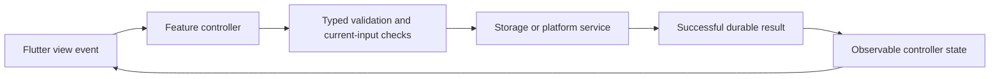

# Automated Software Generator Requirements

Created 25 October 2026. This is the ordered feature queue for the 15 minute development schedule. The product specification below supplies the broader scope. Existing work takes precedence over starting a new item.

## Completion and selection rules

Read this document on every scheduled run. First reconcile any active issue or PR against GitHub and current origin/main. Finish that work before selecting another feature. Select the first queued feature whose dependencies are satisfied; split large features into one coherent issue at a time. Do not mark a whole feature done when only an increment is delivered.

Statuses: Queued, In progress, Blocked, Awaiting merge, Done. A checked box means Done only. Before marking Done, verify acceptance criteria, actual relevant tests, independent final-revision review, required CI, and the PR merge into main. Record issue, PR, merge SHA, validation and completion date. Implementation or an open PR alone is not completion. Do not start the next task until the previous task is completed and merged into main. If blocked, record the blocker and resume it on the next run rather than silently advancing. If another run owns active work, avoid overlapping changes.

Update this document with task selection and delivery evidence, alongside [agent memory](history/AGENT_MEMORY.md) and [progress](history/PROGRESS.md). Preserve unrelated edits. Include status updates in the relevant branch/PR where possible; reconcile the verified merge on the next run. Never overwrite this document from an older branch.

## Ordered feature queue

- [x] F01 Structured requirements and task board — Done
  - Persist requirement IDs, acceptance criteria, task dependencies and task status per project; expose them in the workspace with edit and reopen support.
  - Accept when edits survive restart, invalid dependencies are rejected, and requirements changes invalidate affected approvals. Include a readable project requirements document with task progress.
- [x] F02 Executable approved plans — Done; depends on F01
  - Convert saved plans into validated, structured tasks bound to the exact requirements and approval revision.
  - Accept when only the current explicitly approved plan can start Build; withdrawn, stale and unapproved plans cannot execute. Show task progress and failures.
- [x] F03 Resumable bounded execution — Done; depends on F02
  - Persist tool actions, results, limits and checkpoints; support stop, cancel and safe resume after interruption.
  - Accept when duplicate side effects are prevented on resume, out-of-project paths and unauthorized commands are rejected, and time/output/tool-call limits are enforced.
- [x] F04 Model assisted Flutter source edits — Done; depends on F03
  - Extend the fixed generator with reviewed, scoped source changes driven by approved tasks and a visible diff.
  - Accept when a real local-model request changes an independent Flutter project, passes analysis/tests/build and refreshes its actual preview; preserve the last working output on failure.
- [x] F05 Bounded automatic build repairs — Done; depends on F04
  - Diagnose actual build/test errors and repair within a maximum of three attempts per failure category.
  - Accept when every attempt and exit result is saved, cancellation works, exhausted repairs stop honestly, and success requires rerunning the failing checks.
- [ ] F06 Build history and last working version — In progress; depends on F01
  - Keep timestamped build/test outcomes linked to input revisions and preview artifacts, with a last-successful-version entry.
  - Accept when history survives restart, stale or missing artifacts are explicit, and rollback requires a visible selection and preserves current work.
- [ ] F07 Existing project import — Queued; depends on F01
  - Inspect an existing Flutter repository without overwriting it; identify toolchains, project metadata and unsupported capabilities.
  - Accept when users can select and reopen an imported project, inspect findings and approve a plan before any source modification; invalid folders fail without writes.
- [ ] F08 Portable project backup and restore — Queued; depends on F01
  - Export and restore requirements, conversations, decisions, tasks and revision metadata with versioned manifests.
  - Accept when round trips preserve records, corrupt/incompatible archives fail safely, secrets are excluded and existing projects are never silently replaced.
- [ ] F09 Runtime diagnostics and resource controls — Queued
  - Show actual model connectivity, active request, cancellation scope, request limits and actionable setup failures.
  - Accept when offline, timeout and cancellation states are truthful, settings persist, and diagnostics omit secrets and private prompt content.
- [ ] F14 Resizable and collapsible workspace panes — Queued; depends on F01
  - Priority: after active F02 and existing higher-priority F03–F09 work; does not interrupt active delivery.
  - Source/evidence: product specification §4.3 requires resizable/collapsible panels. `lib/views/project_workspace.dart` currently uses a clamped 40% width and a static VerticalDivider, with narrow-screen tabs; no resize/collapse controls exist. Existing F01–F13 do not cover pane layout controls. No second GitHub issue created in the #50 run.
  - Scope/value: let users allocate desktop chat/preview space and collapse/restore a pane while keeping narrow-screen tabs and working state.
  - Accept when pointer and keyboard controls resize within usable minimums, collapse/restore retains conversation/prototype state, and narrow/enlarged-text layouts remain accessible without overflow. Add controller/widget interaction and responsive regressions; run format/analyze/tests/web build. Create/reuse a scoped issue only when this task is selected.
- [ ] F10 Deterministic requirements review — Queued; depends on F04 and F06
  - Map each requirement to concrete checks and saved evidence; distinguish automated verification from advisory model feedback.
  - Accept when failed, missing and stale evidence cannot yield a verified requirement, and reports link to exact revisions and test results.
- [ ] F11 Additional project adapters — Queued; depends on F04 and F05
  - Add one complete adapter at a time, beginning with Python, then React/Next.js, then native targets when their toolchains are available.
  - Accept each adapter only after real creation, analysis/tests, execution and preview or runnable output; label other types unsupported until verified. Track each adapter as its own increment.
- [ ] F12 Isolated self development — Queued; depends on F03, F05, F06 and F10
  - Propose changes to ASG in an isolated checkout with independent review and protected PR delivery.
  - Accept when the installed stable application remains usable, failed candidates are recoverable, and merging requires independent approval and passing required checks.

- [x] F13 Consolidate project documentation — Done
  - Delivered user request: keep one requirements and task document, organize supporting documents, remove redundant copies, and update the scheduled workflow.
  - Acceptance: one requirements file; unique original product scope and foundation history retained; maintained local documentation links resolve; the active 15 minute automation reads this file, deduplicates new tasks and checks Done only after verified merge.
  - Delivered 25 October 2026 via [issue #32](https://github.com/arpit-it/ASG/issues/32), branch `codex/32-documentation-queue`, [PR #33](https://github.com/arpit-it/ASG/pull/33). Independent review approved head `ec9b561f12d1edd9439d100dadae52afe3a90ab9`; required Flutter checks/web build (real Chrome storage and generated-project verification) and Python fixtures passed in CI run `40172035200`. Remote merge `3b4333286e0c3ef8c6543501c2bba6721e714035` at 2026-10-25 07:18:39 UTC and issue closure verified; local main synchronized before F01.

## Adding new tasks

On every scheduled run compare the current implementation, user requests, open issues and review findings with this queue. Add a task only for a user-requested capability, an unmet product specification or a reproducible defect. First search all queued, active and completed entries plus GitHub issues/PRs; extend or reopen an existing task when it covers the same work. Do not add speculative features or duplicate issues.

Use the next unused F number, never renumber or reuse IDs. Record the problem and supporting evidence, user value, priority, dependencies, bounded scope, testable acceptance criteria and validation plan. Link a supporting specification section or reproduction and the matching issue when created. Add at most one justified new task per run. If no justified gap exists, add nothing. Insert the task by dependency and priority, retaining its stable ID. A new task does not interrupt active work: finish and verify its merge first.

A task moves Queued → In progress → Awaiting merge → Done; use Blocked with evidence and the required next action when progress cannot continue. Keep completed entries and merge evidence permanently. Code generation, local test success, issue closure alone or an unmerged PR never checks the Done box. If a delivered feature regresses, add a linked repair task or reopen the affected entry with the reason; preserve prior delivery history.

## Active task and delivery ledger

Active: F06 In progress; timestamped outcome history delivered through issue #104/PR #105, verified merge `5ef78b671636eb86b2f866d39081eff3321fdd60`. Rollback and live artifact inspection remain pending. Prior delivery: None. F05 Done through independently approved PR #103, verified merge `daf0d0d939e095490409208d16a76e0e2c02d36e`; issue #94 closed, actual live-model automatic repair acceptance and required CI passed. Next eligible queued task is F06; no later task selected in this run. Historical delivery: Consented bounded automatic repair session delivered on reopened #94, branch `94-automatic-repair-loop`, independently approved [PR #102](https://github.com/arpit-it/ASG/pull/102), verified merge `fd7c27a2d0bb19a7aa5e5ab2d4b863f7700c352b`; live-model repair acceptance remains pending. Stop-boundary correction delivered on reopened #94, branch `94-repair-stop-boundaries`, independently reviewed PR #101 and verified merge `f230a56d2a82b69ad3d586359f76ef0cad6d9919`; automatic retry/live acceptance remain pending. No later task selected. Reviewed repair application/check-rerun delivered on reopened #94, branch `94-repair-check-rerun`, independently reviewed PR #100 and verified merge `5d59e83f4cd883492edb7df353741ecf27a704fe`; automatic model retry orchestration/live acceptance remain pending. Visible repair history/exhaustion delivered on reopened #94, branch `94-repair-history`, independently reviewed PR #99 and verified merge `d6da173521de483ce133e911a0bf85af27f69abc`; Durable per-category repair-request budgets delivered on reopened #94, branch `94-repair-attempt-budget`, independently reviewed PR #98 and verified merge `206bbcffc1d86f1ae28fbc3b41fc203118534cbb`; automatic application/check-rerun orchestration remains pending. Review-only model corrections from durable failed candidate evidence delivered on reopened #94, branch `94-failure-repair-proposals`, independently reviewed PR #97 and verified merge `3de9433b0a254affb67aacd57c30e381575e8f0f`; automatic repair budgets/loop remain pending. Durable candidate verification journal increment delivered on reopened #94, branch `94-candidate-verification-journal`, independently approved PR #96 and verified merge `f848a2c41c4e68c5628a325c067ba5a75d5942d7`; actual model repairs and per-category budgets remain pending. First bounded failure-diagnosis increment delivered through issue #94, branch `94-candidate-failure-diagnosis`, independently approved PR #95 and verified merge `44726c57545f57175e271ad01243582e0a1237d8`. Durable bounded automatic repair integration remains required; no later feature selected. F04 Done through reopened #84, branch `84-candidate-verification-promotion`, independently reviewed PR #93 and verified merge `dc3fedce13c873cb3a093e63a208a58b5de8d2d5`. Real local-model acceptance, final-head independent review `5644781421` and required CI `40224068293` passed; full completion evidence is recorded below. Candidate preparation controls on reopened #84, branch `84-source-candidate-controls`, delivered through independently approved [PR #92](https://github.com/arpit-it/ASG/pull/92), verified merge `7cb2a0bad81333da51b5132db27146ed6cb02f31`. PR #92 delivered preparation-only controls, superseded by the complete PR #93 workflow. Prior isolated source candidate preparation on reopened #84, branch `84-source-candidate-preparation`, delivered through independently approved [PR #91](https://github.com/arpit-it/ASG/pull/91), verified merge `b19953cf84ff11cfa13564bbba17e05d3db5c49d`. PR #91 delivered service-only preparation. Prior line-oriented proposal comparison on reopened #84 delivered through independently approved PR #90, verified merge `09743ad84ee61bbf11c971904f4ffcde138e148d`. Read-only proposal review on reopened #84 delivered through independently approved PR #89, verified merge `9441e51bb81f7b8c36a1722f5d9e7324374a1132`; read-only source snapshots on reopened #84 delivered through independently reviewed PR #88, verified merge `58bda60ba26767f40fd423d3c8049095f5ac2eef`. Approved-task proposal provenance delivered through independently approved PR #87, verified merge `adca80bf396d078042e42a81c7cd394504417c1d`. Prior strict-JSON repair PR #86 verified merged `3a2bb1f578bd18291c29862b09abd50a37ed08a7`. F04 now includes safe candidate verification/promotion, last-working-output preservation and real local-model acceptance within the documented macOS/Flutter scope. F03 remains verified Done through PR #83.

### F03 acceptance boundary and evidence

Acceptance audit on reopened issue #80, branch `80-execution-acceptance`; Done after verified PR #83 merge `4344656f3655b5ec620a566666afb2aca37a5144` (final delivery evidence below). The implemented boundary is the trusted `flutter-starter` adapter and a single app session. Persisted actions are its four approved operations; arbitrary tools/source synthesis remain F04/F11, automatic repair F05, configurable resource controls F09 and cross-process isolation F12. An uncertain action is refused rather than replayed. Explicit Retry is a separately consented restart and may repeat commands. These limits are part of the supported behavior, not claims of a sandbox or general-purpose execution engine.

| F03 criterion | Implemented boundary | Regression evidence |
| --- | --- | --- |
| Persist actions, results, limits and checkpoints | `GeneratedProject` stores exact task graph/approval, ordered results, explicit cancellation/timeout/output flags, fixed versioned limits and version-1 dispatch marker. `NativeGenerationHost.verify` awaits storage before launch and saves result plus marker clearance together. | `verification_limits_test.dart`, `source_generation_test.dart`: policy reopen/adversarial values, persistence refusal preventing launch, uncertain runner loss preserving prior results; `source_generation_controller_test.dart`: durable failures, reopen and saved graph identity. |
| Stop and cancel | Visible Stop requests helper termination, prevents downstream commands/Ready and retains completed results. Disposal closes owned work; parent loss and SIGTERM/SIGINT record cancellation when a result reaches storage. | Controller/widget Stop and final-save races; native preparation/pre-command and running-helper Stop; `tools/test_generation_command.py`: real signal/parent-loss fixtures and descendant cleanup. Process death cannot guarantee a final saved result. |
| Safe resume without duplicate side effects | Explicit consent, exact approval/inputs/toolchain and unchanged source/dependency fingerprints are required. Resume retains a successful prefix and dispatches only its suffix. Legacy, pending/uncertain, failed/cancelled and all-complete snapshots refuse resume; reopening starts nothing. | Native tests cover all prefix lengths 0–3, changed source/dependency metadata, persistence refusal and Stop. Controller/widget tests cover reopen, consent, legacy/uncertain records, stale approval/toolchain. Opt-in real test commits resolve, recreates the host, resumes analysis/tests/build and serves compiled JavaScript HTTP 200. |
| Reject out-of-project paths and unauthorized commands | Exclusive new folder creation, canonical paths, link/traversal rejection and input/output fingerprints protect the trusted starter. Validated contracts contain exactly the four fixed operations; helper uses argument arrays and an operation allowlist. | Source-generation native traversal/existing-folder/link/preview-scope tests; build-plan/mapped-plan adversarial contract tests; Python fixed-command assertions. Trusted installed SDK/Python/cache and same-user filesystem races remain outside this guard. |
| Enforce time/output/tool-call limits | Each command has exactly 180 seconds and 65536 combined output bytes. Exhaustion kills its owned process group and blocks downstream work. Validated graph/history caps total operations at four including resumed successes. Explicit altered policies and helper CLI overrides fail before execution. | Python actual timeout/output-overrun/exact-boundary/descendant tests and CLI deadline/output rejection; policy serialization tests; all-prefix resume tests assert exactly four total operations; failed/output-exhausted native results cannot become Ready. |

This audit maps existing delivered behavior rather than adding new execution authority. Prior delivery entries remain historical. The queue stays unchecked until independent final-revision approval, actual required CI and verified merge; record final merge evidence below before selecting F04. Fresh live-model inference is not established by this audit.

### F02 acceptance boundary and evidence

F02 establishes executable approved plans for the implemented `flutter-starter` adapter. Every accepted contract retains exactly the four trusted resolve/analyze/test/build operations. Versions 2–4 support named tasks, dependency order and optional validated board provenance; versions 1/2 remain compatible. Unsupported plans stay advisory even when approved. F02 does not promise arbitrary code execution: model-assisted source changes are F04, additional adapters F11, and action checkpoints/cancel/resume F03. Earlier entries saying broader/general mapping remained unmet describe their delivery-time assessment; this matrix supersedes that assessment following independent final-revision approval and verified PR #69 merge.

| F02 criterion | Implemented boundary | Regression evidence |
| --- | --- | --- |
| Convert saved plans into validated structured tasks | `BuildPlan.parse` and `BuildTask.fromJson` reject ambiguous fences, duplicate JSON members, unknown fields/operations, invalid IDs/dependencies and unsupported adapters. Versions 3/4 validate board references and every prerequisite operation. | `test/build_plan_test.dart`, `test/mapped_build_plan_test.dart`, `test/board_mapped_build_plan_test.dart`: immutable conversion, adversarial contracts, reordered checks, distinct/shared mapping and missing prerequisites. |
| Bind tasks to exact requirements and approval revision | `PlanApprovalStore.requireCurrentApproval` rereads saved project, latest marked Plan, requirement revision and prototype revision/definition; generated history retains exact approval identity and task graph. | `test/plan_approval_test.dart`: persistence ordering, native database reopen, stale drafts and prototype/requirements changes. `test/source_generation_controller_test.dart`: named/board graphs after reopen, graph tampering and replacement/reapproval refusal. |
| Only current explicit approval starts Build | `SourceGenerationController` checks approval and structured contract before preview/host effects, then rechecks at write/progress boundaries and after async persistence. Separate operation consent is mandatory. | `test/source_generation_controller_test.dart`: unapproved/withdrawn/replaced/corrupt/missing-project refusals, stale prototype, preparation/write/progress withdrawal and disposal; history/preview preserved on refusal. `test/source_generation_test.dart`: actual filesystem write guards. |
| Show task progress and failures | `GeneratedProject.taskStatus` derives pending/running/passed/failed/blocked/interrupted from saved command evidence; exact task order and board summaries survive serialization/reopen. No automatic board completion or requirement-acceptance claim. | `test/build_task_test.dart`, `test/source_generation_test.dart`, `test/source_generation_controller_test.dart`: actual runner/validation failures, blocked downstream work, reopen and retry. `test/source_generation_controller_test.dart` exercises the explicit-consent and saved-progress UI; `test/board_verification_progress_test.dart` covers grouped outcomes, reopen/retry and narrow 320px/200% text rendering. |

Validation is recorded in this run's delivery entry below. Fixture tests establish guarded workflow behavior; the explicit real-generation test establishes actual offline resolve/analyze/test/web-build/served-output behavior of a separate generated starter. Neither establishes live Qwen inference or arbitrary model-written source. Required CI separately exercises real Chrome storage and generated-project verification.

Historical active-work summary (retained as delivery provenance):

Active: F02 remains In progress. Reopened issue #42 on `42-board-mapping-diagnostics` delivered actionable mapping refusal diagnostics through independently reviewed PR #68, verified merge `be3e285b8c308e773527636c9488b4165965aeb1`; issue closed. Reopened issue #40 on `40-board-verification-progress` adds read-only linked board verification summaries delivered through independently reviewed PR #67, verified merge `2b2cc7e1cccec2baf35d49305d74f651412192f0`; issue closed. Reopened issue #42 on `42-shared-board-task-mapping` delivered shared board-task mapping through independently reviewed PR #66, verified merge `e7f900846e63bde66b660386ddc136ae96994d82`; issue closed. Reopened issue #42 on `42-board-task-provenance` delivered validated board-task provenance through independently reviewed PR #65, verified merge `a74e93263fffd7cadee3ce01647ecb4f3bc4af45`; issue closed. Reopened issue #42 on `42-approved-task-mapping` delivered bounded approved adapter task mapping through independently reviewed PR #64, verified merge `847fcfc71972f3d6691dfe18150e5f5866ce5c1c`; issue closed. Reopened issue #40 on `codex/40-task-validation-failure` delivered per-task validation failure identity through independently reviewed [PR #61](https://github.com/arpit-it/ASG/pull/61), verified merge `b68f715c8ce9cfa1a46c6c87a2ab423504d9f8f8`; issue closed. Prior delivery evidence remains below. Reopened issue #40 on `codex/40-task-launch-failure` delivered runner-failure identity via independently reviewed PR #60, verified merged as `92b4035c16ef1717c0a11e732b756b0c4df2a100`; issue closed. Original PR #41 delivery retained.  Issue #58, branch `codex/58-generation-write-approval`, delivered generation filesystem authorization boundaries via independently reviewed PR #59, verified merged as `dcec0e370b63d1a39535b501f37dec136f6249b5`; issue closed. See final evidence below.  Issue #56, branch `codex/56-complete-plan-context`, delivered complete Plan requirements context via independently reviewed PR #57, verified merged as `f91274f54266ff391fac8ab635a8ae9881ab5d25`; issue closed. See final evidence below. Issue #54, branch `codex/54-resolve-evidence`, delivered resolve-result evidence through independently reviewed PR #55, verified merged as `ed7de9a926bf6dba63e7cf82da6eff350bf482f6`; issue closed. See final evidence below. Issue #52, branch `codex/52-verification-approval`, delivered verification approval boundaries via independently reviewed PR #53, verified merged as `28b5ca93ee45237bf64434eaab2bf353be26e80d`; issue closed. See final evidence below. Issue #50, branch `codex/50-prototype-plan-context`, delivered via independently reviewed PR #51, verified merged as `195c6bfc1ad1118bba23e9e2b513fbd8adb6cd8f`; issue closed. Prototype-bound Plan approval and the user-requested documentation/architecture update are delivered; evidence below. Issue #48, branch `codex/48-plan-execution-preview`, delivered via independently reviewed PR #49, verified merged as `34da5bebf1728e969d9c43a661d30e4454e13f09`; issue closed. Prior issue #46, branch `codex/46-plan-task-proposals`, delivered via independently reviewed PR #47, verified merged as `938c0633f67fb544687822ef8b8ac29ebe9caac6`; issue closed. General executable adapter mapping remains unmet. Prior issue #44, branch `codex/44-unambiguous-build-contract`, delivered via independently reviewed PR #45, verified merged as `0d570585aad7dab7249536b9fef54adaab4bb846`; issue closed. Validated Plan task contract [issue #42](https://github.com/arpit-it/ASG/issues/42), branch `codex/42-plan-task-contract`, independently reviewed and merged via PR #43 as `b30d6bca269876be1ad8d925df347a253d73645f`; issue #42 closed. Prior #40 / PR #41 independently reviewed and verified merged as `88e7dbb7dfdf936361739f31ca5a15415e86762a`; issue #40 closed. General Plan conversion remains unmet; resume F02 before F03.

For each increment append: feature ID; status; scope; dependencies; issue; branch; PR; tested revision; checks and limitations; reviewer verdict; merge SHA; completion date; blocker or next step. Keep completed entries as history.

## Current product decisions

ASG is a Flutter application targeting Android, iOS, web, macOS, Windows and Linux. Included platform runners do not establish tested device support. Managed MLX setup and the current independent Flutter web generator host are macOS-specific; other platforms retain supported app features and runtime connection controls.

Use Flutter across six platforms under the display name Automated Software Generator. The direct Flutter request supersedes the attached SwiftUI framework choice. Implemented scope includes guided creation/session restore, durable interpreted prototypes, structured requirements/tasks, Discuss/Plan/advisory Review, explicit approval, and the fixed Flutter web source-generation/verification slice. General source synthesis and other queued capabilities remain future work.

## Current application architecture and implemented behavior

This section describes the implemented baseline and the issue #50 change under PR #51; it is the current architectural interpretation of the product specification. The ordered F queue above is the only development queue. A feature listed as a future goal in the original brief is not implemented merely because its architecture is described here. PR #51 was independently reviewed and verified merged as `195c6bfc1ad1118bba23e9e2b513fbd8adb6cd8f` on 25 October 2026; its prototype-bound approval change is delivered.

### Product and platform contract

Automated Software Generator is a local-first **Flutter/Dart application targeting Android, iOS, web, macOS, Windows and Linux**. Flutter 3.47.6 / Dart 3.13.5 is the pinned development/CI baseline. The package is `asg`; its Flutter root is `asg/`. The development machine being a Mac does not make the product a macOS-only application. A project's selected target platforms are saved intent, not proof that the corresponding generated apps exist or build.

| Capability | Current platform scope | Evidence and limits |
| --- | --- | --- |
| Flutter app shell, guided creation, project records, prototype UI and planning/requirements screens | Shared application code and six platform runners | Earlier Android debug/macOS debug and current web builds passed. iOS, Windows and Linux application builds and physical-device launches are not established. Responsive widget tests do not establish device acceptance. |
| Durable local records | Native Sembast file; browser IndexedDB | Real native close/reopen and Chrome IndexedDB tests. Single application isolate/session contract; no cross-process or live multi-tab synchronization. |
| Runtime connection controls | Shared UI, subject to reachable endpoint/platform network policy | macOS and localhost browser use host loopback; Android Emulator uses its host alias. Physical-phone connectivity is not configured. No phone-local 9B inference is claimed. |
| Managed model scanning, explicit download, prepare/start/stop | macOS host integration | Existing Qwen3.5-9B 4-bit MLX setup on Apple Silicon; compatible selected Python/checkpoint required. Other targets show an explicit unsupported-managed-setup explanation and connection controls. |
| Independent source generation and compiled preview | macOS-hosted fixed Flutter **web** adapter | Creates a separate new project, executes trusted offline Flutter verification and serves compiled web output. This does not generate macOS/native applications or execute arbitrary repositories. Linux CI fixtures do not change the product host gate. |

### MVC boundaries and data flow

Use Flutter MVC with integration services, `ChangeNotifier`/`BaseController` observable state and constructor/factory injection. Do not replace this with SwiftUI/MVVM or introduce a new state framework without a concrete requirement.

| Layer | Current components | Required responsibility |
| --- | --- | --- |
| Models (`lib/models/`) | StudioProject, ProjectBlueprint, AppDefinition/AppElement, ChatMessage, RequirementsBoard/ProjectRequirement/DevelopmentTask, PlanApproval, PlanTaskProposal, BuildPlan/BuildTask, GeneratedProject, runtime/settings types | Immutable typed data, pure validation and versioned serialization. No widgets, HTTP or storage plugins. |
| Views (`lib/views/`) | StudioHome, Dashboard, ProjectWizard, ProjectWorkspace, LiveApplicationView, ModelChat, RequirementsScreen, SourceGenerationScreen, RuntimeSetupScreen and focused status/dialog views | Render actual state, collect input, own widget/navigation/text/focus lifecycle and delegate actions. No persistence/network/business-rule implementation in callbacks. |
| Controllers (`lib/controllers/`) | StudioSessionController, ProjectWizardController, AppWorkspaceController, ChatController, RequirementsController, SourceGenerationController, RuntimeSetupController, ProjectDetailsController | Coordinate validation/services, busy/error/progress state, commit ordering and cancellation/disposal. No widgets, BuildContext or navigation. |
| Services (`lib/services/`) | RecordStorage/StudioDatabase and stores, ApplicationEditor/LocalApplicationActions, ModelProvider/LocalModel, PlanApprovalStore/PlanTaskImport, GenerationInput/GenerationHost, runtime/folder-picker adapters | Own transactional persistence, transport, platform processes/filesystem integrations and enforce execution-boundary checks. Conditional factories expose honest unsupported-host behavior. |

Success must publish only after validation and the required write succeed. Failed/partial/model-cancelled updates preserve the last committed prototype and history. Async work prevents duplicate submissions, respects disposal and keeps errors visible. Source generation and model transport are distinct workflows; no model prose grants a tool permission.

### Implemented user workflows

1. **Create and reopen:** describe intent, choose suggested experience/features, review project metadata/platforms/location, then save and open the workspace. Suggestions are deterministic. A saved-but-not-opened failure offers selection-only retry without duplicate creation. Session restore rereads the canonical project and preserves the prior workspace on failed selection.
2. **Edit the prototype:** desktop chat appears left of the live interpreted prototype; narrow layouts use state-preserving Chat/Preview tabs. Common exact instructions use validated local actions; custom edits use streamed bounded model proposals. The definition supports headings, text, task lists/completion, counters, notes and bounded buttons, with indigo/green/orange/pink themes. Validated edits and conversations save before revision/preview refresh; interactions use serialized/coalesced durable writes with explicit retry.
3. **Maintain requirements:** the F01 board stores stable requirement IDs, titles and acceptance criteria; development tasks have stable IDs, requirement references, dependency IDs and manual queued/in-progress/blocked/done status. Reject duplicate/missing IDs and dependency cycles; reopening/changing prerequisites invalidates dependent completion. A successful board write increments its revision and invalidates prior Plan approval. Manual Done is not automated verification.
4. **Discuss, Plan and Review:** separate saved assistance history supports Discuss, Plan and advisory Review. These modes have no application/source/command tools. Review reads fresh bounded prototype and historical verification evidence, states limitations, and does not run tests or mark requirements verified. Completed replies whose final write fails remain visibly unsaved with save-only retry; mode/navigation/new requests wait until save finishes.
5. **Import proposed tasks:** one bounded `asg-tasks` version-1 fence may propose up to 200 queued planning tasks against existing requirement IDs. Preview before explicit additive import. Re-read exact latest durable Plan/project/board context; reject collisions, unknown fields/status/commands, duplicate JSON members and invalid graphs. Atomic import preserves existing tasks, changes board revision and requires a fresh Plan before approval. Imported tasks do not become executable commands.
6. **Approve a Plan:** only an app-marked completed saved Plan is eligible. Persist exact message index/content/context, explicit approve/withdraw decision and recording time. New drafts or changed project/board inputs invalidate consent. PR #51 also binds validated prototype definition/revision, including revision-only edits/reverts, and rejects stale captured Build-screen definitions. Unreadable evidence fails closed. Legacy history stays readable but requires a new draft under the current context.
7. **Generate and verify:** explicitly request the fixed Flutter web MVC starter in Plan, inspect its validated task/dependency preview, approve that exact draft, then separately consent in the generation form. Build rechecks current durable approval/inputs before host work and after asynchronous preparation. It accepts exactly one bounded `asg-build` `flutter-starter` contract: version 1 retains the canonical graph; versions 2/3 allow named tasks and validated dependencies, and version 3 additionally binds every operation to an existing board task; malformed/ambiguous/unsupported contracts and duplicate JSON members cannot execute.
8. **Inspect actual output:** generation writes a new folder exclusively, serializes user/model strings as JSON data and runs trusted Flutter operations via argument arrays. Each operation has a 180-second deadline and 64 KiB captured-output limit. Saved step results derive pending/running/passed/failed/blocked/interrupted task state. Saved outcomes carry exact approval provenance and source/dependency/output fingerprints. Only verified unchanged artifacts can be served by the owned loopback preview; the prototype pane is a different interpreted output. Retry needs unchanged inputs and the same approval identity and restarts all checks. Explicit Resume uses a versioned confirmed safe boundary, retains successful results and runs only remaining checks; uncertain/failed dispatches and legacy evidence cannot resume.

The desktop chat width currently follows a clamped 40% split with a static divider. Resizing/collapse is the bounded queued F14 requirement, not an implemented control. Linking a folder only saves its location; existing-source import is F07.

### Persistence and compatibility contract

Production records use `RecordStorage` backed by Sembast (`studio-v2.db` in native app support; IndexedDB on web). Retained preferences migrate atomically; no fallback reset or silent corruption overwrite is permitted. Browser storage is origin/port-specific and can be cleared. Storage is unencrypted application data, not secret storage.

| Record namespace | Stored state |
| --- | --- |
| `studio.projects.v1` | Project identity, name, description, type, platform intent and location |
| `studio.lastProject.v1` | Selected project ID for session restore |
| `studio.application.v1.<id>` | Validated prototype definition, edit messages and revision |
| `studio.chat.v1.<id>` | Separate assistance conversation and optional app-written Plan context |
| `studio.requirements.v1.<id>` | Schema/revision, structured requirements and dependency/status task board |
| `studio.planApproval.v1.<id>` | Exact saved Plan consent/withdrawal identity and time |
| `studio.generation.v1.<id>` | Latest generated outcome, provenance/task graph, actual step results, fingerprints and failure state |
| `studio.localModel.v1` / `studio.runtimeSetup.v1` | Model connection and runtime setup configuration |

Preserve existing keys/payload readability. New approval context does not backfill consent into legacy prose. Per-project damaged application/generation/approval/board evidence remains retained and isolated; invalid global migration data or physical database corruption can stop startup visibly. Only the latest generation outcome is retained; full timestamped history, rollback, portable backup and resumable action journals remain F06/F08/F03.

### Local inference contract

The current selected model is the existing Qwen3.5-9B, locally converted to 4-bit MLX; original weights and runtime environments remain outside Git. `ModelProvider` abstracts the configured endpoint/model. The bridge supports SSE status/token/heartbeat/completion/error events with one active worker. UI progress represents processing stages and human-readable streamed summaries, not private reasoning. Apply only complete validated edits after successful save.

Current client limits are 15 seconds for connection/headers, 30 seconds for stream inactivity and an absolute 180-second total deadline across response modes. The bridge bounds input to 4096 tokens and output to at most 2048 tokens. Cancellation closes transport and is checked at bounded server generation/prefill points; a native kernel cannot be interrupted mid-execution. Explicit model downloads/setup require a selected destination/environment and never run just by opening setup. macOS host integration uses owner-approved host-user permissions, not an execution sandbox.

Earlier real MLX custom-edit/Plan/Review streaming checks passed. In this issue #50 run, the endpoint refused connection; no fresh inference is verified. Larger contexts, arbitrary tool use and other model/framework support remain proposed capabilities until their own acceptance evidence exists.

### Validation and remaining boundaries

Issue #50 code validation passed formatter, analyzer, 200 default tests (four opt-in skips) and web build. Tests cover prototype/revision/corrupt/legacy approval inputs, stale Build screens with preview/history preservation, fresh approval recovery and actual native database reopen. Final PR checks must also include actual Chrome storage, real independent generated-project verification and Python runtime/process fixtures; independent final-head review precedes merge. CI fixtures or skipped live tests do not verify current model availability.

Historical issue #50 assessment (F02/F03 delivered increments and current acceptance boundaries above supersede their earlier gaps): current architecture does not deliver model source edits (F04), automatic repair (F05), full build-history rollback (F06), source import (F07), portable backup (F08), comprehensive diagnostics/resource controls (F09), deterministic requirement verification (F10), other adapters (F11), isolated self-development (F12) or user-resizable panes (F14). These stay in the existing queue; no duplicate task document is introduced.

Detailed contracts: [MVC architecture](architecture/ARCHITECTURE.md), [storage](architecture/STORAGE.md), [generation](architecture/GENERATION.md), [workspace](architecture/LIVE_WORKSPACE.md), [runtime setup](setup/RUNTIME_SETUP.md), [streaming](setup/QWEN_STREAMING.md), [test strategy](development/TEST_STRATEGY.md) and [CI](development/CI.md).

## Foundation acceptance context

These criteria describe earlier increments; their presence does not mark the feature queue complete.

Historical foundation increment: empty dashboard is honest; blank project name is rejected; target selection is required; project record saves before appearing; saved records load at startup; search filters names; unsupported automation displays explicit status. Editable settings are now implemented; existing-source import remains F07. Generated applications, Git initialization, and successful builds must never be claimed based only on record creation.

App-led workspace increment: user describes intent before technical configuration; recommendations can be changed and reviewed; selected platforms/features persist; creation opens the workspace; re-entry restores the current project; desktop chat is left of the live prototype; phone tabs preserve both panes; supported instructions apply and refresh visible version state; invalid edits/failed saves preserve the working version. Independent source generation/building is not part of this increment.

# Product specification and original brief

The user subsequently selected Flutter, the ASG repository, existing Qwen3.5-9B, an app-led creation flow, and chat-left/live-preview-right. These direct requirements supersede conflicting SwiftUI-first details below. The original brief is retained for product scope and provenance, not as a command to restart old milestones. Current MVC standards, the 15 minute task-selection rules above and the repository independent-review/merge workflow govern execution; the original manual-only merge language is superseded by the user-authorized independent reviewer merge process. This brief defines the broader product vision, not a claim of completed functionality.

# CODEX MASTER PROMPT — AI PROJECT STUDIO

## Historical original brief (framework/platform choice superseded)

The original brief proposed SwiftUI and a native macOS-first application; its framework/platform instructions below are now explicitly reconciled to Flutter, while preserving product scope. The current product is Flutter for Android, iOS, web, macOS, Windows and Linux; only specifically documented host integrations remain macOS-specific. Retain the original scope as provenance, not current framework/platform instructions.

## 1. Project Overview

You are the Lead Software Architect, Senior Flutter Engineer, AI Agent Engineer, QA Engineer, and Technical Project Manager responsible for building **AI Project Studio**.

Build a production-oriented Flutter application for Android, iOS, web, macOS, Windows and Linux that allows users to create, develop, test, run, and maintain software projects through natural-language conversations without needing to view or manually edit source code.

The application must also support **Self-Development Mode**, allowing its AI agent to implement, test, and propose changes to AI Project Studio's own source code.

**Primary development environment:**
- Hardware: Apple MacBook Pro M4 Max, 36 GB unified memory.
- Operating system: macOS.
- Primary application framework: Flutter and Dart (supersedes the original SwiftUI choice).
- Current coding/planning model: existing Qwen3.5-9B, locally converted to 4-bit MLX. The original Qwen3-Coder 30B-A3B proposal was superseded; other models require explicit compatibility evidence.
- Current runtime: project-local MLX bridge with SSE streaming; legacy Torch fallback. Additional runtimes require compatibility testing.
- Application targets: Android, iOS, web, macOS, Windows and Linux; local-first storage. Managed inference and the initial generator host are macOS-specific.
- License requirement: Commercially usable dependencies and model checkpoints.
- Development tools: Xcode, Swift Package Manager, Git, Flutter SDK, Python and Node.js where available.

The application should remain functional without cloud services after initial setup and model downloads.

## 2. Development Methodology

Use a hybrid software development lifecycle combining:

1. Agile iterative development.
2. Spiral risk-driven prototyping.
3. DevSecOps automation.
4. Verification and validation practices.
5. AI-assisted software engineering.
6. Human approval at important decision and release boundaries.

Every feature must follow:

**Discovery → Requirements → Feasibility → Architecture → Design → Implementation → Testing → Review → User Acceptance → Release → Maintenance**

Each iteration must produce a working, verifiable increment.

Maintain the following documents:

- `docs/REQUIREMENTS.md`
- `docs/architecture/ARCHITECTURE.md`
- `docs/development/SDLC.md`
- `docs/architecture/TECHNICAL_DECISIONS.md`
- `docs/development/SECURITY.md`
- `docs/history/ROADMAP.md`
- `docs/development/TEST_STRATEGY.md`
- `docs/history/PROGRESS.md`

Do not treat documentation as a substitute for implementing working software.

## 3. Product Vision

The user should be able to launch AI Project Studio and:

1. Create or open a software project.
2. Select the project type and destination folder.
3. Describe the intended application in natural language.
4. Discuss requirements with the AI.
5. Review and approve the requirements and implementation plan.
6. Ask the AI to create a working prototype.
7. Observe autonomous coding, building, testing, and debugging.
8. Interact with the running application through a preview.
9. Request improvements through chat.
10. Maintain project history, versions, and development progress.
11. Resume interrupted development sessions.
12. Build new features for AI Project Studio itself.

Users should not need a code editor.

Provide access to source files and technical logs through optional advanced views, but do not make them part of the normal user experience.

## 4. Flutter Application Interface

Implement the application using Flutter with responsive layouts for Android, iOS, web, macOS, Windows and Linux.

### 4.1 Project Dashboard

Display:

- Existing projects.
- Create New Project.
- Open Existing Project.
- Recent activity.
- Project status.
- Current development phase.
- Last successful build.
- Resume development.
- Application settings.

### 4.2 Project Creation Wizard

Collect:

- Project name.
- Project description.
- Project type.
- Target platforms.
- Storage location using a platform-supported native folder picker, with explicit unsupported-platform behavior.
- Optional Git repository initialization.
- Optional starter template.

Initially support these project types in the architecture:

- Flutter.
- SwiftUI macOS.
- SwiftUI iOS.
- React / Next.js.
- Python.
- Kotlin / Spring Boot.

Implement at least one complete project generator in the first milestone. The implemented initial adapter generates Flutter web MVC projects using a macOS host; other adapters remain subject to F11 acceptance.

Other project types may initially be registered as unsupported or experimental, but must not falsely report successful generation.

### 4.3 Main Project Workspace

Design a three-panel interface:

**Left Panel — Project Navigation**
- Project overview.
- Requirements.
- Architecture.
- Development tasks.
- Test results.
- Version history.
- Project settings.

**Center Panel — AI Conversation**
- Natural-language chat.
- Requirements discussion.
- Clarification questions.
- Implementation plans.
- User approvals.
- Task progress.
- Error explanations.
- Development summaries.

**Right Panel — Live Application Output**
- Running application preview.
- Build status.
- Test results.
- Runtime errors.
- Restart controls.
- Preview controls.

Allow panels to be resized and collapsed.

### 4.4 Conversation Modes

Implement four distinct modes:

**Discuss**
- Understand requirements.
- Ask relevant clarification questions.
- Record decisions.
- No source modifications.

**Plan**
- Produce structured requirements.
- Analyze feasibility.
- Recommend architecture.
- Create task breakdowns.
- Define acceptance criteria.
- Require approval before implementation.

**Build**
- Execute approved tasks.
- Modify project files.
- Run builds and tests.
- Diagnose and repair failures.
- Update progress automatically.

**Review**
- Compare implementation against requirements.
- Execute verification checks.
- Identify defects and missing functionality.
- Produce review reports.
- Recommend follow-up work.

Use explicit state transitions between modes. Do not rely exclusively on LLM-generated text to determine permissions.

## 5. Local LLM Runtime

Implement a provider-independent model runtime interface.

Suggested interface capabilities:

- Load model.
- Unload model.
- Generate text.
- Stream tokens.
- Submit structured tool results.
- Cancel generation.
- Report model status.
- Report memory usage.
- Configure context length.
- Configure sampling parameters.

Use a typed model configuration.

Do not hardcode a model name into the agent orchestration layer.

The current selected model is the existing Qwen3.5-9B 4-bit MLX conversion, through the configurable provider interface; the earlier 30B-A3B candidate is historical.

Before integration:

1. Verify the exact model identifier and license.
2. Identify a compatible Apple Silicon inference runtime.
3. Confirm the checkpoint can load within available memory.
4. Benchmark generation and tool-call behavior.
5. Test a 16K context window.
6. Record memory consumption and token throughput.
7. Document any compatibility limitations.

Start with an existing local runtime rather than developing a new inference engine.

The UI must remain responsive during model inference.

Support graceful cancellation and recoverable model errors.

Do not require Ollama if a suitable MLX or llama.cpp implementation is available.

## 6. Agent Architecture

Implement logical agent roles with shared project state.

### Product Analyst

Responsibilities:
- Gather requirements.
- Identify missing information.
- Maintain requirement records.
- Define acceptance criteria.
- Detect conflicting requirements.

### Solution Architect

Responsibilities:
- Analyze feasibility.
- Choose frameworks and dependencies.
- Design components and interfaces.
- Identify security and performance risks.
- Record architecture decisions.

### Project Manager

Responsibilities:
- Maintain the development backlog.
- Track task dependencies.
- Schedule implementation stages.
- Monitor completion status.
- Identify blocked tasks.

### Coding Agent

Responsibilities:
- Inspect existing project structure.
- Read relevant source files.
- Generate new files.
- Modify existing code.
- Refactor components.
- Implement features.
- Diagnose compiler errors.

### QA Agent

Responsibilities:
- Generate tests.
- Execute tests.
- Analyze failures.
- Validate acceptance criteria.
- Detect regressions.

### Reviewer Agent

Responsibilities:
- Review implementation quality.
- Inspect changed files.
- Identify security concerns.
- Check requirement coverage.
- Produce a review report.

For V1, these roles may be implemented as separate orchestration stages using one locally loaded model.

Do not require multiple large models to remain loaded simultaneously.

## 7. Agent Execution Engine

Build an autonomous, observable, resumable execution loop.

The loop should:

1. Read the current task and approved requirements.
2. Inspect relevant project state.
3. Request a structured action from the LLM.
4. Validate the action against the tool schema and permission policy.
5. Execute the authorized tool.
6. Capture stdout, stderr, exit codes, and artifacts.
7. Return results to the model.
8. Continue until the task is completed, blocked, cancelled, or exceeds its limits.
9. Verify the result using deterministic checks.
10. Persist the outcome.

Implement structured tools for:

- List directory.
- Read file.
- Search project.
- Create file.
- Edit file.
- Delete file.
- Run authorized command.
- Run build.
- Run tests.
- Start preview.
- Stop preview.
- Inspect process status.
- Read logs.
- Create Git checkpoint.
- Inspect Git diff.
- Restore checkpoint.

Use structured tool calls with validated arguments, not unvalidated shell commands extracted from prose.

Set configurable limits for:
- Maximum tool calls.
- Maximum repair attempts.
- Execution timeout.
- CPU and memory usage where enforceable.
- Output size.
- Filesystem scope.

The default automatic repair limit should be three attempts per failure category.

Persist task state so interrupted work can resume.

## 8. Project Memory

Each project must maintain durable, versioned records of:

- Project identity and configuration.
- User requirements.
- Approved architecture.
- Design decisions.
- Task backlog.
- Task execution history.
- AI conversation history.
- Build history.
- Test history.
- Known issues.
- Git checkpoints.
- Last successful application state.

Do not depend on the LLM context window as the only source of project memory.

Use structured local storage such as SQLite for application state and Markdown/JSON artifacts for portable project documentation.

Keep generated project files separate from Studio's internal metadata.

## 9. Project Generation

Implement a template-based project creation engine.

The engine should:

1. Validate the project name and destination.
2. Confirm the destination is safe to use.
3. Create the project directory.
4. Generate the starter application.
5. Initialize version control if requested.
6. Create initial requirements and metadata.
7. Detect required toolchains.
8. Install or resolve dependencies with appropriate approval.
9. Compile the starter project.
10. Run starter tests.
11. Launch the application preview.
12. Record the outcome.

Never overwrite an existing directory without explicit approval.

Project creation must be idempotent or recoverable after partial failure.

## 10. Build, Test, and Repair

Implement a build orchestration service.

Supported operations should include:

- Build.
- Clean.
- Run.
- Stop.
- Test.
- Inspect logs.
- Retry failed operation.
- Restore last known good state.

The AI must be able to inspect compiler output and apply targeted fixes.

Do not mark a task complete merely because code was generated.

The definition of done must include:

- Approved requirements implemented.
- Successful compilation.
- Relevant automated tests passing.
- No unresolved critical errors.
- Required security checks passing.
- Running preview available when supported.
- Review results recorded.

If repeated repair attempts fail, mark the task blocked and explain the reason.

## 11. Live Application Preview

Implement a preview abstraction supporting multiple runtime types.

### Web Applications

Use a managed local development server and WKWebView.

Support:
- Live preview.
- Refresh.
- Console logs.
- Runtime errors.
- Restart.

### Native macOS Applications

Compile and launch the generated application as a separate process.

Provide:
- Launch and stop controls.
- Process status.
- Logs.
- Screenshot or preview capture where permitted.
- Window activation.

Do not assume arbitrary native macOS windows can be embedded directly into the Flutter workspace; native-window preview adapters need an explicit supported integration.

### Mobile Applications

Design the architecture for:
- iOS Simulator.
- Android Emulator.
- Flutter development workflow.

These may be implemented after the initial macOS vertical slice.

The preview must display the actual running application, not an AI-generated representation.

## 12. Self-Development Mode

Implement an architecture that allows AI Project Studio to work on its own source repository.

Self-development must use the same SDLC and agent engine as ordinary projects.

Required workflow:

1. User describes a new Studio feature.
2. AI analyzes the existing Studio repository.
3. AI gathers requirements.
4. AI proposes an implementation plan.
5. User approves the plan.
6. System creates an isolated Git worktree or equivalent development workspace.
7. AI implements the feature in that workspace.
8. AI generates and executes tests.
9. AI builds a separate development version.
10. AI launches the development version.
11. Automated checks validate the change.
12. User reviews the results.
13. Approved changes may be merged through a controlled process.

The stable running application must remain unchanged during development.

The AI must not directly overwrite its installed executable or automatically replace the production release.

Use separate application identifiers, data directories, and process management for stable and development builds where necessary.

Design for future signed updates and rollback, but do not implement automatic self-updating without an explicit approval mechanism.

## 13. Security Requirements

Treat generated code, dependencies, repository content, and LLM tool requests as potentially untrusted.

Required safeguards:

- Restrict project filesystem access.
- Validate and canonicalize paths.
- Prevent path traversal and symlink escapes.
- Keep secrets out of model prompts and logs where possible.
- Redact sensitive values.
- Restrict command execution.
- Apply process timeouts.
- Require approval for destructive operations.
- Require approval for network access or dependency installation according to policy.
- Separate trusted application state from generated projects.
- Use isolated build environments where feasible.
- Prevent generated code from modifying Studio's trusted runtime.
- Maintain audit logs.
- Provide rollback checkpoints.

Do not claim a process is sandboxed unless isolation is actually enforced.

If secure execution isolation cannot be implemented in the first milestone, use restricted commands and clearly document the remaining risk. Do not silently execute arbitrary untrusted project code with unrestricted access.

## 14. Commercial Readiness

Use commercially compatible libraries and frameworks.

Maintain a dependency and license inventory.

Design for future features such as:

- Multiple LLM providers.
- Optional cloud inference.
- Model download management.
- Project export.
- GitHub integration.
- Team collaboration.
- Additional programming languages.
- Deployment pipelines.
- Plugin-based project templates.
- Paid subscription capabilities.

Do not implement billing, accounts, cloud infrastructure, or collaboration in the initial milestone.

Focus on a reliable local development experience first.

## 15. Initial Implementation Milestones

### Milestone 0 — Environment and Feasibility

Inspect the development environment.

Check:
- macOS version.
- Xcode and Swift availability.
- Swift Package Manager.
- Git.
- Python.
- Local inference runtimes.
- Available memory.
- Existing repository contents.

Do not assume dependencies are installed.

Verify model availability and runtime compatibility.

Create the initial architecture and implementation plan.

### Milestone 1 — Flutter Application Foundation

Implement:
- Flutter application with Android, iOS, web, macOS, Windows and Linux runners.
- Project dashboard.
- Project creation wizard.
- Native directory picker.
- Local project metadata.
- Project persistence.
- Basic navigation.
- Application settings.

Ensure the application builds and launches.

### Milestone 2 — AI Conversation

Implement:
- Local LLM provider abstraction.
- Streaming chat interface.
- Project-specific conversation history.
- Discuss and Plan modes.
- Requirements persistence.
- Plan approval workflow.

Provide a mock model provider for deterministic tests.

### Milestone 3 — First Autonomous Development Workflow

Implement a complete vertical slice:

User requests:

"Create a macOS task manager with a task list and an Add Task button."

The application must:

1. Discuss the request.
2. Generate a requirements specification.
3. Produce a short implementation plan.
4. Wait for user approval.
5. Create a Flutter starter project using the supported adapter (currently Flutter web on a macOS host).
6. Generate or modify required source files.
7. Build the project.
8. Execute automated tests.
9. Attempt repairs if compilation fails.
10. Launch the generated application.
11. Show build and test results.
12. Record the final project state.

### Milestone 4 — Self-Development Proof of Concept

Use AI Project Studio's own repository as a development target.

Test feature request:

"Add a project search field to the project dashboard."

The system must:
- Analyze the existing dashboard.
- Create an approved plan.
- Create an isolated worktree.
- Implement project search.
- Generate relevant tests.
- Build the modified Studio.
- Run tests.
- Launch the development version.
- Show the implementation summary and Git diff.
- Request approval before merging.

Use the current independent-review workflow: an independent reviewer may merge only after final-revision approval and required passing checks; the implementer must not self-merge.

## 16. Coding Standards

Use:

- Dart asynchronous work with explicit cancellation/disposal and platform integrations where required.
- Flutter MVC with services, as specified in development/CODING_STANDARDS.md.
- Constructor/factory dependency injection with typed Dart interfaces.
- Modular services.
- Structured error handling.
- Structured logging.
- Unit and integration tests.
- Clear separation between UI, agent orchestration, inference, and execution.

Avoid:
- Massive view controllers.
- Unnecessary third-party dependencies.
- Hardcoded paths.
- Hardcoded model names.
- Blocking inference on the UI thread.
- Silent failures.
- Unbounded autonomous loops.
- Fake test results.
- Mock-only features presented as complete implementations.

Keep the application buildable after each milestone.

## 17. Codex Execution Instructions

Begin by inspecting the current repository and development environment.

The existing repository already contains the Flutter application in `asg/`; preserve it and extend the active requirements task. A new empty repository would use Flutter runners for Android, iOS, web, macOS, Windows and Linux.

Then:

1. Identify missing dependencies.
2. Verify the proposed model and runtime.
3. Create the SDLC documentation.
4. Define the modular architecture.
5. Establish the testing strategy.
6. Create the initial project backlog.
7. Implement Milestone 1.
8. Build and test Milestone 1.
9. Fix any discovered compilation errors.
10. Report completed work, tests, limitations, and next steps.

Do not stop after writing documentation.

Do not attempt to implement every milestone in one uncontrolled change.

Do not install system-wide software, download large models, execute destructive commands, or modify files outside the selected workspace without approval.

Maintain `docs/history/PROGRESS.md` after every completed milestone.

If the environment does not support a required operation, report the limitation and continue with independently testable work.

At the end of each milestone, provide:

- Features implemented.
- Files created or modified.
- Build status.
- Test results.
- Known issues.
- Risks.
- Next milestone.

## 18. Original foundation task — historical, already delivered in increments

The original foundation task below is retained as acceptance context; current work follows the ordered queue, with F02 active.

Create the Flutter Automated Software Generator application for Android, iOS, web, macOS, Windows and Linux, including a working project dashboard, project creation wizard, persistent project records, native folder selection, and the foundational architecture for future local LLM integration.

Run the available build and tests.

The deliverable is a real Flutter application foundation, with build/run evidence reported separately for each verified platform.

Preserve all progress in the repository and report what was verified versus what remains unimplemented.

### F01 increment — 25 October 2026

Done, issue #34, branch `codex/34-requirements-board`. Scope: typed per-project requirement IDs/criteria, task IDs/dependencies/status, workspace edit/reopen, readable requirements document and revision-bound Plan approval. Additive `studio.requirements.v1.<projectId>` record, bounded content, dependency cycle/missing-reference rejection, prerequisite completion guards, transitive reopen, atomic writes, stale-editor exclusion, preserved corrupt records. Manual task progress is explicitly not deterministic test evidence. Existing prototype creation/chat/preview remains supported; executable plans remain F02. Validated: nine new regressions; formatter/analyzer; 167 default tests passed (four opt-in skips); actual Chrome storage reopen/corruption test; web/macOS debug builds; live existing Qwen Review streaming/persistence smoke (35s). Final delivery verified 25 October 2026: issue #34 closed/completed; branch `codex/34-requirements-board`; [PR #35](https://github.com/arpit-it/ASG/pull/35) merged by independent reviewer as `6f2dc2bf9168b4a1142f61cf4f24b82a3e8c11a5` at 07:40:50 UTC. Tested published head `0907ed31800db403498d01cbd3eb10d82266fbce` (local equivalent `64b7f33e949980d9fe7c7b703776ffbd540aa1b8`), tested/merged tree `1eaf96f1dad317a95a7c7db545f1a91cf7fbb9f3`. Independent final approval review `5642100543`, detailed review `5642093911`: no blockers; 31 focused tests passed (one live skip), plus delayed-disposal and narrow doubled-text failed-draft probes. Required CI run `40173354018`: Flutter job `121108718986` and Python fixtures job `121108718774` passed, including actual Chrome storage and independent generated-project resolve/analyze/test/web-build. Parent independently verified remote merge/issue closure and synchronized main safely. Local formatter/analyzer, 167 tests (four opt-in skips), Chrome storage, web/macOS debug builds and existing live Qwen Review smoke passed. No blocker. F02 is next eligible task for a subsequent run.

### F02 Build authorization increment — 25 October 2026

In progress, [issue #36](https://github.com/arpit-it/ASG/issues/36), branch `codex/36-build-plan-gate`; depends on delivered F01. Observed gap: fixed generation and verification accepted operation consent without reading Plan approval. Scope/acceptance: both entry points must require explicit operation consent plus the exact latest saved plan approved for the current saved project/requirements revision; reject absent, corrupt, withdrawn, replaced and stale evidence before host work. Recheck approval after asynchronous preparation and before verification. A rejected retry preserves saved build history. Generation UI displays the approved draft or actionable lock reason. Withdrawal prevents subsequent starts, not commands already running. Existing actual per-command results remain visible.

Four new regressions cover denied generation/retry, replacement/corruption/withdrawal, requirements changes, missing project and withdrawal during preparation. Final local formatter/analyzer and default suite pass (171 tests, four opt-in skips). Web and macOS debug builds passed. Exact tested revision/PR/review/CI/merge will be recorded in the linked PR. Existing Qwen runtime reports ready/idle; no fresh inference was run, no model download or stable-app replacement. This increment gates the existing fixed template only; conversion of model plans into validated structured executable tasks remains F02 In progress. Do not check F02 Done or start F03.

### F02 authorization increment verified delivery

F02 authorization increment delivered via [PR #37](https://github.com/arpit-it/ASG/pull/37), issue #36 closed/completed, branch `codex/36-build-plan-gate`. Exact published/tested head `dcd43986d7c2ed712422799acce7db4a579f0d27` (local equivalent `ed038b7`), tested/merged tree `66af194fa7910248eb8d46f89be336b3c478fe65`. Independent final review `5642176906` approved with no blockers after 47 focused tests (one live skip) and a delayed-preview-stop withdrawal race probe; initial detailed review `5642171429`. Required CI run `40175011702` passed Flutter job `121113688406` (real Chrome storage, web and independent generated-project verification included) and Python fixtures job `121113688577`. Reviewer merged as `b1a08f120ed22babbc53704bbe1d76c25516ea10` at 2026-10-25 08:05:45 UTC. Parent independently verified remote merge/issue closure and fast-forwarded local main, 0/0 divergence and exact tested tree. Local formatter/analyzer, 171 default tests (four opt-in skips), web and macOS debug builds passed. No fresh inference claim. F02 remains In progress: structured task conversion/execution is next, and F03 must wait. No further issue created this run.

Post-merge evidence retained locally for the next normal reviewed F02 increment branch/PR; preserve it when changing checkouts.

## F02 exact Build provenance increment — issue #38 (25 October 2026)

Awaiting merge; branch `codex/38-build-provenance`, depends on delivered F01 and F02 approval boundary PR #37 (verified merged b1a08f120ed22babbc53704bbe1d76c25516ea10). No competing active ASG run or open issue/PR at selection. Evidence: old generated source could be retried under a replacement approved Plan because outcomes lacked approval identity. Scope/acceptance: persist exact authorizing Plan index/content/context/timestamp through progress/failure/reopen; reject mismatched, reapproved, legacy or changed-input retries before host work while preserving history; preserve legacy preview and expose provenance in UI. Corrupt provenance fails closed. New generation still needs current durable approval and separate operation consent. Only fixed starter verification is implemented; structured task conversion/execution remains F02 In progress, F03 not started.

Four new controller/model regressions plus extended UI and actual Chrome persistence coverage pass. Final formatter/analyzer, 175 default tests (four opt-in skips), real Chrome IndexedDB test, web and macOS debug builds passed. Existing local Qwen3.5-9B MLX health ready/idle; no fresh inference/model download/stable-app replacement. Required CI, independent exact-head review and remote merge evidence will be recorded in the linked PR before completion. Prior post-merge #36 evidence included, unrelated IDE edits excluded. No second issue created.

### F02 provenance increment verified delivery

Issue #38 completed via [PR #39](https://github.com/arpit-it/ASG/pull/39), branch `codex/38-build-provenance`. Tested published head `884db42ebf48a5522fb0e037bb6d16c28d6f090e` (local equivalent `6add93e`); tested/merged tree `7fb3ad0a4542d308b5c42372674228e14d4dae77`. Independent final-revision approval review `5642229009` (initial `5642217813`), no blockers; 32 focused tests plus delayed-preview-stop reapproval race probe passed. Required CI run `40175924414` passed Flutter job `121116458725` (real Chrome storage, web and independent generated resolve/analyze/test/build/serve included) and Python job `121116458853`. Linux default suite 173 passed/6 skipped; local macOS 175 passed/4 skipped because of platform exclusions. Reviewer merged as `594ffd28d84cffe3b3c91b088ba04f69604a93c5` at 2026-10-25 08:19:42 UTC. Parent independently verified remote merge/issue closure and safely fast-forwarded local main, 0/0 divergence and exact tested tree. No fresh inference claim. F02 remains In progress: structured task conversion/execution is pending; no F03 or second issue started. Schedule/notification preference unchanged.

Post-merge evidence retained locally for the next normal reviewed F02 increment branch/PR. Preserve these documentation edits and the unrelated IDE edits; no direct-main publication.

## F02 structured starter tasks increment — issue #40 (25 October 2026)

Awaiting merge; branch `codex/40-structured-build-tasks`. No competing ASG run/open issue/PR at selection; prior PR #39 merge `594ffd28d84cffe3b3c91b088ba04f69604a93c5` verified in fetched origin/main. Preserved its post-merge evidence and unrelated IDE edits. Scope/acceptance: typed allowlisted fixed-starter tasks with stable IDs/dependencies, persisted alongside exact Plan approval; malformed task graph/missing approval rejected; native verification consumes graph; saved actual command results drive pending/running/passed/failed/blocked/interrupted UI; legacy history remains readable. Dependency-failure history cannot claim downstream results. This verifies the fixed starter only; general Plan-to-task conversion remains F02 In progress and F03 must wait.

Validation: five new model regressions and extended controller/reopen, native execution/failure, widget progress and actual Chrome IndexedDB coverage. Final formatter/analyzer, 180 default tests (four opt-in skips), Chrome storage and web/macOS debug builds passed; exact tested revision recorded in PR. Initial test typing and lazy-list scroll failures corrected and retested. Existing Qwen3.5-9B MLX health ready/idle; no fresh inference, model download or stable-app replacement. Required CI, independent exact-revision approval and remote merge evidence will be recorded in linked PR before delivery. One issue only, schedule/notification preference unchanged.

### F02 structured starter tasks verified delivery

Issue #40 completed via [PR #41](https://github.com/arpit-it/ASG/pull/41), branch `codex/40-structured-build-tasks`. Tested published head `91a790a767840735dbd5a6d7b5c151617e41988f` (local equivalent `55b37aba03da6f931556309a3162ad4d5b57afb5`), tested/merged tree `88c66f096587c9b11211bb17c91612bcff1a2d33`. Independent exact-revision final approval review `5642284128` (detailed `5642278464`), no blockers; 37 focused tests (one live skip) plus interrupted/active/preview-work and narrow doubled-text failure-progress probes passed. Required CI run `40176955225` passed Flutter job `121119586502` (real Chrome, web and independent generated-project verification included) and Python fixtures job `121119586233`. Reviewer merged normally through protection as `88e7dbb7dfdf936361739f31ca5a15415e86762a` at 2026-10-25 08:35:10 UTC. Parent independently verified remote merge/issue closure and fast-forwarded local main, 0/0 divergence and exact tested tree. Local formatter/analyzer, 180 default tests (four opt-in skips), Chrome and web/macOS debug builds passed. No fresh inference claim. F02 remains In progress: general structured Plan-to-task conversion remains unmet; do not start F03. No second issue created; schedule/notification preference unchanged.

Post-merge evidence retained locally for the next normal reviewed F02 increment branch/PR; preserve it and unrelated IDE edits. No direct-main publication.

## F02 validated Plan task contract — issue #42 (25 October 2026)

Awaiting merge; branch `codex/42-plan-task-contract`. Verified prior PR #41 merge `88e7dbb7dfdf936361739f31ca5a15415e86762a`, issue #40 closed, no open work or competing run. Gap: Build attached fixed tasks to any approved prose Plan without converting its contents. Scope/acceptance: Plan instructions propose exactly one bounded versioned `asg-build` JSON contract only for explicitly requested fixed Flutter starter generation/verification; Build parses adapter/version/canonical allowlisted graph before generation or retry and consumes its tasks. Missing, malformed, duplicate, oversized, unsupported and changed graphs fail before host work; preserve preview and durable history. Existing approval/context/provenance and operation consent gates remain. Old prose stays readable/approvable but requires a new structured Plan before Build. No arbitrary source synthesis or commands. F02 remains In progress for general Plan conversion; no F03.

Validation: four new parser/prompt regressions and a controller no-side-effect/history/preview regression; existing reopen/retry/widget coverage updated. Real existing Qwen3.5-9B streamed and persisted a valid four-task Plan contract in 29 seconds. Web and macOS debug builds passed. Final formatter/analyzer, 185 default tests (four opt-in skips), actual Chrome IndexedDB storage test, web and macOS debug builds passed; exact tested revision is recorded in linked PR. Initial guidance-copy and lazy-list scroll-target test failures were corrected and retested. No model download, stable-app replacement or schedule/notification changes. Independent final-revision review, required CI and verified remote merge remain required before delivery.

### F02 Plan contract increment verified delivery

Issue #42 completed via [PR #43](https://github.com/arpit-it/ASG/pull/43), branch `codex/42-plan-task-contract`. Tested published head `9a8c68be533f361e61cf3b8f8477ad508a864bd9` (local equivalent `54a0550`); tested/merged tree `edffe0ab0b14bc477b9dc9cdd3e611cf6497435b`. Independent exact-revision final approval review `5642331821` (detailed `5642319901`), no blockers; 40 focused tests independently passed. Required CI run `40177926302`: Python fixtures job `121122545692` and Flutter job `121122545890` passed, including actual Chrome storage, web build and independent generated-project verification. Reviewer merged normally through protection as `b30d6bca269876be1ad8d925df347a253d73645f` at 2026-10-25 08:51:22 UTC. Parent independently verified PR merge/issue closure, fetched and fast-forwarded local main (0/0 divergence, exact tested tree), preserving unrelated IDE edits. Local formatter/analyzer, 185 default tests (four opt-in skips), Chrome, web/macOS debug builds and real Qwen Plan contract streaming/persistence passed. F02 remains In progress: general Plan conversion still unmet; resume F02 before F03. No second issue started, schedule/notification preference unchanged.

Post-merge evidence retained locally for the next normal reviewed F02 branch/PR; no direct-main publication.

## F02 unambiguous Build contracts — issue #44 (25 October 2026)

Awaiting merge; branch `codex/44-unambiguous-build-contract`; extends F02 and delivered #42 / PR #43. Prior PR #43 remote merge b30d6bca269876be1ad8d925df347a253d73645f verified, no open issue/PR or competing active run at selection. Evidence: jsonDecode accepted repeated object keys by keeping the last value, allowing conflicting version/adapter/task fields to pass the contract boundary. Scope/acceptance: reject duplicate members at every object depth, including identical and Unicode-escaped equivalent names, while preserving valid escaped keys, malformed-JSON rejection and fixed adapter limits. Controller regression verifies denied generation and retry preserve preview/history and do no host work. No new executor capability.

Final formatter/analyzer, 187 default tests (four opt-in skips), and web build passed. Two parser regressions plus expanded controller coverage. Existing Qwen3.5-9B MLX health ready/idle; no fresh inference or download. Stable app and unrelated IDE edits preserved. Includes retained PR #43 final review/CI/merge evidence. Exact tested revision, independent review, required CI and verified merge will be recorded in linked PR before delivery. F02 remains In progress; general Plan conversion is still pending, F03 not started. Schedule/notification preference unchanged.

### F02 unambiguous Build contracts verified delivery

Issue #44 completed via [PR #45](https://github.com/arpit-it/ASG/pull/45), branch `codex/44-unambiguous-build-contract`. Tested published head `ae6dd9dd3341edec05d7ef38feb7604afca03fe7` (local equivalent `11194a8216115f13aa148f105aeea5cf776beb00`), tested/merged tree `958ce3cdfc54b99f22fe4324a82930467f70f89d`. Independent final-revision approval review `5642370723` (detailed `5642362242`), no blockers; 35 focused tests passed (one opt-in skip), with additional fully Unicode-escaped canonical graph and eight nested duplicate/string escape probes. Required CI run `40178731220` passed Flutter job `121124991170` (actual Chrome storage, web build and independent generated-project verification included) and Python fixtures job `121124991210`. Reviewer merged normally through protection as `0d570585aad7dab7249536b9fef54adaab4bb846` at 2026-10-25 09:02:18 UTC. Parent independently verified remote merge and issue #44 closed/completed, safely fast-forwarded local main (0/0 divergence, exact tested tree), preserving unrelated IDE edits. Local formatter/analyzer, 187 default tests (four opt-in skips) and web build passed. Existing Qwen health ready/idle; no fresh inference claim. F02 remains In progress: broader Plan conversion remains unmet; no F03 or second issue started. Schedule and notification preference unchanged.

Post-merge evidence retained locally for the next normal reviewed F02 branch/PR; no direct-main publication.

## F02 saved Plan task import — issue #46 (25 October 2026)

Awaiting merge; branch `codex/46-plan-task-proposals`, extends F02 after verified #44 / PR #45 merge `0d570585aad7dab7249536b9fef54adaab4bb846`. No competing active ASG run/open work at selection. Evidence: general saved Plans had no structured task conversion; board tasks required manual entry. Scope/acceptance: optional bounded versioned `asg-tasks` proposal referencing existing requirements; preview then explicit additive import; reject duplicate JSON keys, unknown fields/status/commands, ID collisions, missing references and cycles. Re-read exact latest durable typed Plan/project/requirements context; fail closed for replaced/stale/legacy/corrupt evidence. Atomic board save preserves existing tasks and completion, imports queued tasks, increments revision and invalidates old approval. No inferred approval, arbitrary execution or new executor. F02 remains In progress: general task-to-executable adapter mapping remains unmet; F03 not started.

Validation: six new tests covering graph/parser boundaries, actual native database reopen, approval invalidation, stale/replaced/corrupt evidence preservation, failed save retry/overlap/disposal, preview-before-explicit-import and narrow enlarged-text layout. Final formatter/analyzer, 193 default tests (four opt-in skips), real Chrome storage, web and macOS debug builds passed. Initial database fixture API errors and always-visible panel layout regressions fixed and full suite rerun. Existing local model endpoint `127.0.0.1:8765` refused connection; no fresh inference claim or runtime replacement/download. Stable installed app unchanged, unrelated IDE edits preserved. Retained prior PR #45 final review/CI/merge evidence included. Exact tested head, independent final review, required CI and verified remote merge will be recorded in linked PR before completion. Schedule and notification preference unchanged.

### F02 Plan task import verified delivery

Issue #46 completed via [PR #47](https://github.com/arpit-it/ASG/pull/47), branch `codex/46-plan-task-proposals`. Tested published head `14c412e423fe7794eaeb82c26cb99b881e4e4745` (local equivalent `14c4fe7`), tested/merged tree `0378129562b4d5604082fcd50c4a95da1bb7b9b9`. Independent exact-revision approval reviews `5642423553` and final `5642440677`, no blockers; 37 focused tests (one opt-in skip) and two additional concurrency/parser/Build-isolation probes passed. Required CI run `40179934650`: Flutter job `121128632794` (real Chrome storage, web build and independent generated-project verification included) and Python fixtures job `121128633043` passed. Reviewer merged normally through protection as `938c0633f67fb544687822ef8b8ac29ebe9caac6` at 2026-10-25 09:21:15 UTC; issue #46 closed/completed. Parent independently verified remote merge/issue closure and safely fast-forwarded local main, 0/0 divergence and exact tested tree, preserving unrelated IDE edits. Local formatter/analyzer, 193 default tests (four opt-in skips), Chrome and web/macOS debug builds passed. Model endpoint refused connection; no fresh inference claim. F02 remains In progress for general executable adapter mapping; no F03 or second issue started. Schedule and notification preference unchanged.

Post-merge evidence retained locally for the next normal reviewed F02 branch/PR; no direct-main publication.

## F02 executable Plan preview — issue #48 (25 October 2026)

Awaiting merge; branch `codex/48-plan-execution-preview`; extends F02 / §4.4 after verified PR #47 merge `938c0633f67fb544687822ef8b8ac29ebe9caac6`, issue #46 closed. No other active ASG run or open issue/PR at selection. Evidence: approval UI exposed raw saved Plan text while executable contract validation appeared only after opening Build. Scope/acceptance: readable four-task fixed-starter preview with operation labels/dependencies beside approval; missing/advisory, malformed/unsupported, stale/replaced/corrupt evidence cannot appear validated. Separate operation consent and existing Build gates retained; approval remains available for advisory plans. No added execution capability. F02 remains In progress for general executable adapter mapping; F03 not started.

Validation: four new controller/widget regressions cover durable current context, invalid/advisory contract approval, missing/corrupt/replaced evidence, read-only preview and narrow enlarged-text approval. Final formatter/analyzer, 197 default tests (four opt-in skips), and web build passed. Initial missing test import and first-draft streaming visibility regression fixed and full suite retested; preview panel appears only for an existing saved Plan. Existing model endpoint refused connection; no fresh inference, runtime download or stable-app replacement. Prior PR #47 final review/CI/merge evidence retained. Exact tested head, independent final-revision review, required CI and remote merge will be recorded in linked PR before delivery. Schedule/notification preference unchanged.

### F02 executable Plan preview verified delivery

Issue #48 completed via [PR #49](https://github.com/arpit-it/ASG/pull/49), branch `codex/48-plan-execution-preview`. Tested published head `436f3267fd7a83b332c83c9e5d1bfd176c56318c` (local equivalent `b1c26af`), tested/merged tree `3c3bf2971db7eec37934438253a1ca6a94155542`. Independent final-revision approval review `5642524001` (detailed `5642503320`), no blockers; 54 focused tests passed (one live opt-in skip), formatter passed independently. Required CI run `40180984555`: Flutter job `121131800468` (actual Chrome storage, web build and independent generated-project verification included) and Python fixtures job `121131800593` passed. Reviewer merged through normal protection as `34da5bebf1728e969d9c43a661d30e4454e13f09` at 2026-10-25 09:36:01 UTC; issue #48 closed/completed. Parent independently verified remote merge and closure, safely fast-forwarded local main (0/0 divergence and exact tested tree), preserving unrelated IDE edits. Local formatter/analyzer, 197 default tests (four opt-in skips), web build passed. Model endpoint refused connection; no fresh inference claim. F02 remains In progress for general executable adapter mapping; no F03 or second issue started. Schedule/notification preference unchanged.

Post-merge evidence retained locally for the next normal reviewed F02 branch/PR; no direct-main publication.

## F02 prototype-bound Plan approval — issue #50 (25 October 2026)

Awaiting merge; branch `codex/50-prototype-plan-context`, extends F02 / §4.4 after verified PR #49 merge `34da5bebf1728e969d9c43a661d30e4454e13f09`, issue #48 closed. No competing active ASG run/open task at selection. Evidence: current Plan context bound project and board only, so editing the saved prototype retained approval for changed generation inputs. Scope/acceptance: new Plan contexts capture exact validated prototype definition and revision (including unsaved starter fallback); changed, revision-only or corrupt evidence invalidates approval/executable preview. Generation/retry must reject stale screen inputs before stopping preview/host work, preserving history. Fresh Plan/approval and current screen work; native reopen retains identity. Legacy Plan/history stays readable; fresh draft required for legacy context. No new executor; F02 remains In progress, F03 not started.

Validation: three added regressions cover prototype edits/revision-only changes/corruption, legacy context refusal, and stale Build input denial with preview/history preservation and fresh approval/reopen recovery; extended actual native database reopen and existing planning fixture. Final formatter/analyzer, full default suite and web build evidence recorded in linked PR. Initial invalid test fixtures corrected and suite retested. Existing model endpoint refused connection; no fresh inference claim or runtime replacement. Required CI, independent final-revision approval and verified merge are required before delivery. Prior PR #49 final delivery evidence retained; unrelated IDE edits preserved. Schedule and notification preferences unchanged.

### Documentation audit requested during issue #50

Audited both entry READMEs and every maintained document under docs, plus contribution/security guidance and repository instructions. Reconciled current Flutter six-platform scope, MVC/planning/storage/generator boundaries, approval/prototype provenance, CI/live-test distinction, dependency inventory and historical-versus-current evidence. Preserved original history and brief; removed stale current claims that storage/approval/generation or MLX verification were absent. Added only F14 for the concrete uncovered §4.3 pane resize/collapse requirement; existing tasks already cover other known gaps, so no duplicate queue or second issue. Documentation changes share PR #51 and require fresh final-head independent review.

### F02 prototype-bound approval and documentation verified delivery

Issue #50 completed through [PR #51](https://github.com/arpit-it/ASG/pull/51), branch `codex/50-prototype-plan-context`. Final published/tested head `0e658f600cd31c887f15876df040b820c42e5254` (local equivalent `6840fd8`), tested/merged tree `657779cef6839b4c1fcee16099bda5f40b9c5704`. Independent final-revision approval review `5642649010` recorded an explicit no-blockers COMMENT verdict because shared-owner identity cannot submit GitHub APPROVE; 51 focused tests passed, one live opt-in skip. Required CI run `40182861107` passed Flutter job `121137420448` (actual Chrome storage, web build and independent generated-project verification) and Python fixtures job `121137420605`. Reviewer merged normally as `195c6bfc1ad1118bba23e9e2b513fbd8adb6cd8f` at 2026-10-25 10:03:09 UTC; issue #50 closed/completed. Parent independently verified remote merge/closure, safely fast-forwarded local main (0/0 divergence) and confirmed exact tested tree, preserving unrelated IDE edits. Local formatter/analyzer, 200 default tests (four opt-in skips) and web build passed. Model endpoint unavailable; no fresh inference claim.

User-requested documentation/platform and canonical architecture updates delivered in the same PR: audited 27 documents, 113 resolving local links, 14 unique task IDs; added only queued F14 for documented pane resize/collapse gap. F02 remains In progress for broader executable adapter mapping; no F03 or second issue started. Schedule and notification preference unchanged. Post-merge status/evidence retained locally for the next normal reviewed increment; no direct-main publication.

## F02 verification approval boundaries — issue #52 (25 October 2026)

Awaiting merge; branch `codex/52-verification-approval`. Prior PR #51 verified remotely merged as `195c6bfc1ad1118bba23e9e2b513fbd8adb6cd8f`; no competing active run/open task at selection. F02 gap: approval was checked before verification only, so withdrawal during resolve still allowed analyze/test/build. Scope/acceptance: reread exact durable approval at progress and native operation boundaries for generation and retry; stop later commands on withdrawal, reapproval, changed requirements/prototype or corrupt evidence; retain completed command results and failed outcome across reopen. An already running command may finish; no process cancellation/resume or new executor added. F02 remains In progress for general executable adapter mapping; F03 not started.

Validation: ten controller regressions cover five approval changes for generation/retry, plus native pre-command refusal regression. Focused 36 tests passed (one opt-in skip), formatter/analyzer passed; 211 default tests (four opt-in skips) and web build passed; macOS debug build result recorded in linked PR. Existing model endpoint refused connection; no fresh inference/runtime replacement/download or stable-app replacement. Retained prior post-merge documentation evidence and unrelated IDE edits. Exact published tested head, required CI, independent final-revision review and verified merge will be recorded in the PR before delivery. Schedule and notification preferences unchanged.

Review correction for #52 / [PR #53](https://github.com/arpit-it/ASG/pull/53): independent reviewer reproduced a launch-preparation race at original published head `15bd710b484f882b34b18af20cc24c59801887cb` and recorded blocking COMMENT review `5642706233`. The default native runner now rechecks consent immediately before Process.start, after async SDK/helper preparation. Retained a trusted SDK marker regression that fails on the original head and passes with the fix; a withdrawn approval cannot launch that command. Initial direct-loader regression was corrected to exercise the real default helper path. Final formatter/analyzer and 212 default tests (four opt-in skips) pass; web/macOS debug rebuilds also pass. Fresh exact-head review/CI are required and recorded in the PR. No running-process cancellation claim. F02 remains In progress.

### F02 verification approval boundaries verified delivery

Issue #52 completed via [PR #53](https://github.com/arpit-it/ASG/pull/53), branch `codex/52-verification-approval`. Final published/tested head `c1b7df9a7245c7c2b8ddd9451cc3b247f8808214` (local equivalent `5a97da2`), tested/merged tree `d3b53a2d35c3fec3e7a5b71e743eaac1ffdbbe54`. Independent reviewer reproduced and blocked the original launch-preparation race (review `5642706233`); fixed and approved final revision with no blockers (reviews `5642716053`, final `5642727616`). Independent 48 focused tests passed (one live skip). Required CI run `40184297186` passed Flutter job `121141705968` (210 Linux tests, six skips; actual Chrome storage; web build; real generated-project resolve/analyze/test/build/serve) and Python fixtures job `121141705769`. Reviewer merged normally through protection as `28b5ca93ee45237bf64434eaab2bf353be26e80d` at 2026-10-25 10:24:20 UTC; issue #52 closed/completed. Parent independently verified merge/closure, safely fast-forwarded local main (0/0 divergence), and confirmed exact tested tree while preserving unrelated IDE edits.

Local final formatter/analyzer, 212 default tests (four opt-in skips), web/macOS debug rebuilds passed. No fresh inference: endpoint unavailable. F02 remains In progress for general executable adapter mapping; F03 not started, no second issue. Schedule and notification preference unchanged. This increment stops subsequent commands after consent changes; an already running command may finish. Post-merge evidence retained locally for the next normal reviewed branch/PR; no direct-main publication.

## F02 resolve-result evidence — issue #54 (25 October 2026)

Awaiting merge; branch `codex/54-resolve-evidence`. Prior PR #53 verified merged as `28b5ca93ee45237bf64434eaab2bf353be26e80d`, issue #52 closed; no competing ASG run or open issue/PR at selection. Native resolve results were lost when post-command dependency metadata validation threw. Reproduced successful and failed resolve evidence loss before fixing. Scope/acceptance: retain actual exit/output/timeout evidence, block subsequent commands and unsafe retry, and preserve controller failure/task evidence across reopen. No new execution, cancellation or resume capability. F02 remains In progress for general executable adapter mapping; F03 not started.

The host now records the command result before metadata inspection, publishes it on validation failure, and preserves the old metadata fingerprint. Failed/timed-out commands report their actual failure before metadata inspection. Four regressions cover successful/failed/timed-out resolve with linked metadata and controller persistence/reopen. An initial progress-before-fingerprint implementation exposed an existing changed-metadata regression; corrected ordering and retested. Final formatter/analyzer, 216 default tests (four opt-in skips), web and macOS debug builds passed. Exact tested revision, independent review, required CI and verified merge will be recorded in the linked PR. Model endpoint unavailable; no fresh inference claim, model download or stable-app replacement. Prior post-merge documentation evidence and unrelated IDE edits preserved. Schedule/notification preferences unchanged.

### F02 resolve-result evidence verified delivery

Issue #54 completed via [PR #55](https://github.com/arpit-it/ASG/pull/55), branch `codex/54-resolve-evidence`. Published/tested head `5c730dfee7d9aa5366152baf092835e4f42677e1` (local equivalent `b600019`), tested/merged tree `c19681fc4990d17f248e7485031642586f6b4bc0`. Independent exact-head approval review `5642764464`, final merge-gate review `5642775563`, no blockers; 52 focused tests passed (one opt-in skip). Required CI run `40185374237` passed Flutter job `121144937782` (214 Linux tests, six skips; actual Chrome IndexedDB; format/analyze/web; real independently generated project resolve/analyze/test/build/serve) and Python job `121144937578` (2+4+4 fixtures). Reviewer merged normally through protection as `ed7de9a926bf6dba63e7cf82da6eff350bf482f6` at 2026-10-25 10:39:53 UTC; issue #54 closed/completed. Parent independently verified merge/closure, safely fast-forwarded local main (0/0 divergence), and confirmed exact tested tree while preserving unrelated IDE edits.

Local formatter/analyzer, 216 default tests (four opt-in skips), web/macOS debug builds passed. Four regressions cover resolve success/failure/timeout with unsafe metadata and controller persistence/reopen; changed metadata and approval gates remain working. Endpoint unavailable; no fresh inference claim or stable-app replacement. F02 remains In progress for general executable adapter mapping; F03 not started. Schedule/notification preferences unchanged. Post-merge evidence retained locally for the next reviewed increment; no direct-main publication.

## F02 complete Plan requirements context — issue #56 (25 October 2026)

Awaiting merge; branch `codex/56-complete-plan-context`. Prior PR #55 verified merged as `ed7de9a926bf6dba63e7cf82da6eff350bf482f6`; issue #54 closed. No competing ASG run/open work at selection. Evidence: Plan prompts truncated readable requirements at 12,000 characters but still bound approval to the entire board. Scope/acceptance: require the full board within that existing budget before saving a Plan request/creating a provider, at approval and at Build checks; preserve records/input on refusal. Reject legacy oversized contexts while allowing withdrawal. Exact-boundary requests include all trailing task data; shortening and fresh drafting restore approval. Discuss/Review remain bounded advisory conversations. No additional execution; broader F02 adapter mapping remains pending, F03 not started.

Validation: five regressions cover unchanged durable history/approval and zero provider creation, legacy approval/Build rejection and withdrawal, exact boundary/full tail context/retry/revision invalidation, advisory truncation, and actual narrow enlarged-text error/input retention. Initial fixture registration/scroll errors corrected. Final formatter/analyzer, 221 default tests (four opt-in skips) and web build passed. Exact tested revision, independent review, required CI and verified merge will be recorded in linked PR before delivery. Existing model endpoint refused connection; no fresh inference/model download/stable-app replacement. Retained prior post-merge documentation and unrelated IDE edits. Schedule/notification preference unchanged.

### F02 complete Plan context verified delivery

Issue #56 completed via [PR #57](https://github.com/arpit-it/ASG/pull/57), branch `codex/56-complete-plan-context`. Published/tested head `19da9ad3daa94742c8dbb927e64962e11c517cac` (local equivalent `86684e3`), tested/merged tree `c7afbad1c73e5f9e02d96c3b4a9f1d721b891a94`. Independent exact-revision approval reviews `5642833277` and final `5642842596`, no blockers; 61 focused tests passed (one live opt-in skip). Required CI run `40186797837` passed Flutter job `121149202838` (219 Linux tests, six skips; actual Chrome IndexedDB; formatter/analyzer/web; real independently generated project resolve/analyze/test/web-build/serve) and Python job `121149203081` (2+4+4 fixtures). Reviewer merged normally through protection as `f91274f54266ff391fac8ab635a8ae9881ab5d25` at 2026-10-25 11:01:04 UTC; issue #56 closed/completed. Parent independently verified merge/closure, safely fast-forwarded local main (0/0 divergence), and confirmed exact tested tree, preserving unrelated IDE edits.

Local formatter/analyzer, 221 default tests (four opt-in skips) and web build passed. Five new regressions cover complete-context budget and legacy approval/Build/withdrawal boundaries. Endpoint unavailable; no fresh inference or stable-app replacement. F02 remains In progress for broader executable adapter mapping; F03 not started, no second issue. Schedule and notification preferences unchanged. Post-merge evidence retained locally for the next normal reviewed branch/PR; no direct-main publication.

## F02 generation filesystem approval boundaries — issue #58 (25 October 2026)

Delivered via independently reviewed PR #59, verified merge `dcec0e370b63d1a39535b501f37dec136f6249b5`; branch `codex/58-generation-write-approval`. Extends F02 / §4.4 after PR #57 verified merged as `f91274f54266ff391fac8ab635a8ae9881ab5d25`, issue #56 closed. No competing ASG run or open task at selection. Evidence: native generation awaited path/SDK validation and asset loading before folder/file mutations without checking consent again; verification guards did not cover generation. Scope/acceptance: controller passes exact durable Plan/input/lifecycle authorization; native host rechecks synchronously before directory creation, parent creation, exclusive file creation and content writes. Refusal stops subsequent writes/verification and preserves partial files and previous durable build history. An already dispatched filesystem operation may finish; no rollback, cancellation/resume or new executor. Broader executable adapter mapping remains pending; F02 In progress and F03 not started.

Validation: six new regressions cover pre-directory refusal, consent changes during asset loading, partial-file preservation, withdrawal, prototype revision changes and controller disposal after preparation; controller tests retain an existing durable ready build. Focused 47 tests passed (one live opt-in skip); formatter/analyzer, 227 default tests (four opt-in skips), web and macOS debug builds passed. The asset-loading regression fails with the authorization guard removed and passes with it restored. Existing endpoint refused connection; no fresh inference, model download or stable-app replacement. Prior post-merge delivery evidence and unrelated IDE edits preserved. Independent final-revision review, required CI and verified merge must precede delivery. Schedule/notification preference unchanged.

### F02 generation write authorization verified delivery

Issue #58 completed via [PR #59](https://github.com/arpit-it/ASG/pull/59), branch `codex/58-generation-write-approval`. Published/tested head `b02d9b16a390cbb7504cfff3a6fe78b34f9254a3` (local equivalent `c7f4c54`), tested/merged tree `0b6d1e383bb3fe972e7c67fa83f5272fec7bf61f`. Independent exact-head approval reviews `5642884376` and final `5642895195`, no blockers; 58 focused tests passed (one live opt-in skip), plus two external filesystem-boundary probes passed. Required CI run `40188023357` succeeded: Flutter job `121152866330` (225 Linux tests, six skips; actual Chrome IndexedDB; formatter/analyzer/web; real independent generated-project resolve/analyze/test/web-build/serve) and Python job `121152866197` (2+4+4 fixtures). Reviewer merged normally through protection as `dcec0e370b63d1a39535b501f37dec136f6249b5` at 2026-10-25 11:19:20 UTC; issue #58 closed/completed. Parent independently verified merge/closure, safely fast-forwarded local main (0/0 divergence) and confirmed exact tested tree, preserving unrelated IDE edits.

Local formatter/analyzer, 227 default tests (four opt-in skips), web/macOS debug builds passed. Six regressions and an original-behavior mutation probe establish refusal after async generation preparation, no later writes/verification, retained partial files and previous durable build history. An already dispatched filesystem operation may finish. Endpoint unavailable; no fresh inference, model download or stable-app replacement. F02 remains In progress for broader executable adapter mapping; F03 not started and no second issue. Schedule/notification preference unchanged. Post-merge evidence retained locally for the next normal reviewed increment; no direct-main publication.

## F02 runner failure task identity — reopened issue #40 (25 October 2026)

Delivered via PR #60; verified merge `92b4035c16ef1717c0a11e732b756b0c4df2a100`; branch `codex/40-task-launch-failure`. Verified prior PR #59 merged as `dcec0e370b63d1a39535b501f37dec136f6249b5`, issue #58 closed; no competing ASG run or open task at selection. Reused #40 rather than creating a duplicate. F02 requires visible task failures: native runner preparation/launch/helper exceptions had no GenerationStep, so the failure phase marked all remaining tasks blocked. Scope/acceptance: persist a validated optional failed-operation identity, mark that task failed and downstream tasks blocked without inventing an exit result, retain completed steps/error after reopen, and clear identity on retry. Original PR #41 task graph delivery remains intact; F02 remains In progress for broader executable adapter mapping, F03 not started.

Four regressions cover strict identity/history validation, real native runner SDK-preparation refusal, an exception after resolve with no downstream execution and successful retry, and controller failure-save/reopen/retry. Initial analyzer braces warning fixed. Final formatter/analyzer, 231 default tests (four opt-in skips), web and macOS debug builds passed. Exact published tested revision, independent final-head review, required CI and verified merge will be recorded in the linked PR before delivery. Model endpoint unavailable; no fresh live inference, model download or stable-app replacement. Prior post-merge documentation and unrelated IDE edits preserved. Schedule and notification preferences unchanged.

### F02 runner failure identity verified delivery

Reopened issue #40 completed via [PR #60](https://github.com/arpit-it/ASG/pull/60), branch `codex/40-task-launch-failure`; original PR #41 delivery retained. Published/tested head `ed943b5b9819d8132447647768ba59d334de8406` (local equivalent `9fab854`), tested/merged tree `5e9431133dce6244befc0afeaffe7e7f84b80614`. Independent exact-revision approval reviews `5642949846` and final `5642969167`, no blockers; 67 focused tests passed (one live opt-in skip). Required CI run `40189072040` succeeded: Flutter job `121155994603` (229 Linux tests, six skips; actual Chrome IndexedDB; formatter/analyzer/web; real independent generated-project resolve/analyze/test/web-build/serve) and Python job `121155994319` (2+4+4 fixtures). Reviewer merged normally through protection as `92b4035c16ef1717c0a11e732b756b0c4df2a100` at 2026-10-25 11:33:35 UTC; issue #40 closed/completed. Parent independently verified merge/closure, safely fast-forwarded local main (0/0 divergence), and confirmed exact tested tree while preserving unrelated IDE edits.

Local formatter/analyzer, 231 default tests (four opt-in skips), web/macOS debug builds passed. Four regressions cover real runner preparation failure, post-resolve runner exception without invented exit evidence, validated task identity and controller persistence/reopen/retry. No fresh inference: endpoint unavailable. F02 remains In progress for broader executable adapter mapping; F03 not started, no second issue. Schedule/notification preference unchanged. Post-merge evidence retained locally for the next normal reviewed increment; no direct-main publication.

## F02 per-task validation failure identity — reopened issue #40 (25 October 2026)

Delivered via PR #61; verified merge `b68f715c8ce9cfa1a46c6c87a2ab423504d9f8f8`; branch `codex/40-task-validation-failure`. Verified prior PR #60 merged as `92b4035c16ef1717c0a11e732b756b0c4df2a100`; no competing ASG run or open issue/PR at selection. Reused #40 without a new issue. Evidence: per-task source/dependency checks outside the runner exception handler stopped verification safely but left the affected task blocked, with no failed identity. Scope/acceptance: attribute those validation refusals to the current task without fabricating command results; retain completed steps, stop downstream runners, preserve serialized reopen status and clear identity on a successful fresh verification after original inputs are restored. Approval/persistence callback refusal remains outside this validation catch. No executor expansion or checkpoint resume; F02 remains In progress for broader executable adapter mapping, F03 not started.

Two real filesystem regressions cover source and resolution changes after resolve, prove analyze never launches, preserve resolve/passed plus analyze/failed and downstream/blocked after serialization, and verify restored-input retry. Focused 63 tests passed (one live opt-in skip); formatter/analyzer, 233 default tests (four opt-in skips) passed. Web/macOS debug build results, exact published revision, independent final-head review, required CI and verified merge are recorded in the linked PR before delivery. Endpoint refused connection; no fresh inference, model download or stable-app replacement. Prior delivery docs and unrelated IDE edits preserved; schedule/notification preferences unchanged.

### F02 per-task validation identity verified delivery

Reopened issue #40 completed via [PR #61](https://github.com/arpit-it/ASG/pull/61), branch `codex/40-task-validation-failure`; original PR #41 and #60 deliveries retained. Exact published/tested head `f1f3a8fd14fcc9dfee14a17cf597f302efbcd30f` (local equivalent `8c6d1beb7e3c3c0216b7d5a16bd8c2e7f4ed94b3`), tested/merged tree `9ae69ddd89c6bb97695ba7589cc999c39cf7d36f`. Independent exact-revision approval reviews `5643082920` and final `5643102916`, no blockers; independent 69 focused tests passed (one live opt-in skip). Required CI `40190544123` succeeded: Flutter job `121160409585` (231 Linux tests, six skips; actual Chrome storage; formatter/analyzer/web; real independent generated-project resolve/analyze/test/build/serve) and Python job `121160409849` (2+4+4 fixtures). Reviewer merged normally through protection as `b68f715c8ce9cfa1a46c6c87a2ab423504d9f8f8` at 2026-10-25 11:55:18 UTC; issue #40 closed/completed. Parent independently verified merge and closure, safely synchronized local main (0/0 divergence) and confirmed exact tested tree, preserving concurrent instruction/history edits and unrelated IDE edits.

Local formatter/analyzer, 233 default tests (four opt-in skips), web/macOS debug builds passed. Two actual filesystem regressions prove per-task source/dependency refusal identifies analyze as failed without launching it, preserves successful resolve and downstream blocked status after serialization, and clears identity on fresh verification after original inputs are restored. Endpoint unavailable; no fresh inference/model download/stable-app replacement. F02 remains In progress for broader executable adapter mapping; F03 not started, no new issue created. Schedule/notification preferences unchanged. Post-merge evidence retained locally for the next reviewed increment; no direct-main publication.

## F02 approved adapter task mapping — reopened issue #42 (25 October 2026)

Delivered via independently reviewed PR #64, verified merge `847fcfc71972f3d6691dfe18150e5f5866ce5c1c`; branch `42-approved-task-mapping`. Prior PR #63 verified merged as `6dc5accb66d6106bc45653162429cc4f49118c7b`; no competing active ASG run or open issue/PR at selection. Reused #42, retaining original PR #43 delivery. Evidence: canonical task IDs and one hardcoded chain prevented named task mapping/test-before-analyze dependencies. Version-2 `asg-build` validates exactly one of each existing operation, bounded unique IDs, topological dependencies and mandatory transitive prerequisites. Version 1 remains canonical. Native execution and reopened history/status follow saved task order; retry rejects a graph changed independently of approval before preview/host side effects. No skipped checks, custom source, new commands or adapters. General mapping remains unmet; F02 In progress, F03 not started.

Acceptance/validation: adversarial parser/graph compatibility; native-host reordered execution/failure/reopen/retry to Ready and mismatched history rejection; controller tampered-graph refusal preserves preview/history. Final formatter/analyzer and 238 default tests passed (four opt-in skips); web/macOS debug builds passed. An outdated widget label assertion was corrected and the full suite rerun. Exact published head, independent final-revision review, required CI and merge evidence follow in linked PR. Runtime endpoint refused connection; no fresh inference/model download/stable-app replacement. Prior local delivery notes and unrelated IDE edits preserved; schedule/notifications unchanged.

### F02 approved task mapping verified delivery

Reopened issue #42 completed through [PR #64](https://github.com/arpit-it/ASG/pull/64), branch `42-approved-task-mapping`; original PR #43 evidence retained. Exact published/tested head `d725659117d396a5eb1666fee6ae17deb3b0d8c0` (local equivalent `15f9bd6550998c479e7a76b34e85491eac6a6968`), tested/merged tree `4061ccf8eb9f01b88cc9b3b29f2368179529a7b0`. Independent exact-revision reviews `5643202360` and final `5643211628` approved with no blockers; 78 independent focused tests passed (one live opt-in skip). Required CI `40193201961` succeeded: Flutter `121168426699` (236 Linux tests, six skips; actual Chrome IndexedDB; formatter/analyzer/web; independently generated project resolve/analyze/test/build/serve) and Python `121168426873` (2+4+4 fixtures). Reviewer merged normally through protection as `847fcfc71972f3d6691dfe18150e5f5866ce5c1c` at 2026-10-25 12:32:50 UTC; issue #42 closed/completed. Parent independently retrieved merge/closure, safely synchronized local main (0/0 divergence), confirmed exact tested tree and preserved unrelated IDE edits.

Final local formatter/analyzer, 238 default tests (four opt-in skips), web/macOS debug builds passed. Named version-2 graphs preserve mandatory adapter checks, execution/history order and exact approval on retry; five new regressions cover adversarial dependencies, reordered native execution/failure/reopen/retry, named approved generation/restart and graph tamper refusal. Runtime unavailable; no fresh inference/model download/stable-app replacement. F02 remains In progress for broader adapter mapping; F03 not started, no second task selected. Schedule/notifications unchanged. Post-merge evidence retained locally for the next normal reviewed increment; no direct-main publication.

## F02 board task provenance — reopened issue #42 (25 October 2026)

Delivered via independently reviewed PR #65, verified merge `a74e93263fffd7cadee3ce01647ecb4f3bc4af45`; branch `42-board-task-provenance`. Verified prior PR #64 merged as `847fcfc71972f3d6691dfe18150e5f5866ce5c1c`, with independent final-head reviews and required CI success. No competing ASG run/open issue/PR at selection. Reused #42; no new issue/F ID. Evidence: executable task IDs had no explicit connection to requirements-board task IDs or their prerequisites. Version-3 `asg-build` now references four distinct existing board tasks and preserves those links in saved graphs/preview/progress. Validate the board and enforce all board prerequisites transitively in the executable graph, including manually Done prerequisites; reject missing, duplicate, mixed and legacy-version references. Build/retry and asynchronous authorization boundaries reread durable mapping context. Version 1/2 compatibility retained. Board status is never changed or treated as permission to skip mandatory checks; these links do not verify requirement acceptance. No command/source/adapter expansion. Broader F02 mapping remains unmet; F03 not started.

Acceptance/validation: adversarial parser and transitive/unmapped prerequisite coverage; native filesystem execution/failure/reopen/retry with linked graph; controller generation/reopen/retry with both queued/Done board statuses, changed board refusal and newly approved missing-reference refusal before preview/host effects; read-only chat preview. Initial analyzer null-aware map-entry suggestion fixed. Final formatter/analyzer and 245 default tests passed (four opt-in skips); web and macOS debug builds passed. Exact published/tested revision, independent review, required CI and merge evidence recorded before delivery. Runtime endpoint unavailable; no fresh inference/model download/stable-app replacement. Prior delivery bookkeeping and unrelated IDE edits retained. Schedule/notifications unchanged.

### F02 board task provenance verified delivery

Reopened issue #42 completed through [PR #65](https://github.com/arpit-it/ASG/pull/65), branch `42-board-task-provenance`; prior PRs #43/#64 retained. Exact published/tested head `7ccaf03633cce6917a5ed64cd2630722a4f33e62` (local equivalent `1bcda0083b5b7f56ebed1f951bcd15d0f9b10ee9`), tested/merged tree `bdd10a847d2456a9176454a6103f15c02c773d9d`. Independent exact-revision reviews `5643262559` and final `5643270734` approved with no blockers; 85 independent focused tests passed (one live opt-in skip). Required CI `40194724429` succeeded: Flutter `121172990894` (243 Linux tests, six skips; actual Chrome IndexedDB; formatter/analyzer/web; explicit independent generated-project resolve/analyze/test/build/serve) and Python `121172991070` (2+4+4 fixtures). Reviewer merged normally through protection as `a74e93263fffd7cadee3ce01647ecb4f3bc4af45` at 2026-10-25 12:52:16 UTC; issue #42 closed/completed. Parent independently verified merge/closure, safely fast-forwarded local main (0/0 divergence), confirmed exact tested tree and preserved unrelated IDE edits.

Final local formatter/analyzer, 245 default tests (four opt-in skips), web/macOS debug builds passed. Seven new regressions establish durable references, board dependency coverage, native filesystem execution/failure/reopen/retry, queued/Done status preservation and refusal before host effects. Version 1/2 compatibility and all mandatory operations retained. Runtime unavailable; no fresh inference/model download/stable-app replacement. F02 remains In progress for broader mapping; F03 not started, no second task selected. Schedule/notifications unchanged. Post-merge evidence retained locally for the next normal reviewed increment; no direct-main publication.

## F02 shared board task mapping — reopened issue #42 (25 October 2026)

Delivered via independently reviewed PR #66, verified merge `e7f900846e63bde66b660386ddc136ae96994d82`; branch `42-shared-board-task-mapping`. Prior PR #65 verified merged as `a74e93263fffd7cadee3ce01647ecb4f3bc4af45`, issue #42 closed before reuse; no competing ASG owner/open PR at selection. Gap: version 3 required four distinct board tasks even when one actual task covers the starter workflow. Version 4 permits shared board references while requiring ALL mapped operations for every board prerequisite transitively before each dependent operation. Version 3 retains distinct references, versions 1/2 remain compatible, and all four trusted operations remain mandatory. No commands, source edits or adapter expansion; board status remains manual. F02 remains In progress; F03 not started.

Acceptance/validation: shared mappings survive serialization/native execution/failure/reopen/retry and controller durable authorization with queued/Done status preservation; partial/unmapped prerequisites, missing/mixed references and legacy shared references are refused. Five additional regression cases extend existing coverage. Final formatter/analyzer, 250 default tests (four opt-in skips), web and macOS debug builds passed. Focused regressions: 72 passed, one live opt-in skip. Independent final-revision review/CI/merge will be recorded before delivery. Runtime endpoint unavailable; no fresh inference/model download/stable-app replacement. Existing delivery documentation and unrelated IDE edits preserved; no new issue/F ID. Schedule/notification settings unchanged.

### F02 shared board task mapping verified delivery

Reopened issue #42 completed through [PR #66](https://github.com/arpit-it/ASG/pull/66), branch `42-shared-board-task-mapping`; prior PRs #43/#64/#65 retained. Exact published/tested head `1df824c20597ba159661dedc85f62b5a4f44036e` (local equivalent `90ea62f`), tested/merged tree `5915ee2fc75fb84226bea34e1393534ac4fbf79e`. Independent exact-revision reviews `5643323880` and final `5643333613` approved with no blockers; 85 independent focused tests passed (one live opt-in skip). Required CI `40196085154` succeeded: Flutter `121177094181` (248 Linux tests, six skips; actual Chrome storage; formatter/analyzer/web; real independent generated-project resolve/analyze/test/build/serve) and Python `121177093981` (2+4+4 fixtures). Reviewer merged normally through protection as `e7f900846e63bde66b660386ddc136ae96994d82` at 2026-10-25 13:10:37 UTC; issue #42 closed/completed. Parent independently retrieved merge/closure, safely fast-forwarded local main (0/0 divergence), confirmed exact tested tree and preserved unrelated IDE edits.

Local formatter/analyzer, 250 default tests (four opt-in skips), web/macOS debug builds passed. Five additional regressions cover shared-reference version compatibility, ALL prerequisite coverage, native execution/failure/reopen/retry, controller durable authorization and manual queued/Done preservation. Runtime endpoint unavailable; no fresh inference/model download/stable-app replacement. F02 remains In progress for broader mapping; F03 not started, no new issue/F ID or second task selected. Schedule/notifications unchanged. Post-merge evidence retained locally for the next normal reviewed increment; no direct-main publication.

## F02 linked board verification progress — reopened issue #40 (25 October 2026)

Scope: read-only board-task verification summaries for shared/distinct approved operation mappings. Evidence: after PR #66, users had to combine individual operation rows to see a board task's verification outcome. Reused #40, preserving PRs #41/#60/#61; no new issue/F ID. Branch `40-board-verification-progress`, based on verified origin/main `e7f900846e63bde66b660386ddc136ae96994d82` (PR #66, issue #42 closed). No competing active run/open PR at selection. Summaries derive passed/total and pending/running/interrupted/failed/blocked/passed status from actual saved operation evidence. No schema change, board mutation, requirement-acceptance claim, command or adapter expansion. Legacy/unlinked graphs show no invented board provenance. F02 remains In progress; F03 not started.

Acceptance/validation: shared/distinct mapping aggregation; command/runner failures, blocked partial work, interrupted reopen and fresh retry; immutable summaries; narrow 320px/200% text rendering. Three new regression tests passed; final formatter/analyzer, 253 default tests (four opt-in skips), web and macOS debug builds passed. Independent final-revision review, required CI and merge evidence pending. Runtime endpoint refused connection; no fresh inference, model download or stable-app replacement. Prior post-merge evidence and unrelated IDE edits preserved. Schedule/notifications unchanged.

### F02 linked board verification progress verified delivery

Reopened issue #40 completed through [PR #67](https://github.com/arpit-it/ASG/pull/67), branch `40-board-verification-progress`; prior PRs #41/#60/#61 retained. Exact published/tested head `0ff1d13ff475e50f80abce1f6ae7a5c5f6f5889b` (local equivalent `3b2d0d2`), tested/merged tree `c6f2f8838ac228792222d6fff8ba1fea07b57606`. Independent exact-revision reviews `5643385204` and final `5643394180` approved with no blockers; 55 independent focused tests passed. Required CI `40197601088` succeeded: Flutter `121181713939` (251 Linux tests, six skips; actual Chrome IndexedDB; formatter/analyzer/web; explicitly enabled independent generated-project resolve/analyze/test/build/serve) and Python `121181713764` (2+4+4 fixtures). Reviewer merged normally through protection as `2b2cc7e1cccec2baf35d49305d74f651412192f0` at 2026-10-25 13:30:30 UTC; issue #40 closed/completed. Parent independently verified merge/closure, safely fast-forwarded local main (0/0 divergence), confirmed exact tested tree and preserved unrelated IDE edits.

Local formatter/analyzer, 253 default tests (four opt-in skips), web/macOS debug builds passed. Three new regression tests cover shared/distinct mapped operation summaries, failed/blocked/interrupted outcomes, serialized reopen/fresh retry, legacy/unlinked provenance, immutable summaries and narrow 320px/200% text rendering. Summaries are verification-only and never mutate board completion or claim requirement acceptance. Runtime endpoint inaccessible; no fresh inference/model download/stable-app replacement. F02 remains In progress for broader mapping; F03 not started, no new issue/F ID or second task selected. Schedule/notifications unchanged. Post-merge evidence retained locally for the next normal reviewed increment; no direct-main publication.

## F02 actionable board mapping refusals — reopened issue #42 (25 October 2026)

Delivered via independently reviewed PR #68; verified merge `be3e285b8c308e773527636c9488b4165965aeb1`; branch `42-board-mapping-diagnostics`. Prior PR #67 verified merged as `2b2cc7e1cccec2baf35d49305d74f651412192f0`; no competing active run/open issue/PR at selection. Reused #42, no new issue/F ID. Evidence: BuildPlan.parse discarded all board mapping failure reasons behind generic starter guidance. Scope/acceptance: distinguish absent/invalid board, unknown mapped tasks, duplicate version-3 references and incomplete prerequisites with fixed corrective text; never echo raw proposal or project content. Accepted graphs and execution/approval restrictions remain unchanged. Parser regression covers each category and confidential marker exclusion; existing durable controller preview regression now requires the actionable missing-task message and remains read-only.

Validation: formatter/analyzer, 254 default Flutter tests (four opt-in skips), 11 focused parser/preview tests and web build passed. Independent exact-final-revision review, required CI and verified merge pending. Runtime endpoint inaccessible; no fresh inference/model download/stable-app replacement. Prior delivery documentation and unrelated IDE edits preserved. F02 remains In progress, F03 not started. Schedule/notifications unchanged.

### F02 actionable board mapping refusals verified delivery

Reopened issue #42 completed through [PR #68](https://github.com/arpit-it/ASG/pull/68), branch `42-board-mapping-diagnostics`; prior deliveries retained. Exact published/tested head `66b8761249b9f1301183f6693844fec90fc488ec` (local equivalent `5207a251e73c5341920c4e9025c07d47d42a0b14`), tested/merged tree `621dfe793de208ff8d1853748fb23f9e3a1af512`. Independent exact-revision reviews `5643479182` and final `5643496536` approved with no blockers; 58 independent focused tests passed. Required CI `40198966987` succeeded: Flutter `121185835882` (252 Linux tests, six skips; actual Chrome IndexedDB; formatter/analyzer/web; explicitly enabled independent generated-project resolve/analyze/test/build/serve) and Python `121185836118` (2+4+4 fixtures). Reviewer merged normally through protection as `be3e285b8c308e773527636c9488b4165965aeb1` at 2026-10-25 13:48:04 UTC; issue #42 closed/completed. Parent independently verified merge/closure, safely fast-forwarded local main (0/0 divergence), confirmed exact tested tree and preserved unrelated IDE edits.

Local formatter/analyzer, 254 default tests (four opt-in skips), 11 focused parser/preview tests and web build passed. Refusals now explain absent/invalid boards, missing tasks, duplicate version-3 references and incomplete prerequisites with fixed corrective text. Accepted graphs/approval rules/commands remain unchanged; errors do not echo proposal or board content. Runtime endpoint inaccessible; no fresh inference/model download/stable-app replacement. F02 remains In progress for broader mapping; F03 not started, no new issue/F ID or second task selected. Schedule/notifications unchanged. Post-merge evidence retained locally for the next normal reviewed increment; no direct-main publication.

## F02 executable-plan acceptance audit — reopened issue #42 (25 October 2026)

Awaiting merge; branch `42-executable-plan-acceptance`, baseline verified origin/main `be3e285b8c308e773527636c9488b4165965aeb1` (PR #68 merged, issue #42 closed before reuse). No competing active ASG owner or open issue/PR at selection. No new issue/F ID. Scope: audit the delivered F02 criteria against actual parser, durable approval/execution boundaries, persisted task graph/progress/failure and board provenance. The requirements acceptance matrix distinguishes the implemented fixed adapter from custom source edits (F04), additional adapters (F11) and checkpoints/cancel/resume (F03). Historical assessments and delivery evidence retained; F02 is unchecked until final review, required CI and verified merge. F03 not started.

Validation: formatter (115 files unchanged), analyzer, 254 default Flutter tests passed (four opt-in skips). Explicit real-generation test passed: temporary independent starter resolved offline dependencies, analyzed, ran its tests, built web output and served compiled JavaScript with HTTP 200. Existing test coverage was rerun rather than adding redundant implementation-mirroring tests. These checks validate the current source baseline; this change updates acceptance evidence/documentation only. Model endpoint 127.0.0.1:8765 refused connection; no fresh inference, model download, installed-app replacement or external deployment. Independent reviewer must independently decide whether F02 acceptance is complete before authorizing merge; any real remaining gap keeps F02 open. Prior post-merge evidence and unrelated IDE edits preserved. Schedule/notifications unchanged.

### F02 executable approved plans — verified acceptance completion

F02 Done, 25 October 2026. Reopened issue #42 completed through [PR #69](https://github.com/arpit-it/ASG/pull/69), branch `42-executable-plan-acceptance`. Exact published/tested head `b4c0b747a818052eedaddf0306c1ca73f7575b4b` (local equivalent `6101772d75e8eb21b81dcbe5aa9a0f00ea1bc10b`), tested/merged tree `a2d32cd5d77415170a56ab5fc81941ac1a687697`. Independent detailed review `5643544223` and final approval `5643567863` found no blockers and confirmed stated F02 acceptance for the supported fixed adapter after inspecting actual parser, durable approval/controller/native execution, task status and UI. Independently passed 78 focused tests plus one real independent generated-project resolve/analyze/test/web-build/HTTP-200 compiled-output test. Required CI run `40199754265` passed Flutter job `121188217518` and Python job `121188217582`; reviewer inspected actual logs including formatter/analyzer/default tests, actual Chrome IndexedDB, main web build, explicit real generated-project checks and Python process fixtures.

Reviewer merged normally through protection as `f66a987f24b20d36e25b690dd409b7184e7dd57c` at 2026-10-25 14:00:04 UTC; issue #42 closed/completed at 14:00:05 UTC. Parent independently retrieved remote merge/closure, safely fast-forwarded local main (0/0 divergence), and confirmed the exact reviewed tree with unrelated IDE edits preserved. Local formatter/analyzer, 254 default tests (four opt-in skips) and explicit real generated-project verification passed. This audit adds acceptance evidence, not runtime capabilities; previous implementation deliveries remain permanent history.

F02 now satisfies its stated structured-task/exact-approval/progress/failure criteria for the implemented Flutter starter. Historical unspecified broader-mapping assessments are superseded by this independently verified acceptance audit. F03 checkpoints/cancel/safe resume, F04 model-assisted source edits and F11 additional adapters retain their own acceptance gates. F03 is next eligible, not started this run. Endpoint unavailable; no fresh model inference, model download, installed-app replacement or external deployment. No new issue/F ID. Schedule/notifications unchanged. Post-merge bookkeeping is retained locally for the next normal reviewed increment, without direct-main publication.

## F03 command output exhaustion — issue #70 (25 October 2026)

Awaiting merge; branch `70-command-output-limit` from verified origin/main `f66a987f24b20d36e25b690dd409b7184e7dd57c` (PR #69, issue #42 closed). No competing ASG run or open PR at selection. Created only issue #70 after checking existing issues for output-limit coverage. Evidence: the helper retained 64 KiB but continued consuming unlimited output and could report success. Scope: enforce combined stdout/stderr byte exhaustion, terminate owned process group, retain bounded diagnostics and persist/show explicit `outputLimitExceeded`. Exact boundary succeeds; exhaustion is failure even with zero exit, blocks downstream checks and cannot yield Ready. Older records default false. No command/adapter expansion. F03 remains In progress; action checkpoints, user stop/cancel and safe resume remain unmet.

Validation: six real Python process fixtures passed, including exact/excess boundaries, zero-exit and stderr exhaustion, descendant delayed-write prevention and timeout cleanup. Two new Dart regressions cover serialized legacy/current evidence, failed/blocked task statuses, rejected downstream/Ready records and native host stopping after exhaustion. Formatter/analyzer, 256 default Flutter tests (four opt-in skips), web and macOS debug builds passed. Model endpoint unavailable; no fresh inference, model download, installed-app replacement or external deployment. Prior post-merge F02 bookkeeping retained in this normal reviewed increment; unrelated IDE edits excluded. Independent final-revision review and required CI/merge evidence pending.

### F03 command output exhaustion — verified delivery

Issue #70 completed through [PR #71](https://github.com/arpit-it/ASG/pull/71), branch `70-command-output-limit`. Exact published/tested head `6d9d334c839359e66e3ce9867b501f6e2208e276` (local equivalent `650c98dddd2f963e0d756d53c6b8e0a337d15dae`), tested/merged tree `8ab3f61cfc1db7486273bcd3a0e600d7832bc711`. Independent exact-revision reviews `5643614019` and final `5643624379` approved without blockers. Reviewer independently passed six Python fixtures, 72 focused Flutter tests (one opt-in skip) and 30 repeated exact/excess boundary process checks. Required CI `40201028909` succeeded: Flutter `121192045860` (254 Linux tests, six skips; formatter/analyzer, real Chrome IndexedDB, main web build and explicit real generated-project resolve/analyze/test/web-build/serve) and Python `121192046009` (2+4+6 fixtures). Actual CI logs inspected by reviewer.

Reviewer merged normally through protection as `ac716932db72933e2aa0d36c7dfc2508ceba0ed6` at 2026-10-25 14:15:21 UTC; issue #70 closed/completed at 14:15:23 UTC. Parent independently retrieved remote merge/closure and safely fast-forwarded local main (0/0 divergence) to the exact tested tree, preserving unrelated IDE edits. Parent formatter/analyzer, 256 default tests (four opt-in skips), web/macOS debug builds and explicit real temporary generated-project offline resolve/analyze/test/web-build/HTTP preview passed. No fresh model inference (endpoint unavailable), model download, installed-app replacement or external deployment.

F03 remains In progress: output-limit increment is delivered; action checkpoints, user stop/cancel and safe resume remain unmet. No later task started or new F ID added. Schedule/notification preferences unchanged. Post-merge bookkeeping retained locally for the next normal reviewed increment, without direct-main publication.

## F03 explicit command cancellation evidence — issue #72 (25 October 2026)

Delivered through independently reviewed PR #73, verified merge `3f32dead4224a3bd22fbb0958bd4e022eee3d388`; branch `72-command-cancellation-evidence` from verified origin/main `ac716932db72933e2aa0d36c7dfc2508ceba0ed6` (PR #71 merged; no competing active ASG run/open issue/PR). Created only #72 after searching existing cancellation issues. Evidence: helper signals were indistinguishable from ordinary command failure; parent disappearance did not set cancellation and could retain zero exit. Scope: explicit signal/parent-loss cancellation, fail-closed success predicate, saved/reopened cancellation evidence and readable outcome. Older snapshots default `cancelled` to false. Native verification stops downstream even for zero-exit cancelled evidence. No new commands, user Stop button or checkpoint resume; F03 remains In progress.

Validation: eight real Python fixtures passed (signal termination/descendant cleanup and parent-loss zero-exit coverage added); formatter/analyzer and 258 default Flutter tests passed (four opt-in skips). Two Dart regressions prove persistence/legacy compatibility, failed/blocked status, invalid downstream/Ready rejection and native stopping. Web and macOS debug builds passed; independent final-revision review/required CI pending. Model endpoint unavailable; no fresh inference, model download or installed-app replacement. Prior PR #71 delivery bookkeeping and unrelated IDE edits retained; no later task selected. Schedule/notification preferences unchanged.

### F03 explicit cancellation evidence — verified delivery

Issue #72 completed through [PR #73](https://github.com/arpit-it/ASG/pull/73), branch `72-command-cancellation-evidence`. Exact published/tested head `afec88608e27e302e01c8c3e52f91164c6563c29` (local equivalent `869da23`), tested/merged tree `b3c612c1bc9545e40aab753f3e945485b4d5d63f`. Independent exact-revision reviews `5643656340` and final `5643667054` approved without blockers. Reviewer independently passed eight Python fixtures, 71 focused Flutter tests (one opt-in skip) and 20 repeated parent-loss/SIGTERM-zero-exit fixtures. Required CI `40202075754` succeeded: Flutter `121195166643` (256 Linux tests, six skips; formatter/analyzer, real Chrome IndexedDB, main web build, explicit real independent generated-project resolve/analyze/test/build/serve) and Python `121195166858` (2+4+8 fixtures); actual logs inspected.

Reviewer merged normally through protection as `3f32dead4224a3bd22fbb0958bd4e022eee3d388` at 2026-10-25 14:28:47 UTC; issue #72 closed/completed at 14:28:48 UTC. Parent independently retrieved merge/closure, verified exact tested tree and safely fast-forwarded local main (0/0 divergence), preserving unrelated IDE edits. Local formatter/analyzer, 258 default tests (four opt-in skips), eight Python fixtures, web/macOS debug builds and explicit real temporary generated-project offline resolve/analyze/test/web-build/HTTP-200 compiled preview passed. Model endpoint unavailable; no fresh inference/model download/installed-app replacement.

Signals/observed parent loss now retain distinct cancellation failure evidence; zero exit cannot pass, downstream operations stay blocked and old records default false. F03 remains In progress for user Stop controls, action checkpoints and safe resume. No later task started or new F ID added. Schedule/notification preferences unchanged. Post-merge bookkeeping retained locally for the next normal reviewed increment; no direct-main publication.

## F03 user Stop verification — issue #74 (25 October 2026)

Awaiting merge; branch `74-stop-verification` from verified origin/main `3f32dead4224a3bd22fbb0958bd4e022eee3d388` (PR #73 merged; issue #72 completed). No competing active ASG run/open issue/PR at selection. Created only #74 for the documented missing F03 Stop control. Stop is available during verification, requests helper termination, prevents subsequent commands/Ready and retains completed evidence. Repeated requests are harmless; UI remains busy until an outcome is saved. Preparation and launch races recheck cancellation; even a zero-exit completion after Stop is cancelled. Existing source files remain; retry is explicit and restarts verification, not checkpoint resume. F03 remains In progress for action checkpoints and safe resume.

Validation: seven new controller/widget/native regressions cover idle/repeated Stop, durable evidence/retry, Stop during final Ready persistence, pre-command/preparation refusal and actual running-helper termination. Formatter/analyzer, 265 default Flutter tests (four opt-in skips), eight Python fixtures, web and macOS debug builds passed. Independent final-revision review, required CI and merge evidence pending. Model endpoint unavailable; no fresh inference/model download/installed-app replacement. Prior PR #73 delivery evidence and unrelated IDE edits retained; no later task selected.

### F03 user Stop verification — verified delivery

Issue #74 completed through [PR #75](https://github.com/arpit-it/ASG/pull/75), branch `74-stop-verification`. Exact published/tested head `d699c08223e977692135f3fb420819451e56372f` (local equivalent `ea79276ed9865f82087eef8f71499a17e9084b79`), tested/merged tree `ef6cb7873bd75707d3fdb6785e136e462dc2924d`. Independent exact-revision reviews `5643701904` and final `5643713822` approved without blockers. Reviewer independently passed 70 focused Flutter tests (one opt-in skip) and eight Python fixtures. Required CI `40203170606` succeeded: Flutter `121198461873` (263 Linux tests, six skips; formatter/analyzer, real Chrome IndexedDB, main web build and explicit real independent generated-project resolve/analyze/test/build/serve) and Python `121198462132` (2+4+8 fixtures); actual logs inspected.

Reviewer merged normally through protection as `401f0f67669f908f4a05ef544875c1d559636a1f` at 2026-10-25 14:43:39 UTC; issue #74 closed/completed at 14:43:40 UTC. Parent independently retrieved merge/closure, verified exact tested tree and safely fast-forwarded local main (0/0 divergence), preserving unrelated IDE edits. Local formatter/analyzer, 265 default tests (four opt-in skips), eight Python fixtures, web/macOS debug builds and explicitly enabled real independent generated-project resolve/analyze/test/web-build/HTTP preview passed. No fresh model inference (endpoint unavailable), model download or installed-app replacement.

User Stop now terminates active verification and prevents later commands/Ready while retaining completed evidence. Explicit retry restarts verification; interrupted resolution metadata may require a new folder because existing fingerprint checks fail closed. F03 remains In progress for action checkpoints and safe resume. No later task started or new F ID added. Schedule/notification preferences unchanged. Post-merge bookkeeping retained locally for the next normal reviewed increment; no direct-main publication.

## F03 verification dispatch checkpoints — issue #76 (25 October 2026)

In progress on `76-verification-checkpoints`, from verified origin/main `401f0f67669f908f4a05ef544875c1d559636a1f` (PR #75 merged, issue #74 closed). No other active ASG owner/open task at selection. Existing checkpoint searches found only earlier bounded-output/cancellation/Stop increments explicitly excluding checkpoint resume; created only #76. Native verification now awaits an additive `pendingOperation` dispatch checkpoint before each command, records results and clears the marker together, and retains uncertain dispatch plus completed evidence after runner exceptions. Reopen explains that a command may have changed files; legacy snapshots remain readable and inconsistent checkpoints fail closed. Existing explicit Retry restarts checks; safe resume and F03 completion remain unmet. No later task selected.

Acceptance/validation: checkpoint persistence refusal must prevent dispatch; known results clear markers; runner loss retains uncertain operation and completed results; invalid next-operation/phase/history markers are rejected; reopened UI reports uncertainty without host effects. Four new native/serialization/widget regressions added. Formatter/analyzer and 269 default tests (four opt-in skips) passed; eight Python fixtures, web/macOS debug builds and explicit real independent generated-project offline resolve/analyze/test/web-build/HTTP preview passed. Endpoint unavailable, no fresh model inference claimed. Independent final-revision review/required CI/merge pending. Prior PR #75 evidence and unrelated IDE edits preserved; schedule/preferences unchanged.

### F03 verification dispatch checkpoints — verified delivery

Issue #76 completed through [PR #77](https://github.com/arpit-it/ASG/pull/77), branch `76-verification-checkpoints`. Exact published/tested head `6c45ace6454ab0c2f2791de118bac20832e28ecb` (local equivalent `e97f0df`), tested/merged tree `9aae560317c0fdf2c6f2d96d27156ed366708f78`. Independent exact-revision reviews `5643762770` and final `5643774541` approved without blockers or unresolved threads. Reviewer independently passed 74 focused Flutter tests (one opt-in skip) and eight Python fixtures. Required CI `40204514921` succeeded: Flutter `121202482357` (267 Linux tests, six skips; formatter/analyzer, real Chrome storage, main web build and explicit real independent generated-project resolve/analyze/test/build/HTTP preview) and Python `121202482158` (2+4+8 fixtures); actual logs inspected.

Reviewer merged normally through protection as `6ea4d80fc5469ff29b499a22ae78f21c68093c50` at 2026-10-25 15:01:03 UTC; issue #76 closed/completed at 15:01:04 UTC. Parent independently retrieved merge/closure, verified exact tested tree and safely fast-forwarded local main (0/0 divergence), preserving unrelated IDE edits. Local formatter/analyzer, 269 default tests (four opt-in skips), eight Python fixtures, web/macOS debug builds and explicit real temporary generated-project offline resolve/analyze/test/web-build/HTTP preview passed. No fresh model inference (endpoint unavailable), model download or installed-app replacement.

Dispatch checkpoints now distinguish an operation that may have started from a completed result, await durable persistence before launch and retain uncertain evidence after runner loss. Explicit Retry remains a full restart. F03 remains In progress for safe resume with duplicate-side-effect prevention; no later task started or new F ID added. Schedule/notification preferences unchanged. Post-merge bookkeeping retained locally for the next normal reviewed increment; no direct-main publication.

## F03 safe verification resume — issue #78 (25 October 2026)

Awaiting merge on `78-safe-verification-resume`, baseline verified origin/main `6ea4d80fc5469ff29b499a22ae78f21c68093c50` (PR #77 merged, issue #76 closed). No competing active ASG owner/open issue/PR at selection. Created only #78 after deduplicating existing checkpoint/cancellation issues, which excluded resume. Scope: explicit Resume remaining checks from a versioned safe boundary, retaining a successful prefix and executing only remaining approved fixed operations. Legacy evidence, pending dispatch uncertainty, failed/cancelled commands and all-complete records cannot resume. Explicit Retry remains a separately consented full restart. The saved toolchain, exact approval/task graph, current prototype/project/board inputs and source/dependency fingerprints must match; validation/storage refusal and Stop still prevent later dispatch. No new commands or arbitrary code execution. F03 remains In progress pending full acceptance review; no later task selected.

Acceptance/validation: nine new controller/widget/native regressions cover reopening, consent, every successful prefix length 0–3, repeated-resume refusal, legacy/future/uncertain/failed/invalid history, changed toolchain/approval/source/dependency inputs, persistence refusal and Stop. Formatter/analyzer and 278 default Flutter tests passed (four opt-in skips); web and macOS debug builds passed. Fourteen Python fixtures passed (2 download, 4 streaming HTTP, 8 process); initial sandbox-only HTTP fixtures could not bind loopback and passed with permitted local binding. Explicit real generated-project test passed in 19 seconds: resolution committed, host disposed/recreated, remaining analyze/test/web-build completed and compiled JavaScript served HTTP 200. This verifies actual resume/build/preview, not current model inference. Endpoint unavailable; no model download, stable-app replacement or external deployment. Independent final-revision review, required CI and merge evidence pending. Prior PR #77 delivery bookkeeping and unrelated IDE edits retained; schedule/preferences unchanged.

### F03 safe verification resume — verified delivery

Issue #78 completed through [PR #79](https://github.com/arpit-it/ASG/pull/79), branch `78-safe-verification-resume`. Final published/tested head `47ee34c735658a95f121c3be747ef308d9d6658d` (local equivalent `365180a`), tested/merged tree `48210c11f44e333745225ed4099bc295e89ccd53`. Independent initial review `5643834124`, fresh corrected-head review `5643842096` and final approval `5643856882` found no blockers/unresolved threads. Reviewer independently passed 99 focused Flutter tests (one opt-in skip), eight process fixtures and an explicit real interrupted/recreated-host/resumed generated-project resolve/analyze/test/build/HTTP-200 pipeline (25 seconds). Initial CI failed only formatting of a late API comment; a one-blank-line correction was published normally, formatter/analyzer/full tests rerun and fresh final-head review obtained.

Required final CI `40206519082` passed: Flutter `121208511302` (115 formatted files unchanged, analyzer, 276 Linux tests/six skips, actual Chrome storage, main web build and explicit real generated-project interruption/resume/build/preview) and Python `121208511515` (2+4+8 fixtures); reviewer inspected actual logs. Reviewer merged normally through protection as `f10dc75ddc214c8a4ae2d44b448c0c97ccc48fa7` at 2026-10-25 15:26:08 UTC; issue #78 closed/completed at 15:26:09 UTC. Parent independently retrieved merge/closure, confirmed exact reviewed tree and safely fast-forwarded local main (0/0 divergence), preserving unrelated IDE edits.

Local formatter/analyzer, 278 default tests (four opt-in skips), 14 Python fixtures, web/macOS debug builds and actual real generated-project resumed pipeline/HTTP preview passed. Resume preserves confirmed successful commands, runs only the remaining fixed suffix and refuses uncertain/failed/legacy/all-complete checkpoints. Current exact approval/inputs, saved toolchain and unchanged source/dependency fingerprints remain mandatory; explicit Retry is a full restart. F03 remains In progress pending full acceptance audit of the supported fixed adapter; no later task started or new F ID added. Endpoint connection refused even with permitted loopback access; no fresh model inference, model download, installed-app replacement or external deployment. Schedule/notification preferences unchanged. Post-merge bookkeeping retained locally for the next reviewed increment; no direct-main publication.

## F03 saved fixed execution limits — issue #80 (25 October 2026)

Awaiting merge on `80-verification-limit-evidence`, baseline verified origin/main `f10dc75ddc214c8a4ae2d44b448c0c97ccc48fa7` (PR #79 merged, issue #78 closed). No competing active ASG run/open issue/PR at selection. Created only #80 for F03's documented persisted-limits gap: prior outcomes retained results/checkpoints but embedded deadline/output caps only in the host/helper. New outcomes include strict version-1 policy evidence: 180 seconds per command, 65536 combined output bytes and four total operations including a resumed successful prefix. Native dispatch reads the saved deadline/output cap; the helper refuses different output caps. Policy values cannot expand execution authority. Explicit malformed/unsupported policies fail closed. Entirely absent historical policy uses the same former fixed limits; legacy checkpoint restrictions remain intact. Existing IDE edits excluded; PR #79 post-merge bookkeeping retained. F03 remains In progress pending full acceptance audit; no later task selected.

Acceptance/validation: policy copy/reopen and historical fallback tests; adversarial missing/extra/altered/version/type policies rejected; all successful prefix lengths 0–3 retain limits and finish exactly four total operations; actual helper rejects invalid output-cap arguments before launch. Final formatter/analyzer and 280 default Flutter tests passed (four opt-in skips); 15 Python fixtures passed (2 download, 4 HTTP/SSE, 9 process). Web and macOS debug builds passed. Explicit real generated-project resolve/checkpoint/recreated-host/resume/analyze/test/web-build/HTTP-200 preview passed in 20 seconds. No fresh model inference, model download, installed-app replacement or external deployment. Independent final-revision review, required CI and merge evidence pending. Schedule/notification preferences unchanged.

### F03 saved fixed execution limits — verified delivery

Issue #80 completed through [PR #81](https://github.com/arpit-it/ASG/pull/81), branch `80-verification-limit-evidence`. Final published/tested head `03a28f26e5f5a64687089c27afaa4a197f568448` (local equivalent `a8aa51ae89d9c595bfc482dd9216e28004ebe9bf`), tested/merged tree `6be8f90d3a865c1498b9d44aa191231bd9ab32ab`. Independent exact-revision review `5643901133` and final approval `5643925123` found no blockers/unresolved threads. Reviewer independently passed 85 focused Flutter tests (one opt-in skip), nine process fixtures, formatter (116 files unchanged) and actual interrupted/recreated-host/resumed generated-project analyze/test/build/HTTP preview in 23 seconds.

Required CI `40207725281` passed: Flutter `121212161324` (formatter/analyzer, 278 Linux tests/six skips, actual Chrome storage, main web build and explicit real resumed generated-project verification) and Python `121212161131` (2+4+9 fixtures); reviewer inspected actual logs. Reviewer merged normally through protection as `e9270277872cb6635741fefd267f34a979c22b4a` at 2026-10-25 15:41:42 UTC; issue #80 closed/completed at 15:41:44 UTC. Parent independently retrieved merge/closure, verified exact tested tree and safely fast-forwarded local main (0/0 divergence), preserving unrelated IDE edits.

Local formatter/analyzer, 280 default tests (four opt-in skips), 15 Python fixtures, web/macOS debug builds and explicit actual generated-project resumed pipeline/HTTP preview passed. Saved policy now records the existing fixed deadline/output/operation bounds and rejects altered/unsupported explicit policies; historical field absence infers the former fixed policy without relaxing checkpoint restrictions. F03 remains In progress pending whole-feature acceptance audit; no later task or new F ID selected. Existing local model health endpoint 8765 refused connection even with permitted loopback access; no fresh inference, model download, installed-app replacement or external deployment. Schedule/notification preferences unchanged. Post-merge bookkeeping retained locally for the next reviewed increment; no direct-main publication.

## F03 helper deadline enforcement — reopened issue #80 (25 October 2026)

Awaiting merge on `80-enforce-helper-deadline` from verified origin/main `e9270277872cb6635741fefd267f34a979c22b4a` (PR #81 merged). No competing active ASG run or open issue/PR at selection. Acceptance audit found the Python CLI accepted deadlines 1–300 seconds although saved policy requires exactly 180. Reused/reopened matching #80 instead of creating a duplicate issue or F ID. Scope: enforce the fixed 180-second CLI policy before launch, retaining the default and internal short-deadline process fixtures. Acceptance: omitted/explicit 180 dispatch unchanged; smaller/larger/out-of-range/non-integer arguments reject before the runner. New regression invokes the real CLI parser with a mocked launch boundary and asserts no dispatch on rejection. Existing output/cancellation/deadline/descendant cleanup and actual generated-project resume must remain passing. F03 remains In progress pending whole-feature audit; no later task selected. Prior PR #81 delivery bookkeeping retained, IDE edits excluded. Validation, independent final-revision review and merge evidence follow.

Validation: formatter (116 files unchanged), analyzer and 280 default Flutter tests passed (four opt-in skips); 16 Python fixtures passed (2 download, 4 HTTP/SSE, 10 process). Web and macOS debug builds passed. Explicit real generated-project test passed in 20 seconds: durable resolve checkpoint, recreated host, remaining analyze/test/web-build and compiled JavaScript HTTP-200 preview. No fresh inference (local endpoint refused connection), model download, installed-app replacement or deployment. Independent exact-revision review and required CI/merge pending.

### F03 helper deadline enforcement — verified delivery

Reopened issue #80 completed through [PR #82](https://github.com/arpit-it/ASG/pull/82), branch `80-enforce-helper-deadline`. Exact published/tested head `8ceb1de01807e225ab3d81e02dabc84cb3a8cfcc` (local equivalent `5b5f9d31166144f8491226d374cd09417cc6da06`), tested/merged tree `f6b4ccee428ad2a19c4049bea0387430e8c636c7`. Independent exact-revision approval `5644004521` and final approval `5644030584` found no blockers/unresolved threads. Reviewer independently passed 85 focused Flutter tests (one opt-in skip), ten Python process fixtures, formatter (116 files unchanged), and real interrupted/recreated-host/resumed generated-project analysis/tests/build/HTTP-200 preview in 19 seconds.

Required CI `40209107387` passed: Flutter `121216319995` (formatter/analyzer, 278 Linux tests/six skips, real Chrome storage, web build and explicit actual resumed generated-project verification), Python `121216320161` (2+4+10 fixtures); reviewer inspected actual logs. Reviewer merged normally through protection as `7c2aee7dc633bb1e3a714aacd689fd99b5b8883c` at 2026-10-25 15:58:47 UTC; issue #80 closed/completed at 15:58:48 UTC. Parent independently retrieved merge/closure, verified exact tested tree and safely fast-forwarded local main (0/0 divergence), preserving unrelated IDE edits.

Local formatter/analyzer, 280 default tests (four opt-in skips), 16 Python fixtures, web/macOS debug builds and actual generated-project resume/preview passed. The helper CLI now permits only the saved 180-second deadline, retaining default behavior; altered/malformed values fail before dispatch. Internal short process-fixture deadlines remain available. F03 remains In progress pending full acceptance audit; no later task or new issue/F ID selected. No fresh inference (endpoint refused connection), model download, stable-app replacement or external deployment. Schedule/notification preferences unchanged. Post-merge bookkeeping retained locally for the next normal reviewed increment.

## F03 final acceptance audit — reopened issue #80 (25 October 2026)

Awaiting merge on `80-execution-acceptance`, baseline verified PR #82 merge `7c2aee7dc633bb1e3a714aacd689fd99b5b8883c`; issue #80 previously closed/completed. No competing active run/open work at selection. Reused/reopened #80 for whole-feature acceptance audit, with no new issue/F ID/capability. Inspected current models/controller/native host/helper and existing adversarial controller/widget/native/process tests against every F03 criterion. Added the acceptance matrix in REQUIREMENTS.md and corrected stale generation/workflow text; no further implementation defect found. The supported scope is the current trusted fixed Flutter starter, explicit consent and a single app session. Unknown dispatch never replays; Retry is an explicit full restart. No arbitrary source execution/sandbox/configurable resource-limit claim.

Actual local verification: formatter 116 files unchanged; analyzer clean; 280 default Flutter tests passed, four opt-in skips; 16 Python fixtures passed (2 download mocks, 4 HTTP/SSE, 10 process). Explicit real generated-project test passed in 61 seconds: offline resolve checkpoint, recreated host, suffix analysis/widget tests/web build, compiled JavaScript HTTP 200. No fresh live-model inference or model download; no installed-app replacement/deployment. Documentation-only diff needs no additional app binary build; real generated web build ran and required CI still gates delivery. Independent final-revision review and required CI/merge pending. F03 stays unchecked until verified merge; F04 not started. Prior PR #82 merge evidence and unrelated IDE edits preserved. Schedule/notification preferences unchanged.

### F03 whole-feature acceptance — verified completion

F03 is Done for the documented trusted `flutter-starter` boundary. Reopened issue #80 completed through [PR #83](https://github.com/arpit-it/ASG/pull/83), branch `80-execution-acceptance`. Exact published/tested head `ad350f12166bf477beef47da5dcb973d7c83917d` (local equivalent `e636659`), tested/merged tree `b286c819b8a1c37ed9031fd76cd212870f0ff992`. Independent acceptance/source/diff review `5644063333` and final approval `5644071178` found no blockers/unresolved threads. Reviewer independently passed 85 focused Flutter tests (one opt-in skip), ten process fixtures and real interrupted/recreated-host/resumed analysis/tests/web-build/HTTP-200 preview in 32 seconds.

Required CI `40209998636` passed: Flutter `121218982520` (116 formatted files unchanged, analyzer, 278 Linux tests/six skips, real Chrome storage, main web build and explicit real resumed generated-project pipeline); Python `121218982256` (actual 2+4+10 fixtures). Reviewer inspected actual logs and merged normally through protection as `4344656f3655b5ec620a566666afb2aca37a5144` at 2026-10-25 16:09:44 UTC. Issue #80 closed/completed at 16:09:45 UTC. Parent independently retrieved merge and closure, verified the exact tested tree, fetched and safely fast-forwarded local main (0/0 divergence), preserving unrelated IDE edits.

Local formatter/analyzer, 280 default Flutter tests/four skips, 16 Python fixtures and explicit real generated-project checkpoint/resume/build/HTTP preview (61 seconds) passed. All relative documentation links resolve. Final audit found no further implementation gap within F03's stated boundary; source synthesis remains F04, repair F05 and broader adapters F11. Current model health endpoint refused connection; no fresh inference/model download, stable-app replacement or external deployment. No new issue/F ID or F04 work started. F04 is the next eligible requirement for the next run. Schedule/notification preferences unchanged. This post-merge bookkeeping is retained locally for the next normal reviewed branch; no direct-main publication.

## F04 bounded source-edit proposal increment — issue #84 (25 October 2026)

Branch `84-source-edit-proposals`; scope: immutable full original/replacement review artifacts plus an injected streaming model service. Current ApplicationEditor only edits JSON prototype definitions and generation remains fixed-template; this increment adds a usable proposal boundary without enabling source writes/execution. Only existing canonical lib/test Dart paths are accepted; exact original contents, unique paths, strict fields, eight-file/32K-text/128K-response bounds and nonempty changed replacements are enforced. Input snapshots cannot mutate during inference. Concurrent requests reject; cancellation rejects late results including transport-cleanup races; provider failures release busy state.

Acceptance for this increment: adversarial model/service tests cover scoped paths, stale originals, unknown fields, duplicate paths, malformed/oversized JSON, input mutation, cancellation, concurrent calls and retries. Full F04 remains In progress: no UI diff, approved task binding, disk writes or actual inference acceptance is claimed. Existing generator/last working output stays untouched. Formatter/analyzer and 290 default tests (four opt-in skips) passed; web build, required CI and independent exact-revision review/merge evidence recorded below when available. No new F ID or later task.

Issue #84 validation follow-up: final formatter checked 119 files; analyzer clean; full suite passed 290 tests/four skips before one additional new-file rejection test, then all 11 focused proposal tests passed. Web build passed (including Wasm dry run). Required CI independently validates the final revision. No fresh inference claimed.

### F04 bounded source proposals — verified increment delivery

Issue #84 completed through [PR #85](https://github.com/arpit-it/ASG/pull/85), branch `84-source-edit-proposals`. Exact published head `ce4b26326ea968565f61c453935ae41c50b94386` (local equivalent `694ac3a`), tested/merged tree `abdbf618d1b77e72019dfdf94a4e47d7acdbbaf9`. Independent initial review `6400140552` and final approval `6400179157` found no blockers/unresolved threads. Reviewer independently passed formatter (119 files unchanged), analyzer, 291 Flutter tests/four skips and 12 focused proposal/architecture tests.

Required CI `40211532716` passed: Flutter `121223602990` actual logs confirm 119 formatted files unchanged, clean analyzer, 289 Linux tests/six skips, real Chrome storage, web build and actual interrupted/resumed generated-project pipeline; Python `121223603337` confirms 2+4+10 fixtures. Reviewer merged normally through protection as `38cf1c9c4121e898560d1495a48a1abf9c67b16a` at 2026-10-25 16:29:11 UTC. Issue #84 closed/completed at 16:29:12 UTC. Parent independently retrieved merge/closure, verified exact tested tree, fetched and safely fast-forwarded local main (0/0 divergence), preserving unrelated IDE edits.

This delivers bounded immutable model source-proposal artifacts and a streaming service only. F04 remains In progress and unchecked: approved-task binding, review UI, safe source application, last-working-output preservation during verification and actual local-model analyze/test/build/refreshed-preview acceptance remain pending. Actual permitted loopback health check refused connection; no fresh inference, model download, installed-app replacement or deployment. No later task/new F ID selected. Schedule/notification preferences unchanged. Post-merge evidence retained locally for the next normal reviewed increment; no direct-main publication.

## F04 ambiguous JSON rejection — reopened issue #84 (25 October 2026)

Branch `84-reject-ambiguous-source-json`, baseline verified PR #85 merge `38cf1c9c4121e898560d1495a48a1abf9c67b16a`. No competing active run/open issue/PR at selection. Reopened matching #84 rather than creating an issue or F ID: streaming source proposals decoded duplicate JSON members with last-value precedence, violating the strict proposal acceptance boundary. A new regression reproduced acceptance of ambiguous input before the fix. The service now uses the existing validated-JSON duplicate-member guard before typed parsing. Tests cover duplicate summary/changes/path/before/after and escaped equivalent keys across chunk boundaries, cleanup/retry, and legitimate escaped source text. No source writes/execution or full F04 completion claim. Prior PR #85 merge evidence and unrelated IDE edits preserved.

Validation, exact-revision independent review, required CI and merge evidence follow below. F04 remains In progress and unchecked; this bounded defect repair must merge before continuing integration. Local model health endpoint refused connection; no fresh inference, model download, stable-app replacement or deployment. Schedule/notification preferences unchanged.

Issue #84 repair validation: formatter 119 files unchanged, analyzer clean, 293 default Flutter tests passed (four opt-in skips), web build/Wasm dry run passed. Initial regression failed before the fix as expected; test-only lint corrections were followed by full successful validation. Awaiting linked PR, independent final-head review and required CI. F04 remains In progress.

### F04 ambiguous JSON rejection — verified delivery

Reopened issue #84 completed through [PR #86](https://github.com/arpit-it/ASG/pull/86), branch `84-reject-ambiguous-source-json`. Exact published head `05974ce733a9b5ba768a938f4d4506efbc2e355c` (local equivalent `a375f17`), tested/merged tree `fe2cf348afc278c0d61a4c06928cb561cbf08810`. Independent initial review `6400241668` and final approval `6400280933` found no blockers/unresolved threads. Reviewer independently passed 14 focused tests, formatter (119 unchanged) and analyzer.

Required CI `40212295111` passed: Flutter `121225929400` actual logs show formatter/analyzer, 291 Linux tests/six skips, real Chrome storage, web build and actual interrupted/resumed generated-project verification; Python `121225929563` confirms 2+4+10 fixtures. Reviewer merged normally through protection as `3a2bb1f578bd18291c29862b09abd50a37ed08a7` at 2026-10-25 16:38:37 UTC; issue #84 completed at 16:38:38 UTC. Parent independently retrieved merge/closure, verified the exact tested tree, fetched and safely fast-forwarded local main (0/0 divergence), preserving unrelated IDE edits.

Local formatter/analyzer, 293 Flutter tests/four opt-in skips and web build passed. The regression reproduced silent duplicate-key acceptance before repair; decoded equivalent keys now reject before typed parsing, with transport cleanup/retry preserved. F04 remains In progress and unchecked pending approved-task binding, review UI, safe source application, working-output preservation and real local-model acceptance. No new issue/F ID or later task selected. Existing model endpoint refused connection; no fresh inference, model download, installed-app replacement or deployment. Schedule/notification preferences unchanged. Post-merge bookkeeping retained locally for the next normal reviewed increment.

## F04 approved-task proposal provenance — reopened issue #84 (25 October 2026)

Branch `84-approved-source-proposals`, baseline verified PR #86 merge `3a2bb1f578bd18291c29862b09abd50a37ed08a7`. No competing active ASG run or open work at selection. Reused #84 for the next bounded proposal increment; no new issue/F ID. Added a review-only service requiring durable current Plan approval and a board task mapped in its validated build contract before inference. Saved task and requirement acceptance provide the instruction. Immutable evidence retains project/task and exact approval identity; retained evidence can be rechecked. Withdrawal, same-content reapproval, requirements/context changes and cancellation during inference/transport cleanup prevent publication. Raw source proposer remains an unauthorizing transport/parser. Mapping grants no source write or execution permission; all UI/application/real-inference F04 acceptance remains pending.

Acceptance: invalid/missing/stale approval, advisory/unmapped Plan or unknown task reject before transport; valid prompt/evidence retain saved task/acceptance; async approval/requirements changes reject and retry succeeds; concurrency/cancellation guarded. Formatter/analyzer/full Flutter suite/web build, required CI and independent exact-revision review/merge evidence follow. No fresh inference (loopback endpoint refused connection), downloads, installed-app replacement or deployment. Prior PR #86 merge evidence and unrelated IDE edits retained. F04 remains In progress and unchecked.

Issue #84 provenance validation: formatter 122 files unchanged, analyzer clean, 297 default Flutter tests passed/four opt-in skips, web build/Wasm dry run passed. Initial test matcher and two lint findings corrected before full successful rerun. Awaiting linked PR, independent final-revision review and required CI; F04 remains In progress.

### F04 approved-task proposal provenance — verified delivery

Reopened issue #84 completed through [PR #87](https://github.com/arpit-it/ASG/pull/87), branch `84-approved-source-proposals`. Exact published head `077c9c514679cbb6d169bb76c5689a5df63b8baf` (local equivalent `9d97c99`), tested/merged tree `100c281444e4aff9309f0d7a7eea6d424b666bee`. Independent initial review `6400360252` and final approval `6400408294` found no blockers/unresolved threads. Reviewer independently passed 35 focused proposal/approval/board mapping/MVC tests, formatter (122 files unchanged) and analyzer.

Required CI `40213160823` passed: Flutter `121228556805` actual logs confirm formatting/analyzer, 295 Linux tests/six skips, real Chrome storage, web build and explicit real generated-project checkpoint/resumed analysis/tests/build/served preview; Python `121228557071` confirms 2+4+10 fixtures. Reviewer merged normally through protection as `adca80bf396d078042e42a81c7cd394504417c1d` on 25 October 2026; issue #84 closed/completed at 16:50:35 UTC. Parent independently retrieved merge/closure, verified exact tested tree and safely fast-forwarded local main (0/0 divergence), preserving unrelated IDE edits.

Local formatter/analyzer, 297 Flutter tests/four opt-in skips and web build/Wasm dry run passed; all local documentation links resolve. This delivers approved-task review provenance only. F04 remains In progress and unchecked pending visible diff UI, safe source application, last-working-output preservation and real local-model analyze/test/build/refreshed-preview acceptance. Actual default endpoint `127.0.0.1:8765/health` refused connection; no fresh inference, downloads, installed-app replacement or deployment. No new issue/F ID or later task selected. Schedule/notification preferences unchanged. Post-merge bookkeeping retained locally for the next normal reviewed increment.

## F04 read-only generated-source snapshots — reopened issue #84 (25 October 2026)

Branch `84-source-review-snapshots`, baseline verified PR #87 merge `adca80bf396d078042e42a81c7cd394504417c1d`. No competing active ASG run/open issue/PR at selection. Reopened matching #84; no new issue/F ID. Source proposals previously required caller-supplied originals. Added a native read-only source snapshot service for selected recorded lib/test Dart files: canonical root and component checks reject links/missing/nonregular files, saved SHA-256 validates captured bytes, strict UTF-8 and per-file/count/encoded aggregate bounds prevent oversized input. Reads run off the UI isolate and return immutable text. Unsupported web fallback fails explicitly. This is a preparation service; no user-facing integration, source application or execution is delivered. Path checks do not lock against concurrent hostile filesystem mutation; captured hashes do not authorize later writes.

Acceptance/validation: five actual-filesystem regressions cover exact Unicode contents, immutability/no writes, invalid/duplicate/unrecorded selections, changed/missing/non-file paths, linked root/parent/file, invalid UTF-8 and byte/text/aggregate limits. Analyzer clean; 302 Flutter tests passed/four opt-in skips. Web build/formatter, independent final-revision review, required CI and verified merge evidence follow. Prior verified PR #87 evidence retained in this normal reviewed increment; unrelated IDE edits excluded. F04 stays In progress and unchecked pending visible review UI, safe application, working-output preservation and real local-model analyze/test/build/refreshed-preview acceptance. Default local endpoint refused connection; no fresh inference, download, stable-app replacement or deployment. Schedule/notification preferences unchanged.

Issue #84 snapshot validation complete: formatter 126 files unchanged, analyzer clean, 302 Flutter tests passed/four opt-in skips, web build and Wasm dry run passed. Awaiting linked PR, independent exact-revision review and required CI.

### F04 read-only source snapshots — verified delivery

Reopened issue #84 completed through [PR #88](https://github.com/arpit-it/ASG/pull/88), branch `84-source-review-snapshots`. Exact published head `e52f4cf5ba8fa0428491b3b44293c3717e3a4d5c` (local equivalent `f649bbb`), tested/merged tree `a41c4ce0c481ebcd1e5d4ddf19b95f31d73b733f`. Independent initial review `5644261467` and final approval verdict `5644275142` found no blockers/unresolved threads. Same-owner GitHub account cannot submit APPROVE; independent verdict recorded as COMMENT, with repository protection preserved. Reviewer independently passed 23 focused tests, formatter (126 files unchanged) and analyzer.

Required CI `40214788322` passed: actual Flutter logs `121233459930` confirm 300 Linux tests/six skips including the five new filesystem regressions, real Chrome storage, web build and explicit actual generated-project analyze/test/build/served preview; Python `121233459787` confirms 2+4+10 fixtures. Reviewer merged normally through protection as `58bda60ba26767f40fd423d3c8049095f5ac2eef` at 2026-10-25 17:11:07 UTC. Issue #84 closed/completed at 17:11:08 UTC. Parent independently retrieved merge/closure, verified exact tested tree and safely fast-forwarded local main (0/0 divergence), preserving unrelated IDE edits.

Local formatter/analyzer, 302 Flutter tests/four opt-in skips and web build/Wasm dry run passed; local documentation links resolve. This increment prepares recorded original source for review. F04 remains In progress and unchecked pending visible diff integration, safe source application, last-working-output preservation and real local-model analyze/test/build/refreshed-preview acceptance. Actual default endpoint refused connection; no fresh inference, download, installed-app replacement or deployment. No new issue/F ID or later task selected. Schedule/notification preferences unchanged. Post-merge evidence retained locally for the next normal reviewed increment.

## F04 read-only source proposal review — reopened issue #84

Branch `84-source-review-screen` from verified PR #88 merge `58bda60ba26767f40fd423d3c8049095f5ac2eef`. No competing active run/open work at selection. Reused #84 without a new issue/F ID. Adds a controller and screen reachable from a saved generated outcome: select a currently approved mapped board task and 1–8 recorded Dart files, capture validated originals, request the configured local model, and inspect full original/replacement text plus exact task/approval identity. Visible capture/inference/cancel/error states; approval changes during capture/inference and retained review hide/refuse stale proposals. Cancellation/disposal suppress late publication; no source writes, execution, application controls or saved-generation changes. Narrow 320px/200% text interaction coverage and injected approval/cancellation/error tests accompany existing real-filesystem snapshot/proposal tests.

F04 remains In progress and unchecked pending safe source application, last-working-output preservation and real local-model analyze/test/build/refreshed-preview acceptance. Validation/review/CI/merge evidence follows. Prior verified PR #88 delivery evidence retained; unrelated IDE edits excluded. No fresh inference/model download/stable-app replacement/deployment. Schedule/notification preferences unchanged.

Issue #84 source-review validation: formatter129 unchanged, analyzer clean, 309 Flutter tests passed/four opt-in skips, web build/Wasm dry run passed. Seven new controller/widget regressions cover request provenance/no durable writes, invalid inputs, approval withdrawal during capture, cancellation/disposal, inference cancellation, model failure and 320px/200% text full-file review. Initial test compile/scroll/event-timing fixture failures corrected and full suite rerun successfully. Default loopback endpoint refused connection; no fresh inference. Awaiting linked PR, independent exact-revision review and required CI.

### F04 source proposal review — verified delivery

Reopened issue #84 completed through [PR #89](https://github.com/arpit-it/ASG/pull/89), branch `84-source-review-screen`. Exact published head `c6bfb07eb077cbb08dca6e133a5ebcc12cdf52e7` (local equivalent `a2f9e9b`), tested/merged tree `5965465b61fb6a0673afa69d5413f33cb95c8590`. Independent initial review `5644346419` and final approval verdict `5644356843` found no blockers/unresolved threads. Reviewer independently passed 30 focused controller/widget/snapshot/proposer/approval/MVC tests, formatter129 unchanged and analyzer. Same-owner approval recorded as COMMENT, with protection preserved.

Required CI `40216475252` passed; actual logs inspected by reviewer: Flutter `121238584058` confirms formatter/analyzer, 307 Linux tests/six skips including all seven new tests, real Chrome storage, web build and explicit actual generated-project checkpoint/recreated-host/resumed analysis/tests/build/HTTP-200 preview; Python `121238584198` confirms 2+4+10 fixtures. Reviewer merged normally through protection as `9441e51bb81f7b8c36a1722f5d9e7324374a1132` at 2026-10-25 17:31:00 UTC; issue #84 closed/completed at 17:31:02 UTC. Parent independently retrieved merge/closure, verified exact tested tree, fetched and safely fast-forwarded local main (0/0 divergence), preserving unrelated IDE edits.

Local formatter/analyzer, 309 Flutter tests/four opt-in skips and web build/Wasm dry run passed; all local documentation links resolve. This delivers read-only selected-source proposal review with full original/replacement text and exact approval provenance. F04 remains In progress and unchecked pending safe source application, last-working-output preservation and real local-model analyze/test/build/refreshed-preview acceptance. Default model endpoint refused connection; no fresh inference, download, stable-app replacement or deployment. No new issue/F ID or later task selected. Schedule/notification preferences unchanged. Post-merge bookkeeping retained locally for the next normal reviewed increment.

## F04 visible line comparison — reopened issue #84 (25 October 2026)

Baseline verified PR #89 merge `9441e51bb81f7b8c36a1722f5d9e7324374a1132`, branch `84-source-line-diff`. No competing active run/open issue/PR at selection. Reused #84; no new issue/F ID. Evidence: full original/replacement review existed, but F04's visible diff lacked changed-line alignment. Adds immutable deterministic line comparison with original/replacement line numbers, explicit additions/removals/context and exact LF/CRLF/CR/no-final-newline evidence. Prefix/suffix trimming and a 65,536-cell matrix limit bound comparison work; larger changed regions explicitly show complete removal/addition, retaining exact text. Comparisons are cached per immutable replacement. Existing full-file text, current-approval visibility guards and read-only scope remain.

Acceptance: insert/delete/replace/repeated/Unicode/blank/line-ending comparisons reconstruct both inputs; deterministic numbered immutable output; large fallback is truthful and bounded; 320px/200% text review shows selectable wrapped comparison and approval withdrawal hides it. Five new tests include 200 seeded repeated-line cases and large input/fallback; existing end-to-end review widget coverage extended. Formatter 132 unchanged, analyzer clean, 314 default Flutter tests/four opt-in skips passed. Web build and Wasm dry run passed. Independent final-revision review, required CI and merge evidence follow. F04 remains In progress and unchecked pending safe application, last-working-output preservation and real local-model verification. Local endpoint refused connection; no fresh inference, downloads, installed-app replacement or deployment. Prior verified PR #89 evidence retained; unrelated IDE edits excluded.

### F04 visible line comparison — verified delivery

Reopened issue #84 completed through [PR #90](https://github.com/arpit-it/ASG/pull/90), branch `84-source-line-diff`. Exact published head `e38a82e90fa2de7be43b91877cf3bb617b23ad89` (local equivalent `b632fc4`), tested/merged tree `df196e85282455ae5f49ac203af11f08dc1baf80`. Independent initial review `5644395304` and final approval `5644421797` found no blockers/unresolved threads. Reviewer independently passed 30 focused diff/controller/proposer/approval/MVC tests, formatter132 unchanged and analyzer. Same-owner approval recorded as COMMENT, with protection preserved.

Required CI `40217553299` passed; reviewer inspected actual logs: Flutter `121241884601` confirms 312 Linux tests/six skips including all five new diff regressions and extended review withdrawal, real Chrome storage, web build and explicit actual generated-project checkpoint/recreated-host/resumed analysis/tests/build/HTTP-200 preview; Python `121241884515` confirms 2+4+10 fixtures. Reviewer merged normally through protection as `09743ad84ee61bbf11c971904f4ffcde138e148d` at 2026-10-25 17:45:34 UTC; issue #84 closed/completed at 17:45:35 UTC. Parent independently retrieved merge/closure, verified exact tested tree, fetched and safely fast-forwarded local main (0/0 divergence), preserving unrelated IDE edits.

Local formatter/analyzer, 314 Flutter tests/four opt-in skips and web build/Wasm dry run passed. This delivers selectable numbered line comparison and full original/replacement review. F04 remains In progress and unchecked pending safe source application, last-working-output preservation and real local-model analyze/test/build/refreshed-preview acceptance. Default model endpoint refused connection; no fresh inference, download, stable-app replacement or deployment. No new issue/F ID or later task selected. Schedule/notification preferences unchanged. Post-merge bookkeeping retained locally for the next normal reviewed increment.

## F04 isolated source candidate preparation — reopened issue #84 (25 October 2026)

Branch `84-source-candidate-preparation` from verified PR #90 merge `09743ad84ee61bbf11c971904f4ffcde138e148d`. No competing active ASG run or open issue/PR at selection. Reused #84; no new issue/F ID. Reviewed edits previously had no application path. Adds a native preparation service that captures all recorded source with matching hashes and exact proposal originals, then writes replacements plus unchanged files into an OS-created exclusive candidate folder outside the original. Current project inputs, mapped task and exact durable approval are required before capture, across async boundaries and before writes; caller cancellation/disposal checks are mandatory. Original source, compiled preview and saved generation remain untouched. Fresh candidate has new source hashes/current approval/tasks and no prior verification, dependency resolution or output evidence. Build/cache/lock files are not copied. Web fails explicitly.

Bounds: 64 recorded files, 512 KiB per captured file, 2 MiB aggregate, 16 path components and 128 visited source directories; reject traversal, hidden paths except .gitignore, unrecorded/missing/modified entries and links. Failed partial candidates remain at the reported path rather than risking recursive deletion after ownership changes. This is preparation only: no UI apply action, model-source execution, preview promotion or saved-generation replacement. Same-user hostile filesystem races are outside this path-check guard; it is not a sandbox.

Eight actual-filesystem regressions cover exact Unicode/CRLF/binary copying, unchanged working preview, unique destinations, empty verification state, input/project/task/approval mismatch and async withdrawal, stale originals, changed/missing/unrecorded files, links, traversal/size limits and cancellation before/during writing. Format/analyze/full Flutter tests/web build, required CI and independent exact-head review/merge evidence follow. Local model endpoint refused connection; no fresh inference, model download, stable-app replacement or deployment. F04 stays In progress and unchecked pending application UI, safe verification/promotion and actual local-model acceptance. Prior PR #90 delivery evidence and unrelated IDE edits preserved.

Issue #84 candidate preparation validation: formatter136 unchanged, analyzer clean, 322 Flutter tests passed/four opt-in skips, web build and Wasm dry run passed. Eight new actual-filesystem tests passed. Initial flow-control/style lints corrected before successful final checks. Awaiting linked PR, independent final-revision review and required CI; F04 remains In progress.

PR [#91](https://github.com/arpit-it/ASG/pull/91) independent review `5644494904` found final-publication refusal could omit the retained candidate path. Fixed wrapper error reporting and added a deterministic final-call cancellation regression that verifies the complete candidate remains inspectable and original source/preview unchanged. Final formatter136 unchanged, analyzer clean, 323 Flutter tests/four opt-in skips and web build/Wasm dry run passed; nine new filesystem regressions total. Awaiting fresh exact-head review, required CI and merge; F04 remains In progress.

### F04 isolated source candidates — verified delivery

Reopened issue #84 completed through [PR #91](https://github.com/arpit-it/ASG/pull/91), branch `84-source-candidate-preparation`. Exact published final head `c8a374cf8a77caa262103f3499cc31dc0811f3b8` (local equivalent `6c08e93`), tested/merged tree `a0b50aab8fb66a50e0b16ebe6655630b1bdda348`. Independent review `5644494904` found a final-publication recovery-path omission; fixed and regression tested. Fresh final approval `5644536461` confirmed resolution and no blockers/unresolved threads. Reviewer independently passed 19 focused candidate/provenance/snapshot/MVC tests, formatter136 unchanged and analyzer. Same-owner approval recorded as COMMENT; protection preserved.

Required CI `40219050808` passed; reviewer inspected actual logs: Flutter `121246446085` confirms 321 Linux tests/six skips, all nine candidate regressions including final-path refusal, real Chrome storage, web build/Wasm dry run and explicit actual generated-project checkpoint/recreated-host/resumed analysis/tests/build/HTTP-200 preview. Python `121246445898` confirms 2+4+10 fixtures. Reviewer merged normally through protection as `b19953cf84ff11cfa13564bbba17e05d3db5c49d` at 2026-10-25 18:03:47 UTC; issue #84 closed/completed at 18:03:48 UTC. Parent independently retrieved merge/closure, verified tested tree, fetched and safely fast-forwarded local main (0/0 divergence), preserving unrelated IDE edits.

Local formatter/analyzer, 323 Flutter tests/four opt-in skips and web build passed. This delivers isolated unverified candidate preparation with exact approval/input guards and original working-output preservation. F04 remains In progress and unchecked pending application controls, safe verification/promotion and actual local-model analyze/test/build/refreshed-preview acceptance. Endpoint offline; no fresh inference, download, stable-app replacement or deployment. No new issue/F ID or later task selected. Schedule/notification unchanged. Post-merge bookkeeping retained locally for the next normal reviewed increment.

## F04 candidate preparation controls — reopened issue #84 (25 October 2026)

Branch `84-source-candidate-controls` from verified PR #91 merge `b19953cf84ff11cfa13564bbba17e05d3db5c49d`. No overlapping ASG run or open issue/PR at selection. Reused #84; no new issue/F ID. Adds explicit parent-folder selection followed by a separate preparation confirmation in source review. Controller owns the service, blocks duplicate work, checks current approval/cancellation/disposal, and displays the unverified candidate path without saving/replacing working generation or executing source. Service failures retain reported partial paths; late cancellation/approval refusal retains completed paths for inspection. Paths are session-only; copies remain on disk when the screen closes.

Acceptance/validation: folder consent before writes, duplicate exclusion, success/failure, stale approval, cancellation/disposal and original working-output preservation tested. Enlarged 200% text at 320px exercises real selection/confirmation and displayed path plus existing full comparison/withdrawal. Two controller regressions plus extended widget test; existing nine filesystem candidate tests retained. Formatter136 unchanged, analyzer clean, 325 Flutter tests/four opt-in skips and web build/Wasm dry run passed. Early test scroll-settling assertions and style issues corrected, full tests rerun. Local endpoint refused connection; no fresh inference, downloads, stable-app replacement or deployment. Awaiting merge through [PR #92](https://github.com/arpit-it/ASG/pull/92), independent final-head review and required CI. F04 remains In progress pending candidate verification/promotion and real local-model acceptance. Prior PR91 verified delivery retained; unrelated IDE edits excluded.

### F04 candidate preparation controls — verified delivery

Reopened issue #84 completed through [PR #92](https://github.com/arpit-it/ASG/pull/92), branch `84-source-candidate-controls`. Final published head `df0cf1441972d3852797dfcb9aa43931b96f0a94` (local equivalent `746fdfa`), tested/merged tree `9981b418b11b0d3bf26e4d67a42667b000cd97cc`. Independent initial review `5644603959` and final approval `5644608299` found no blockers/unresolved threads; final gate `5644630857`. Reviewer independently passed 19 focused controller/candidate/MVC tests, formatter136 unchanged and analyzer. Same-owner approval recorded as COMMENT; protection preserved.

Required CI `40220529580` passed; reviewer inspected actual logs: Flutter `121250981420` confirms 323 Linux tests/six skips including candidate regressions, actual Chrome storage, web/Wasm and generated-project resolve/analyze/test/build/serve fixture. Python `121250981145` confirms 2+4+10 fixtures. Reviewer merged normally through protection as `7cb2a0bad81333da51b5132db27146ed6cb02f31` at 2026-10-25 18:22:01 UTC; issue #84 closed/completed at 18:22:02 UTC. Parent independently retrieved merge/closure, verified exact tested tree, fetched and safely fast-forwarded local main (0/0 divergence), preserving unrelated IDE edits.

Local formatter/analyzer, 325 Flutter tests/four opt-in skips and web build/Wasm dry run passed. This delivers explicit folder consent and user-facing unverified candidate preparation with working source/preview retained. F04 remains In progress and unchecked pending candidate verification/promotion and actual local-model analyze/test/build/refreshed-preview acceptance. Endpoint offline; no fresh inference, download, stable-app replacement or deployment. No new issue/F ID or later task selected. Schedule/notification preferences unchanged. Post-merge bookkeeping retained locally for next normal reviewed increment.

## F04 safe candidate verification/promotion and acceptance — reopened issue #84 (26 October 2026)

Branch `84-candidate-verification-promotion` from verified PR #92 merge `7cb2a0bad81333da51b5132db27146ed6cb02f31`. Human explicitly requested this completion scope; no competing active ASG run/open issue/PR at selection. Reused #84, no new issue/F ID. Candidate source checks now require separate visible consent and use an inherited macOS deny-by-default Seatbelt runner with fixed offline operations, 180-second/64 KiB limits, scrubbed environment, read-only SDK/package content and candidate/temp writes. Native probes prove private/symlink reads, outside/shared writes, external socket connections and unrelated-process signals are denied; candidate/temp writes and SDK reads work. Unsupported confinement fails closed. Candidate progress/checkpoints are saved separately. Exact current approval/tasks, original working identity and input/source/resolution hashes guard work.

Explicit promotion starts/validates a second preview before atomically comparing working/project/prototype/board/chat/approval snapshots and writing both new working and previous-working pointers. No source folder is overwritten. All failed checks, cancellation, preview/storage errors, stale approval or changed working records retain the old source and live preview. Ownership transfers only after commit; final publication is noncancellable. Promoted model snapshots cannot use in-place Build retry/resume; further verification requires another candidate. Candidate histories remain honest interrupted evidence after close; no new cross-session candidate-resume or F06 rollback UI is claimed. General adapters/repairs/self-development remain queued.

Live validation exposed and fixed an existing source-capture isolate overcapture of a database authorization closure, covered by an unsendable-context regression. The model prompt now explicitly requires one complete-file entry per path; strict originals/duplicates/schema validation remains intact. An initial Qwen snippet response was rejected without writes; clarified saved acceptance and full-file instructions then passed using the real local MLX streaming provider.

Acceptance evidence: `test/candidate_real_test.dart` real Qwen test completed in 46 seconds on final runtime path: saved mapped requirement/task/Plan approval; actual working-project generation/checks; model full-file edit; real changed-source refusal with unchanged working source/HTTP preview; fresh confined candidate resolve=0, test=0, analyze=0, build=0; explicit atomic promotion; changed compiled JavaScript served HTTP200; refused in-place retry leaves promoted preview alive; actual database close/reopen retains confined working and previous pointers. Separate browser inspection visibly showed **F04 Model Verified** in the actual compiled app; screenshot retained outside repository. Existing local offline 4-bit weights/environment only; no model downloads, installed-app replacement or external deployment.

Initial local formatter140 unchanged, analyzer clean, 338 Flutter tests/six opt-in skips, actual Chrome storage, web/Wasm build and macOS debug build passed. Python fixtures 2+4+10+3 passed, including native confinement probes; actual confined cached-toolchain fixture also passed all four commands. Regression coverage includes consent/duplicates, exact provenance, cancellation/disposal, checkpoint failure, stale working/approval, preview/atomic-write failures, native transactional reopen, 320px/200% text UI, strict confinement-version types and production database isolate transfer. Delivery PR [#93](https://github.com/arpit-it/ASG/pull/93). Required CI and independent final-head review/merge remain pending; F04 is Awaiting merge and unchecked until verified remote merge. Prior PR92 postmerge bookkeeping retained; unrelated IDE edits excluded. No later task selected; interval/notification preference unchanged.

### PR #93 independent-review fixes

Independent initial review `5644720226` found a P1 detached-descendant escape: killing the root process group alone did not bound children using new sessions/groups. The confined policy now denies native SYS_setsid/SYS_setpgid and SYS_posix_spawn (including spawn-attribute escapes), while normal SDK fork/exec remains available. Native regression exercises seven child variants across successful-root exit, timeout and cancellation (21 cases), asserts normal children actually launched, and proves no late candidate write remains. No unsupported NOTE_TRACK assumption or unconfined fallback is used. Actual confined Flutter fixture still passes all four operations.

Review `5644736483` also found contradictory integrated review labels after verification/promotion. Status and folder descriptions now derive from actual candidate state. A new integrated 320px/200% review-screen regression verifies prepared→verified→promoted state and absence of stale unverified copy. Both findings remain pending independent fresh-final-revision confirmation.

Retest: formatter140 unchanged, analyzer clean, 339 Flutter tests/six opt-in skips, web/Wasm and macOS debug builds passed. Python candidate policy tests4/4, including the21native lifetime cases; existing runtime fixtures remain2+4+10. Real Qwen end-to-end acceptance reran successfully in46seconds under the corrected confinement, including source-failure preservation, all four zero-exit checks, atomic promotion, live HTTP preview, safe retry refusal and DB reopen. Fresh exact-head review and required CI must pass before merge; F04 stays Awaiting merge and unchecked.

### F04 completed — verified final delivery (26 October 2026)

F04 is Done and checked only after verified merge of [PR #93](https://github.com/arpit-it/ASG/pull/93), issue #84 closed/completed. Branch `84-candidate-verification-promotion`; exact approved final head `768573335097feb0b9755b3a30ba2b84ffc8d6fb` (local equivalent `1bd3649`), tested/merged tree `0a275b8f1609d647d1ee45c921754a9229f492b0`. Independent initial reviews `5644720226`/`5644736483` identified descendant lifetime and stale status-copy defects; both fixed, regression tested and resolved. Fresh exact-final approval `5644781421` and merge gate `5644791716` confirmed no remaining blockers/unresolved threads. Reviewer independently passed 41 focused tests, formatter 140 unchanged/analyzer, four native confinement tests including 21 lifetime cases, and the complete actual local Qwen acceptance in 46 seconds.

Required CI `40224068293` succeeded. Reviewer inspected actual logs: Flutter `121261617383` confirms 337 Linux tests/six skips, integrated review UI, atomic native DB/isolate regressions, real Chrome IndexedDB, web/Wasm and explicit actual generated-project resolve/analyze/test/build/serve. Python `121261617526` confirms 2 download + 4 streaming + 10 process + 4 policy tests (two native tests skipped on Linux; all four independently passed on Mac). Reviewer merged normally through protection as `dc3fedce13c873cb3a093e63a208a58b5de8d2d5` at 2026-10-25 19:06:09 UTC (26 October 00:36:09 IST); issue #84 closed at 19:06:11 UTC. Parent independently fetched PR merge/issue closure, verified exact tested tree, and safely fast-forwarded local main with 0/0 divergence; unrelated IDE edits preserved.

Acceptance: real approved-task local-model Dart replacement → visible full diff → separate candidate → confined actual resolve/test/analyze/build all exit 0 → explicit atomic promotion → changed compiled JavaScript/HTTP 200 and visibly refreshed browser title **F04 Model Verified**. Changed-source refusal retained the original source and HTTP preview; stale approval/working state, cancellation, checkpoint, preview and publication failures have regressions. Previous working folder/pointer are retained, and in-place retry of promoted model output is refused to keep its preview alive. Actual database reopen preserves both pointers and confinement marker. Local final 339 Flutter tests/six opt-in skips, analyzer/formatter, Chrome, web/Wasm, macOS debug and 20 Python fixtures passed. No model download, stable-app replacement or external deployment. Existing offline MLX runtime remains available.

Supported F04 scope is bounded reviewed replacements of recorded lib/test Dart files in independently generated Flutter web projects on the macOS host. It does not claim arbitrary framework generation, hostile-VM isolation, general rollback/history, automatic repair or cross-session candidate resume. F05 and later tasks remain queued; none selected in this request. Schedule/notification preferences unchanged. Post-merge ledger bookkeeping is retained locally for the next normal reviewed change.

### F05 candidate failure diagnosis — issue #94 (26 October 2026)

Selected after independently verified F04 PR #93 merge and issue #84 closure, current origin/main `dc3fedce13c873cb3a093e63a208a58b5de8d2d5`; owning run finished and open issues/PRs were empty. Historical repair issue search found no matching work. Reused F05 without a new F ID; created only #94. Branch `94-candidate-failure-diagnosis` preserves F04 postmerge bookkeeping and unrelated IDE edits.

Bounded scope/acceptance: a read-only typed diagnosis derives from existing candidate check evidence; only normal nonzero analyze/test/build exits are possible source-diagnosis inputs, never proof of source causation. Cancellation, deadline/output exhaustion, offline resolution, negative signal exits, runner/validation refusal, uncertain dispatch, interrupted/legacy/unconfined/malformed evidence cannot be treated as source failures. Show the exact operation/exit and actionable limits in the candidate UI, including narrow/large-text layouts. No inference, file modification, automatic retry, execution permission or schema change. Validate adversarial model fixtures, controller/view failure callbacks, native DB reopen, formatter/analyzer/full suite/web build and independent exact-head review/CI.

F05 remains In progress and unchecked: durable repair attempts, a maximum of three per failure category, model repair integration, cancellation/exhaustion and actual rerun acceptance remain required. This increment must be reviewed and merged before further implementation.

Validation: formatter142 unchanged, analyzer clean,346Flutter tests/six opt-in skips and web build/Wasm dry run passed. Six new adversarial/native-reopen model tests and one integrated failure-callback UI test at320px/200% pass; initial fixture order assertion corrected before full retest. Awaiting PR, exact-final independent review and required CI. No fresh inference/model download or installed-app replacement.

Delivery PR [#95](https://github.com/arpit-it/ASG/pull/95) targets main and closes bounded diagnosis issue #94 after independent final-head approval, required CI and verified merge. F05 remains In progress and unchecked. Local tested revision `4f9ae7c`, equivalent published `db94515ee4e858bae08fa3500ec2ed44f5f780e1`, tree `1ac278ea54159d69deea56cd5c77b3f1c5203578`; fetched diff empty. Final documentation-link followup and independent review/CI evidence are recorded in the PR.

### F05 failure diagnosis — verified delivery (26 October 2026)

Bounded issue #94 completed through [PR #95](https://github.com/arpit-it/ASG/pull/95), branch `94-candidate-failure-diagnosis`. Exact approved final head `eedc7909fea436efb16e364b8842eec8af36bc24` (local equivalent `f556c95`), tested/merged tree `7c383d1d85f40cad19938834eab48c08d60a6e62`. Independent final approval `5644846305` and final gate `5644863502` found no blocking issues or unresolved threads; reviewer independently passed 19 focused diagnosis/candidate/MVC tests, formatter142 unchanged and analyzer. No review fixes required.

Required CI `40225430269` passed. Actual logs independently inspected: Flutter `121265719832` confirms344Linux tests/six opt-in skips, real Chrome IndexedDB, web/Wasm build and actual generated-project resolve/analyze/test/build/serve all successful. Python `121265719632` confirms2+4+10+4fixtures, two native-only policy skips onLinux (native probes were independently verified for preceding F04 delivery). Reviewer merged normally through protections as `44726c57545f57175e271ad01243582e0a1237d8` at2026-10-25 19:23:57UTC; issue #94 closed/completed at19:23:58UTC. Parent independently fetched PR merge/issue closure and exact tested tree, then safely fast-forwarded local main with0/0divergence. Unrelated IDE edits preserved.

Parent formatter/analyzer,346Flutter tests/six opt-in skips and web/Wasm build passed. This delivers read-only conservative candidate failure diagnosis only; no inference, automatic repair or new execution authority. F05 remains In progress and unchecked pending durable attempts, per-category maximum three repairs, model integration, cancellation/exhaustion and actual rerun acceptance. No later task selected; schedule/notification preferences unchanged. Postmerge ledger evidence retained locally for the next normal reviewed increment.

### F05 durable candidate verification journal — reopened issue #94 (26 October 2026)

Branch `94-candidate-verification-journal` from verified PR #95 merge `44726c57545f57175e271ad01243582e0a1237d8`; prior owning run idle and no open issues/PRs at selection. Reopened matching #94; no new issue/F ID. Evidence: retrying candidate verification replaced prior actual exit/output evidence. Each explicitly requested verification now reserves a sequential run before host entry, atomically writes current candidate and journal checkpoints, and preserves earlier run snapshots across retries. A read-only expandable history shows timestamp, candidate folder, exact operation/exit/output and explicit unfinished/unknown-dispatch status. These manual check runs are not automatic model repair attempts or a repair budget.

Acceptance: persistent failed/complete/uncertain evidence, native close/reopen, corrupt-record retention/isolation, stale-writer refusal, atomic save/authorization failure, late Stop exit capture, original working preview retention and 320px/200% history interaction. Atomic storage required; unsupported adapters fail closed. All runs are retained without a permanent per-project verification ceiling. Existing latest candidate records remain readable; history begins with new runs and does not backfill old overwritten output. Reopening history executes nothing. No new source execution/model request/repair/promotion authority; original confinement and input/dependency fingerprints remain enforced. F05 remains In progress and unchecked pending model integration, durable per-category three-repair budgets, exhaustion and actual rerun acceptance.

Validation and independent final-revision review/CI/merge evidence follow in the linked delivery PR. Prior PR95 verified delivery bookkeeping retained; unrelated IDE changes excluded. No later task selected; schedule and notification preference unchanged.

Local validation: formatter145 unchanged, analyzer clean,353Flutter tests/six opt-in skips, final29focused journal/controller/review tests and web/Wasm build passed. Early test adapter lacked atomic storage and two test imports failed analysis; adapters/imports corrected, all affected checks rerun. Endpoint refused connection; no fresh inference, model download, stable-app replacement or deployment. Awaiting final linked PR, independent exact-head review, required CI and verified merge.

Delivery [PR #96](https://github.com/arpit-it/ASG/pull/96), reopened issue #94, branch `94-candidate-verification-journal`: this increment is Awaiting merge; F05 remains In progress/unchecked. Tested local `a7879c9`, equivalent published `473697934767ccbcda33b623ff9bb29355a3946d`, exact tree `5ce5ea4871cb963edb55658663687c559c94a55d`; fetched diff empty. Independent review and actual required CI underway; final-head verdict/checks/verified merge evidence will follow in the PR.

### PR #96 independent-review fixes

Independent changes-required review `5644904229` at initial head `4736979` identified two blockers: a permanent 32-run project ceiling and transient exit-checkpoint failure losing an already observed actual result. Removed the project ceiling while retaining all prior evidence; no pruning/reset. Retain observed result separately from published state and use it for final stop recovery saving, so failed persistence cannot expose unsaved Ready status. Regression retains 34 runs and proves transient exit-save refusal followed by successful fallback preserves analyze exit65/full output, prevents downstream checks and preserves the working preview. Formatter145 unchanged/analyzer clean/full354Flutter tests with six opt-in skips pass; web/Wasm build passed. Fresh exact-final-head independent review and required CI are required before merge. F05 remains In progress/unchecked.

### F05 candidate verification journal — verified delivery (26 October 2026)

Reopened issue #94 completed through [PR #96](https://github.com/arpit-it/ASG/pull/96), branch `94-candidate-verification-journal`. Exact final approved head `d4f3810912b5591d6aa7fc9c84648128d6737298` (local equivalent `52104d0`), tested/merged tree `b6981fbab8606880f34139e2c1b369616549a427`. Independent changes-required review `5644904229` found the permanent verification ceiling and transient exit-save loss; both fixed with regressions. Fresh final approval `5644911607` and final merge gate `5644927076` confirmed both resolved and no remaining blockers/unresolved threads. Reviewer independently passed31focused journal/controller/review/MVC tests, formatter145 unchanged and analyzer.

Required CI `40227045880` passed. Actual logs independently inspected: Flutter `121270570435` confirms352Linux tests/six opt-in skips, realChromeIndexedDB, web/Wasm and separately enabled actual generated-project resolve/analyze/test/build all exit0/serve fixture success. Python `121270570644` confirms2+4+10+4fixtures/two native-only Linux skips. Reviewer merged normally through protection as `f848a2c41c4e68c5628a325c067ba5a75d5942d7` at2026-10-25 19:43:47UTC; issue #94 closed/completed at19:43:48UTC. Parent independently fetched merge/closure, verified exact tested tree, and safely fast-forwarded local main with0/0divergence, preserving unrelated IDE edits.

Final local354Flutter tests/six opt-in skips, formatter145/analyzer and web/Wasm build passed. Delivered durable manual candidate verification evidence across retries, atomic checkpoints/stale-writer refusal, native reopen/corruption isolation, actual exit retention after late Stop/transient save refusal and320px/200% history UI. No permanent project check ceiling or evidence pruning. No new model/source execution/promotion authority; no fresh inference because endpoint offline. F05 remains In progress and unchecked pending durable model repair attempts, per-category three-attempt budgets, cancellation/exhaustion and actual repaired-check rerun acceptance. No later task selected; schedule/notifications unchanged. Postmerge evidence retained locally for the next normal reviewed increment.

### F05 reviewed repair proposals — reopened issue #94 (26 October 2026)

Verified PR #96 merge `f848a2c41c4e68c5628a325c067ba5a75d5942d7` and matching closed issue; origin/main and local main matched with no competing run/open issue/PR. Reopened matching #94, branch `94-failure-repair-proposals`; no new issue or F ID. Gap: proposal inference could not consume saved failed candidate output or target that candidate's source.

Scope: explicit review-only repair request bound to latest durable finished confined analyze/test/build failure, exact run/candidate, current Plan/task graph and project inputs. Hash-validated candidate Dart capture feeds the approved proposer with bounded JSON-escaped actual exit/output and explicit truncation/untrusted-data guidance. Changed/uncertain/resource/dependency/cancelled/unpersisted evidence fails closed, including changes during capture/inference/cleanup. A reviewed repair prepares a fresh candidate from the failed source; working output and previous candidate/journal remain retained. Verification and promotion keep separate explicit controls. Failed/cancelled model requests retain the old candidate for inspection/retry.

Acceptance/validation: exact saved diagnostics and bounded pathological output; non-source/stale failure refusal before transport; superseded evidence during inference/cleanup; correct candidate source capture and new-copy preparation; new candidate can verify without stale failure dependency; existing approval/cancel/disposal/MVC/responsive checks. F05 remains unchecked/In progress: this is not an automatic repair loop and introduces no model-attempt budget. Durable per-category maximum-three model attempts, exhaustion/cancellation and actual repaired-check rerun acceptance remain required. Final local checks, exact revision, independent review, CI and merge evidence follow in the linked PR.

Local validation: formatter147 unchanged, analyzer clean, final360Flutter tests/six opt-in skips and web build/Wasm dry run passed; added narrow320px/200% saved-failure repair UI regression verified separately. Initial new failure fixture used the wrong approved task order; corrected to the actual graph and reran the focused suite. Endpoint offline: no fresh live inference claimed. No source execution authority, model download, stable-app replacement or external deployment added. Awaiting linked PR, independent exact-final-head review and required CI.

Final full360Flutter tests/six opt-in skips passed after the responsive test correction. Schedule drift from10minutes was corrected to the requested15minutes using the automation tool; existing failed-runs-only notification preference preserved.

Delivery [PR #97](https://github.com/arpit-it/ASG/pull/97), reopened issue #94, branch `94-failure-repair-proposals`: bounded increment Awaiting merge; F05 remains In progress/unchecked. Tested local `8dd9bb4`, equivalent published `9298d5f62e39e933395e6dd5e46ee52000b1b0d5`, exact tree `3f7d6de5f89241259bd99c21206c0440c2319219`; fetched diff empty. Independent reviewer is inspecting final diff and required CI; final documentation-link revision, review/check/merge evidence follow in the PR. No later task selected.

### PR #97 independent review fix

Independent review `5644977146` at docs head `910be7da81b11abfe152774d199f916c7d70cafb` found that a failed repair retry after a successful proposal retained stale Requesting progress. Added an explicit terminal failure status; regression keeps the previous reviewed proposal/candidate while proving busy clears and inference is no longer reported active. Reviewer independently passed37focused tests/formatter147/analyzer before this correction. Parent reran formatter147 unchanged, analyzer, full360Flutter tests/six opt-in skips and web build/Wasm dry run after the fix; all passed. Fresh exact-final-revision independent review and required CI are required before merge. F05 remains In progress/unchecked.

### F05 reviewed repair proposals — verified delivery (26 October 2026)

Reopened issue #94 completed through [PR #97](https://github.com/arpit-it/ASG/pull/97), branch `94-failure-repair-proposals`. Exact final approved head `733f478d4eb9cfc6f302b50dd44fa9420cb197f9` (local equivalent `b777bea`), tested/merged tree `264090bf96033fbdf569152205bab96358e84d24`. Independent review `5644977146` found stale Requesting status after failed repair retry; fixed and regressed while retaining the earlier proposal/candidate. Fresh final approval `5644981751` and merge gate `5644997439` confirmed no remaining blockers or unresolved threads. Reviewer independently reran37focused repair/review/candidate/MVC tests, formatter147 unchanged and analyzer on the exact final tree.

Required CI `40228778686` passed. Reviewer inspected actual logs: Flutter `121275880215` confirms358Linux tests/six opt-in skips, realChromeIndexedDB, web/Wasm and separately enabled actual independent generated-project resolve/analyze/test/build all exit0 and serving fixture success. Python `121275880055` confirms2download+4streaming+10process+4policy fixtures/two native-only Linux skips. Reviewer merged normally through protection as `3de9433b0a254affb67aacd57c30e381575e8f0f` at2026-10-25 20:07:04UTC; issue #94 closed/completed20:07:05UTC. Parent independently fetched PR merge and issue closure, verified exact tested tree, then safely fast-forwarded local main with0/0divergence; unrelated IDE edits preserved.

Final parent360Flutter tests/six opt-in skips, formatter147/analyzer and web build/Wasm dry run passed after review fix. Delivered explicit review-only local-model corrections using a saved finished confined source-check failure, bounded actual exit/output, hash-validated failed candidate Dart snapshots and a fresh reviewed candidate copy. Superseded, uncertain, cancelled, dependency/resource and corrupt evidence fail closed. Working output/preview and prior check runs remain retained. Endpoint offline; no fresh live inference claimed, model download, stable-app replacement or external deployment. This is not automatic repair success: F05 remains In progress/unchecked pending durable per-category maximum-three model attempts, automatic repair-loop cancellation/exhaustion and actual repaired-check rerun acceptance. No later task selected.

Observed schedule drift from10minutes corrected through the automation tool to the requested15minutes; ACTIVE local project target, model/reasoning and failed-runs-only notification preference preserved and verified. Postmerge ledger evidence retained locally for the next normal reviewed increment.

### F05 durable repair-request budget — reopened issue #94 (26 October 2026)

Verified PR #97 merge `3de9433b0a254affb67aacd57c30e381575e8f0f`, matching issue closure and no other active run/open issue/PR before reopening #94 on `94-repair-attempt-budget`. No new issue or task ID. Prior delivery bookkeeping retained.

Gap/scope: review-only repair inference had no durable request count. A strict typed `studio.repairAttempts.v1.<projectId>` journal now atomically reserves each request before transport, retains exact finished failed check/exit/output and timestamp, and records proposed diff, failure or cancellation. Unfinished reservations remain explicitly uncertain and consume budget after restart. Maximum three requests per analyze/test/build category and exact approval across candidate copies; a new approval starts a separate budget without pruning prior evidence. Atomic CAS prevents lost concurrent reservations; corrupt/non-atomic storage and exhausted budgets refuse transport. Terminal observation grants no source execution/promotion authority. A model proposal is never labelled repaired/checks passed.

Acceptance/validation: fourth request refuses before transport; failed/cancelled/interrupted reservations count; separate categories and changed candidate paths; simultaneous CAS refusal; older terminal observation preserves newer reservations; stale journal refusal; native disk reopen/corruption isolation; bounded diagnostics, current authorization, cancellation and existing responsive review workflow. Initial test fixtures used unsupported copy arguments/incorrect task order; fixed to actual model/approved graph and rerun. Formatter150/analyzer/full Flutter suite and web/Wasm results follow in delivery evidence. Endpoint at127.0.0.1:8765 offline; no fresh live inference claimed. No downloads, stable-app replacement or deployment.

F05 remains In progress/unchecked. This bounded increment does not implement automatic application/check reruns, complete automatic-loop cancellation/exhaustion UI or live-model repair acceptance. Independent final-revision review and required CI must pass before this increment merges; no later task selected.

Local validation: formatter150 files, analyzer clean, full367Flutter tests/six opt-in skips passed; web build and Wasm dry run passed. Independent review and required CI pending.

Delivery [PR #98](https://github.com/arpit-it/ASG/pull/98), reopened issue #94, branch `94-repair-attempt-budget`: bounded increment Awaiting merge. Tested local `e5763b7`, published `2ff8d98da9abb64d67b34097fa9a80fa161447b1`, exact tree `b86666418ae0ac4c6fde0ebb71e2b796be142ef3`; fetched diff empty. Independent reviewer inspecting implementation and actual required CI. Final revision/review/check/merge evidence follows in the PR. F05 remains In progress and unchecked.

Independent implementation review passed40focused tests, formatter150 unchanged and analyzer, with no blocking finding. Optional schema hardening identified a missing proposal key being replaceable by an unknown fifth field for non-proposed states; tightened exact shape and added corruption-retention regression. Final formatter150/analyzer/full368Flutter tests/six opt-in skips/web build and Wasm dry run all passed after the correction. Fresh exact-final-head review and required CI are required before merge.

### F05 durable repair-request budget — verified delivery (26 October 2026)

Reopened issue #94 completed through [PR #98](https://github.com/arpit-it/ASG/pull/98), branch `94-repair-attempt-budget`. Exact final approved head `b2e6f6c1acb9a3b3ad0fc78019cb09e3a5fca68f` (local equivalent `39ef02d`), tested/merged tree `34c780f91aae1c52821b270168a54db5c98e9848`. Independent implementation review suggested strict unknown-field rejection; fixed with corruption-retention regression. Fresh final approval `5645041783` and merge gate `5645067851` confirmed no blocking findings or unresolved threads. Reviewer independently passed41focused model/store/proposer/review/candidate/MVC tests, formatter150 unchanged and analyzer.

Required CI `40230321159` passed. Actual logs independently inspected: Flutter `121280493806` confirms366Linux tests/six opt-in skips, actualChromeIndexedDB, web/Wasm and separately enabled independent generated-project resolve/analyze/test/build exits0 plus serving fixture success. Python `121280493656` confirms2download+4streaming+10process+4policy fixtures/two native-only Linux skips. Reviewer merged normally through protection as `206bbcffc1d86f1ae28fbc3b41fc203118534cbb` at2026-10-25 20:25:54UTC; issue #94 closed/completed20:25:56UTC. Parent independently fetched merge/closure, verified exact tested tree and safely fast-forwarded local main with0/0divergence, preserving unrelated IDE edits.

Final local368Flutter tests/six opt-in skips, formatter150/analyzer and web build/Wasm dry run passed after the schema correction. Delivered durable pretransport reservations and maximum-three per-category/per-approval repair requests across candidate copies/service recreation; failed/cancelled/interrupted attempts count, exact original check exits/output and produced diffs retained, concurrent/stale writes fail closed, and native reopen/corruption isolation verified. No model proposal implies check success. Endpoint offline; no fresh inference, model download, stable-app replacement or deployment claimed. F05 remains In progress/unchecked pending automatic repair application/check reruns, bounded loop cancellation/exhaustion and actual live-model repair acceptance. No later task selected.15minute cadence and failed-runs-only preference verified unchanged. Postmerge ledger evidence retained locally for the next normal reviewed increment.

### F05 visible repair history and exhaustion — reopened issue #94 (26 October 2026)

Verified PR #98 merge `206bbcffc1d86f1ae28fbc3b41fc203118534cbb`, matching issue closure, origin/main equality and no competing active ASG run/open issue/PR. Reopened matching #94 on `94-repair-history`; no new issue or F ID. Retained prior delivery bookkeeping and unrelated IDE edits.

Observed gap: repair requests persisted but source review exposed neither attempt history nor remaining budgets; its repair action stayed enabled after exhaustion. Scope: read-only persisted attempts, exact original failed check exit/output and produced diff; current-approval per-category usage; honest proposed/unverified, failed, cancelled and unfinished/uncertain labels. Exhausted or corrupt history refuses repair before source capture/transport, with visible explanation and retained records. Normal proposal/preparation/verification/promotion controls remain available; no source execution authority added.

Acceptance/validation: fresh-controller history and immutable records, approval isolation, fourth-request preflight refusal without capture/transport, corrupt-record retention and refusal, actual exit/output/diff display at320px/200% text. Focused14tests passed after correcting a widget test scroll interaction; formatter152files/analyzer clean. Full checks/web build and independent exact-final-revision review/CI follow in delivery evidence. Endpoint127.0.0.1:8765 offline; no fresh live inference claimed.

F05 remains In progress/unchecked: automatic repair application/check reruns, bounded automatic-loop cancellation/exhaustion and actual live-model repair acceptance remain pending. No later task selected. Requested15minute cadence and failed-runs-only notification preference verified unchanged.

Delivery [PR #99](https://github.com/arpit-it/ASG/pull/99), reopened issue #94, branch `94-repair-history`: bounded increment Awaiting merge. Tested implementation local `4f120f1`, published `e5da371f7931e8328545e015348c9802bbd23051`, exact tree `3e5586eab28e9f6fe9a040154a6cf6f74b2795f3`; fetched diff empty. Formatter152 unchanged/analyzer/full370Flutter tests with six opt-in skips/web build and Wasm dry run passed. Independent initial review passed43focused history/review/store/proposer/candidate/MVC tests plus formatter/analyzer, no blocking findings. Added stronger320px/200% assertions for exhausted disabled action and uncertain-reservation label; corrected lazy-list test scrolling and reran full370tests/six skips, formatter/analyzer successfully. Source implementation unchanged from successful web build. Final exact-revision independent review and actual required CI gate remain required; F05 remains In progress/unchecked. Final review/check/merge evidence follows in the PR and subsequent ledger reconciliation.

### F05 visible repair history and exhaustion — verified delivery (26 October 2026)

Reopened issue #94 completed through [PR #99](https://github.com/arpit-it/ASG/pull/99), branch `94-repair-history`. Exact approved final head `7d6d726cbff4bb1fd9bc5ad63446d5e73c3f4f62` (local equivalent `06267cd`), tested/merged tree `c0c3c237487645df4f06108d71cbb8254838d863`. Independent review found no blocking defect; final approval `5645114946` and merge gate `6402934085` confirmed final revision and no unresolved threads. Reviewer independently passed43focused history/review/store/proposer/candidate/MVC tests plus formatter152/analyzer, then reran14affected tests on the final revision after stronger narrow exhaustion/uncertain-label assertions.

Required CI `40231362349` passed. Reviewer inspected actual logs: Flutter `121283744362` confirms368Linux tests/six opt-in skips, actualChromeIndexedDB, web/Wasm and separately enabled actual independent generated-project resolve/analyze/test/build all exit0 plus serving fixture success. Python `121283744184` confirms2download+4streaming+10process+4policy fixtures/two native-only Linux skips. Reviewer merged normally through protection as `d6da173521de483ce133e911a0bf85af27f69abc` at2026-10-25 20:38:05UTC; issue #94 closed/completed20:38:06UTC. Parent independently fetched merge/closure, verified exact tested tree and safely fast-forwarded local main with0/0divergence, preserving unrelated IDE edits.

Final local370Flutter tests/six opt-in skips, formatter152/analyzer and same-source web build/Wasm dry run passed. Delivered read-only durable request outcomes, original check exit/output and produced diffs; current-approval category usage and honest uncertain/proposed-unverified labels. Exhaustion/corrupt history blocks repair before capture/transport without deleting retained evidence or changing working output. No new execution authority. Endpoint offline; no fresh inference, download, stable-app replacement or deployment claimed. F05 remains In progress/unchecked pending automatic application/check reruns, bounded automatic-loop cancellation/exhaustion and actual live-model repair acceptance. No later task selected.15minute cadence and failed-runs-only preference verified unchanged. Postmerge ledger evidence retained locally for the next normal reviewed increment.

### F05 reviewed repair application and check rerun — reopened issue #94 (26 October 2026)

Issue #94, branch `94-repair-check-rerun`. PR #99 was verified merged as `d6da173521de483ce133e911a0bf85af27f69abc`; its independent final review/CI evidence is reconciled above. No overlapping active ASG run or open PR/issue was found before reopening #94. No new issue or feature ID.

Gap: a reviewed repair could only be copied and verified in separate actions. Scope: explicit consent to apply that exact reviewed repair to a new isolated candidate and automatically rerun the approved resolve/analyze/test/build graph using the existing confined host and durable verification journal. No automatic promotion or further model request. The existing per-category request budget remains unchanged.

Acceptance: ordinary proposals, missing consent or destination cannot start; duplicate actions are blocked; cancellation, withdrawal, disposal and working-build changes at the copy/dispatch boundary refuse execution; real failed exits are retained and cannot report success; working output remains unchanged. Regression tests include full-graph rerun, failed analyze exit65/output, copy failure, progress-listener cancellation and320px/200% consent/action interaction. Source capture and execution retain existing hash/input/task guards and bounded sandbox. Endpoint offline; no fresh inference claimed. F05 remains In progress/unchecked pending automatic model retry orchestration and actual live repair acceptance. Independent final-revision review, required CI and merge evidence follow in the linked PR.

Validation: formatter152 unchanged, analyzer clean, full379Flutter tests passed/six opt-in skips, web build and Wasm dry run passed. Initial test lint and lazy-list scrolling failures corrected; final full suite passed. No fresh live inference (endpoint offline), stable-app replacement or deployment. Final revision/review/CI/merge evidence will be recorded in the PR.

Delivery [PR #100](https://github.com/arpit-it/ASG/pull/100), reopened issue #94, branch `94-repair-check-rerun`: bounded increment Awaiting merge; F05 remains In progress/unchecked. Tested local `2baec3a`, equivalent published `5083f04eb62998e5acba5ab423687ec719613348`, exact tree `8f2ecd792b03c6a69ed010c314ccaf52eae731fe`; fetched diff empty. Formatter152 unchanged/analyzer/full379Flutter tests with six opt-in skips/web build and Wasm dry run passed. Independent reviewer inspecting diff, acceptance and actual required CI. Final exact-revision review/check/merge evidence follows in the PR and subsequent ledger reconciliation. No later task selected.

Independent review `5645209229` at initial head `5083f04e` identified a blocker: parent review busy state hid the candidate verification panel during automatic checks, removing visible progress/Stop while navigation was blocked. Render candidate controls while the session is busy, retaining the parent copy/dispatch exclusion. Added delayed-host320px/200% regression proving visible progress/Stop, cancellation, durable stopped run without fabricated exits and no promotion. Independent initial42focused tests passed. Fresh final-revision review and required CI must pass after this correction.

After the Stop UI correction, final formatter152 unchanged/analyzer/full379Flutter tests with six opt-in skips/web build and Wasm dry run all passed. Fresh exact-final-revision independent review and required CI remain the merge gate.

### F05 reviewed repair application and check rerun — verified delivery (26 October 2026)

Reopened issue #94 completed through [PR #100](https://github.com/arpit-it/ASG/pull/100), branch `94-repair-check-rerun`. Exact approved final head `1ec56c5a93a6b7d36162a6bbf2fb781817384d58` (local equivalent `60a4934`), tested/merged tree `015833787dd4f52cfc6299308f7ed9857c371c0d`. Independent initial review `5645209229` identified hidden verification progress/Stop; fixed and added a delayed-host320px/200% actual Stop regression. Fresh approval `5645227524` and merge gate `5645260360` confirmed final revision and no unresolved threads. Reviewer independently passed42focused tests plus formatter152/analyzer.

Required CI `40232653518` passed. Actual logs independently inspected: Flutter `121287540277` confirms377Linux tests/six opt-in skips, actualChromeIndexedDB, web/Wasm and separate independent generated-project resolve/analyze/test/build all exit0 plus serving fixture success. Python `121287540424` confirms2download+4streaming+10process+4confinement fixtures/two native-only Linux skips. Reviewer merged normally through protection as `5d59e83f4cd883492edb7df353741ecf27a704fe` at2026-10-25 20:55:34UTC; issue #94 closed/completed20:55:35UTC. Parent independently verified remote merge/closure/exact tested tree and safely fast-forwarded local main with0/0divergence, preserving unrelated IDE edits.

Final local379Flutter tests/six opt-in skips, formatter152/analyzer and web/Wasm build passed after the Stop fix. Delivered explicit consent for the reviewed repair copy followed by automatic confined full-check rerun, durable actual outcomes, visible Stop/progress and separate promotion. Endpoint offline; no fresh inference, model download, stable-app replacement or deployment claimed. F05 remains In progress/unchecked pending automatic model retry orchestration, bounded loop cancellation/exhaustion and actual live-model repair acceptance. No later task selected;15minute cadence/failed-runs-only unchanged. Postmerge ledger evidence retained locally for the next normal reviewed increment.

### F05 Stop at repair progress boundaries — issue #94 (26 October 2026)

Reused/reopened #94 on branch `94-repair-stop-boundaries` after verifying PR #100 merged as `5d59e83f4cd883492edb7df353741ecf27a704fe`. No new issue or feature ID. F05 remains In progress/unchecked; automatic retry orchestration and live-model acceptance remain pending.

Reproduced a cancellation defect: synchronous progress listeners could Stop/dispose or change working/approval evidence, yet source capture or local-model dispatch still started. New regressions fail14/16cases on the unchanged controller. Recheck cancellation, disposal, working-record identity and exact approval after each progress callback before capture/transport; retain candidate/check/attempt evidence and allow a legitimate subsequent request. Also preserve visible cancellation status instead of hiding it behind the retained failed candidate.

Acceptance coverage:16deterministic boundary cases across ordinary/repair requests, capture/model notification and Stop/dispose/working/approval changes; Stop cases also prove successful fresh requests. No consumed repair reservation or model transport after a refused boundary, no altered working output or lost durable failure. Initial new-test stream-close handling and lint corrected; regression exposed status masking, fixed. Formatter/analyzer/full tests/web build final evidence and independent exact-revision review/required CI follow in the linked PR. Endpoint offline; no fresh inference, model download, stable-app replacement or deployment claimed.

Final local validation: formatter152 unchanged, analyzer clean,395Flutter tests passed/six opt-in skips, web build and Wasm dry run passed. Awaiting independent final-revision review, required CI and verified merge; F05 remains In progress.

Independent review5645293805 at initial7c956532 found stale cancellation status after later candidate operations. Clear that status when a fresh candidate action starts; two new Stop-then-verify regressions prove verifying/result status supersedes cancellation. Final397Flutter tests/six opt-in skips, analyzer and formatter152 unchanged/webWasm verification are required after correction; fresh final-revision review and CI remain the merge gate.

Delivery [PR #101](https://github.com/arpit-it/ASG/pull/101), reopened issue #94, branch `94-repair-stop-boundaries`: bounded correction Awaiting merge; F05 remains In progress/unchecked. Exact final approved head `82aef35cf4badba10ff42e33e0e8e566d8b1f0c4` (tested local `01a1c7c`), tree `0efab514f66457f01ebb2b7d096e4ded77bcb6f9`; fetched diff empty. Independent final review `5645302349` approved after52focused tests plus formatter152/analyzer; prior review `5645293805` status blocker resolved. Final local397tests/six skips, formatter152/analyzer/webWasm passed. Required CI `40233782131` remains the reviewer merge gate; no merge claimed. Final evidence will be reconciled after remote merge.

### F05 Stop at repair progress boundaries — verified delivery (26 October 2026)

Reopened issue #94 completed through [PR #101](https://github.com/arpit-it/ASG/pull/101), branch `94-repair-stop-boundaries`. Exact approved final head `82aef35cf4badba10ff42e33e0e8e566d8b1f0c4` (local equivalent `01a1c7c`), tested/merged tree `0efab514f66457f01ebb2b7d096e4ded77bcb6f9`. Initial independent review `5645293805` identified sticky cancellation status after later candidate actions; fixed and added two Stop-then-verify regressions. Fresh final approval `5645302349` and merge gate `5645327391` confirmed the final revision and no unresolved threads. Reviewer independently passed52focused tests plus formatter152/analyzer.

Required CI `40233782131` passed. Reviewer inspected actual logs: Flutter `121290908970` confirms395Linux tests/six opt-in skips, actualChromeIndexedDB, web/Wasm and separately enabled actual independent generated-project resolve/analyze/test/build all exit0 plus serving success. Python `121290909178` confirms2download+4streaming+10process+4confinement fixtures/two native-only Linux skips. Reviewer merged normally through protection as `f230a56d2a82b69ad3d586359f76ef0cad6d9919` at2026-10-25 21:10:40UTC; issue #94 closed/completed21:10:41UTC. Parent independently fetched and verified remote merge/closure/exact tested tree and safely fast-forwarded local main with0/0divergence, preserving unrelated IDE edits and local postmerge ledger notes.

Final local397Flutter tests/six skips, formatter152/analyzer and web/Wasm build passed after review correction. Delivered cancellation/disposal/current-input checks after progress notifications before capture or inference, preventing transport and repair reservations after Stop. Retained failure evidence and fresh request/session status behavior are covered. Endpoint offline; no fresh inference, model download, stable-app replacement or deployment claimed. F05 remains In progress/unchecked pending automatic model retry orchestration and actual live-model repair acceptance. No later task selected;15minute cadence/failed-runs-only preference unchanged. Postmerge evidence retained locally for the next normal reviewed increment.

### F05 consented bounded automatic repair session — issue #94 (26 October 2026)

Reused/reopened #94 on `94-automatic-repair-loop` after verifying PR #101 merged as `f230a56d2a82b69ad3d586359f76ef0cad6d9919`. No competing active run/open PR and no new issue/F ID. Scope: explicit consent bound to selected recorded Dart paths, current proposal/approval and candidate parent; automatically request corrections, prepare separate candidates and rerun the full confined check graph. Existing durable three-request per-category/per-approval reservations include failed/interrupted requests; an additional nine-iteration session bound prevents nonprogressing integrations. Stop on success, exhaustion, cancellation, stale authority or integration errors. Promotion remains separate; no restart replay.

Regression coverage includes consent refusal, success, repeated failure exhaustion, analyze→test→build category transitions, Stop before transport/during copy/during verification, disposal, working-record replacement, approval withdrawal, offline failure and actual narrow320px/200% consent/Stop UI. Prior cancellation status masking was exposed by the new regression and fixed; fixture stream/scroll/assertion corrections completed before full retest. Actual saved exit/output evidence and working output retention are asserted. Full408Flutter tests passed/six opt-in skips; web build/Wasm dry run passed. Final formatter/analyzer and independent exact-revision review/required CI remain the publication gate. Endpoint127.0.0.1:8765 offline; no fresh inference, download, stable-app replacement or deployment claimed. F05 remains In progress/unchecked pending live-model repair acceptance.15minute cadence/failed-runs-only preference unchanged. PR/review/merge evidence follows after verification.

Delivery [PR #102](https://github.com/arpit-it/ASG/pull/102), reopened issue #94, branch `94-automatic-repair-loop`: Awaiting merge; F05 remains In progress/unchecked pending live-model repair acceptance. Initial published/tested head `15a66e000214abf7b10336e339001d3c390731e6` (local `8399517`, identical tree `4656643800c9ac81020c78d069b7be8f2bb2195c`) independently reviewed in `5646939197`: active-inference Stop set its flag before a guard and skipped transport cancellation. Corrected guard ordering and added an already-dispatched delayed-model regression proving provider cancellation and suppression of late-response copies/retries. Independent initial79focused tests passed; fresh final-head review/required CI remain mandatory. Final local409Flutter tests/six opt-in skips, formatter152/analyzer and web build/Wasm dry run passed after the correction. No merge or live inference claimed; final approval/check/merge evidence will be reconciled after remote verification.

### F05 consented bounded automatic repair session — verified delivery (26 October 2026)

Reopened issue #94 completed through [PR #102](https://github.com/arpit-it/ASG/pull/102), branch `94-automatic-repair-loop`. Exact approved final head `e4c0c215f5156c6b3e6f5ce81f30750598831dbd` (local equivalent `72ae815`), tested/merged tree `c6d6afa1d373a8657c98dd38a3b7acc205fda147`. Initial independent review `5646939197` found that active-inference Stop skipped transport cancellation; fixed with delayed-model cancellation/late-response suppression regression. Fresh final approval `5646949688` and merge gate `5646969696` confirmed final revision and no unresolved threads. Reviewer independently passed80focused tests plus formatter152/analyzer.

Required CI `40262850845` passed. Actual logs independently inspected: Flutter `121378799541` confirms407Linux tests/six opt-in skips, actualChromeIndexedDB, web/Wasm and separately enabled independent generated-project resolve/analyze/test/build all exit0 plus serving success. Python `121378799351` confirms2download+4streaming+10process+4confinement fixtures/two macOS-only Linux skips. Reviewer merged normally through protection as `fd7c27a2d0bb19a7aa5e5ab2d4b863f7700c352b` at2026-10-26 03:16:51UTC; issue #94 closed/completed03:16:53UTC. Parent independently fetched/verified remote merge, issue closure and exact tested tree, then safely fast-forwarded local main with0/0divergence, preserving unrelated IDE edits.

Final local409Flutter tests/six opt-in skips, formatter152/analyzer and web/Wasm build passed after the review correction. Delivered explicit scoped consent for automatic model corrections, separate confined candidates and full check reruns, durable category budgets, visible Stop and separate promotion. Endpoint offline; no fresh inference, download, stable-app replacement or deployment claimed. F05 remains In progress/unchecked pending actual live-model repair acceptance. No later task selected;15minute cadence/failed-runs-only preference unchanged. Postmerge evidence retained locally for the next normal reviewed increment.

### F05 real automatic repair acceptance — issue #94 (26 October 2026)

Reopened matching #94 on `94-live-repair-acceptance` after independently verifying PR #102 merge `fd7c27a2d0bb19a7aa5e5ab2d4b863f7700c352b`, previous owner idle and no open PR. Preserved postmerge delivery evidence and unrelated IDE edits. No new issue/F ID.

Scope: opt-in macOS integration test seeds an intentionally undefined function through a reviewed proposal; actual confined analyzer must fail before real local Qwen correction and automatic full-check rerun. Assert maximum-three analyze requests, retained failure exits/output/diffs, untouched working source/HTTP200 preview, separate explicit promotion, and journal/attempt persistence after native database reopen. Only the initial defect is a deterministic fixture; repair requests use real transport. Existing offline MLX runtime and local weights started with GPU access; no download or environment installation. Initial test required an additional explicit destination selection after preparation; corrected. Final acceptance/review/CI/merge evidence follows. F05 remains unchecked until verified merge.

Live validation exposed Qwen dropping the exact original file's final newline in `before`; strict stale-source validation correctly refused it. Clarified the JSON escaped-newline instruction without changing validation. The next actual model correction passed all confined checks and promotion/preview assertions; an accidental second verify inherited from the F04 test caused only the journal-count assertion to fail. Removed that redundant verification so the test proves success from the automatic loop alone; final full validation and native reopen assertions follow. Temporary fixture-only diagnostics were removed.

Final local validation: formatter153files unchanged/analyzer clean,409default Flutter tests/seven opt-in skips, web build/Wasm dry run passed. Explicit `flutter test test/automatic_repair_real_test.dart --dart-define=ASG_REAL_INFERENCE=true` passed in55seconds: actual analyzer failure, real Qwen automatic correction, confined resolve/test/analyze/build all exit0, untouched working source/preview until explicit promotion, HTTP200 refreshed output, exact durable journal/attempt JSON retained after native reopen. No additional manual verify establishes the automatic-loop success. F05 acceptance is satisfied within the existing scoped macOS/Flutter adapter; Awaiting merge and unchecked until independent final-revision review, actual required CI and verified protected merge. No later task selected.

### F05 real automatic repair acceptance — verified delivery (26 October 2026)

F05 Done after verified [PR #103](https://github.com/arpit-it/ASG/pull/103) merge `daf0d0d939e095490409208d16a76e0e2c02d36e` at2026-10-26 03:33:58UTC; reopened issue #94 closed/completed03:33:59UTC. Branch `94-live-repair-acceptance`; exact approved head `a8994efb133ab969003401f919b8ca0da6712ce4`, tested local `f517b46`, merged/tested tree `350bf9f197905df09d3cc881fbeb573ae8be50c2`. Independent approval `5647033472`, final merge gate `5647042988`; no blocking findings/unresolved threads. Reviewer independently passed78focused tests, formatter153/analyzer and real Qwen automatic repair acceptance in54seconds.

Required CI `40264300492` passed. Actual logs independently inspected: Flutter `121383189600` confirms407Linux tests/six opt-in skips, actualChromeIndexedDB, web/Wasm and independent generated-project resolve/analyze/test/build all exit0 plus serving success. Python `121383189813` confirms2download+4streaming+10process+4confinement fixtures/two macOS-only Linux skips. Parent fetched remote merge, independently verified issue closure and exact tested tree, then safely fast-forwarded local main with0/0divergence and unrelated IDE edits preserved.

Final local409Flutter tests/seven opt-in skips, formatter153/analyzer/webWasm passed. Explicit real Qwen automatic repair acceptance passed55seconds: deterministic reviewed undefined-function defect causes actual analyzer failure, real model repair produces a separately confined candidate, automatic full checks all exit0, working source/HTTP200 preview remains unchanged until separate explicit promotion, and exact attempts/check journals survive native database reopen. Strict source validation unchanged; prompt clarifies required escaped final newline after actual model mismatch. Existing offline MLX runtime/local weights used and owned runtime stopped after reviewer acceptance; no download, environment installation, stable-app replacement or deployment.

F05 acceptance is complete for the existing scoped Dart/macOS/Flutter adapter. Prior delivered cancellation, exhaustion, durable maximum-three per-category/per-approval budgets and failure retention remain covered by regression tests; this run supplies missing real-model acceptance. No later task selected this run. Next run reconcile this verified delivery into its normal reviewed increment, then select first eligible queued requirement F06 after overlap check.15minute cadence and notification preference unchanged. Postmerge ledger evidence retained locally for next reviewed increment.

### F06 timestamped outcome history increment — issue #104

Branch `104-build-outcome-history` from verified origin/main `daf0d0d`. Gap: generation storage replaces prior outcomes; candidate journals alone do not preserve working-build history. Scope/acceptance: timestamped terminal outcomes with exact input/source/artifact identities, last recorded success, durable reopen, corrupt-history refusal and atomic promotion/history publication; read-only UI explicitly treats artifact availability as unverified. Existing legacy generation records remain readable. Rollback and proactive stale/missing-artifact inspection remain pending; F06 remains In progress/unchecked. Local formatter155/analyzer and411Flutter tests/seven opt-in skips passed; web build and exact-PR independent review/required CI/merge pending. Regression coverage includes native database reopen, exact saved snapshots, legacy unknown timestamps, corrupt-history and failed-write preservation, candidate promotion and expanded history UI.

### F06 timestamped build history — verified increment delivery (26 October 2026)

Issue #104 completed through [PR #105](https://github.com/arpit-it/ASG/pull/105), branch `104-build-outcome-history`, merged normally by independent reviewer as `5ef78b671636eb86b2f866d39081eff3321fdd60` at2026-10-26 04:22:03UTC; issue closed/completed04:22:04UTC. Exact approved head `ed3f4985c70e78c61d91d79440fe1fc408f7bdec`, local tested `40caedd91026aaa93d28d97c422be88ed4abcbbb`, tested/merged tree `7adb5b4ab6f9fda8f19bfa3e4c2104234747eab3`. Final independent approval5647351557 and merge gate5647370964 confirmed no blockers/unresolved threads; reviewer independently passed82focused tests, formatter155/analyzer.

Required CI40268252735 passed. Actual logs independently inspected by reviewer: Flutter121395256047 confirms409Linux tests/six opt-in skips, actualChromeIndexedDB, web/Wasm and independent generated-project resolve/analyze/test/build all exit0/serving success. Python121395256265 confirms2download+4streaming+10process+4confinement fixtures/two macOS-only Linux skips. Final local411Flutter tests/seven skips, formatter155/analyzer/webWasm passed. Parent independently fetched/verified PR merge, issue closure and exact tested tree; safely fast-forwarded local main with0/0divergence, preserving unrelated IDE edits and no staged changes.

Delivered durable timestamped terminal outcome history, last recorded success, exact input/source/artifact identity/check exits, legacy unknown-time retention, failed-write/corruption preservation, read-only UI and atomic promotion/history. F06 remains In progress/unchecked: proactive stale/missing artifact inspection and explicit rollback preserving current work remain pending. Resume F06 next run after overlap/deduplication checks; reuse/reopen104 if appropriate. No later requirement selected or second issue created. No fresh inference/download/stable-app replacement/deployment.15minute cadence/notification preference unchanged. Postmerge evidence retained locally for next normal reviewed increment.

### F06 read-only artifact inspection — reopened issue #104 (26 October 2026)

Resumed F06 on `104-history-artifact-inspection` after independently verifying PR105 merge `5ef78b671636eb86b2f866d39081eff3321fdd60`, no competing active owner and no open issue/PR. Reopened matching104; no new issue/F ID. Scope: explicit per-history inspection compares exact saved source/output hashes, labels matching/missing/changed/unverified/unavailable evidence, refuses unsafe links and treats I/O failures honestly. Inspection grants no execution authority, starts no preview/commands and writes no files or saved records. Results are session-local point-in-time observations; preview still validates independently. Current preview and history remain preserved.

Native fixture regression covers original files, changed/deleted source/output, unsafe symlinks, unbuilt evidence and missing output directory. Controller test covers read-only persistence/preview retention, overlap exclusion and disposal; real history UI action/status regression included. Initial widget test failed because its tap target was below the viewport; centered the target and reran full tests. Local413Flutter tests/seven opt-in skips and analyzer passed. Final formatter156/analyzer and web build/Wasm dry run passed. Independent exact-revision review/required CI/merge remain gates. F06 In progress/unchecked: explicit rollback preserving current work remains pending. Endpoint8765 offline; no fresh inference, download, stable-app replacement or deployment. Cadence/preferences unchanged.
