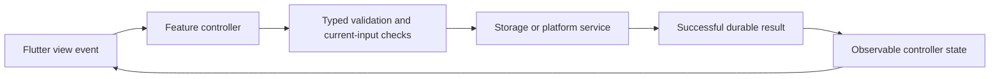

# Automated Software Generator Requirements

Created 25 October 2026. This is the ordered feature queue for the 15 minute development schedule. The product specification below supplies the broader scope. Existing work takes precedence over starting a new item.

## Completion and selection rules

Read this document on every scheduled run. First reconcile any active issue or PR against GitHub and current origin/main. Finish that work before selecting another feature. Select the first queued feature whose dependencies are satisfied; split large features into one coherent issue at a time. Do not mark a whole feature done when only an increment is delivered.

Statuses: Queued, In progress, Blocked, Awaiting merge, Done. A checked box means Done only. Before marking Done, verify acceptance criteria, actual relevant tests, independent final-revision review, required CI, and the PR merge into main. Record issue, PR, merge SHA, validation and completion date. Implementation or an open PR alone is not completion. Do not start the next task until the previous task is completed and merged into main. If blocked, record the blocker and resume it on the next run rather than silently advancing. If another run owns active work, avoid overlapping changes.

Update this document with task selection and delivery evidence, alongside [agent memory](history/AGENT_MEMORY.md) and [progress](history/PROGRESS.md). Preserve unrelated edits. Include status updates in the relevant branch/PR where possible; reconcile the verified merge on the next run. Never overwrite this document from an older branch.

## Ordered feature queue

- [x] F01 Structured requirements and task board — Done
  - Persist requirement IDs, acceptance criteria, task dependencies and task status per project; expose them in the workspace with edit and reopen support.
  - Accept when edits survive restart, invalid dependencies are rejected, and requirements changes invalidate affected approvals. Include a readable project requirements document with task progress.
- [x] F02 Executable approved plans — Done; depends on F01
  - Convert saved plans into validated, structured tasks bound to the exact requirements and approval revision.
  - Accept when only the current explicitly approved plan can start Build; withdrawn, stale and unapproved plans cannot execute. Show task progress and failures.
- [x] F03 Resumable bounded execution — Done; depends on F02
  - Persist tool actions, results, limits and checkpoints; support stop, cancel and safe resume after interruption.
  - Accept when duplicate side effects are prevented on resume, out-of-project paths and unauthorized commands are rejected, and time/output/tool-call limits are enforced.
- [x] F04 Model assisted Flutter source edits — Done; depends on F03
  - Extend the fixed generator with reviewed, scoped source changes driven by approved tasks and a visible diff.
  - Accept when a real local-model request changes an independent Flutter project, passes analysis/tests/build and refreshes its actual preview; preserve the last working output on failure.
- [x] F05 Bounded automatic build repairs — Done; depends on F04
  - Diagnose actual build/test errors and repair within a maximum of three attempts per failure category.
  - Accept when every attempt and exit result is saved, cancellation works, exhausted repairs stop honestly, and success requires rerunning the failing checks.
- [x] F06 Build history and last working version — Done; depends on F01
  - Keep timestamped build/test outcomes linked to input revisions and preview artifacts, with a last-successful-version entry.
  - Accept when history survives restart, stale or missing artifacts are explicit, and rollback requires a visible selection and preserves current work.
- [x] F07 Existing project import — Done; depends on F01
  - Inspect an existing Flutter repository without overwriting it; identify toolchains, project metadata and unsupported capabilities.
  - Accept when users can select and reopen an imported project, inspect findings and approve a plan before any source modification; invalid folders fail without writes.
- [x] F08 Portable project backup and restore — Done; depends on F01
  - Export and restore requirements, conversations, decisions, tasks and revision metadata with versioned manifests.
  - Accept when round trips preserve records, corrupt/incompatible archives fail safely, secrets are excluded and existing projects are never silently replaced.
- [ ] F09 Runtime diagnostics and resource controls — In progress
  - Show actual model connectivity, active request, cancellation scope, request limits and actionable setup failures.
  - Accept when offline, timeout and cancellation states are truthful, settings persist, and diagnostics omit secrets and private prompt content.
- [ ] F14 Resizable and collapsible workspace panes — Queued; depends on F01
  - Priority: after active F02 and existing higher-priority F03–F09 work; does not interrupt active delivery.
  - Source/evidence: product specification §4.3 requires resizable/collapsible panels. `lib/views/project_workspace.dart` currently uses a clamped 40% width and a static VerticalDivider, with narrow-screen tabs; no resize/collapse controls exist. Existing F01–F13 do not cover pane layout controls. No second GitHub issue created in the #50 run.
  - Scope/value: let users allocate desktop chat/preview space and collapse/restore a pane while keeping narrow-screen tabs and working state.
  - Accept when pointer and keyboard controls resize within usable minimums, collapse/restore retains conversation/prototype state, and narrow/enlarged-text layouts remain accessible without overflow. Add controller/widget interaction and responsive regressions; run format/analyze/tests/web build. Create/reuse a scoped issue only when this task is selected.
- [ ] F10 Deterministic requirements review — Queued; depends on F04 and F06
  - Map each requirement to concrete checks and saved evidence; distinguish automated verification from advisory model feedback.
  - Accept when failed, missing and stale evidence cannot yield a verified requirement, and reports link to exact revisions and test results.
- [ ] F11 Additional project adapters — Queued; depends on F04 and F05
  - Add one complete adapter at a time, beginning with Python, then React/Next.js, then native targets when their toolchains are available.
  - Accept each adapter only after real creation, analysis/tests, execution and preview or runnable output; label other types unsupported until verified. Track each adapter as its own increment.
- [ ] F12 Isolated self development — Queued; depends on F03, F05, F06 and F10
  - Propose changes to ASG in an isolated checkout with independent review and protected PR delivery.
  - Accept when the installed stable application remains usable, failed candidates are recoverable, and merging requires independent approval and passing required checks.

- [x] F13 Consolidate project documentation — Done
  - Delivered user request: keep one requirements and task document, organize supporting documents, remove redundant copies, and update the scheduled workflow.
  - Acceptance: one requirements file; unique original product scope and foundation history retained; maintained local documentation links resolve; the active 15 minute automation reads this file, deduplicates new tasks and checks Done only after verified merge.
  - Delivered 25 October 2026 via [issue #32](https://github.com/arpit-it/ASG/issues/32), branch `codex/32-documentation-queue`, [PR #33](https://github.com/arpit-it/ASG/pull/33). Independent review approved head `ec9b561f12d1edd9439d100dadae52afe3a90ab9`; required Flutter checks/web build (real Chrome storage and generated-project verification) and Python fixtures passed in CI run `40172035200`. Remote merge `3b4333286e0c3ef8c6543501c2bba6721e714035` at 2026-10-25 07:18:39 UTC and issue closure verified; local main synchronized before F01.

## Adding new tasks

On every scheduled run compare the current implementation, user requests, open issues and review findings with this queue. Add a task only for a user-requested capability, an unmet product specification or a reproducible defect. First search all queued, active and completed entries plus GitHub issues/PRs; extend or reopen an existing task when it covers the same work. Do not add speculative features or duplicate issues.

Use the next unused F number, never renumber or reuse IDs. Record the problem and supporting evidence, user value, priority, dependencies, bounded scope, testable acceptance criteria and validation plan. Link a supporting specification section or reproduction and the matching issue when created. Add at most one justified new task per run. If no justified gap exists, add nothing. Insert the task by dependency and priority, retaining its stable ID. A new task does not interrupt active work: finish and verify its merge first.

A task moves Queued → In progress → Awaiting merge → Done; use Blocked with evidence and the required next action when progress cannot continue. Keep completed entries and merge evidence permanently. Code generation, local test success, issue closure alone or an unmerged PR never checks the Done box. If a delivered feature regresses, add a linked repair task or reopen the affected entry with the reason; preserve prior delivery history.

## Active task and delivery ledger

Active: No unmerged F08 work. F08 Done under the user-approved manual literal-redaction policy after PR #166 merge `512a6992caa4b37d73a9a72a7c61f8fe4a3242d1` on 27 October 2026. Independent final-head review and all required checks passed. F09 In progress/unchecked. Issue #167 / PR #168 bounded private connection diagnostics verified merged as `5539d78d5b635bf2aed9e6ca9aab7d22904936b2` after final independent review and required CI. Issue #169 / PR #170 verified merged as `8264230b3bb766da1a1c87dd02d91f69147c19f0` after independent final review `5662237780` / final gate `5662257866` and required CI `40450214752`. PR #171 chat diagnostics verified merged as `e6c73dd9b0c5b533a4b817c115f542000ec4a427`. PR #172 verified merged as `99f20d8f1e82d2fa2fd1001d4486234bfb1dfa4e`. Reopened issue #167 / PR #173 runtime token preservation verified merged as `6d5aa3708c04e82da190e5239a9c76ad09265015` after independent final review and required CI. Reopened issue #167 / PR #174 private chat failure diagnostics verified merged as `349160341fb67b6f8b26dd60d00d63bb1573347a` after independent final-revision reviews `5662641387` / `5662674294` and required CI `40455667022`. Reopened issue #167 / PR #175 private runtime health diagnostics verified merged as `75a49472053cade2c9c110dcd5fd6b689b119c93` after independent reviews `5662763446` / `5662785468` and required CI `40457100546`. F09 remains In progress; no later task selected. Reopened issue #167 / PR #176 bounded private setup inference probe verified merged as `a71b855fc0e486860589396e67a19e9fc6d00d34` after independent reviews `5662866403` / `5662884291` and required CI `40458448324`. Reopened issue #167 / PR #177 on `167-startup-stop-race` addresses managed-startup Stop/disposal races; verified merged as `25ce75b94532a834b18fb9500d883481b15f937e` on 27 October 2026 after final reviews `5662956499` / `5663000911` and required CI `40459770338`. Reopened issue #167 / PR #178 on `167-private-settings-errors` verified merged as `5295034adcbc92e1234810e0600fc46e5fd91c6e` on 27 October 2026 after independent reviews `5663082771` / `5663099873` and required CI `40461131205`. F09 remains In progress/unchecked; no unmerged work or later task selected. Reopened issue #167 / PR #179 private checkpoint metadata diagnostics verified merged as `3cc73d5a5745b3b15b9512c873b0bd6bcc4f71c1`; independent final-revision review and required CI passed. F09 remains In progress. Reopened issue #167 / PR #180 private connection URL validation verified merged as `463f09b184919868b0e543b3b962ec8a201707cd`; independent final reviews `5663298229` / `5663331607` and required CI `40463998042` passed. F09 remains In progress/unchecked. Reopened issue #167 / PR #182 health connection identity verified merged as `6389ce78f958abbcc0231a26adc22c061137446a`; independent final review and required CI `40467127356` passed. F09 remains In progress/unchecked. Reopened #167 / PR #183 on `167-stop-health-refresh` verified merged as `610f0929ab10864a0b3f18b4266841572e24db44` after independent final review and required CI `40468627961`. F09 remains In progress/unchecked. Reopened #167 / PR #184 private connection save diagnostics verified merged as `41e7a2157a7c9773dfc64cf8676c705f67388ed4`; independent final review and required CI `40470148708` passed. F09 remains In progress/unchecked. Reopened #167 / PR #185 private setup save diagnostics verified merged as `48f0aebc4b7f050512ca0ac9c3164efb1fbc305d`; independent final review and required CI `40471693412` passed. F09 remains In progress/unchecked. Reopened #167 / PR #186 private picker diagnostics verified merged as `1ae2894f7eb0183e94214fa689c19dfdb82d2180`; independent final review and required CI `40473512346` passed. F09 remains In progress/unchecked.

### F03 acceptance boundary and evidence

Acceptance audit on reopened issue #80, branch `80-execution-acceptance`; Done after verified PR #83 merge `4344656f3655b5ec620a566666afb2aca37a5144` (final delivery evidence below). The implemented boundary is the trusted `flutter-starter` adapter and a single app session. Persisted actions are its four approved operations; arbitrary tools/source synthesis remain F04/F11, automatic repair F05, configurable resource controls F09 and cross-process isolation F12. An uncertain action is refused rather than replayed. Explicit Retry is a separately consented restart and may repeat commands. These limits are part of the supported behavior, not claims of a sandbox or general-purpose execution engine.

| F03 criterion | Implemented boundary | Regression evidence |
| --- | --- | --- |
| Persist actions, results, limits and checkpoints | `GeneratedProject` stores exact task graph/approval, ordered results, explicit cancellation/timeout/output flags, fixed versioned limits and version-1 dispatch marker. `NativeGenerationHost.verify` awaits storage before launch and saves result plus marker clearance together. | `verification_limits_test.dart`, `source_generation_test.dart`: policy reopen/adversarial values, persistence refusal preventing launch, uncertain runner loss preserving prior results; `source_generation_controller_test.dart`: durable failures, reopen and saved graph identity. |
| Stop and cancel | Visible Stop requests helper termination, prevents downstream commands/Ready and retains completed results. Disposal closes owned work; parent loss and SIGTERM/SIGINT record cancellation when a result reaches storage. | Controller/widget Stop and final-save races; native preparation/pre-command and running-helper Stop; `tools/test_generation_command.py`: real signal/parent-loss fixtures and descendant cleanup. Process death cannot guarantee a final saved result. |
| Safe resume without duplicate side effects | Explicit consent, exact approval/inputs/toolchain and unchanged source/dependency fingerprints are required. Resume retains a successful prefix and dispatches only its suffix. Legacy, pending/uncertain, failed/cancelled and all-complete snapshots refuse resume; reopening starts nothing. | Native tests cover all prefix lengths 0–3, changed source/dependency metadata, persistence refusal and Stop. Controller/widget tests cover reopen, consent, legacy/uncertain records, stale approval/toolchain. Opt-in real test commits resolve, recreates the host, resumes analysis/tests/build and serves compiled JavaScript HTTP 200. |
| Reject out-of-project paths and unauthorized commands | Exclusive new folder creation, canonical paths, link/traversal rejection and input/output fingerprints protect the trusted starter. Validated contracts contain exactly the four fixed operations; helper uses argument arrays and an operation allowlist. | Source-generation native traversal/existing-folder/link/preview-scope tests; build-plan/mapped-plan adversarial contract tests; Python fixed-command assertions. Trusted installed SDK/Python/cache and same-user filesystem races remain outside this guard. |
| Enforce time/output/tool-call limits | Each command has exactly 180 seconds and 65536 combined output bytes. Exhaustion kills its owned process group and blocks downstream work. Validated graph/history caps total operations at four including resumed successes. Explicit altered policies and helper CLI overrides fail before execution. | Python actual timeout/output-overrun/exact-boundary/descendant tests and CLI deadline/output rejection; policy serialization tests; all-prefix resume tests assert exactly four total operations; failed/output-exhausted native results cannot become Ready. |

This audit maps existing delivered behavior rather than adding new execution authority. Prior delivery entries remain historical. The queue stays unchecked until independent final-revision approval, actual required CI and verified merge; record final merge evidence below before selecting F04. Fresh live-model inference is not established by this audit.

### F02 acceptance boundary and evidence

F02 establishes executable approved plans for the implemented `flutter-starter` adapter. Every accepted contract retains exactly the four trusted resolve/analyze/test/build operations. Versions 2–4 support named tasks, dependency order and optional validated board provenance; versions 1/2 remain compatible. Unsupported plans stay advisory even when approved. F02 does not promise arbitrary code execution: model-assisted source changes are F04, additional adapters F11, and action checkpoints/cancel/resume F03. Earlier entries saying broader/general mapping remained unmet describe their delivery-time assessment; this matrix supersedes that assessment following independent final-revision approval and verified PR #69 merge.

| F02 criterion | Implemented boundary | Regression evidence |
| --- | --- | --- |
| Convert saved plans into validated structured tasks | `BuildPlan.parse` and `BuildTask.fromJson` reject ambiguous fences, duplicate JSON members, unknown fields/operations, invalid IDs/dependencies and unsupported adapters. Versions 3/4 validate board references and every prerequisite operation. | `test/build_plan_test.dart`, `test/mapped_build_plan_test.dart`, `test/board_mapped_build_plan_test.dart`: immutable conversion, adversarial contracts, reordered checks, distinct/shared mapping and missing prerequisites. |
| Bind tasks to exact requirements and approval revision | `PlanApprovalStore.requireCurrentApproval` rereads saved project, latest marked Plan, requirement revision and prototype revision/definition; generated history retains exact approval identity and task graph. | `test/plan_approval_test.dart`: persistence ordering, native database reopen, stale drafts and prototype/requirements changes. `test/source_generation_controller_test.dart`: named/board graphs after reopen, graph tampering and replacement/reapproval refusal. |
| Only current explicit approval starts Build | `SourceGenerationController` checks approval and structured contract before preview/host effects, then rechecks at write/progress boundaries and after async persistence. Separate operation consent is mandatory. | `test/source_generation_controller_test.dart`: unapproved/withdrawn/replaced/corrupt/missing-project refusals, stale prototype, preparation/write/progress withdrawal and disposal; history/preview preserved on refusal. `test/source_generation_test.dart`: actual filesystem write guards. |
| Show task progress and failures | `GeneratedProject.taskStatus` derives pending/running/passed/failed/blocked/interrupted from saved command evidence; exact task order and board summaries survive serialization/reopen. No automatic board completion or requirement-acceptance claim. | `test/build_task_test.dart`, `test/source_generation_test.dart`, `test/source_generation_controller_test.dart`: actual runner/validation failures, blocked downstream work, reopen and retry. `test/source_generation_controller_test.dart` exercises the explicit-consent and saved-progress UI; `test/board_verification_progress_test.dart` covers grouped outcomes, reopen/retry and narrow 320px/200% text rendering. |

Validation is recorded in this run's delivery entry below. Fixture tests establish guarded workflow behavior; the explicit real-generation test establishes actual offline resolve/analyze/test/web-build/served-output behavior of a separate generated starter. Neither establishes live Qwen inference or arbitrary model-written source. Required CI separately exercises real Chrome storage and generated-project verification.

Historical active-work summary (retained as delivery provenance):

Active: F02 remains In progress. Reopened issue #42 on `42-board-mapping-diagnostics` delivered actionable mapping refusal diagnostics through independently reviewed PR #68, verified merge `be3e285b8c308e773527636c9488b4165965aeb1`; issue closed. Reopened issue #40 on `40-board-verification-progress` adds read-only linked board verification summaries delivered through independently reviewed PR #67, verified merge `2b2cc7e1cccec2baf35d49305d74f651412192f0`; issue closed. Reopened issue #42 on `42-shared-board-task-mapping` delivered shared board-task mapping through independently reviewed PR #66, verified merge `e7f900846e63bde66b660386ddc136ae96994d82`; issue closed. Reopened issue #42 on `42-board-task-provenance` delivered validated board-task provenance through independently reviewed PR #65, verified merge `a74e93263fffd7cadee3ce01647ecb4f3bc4af45`; issue closed. Reopened issue #42 on `42-approved-task-mapping` delivered bounded approved adapter task mapping through independently reviewed PR #64, verified merge `847fcfc71972f3d6691dfe18150e5f5866ce5c1c`; issue closed. Reopened issue #40 on `codex/40-task-validation-failure` delivered per-task validation failure identity through independently reviewed [PR #61](https://github.com/arpit-it/ASG/pull/61), verified merge `b68f715c8ce9cfa1a46c6c87a2ab423504d9f8f8`; issue closed. Prior delivery evidence remains below. Reopened issue #40 on `codex/40-task-launch-failure` delivered runner-failure identity via independently reviewed PR #60, verified merged as `92b4035c16ef1717c0a11e732b756b0c4df2a100`; issue closed. Original PR #41 delivery retained.  Issue #58, branch `codex/58-generation-write-approval`, delivered generation filesystem authorization boundaries via independently reviewed PR #59, verified merged as `dcec0e370b63d1a39535b501f37dec136f6249b5`; issue closed. See final evidence below.  Issue #56, branch `codex/56-complete-plan-context`, delivered complete Plan requirements context via independently reviewed PR #57, verified merged as `f91274f54266ff391fac8ab635a8ae9881ab5d25`; issue closed. See final evidence below. Issue #54, branch `codex/54-resolve-evidence`, delivered resolve-result evidence through independently reviewed PR #55, verified merged as `ed7de9a926bf6dba63e7cf82da6eff350bf482f6`; issue closed. See final evidence below. Issue #52, branch `codex/52-verification-approval`, delivered verification approval boundaries via independently reviewed PR #53, verified merged as `28b5ca93ee45237bf64434eaab2bf353be26e80d`; issue closed. See final evidence below. Issue #50, branch `codex/50-prototype-plan-context`, delivered via independently reviewed PR #51, verified merged as `195c6bfc1ad1118bba23e9e2b513fbd8adb6cd8f`; issue closed. Prototype-bound Plan approval and the user-requested documentation/architecture update are delivered; evidence below. Issue #48, branch `codex/48-plan-execution-preview`, delivered via independently reviewed PR #49, verified merged as `34da5bebf1728e969d9c43a661d30e4454e13f09`; issue closed. Prior issue #46, branch `codex/46-plan-task-proposals`, delivered via independently reviewed PR #47, verified merged as `938c0633f67fb544687822ef8b8ac29ebe9caac6`; issue closed. General executable adapter mapping remains unmet. Prior issue #44, branch `codex/44-unambiguous-build-contract`, delivered via independently reviewed PR #45, verified merged as `0d570585aad7dab7249536b9fef54adaab4bb846`; issue closed. Validated Plan task contract [issue #42](https://github.com/arpit-it/ASG/issues/42), branch `codex/42-plan-task-contract`, independently reviewed and merged via PR #43 as `b30d6bca269876be1ad8d925df347a253d73645f`; issue #42 closed. Prior #40 / PR #41 independently reviewed and verified merged as `88e7dbb7dfdf936361739f31ca5a15415e86762a`; issue #40 closed. General Plan conversion remains unmet; resume F02 before F03.

For each increment append: feature ID; status; scope; dependencies; issue; branch; PR; tested revision; checks and limitations; reviewer verdict; merge SHA; completion date; blocker or next step. Keep completed entries as history.

## Current product decisions

ASG is a Flutter application targeting Android, iOS, web, macOS, Windows and Linux. Included platform runners do not establish tested device support. Managed MLX setup and the current independent Flutter web generator host are macOS-specific; other platforms retain supported app features and runtime connection controls.

Use Flutter across six platforms under the display name Automated Software Generator. The direct Flutter request supersedes the attached SwiftUI framework choice. Implemented scope includes guided creation/session restore, durable interpreted prototypes, structured requirements/tasks, Discuss/Plan/advisory Review, explicit approval, and the fixed Flutter web source-generation/verification slice. General source synthesis and other queued capabilities remain future work.

## Current application architecture and implemented behavior

This section describes the implemented baseline and the issue #50 change under PR #51; it is the current architectural interpretation of the product specification. The ordered F queue above is the only development queue. A feature listed as a future goal in the original brief is not implemented merely because its architecture is described here. PR #51 was independently reviewed and verified merged as `195c6bfc1ad1118bba23e9e2b513fbd8adb6cd8f` on 25 October 2026; its prototype-bound approval change is delivered.

### Product and platform contract

Automated Software Generator is a local-first **Flutter/Dart application targeting Android, iOS, web, macOS, Windows and Linux**. Flutter 3.47.6 / Dart 3.13.5 is the pinned development/CI baseline. The package is `asg`; its Flutter root is `asg/`. The development machine being a Mac does not make the product a macOS-only application. A project's selected target platforms are saved intent, not proof that the corresponding generated apps exist or build.

| Capability | Current platform scope | Evidence and limits |
| --- | --- | --- |
| Flutter app shell, guided creation, project records, prototype UI and planning/requirements screens | Shared application code and six platform runners | Earlier Android debug/macOS debug and current web builds passed. iOS, Windows and Linux application builds and physical-device launches are not established. Responsive widget tests do not establish device acceptance. |
| Durable local records | Native Sembast file; browser IndexedDB | Real native close/reopen and Chrome IndexedDB tests. Single application isolate/session contract; no cross-process or live multi-tab synchronization. |
| Runtime connection controls | Shared UI, subject to reachable endpoint/platform network policy | macOS and localhost browser use host loopback; Android Emulator uses its host alias. Physical-phone connectivity is not configured. No phone-local 9B inference is claimed. |
| Managed model scanning, explicit download, prepare/start/stop | macOS host integration | Existing Qwen3.5-9B 4-bit MLX setup on Apple Silicon; compatible selected Python/checkpoint required. Other targets show an explicit unsupported-managed-setup explanation and connection controls. |
| Independent source generation and compiled preview | macOS-hosted fixed Flutter **web** adapter | Creates a separate new project, executes trusted offline Flutter verification and serves compiled web output. This does not generate macOS/native applications or execute arbitrary repositories. Linux CI fixtures do not change the product host gate. |

### MVC boundaries and data flow

Use Flutter MVC with integration services, `ChangeNotifier`/`BaseController` observable state and constructor/factory injection. Do not replace this with SwiftUI/MVVM or introduce a new state framework without a concrete requirement.

| Layer | Current components | Required responsibility |
| --- | --- | --- |
| Models (`lib/models/`) | StudioProject, ProjectBlueprint, AppDefinition/AppElement, ChatMessage, RequirementsBoard/ProjectRequirement/DevelopmentTask, PlanApproval, PlanTaskProposal, BuildPlan/BuildTask, GeneratedProject, runtime/settings types | Immutable typed data, pure validation and versioned serialization. No widgets, HTTP or storage plugins. |
| Views (`lib/views/`) | StudioHome, Dashboard, ProjectWizard, ProjectWorkspace, LiveApplicationView, ModelChat, RequirementsScreen, SourceGenerationScreen, RuntimeSetupScreen and focused status/dialog views | Render actual state, collect input, own widget/navigation/text/focus lifecycle and delegate actions. No persistence/network/business-rule implementation in callbacks. |
| Controllers (`lib/controllers/`) | StudioSessionController, ProjectWizardController, AppWorkspaceController, ChatController, RequirementsController, SourceGenerationController, RuntimeSetupController, ProjectDetailsController | Coordinate validation/services, busy/error/progress state, commit ordering and cancellation/disposal. No widgets, BuildContext or navigation. |
| Services (`lib/services/`) | RecordStorage/StudioDatabase and stores, ApplicationEditor/LocalApplicationActions, ModelProvider/LocalModel, PlanApprovalStore/PlanTaskImport, GenerationInput/GenerationHost, runtime/folder-picker adapters | Own transactional persistence, transport, platform processes/filesystem integrations and enforce execution-boundary checks. Conditional factories expose honest unsupported-host behavior. |

Success must publish only after validation and the required write succeed. Failed/partial/model-cancelled updates preserve the last committed prototype and history. Async work prevents duplicate submissions, respects disposal and keeps errors visible. Source generation and model transport are distinct workflows; no model prose grants a tool permission.

### Implemented user workflows

1. **Create and reopen:** describe intent, choose suggested experience/features, review project metadata/platforms/location, then save and open the workspace. Suggestions are deterministic. A saved-but-not-opened failure offers selection-only retry without duplicate creation. Session restore rereads the canonical project and preserves the prior workspace on failed selection.
2. **Edit the prototype:** desktop chat appears left of the live interpreted prototype; narrow layouts use state-preserving Chat/Preview tabs. Common exact instructions use validated local actions; custom edits use streamed bounded model proposals. The definition supports headings, text, task lists/completion, counters, notes and bounded buttons, with indigo/green/orange/pink themes. Validated edits and conversations save before revision/preview refresh; interactions use serialized/coalesced durable writes with explicit retry.
3. **Maintain requirements:** the F01 board stores stable requirement IDs, titles and acceptance criteria; development tasks have stable IDs, requirement references, dependency IDs and manual queued/in-progress/blocked/done status. Reject duplicate/missing IDs and dependency cycles; reopening/changing prerequisites invalidates dependent completion. A successful board write increments its revision and invalidates prior Plan approval. Manual Done is not automated verification.
4. **Discuss, Plan and Review:** separate saved assistance history supports Discuss, Plan and advisory Review. These modes have no application/source/command tools. Review reads fresh bounded prototype and historical verification evidence, states limitations, and does not run tests or mark requirements verified. Completed replies whose final write fails remain visibly unsaved with save-only retry; mode/navigation/new requests wait until save finishes.
5. **Import proposed tasks:** one bounded `asg-tasks` version-1 fence may propose up to 200 queued planning tasks against existing requirement IDs. Preview before explicit additive import. Re-read exact latest durable Plan/project/board context; reject collisions, unknown fields/status/commands, duplicate JSON members and invalid graphs. Atomic import preserves existing tasks, changes board revision and requires a fresh Plan before approval. Imported tasks do not become executable commands.
6. **Approve a Plan:** only an app-marked completed saved Plan is eligible. Persist exact message index/content/context, explicit approve/withdraw decision and recording time. New drafts or changed project/board inputs invalidate consent. PR #51 also binds validated prototype definition/revision, including revision-only edits/reverts, and rejects stale captured Build-screen definitions. Unreadable evidence fails closed. Legacy history stays readable but requires a new draft under the current context.
7. **Generate and verify:** explicitly request the fixed Flutter web MVC starter in Plan, inspect its validated task/dependency preview, approve that exact draft, then separately consent in the generation form. Build rechecks current durable approval/inputs before host work and after asynchronous preparation. It accepts exactly one bounded `asg-build` `flutter-starter` contract: version 1 retains the canonical graph; versions 2/3 allow named tasks and validated dependencies, and version 3 additionally binds every operation to an existing board task; malformed/ambiguous/unsupported contracts and duplicate JSON members cannot execute.
8. **Inspect actual output:** generation writes a new folder exclusively, serializes user/model strings as JSON data and runs trusted Flutter operations via argument arrays. Each operation has a 180-second deadline and 64 KiB captured-output limit. Saved step results derive pending/running/passed/failed/blocked/interrupted task state. Saved outcomes carry exact approval provenance and source/dependency/output fingerprints. Only verified unchanged artifacts can be served by the owned loopback preview; the prototype pane is a different interpreted output. Retry needs unchanged inputs and the same approval identity and restarts all checks. Explicit Resume uses a versioned confirmed safe boundary, retains successful results and runs only remaining checks; uncertain/failed dispatches and legacy evidence cannot resume.

The desktop chat width currently follows a clamped 40% split with a static divider. Resizing/collapse is the bounded queued F14 requirement, not an implemented control. Linking a folder only saves its location; existing-source import is F07.

### Persistence and compatibility contract

Production records use `RecordStorage` backed by Sembast (`studio-v2.db` in native app support; IndexedDB on web). Retained preferences migrate atomically; no fallback reset or silent corruption overwrite is permitted. Browser storage is origin/port-specific and can be cleared. Storage is unencrypted application data, not secret storage.

| Record namespace | Stored state |
| --- | --- |
| `studio.projects.v1` | Project identity, name, description, type, platform intent and location |
| `studio.lastProject.v1` | Selected project ID for session restore |
| `studio.application.v1.<id>` | Validated prototype definition, edit messages and revision |
| `studio.chat.v1.<id>` | Separate assistance conversation and optional app-written Plan context |
| `studio.requirements.v1.<id>` | Schema/revision, structured requirements and dependency/status task board |
| `studio.planApproval.v1.<id>` | Exact saved Plan consent/withdrawal identity and time |
| `studio.generation.v1.<id>` | Latest generated outcome, provenance/task graph, actual step results, fingerprints and failure state |
| `studio.localModel.v1` / `studio.runtimeSetup.v1` | Model connection and runtime setup configuration |

Preserve existing keys/payload readability. New approval context does not backfill consent into legacy prose. Per-project damaged application/generation/approval/board evidence remains retained and isolated; invalid global migration data or physical database corruption can stop startup visibly. Only the latest generation outcome is retained; full timestamped history, rollback, portable backup and resumable action journals remain F06/F08/F03.

### Local inference contract

The current selected model is the existing Qwen3.5-9B, locally converted to 4-bit MLX; original weights and runtime environments remain outside Git. `ModelProvider` abstracts the configured endpoint/model. The bridge supports SSE status/token/heartbeat/completion/error events with one active worker. UI progress represents processing stages and human-readable streamed summaries, not private reasoning. Apply only complete validated edits after successful save.

Current client limits are 15 seconds for connection/headers, 30 seconds for stream inactivity and an absolute 180-second total deadline across response modes. The bridge bounds input to 4096 tokens and output to at most 2048 tokens. Cancellation closes transport and is checked at bounded server generation/prefill points; a native kernel cannot be interrupted mid-execution. Explicit model downloads/setup require a selected destination/environment and never run just by opening setup. macOS host integration uses owner-approved host-user permissions, not an execution sandbox.

Earlier real MLX custom-edit/Plan/Review streaming checks passed. In this issue #50 run, the endpoint refused connection; no fresh inference is verified. Larger contexts, arbitrary tool use and other model/framework support remain proposed capabilities until their own acceptance evidence exists.

### Validation and remaining boundaries

Issue #50 code validation passed formatter, analyzer, 200 default tests (four opt-in skips) and web build. Tests cover prototype/revision/corrupt/legacy approval inputs, stale Build screens with preview/history preservation, fresh approval recovery and actual native database reopen. Final PR checks must also include actual Chrome storage, real independent generated-project verification and Python runtime/process fixtures; independent final-head review precedes merge. CI fixtures or skipped live tests do not verify current model availability.

Historical issue #50 assessment (F02/F03 delivered increments and current acceptance boundaries above supersede their earlier gaps): current architecture does not deliver model source edits (F04), automatic repair (F05), full build-history rollback (F06), source import (F07), portable backup (F08), comprehensive diagnostics/resource controls (F09), deterministic requirement verification (F10), other adapters (F11), isolated self-development (F12) or user-resizable panes (F14). These stay in the existing queue; no duplicate task document is introduced.

Detailed contracts: [MVC architecture](architecture/ARCHITECTURE.md), [storage](architecture/STORAGE.md), [generation](architecture/GENERATION.md), [workspace](architecture/LIVE_WORKSPACE.md), [runtime setup](setup/RUNTIME_SETUP.md), [streaming](setup/QWEN_STREAMING.md), [test strategy](development/TEST_STRATEGY.md) and [CI](development/CI.md).

## Foundation acceptance context

These criteria describe earlier increments; their presence does not mark the feature queue complete.

Historical foundation increment: empty dashboard is honest; blank project name is rejected; target selection is required; project record saves before appearing; saved records load at startup; search filters names; unsupported automation displays explicit status. Editable settings are now implemented; existing-source import remains F07. Generated applications, Git initialization, and successful builds must never be claimed based only on record creation.

App-led workspace increment: user describes intent before technical configuration; recommendations can be changed and reviewed; selected platforms/features persist; creation opens the workspace; re-entry restores the current project; desktop chat is left of the live prototype; phone tabs preserve both panes; supported instructions apply and refresh visible version state; invalid edits/failed saves preserve the working version. Independent source generation/building is not part of this increment.

# Product specification and original brief

The user subsequently selected Flutter, the ASG repository, existing Qwen3.5-9B, an app-led creation flow, and chat-left/live-preview-right. These direct requirements supersede conflicting SwiftUI-first details below. The original brief is retained for product scope and provenance, not as a command to restart old milestones. Current MVC standards, the 15 minute task-selection rules above and the repository independent-review/merge workflow govern execution; the original manual-only merge language is superseded by the user-authorized independent reviewer merge process. This brief defines the broader product vision, not a claim of completed functionality.

# CODEX MASTER PROMPT — AI PROJECT STUDIO

## Historical original brief (framework/platform choice superseded)

The original brief proposed SwiftUI and a native macOS-first application; its framework/platform instructions below are now explicitly reconciled to Flutter, while preserving product scope. The current product is Flutter for Android, iOS, web, macOS, Windows and Linux; only specifically documented host integrations remain macOS-specific. Retain the original scope as provenance, not current framework/platform instructions.

## 1. Project Overview

You are the Lead Software Architect, Senior Flutter Engineer, AI Agent Engineer, QA Engineer, and Technical Project Manager responsible for building **AI Project Studio**.

Build a production-oriented Flutter application for Android, iOS, web, macOS, Windows and Linux that allows users to create, develop, test, run, and maintain software projects through natural-language conversations without needing to view or manually edit source code.

The application must also support **Self-Development Mode**, allowing its AI agent to implement, test, and propose changes to AI Project Studio's own source code.

**Primary development environment:**
- Hardware: Apple MacBook Pro M4 Max, 36 GB unified memory.
- Operating system: macOS.
- Primary application framework: Flutter and Dart (supersedes the original SwiftUI choice).
- Current coding/planning model: existing Qwen3.5-9B, locally converted to 4-bit MLX. The original Qwen3-Coder 30B-A3B proposal was superseded; other models require explicit compatibility evidence.
- Current runtime: project-local MLX bridge with SSE streaming; legacy Torch fallback. Additional runtimes require compatibility testing.
- Application targets: Android, iOS, web, macOS, Windows and Linux; local-first storage. Managed inference and the initial generator host are macOS-specific.
- License requirement: Commercially usable dependencies and model checkpoints.
- Development tools: Xcode, Swift Package Manager, Git, Flutter SDK, Python and Node.js where available.

The application should remain functional without cloud services after initial setup and model downloads.

## 2. Development Methodology

Use a hybrid software development lifecycle combining:

1. Agile iterative development.
2. Spiral risk-driven prototyping.
3. DevSecOps automation.
4. Verification and validation practices.
5. AI-assisted software engineering.
6. Human approval at important decision and release boundaries.

Every feature must follow:

**Discovery → Requirements → Feasibility → Architecture → Design → Implementation → Testing → Review → User Acceptance → Release → Maintenance**

Each iteration must produce a working, verifiable increment.

Maintain the following documents:

- `docs/REQUIREMENTS.md`
- `docs/architecture/ARCHITECTURE.md`
- `docs/development/SDLC.md`
- `docs/architecture/TECHNICAL_DECISIONS.md`
- `docs/development/SECURITY.md`
- `docs/history/ROADMAP.md`
- `docs/development/TEST_STRATEGY.md`
- `docs/history/PROGRESS.md`

Do not treat documentation as a substitute for implementing working software.

## 3. Product Vision

The user should be able to launch AI Project Studio and:

1. Create or open a software project.
2. Select the project type and destination folder.
3. Describe the intended application in natural language.
4. Discuss requirements with the AI.
5. Review and approve the requirements and implementation plan.
6. Ask the AI to create a working prototype.
7. Observe autonomous coding, building, testing, and debugging.
8. Interact with the running application through a preview.
9. Request improvements through chat.
10. Maintain project history, versions, and development progress.
11. Resume interrupted development sessions.
12. Build new features for AI Project Studio itself.

Users should not need a code editor.

Provide access to source files and technical logs through optional advanced views, but do not make them part of the normal user experience.

## 4. Flutter Application Interface

Implement the application using Flutter with responsive layouts for Android, iOS, web, macOS, Windows and Linux.

### 4.1 Project Dashboard

Display:

- Existing projects.
- Create New Project.
- Open Existing Project.
- Recent activity.
- Project status.
- Current development phase.
- Last successful build.
- Resume development.
- Application settings.

### 4.2 Project Creation Wizard

Collect:

- Project name.
- Project description.
- Project type.
- Target platforms.
- Storage location using a platform-supported native folder picker, with explicit unsupported-platform behavior.
- Optional Git repository initialization.
- Optional starter template.

Initially support these project types in the architecture:

- Flutter.
- SwiftUI macOS.
- SwiftUI iOS.
- React / Next.js.
- Python.
- Kotlin / Spring Boot.

Implement at least one complete project generator in the first milestone. The implemented initial adapter generates Flutter web MVC projects using a macOS host; other adapters remain subject to F11 acceptance.

Other project types may initially be registered as unsupported or experimental, but must not falsely report successful generation.

### 4.3 Main Project Workspace

Design a three-panel interface:

**Left Panel — Project Navigation**
- Project overview.
- Requirements.
- Architecture.
- Development tasks.
- Test results.
- Version history.
- Project settings.

**Center Panel — AI Conversation**
- Natural-language chat.
- Requirements discussion.
- Clarification questions.
- Implementation plans.
- User approvals.
- Task progress.
- Error explanations.
- Development summaries.

**Right Panel — Live Application Output**
- Running application preview.
- Build status.
- Test results.
- Runtime errors.
- Restart controls.
- Preview controls.

Allow panels to be resized and collapsed.

### 4.4 Conversation Modes

Implement four distinct modes:

**Discuss**
- Understand requirements.
- Ask relevant clarification questions.
- Record decisions.
- No source modifications.

**Plan**
- Produce structured requirements.
- Analyze feasibility.
- Recommend architecture.
- Create task breakdowns.
- Define acceptance criteria.
- Require approval before implementation.

**Build**
- Execute approved tasks.
- Modify project files.
- Run builds and tests.
- Diagnose and repair failures.
- Update progress automatically.

**Review**
- Compare implementation against requirements.
- Execute verification checks.
- Identify defects and missing functionality.
- Produce review reports.
- Recommend follow-up work.

Use explicit state transitions between modes. Do not rely exclusively on LLM-generated text to determine permissions.

## 5. Local LLM Runtime

Implement a provider-independent model runtime interface.

Suggested interface capabilities:

- Load model.
- Unload model.
- Generate text.
- Stream tokens.
- Submit structured tool results.
- Cancel generation.
- Report model status.
- Report memory usage.
- Configure context length.
- Configure sampling parameters.

Use a typed model configuration.

Do not hardcode a model name into the agent orchestration layer.

The current selected model is the existing Qwen3.5-9B 4-bit MLX conversion, through the configurable provider interface; the earlier 30B-A3B candidate is historical.

Before integration:

1. Verify the exact model identifier and license.
2. Identify a compatible Apple Silicon inference runtime.
3. Confirm the checkpoint can load within available memory.
4. Benchmark generation and tool-call behavior.
5. Test a 16K context window.
6. Record memory consumption and token throughput.
7. Document any compatibility limitations.

Start with an existing local runtime rather than developing a new inference engine.

The UI must remain responsive during model inference.

Support graceful cancellation and recoverable model errors.

Do not require Ollama if a suitable MLX or llama.cpp implementation is available.

## 6. Agent Architecture

Implement logical agent roles with shared project state.

### Product Analyst

Responsibilities:
- Gather requirements.
- Identify missing information.
- Maintain requirement records.
- Define acceptance criteria.
- Detect conflicting requirements.

### Solution Architect

Responsibilities:
- Analyze feasibility.
- Choose frameworks and dependencies.
- Design components and interfaces.
- Identify security and performance risks.
- Record architecture decisions.

### Project Manager

Responsibilities:
- Maintain the development backlog.
- Track task dependencies.
- Schedule implementation stages.
- Monitor completion status.
- Identify blocked tasks.

### Coding Agent

Responsibilities:
- Inspect existing project structure.
- Read relevant source files.
- Generate new files.
- Modify existing code.
- Refactor components.
- Implement features.
- Diagnose compiler errors.

### QA Agent

Responsibilities:
- Generate tests.
- Execute tests.
- Analyze failures.
- Validate acceptance criteria.
- Detect regressions.

### Reviewer Agent

Responsibilities:
- Review implementation quality.
- Inspect changed files.
- Identify security concerns.
- Check requirement coverage.
- Produce a review report.

For V1, these roles may be implemented as separate orchestration stages using one locally loaded model.

Do not require multiple large models to remain loaded simultaneously.

## 7. Agent Execution Engine

Build an autonomous, observable, resumable execution loop.

The loop should:

1. Read the current task and approved requirements.
2. Inspect relevant project state.
3. Request a structured action from the LLM.
4. Validate the action against the tool schema and permission policy.
5. Execute the authorized tool.
6. Capture stdout, stderr, exit codes, and artifacts.
7. Return results to the model.
8. Continue until the task is completed, blocked, cancelled, or exceeds its limits.
9. Verify the result using deterministic checks.
10. Persist the outcome.

Implement structured tools for:

- List directory.
- Read file.
- Search project.
- Create file.
- Edit file.
- Delete file.
- Run authorized command.
- Run build.
- Run tests.
- Start preview.
- Stop preview.
- Inspect process status.
- Read logs.
- Create Git checkpoint.
- Inspect Git diff.
- Restore checkpoint.

Use structured tool calls with validated arguments, not unvalidated shell commands extracted from prose.

Set configurable limits for:
- Maximum tool calls.
- Maximum repair attempts.
- Execution timeout.
- CPU and memory usage where enforceable.
- Output size.
- Filesystem scope.

The default automatic repair limit should be three attempts per failure category.

Persist task state so interrupted work can resume.

## 8. Project Memory

Each project must maintain durable, versioned records of:

- Project identity and configuration.
- User requirements.
- Approved architecture.
- Design decisions.
- Task backlog.
- Task execution history.
- AI conversation history.
- Build history.
- Test history.
- Known issues.
- Git checkpoints.
- Last successful application state.

Do not depend on the LLM context window as the only source of project memory.

Use structured local storage such as SQLite for application state and Markdown/JSON artifacts for portable project documentation.

Keep generated project files separate from Studio's internal metadata.

## 9. Project Generation

Implement a template-based project creation engine.

The engine should:

1. Validate the project name and destination.
2. Confirm the destination is safe to use.
3. Create the project directory.
4. Generate the starter application.
5. Initialize version control if requested.
6. Create initial requirements and metadata.
7. Detect required toolchains.
8. Install or resolve dependencies with appropriate approval.
9. Compile the starter project.
10. Run starter tests.
11. Launch the application preview.
12. Record the outcome.

Never overwrite an existing directory without explicit approval.

Project creation must be idempotent or recoverable after partial failure.

## 10. Build, Test, and Repair

Implement a build orchestration service.

Supported operations should include:

- Build.
- Clean.
- Run.
- Stop.
- Test.
- Inspect logs.
- Retry failed operation.
- Restore last known good state.

The AI must be able to inspect compiler output and apply targeted fixes.

Do not mark a task complete merely because code was generated.

The definition of done must include:

- Approved requirements implemented.
- Successful compilation.
- Relevant automated tests passing.
- No unresolved critical errors.
- Required security checks passing.
- Running preview available when supported.
- Review results recorded.

If repeated repair attempts fail, mark the task blocked and explain the reason.

## 11. Live Application Preview

Implement a preview abstraction supporting multiple runtime types.

### Web Applications

Use a managed local development server and WKWebView.

Support:
- Live preview.
- Refresh.
- Console logs.
- Runtime errors.
- Restart.

### Native macOS Applications

Compile and launch the generated application as a separate process.

Provide:
- Launch and stop controls.
- Process status.
- Logs.
- Screenshot or preview capture where permitted.
- Window activation.

Do not assume arbitrary native macOS windows can be embedded directly into the Flutter workspace; native-window preview adapters need an explicit supported integration.

### Mobile Applications

Design the architecture for:
- iOS Simulator.
- Android Emulator.
- Flutter development workflow.

These may be implemented after the initial macOS vertical slice.

The preview must display the actual running application, not an AI-generated representation.

## 12. Self-Development Mode

Implement an architecture that allows AI Project Studio to work on its own source repository.

Self-development must use the same SDLC and agent engine as ordinary projects.

Required workflow:

1. User describes a new Studio feature.
2. AI analyzes the existing Studio repository.
3. AI gathers requirements.
4. AI proposes an implementation plan.
5. User approves the plan.
6. System creates an isolated Git worktree or equivalent development workspace.
7. AI implements the feature in that workspace.
8. AI generates and executes tests.
9. AI builds a separate development version.
10. AI launches the development version.
11. Automated checks validate the change.
12. User reviews the results.
13. Approved changes may be merged through a controlled process.

The stable running application must remain unchanged during development.

The AI must not directly overwrite its installed executable or automatically replace the production release.

Use separate application identifiers, data directories, and process management for stable and development builds where necessary.

Design for future signed updates and rollback, but do not implement automatic self-updating without an explicit approval mechanism.

## 13. Security Requirements

Treat generated code, dependencies, repository content, and LLM tool requests as potentially untrusted.

Required safeguards:

- Restrict project filesystem access.
- Validate and canonicalize paths.
- Prevent path traversal and symlink escapes.
- Keep secrets out of model prompts and logs where possible.
- Redact sensitive values.
- Restrict command execution.
- Apply process timeouts.
- Require approval for destructive operations.
- Require approval for network access or dependency installation according to policy.
- Separate trusted application state from generated projects.
- Use isolated build environments where feasible.
- Prevent generated code from modifying Studio's trusted runtime.
- Maintain audit logs.
- Provide rollback checkpoints.

Do not claim a process is sandboxed unless isolation is actually enforced.

If secure execution isolation cannot be implemented in the first milestone, use restricted commands and clearly document the remaining risk. Do not silently execute arbitrary untrusted project code with unrestricted access.

## 14. Commercial Readiness

Use commercially compatible libraries and frameworks.

Maintain a dependency and license inventory.

Design for future features such as:

- Multiple LLM providers.
- Optional cloud inference.
- Model download management.
- Project export.
- GitHub integration.
- Team collaboration.
- Additional programming languages.
- Deployment pipelines.
- Plugin-based project templates.
- Paid subscription capabilities.

Do not implement billing, accounts, cloud infrastructure, or collaboration in the initial milestone.

Focus on a reliable local development experience first.

## 15. Initial Implementation Milestones

### Milestone 0 — Environment and Feasibility

Inspect the development environment.

Check:
- macOS version.
- Xcode and Swift availability.
- Swift Package Manager.
- Git.
- Python.
- Local inference runtimes.
- Available memory.
- Existing repository contents.

Do not assume dependencies are installed.

Verify model availability and runtime compatibility.

Create the initial architecture and implementation plan.

### Milestone 1 — Flutter Application Foundation

Implement:
- Flutter application with Android, iOS, web, macOS, Windows and Linux runners.
- Project dashboard.
- Project creation wizard.
- Native directory picker.
- Local project metadata.
- Project persistence.
- Basic navigation.
- Application settings.

Ensure the application builds and launches.

### Milestone 2 — AI Conversation

Implement:
- Local LLM provider abstraction.
- Streaming chat interface.
- Project-specific conversation history.
- Discuss and Plan modes.
- Requirements persistence.
- Plan approval workflow.

Provide a mock model provider for deterministic tests.

### Milestone 3 — First Autonomous Development Workflow

Implement a complete vertical slice:

User requests:

"Create a macOS task manager with a task list and an Add Task button."

The application must:

1. Discuss the request.
2. Generate a requirements specification.
3. Produce a short implementation plan.
4. Wait for user approval.
5. Create a Flutter starter project using the supported adapter (currently Flutter web on a macOS host).
6. Generate or modify required source files.
7. Build the project.
8. Execute automated tests.
9. Attempt repairs if compilation fails.
10. Launch the generated application.
11. Show build and test results.
12. Record the final project state.

### Milestone 4 — Self-Development Proof of Concept

Use AI Project Studio's own repository as a development target.

Test feature request:

"Add a project search field to the project dashboard."

The system must:
- Analyze the existing dashboard.
- Create an approved plan.
- Create an isolated worktree.
- Implement project search.
- Generate relevant tests.
- Build the modified Studio.
- Run tests.
- Launch the development version.
- Show the implementation summary and Git diff.
- Request approval before merging.

Use the current independent-review workflow: an independent reviewer may merge only after final-revision approval and required passing checks; the implementer must not self-merge.

## 16. Coding Standards

Use:

- Dart asynchronous work with explicit cancellation/disposal and platform integrations where required.
- Flutter MVC with services, as specified in development/CODING_STANDARDS.md.
- Constructor/factory dependency injection with typed Dart interfaces.
- Modular services.
- Structured error handling.
- Structured logging.
- Unit and integration tests.
- Clear separation between UI, agent orchestration, inference, and execution.

Avoid:
- Massive view controllers.
- Unnecessary third-party dependencies.
- Hardcoded paths.
- Hardcoded model names.
- Blocking inference on the UI thread.
- Silent failures.
- Unbounded autonomous loops.
- Fake test results.
- Mock-only features presented as complete implementations.

Keep the application buildable after each milestone.

## 17. Codex Execution Instructions

Begin by inspecting the current repository and development environment.

The existing repository already contains the Flutter application in `asg/`; preserve it and extend the active requirements task. A new empty repository would use Flutter runners for Android, iOS, web, macOS, Windows and Linux.

Then:

1. Identify missing dependencies.
2. Verify the proposed model and runtime.
3. Create the SDLC documentation.
4. Define the modular architecture.
5. Establish the testing strategy.
6. Create the initial project backlog.
7. Implement Milestone 1.
8. Build and test Milestone 1.
9. Fix any discovered compilation errors.
10. Report completed work, tests, limitations, and next steps.

Do not stop after writing documentation.

Do not attempt to implement every milestone in one uncontrolled change.

Do not install system-wide software, download large models, execute destructive commands, or modify files outside the selected workspace without approval.

Maintain `docs/history/PROGRESS.md` after every completed milestone.

If the environment does not support a required operation, report the limitation and continue with independently testable work.

At the end of each milestone, provide:

- Features implemented.
- Files created or modified.
- Build status.
- Test results.
- Known issues.
- Risks.
- Next milestone.

## 18. Original foundation task — historical, already delivered in increments

The original foundation task below is retained as acceptance context; current work follows the ordered queue, with F02 active.

Create the Flutter Automated Software Generator application for Android, iOS, web, macOS, Windows and Linux, including a working project dashboard, project creation wizard, persistent project records, native folder selection, and the foundational architecture for future local LLM integration.

Run the available build and tests.

The deliverable is a real Flutter application foundation, with build/run evidence reported separately for each verified platform.

Preserve all progress in the repository and report what was verified versus what remains unimplemented.

### F01 increment — 25 October 2026

Done, issue #34, branch `codex/34-requirements-board`. Scope: typed per-project requirement IDs/criteria, task IDs/dependencies/status, workspace edit/reopen, readable requirements document and revision-bound Plan approval. Additive `studio.requirements.v1.<projectId>` record, bounded content, dependency cycle/missing-reference rejection, prerequisite completion guards, transitive reopen, atomic writes, stale-editor exclusion, preserved corrupt records. Manual task progress is explicitly not deterministic test evidence. Existing prototype creation/chat/preview remains supported; executable plans remain F02. Validated: nine new regressions; formatter/analyzer; 167 default tests passed (four opt-in skips); actual Chrome storage reopen/corruption test; web/macOS debug builds; live existing Qwen Review streaming/persistence smoke (35s). Final delivery verified 25 October 2026: issue #34 closed/completed; branch `codex/34-requirements-board`; [PR #35](https://github.com/arpit-it/ASG/pull/35) merged by independent reviewer as `6f2dc2bf9168b4a1142f61cf4f24b82a3e8c11a5` at 07:40:50 UTC. Tested published head `0907ed31800db403498d01cbd3eb10d82266fbce` (local equivalent `64b7f33e949980d9fe7c7b703776ffbd540aa1b8`), tested/merged tree `1eaf96f1dad317a95a7c7db545f1a91cf7fbb9f3`. Independent final approval review `5642100543`, detailed review `5642093911`: no blockers; 31 focused tests passed (one live skip), plus delayed-disposal and narrow doubled-text failed-draft probes. Required CI run `40173354018`: Flutter job `121108718986` and Python fixtures job `121108718774` passed, including actual Chrome storage and independent generated-project resolve/analyze/test/web-build. Parent independently verified remote merge/issue closure and synchronized main safely. Local formatter/analyzer, 167 tests (four opt-in skips), Chrome storage, web/macOS debug builds and existing live Qwen Review smoke passed. No blocker. F02 is next eligible task for a subsequent run.

### F02 Build authorization increment — 25 October 2026

In progress, [issue #36](https://github.com/arpit-it/ASG/issues/36), branch `codex/36-build-plan-gate`; depends on delivered F01. Observed gap: fixed generation and verification accepted operation consent without reading Plan approval. Scope/acceptance: both entry points must require explicit operation consent plus the exact latest saved plan approved for the current saved project/requirements revision; reject absent, corrupt, withdrawn, replaced and stale evidence before host work. Recheck approval after asynchronous preparation and before verification. A rejected retry preserves saved build history. Generation UI displays the approved draft or actionable lock reason. Withdrawal prevents subsequent starts, not commands already running. Existing actual per-command results remain visible.

Four new regressions cover denied generation/retry, replacement/corruption/withdrawal, requirements changes, missing project and withdrawal during preparation. Final local formatter/analyzer and default suite pass (171 tests, four opt-in skips). Web and macOS debug builds passed. Exact tested revision/PR/review/CI/merge will be recorded in the linked PR. Existing Qwen runtime reports ready/idle; no fresh inference was run, no model download or stable-app replacement. This increment gates the existing fixed template only; conversion of model plans into validated structured executable tasks remains F02 In progress. Do not check F02 Done or start F03.

### F02 authorization increment verified delivery

F02 authorization increment delivered via [PR #37](https://github.com/arpit-it/ASG/pull/37), issue #36 closed/completed, branch `codex/36-build-plan-gate`. Exact published/tested head `dcd43986d7c2ed712422799acce7db4a579f0d27` (local equivalent `ed038b7`), tested/merged tree `66af194fa7910248eb8d46f89be336b3c478fe65`. Independent final review `5642176906` approved with no blockers after 47 focused tests (one live skip) and a delayed-preview-stop withdrawal race probe; initial detailed review `5642171429`. Required CI run `40175011702` passed Flutter job `121113688406` (real Chrome storage, web and independent generated-project verification included) and Python fixtures job `121113688577`. Reviewer merged as `b1a08f120ed22babbc53704bbe1d76c25516ea10` at 2026-10-25 08:05:45 UTC. Parent independently verified remote merge/issue closure and fast-forwarded local main, 0/0 divergence and exact tested tree. Local formatter/analyzer, 171 default tests (four opt-in skips), web and macOS debug builds passed. No fresh inference claim. F02 remains In progress: structured task conversion/execution is next, and F03 must wait. No further issue created this run.

Post-merge evidence retained locally for the next normal reviewed F02 increment branch/PR; preserve it when changing checkouts.

## F02 exact Build provenance increment — issue #38 (25 October 2026)

Awaiting merge; branch `codex/38-build-provenance`, depends on delivered F01 and F02 approval boundary PR #37 (verified merged b1a08f120ed22babbc53704bbe1d76c25516ea10). No competing active ASG run or open issue/PR at selection. Evidence: old generated source could be retried under a replacement approved Plan because outcomes lacked approval identity. Scope/acceptance: persist exact authorizing Plan index/content/context/timestamp through progress/failure/reopen; reject mismatched, reapproved, legacy or changed-input retries before host work while preserving history; preserve legacy preview and expose provenance in UI. Corrupt provenance fails closed. New generation still needs current durable approval and separate operation consent. Only fixed starter verification is implemented; structured task conversion/execution remains F02 In progress, F03 not started.

Four new controller/model regressions plus extended UI and actual Chrome persistence coverage pass. Final formatter/analyzer, 175 default tests (four opt-in skips), real Chrome IndexedDB test, web and macOS debug builds passed. Existing local Qwen3.5-9B MLX health ready/idle; no fresh inference/model download/stable-app replacement. Required CI, independent exact-head review and remote merge evidence will be recorded in the linked PR before completion. Prior post-merge #36 evidence included, unrelated IDE edits excluded. No second issue created.

### F02 provenance increment verified delivery

Issue #38 completed via [PR #39](https://github.com/arpit-it/ASG/pull/39), branch `codex/38-build-provenance`. Tested published head `884db42ebf48a5522fb0e037bb6d16c28d6f090e` (local equivalent `6add93e`); tested/merged tree `7fb3ad0a4542d308b5c42372674228e14d4dae77`. Independent final-revision approval review `5642229009` (initial `5642217813`), no blockers; 32 focused tests plus delayed-preview-stop reapproval race probe passed. Required CI run `40175924414` passed Flutter job `121116458725` (real Chrome storage, web and independent generated resolve/analyze/test/build/serve included) and Python job `121116458853`. Linux default suite 173 passed/6 skipped; local macOS 175 passed/4 skipped because of platform exclusions. Reviewer merged as `594ffd28d84cffe3b3c91b088ba04f69604a93c5` at 2026-10-25 08:19:42 UTC. Parent independently verified remote merge/issue closure and safely fast-forwarded local main, 0/0 divergence and exact tested tree. No fresh inference claim. F02 remains In progress: structured task conversion/execution is pending; no F03 or second issue started. Schedule/notification preference unchanged.

Post-merge evidence retained locally for the next normal reviewed F02 increment branch/PR. Preserve these documentation edits and the unrelated IDE edits; no direct-main publication.

## F02 structured starter tasks increment — issue #40 (25 October 2026)

Awaiting merge; branch `codex/40-structured-build-tasks`. No competing ASG run/open issue/PR at selection; prior PR #39 merge `594ffd28d84cffe3b3c91b088ba04f69604a93c5` verified in fetched origin/main. Preserved its post-merge evidence and unrelated IDE edits. Scope/acceptance: typed allowlisted fixed-starter tasks with stable IDs/dependencies, persisted alongside exact Plan approval; malformed task graph/missing approval rejected; native verification consumes graph; saved actual command results drive pending/running/passed/failed/blocked/interrupted UI; legacy history remains readable. Dependency-failure history cannot claim downstream results. This verifies the fixed starter only; general Plan-to-task conversion remains F02 In progress and F03 must wait.

Validation: five new model regressions and extended controller/reopen, native execution/failure, widget progress and actual Chrome IndexedDB coverage. Final formatter/analyzer, 180 default tests (four opt-in skips), Chrome storage and web/macOS debug builds passed; exact tested revision recorded in PR. Initial test typing and lazy-list scroll failures corrected and retested. Existing Qwen3.5-9B MLX health ready/idle; no fresh inference, model download or stable-app replacement. Required CI, independent exact-revision approval and remote merge evidence will be recorded in linked PR before delivery. One issue only, schedule/notification preference unchanged.

### F02 structured starter tasks verified delivery

Issue #40 completed via [PR #41](https://github.com/arpit-it/ASG/pull/41), branch `codex/40-structured-build-tasks`. Tested published head `91a790a767840735dbd5a6d7b5c151617e41988f` (local equivalent `55b37aba03da6f931556309a3162ad4d5b57afb5`), tested/merged tree `88c66f096587c9b11211bb17c91612bcff1a2d33`. Independent exact-revision final approval review `5642284128` (detailed `5642278464`), no blockers; 37 focused tests (one live skip) plus interrupted/active/preview-work and narrow doubled-text failure-progress probes passed. Required CI run `40176955225` passed Flutter job `121119586502` (real Chrome, web and independent generated-project verification included) and Python fixtures job `121119586233`. Reviewer merged normally through protection as `88e7dbb7dfdf936361739f31ca5a15415e86762a` at 2026-10-25 08:35:10 UTC. Parent independently verified remote merge/issue closure and fast-forwarded local main, 0/0 divergence and exact tested tree. Local formatter/analyzer, 180 default tests (four opt-in skips), Chrome and web/macOS debug builds passed. No fresh inference claim. F02 remains In progress: general structured Plan-to-task conversion remains unmet; do not start F03. No second issue created; schedule/notification preference unchanged.

Post-merge evidence retained locally for the next normal reviewed F02 increment branch/PR; preserve it and unrelated IDE edits. No direct-main publication.

## F02 validated Plan task contract — issue #42 (25 October 2026)

Awaiting merge; branch `codex/42-plan-task-contract`. Verified prior PR #41 merge `88e7dbb7dfdf936361739f31ca5a15415e86762a`, issue #40 closed, no open work or competing run. Gap: Build attached fixed tasks to any approved prose Plan without converting its contents. Scope/acceptance: Plan instructions propose exactly one bounded versioned `asg-build` JSON contract only for explicitly requested fixed Flutter starter generation/verification; Build parses adapter/version/canonical allowlisted graph before generation or retry and consumes its tasks. Missing, malformed, duplicate, oversized, unsupported and changed graphs fail before host work; preserve preview and durable history. Existing approval/context/provenance and operation consent gates remain. Old prose stays readable/approvable but requires a new structured Plan before Build. No arbitrary source synthesis or commands. F02 remains In progress for general Plan conversion; no F03.

Validation: four new parser/prompt regressions and a controller no-side-effect/history/preview regression; existing reopen/retry/widget coverage updated. Real existing Qwen3.5-9B streamed and persisted a valid four-task Plan contract in 29 seconds. Web and macOS debug builds passed. Final formatter/analyzer, 185 default tests (four opt-in skips), actual Chrome IndexedDB storage test, web and macOS debug builds passed; exact tested revision is recorded in linked PR. Initial guidance-copy and lazy-list scroll-target test failures were corrected and retested. No model download, stable-app replacement or schedule/notification changes. Independent final-revision review, required CI and verified remote merge remain required before delivery.

### F02 Plan contract increment verified delivery

Issue #42 completed via [PR #43](https://github.com/arpit-it/ASG/pull/43), branch `codex/42-plan-task-contract`. Tested published head `9a8c68be533f361e61cf3b8f8477ad508a864bd9` (local equivalent `54a0550`); tested/merged tree `edffe0ab0b14bc477b9dc9cdd3e611cf6497435b`. Independent exact-revision final approval review `5642331821` (detailed `5642319901`), no blockers; 40 focused tests independently passed. Required CI run `40177926302`: Python fixtures job `121122545692` and Flutter job `121122545890` passed, including actual Chrome storage, web build and independent generated-project verification. Reviewer merged normally through protection as `b30d6bca269876be1ad8d925df347a253d73645f` at 2026-10-25 08:51:22 UTC. Parent independently verified PR merge/issue closure, fetched and fast-forwarded local main (0/0 divergence, exact tested tree), preserving unrelated IDE edits. Local formatter/analyzer, 185 default tests (four opt-in skips), Chrome, web/macOS debug builds and real Qwen Plan contract streaming/persistence passed. F02 remains In progress: general Plan conversion still unmet; resume F02 before F03. No second issue started, schedule/notification preference unchanged.

Post-merge evidence retained locally for the next normal reviewed F02 branch/PR; no direct-main publication.

## F02 unambiguous Build contracts — issue #44 (25 October 2026)

Awaiting merge; branch `codex/44-unambiguous-build-contract`; extends F02 and delivered #42 / PR #43. Prior PR #43 remote merge b30d6bca269876be1ad8d925df347a253d73645f verified, no open issue/PR or competing active run at selection. Evidence: jsonDecode accepted repeated object keys by keeping the last value, allowing conflicting version/adapter/task fields to pass the contract boundary. Scope/acceptance: reject duplicate members at every object depth, including identical and Unicode-escaped equivalent names, while preserving valid escaped keys, malformed-JSON rejection and fixed adapter limits. Controller regression verifies denied generation and retry preserve preview/history and do no host work. No new executor capability.

Final formatter/analyzer, 187 default tests (four opt-in skips), and web build passed. Two parser regressions plus expanded controller coverage. Existing Qwen3.5-9B MLX health ready/idle; no fresh inference or download. Stable app and unrelated IDE edits preserved. Includes retained PR #43 final review/CI/merge evidence. Exact tested revision, independent review, required CI and verified merge will be recorded in linked PR before delivery. F02 remains In progress; general Plan conversion is still pending, F03 not started. Schedule/notification preference unchanged.

### F02 unambiguous Build contracts verified delivery

Issue #44 completed via [PR #45](https://github.com/arpit-it/ASG/pull/45), branch `codex/44-unambiguous-build-contract`. Tested published head `ae6dd9dd3341edec05d7ef38feb7604afca03fe7` (local equivalent `11194a8216115f13aa148f105aeea5cf776beb00`), tested/merged tree `958ce3cdfc54b99f22fe4324a82930467f70f89d`. Independent final-revision approval review `5642370723` (detailed `5642362242`), no blockers; 35 focused tests passed (one opt-in skip), with additional fully Unicode-escaped canonical graph and eight nested duplicate/string escape probes. Required CI run `40178731220` passed Flutter job `121124991170` (actual Chrome storage, web build and independent generated-project verification included) and Python fixtures job `121124991210`. Reviewer merged normally through protection as `0d570585aad7dab7249536b9fef54adaab4bb846` at 2026-10-25 09:02:18 UTC. Parent independently verified remote merge and issue #44 closed/completed, safely fast-forwarded local main (0/0 divergence, exact tested tree), preserving unrelated IDE edits. Local formatter/analyzer, 187 default tests (four opt-in skips) and web build passed. Existing Qwen health ready/idle; no fresh inference claim. F02 remains In progress: broader Plan conversion remains unmet; no F03 or second issue started. Schedule and notification preference unchanged.

Post-merge evidence retained locally for the next normal reviewed F02 branch/PR; no direct-main publication.

## F02 saved Plan task import — issue #46 (25 October 2026)

Awaiting merge; branch `codex/46-plan-task-proposals`, extends F02 after verified #44 / PR #45 merge `0d570585aad7dab7249536b9fef54adaab4bb846`. No competing active ASG run/open work at selection. Evidence: general saved Plans had no structured task conversion; board tasks required manual entry. Scope/acceptance: optional bounded versioned `asg-tasks` proposal referencing existing requirements; preview then explicit additive import; reject duplicate JSON keys, unknown fields/status/commands, ID collisions, missing references and cycles. Re-read exact latest durable typed Plan/project/requirements context; fail closed for replaced/stale/legacy/corrupt evidence. Atomic board save preserves existing tasks and completion, imports queued tasks, increments revision and invalidates old approval. No inferred approval, arbitrary execution or new executor. F02 remains In progress: general task-to-executable adapter mapping remains unmet; F03 not started.

Validation: six new tests covering graph/parser boundaries, actual native database reopen, approval invalidation, stale/replaced/corrupt evidence preservation, failed save retry/overlap/disposal, preview-before-explicit-import and narrow enlarged-text layout. Final formatter/analyzer, 193 default tests (four opt-in skips), real Chrome storage, web and macOS debug builds passed. Initial database fixture API errors and always-visible panel layout regressions fixed and full suite rerun. Existing local model endpoint `127.0.0.1:8765` refused connection; no fresh inference claim or runtime replacement/download. Stable installed app unchanged, unrelated IDE edits preserved. Retained prior PR #45 final review/CI/merge evidence included. Exact tested head, independent final review, required CI and verified remote merge will be recorded in linked PR before completion. Schedule and notification preference unchanged.

### F02 Plan task import verified delivery

Issue #46 completed via [PR #47](https://github.com/arpit-it/ASG/pull/47), branch `codex/46-plan-task-proposals`. Tested published head `14c412e423fe7794eaeb82c26cb99b881e4e4745` (local equivalent `14c4fe7`), tested/merged tree `0378129562b4d5604082fcd50c4a95da1bb7b9b9`. Independent exact-revision approval reviews `5642423553` and final `5642440677`, no blockers; 37 focused tests (one opt-in skip) and two additional concurrency/parser/Build-isolation probes passed. Required CI run `40179934650`: Flutter job `121128632794` (real Chrome storage, web build and independent generated-project verification included) and Python fixtures job `121128633043` passed. Reviewer merged normally through protection as `938c0633f67fb544687822ef8b8ac29ebe9caac6` at 2026-10-25 09:21:15 UTC; issue #46 closed/completed. Parent independently verified remote merge/issue closure and safely fast-forwarded local main, 0/0 divergence and exact tested tree, preserving unrelated IDE edits. Local formatter/analyzer, 193 default tests (four opt-in skips), Chrome and web/macOS debug builds passed. Model endpoint refused connection; no fresh inference claim. F02 remains In progress for general executable adapter mapping; no F03 or second issue started. Schedule and notification preference unchanged.

Post-merge evidence retained locally for the next normal reviewed F02 branch/PR; no direct-main publication.

## F02 executable Plan preview — issue #48 (25 October 2026)

Awaiting merge; branch `codex/48-plan-execution-preview`; extends F02 / §4.4 after verified PR #47 merge `938c0633f67fb544687822ef8b8ac29ebe9caac6`, issue #46 closed. No other active ASG run or open issue/PR at selection. Evidence: approval UI exposed raw saved Plan text while executable contract validation appeared only after opening Build. Scope/acceptance: readable four-task fixed-starter preview with operation labels/dependencies beside approval; missing/advisory, malformed/unsupported, stale/replaced/corrupt evidence cannot appear validated. Separate operation consent and existing Build gates retained; approval remains available for advisory plans. No added execution capability. F02 remains In progress for general executable adapter mapping; F03 not started.

Validation: four new controller/widget regressions cover durable current context, invalid/advisory contract approval, missing/corrupt/replaced evidence, read-only preview and narrow enlarged-text approval. Final formatter/analyzer, 197 default tests (four opt-in skips), and web build passed. Initial missing test import and first-draft streaming visibility regression fixed and full suite retested; preview panel appears only for an existing saved Plan. Existing model endpoint refused connection; no fresh inference, runtime download or stable-app replacement. Prior PR #47 final review/CI/merge evidence retained. Exact tested head, independent final-revision review, required CI and remote merge will be recorded in linked PR before delivery. Schedule/notification preference unchanged.

### F02 executable Plan preview verified delivery

Issue #48 completed via [PR #49](https://github.com/arpit-it/ASG/pull/49), branch `codex/48-plan-execution-preview`. Tested published head `436f3267fd7a83b332c83c9e5d1bfd176c56318c` (local equivalent `b1c26af`), tested/merged tree `3c3bf2971db7eec37934438253a1ca6a94155542`. Independent final-revision approval review `5642524001` (detailed `5642503320`), no blockers; 54 focused tests passed (one live opt-in skip), formatter passed independently. Required CI run `40180984555`: Flutter job `121131800468` (actual Chrome storage, web build and independent generated-project verification included) and Python fixtures job `121131800593` passed. Reviewer merged through normal protection as `34da5bebf1728e969d9c43a661d30e4454e13f09` at 2026-10-25 09:36:01 UTC; issue #48 closed/completed. Parent independently verified remote merge and closure, safely fast-forwarded local main (0/0 divergence and exact tested tree), preserving unrelated IDE edits. Local formatter/analyzer, 197 default tests (four opt-in skips), web build passed. Model endpoint refused connection; no fresh inference claim. F02 remains In progress for general executable adapter mapping; no F03 or second issue started. Schedule/notification preference unchanged.

Post-merge evidence retained locally for the next normal reviewed F02 branch/PR; no direct-main publication.

## F02 prototype-bound Plan approval — issue #50 (25 October 2026)

Awaiting merge; branch `codex/50-prototype-plan-context`, extends F02 / §4.4 after verified PR #49 merge `34da5bebf1728e969d9c43a661d30e4454e13f09`, issue #48 closed. No competing active ASG run/open task at selection. Evidence: current Plan context bound project and board only, so editing the saved prototype retained approval for changed generation inputs. Scope/acceptance: new Plan contexts capture exact validated prototype definition and revision (including unsaved starter fallback); changed, revision-only or corrupt evidence invalidates approval/executable preview. Generation/retry must reject stale screen inputs before stopping preview/host work, preserving history. Fresh Plan/approval and current screen work; native reopen retains identity. Legacy Plan/history stays readable; fresh draft required for legacy context. No new executor; F02 remains In progress, F03 not started.

Validation: three added regressions cover prototype edits/revision-only changes/corruption, legacy context refusal, and stale Build input denial with preview/history preservation and fresh approval/reopen recovery; extended actual native database reopen and existing planning fixture. Final formatter/analyzer, full default suite and web build evidence recorded in linked PR. Initial invalid test fixtures corrected and suite retested. Existing model endpoint refused connection; no fresh inference claim or runtime replacement. Required CI, independent final-revision approval and verified merge are required before delivery. Prior PR #49 final delivery evidence retained; unrelated IDE edits preserved. Schedule and notification preferences unchanged.

### Documentation audit requested during issue #50

Audited both entry READMEs and every maintained document under docs, plus contribution/security guidance and repository instructions. Reconciled current Flutter six-platform scope, MVC/planning/storage/generator boundaries, approval/prototype provenance, CI/live-test distinction, dependency inventory and historical-versus-current evidence. Preserved original history and brief; removed stale current claims that storage/approval/generation or MLX verification were absent. Added only F14 for the concrete uncovered §4.3 pane resize/collapse requirement; existing tasks already cover other known gaps, so no duplicate queue or second issue. Documentation changes share PR #51 and require fresh final-head independent review.

### F02 prototype-bound approval and documentation verified delivery

Issue #50 completed through [PR #51](https://github.com/arpit-it/ASG/pull/51), branch `codex/50-prototype-plan-context`. Final published/tested head `0e658f600cd31c887f15876df040b820c42e5254` (local equivalent `6840fd8`), tested/merged tree `657779cef6839b4c1fcee16099bda5f40b9c5704`. Independent final-revision approval review `5642649010` recorded an explicit no-blockers COMMENT verdict because shared-owner identity cannot submit GitHub APPROVE; 51 focused tests passed, one live opt-in skip. Required CI run `40182861107` passed Flutter job `121137420448` (actual Chrome storage, web build and independent generated-project verification) and Python fixtures job `121137420605`. Reviewer merged normally as `195c6bfc1ad1118bba23e9e2b513fbd8adb6cd8f` at 2026-10-25 10:03:09 UTC; issue #50 closed/completed. Parent independently verified remote merge/closure, safely fast-forwarded local main (0/0 divergence) and confirmed exact tested tree, preserving unrelated IDE edits. Local formatter/analyzer, 200 default tests (four opt-in skips) and web build passed. Model endpoint unavailable; no fresh inference claim.

User-requested documentation/platform and canonical architecture updates delivered in the same PR: audited 27 documents, 113 resolving local links, 14 unique task IDs; added only queued F14 for documented pane resize/collapse gap. F02 remains In progress for broader executable adapter mapping; no F03 or second issue started. Schedule and notification preference unchanged. Post-merge status/evidence retained locally for the next normal reviewed increment; no direct-main publication.

## F02 verification approval boundaries — issue #52 (25 October 2026)

Awaiting merge; branch `codex/52-verification-approval`. Prior PR #51 verified remotely merged as `195c6bfc1ad1118bba23e9e2b513fbd8adb6cd8f`; no competing active run/open task at selection. F02 gap: approval was checked before verification only, so withdrawal during resolve still allowed analyze/test/build. Scope/acceptance: reread exact durable approval at progress and native operation boundaries for generation and retry; stop later commands on withdrawal, reapproval, changed requirements/prototype or corrupt evidence; retain completed command results and failed outcome across reopen. An already running command may finish; no process cancellation/resume or new executor added. F02 remains In progress for general executable adapter mapping; F03 not started.

Validation: ten controller regressions cover five approval changes for generation/retry, plus native pre-command refusal regression. Focused 36 tests passed (one opt-in skip), formatter/analyzer passed; 211 default tests (four opt-in skips) and web build passed; macOS debug build result recorded in linked PR. Existing model endpoint refused connection; no fresh inference/runtime replacement/download or stable-app replacement. Retained prior post-merge documentation evidence and unrelated IDE edits. Exact published tested head, required CI, independent final-revision review and verified merge will be recorded in the PR before delivery. Schedule and notification preferences unchanged.

Review correction for #52 / [PR #53](https://github.com/arpit-it/ASG/pull/53): independent reviewer reproduced a launch-preparation race at original published head `15bd710b484f882b34b18af20cc24c59801887cb` and recorded blocking COMMENT review `5642706233`. The default native runner now rechecks consent immediately before Process.start, after async SDK/helper preparation. Retained a trusted SDK marker regression that fails on the original head and passes with the fix; a withdrawn approval cannot launch that command. Initial direct-loader regression was corrected to exercise the real default helper path. Final formatter/analyzer and 212 default tests (four opt-in skips) pass; web/macOS debug rebuilds also pass. Fresh exact-head review/CI are required and recorded in the PR. No running-process cancellation claim. F02 remains In progress.

### F02 verification approval boundaries verified delivery

Issue #52 completed via [PR #53](https://github.com/arpit-it/ASG/pull/53), branch `codex/52-verification-approval`. Final published/tested head `c1b7df9a7245c7c2b8ddd9451cc3b247f8808214` (local equivalent `5a97da2`), tested/merged tree `d3b53a2d35c3fec3e7a5b71e743eaac1ffdbbe54`. Independent reviewer reproduced and blocked the original launch-preparation race (review `5642706233`); fixed and approved final revision with no blockers (reviews `5642716053`, final `5642727616`). Independent 48 focused tests passed (one live skip). Required CI run `40184297186` passed Flutter job `121141705968` (210 Linux tests, six skips; actual Chrome storage; web build; real generated-project resolve/analyze/test/build/serve) and Python fixtures job `121141705769`. Reviewer merged normally through protection as `28b5ca93ee45237bf64434eaab2bf353be26e80d` at 2026-10-25 10:24:20 UTC; issue #52 closed/completed. Parent independently verified merge/closure, safely fast-forwarded local main (0/0 divergence), and confirmed exact tested tree while preserving unrelated IDE edits.

Local final formatter/analyzer, 212 default tests (four opt-in skips), web/macOS debug rebuilds passed. No fresh inference: endpoint unavailable. F02 remains In progress for general executable adapter mapping; F03 not started, no second issue. Schedule and notification preference unchanged. This increment stops subsequent commands after consent changes; an already running command may finish. Post-merge evidence retained locally for the next normal reviewed branch/PR; no direct-main publication.

## F02 resolve-result evidence — issue #54 (25 October 2026)

Awaiting merge; branch `codex/54-resolve-evidence`. Prior PR #53 verified merged as `28b5ca93ee45237bf64434eaab2bf353be26e80d`, issue #52 closed; no competing ASG run or open issue/PR at selection. Native resolve results were lost when post-command dependency metadata validation threw. Reproduced successful and failed resolve evidence loss before fixing. Scope/acceptance: retain actual exit/output/timeout evidence, block subsequent commands and unsafe retry, and preserve controller failure/task evidence across reopen. No new execution, cancellation or resume capability. F02 remains In progress for general executable adapter mapping; F03 not started.

The host now records the command result before metadata inspection, publishes it on validation failure, and preserves the old metadata fingerprint. Failed/timed-out commands report their actual failure before metadata inspection. Four regressions cover successful/failed/timed-out resolve with linked metadata and controller persistence/reopen. An initial progress-before-fingerprint implementation exposed an existing changed-metadata regression; corrected ordering and retested. Final formatter/analyzer, 216 default tests (four opt-in skips), web and macOS debug builds passed. Exact tested revision, independent review, required CI and verified merge will be recorded in the linked PR. Model endpoint unavailable; no fresh inference claim, model download or stable-app replacement. Prior post-merge documentation evidence and unrelated IDE edits preserved. Schedule/notification preferences unchanged.

### F02 resolve-result evidence verified delivery

Issue #54 completed via [PR #55](https://github.com/arpit-it/ASG/pull/55), branch `codex/54-resolve-evidence`. Published/tested head `5c730dfee7d9aa5366152baf092835e4f42677e1` (local equivalent `b600019`), tested/merged tree `c19681fc4990d17f248e7485031642586f6b4bc0`. Independent exact-head approval review `5642764464`, final merge-gate review `5642775563`, no blockers; 52 focused tests passed (one opt-in skip). Required CI run `40185374237` passed Flutter job `121144937782` (214 Linux tests, six skips; actual Chrome IndexedDB; format/analyze/web; real independently generated project resolve/analyze/test/build/serve) and Python job `121144937578` (2+4+4 fixtures). Reviewer merged normally through protection as `ed7de9a926bf6dba63e7cf82da6eff350bf482f6` at 2026-10-25 10:39:53 UTC; issue #54 closed/completed. Parent independently verified merge/closure, safely fast-forwarded local main (0/0 divergence), and confirmed exact tested tree while preserving unrelated IDE edits.

Local formatter/analyzer, 216 default tests (four opt-in skips), web/macOS debug builds passed. Four regressions cover resolve success/failure/timeout with unsafe metadata and controller persistence/reopen; changed metadata and approval gates remain working. Endpoint unavailable; no fresh inference claim or stable-app replacement. F02 remains In progress for general executable adapter mapping; F03 not started. Schedule/notification preferences unchanged. Post-merge evidence retained locally for the next reviewed increment; no direct-main publication.

## F02 complete Plan requirements context — issue #56 (25 October 2026)

Awaiting merge; branch `codex/56-complete-plan-context`. Prior PR #55 verified merged as `ed7de9a926bf6dba63e7cf82da6eff350bf482f6`; issue #54 closed. No competing ASG run/open work at selection. Evidence: Plan prompts truncated readable requirements at 12,000 characters but still bound approval to the entire board. Scope/acceptance: require the full board within that existing budget before saving a Plan request/creating a provider, at approval and at Build checks; preserve records/input on refusal. Reject legacy oversized contexts while allowing withdrawal. Exact-boundary requests include all trailing task data; shortening and fresh drafting restore approval. Discuss/Review remain bounded advisory conversations. No additional execution; broader F02 adapter mapping remains pending, F03 not started.

Validation: five regressions cover unchanged durable history/approval and zero provider creation, legacy approval/Build rejection and withdrawal, exact boundary/full tail context/retry/revision invalidation, advisory truncation, and actual narrow enlarged-text error/input retention. Initial fixture registration/scroll errors corrected. Final formatter/analyzer, 221 default tests (four opt-in skips) and web build passed. Exact tested revision, independent review, required CI and verified merge will be recorded in linked PR before delivery. Existing model endpoint refused connection; no fresh inference/model download/stable-app replacement. Retained prior post-merge documentation and unrelated IDE edits. Schedule/notification preference unchanged.

### F02 complete Plan context verified delivery

Issue #56 completed via [PR #57](https://github.com/arpit-it/ASG/pull/57), branch `codex/56-complete-plan-context`. Published/tested head `19da9ad3daa94742c8dbb927e64962e11c517cac` (local equivalent `86684e3`), tested/merged tree `c7afbad1c73e5f9e02d96c3b4a9f1d721b891a94`. Independent exact-revision approval reviews `5642833277` and final `5642842596`, no blockers; 61 focused tests passed (one live opt-in skip). Required CI run `40186797837` passed Flutter job `121149202838` (219 Linux tests, six skips; actual Chrome IndexedDB; formatter/analyzer/web; real independently generated project resolve/analyze/test/web-build/serve) and Python job `121149203081` (2+4+4 fixtures). Reviewer merged normally through protection as `f91274f54266ff391fac8ab635a8ae9881ab5d25` at 2026-10-25 11:01:04 UTC; issue #56 closed/completed. Parent independently verified merge/closure, safely fast-forwarded local main (0/0 divergence), and confirmed exact tested tree, preserving unrelated IDE edits.

Local formatter/analyzer, 221 default tests (four opt-in skips) and web build passed. Five new regressions cover complete-context budget and legacy approval/Build/withdrawal boundaries. Endpoint unavailable; no fresh inference or stable-app replacement. F02 remains In progress for broader executable adapter mapping; F03 not started, no second issue. Schedule and notification preferences unchanged. Post-merge evidence retained locally for the next normal reviewed branch/PR; no direct-main publication.

## F02 generation filesystem approval boundaries — issue #58 (25 October 2026)

Delivered via independently reviewed PR #59, verified merge `dcec0e370b63d1a39535b501f37dec136f6249b5`; branch `codex/58-generation-write-approval`. Extends F02 / §4.4 after PR #57 verified merged as `f91274f54266ff391fac8ab635a8ae9881ab5d25`, issue #56 closed. No competing ASG run or open task at selection. Evidence: native generation awaited path/SDK validation and asset loading before folder/file mutations without checking consent again; verification guards did not cover generation. Scope/acceptance: controller passes exact durable Plan/input/lifecycle authorization; native host rechecks synchronously before directory creation, parent creation, exclusive file creation and content writes. Refusal stops subsequent writes/verification and preserves partial files and previous durable build history. An already dispatched filesystem operation may finish; no rollback, cancellation/resume or new executor. Broader executable adapter mapping remains pending; F02 In progress and F03 not started.

Validation: six new regressions cover pre-directory refusal, consent changes during asset loading, partial-file preservation, withdrawal, prototype revision changes and controller disposal after preparation; controller tests retain an existing durable ready build. Focused 47 tests passed (one live opt-in skip); formatter/analyzer, 227 default tests (four opt-in skips), web and macOS debug builds passed. The asset-loading regression fails with the authorization guard removed and passes with it restored. Existing endpoint refused connection; no fresh inference, model download or stable-app replacement. Prior post-merge delivery evidence and unrelated IDE edits preserved. Independent final-revision review, required CI and verified merge must precede delivery. Schedule/notification preference unchanged.

### F02 generation write authorization verified delivery

Issue #58 completed via [PR #59](https://github.com/arpit-it/ASG/pull/59), branch `codex/58-generation-write-approval`. Published/tested head `b02d9b16a390cbb7504cfff3a6fe78b34f9254a3` (local equivalent `c7f4c54`), tested/merged tree `0b6d1e383bb3fe972e7c67fa83f5272fec7bf61f`. Independent exact-head approval reviews `5642884376` and final `5642895195`, no blockers; 58 focused tests passed (one live opt-in skip), plus two external filesystem-boundary probes passed. Required CI run `40188023357` succeeded: Flutter job `121152866330` (225 Linux tests, six skips; actual Chrome IndexedDB; formatter/analyzer/web; real independent generated-project resolve/analyze/test/web-build/serve) and Python job `121152866197` (2+4+4 fixtures). Reviewer merged normally through protection as `dcec0e370b63d1a39535b501f37dec136f6249b5` at 2026-10-25 11:19:20 UTC; issue #58 closed/completed. Parent independently verified merge/closure, safely fast-forwarded local main (0/0 divergence) and confirmed exact tested tree, preserving unrelated IDE edits.

Local formatter/analyzer, 227 default tests (four opt-in skips), web/macOS debug builds passed. Six regressions and an original-behavior mutation probe establish refusal after async generation preparation, no later writes/verification, retained partial files and previous durable build history. An already dispatched filesystem operation may finish. Endpoint unavailable; no fresh inference, model download or stable-app replacement. F02 remains In progress for broader executable adapter mapping; F03 not started and no second issue. Schedule/notification preference unchanged. Post-merge evidence retained locally for the next normal reviewed increment; no direct-main publication.

## F02 runner failure task identity — reopened issue #40 (25 October 2026)

Delivered via PR #60; verified merge `92b4035c16ef1717c0a11e732b756b0c4df2a100`; branch `codex/40-task-launch-failure`. Verified prior PR #59 merged as `dcec0e370b63d1a39535b501f37dec136f6249b5`, issue #58 closed; no competing ASG run or open task at selection. Reused #40 rather than creating a duplicate. F02 requires visible task failures: native runner preparation/launch/helper exceptions had no GenerationStep, so the failure phase marked all remaining tasks blocked. Scope/acceptance: persist a validated optional failed-operation identity, mark that task failed and downstream tasks blocked without inventing an exit result, retain completed steps/error after reopen, and clear identity on retry. Original PR #41 task graph delivery remains intact; F02 remains In progress for broader executable adapter mapping, F03 not started.

Four regressions cover strict identity/history validation, real native runner SDK-preparation refusal, an exception after resolve with no downstream execution and successful retry, and controller failure-save/reopen/retry. Initial analyzer braces warning fixed. Final formatter/analyzer, 231 default tests (four opt-in skips), web and macOS debug builds passed. Exact published tested revision, independent final-head review, required CI and verified merge will be recorded in the linked PR before delivery. Model endpoint unavailable; no fresh live inference, model download or stable-app replacement. Prior post-merge documentation and unrelated IDE edits preserved. Schedule and notification preferences unchanged.

### F02 runner failure identity verified delivery

Reopened issue #40 completed via [PR #60](https://github.com/arpit-it/ASG/pull/60), branch `codex/40-task-launch-failure`; original PR #41 delivery retained. Published/tested head `ed943b5b9819d8132447647768ba59d334de8406` (local equivalent `9fab854`), tested/merged tree `5e9431133dce6244befc0afeaffe7e7f84b80614`. Independent exact-revision approval reviews `5642949846` and final `5642969167`, no blockers; 67 focused tests passed (one live opt-in skip). Required CI run `40189072040` succeeded: Flutter job `121155994603` (229 Linux tests, six skips; actual Chrome IndexedDB; formatter/analyzer/web; real independent generated-project resolve/analyze/test/web-build/serve) and Python job `121155994319` (2+4+4 fixtures). Reviewer merged normally through protection as `92b4035c16ef1717c0a11e732b756b0c4df2a100` at 2026-10-25 11:33:35 UTC; issue #40 closed/completed. Parent independently verified merge/closure, safely fast-forwarded local main (0/0 divergence), and confirmed exact tested tree while preserving unrelated IDE edits.

Local formatter/analyzer, 231 default tests (four opt-in skips), web/macOS debug builds passed. Four regressions cover real runner preparation failure, post-resolve runner exception without invented exit evidence, validated task identity and controller persistence/reopen/retry. No fresh inference: endpoint unavailable. F02 remains In progress for broader executable adapter mapping; F03 not started, no second issue. Schedule/notification preference unchanged. Post-merge evidence retained locally for the next normal reviewed increment; no direct-main publication.

## F02 per-task validation failure identity — reopened issue #40 (25 October 2026)

Delivered via PR #61; verified merge `b68f715c8ce9cfa1a46c6c87a2ab423504d9f8f8`; branch `codex/40-task-validation-failure`. Verified prior PR #60 merged as `92b4035c16ef1717c0a11e732b756b0c4df2a100`; no competing ASG run or open issue/PR at selection. Reused #40 without a new issue. Evidence: per-task source/dependency checks outside the runner exception handler stopped verification safely but left the affected task blocked, with no failed identity. Scope/acceptance: attribute those validation refusals to the current task without fabricating command results; retain completed steps, stop downstream runners, preserve serialized reopen status and clear identity on a successful fresh verification after original inputs are restored. Approval/persistence callback refusal remains outside this validation catch. No executor expansion or checkpoint resume; F02 remains In progress for broader executable adapter mapping, F03 not started.

Two real filesystem regressions cover source and resolution changes after resolve, prove analyze never launches, preserve resolve/passed plus analyze/failed and downstream/blocked after serialization, and verify restored-input retry. Focused 63 tests passed (one live opt-in skip); formatter/analyzer, 233 default tests (four opt-in skips) passed. Web/macOS debug build results, exact published revision, independent final-head review, required CI and verified merge are recorded in the linked PR before delivery. Endpoint refused connection; no fresh inference, model download or stable-app replacement. Prior delivery docs and unrelated IDE edits preserved; schedule/notification preferences unchanged.

### F02 per-task validation identity verified delivery

Reopened issue #40 completed via [PR #61](https://github.com/arpit-it/ASG/pull/61), branch `codex/40-task-validation-failure`; original PR #41 and #60 deliveries retained. Exact published/tested head `f1f3a8fd14fcc9dfee14a17cf597f302efbcd30f` (local equivalent `8c6d1beb7e3c3c0216b7d5a16bd8c2e7f4ed94b3`), tested/merged tree `9ae69ddd89c6bb97695ba7589cc999c39cf7d36f`. Independent exact-revision approval reviews `5643082920` and final `5643102916`, no blockers; independent 69 focused tests passed (one live opt-in skip). Required CI `40190544123` succeeded: Flutter job `121160409585` (231 Linux tests, six skips; actual Chrome storage; formatter/analyzer/web; real independent generated-project resolve/analyze/test/build/serve) and Python job `121160409849` (2+4+4 fixtures). Reviewer merged normally through protection as `b68f715c8ce9cfa1a46c6c87a2ab423504d9f8f8` at 2026-10-25 11:55:18 UTC; issue #40 closed/completed. Parent independently verified merge and closure, safely synchronized local main (0/0 divergence) and confirmed exact tested tree, preserving concurrent instruction/history edits and unrelated IDE edits.

Local formatter/analyzer, 233 default tests (four opt-in skips), web/macOS debug builds passed. Two actual filesystem regressions prove per-task source/dependency refusal identifies analyze as failed without launching it, preserves successful resolve and downstream blocked status after serialization, and clears identity on fresh verification after original inputs are restored. Endpoint unavailable; no fresh inference/model download/stable-app replacement. F02 remains In progress for broader executable adapter mapping; F03 not started, no new issue created. Schedule/notification preferences unchanged. Post-merge evidence retained locally for the next reviewed increment; no direct-main publication.

## F02 approved adapter task mapping — reopened issue #42 (25 October 2026)

Delivered via independently reviewed PR #64, verified merge `847fcfc71972f3d6691dfe18150e5f5866ce5c1c`; branch `42-approved-task-mapping`. Prior PR #63 verified merged as `6dc5accb66d6106bc45653162429cc4f49118c7b`; no competing active ASG run or open issue/PR at selection. Reused #42, retaining original PR #43 delivery. Evidence: canonical task IDs and one hardcoded chain prevented named task mapping/test-before-analyze dependencies. Version-2 `asg-build` validates exactly one of each existing operation, bounded unique IDs, topological dependencies and mandatory transitive prerequisites. Version 1 remains canonical. Native execution and reopened history/status follow saved task order; retry rejects a graph changed independently of approval before preview/host side effects. No skipped checks, custom source, new commands or adapters. General mapping remains unmet; F02 In progress, F03 not started.

Acceptance/validation: adversarial parser/graph compatibility; native-host reordered execution/failure/reopen/retry to Ready and mismatched history rejection; controller tampered-graph refusal preserves preview/history. Final formatter/analyzer and 238 default tests passed (four opt-in skips); web/macOS debug builds passed. An outdated widget label assertion was corrected and the full suite rerun. Exact published head, independent final-revision review, required CI and merge evidence follow in linked PR. Runtime endpoint refused connection; no fresh inference/model download/stable-app replacement. Prior local delivery notes and unrelated IDE edits preserved; schedule/notifications unchanged.

### F02 approved task mapping verified delivery

Reopened issue #42 completed through [PR #64](https://github.com/arpit-it/ASG/pull/64), branch `42-approved-task-mapping`; original PR #43 evidence retained. Exact published/tested head `d725659117d396a5eb1666fee6ae17deb3b0d8c0` (local equivalent `15f9bd6550998c479e7a76b34e85491eac6a6968`), tested/merged tree `4061ccf8eb9f01b88cc9b3b29f2368179529a7b0`. Independent exact-revision reviews `5643202360` and final `5643211628` approved with no blockers; 78 independent focused tests passed (one live opt-in skip). Required CI `40193201961` succeeded: Flutter `121168426699` (236 Linux tests, six skips; actual Chrome IndexedDB; formatter/analyzer/web; independently generated project resolve/analyze/test/build/serve) and Python `121168426873` (2+4+4 fixtures). Reviewer merged normally through protection as `847fcfc71972f3d6691dfe18150e5f5866ce5c1c` at 2026-10-25 12:32:50 UTC; issue #42 closed/completed. Parent independently retrieved merge/closure, safely synchronized local main (0/0 divergence), confirmed exact tested tree and preserved unrelated IDE edits.

Final local formatter/analyzer, 238 default tests (four opt-in skips), web/macOS debug builds passed. Named version-2 graphs preserve mandatory adapter checks, execution/history order and exact approval on retry; five new regressions cover adversarial dependencies, reordered native execution/failure/reopen/retry, named approved generation/restart and graph tamper refusal. Runtime unavailable; no fresh inference/model download/stable-app replacement. F02 remains In progress for broader adapter mapping; F03 not started, no second task selected. Schedule/notifications unchanged. Post-merge evidence retained locally for the next normal reviewed increment; no direct-main publication.

## F02 board task provenance — reopened issue #42 (25 October 2026)

Delivered via independently reviewed PR #65, verified merge `a74e93263fffd7cadee3ce01647ecb4f3bc4af45`; branch `42-board-task-provenance`. Verified prior PR #64 merged as `847fcfc71972f3d6691dfe18150e5f5866ce5c1c`, with independent final-head reviews and required CI success. No competing ASG run/open issue/PR at selection. Reused #42; no new issue/F ID. Evidence: executable task IDs had no explicit connection to requirements-board task IDs or their prerequisites. Version-3 `asg-build` now references four distinct existing board tasks and preserves those links in saved graphs/preview/progress. Validate the board and enforce all board prerequisites transitively in the executable graph, including manually Done prerequisites; reject missing, duplicate, mixed and legacy-version references. Build/retry and asynchronous authorization boundaries reread durable mapping context. Version 1/2 compatibility retained. Board status is never changed or treated as permission to skip mandatory checks; these links do not verify requirement acceptance. No command/source/adapter expansion. Broader F02 mapping remains unmet; F03 not started.

Acceptance/validation: adversarial parser and transitive/unmapped prerequisite coverage; native filesystem execution/failure/reopen/retry with linked graph; controller generation/reopen/retry with both queued/Done board statuses, changed board refusal and newly approved missing-reference refusal before preview/host effects; read-only chat preview. Initial analyzer null-aware map-entry suggestion fixed. Final formatter/analyzer and 245 default tests passed (four opt-in skips); web and macOS debug builds passed. Exact published/tested revision, independent review, required CI and merge evidence recorded before delivery. Runtime endpoint unavailable; no fresh inference/model download/stable-app replacement. Prior delivery bookkeeping and unrelated IDE edits retained. Schedule/notifications unchanged.

### F02 board task provenance verified delivery

Reopened issue #42 completed through [PR #65](https://github.com/arpit-it/ASG/pull/65), branch `42-board-task-provenance`; prior PRs #43/#64 retained. Exact published/tested head `7ccaf03633cce6917a5ed64cd2630722a4f33e62` (local equivalent `1bcda0083b5b7f56ebed1f951bcd15d0f9b10ee9`), tested/merged tree `bdd10a847d2456a9176454a6103f15c02c773d9d`. Independent exact-revision reviews `5643262559` and final `5643270734` approved with no blockers; 85 independent focused tests passed (one live opt-in skip). Required CI `40194724429` succeeded: Flutter `121172990894` (243 Linux tests, six skips; actual Chrome IndexedDB; formatter/analyzer/web; explicit independent generated-project resolve/analyze/test/build/serve) and Python `121172991070` (2+4+4 fixtures). Reviewer merged normally through protection as `a74e93263fffd7cadee3ce01647ecb4f3bc4af45` at 2026-10-25 12:52:16 UTC; issue #42 closed/completed. Parent independently verified merge/closure, safely fast-forwarded local main (0/0 divergence), confirmed exact tested tree and preserved unrelated IDE edits.

Final local formatter/analyzer, 245 default tests (four opt-in skips), web/macOS debug builds passed. Seven new regressions establish durable references, board dependency coverage, native filesystem execution/failure/reopen/retry, queued/Done status preservation and refusal before host effects. Version 1/2 compatibility and all mandatory operations retained. Runtime unavailable; no fresh inference/model download/stable-app replacement. F02 remains In progress for broader mapping; F03 not started, no second task selected. Schedule/notifications unchanged. Post-merge evidence retained locally for the next normal reviewed increment; no direct-main publication.

## F02 shared board task mapping — reopened issue #42 (25 October 2026)

Delivered via independently reviewed PR #66, verified merge `e7f900846e63bde66b660386ddc136ae96994d82`; branch `42-shared-board-task-mapping`. Prior PR #65 verified merged as `a74e93263fffd7cadee3ce01647ecb4f3bc4af45`, issue #42 closed before reuse; no competing ASG owner/open PR at selection. Gap: version 3 required four distinct board tasks even when one actual task covers the starter workflow. Version 4 permits shared board references while requiring ALL mapped operations for every board prerequisite transitively before each dependent operation. Version 3 retains distinct references, versions 1/2 remain compatible, and all four trusted operations remain mandatory. No commands, source edits or adapter expansion; board status remains manual. F02 remains In progress; F03 not started.

Acceptance/validation: shared mappings survive serialization/native execution/failure/reopen/retry and controller durable authorization with queued/Done status preservation; partial/unmapped prerequisites, missing/mixed references and legacy shared references are refused. Five additional regression cases extend existing coverage. Final formatter/analyzer, 250 default tests (four opt-in skips), web and macOS debug builds passed. Focused regressions: 72 passed, one live opt-in skip. Independent final-revision review/CI/merge will be recorded before delivery. Runtime endpoint unavailable; no fresh inference/model download/stable-app replacement. Existing delivery documentation and unrelated IDE edits preserved; no new issue/F ID. Schedule/notification settings unchanged.

### F02 shared board task mapping verified delivery

Reopened issue #42 completed through [PR #66](https://github.com/arpit-it/ASG/pull/66), branch `42-shared-board-task-mapping`; prior PRs #43/#64/#65 retained. Exact published/tested head `1df824c20597ba159661dedc85f62b5a4f44036e` (local equivalent `90ea62f`), tested/merged tree `5915ee2fc75fb84226bea34e1393534ac4fbf79e`. Independent exact-revision reviews `5643323880` and final `5643333613` approved with no blockers; 85 independent focused tests passed (one live opt-in skip). Required CI `40196085154` succeeded: Flutter `121177094181` (248 Linux tests, six skips; actual Chrome storage; formatter/analyzer/web; real independent generated-project resolve/analyze/test/build/serve) and Python `121177093981` (2+4+4 fixtures). Reviewer merged normally through protection as `e7f900846e63bde66b660386ddc136ae96994d82` at 2026-10-25 13:10:37 UTC; issue #42 closed/completed. Parent independently retrieved merge/closure, safely fast-forwarded local main (0/0 divergence), confirmed exact tested tree and preserved unrelated IDE edits.

Local formatter/analyzer, 250 default tests (four opt-in skips), web/macOS debug builds passed. Five additional regressions cover shared-reference version compatibility, ALL prerequisite coverage, native execution/failure/reopen/retry, controller durable authorization and manual queued/Done preservation. Runtime endpoint unavailable; no fresh inference/model download/stable-app replacement. F02 remains In progress for broader mapping; F03 not started, no new issue/F ID or second task selected. Schedule/notifications unchanged. Post-merge evidence retained locally for the next normal reviewed increment; no direct-main publication.

## F02 linked board verification progress — reopened issue #40 (25 October 2026)

Scope: read-only board-task verification summaries for shared/distinct approved operation mappings. Evidence: after PR #66, users had to combine individual operation rows to see a board task's verification outcome. Reused #40, preserving PRs #41/#60/#61; no new issue/F ID. Branch `40-board-verification-progress`, based on verified origin/main `e7f900846e63bde66b660386ddc136ae96994d82` (PR #66, issue #42 closed). No competing active run/open PR at selection. Summaries derive passed/total and pending/running/interrupted/failed/blocked/passed status from actual saved operation evidence. No schema change, board mutation, requirement-acceptance claim, command or adapter expansion. Legacy/unlinked graphs show no invented board provenance. F02 remains In progress; F03 not started.

Acceptance/validation: shared/distinct mapping aggregation; command/runner failures, blocked partial work, interrupted reopen and fresh retry; immutable summaries; narrow 320px/200% text rendering. Three new regression tests passed; final formatter/analyzer, 253 default tests (four opt-in skips), web and macOS debug builds passed. Independent final-revision review, required CI and merge evidence pending. Runtime endpoint refused connection; no fresh inference, model download or stable-app replacement. Prior post-merge evidence and unrelated IDE edits preserved. Schedule/notifications unchanged.

### F02 linked board verification progress verified delivery

Reopened issue #40 completed through [PR #67](https://github.com/arpit-it/ASG/pull/67), branch `40-board-verification-progress`; prior PRs #41/#60/#61 retained. Exact published/tested head `0ff1d13ff475e50f80abce1f6ae7a5c5f6f5889b` (local equivalent `3b2d0d2`), tested/merged tree `c6f2f8838ac228792222d6fff8ba1fea07b57606`. Independent exact-revision reviews `5643385204` and final `5643394180` approved with no blockers; 55 independent focused tests passed. Required CI `40197601088` succeeded: Flutter `121181713939` (251 Linux tests, six skips; actual Chrome IndexedDB; formatter/analyzer/web; explicitly enabled independent generated-project resolve/analyze/test/build/serve) and Python `121181713764` (2+4+4 fixtures). Reviewer merged normally through protection as `2b2cc7e1cccec2baf35d49305d74f651412192f0` at 2026-10-25 13:30:30 UTC; issue #40 closed/completed. Parent independently verified merge/closure, safely fast-forwarded local main (0/0 divergence), confirmed exact tested tree and preserved unrelated IDE edits.

Local formatter/analyzer, 253 default tests (four opt-in skips), web/macOS debug builds passed. Three new regression tests cover shared/distinct mapped operation summaries, failed/blocked/interrupted outcomes, serialized reopen/fresh retry, legacy/unlinked provenance, immutable summaries and narrow 320px/200% text rendering. Summaries are verification-only and never mutate board completion or claim requirement acceptance. Runtime endpoint inaccessible; no fresh inference/model download/stable-app replacement. F02 remains In progress for broader mapping; F03 not started, no new issue/F ID or second task selected. Schedule/notifications unchanged. Post-merge evidence retained locally for the next normal reviewed increment; no direct-main publication.

## F02 actionable board mapping refusals — reopened issue #42 (25 October 2026)

Delivered via independently reviewed PR #68; verified merge `be3e285b8c308e773527636c9488b4165965aeb1`; branch `42-board-mapping-diagnostics`. Prior PR #67 verified merged as `2b2cc7e1cccec2baf35d49305d74f651412192f0`; no competing active run/open issue/PR at selection. Reused #42, no new issue/F ID. Evidence: BuildPlan.parse discarded all board mapping failure reasons behind generic starter guidance. Scope/acceptance: distinguish absent/invalid board, unknown mapped tasks, duplicate version-3 references and incomplete prerequisites with fixed corrective text; never echo raw proposal or project content. Accepted graphs and execution/approval restrictions remain unchanged. Parser regression covers each category and confidential marker exclusion; existing durable controller preview regression now requires the actionable missing-task message and remains read-only.

Validation: formatter/analyzer, 254 default Flutter tests (four opt-in skips), 11 focused parser/preview tests and web build passed. Independent exact-final-revision review, required CI and verified merge pending. Runtime endpoint inaccessible; no fresh inference/model download/stable-app replacement. Prior delivery documentation and unrelated IDE edits preserved. F02 remains In progress, F03 not started. Schedule/notifications unchanged.

### F02 actionable board mapping refusals verified delivery

Reopened issue #42 completed through [PR #68](https://github.com/arpit-it/ASG/pull/68), branch `42-board-mapping-diagnostics`; prior deliveries retained. Exact published/tested head `66b8761249b9f1301183f6693844fec90fc488ec` (local equivalent `5207a251e73c5341920c4e9025c07d47d42a0b14`), tested/merged tree `621dfe793de208ff8d1853748fb23f9e3a1af512`. Independent exact-revision reviews `5643479182` and final `5643496536` approved with no blockers; 58 independent focused tests passed. Required CI `40198966987` succeeded: Flutter `121185835882` (252 Linux tests, six skips; actual Chrome IndexedDB; formatter/analyzer/web; explicitly enabled independent generated-project resolve/analyze/test/build/serve) and Python `121185836118` (2+4+4 fixtures). Reviewer merged normally through protection as `be3e285b8c308e773527636c9488b4165965aeb1` at 2026-10-25 13:48:04 UTC; issue #42 closed/completed. Parent independently verified merge/closure, safely fast-forwarded local main (0/0 divergence), confirmed exact tested tree and preserved unrelated IDE edits.

Local formatter/analyzer, 254 default tests (four opt-in skips), 11 focused parser/preview tests and web build passed. Refusals now explain absent/invalid boards, missing tasks, duplicate version-3 references and incomplete prerequisites with fixed corrective text. Accepted graphs/approval rules/commands remain unchanged; errors do not echo proposal or board content. Runtime endpoint inaccessible; no fresh inference/model download/stable-app replacement. F02 remains In progress for broader mapping; F03 not started, no new issue/F ID or second task selected. Schedule/notifications unchanged. Post-merge evidence retained locally for the next normal reviewed increment; no direct-main publication.

## F02 executable-plan acceptance audit — reopened issue #42 (25 October 2026)

Awaiting merge; branch `42-executable-plan-acceptance`, baseline verified origin/main `be3e285b8c308e773527636c9488b4165965aeb1` (PR #68 merged, issue #42 closed before reuse). No competing active ASG owner or open issue/PR at selection. No new issue/F ID. Scope: audit the delivered F02 criteria against actual parser, durable approval/execution boundaries, persisted task graph/progress/failure and board provenance. The requirements acceptance matrix distinguishes the implemented fixed adapter from custom source edits (F04), additional adapters (F11) and checkpoints/cancel/resume (F03). Historical assessments and delivery evidence retained; F02 is unchecked until final review, required CI and verified merge. F03 not started.

Validation: formatter (115 files unchanged), analyzer, 254 default Flutter tests passed (four opt-in skips). Explicit real-generation test passed: temporary independent starter resolved offline dependencies, analyzed, ran its tests, built web output and served compiled JavaScript with HTTP 200. Existing test coverage was rerun rather than adding redundant implementation-mirroring tests. These checks validate the current source baseline; this change updates acceptance evidence/documentation only. Model endpoint 127.0.0.1:8765 refused connection; no fresh inference, model download, installed-app replacement or external deployment. Independent reviewer must independently decide whether F02 acceptance is complete before authorizing merge; any real remaining gap keeps F02 open. Prior post-merge evidence and unrelated IDE edits preserved. Schedule/notifications unchanged.

### F02 executable approved plans — verified acceptance completion

F02 Done, 25 October 2026. Reopened issue #42 completed through [PR #69](https://github.com/arpit-it/ASG/pull/69), branch `42-executable-plan-acceptance`. Exact published/tested head `b4c0b747a818052eedaddf0306c1ca73f7575b4b` (local equivalent `6101772d75e8eb21b81dcbe5aa9a0f00ea1bc10b`), tested/merged tree `a2d32cd5d77415170a56ab5fc81941ac1a687697`. Independent detailed review `5643544223` and final approval `5643567863` found no blockers and confirmed stated F02 acceptance for the supported fixed adapter after inspecting actual parser, durable approval/controller/native execution, task status and UI. Independently passed 78 focused tests plus one real independent generated-project resolve/analyze/test/web-build/HTTP-200 compiled-output test. Required CI run `40199754265` passed Flutter job `121188217518` and Python job `121188217582`; reviewer inspected actual logs including formatter/analyzer/default tests, actual Chrome IndexedDB, main web build, explicit real generated-project checks and Python process fixtures.

Reviewer merged normally through protection as `f66a987f24b20d36e25b690dd409b7184e7dd57c` at 2026-10-25 14:00:04 UTC; issue #42 closed/completed at 14:00:05 UTC. Parent independently retrieved remote merge/closure, safely fast-forwarded local main (0/0 divergence), and confirmed the exact reviewed tree with unrelated IDE edits preserved. Local formatter/analyzer, 254 default tests (four opt-in skips) and explicit real generated-project verification passed. This audit adds acceptance evidence, not runtime capabilities; previous implementation deliveries remain permanent history.

F02 now satisfies its stated structured-task/exact-approval/progress/failure criteria for the implemented Flutter starter. Historical unspecified broader-mapping assessments are superseded by this independently verified acceptance audit. F03 checkpoints/cancel/safe resume, F04 model-assisted source edits and F11 additional adapters retain their own acceptance gates. F03 is next eligible, not started this run. Endpoint unavailable; no fresh model inference, model download, installed-app replacement or external deployment. No new issue/F ID. Schedule/notifications unchanged. Post-merge bookkeeping is retained locally for the next normal reviewed increment, without direct-main publication.

## F03 command output exhaustion — issue #70 (25 October 2026)

Awaiting merge; branch `70-command-output-limit` from verified origin/main `f66a987f24b20d36e25b690dd409b7184e7dd57c` (PR #69, issue #42 closed). No competing ASG run or open PR at selection. Created only issue #70 after checking existing issues for output-limit coverage. Evidence: the helper retained 64 KiB but continued consuming unlimited output and could report success. Scope: enforce combined stdout/stderr byte exhaustion, terminate owned process group, retain bounded diagnostics and persist/show explicit `outputLimitExceeded`. Exact boundary succeeds; exhaustion is failure even with zero exit, blocks downstream checks and cannot yield Ready. Older records default false. No command/adapter expansion. F03 remains In progress; action checkpoints, user stop/cancel and safe resume remain unmet.

Validation: six real Python process fixtures passed, including exact/excess boundaries, zero-exit and stderr exhaustion, descendant delayed-write prevention and timeout cleanup. Two new Dart regressions cover serialized legacy/current evidence, failed/blocked task statuses, rejected downstream/Ready records and native host stopping after exhaustion. Formatter/analyzer, 256 default Flutter tests (four opt-in skips), web and macOS debug builds passed. Model endpoint unavailable; no fresh inference, model download, installed-app replacement or external deployment. Prior post-merge F02 bookkeeping retained in this normal reviewed increment; unrelated IDE edits excluded. Independent final-revision review and required CI/merge evidence pending.

### F03 command output exhaustion — verified delivery

Issue #70 completed through [PR #71](https://github.com/arpit-it/ASG/pull/71), branch `70-command-output-limit`. Exact published/tested head `6d9d334c839359e66e3ce9867b501f6e2208e276` (local equivalent `650c98dddd2f963e0d756d53c6b8e0a337d15dae`), tested/merged tree `8ab3f61cfc1db7486273bcd3a0e600d7832bc711`. Independent exact-revision reviews `5643614019` and final `5643624379` approved without blockers. Reviewer independently passed six Python fixtures, 72 focused Flutter tests (one opt-in skip) and 30 repeated exact/excess boundary process checks. Required CI `40201028909` succeeded: Flutter `121192045860` (254 Linux tests, six skips; formatter/analyzer, real Chrome IndexedDB, main web build and explicit real generated-project resolve/analyze/test/web-build/serve) and Python `121192046009` (2+4+6 fixtures). Actual CI logs inspected by reviewer.

Reviewer merged normally through protection as `ac716932db72933e2aa0d36c7dfc2508ceba0ed6` at 2026-10-25 14:15:21 UTC; issue #70 closed/completed at 14:15:23 UTC. Parent independently retrieved remote merge/closure and safely fast-forwarded local main (0/0 divergence) to the exact tested tree, preserving unrelated IDE edits. Parent formatter/analyzer, 256 default tests (four opt-in skips), web/macOS debug builds and explicit real temporary generated-project offline resolve/analyze/test/web-build/HTTP preview passed. No fresh model inference (endpoint unavailable), model download, installed-app replacement or external deployment.

F03 remains In progress: output-limit increment is delivered; action checkpoints, user stop/cancel and safe resume remain unmet. No later task started or new F ID added. Schedule/notification preferences unchanged. Post-merge bookkeeping retained locally for the next normal reviewed increment, without direct-main publication.

## F03 explicit command cancellation evidence — issue #72 (25 October 2026)

Delivered through independently reviewed PR #73, verified merge `3f32dead4224a3bd22fbb0958bd4e022eee3d388`; branch `72-command-cancellation-evidence` from verified origin/main `ac716932db72933e2aa0d36c7dfc2508ceba0ed6` (PR #71 merged; no competing active ASG run/open issue/PR). Created only #72 after searching existing cancellation issues. Evidence: helper signals were indistinguishable from ordinary command failure; parent disappearance did not set cancellation and could retain zero exit. Scope: explicit signal/parent-loss cancellation, fail-closed success predicate, saved/reopened cancellation evidence and readable outcome. Older snapshots default `cancelled` to false. Native verification stops downstream even for zero-exit cancelled evidence. No new commands, user Stop button or checkpoint resume; F03 remains In progress.

Validation: eight real Python fixtures passed (signal termination/descendant cleanup and parent-loss zero-exit coverage added); formatter/analyzer and 258 default Flutter tests passed (four opt-in skips). Two Dart regressions prove persistence/legacy compatibility, failed/blocked status, invalid downstream/Ready rejection and native stopping. Web and macOS debug builds passed; independent final-revision review/required CI pending. Model endpoint unavailable; no fresh inference, model download or installed-app replacement. Prior PR #71 delivery bookkeeping and unrelated IDE edits retained; no later task selected. Schedule/notification preferences unchanged.

### F03 explicit cancellation evidence — verified delivery

Issue #72 completed through [PR #73](https://github.com/arpit-it/ASG/pull/73), branch `72-command-cancellation-evidence`. Exact published/tested head `afec88608e27e302e01c8c3e52f91164c6563c29` (local equivalent `869da23`), tested/merged tree `b3c612c1bc9545e40aab753f3e945485b4d5d63f`. Independent exact-revision reviews `5643656340` and final `5643667054` approved without blockers. Reviewer independently passed eight Python fixtures, 71 focused Flutter tests (one opt-in skip) and 20 repeated parent-loss/SIGTERM-zero-exit fixtures. Required CI `40202075754` succeeded: Flutter `121195166643` (256 Linux tests, six skips; formatter/analyzer, real Chrome IndexedDB, main web build, explicit real independent generated-project resolve/analyze/test/build/serve) and Python `121195166858` (2+4+8 fixtures); actual logs inspected.

Reviewer merged normally through protection as `3f32dead4224a3bd22fbb0958bd4e022eee3d388` at 2026-10-25 14:28:47 UTC; issue #72 closed/completed at 14:28:48 UTC. Parent independently retrieved merge/closure, verified exact tested tree and safely fast-forwarded local main (0/0 divergence), preserving unrelated IDE edits. Local formatter/analyzer, 258 default tests (four opt-in skips), eight Python fixtures, web/macOS debug builds and explicit real temporary generated-project offline resolve/analyze/test/web-build/HTTP-200 compiled preview passed. Model endpoint unavailable; no fresh inference/model download/installed-app replacement.

Signals/observed parent loss now retain distinct cancellation failure evidence; zero exit cannot pass, downstream operations stay blocked and old records default false. F03 remains In progress for user Stop controls, action checkpoints and safe resume. No later task started or new F ID added. Schedule/notification preferences unchanged. Post-merge bookkeeping retained locally for the next normal reviewed increment; no direct-main publication.

## F03 user Stop verification — issue #74 (25 October 2026)

Awaiting merge; branch `74-stop-verification` from verified origin/main `3f32dead4224a3bd22fbb0958bd4e022eee3d388` (PR #73 merged; issue #72 completed). No competing active ASG run/open issue/PR at selection. Created only #74 for the documented missing F03 Stop control. Stop is available during verification, requests helper termination, prevents subsequent commands/Ready and retains completed evidence. Repeated requests are harmless; UI remains busy until an outcome is saved. Preparation and launch races recheck cancellation; even a zero-exit completion after Stop is cancelled. Existing source files remain; retry is explicit and restarts verification, not checkpoint resume. F03 remains In progress for action checkpoints and safe resume.

Validation: seven new controller/widget/native regressions cover idle/repeated Stop, durable evidence/retry, Stop during final Ready persistence, pre-command/preparation refusal and actual running-helper termination. Formatter/analyzer, 265 default Flutter tests (four opt-in skips), eight Python fixtures, web and macOS debug builds passed. Independent final-revision review, required CI and merge evidence pending. Model endpoint unavailable; no fresh inference/model download/installed-app replacement. Prior PR #73 delivery evidence and unrelated IDE edits retained; no later task selected.

### F03 user Stop verification — verified delivery

Issue #74 completed through [PR #75](https://github.com/arpit-it/ASG/pull/75), branch `74-stop-verification`. Exact published/tested head `d699c08223e977692135f3fb420819451e56372f` (local equivalent `ea79276ed9865f82087eef8f71499a17e9084b79`), tested/merged tree `ef6cb7873bd75707d3fdb6785e136e462dc2924d`. Independent exact-revision reviews `5643701904` and final `5643713822` approved without blockers. Reviewer independently passed 70 focused Flutter tests (one opt-in skip) and eight Python fixtures. Required CI `40203170606` succeeded: Flutter `121198461873` (263 Linux tests, six skips; formatter/analyzer, real Chrome IndexedDB, main web build and explicit real independent generated-project resolve/analyze/test/build/serve) and Python `121198462132` (2+4+8 fixtures); actual logs inspected.

Reviewer merged normally through protection as `401f0f67669f908f4a05ef544875c1d559636a1f` at 2026-10-25 14:43:39 UTC; issue #74 closed/completed at 14:43:40 UTC. Parent independently retrieved merge/closure, verified exact tested tree and safely fast-forwarded local main (0/0 divergence), preserving unrelated IDE edits. Local formatter/analyzer, 265 default tests (four opt-in skips), eight Python fixtures, web/macOS debug builds and explicitly enabled real independent generated-project resolve/analyze/test/web-build/HTTP preview passed. No fresh model inference (endpoint unavailable), model download or installed-app replacement.

User Stop now terminates active verification and prevents later commands/Ready while retaining completed evidence. Explicit retry restarts verification; interrupted resolution metadata may require a new folder because existing fingerprint checks fail closed. F03 remains In progress for action checkpoints and safe resume. No later task started or new F ID added. Schedule/notification preferences unchanged. Post-merge bookkeeping retained locally for the next normal reviewed increment; no direct-main publication.

## F03 verification dispatch checkpoints — issue #76 (25 October 2026)

In progress on `76-verification-checkpoints`, from verified origin/main `401f0f67669f908f4a05ef544875c1d559636a1f` (PR #75 merged, issue #74 closed). No other active ASG owner/open task at selection. Existing checkpoint searches found only earlier bounded-output/cancellation/Stop increments explicitly excluding checkpoint resume; created only #76. Native verification now awaits an additive `pendingOperation` dispatch checkpoint before each command, records results and clears the marker together, and retains uncertain dispatch plus completed evidence after runner exceptions. Reopen explains that a command may have changed files; legacy snapshots remain readable and inconsistent checkpoints fail closed. Existing explicit Retry restarts checks; safe resume and F03 completion remain unmet. No later task selected.

Acceptance/validation: checkpoint persistence refusal must prevent dispatch; known results clear markers; runner loss retains uncertain operation and completed results; invalid next-operation/phase/history markers are rejected; reopened UI reports uncertainty without host effects. Four new native/serialization/widget regressions added. Formatter/analyzer and 269 default tests (four opt-in skips) passed; eight Python fixtures, web/macOS debug builds and explicit real independent generated-project offline resolve/analyze/test/web-build/HTTP preview passed. Endpoint unavailable, no fresh model inference claimed. Independent final-revision review/required CI/merge pending. Prior PR #75 evidence and unrelated IDE edits preserved; schedule/preferences unchanged.

### F03 verification dispatch checkpoints — verified delivery

Issue #76 completed through [PR #77](https://github.com/arpit-it/ASG/pull/77), branch `76-verification-checkpoints`. Exact published/tested head `6c45ace6454ab0c2f2791de118bac20832e28ecb` (local equivalent `e97f0df`), tested/merged tree `9aae560317c0fdf2c6f2d96d27156ed366708f78`. Independent exact-revision reviews `5643762770` and final `5643774541` approved without blockers or unresolved threads. Reviewer independently passed 74 focused Flutter tests (one opt-in skip) and eight Python fixtures. Required CI `40204514921` succeeded: Flutter `121202482357` (267 Linux tests, six skips; formatter/analyzer, real Chrome storage, main web build and explicit real independent generated-project resolve/analyze/test/build/HTTP preview) and Python `121202482158` (2+4+8 fixtures); actual logs inspected.

Reviewer merged normally through protection as `6ea4d80fc5469ff29b499a22ae78f21c68093c50` at 2026-10-25 15:01:03 UTC; issue #76 closed/completed at 15:01:04 UTC. Parent independently retrieved merge/closure, verified exact tested tree and safely fast-forwarded local main (0/0 divergence), preserving unrelated IDE edits. Local formatter/analyzer, 269 default tests (four opt-in skips), eight Python fixtures, web/macOS debug builds and explicit real temporary generated-project offline resolve/analyze/test/web-build/HTTP preview passed. No fresh model inference (endpoint unavailable), model download or installed-app replacement.

Dispatch checkpoints now distinguish an operation that may have started from a completed result, await durable persistence before launch and retain uncertain evidence after runner loss. Explicit Retry remains a full restart. F03 remains In progress for safe resume with duplicate-side-effect prevention; no later task started or new F ID added. Schedule/notification preferences unchanged. Post-merge bookkeeping retained locally for the next normal reviewed increment; no direct-main publication.

## F03 safe verification resume — issue #78 (25 October 2026)

Awaiting merge on `78-safe-verification-resume`, baseline verified origin/main `6ea4d80fc5469ff29b499a22ae78f21c68093c50` (PR #77 merged, issue #76 closed). No competing active ASG owner/open issue/PR at selection. Created only #78 after deduplicating existing checkpoint/cancellation issues, which excluded resume. Scope: explicit Resume remaining checks from a versioned safe boundary, retaining a successful prefix and executing only remaining approved fixed operations. Legacy evidence, pending dispatch uncertainty, failed/cancelled commands and all-complete records cannot resume. Explicit Retry remains a separately consented full restart. The saved toolchain, exact approval/task graph, current prototype/project/board inputs and source/dependency fingerprints must match; validation/storage refusal and Stop still prevent later dispatch. No new commands or arbitrary code execution. F03 remains In progress pending full acceptance review; no later task selected.

Acceptance/validation: nine new controller/widget/native regressions cover reopening, consent, every successful prefix length 0–3, repeated-resume refusal, legacy/future/uncertain/failed/invalid history, changed toolchain/approval/source/dependency inputs, persistence refusal and Stop. Formatter/analyzer and 278 default Flutter tests passed (four opt-in skips); web and macOS debug builds passed. Fourteen Python fixtures passed (2 download, 4 streaming HTTP, 8 process); initial sandbox-only HTTP fixtures could not bind loopback and passed with permitted local binding. Explicit real generated-project test passed in 19 seconds: resolution committed, host disposed/recreated, remaining analyze/test/web-build completed and compiled JavaScript served HTTP 200. This verifies actual resume/build/preview, not current model inference. Endpoint unavailable; no model download, stable-app replacement or external deployment. Independent final-revision review, required CI and merge evidence pending. Prior PR #77 delivery bookkeeping and unrelated IDE edits retained; schedule/preferences unchanged.

### F03 safe verification resume — verified delivery

Issue #78 completed through [PR #79](https://github.com/arpit-it/ASG/pull/79), branch `78-safe-verification-resume`. Final published/tested head `47ee34c735658a95f121c3be747ef308d9d6658d` (local equivalent `365180a`), tested/merged tree `48210c11f44e333745225ed4099bc295e89ccd53`. Independent initial review `5643834124`, fresh corrected-head review `5643842096` and final approval `5643856882` found no blockers/unresolved threads. Reviewer independently passed 99 focused Flutter tests (one opt-in skip), eight process fixtures and an explicit real interrupted/recreated-host/resumed generated-project resolve/analyze/test/build/HTTP-200 pipeline (25 seconds). Initial CI failed only formatting of a late API comment; a one-blank-line correction was published normally, formatter/analyzer/full tests rerun and fresh final-head review obtained.

Required final CI `40206519082` passed: Flutter `121208511302` (115 formatted files unchanged, analyzer, 276 Linux tests/six skips, actual Chrome storage, main web build and explicit real generated-project interruption/resume/build/preview) and Python `121208511515` (2+4+8 fixtures); reviewer inspected actual logs. Reviewer merged normally through protection as `f10dc75ddc214c8a4ae2d44b448c0c97ccc48fa7` at 2026-10-25 15:26:08 UTC; issue #78 closed/completed at 15:26:09 UTC. Parent independently retrieved merge/closure, confirmed exact reviewed tree and safely fast-forwarded local main (0/0 divergence), preserving unrelated IDE edits.

Local formatter/analyzer, 278 default tests (four opt-in skips), 14 Python fixtures, web/macOS debug builds and actual real generated-project resumed pipeline/HTTP preview passed. Resume preserves confirmed successful commands, runs only the remaining fixed suffix and refuses uncertain/failed/legacy/all-complete checkpoints. Current exact approval/inputs, saved toolchain and unchanged source/dependency fingerprints remain mandatory; explicit Retry is a full restart. F03 remains In progress pending full acceptance audit of the supported fixed adapter; no later task started or new F ID added. Endpoint connection refused even with permitted loopback access; no fresh model inference, model download, installed-app replacement or external deployment. Schedule/notification preferences unchanged. Post-merge bookkeeping retained locally for the next reviewed increment; no direct-main publication.

## F03 saved fixed execution limits — issue #80 (25 October 2026)

Awaiting merge on `80-verification-limit-evidence`, baseline verified origin/main `f10dc75ddc214c8a4ae2d44b448c0c97ccc48fa7` (PR #79 merged, issue #78 closed). No competing active ASG run/open issue/PR at selection. Created only #80 for F03's documented persisted-limits gap: prior outcomes retained results/checkpoints but embedded deadline/output caps only in the host/helper. New outcomes include strict version-1 policy evidence: 180 seconds per command, 65536 combined output bytes and four total operations including a resumed successful prefix. Native dispatch reads the saved deadline/output cap; the helper refuses different output caps. Policy values cannot expand execution authority. Explicit malformed/unsupported policies fail closed. Entirely absent historical policy uses the same former fixed limits; legacy checkpoint restrictions remain intact. Existing IDE edits excluded; PR #79 post-merge bookkeeping retained. F03 remains In progress pending full acceptance audit; no later task selected.

Acceptance/validation: policy copy/reopen and historical fallback tests; adversarial missing/extra/altered/version/type policies rejected; all successful prefix lengths 0–3 retain limits and finish exactly four total operations; actual helper rejects invalid output-cap arguments before launch. Final formatter/analyzer and 280 default Flutter tests passed (four opt-in skips); 15 Python fixtures passed (2 download, 4 HTTP/SSE, 9 process). Web and macOS debug builds passed. Explicit real generated-project resolve/checkpoint/recreated-host/resume/analyze/test/web-build/HTTP-200 preview passed in 20 seconds. No fresh model inference, model download, installed-app replacement or external deployment. Independent final-revision review, required CI and merge evidence pending. Schedule/notification preferences unchanged.

### F03 saved fixed execution limits — verified delivery

Issue #80 completed through [PR #81](https://github.com/arpit-it/ASG/pull/81), branch `80-verification-limit-evidence`. Final published/tested head `03a28f26e5f5a64687089c27afaa4a197f568448` (local equivalent `a8aa51ae89d9c595bfc482dd9216e28004ebe9bf`), tested/merged tree `6be8f90d3a865c1498b9d44aa191231bd9ab32ab`. Independent exact-revision review `5643901133` and final approval `5643925123` found no blockers/unresolved threads. Reviewer independently passed 85 focused Flutter tests (one opt-in skip), nine process fixtures, formatter (116 files unchanged) and actual interrupted/recreated-host/resumed generated-project analyze/test/build/HTTP preview in 23 seconds.

Required CI `40207725281` passed: Flutter `121212161324` (formatter/analyzer, 278 Linux tests/six skips, actual Chrome storage, main web build and explicit real resumed generated-project verification) and Python `121212161131` (2+4+9 fixtures); reviewer inspected actual logs. Reviewer merged normally through protection as `e9270277872cb6635741fefd267f34a979c22b4a` at 2026-10-25 15:41:42 UTC; issue #80 closed/completed at 15:41:44 UTC. Parent independently retrieved merge/closure, verified exact tested tree and safely fast-forwarded local main (0/0 divergence), preserving unrelated IDE edits.

Local formatter/analyzer, 280 default tests (four opt-in skips), 15 Python fixtures, web/macOS debug builds and explicit actual generated-project resumed pipeline/HTTP preview passed. Saved policy now records the existing fixed deadline/output/operation bounds and rejects altered/unsupported explicit policies; historical field absence infers the former fixed policy without relaxing checkpoint restrictions. F03 remains In progress pending whole-feature acceptance audit; no later task or new F ID selected. Existing local model health endpoint 8765 refused connection even with permitted loopback access; no fresh inference, model download, installed-app replacement or external deployment. Schedule/notification preferences unchanged. Post-merge bookkeeping retained locally for the next reviewed increment; no direct-main publication.

## F03 helper deadline enforcement — reopened issue #80 (25 October 2026)

Awaiting merge on `80-enforce-helper-deadline` from verified origin/main `e9270277872cb6635741fefd267f34a979c22b4a` (PR #81 merged). No competing active ASG run or open issue/PR at selection. Acceptance audit found the Python CLI accepted deadlines 1–300 seconds although saved policy requires exactly 180. Reused/reopened matching #80 instead of creating a duplicate issue or F ID. Scope: enforce the fixed 180-second CLI policy before launch, retaining the default and internal short-deadline process fixtures. Acceptance: omitted/explicit 180 dispatch unchanged; smaller/larger/out-of-range/non-integer arguments reject before the runner. New regression invokes the real CLI parser with a mocked launch boundary and asserts no dispatch on rejection. Existing output/cancellation/deadline/descendant cleanup and actual generated-project resume must remain passing. F03 remains In progress pending whole-feature audit; no later task selected. Prior PR #81 delivery bookkeeping retained, IDE edits excluded. Validation, independent final-revision review and merge evidence follow.

Validation: formatter (116 files unchanged), analyzer and 280 default Flutter tests passed (four opt-in skips); 16 Python fixtures passed (2 download, 4 HTTP/SSE, 10 process). Web and macOS debug builds passed. Explicit real generated-project test passed in 20 seconds: durable resolve checkpoint, recreated host, remaining analyze/test/web-build and compiled JavaScript HTTP-200 preview. No fresh inference (local endpoint refused connection), model download, installed-app replacement or deployment. Independent exact-revision review and required CI/merge pending.

### F03 helper deadline enforcement — verified delivery

Reopened issue #80 completed through [PR #82](https://github.com/arpit-it/ASG/pull/82), branch `80-enforce-helper-deadline`. Exact published/tested head `8ceb1de01807e225ab3d81e02dabc84cb3a8cfcc` (local equivalent `5b5f9d31166144f8491226d374cd09417cc6da06`), tested/merged tree `f6b4ccee428ad2a19c4049bea0387430e8c636c7`. Independent exact-revision approval `5644004521` and final approval `5644030584` found no blockers/unresolved threads. Reviewer independently passed 85 focused Flutter tests (one opt-in skip), ten Python process fixtures, formatter (116 files unchanged), and real interrupted/recreated-host/resumed generated-project analysis/tests/build/HTTP-200 preview in 19 seconds.

Required CI `40209107387` passed: Flutter `121216319995` (formatter/analyzer, 278 Linux tests/six skips, real Chrome storage, web build and explicit actual resumed generated-project verification), Python `121216320161` (2+4+10 fixtures); reviewer inspected actual logs. Reviewer merged normally through protection as `7c2aee7dc633bb1e3a714aacd689fd99b5b8883c` at 2026-10-25 15:58:47 UTC; issue #80 closed/completed at 15:58:48 UTC. Parent independently retrieved merge/closure, verified exact tested tree and safely fast-forwarded local main (0/0 divergence), preserving unrelated IDE edits.

Local formatter/analyzer, 280 default tests (four opt-in skips), 16 Python fixtures, web/macOS debug builds and actual generated-project resume/preview passed. The helper CLI now permits only the saved 180-second deadline, retaining default behavior; altered/malformed values fail before dispatch. Internal short process-fixture deadlines remain available. F03 remains In progress pending full acceptance audit; no later task or new issue/F ID selected. No fresh inference (endpoint refused connection), model download, stable-app replacement or external deployment. Schedule/notification preferences unchanged. Post-merge bookkeeping retained locally for the next normal reviewed increment.

## F03 final acceptance audit — reopened issue #80 (25 October 2026)

Awaiting merge on `80-execution-acceptance`, baseline verified PR #82 merge `7c2aee7dc633bb1e3a714aacd689fd99b5b8883c`; issue #80 previously closed/completed. No competing active run/open work at selection. Reused/reopened #80 for whole-feature acceptance audit, with no new issue/F ID/capability. Inspected current models/controller/native host/helper and existing adversarial controller/widget/native/process tests against every F03 criterion. Added the acceptance matrix in REQUIREMENTS.md and corrected stale generation/workflow text; no further implementation defect found. The supported scope is the current trusted fixed Flutter starter, explicit consent and a single app session. Unknown dispatch never replays; Retry is an explicit full restart. No arbitrary source execution/sandbox/configurable resource-limit claim.

Actual local verification: formatter 116 files unchanged; analyzer clean; 280 default Flutter tests passed, four opt-in skips; 16 Python fixtures passed (2 download mocks, 4 HTTP/SSE, 10 process). Explicit real generated-project test passed in 61 seconds: offline resolve checkpoint, recreated host, suffix analysis/widget tests/web build, compiled JavaScript HTTP 200. No fresh live-model inference or model download; no installed-app replacement/deployment. Documentation-only diff needs no additional app binary build; real generated web build ran and required CI still gates delivery. Independent final-revision review and required CI/merge pending. F03 stays unchecked until verified merge; F04 not started. Prior PR #82 merge evidence and unrelated IDE edits preserved. Schedule/notification preferences unchanged.

### F03 whole-feature acceptance — verified completion

F03 is Done for the documented trusted `flutter-starter` boundary. Reopened issue #80 completed through [PR #83](https://github.com/arpit-it/ASG/pull/83), branch `80-execution-acceptance`. Exact published/tested head `ad350f12166bf477beef47da5dcb973d7c83917d` (local equivalent `e636659`), tested/merged tree `b286c819b8a1c37ed9031fd76cd212870f0ff992`. Independent acceptance/source/diff review `5644063333` and final approval `5644071178` found no blockers/unresolved threads. Reviewer independently passed 85 focused Flutter tests (one opt-in skip), ten process fixtures and real interrupted/recreated-host/resumed analysis/tests/web-build/HTTP-200 preview in 32 seconds.

Required CI `40209998636` passed: Flutter `121218982520` (116 formatted files unchanged, analyzer, 278 Linux tests/six skips, real Chrome storage, main web build and explicit real resumed generated-project pipeline); Python `121218982256` (actual 2+4+10 fixtures). Reviewer inspected actual logs and merged normally through protection as `4344656f3655b5ec620a566666afb2aca37a5144` at 2026-10-25 16:09:44 UTC. Issue #80 closed/completed at 16:09:45 UTC. Parent independently retrieved merge and closure, verified the exact tested tree, fetched and safely fast-forwarded local main (0/0 divergence), preserving unrelated IDE edits.

Local formatter/analyzer, 280 default Flutter tests/four skips, 16 Python fixtures and explicit real generated-project checkpoint/resume/build/HTTP preview (61 seconds) passed. All relative documentation links resolve. Final audit found no further implementation gap within F03's stated boundary; source synthesis remains F04, repair F05 and broader adapters F11. Current model health endpoint refused connection; no fresh inference/model download, stable-app replacement or external deployment. No new issue/F ID or F04 work started. F04 is the next eligible requirement for the next run. Schedule/notification preferences unchanged. This post-merge bookkeeping is retained locally for the next normal reviewed branch; no direct-main publication.

## F04 bounded source-edit proposal increment — issue #84 (25 October 2026)

Branch `84-source-edit-proposals`; scope: immutable full original/replacement review artifacts plus an injected streaming model service. Current ApplicationEditor only edits JSON prototype definitions and generation remains fixed-template; this increment adds a usable proposal boundary without enabling source writes/execution. Only existing canonical lib/test Dart paths are accepted; exact original contents, unique paths, strict fields, eight-file/32K-text/128K-response bounds and nonempty changed replacements are enforced. Input snapshots cannot mutate during inference. Concurrent requests reject; cancellation rejects late results including transport-cleanup races; provider failures release busy state.

Acceptance for this increment: adversarial model/service tests cover scoped paths, stale originals, unknown fields, duplicate paths, malformed/oversized JSON, input mutation, cancellation, concurrent calls and retries. Full F04 remains In progress: no UI diff, approved task binding, disk writes or actual inference acceptance is claimed. Existing generator/last working output stays untouched. Formatter/analyzer and 290 default tests (four opt-in skips) passed; web build, required CI and independent exact-revision review/merge evidence recorded below when available. No new F ID or later task.

Issue #84 validation follow-up: final formatter checked 119 files; analyzer clean; full suite passed 290 tests/four skips before one additional new-file rejection test, then all 11 focused proposal tests passed. Web build passed (including Wasm dry run). Required CI independently validates the final revision. No fresh inference claimed.

### F04 bounded source proposals — verified increment delivery

Issue #84 completed through [PR #85](https://github.com/arpit-it/ASG/pull/85), branch `84-source-edit-proposals`. Exact published head `ce4b26326ea968565f61c453935ae41c50b94386` (local equivalent `694ac3a`), tested/merged tree `abdbf618d1b77e72019dfdf94a4e47d7acdbbaf9`. Independent initial review `6400140552` and final approval `6400179157` found no blockers/unresolved threads. Reviewer independently passed formatter (119 files unchanged), analyzer, 291 Flutter tests/four skips and 12 focused proposal/architecture tests.

Required CI `40211532716` passed: Flutter `121223602990` actual logs confirm 119 formatted files unchanged, clean analyzer, 289 Linux tests/six skips, real Chrome storage, web build and actual interrupted/resumed generated-project pipeline; Python `121223603337` confirms 2+4+10 fixtures. Reviewer merged normally through protection as `38cf1c9c4121e898560d1495a48a1abf9c67b16a` at 2026-10-25 16:29:11 UTC. Issue #84 closed/completed at 16:29:12 UTC. Parent independently retrieved merge/closure, verified exact tested tree, fetched and safely fast-forwarded local main (0/0 divergence), preserving unrelated IDE edits.

This delivers bounded immutable model source-proposal artifacts and a streaming service only. F04 remains In progress and unchecked: approved-task binding, review UI, safe source application, last-working-output preservation during verification and actual local-model analyze/test/build/refreshed-preview acceptance remain pending. Actual permitted loopback health check refused connection; no fresh inference, model download, installed-app replacement or deployment. No later task/new F ID selected. Schedule/notification preferences unchanged. Post-merge evidence retained locally for the next normal reviewed increment; no direct-main publication.

## F04 ambiguous JSON rejection — reopened issue #84 (25 October 2026)

Branch `84-reject-ambiguous-source-json`, baseline verified PR #85 merge `38cf1c9c4121e898560d1495a48a1abf9c67b16a`. No competing active run/open issue/PR at selection. Reopened matching #84 rather than creating an issue or F ID: streaming source proposals decoded duplicate JSON members with last-value precedence, violating the strict proposal acceptance boundary. A new regression reproduced acceptance of ambiguous input before the fix. The service now uses the existing validated-JSON duplicate-member guard before typed parsing. Tests cover duplicate summary/changes/path/before/after and escaped equivalent keys across chunk boundaries, cleanup/retry, and legitimate escaped source text. No source writes/execution or full F04 completion claim. Prior PR #85 merge evidence and unrelated IDE edits preserved.

Validation, exact-revision independent review, required CI and merge evidence follow below. F04 remains In progress and unchecked; this bounded defect repair must merge before continuing integration. Local model health endpoint refused connection; no fresh inference, model download, stable-app replacement or deployment. Schedule/notification preferences unchanged.

Issue #84 repair validation: formatter 119 files unchanged, analyzer clean, 293 default Flutter tests passed (four opt-in skips), web build/Wasm dry run passed. Initial regression failed before the fix as expected; test-only lint corrections were followed by full successful validation. Awaiting linked PR, independent final-head review and required CI. F04 remains In progress.

### F04 ambiguous JSON rejection — verified delivery

Reopened issue #84 completed through [PR #86](https://github.com/arpit-it/ASG/pull/86), branch `84-reject-ambiguous-source-json`. Exact published head `05974ce733a9b5ba768a938f4d4506efbc2e355c` (local equivalent `a375f17`), tested/merged tree `fe2cf348afc278c0d61a4c06928cb561cbf08810`. Independent initial review `6400241668` and final approval `6400280933` found no blockers/unresolved threads. Reviewer independently passed 14 focused tests, formatter (119 unchanged) and analyzer.

Required CI `40212295111` passed: Flutter `121225929400` actual logs show formatter/analyzer, 291 Linux tests/six skips, real Chrome storage, web build and actual interrupted/resumed generated-project verification; Python `121225929563` confirms 2+4+10 fixtures. Reviewer merged normally through protection as `3a2bb1f578bd18291c29862b09abd50a37ed08a7` at 2026-10-25 16:38:37 UTC; issue #84 completed at 16:38:38 UTC. Parent independently retrieved merge/closure, verified the exact tested tree, fetched and safely fast-forwarded local main (0/0 divergence), preserving unrelated IDE edits.

Local formatter/analyzer, 293 Flutter tests/four opt-in skips and web build passed. The regression reproduced silent duplicate-key acceptance before repair; decoded equivalent keys now reject before typed parsing, with transport cleanup/retry preserved. F04 remains In progress and unchecked pending approved-task binding, review UI, safe source application, working-output preservation and real local-model acceptance. No new issue/F ID or later task selected. Existing model endpoint refused connection; no fresh inference, model download, installed-app replacement or deployment. Schedule/notification preferences unchanged. Post-merge bookkeeping retained locally for the next normal reviewed increment.

## F04 approved-task proposal provenance — reopened issue #84 (25 October 2026)

Branch `84-approved-source-proposals`, baseline verified PR #86 merge `3a2bb1f578bd18291c29862b09abd50a37ed08a7`. No competing active ASG run or open work at selection. Reused #84 for the next bounded proposal increment; no new issue/F ID. Added a review-only service requiring durable current Plan approval and a board task mapped in its validated build contract before inference. Saved task and requirement acceptance provide the instruction. Immutable evidence retains project/task and exact approval identity; retained evidence can be rechecked. Withdrawal, same-content reapproval, requirements/context changes and cancellation during inference/transport cleanup prevent publication. Raw source proposer remains an unauthorizing transport/parser. Mapping grants no source write or execution permission; all UI/application/real-inference F04 acceptance remains pending.

Acceptance: invalid/missing/stale approval, advisory/unmapped Plan or unknown task reject before transport; valid prompt/evidence retain saved task/acceptance; async approval/requirements changes reject and retry succeeds; concurrency/cancellation guarded. Formatter/analyzer/full Flutter suite/web build, required CI and independent exact-revision review/merge evidence follow. No fresh inference (loopback endpoint refused connection), downloads, installed-app replacement or deployment. Prior PR #86 merge evidence and unrelated IDE edits retained. F04 remains In progress and unchecked.

Issue #84 provenance validation: formatter 122 files unchanged, analyzer clean, 297 default Flutter tests passed/four opt-in skips, web build/Wasm dry run passed. Initial test matcher and two lint findings corrected before full successful rerun. Awaiting linked PR, independent final-revision review and required CI; F04 remains In progress.

### F04 approved-task proposal provenance — verified delivery

Reopened issue #84 completed through [PR #87](https://github.com/arpit-it/ASG/pull/87), branch `84-approved-source-proposals`. Exact published head `077c9c514679cbb6d169bb76c5689a5df63b8baf` (local equivalent `9d97c99`), tested/merged tree `100c281444e4aff9309f0d7a7eea6d424b666bee`. Independent initial review `6400360252` and final approval `6400408294` found no blockers/unresolved threads. Reviewer independently passed 35 focused proposal/approval/board mapping/MVC tests, formatter (122 files unchanged) and analyzer.

Required CI `40213160823` passed: Flutter `121228556805` actual logs confirm formatting/analyzer, 295 Linux tests/six skips, real Chrome storage, web build and explicit real generated-project checkpoint/resumed analysis/tests/build/served preview; Python `121228557071` confirms 2+4+10 fixtures. Reviewer merged normally through protection as `adca80bf396d078042e42a81c7cd394504417c1d` on 25 October 2026; issue #84 closed/completed at 16:50:35 UTC. Parent independently retrieved merge/closure, verified exact tested tree and safely fast-forwarded local main (0/0 divergence), preserving unrelated IDE edits.

Local formatter/analyzer, 297 Flutter tests/four opt-in skips and web build/Wasm dry run passed; all local documentation links resolve. This delivers approved-task review provenance only. F04 remains In progress and unchecked pending visible diff UI, safe source application, last-working-output preservation and real local-model analyze/test/build/refreshed-preview acceptance. Actual default endpoint `127.0.0.1:8765/health` refused connection; no fresh inference, downloads, installed-app replacement or deployment. No new issue/F ID or later task selected. Schedule/notification preferences unchanged. Post-merge bookkeeping retained locally for the next normal reviewed increment.

## F04 read-only generated-source snapshots — reopened issue #84 (25 October 2026)

Branch `84-source-review-snapshots`, baseline verified PR #87 merge `adca80bf396d078042e42a81c7cd394504417c1d`. No competing active ASG run/open issue/PR at selection. Reopened matching #84; no new issue/F ID. Source proposals previously required caller-supplied originals. Added a native read-only source snapshot service for selected recorded lib/test Dart files: canonical root and component checks reject links/missing/nonregular files, saved SHA-256 validates captured bytes, strict UTF-8 and per-file/count/encoded aggregate bounds prevent oversized input. Reads run off the UI isolate and return immutable text. Unsupported web fallback fails explicitly. This is a preparation service; no user-facing integration, source application or execution is delivered. Path checks do not lock against concurrent hostile filesystem mutation; captured hashes do not authorize later writes.

Acceptance/validation: five actual-filesystem regressions cover exact Unicode contents, immutability/no writes, invalid/duplicate/unrecorded selections, changed/missing/non-file paths, linked root/parent/file, invalid UTF-8 and byte/text/aggregate limits. Analyzer clean; 302 Flutter tests passed/four opt-in skips. Web build/formatter, independent final-revision review, required CI and verified merge evidence follow. Prior verified PR #87 evidence retained in this normal reviewed increment; unrelated IDE edits excluded. F04 stays In progress and unchecked pending visible review UI, safe application, working-output preservation and real local-model analyze/test/build/refreshed-preview acceptance. Default local endpoint refused connection; no fresh inference, download, stable-app replacement or deployment. Schedule/notification preferences unchanged.

Issue #84 snapshot validation complete: formatter 126 files unchanged, analyzer clean, 302 Flutter tests passed/four opt-in skips, web build and Wasm dry run passed. Awaiting linked PR, independent exact-revision review and required CI.

### F04 read-only source snapshots — verified delivery

Reopened issue #84 completed through [PR #88](https://github.com/arpit-it/ASG/pull/88), branch `84-source-review-snapshots`. Exact published head `e52f4cf5ba8fa0428491b3b44293c3717e3a4d5c` (local equivalent `f649bbb`), tested/merged tree `a41c4ce0c481ebcd1e5d4ddf19b95f31d73b733f`. Independent initial review `5644261467` and final approval verdict `5644275142` found no blockers/unresolved threads. Same-owner GitHub account cannot submit APPROVE; independent verdict recorded as COMMENT, with repository protection preserved. Reviewer independently passed 23 focused tests, formatter (126 files unchanged) and analyzer.

Required CI `40214788322` passed: actual Flutter logs `121233459930` confirm 300 Linux tests/six skips including the five new filesystem regressions, real Chrome storage, web build and explicit actual generated-project analyze/test/build/served preview; Python `121233459787` confirms 2+4+10 fixtures. Reviewer merged normally through protection as `58bda60ba26767f40fd423d3c8049095f5ac2eef` at 2026-10-25 17:11:07 UTC. Issue #84 closed/completed at 17:11:08 UTC. Parent independently retrieved merge/closure, verified exact tested tree and safely fast-forwarded local main (0/0 divergence), preserving unrelated IDE edits.

Local formatter/analyzer, 302 Flutter tests/four opt-in skips and web build/Wasm dry run passed; local documentation links resolve. This increment prepares recorded original source for review. F04 remains In progress and unchecked pending visible diff integration, safe source application, last-working-output preservation and real local-model analyze/test/build/refreshed-preview acceptance. Actual default endpoint refused connection; no fresh inference, download, installed-app replacement or deployment. No new issue/F ID or later task selected. Schedule/notification preferences unchanged. Post-merge evidence retained locally for the next normal reviewed increment.

## F04 read-only source proposal review — reopened issue #84

Branch `84-source-review-screen` from verified PR #88 merge `58bda60ba26767f40fd423d3c8049095f5ac2eef`. No competing active run/open work at selection. Reused #84 without a new issue/F ID. Adds a controller and screen reachable from a saved generated outcome: select a currently approved mapped board task and 1–8 recorded Dart files, capture validated originals, request the configured local model, and inspect full original/replacement text plus exact task/approval identity. Visible capture/inference/cancel/error states; approval changes during capture/inference and retained review hide/refuse stale proposals. Cancellation/disposal suppress late publication; no source writes, execution, application controls or saved-generation changes. Narrow 320px/200% text interaction coverage and injected approval/cancellation/error tests accompany existing real-filesystem snapshot/proposal tests.

F04 remains In progress and unchecked pending safe source application, last-working-output preservation and real local-model analyze/test/build/refreshed-preview acceptance. Validation/review/CI/merge evidence follows. Prior verified PR #88 delivery evidence retained; unrelated IDE edits excluded. No fresh inference/model download/stable-app replacement/deployment. Schedule/notification preferences unchanged.

Issue #84 source-review validation: formatter129 unchanged, analyzer clean, 309 Flutter tests passed/four opt-in skips, web build/Wasm dry run passed. Seven new controller/widget regressions cover request provenance/no durable writes, invalid inputs, approval withdrawal during capture, cancellation/disposal, inference cancellation, model failure and 320px/200% text full-file review. Initial test compile/scroll/event-timing fixture failures corrected and full suite rerun successfully. Default loopback endpoint refused connection; no fresh inference. Awaiting linked PR, independent exact-revision review and required CI.

### F04 source proposal review — verified delivery

Reopened issue #84 completed through [PR #89](https://github.com/arpit-it/ASG/pull/89), branch `84-source-review-screen`. Exact published head `c6bfb07eb077cbb08dca6e133a5ebcc12cdf52e7` (local equivalent `a2f9e9b`), tested/merged tree `5965465b61fb6a0673afa69d5413f33cb95c8590`. Independent initial review `5644346419` and final approval verdict `5644356843` found no blockers/unresolved threads. Reviewer independently passed 30 focused controller/widget/snapshot/proposer/approval/MVC tests, formatter129 unchanged and analyzer. Same-owner approval recorded as COMMENT, with protection preserved.

Required CI `40216475252` passed; actual logs inspected by reviewer: Flutter `121238584058` confirms formatter/analyzer, 307 Linux tests/six skips including all seven new tests, real Chrome storage, web build and explicit actual generated-project checkpoint/recreated-host/resumed analysis/tests/build/HTTP-200 preview; Python `121238584198` confirms 2+4+10 fixtures. Reviewer merged normally through protection as `9441e51bb81f7b8c36a1722f5d9e7324374a1132` at 2026-10-25 17:31:00 UTC; issue #84 closed/completed at 17:31:02 UTC. Parent independently retrieved merge/closure, verified exact tested tree, fetched and safely fast-forwarded local main (0/0 divergence), preserving unrelated IDE edits.

Local formatter/analyzer, 309 Flutter tests/four opt-in skips and web build/Wasm dry run passed; all local documentation links resolve. This delivers read-only selected-source proposal review with full original/replacement text and exact approval provenance. F04 remains In progress and unchecked pending safe source application, last-working-output preservation and real local-model analyze/test/build/refreshed-preview acceptance. Default model endpoint refused connection; no fresh inference, download, stable-app replacement or deployment. No new issue/F ID or later task selected. Schedule/notification preferences unchanged. Post-merge bookkeeping retained locally for the next normal reviewed increment.

## F04 visible line comparison — reopened issue #84 (25 October 2026)

Baseline verified PR #89 merge `9441e51bb81f7b8c36a1722f5d9e7324374a1132`, branch `84-source-line-diff`. No competing active run/open issue/PR at selection. Reused #84; no new issue/F ID. Evidence: full original/replacement review existed, but F04's visible diff lacked changed-line alignment. Adds immutable deterministic line comparison with original/replacement line numbers, explicit additions/removals/context and exact LF/CRLF/CR/no-final-newline evidence. Prefix/suffix trimming and a 65,536-cell matrix limit bound comparison work; larger changed regions explicitly show complete removal/addition, retaining exact text. Comparisons are cached per immutable replacement. Existing full-file text, current-approval visibility guards and read-only scope remain.

Acceptance: insert/delete/replace/repeated/Unicode/blank/line-ending comparisons reconstruct both inputs; deterministic numbered immutable output; large fallback is truthful and bounded; 320px/200% text review shows selectable wrapped comparison and approval withdrawal hides it. Five new tests include 200 seeded repeated-line cases and large input/fallback; existing end-to-end review widget coverage extended. Formatter 132 unchanged, analyzer clean, 314 default Flutter tests/four opt-in skips passed. Web build and Wasm dry run passed. Independent final-revision review, required CI and merge evidence follow. F04 remains In progress and unchecked pending safe application, last-working-output preservation and real local-model verification. Local endpoint refused connection; no fresh inference, downloads, installed-app replacement or deployment. Prior verified PR #89 evidence retained; unrelated IDE edits excluded.

### F04 visible line comparison — verified delivery

Reopened issue #84 completed through [PR #90](https://github.com/arpit-it/ASG/pull/90), branch `84-source-line-diff`. Exact published head `e38a82e90fa2de7be43b91877cf3bb617b23ad89` (local equivalent `b632fc4`), tested/merged tree `df196e85282455ae5f49ac203af11f08dc1baf80`. Independent initial review `5644395304` and final approval `5644421797` found no blockers/unresolved threads. Reviewer independently passed 30 focused diff/controller/proposer/approval/MVC tests, formatter132 unchanged and analyzer. Same-owner approval recorded as COMMENT, with protection preserved.

Required CI `40217553299` passed; reviewer inspected actual logs: Flutter `121241884601` confirms 312 Linux tests/six skips including all five new diff regressions and extended review withdrawal, real Chrome storage, web build and explicit actual generated-project checkpoint/recreated-host/resumed analysis/tests/build/HTTP-200 preview; Python `121241884515` confirms 2+4+10 fixtures. Reviewer merged normally through protection as `09743ad84ee61bbf11c971904f4ffcde138e148d` at 2026-10-25 17:45:34 UTC; issue #84 closed/completed at 17:45:35 UTC. Parent independently retrieved merge/closure, verified exact tested tree, fetched and safely fast-forwarded local main (0/0 divergence), preserving unrelated IDE edits.

Local formatter/analyzer, 314 Flutter tests/four opt-in skips and web build/Wasm dry run passed. This delivers selectable numbered line comparison and full original/replacement review. F04 remains In progress and unchecked pending safe source application, last-working-output preservation and real local-model analyze/test/build/refreshed-preview acceptance. Default model endpoint refused connection; no fresh inference, download, stable-app replacement or deployment. No new issue/F ID or later task selected. Schedule/notification preferences unchanged. Post-merge bookkeeping retained locally for the next normal reviewed increment.

## F04 isolated source candidate preparation — reopened issue #84 (25 October 2026)

Branch `84-source-candidate-preparation` from verified PR #90 merge `09743ad84ee61bbf11c971904f4ffcde138e148d`. No competing active ASG run or open issue/PR at selection. Reused #84; no new issue/F ID. Reviewed edits previously had no application path. Adds a native preparation service that captures all recorded source with matching hashes and exact proposal originals, then writes replacements plus unchanged files into an OS-created exclusive candidate folder outside the original. Current project inputs, mapped task and exact durable approval are required before capture, across async boundaries and before writes; caller cancellation/disposal checks are mandatory. Original source, compiled preview and saved generation remain untouched. Fresh candidate has new source hashes/current approval/tasks and no prior verification, dependency resolution or output evidence. Build/cache/lock files are not copied. Web fails explicitly.

Bounds: 64 recorded files, 512 KiB per captured file, 2 MiB aggregate, 16 path components and 128 visited source directories; reject traversal, hidden paths except .gitignore, unrecorded/missing/modified entries and links. Failed partial candidates remain at the reported path rather than risking recursive deletion after ownership changes. This is preparation only: no UI apply action, model-source execution, preview promotion or saved-generation replacement. Same-user hostile filesystem races are outside this path-check guard; it is not a sandbox.

Eight actual-filesystem regressions cover exact Unicode/CRLF/binary copying, unchanged working preview, unique destinations, empty verification state, input/project/task/approval mismatch and async withdrawal, stale originals, changed/missing/unrecorded files, links, traversal/size limits and cancellation before/during writing. Format/analyze/full Flutter tests/web build, required CI and independent exact-head review/merge evidence follow. Local model endpoint refused connection; no fresh inference, model download, stable-app replacement or deployment. F04 stays In progress and unchecked pending application UI, safe verification/promotion and actual local-model acceptance. Prior PR #90 delivery evidence and unrelated IDE edits preserved.

Issue #84 candidate preparation validation: formatter136 unchanged, analyzer clean, 322 Flutter tests passed/four opt-in skips, web build and Wasm dry run passed. Eight new actual-filesystem tests passed. Initial flow-control/style lints corrected before successful final checks. Awaiting linked PR, independent final-revision review and required CI; F04 remains In progress.

PR [#91](https://github.com/arpit-it/ASG/pull/91) independent review `5644494904` found final-publication refusal could omit the retained candidate path. Fixed wrapper error reporting and added a deterministic final-call cancellation regression that verifies the complete candidate remains inspectable and original source/preview unchanged. Final formatter136 unchanged, analyzer clean, 323 Flutter tests/four opt-in skips and web build/Wasm dry run passed; nine new filesystem regressions total. Awaiting fresh exact-head review, required CI and merge; F04 remains In progress.

### F04 isolated source candidates — verified delivery

Reopened issue #84 completed through [PR #91](https://github.com/arpit-it/ASG/pull/91), branch `84-source-candidate-preparation`. Exact published final head `c8a374cf8a77caa262103f3499cc31dc0811f3b8` (local equivalent `6c08e93`), tested/merged tree `a0b50aab8fb66a50e0b16ebe6655630b1bdda348`. Independent review `5644494904` found a final-publication recovery-path omission; fixed and regression tested. Fresh final approval `5644536461` confirmed resolution and no blockers/unresolved threads. Reviewer independently passed 19 focused candidate/provenance/snapshot/MVC tests, formatter136 unchanged and analyzer. Same-owner approval recorded as COMMENT; protection preserved.

Required CI `40219050808` passed; reviewer inspected actual logs: Flutter `121246446085` confirms 321 Linux tests/six skips, all nine candidate regressions including final-path refusal, real Chrome storage, web build/Wasm dry run and explicit actual generated-project checkpoint/recreated-host/resumed analysis/tests/build/HTTP-200 preview. Python `121246445898` confirms 2+4+10 fixtures. Reviewer merged normally through protection as `b19953cf84ff11cfa13564bbba17e05d3db5c49d` at 2026-10-25 18:03:47 UTC; issue #84 closed/completed at 18:03:48 UTC. Parent independently retrieved merge/closure, verified tested tree, fetched and safely fast-forwarded local main (0/0 divergence), preserving unrelated IDE edits.

Local formatter/analyzer, 323 Flutter tests/four opt-in skips and web build passed. This delivers isolated unverified candidate preparation with exact approval/input guards and original working-output preservation. F04 remains In progress and unchecked pending application controls, safe verification/promotion and actual local-model analyze/test/build/refreshed-preview acceptance. Endpoint offline; no fresh inference, download, stable-app replacement or deployment. No new issue/F ID or later task selected. Schedule/notification unchanged. Post-merge bookkeeping retained locally for the next normal reviewed increment.

## F04 candidate preparation controls — reopened issue #84 (25 October 2026)

Branch `84-source-candidate-controls` from verified PR #91 merge `b19953cf84ff11cfa13564bbba17e05d3db5c49d`. No overlapping ASG run or open issue/PR at selection. Reused #84; no new issue/F ID. Adds explicit parent-folder selection followed by a separate preparation confirmation in source review. Controller owns the service, blocks duplicate work, checks current approval/cancellation/disposal, and displays the unverified candidate path without saving/replacing working generation or executing source. Service failures retain reported partial paths; late cancellation/approval refusal retains completed paths for inspection. Paths are session-only; copies remain on disk when the screen closes.

Acceptance/validation: folder consent before writes, duplicate exclusion, success/failure, stale approval, cancellation/disposal and original working-output preservation tested. Enlarged 200% text at 320px exercises real selection/confirmation and displayed path plus existing full comparison/withdrawal. Two controller regressions plus extended widget test; existing nine filesystem candidate tests retained. Formatter136 unchanged, analyzer clean, 325 Flutter tests/four opt-in skips and web build/Wasm dry run passed. Early test scroll-settling assertions and style issues corrected, full tests rerun. Local endpoint refused connection; no fresh inference, downloads, stable-app replacement or deployment. Awaiting merge through [PR #92](https://github.com/arpit-it/ASG/pull/92), independent final-head review and required CI. F04 remains In progress pending candidate verification/promotion and real local-model acceptance. Prior PR91 verified delivery retained; unrelated IDE edits excluded.

### F04 candidate preparation controls — verified delivery

Reopened issue #84 completed through [PR #92](https://github.com/arpit-it/ASG/pull/92), branch `84-source-candidate-controls`. Final published head `df0cf1441972d3852797dfcb9aa43931b96f0a94` (local equivalent `746fdfa`), tested/merged tree `9981b418b11b0d3bf26e4d67a42667b000cd97cc`. Independent initial review `5644603959` and final approval `5644608299` found no blockers/unresolved threads; final gate `5644630857`. Reviewer independently passed 19 focused controller/candidate/MVC tests, formatter136 unchanged and analyzer. Same-owner approval recorded as COMMENT; protection preserved.

Required CI `40220529580` passed; reviewer inspected actual logs: Flutter `121250981420` confirms 323 Linux tests/six skips including candidate regressions, actual Chrome storage, web/Wasm and generated-project resolve/analyze/test/build/serve fixture. Python `121250981145` confirms 2+4+10 fixtures. Reviewer merged normally through protection as `7cb2a0bad81333da51b5132db27146ed6cb02f31` at 2026-10-25 18:22:01 UTC; issue #84 closed/completed at 18:22:02 UTC. Parent independently retrieved merge/closure, verified exact tested tree, fetched and safely fast-forwarded local main (0/0 divergence), preserving unrelated IDE edits.

Local formatter/analyzer, 325 Flutter tests/four opt-in skips and web build/Wasm dry run passed. This delivers explicit folder consent and user-facing unverified candidate preparation with working source/preview retained. F04 remains In progress and unchecked pending candidate verification/promotion and actual local-model analyze/test/build/refreshed-preview acceptance. Endpoint offline; no fresh inference, download, stable-app replacement or deployment. No new issue/F ID or later task selected. Schedule/notification preferences unchanged. Post-merge bookkeeping retained locally for next normal reviewed increment.

## F04 safe candidate verification/promotion and acceptance — reopened issue #84 (26 October 2026)

Branch `84-candidate-verification-promotion` from verified PR #92 merge `7cb2a0bad81333da51b5132db27146ed6cb02f31`. Human explicitly requested this completion scope; no competing active ASG run/open issue/PR at selection. Reused #84, no new issue/F ID. Candidate source checks now require separate visible consent and use an inherited macOS deny-by-default Seatbelt runner with fixed offline operations, 180-second/64 KiB limits, scrubbed environment, read-only SDK/package content and candidate/temp writes. Native probes prove private/symlink reads, outside/shared writes, external socket connections and unrelated-process signals are denied; candidate/temp writes and SDK reads work. Unsupported confinement fails closed. Candidate progress/checkpoints are saved separately. Exact current approval/tasks, original working identity and input/source/resolution hashes guard work.

Explicit promotion starts/validates a second preview before atomically comparing working/project/prototype/board/chat/approval snapshots and writing both new working and previous-working pointers. No source folder is overwritten. All failed checks, cancellation, preview/storage errors, stale approval or changed working records retain the old source and live preview. Ownership transfers only after commit; final publication is noncancellable. Promoted model snapshots cannot use in-place Build retry/resume; further verification requires another candidate. Candidate histories remain honest interrupted evidence after close; no new cross-session candidate-resume or F06 rollback UI is claimed. General adapters/repairs/self-development remain queued.

Live validation exposed and fixed an existing source-capture isolate overcapture of a database authorization closure, covered by an unsendable-context regression. The model prompt now explicitly requires one complete-file entry per path; strict originals/duplicates/schema validation remains intact. An initial Qwen snippet response was rejected without writes; clarified saved acceptance and full-file instructions then passed using the real local MLX streaming provider.

Acceptance evidence: `test/candidate_real_test.dart` real Qwen test completed in 46 seconds on final runtime path: saved mapped requirement/task/Plan approval; actual working-project generation/checks; model full-file edit; real changed-source refusal with unchanged working source/HTTP preview; fresh confined candidate resolve=0, test=0, analyze=0, build=0; explicit atomic promotion; changed compiled JavaScript served HTTP200; refused in-place retry leaves promoted preview alive; actual database close/reopen retains confined working and previous pointers. Separate browser inspection visibly showed **F04 Model Verified** in the actual compiled app; screenshot retained outside repository. Existing local offline 4-bit weights/environment only; no model downloads, installed-app replacement or external deployment.

Initial local formatter140 unchanged, analyzer clean, 338 Flutter tests/six opt-in skips, actual Chrome storage, web/Wasm build and macOS debug build passed. Python fixtures 2+4+10+3 passed, including native confinement probes; actual confined cached-toolchain fixture also passed all four commands. Regression coverage includes consent/duplicates, exact provenance, cancellation/disposal, checkpoint failure, stale working/approval, preview/atomic-write failures, native transactional reopen, 320px/200% text UI, strict confinement-version types and production database isolate transfer. Delivery PR [#93](https://github.com/arpit-it/ASG/pull/93). Required CI and independent final-head review/merge remain pending; F04 is Awaiting merge and unchecked until verified remote merge. Prior PR92 postmerge bookkeeping retained; unrelated IDE edits excluded. No later task selected; interval/notification preference unchanged.

### PR #93 independent-review fixes

Independent initial review `5644720226` found a P1 detached-descendant escape: killing the root process group alone did not bound children using new sessions/groups. The confined policy now denies native SYS_setsid/SYS_setpgid and SYS_posix_spawn (including spawn-attribute escapes), while normal SDK fork/exec remains available. Native regression exercises seven child variants across successful-root exit, timeout and cancellation (21 cases), asserts normal children actually launched, and proves no late candidate write remains. No unsupported NOTE_TRACK assumption or unconfined fallback is used. Actual confined Flutter fixture still passes all four operations.

Review `5644736483` also found contradictory integrated review labels after verification/promotion. Status and folder descriptions now derive from actual candidate state. A new integrated 320px/200% review-screen regression verifies prepared→verified→promoted state and absence of stale unverified copy. Both findings remain pending independent fresh-final-revision confirmation.

Retest: formatter140 unchanged, analyzer clean, 339 Flutter tests/six opt-in skips, web/Wasm and macOS debug builds passed. Python candidate policy tests4/4, including the21native lifetime cases; existing runtime fixtures remain2+4+10. Real Qwen end-to-end acceptance reran successfully in46seconds under the corrected confinement, including source-failure preservation, all four zero-exit checks, atomic promotion, live HTTP preview, safe retry refusal and DB reopen. Fresh exact-head review and required CI must pass before merge; F04 stays Awaiting merge and unchecked.

### F04 completed — verified final delivery (26 October 2026)

F04 is Done and checked only after verified merge of [PR #93](https://github.com/arpit-it/ASG/pull/93), issue #84 closed/completed. Branch `84-candidate-verification-promotion`; exact approved final head `768573335097feb0b9755b3a30ba2b84ffc8d6fb` (local equivalent `1bd3649`), tested/merged tree `0a275b8f1609d647d1ee45c921754a9229f492b0`. Independent initial reviews `5644720226`/`5644736483` identified descendant lifetime and stale status-copy defects; both fixed, regression tested and resolved. Fresh exact-final approval `5644781421` and merge gate `5644791716` confirmed no remaining blockers/unresolved threads. Reviewer independently passed 41 focused tests, formatter 140 unchanged/analyzer, four native confinement tests including 21 lifetime cases, and the complete actual local Qwen acceptance in 46 seconds.

Required CI `40224068293` succeeded. Reviewer inspected actual logs: Flutter `121261617383` confirms 337 Linux tests/six skips, integrated review UI, atomic native DB/isolate regressions, real Chrome IndexedDB, web/Wasm and explicit actual generated-project resolve/analyze/test/build/serve. Python `121261617526` confirms 2 download + 4 streaming + 10 process + 4 policy tests (two native tests skipped on Linux; all four independently passed on Mac). Reviewer merged normally through protection as `dc3fedce13c873cb3a093e63a208a58b5de8d2d5` at 2026-10-25 19:06:09 UTC (26 October 00:36:09 IST); issue #84 closed at 19:06:11 UTC. Parent independently fetched PR merge/issue closure, verified exact tested tree, and safely fast-forwarded local main with 0/0 divergence; unrelated IDE edits preserved.

Acceptance: real approved-task local-model Dart replacement → visible full diff → separate candidate → confined actual resolve/test/analyze/build all exit 0 → explicit atomic promotion → changed compiled JavaScript/HTTP 200 and visibly refreshed browser title **F04 Model Verified**. Changed-source refusal retained the original source and HTTP preview; stale approval/working state, cancellation, checkpoint, preview and publication failures have regressions. Previous working folder/pointer are retained, and in-place retry of promoted model output is refused to keep its preview alive. Actual database reopen preserves both pointers and confinement marker. Local final 339 Flutter tests/six opt-in skips, analyzer/formatter, Chrome, web/Wasm, macOS debug and 20 Python fixtures passed. No model download, stable-app replacement or external deployment. Existing offline MLX runtime remains available.

Supported F04 scope is bounded reviewed replacements of recorded lib/test Dart files in independently generated Flutter web projects on the macOS host. It does not claim arbitrary framework generation, hostile-VM isolation, general rollback/history, automatic repair or cross-session candidate resume. F05 and later tasks remain queued; none selected in this request. Schedule/notification preferences unchanged. Post-merge ledger bookkeeping is retained locally for the next normal reviewed change.

### F05 candidate failure diagnosis — issue #94 (26 October 2026)

Selected after independently verified F04 PR #93 merge and issue #84 closure, current origin/main `dc3fedce13c873cb3a093e63a208a58b5de8d2d5`; owning run finished and open issues/PRs were empty. Historical repair issue search found no matching work. Reused F05 without a new F ID; created only #94. Branch `94-candidate-failure-diagnosis` preserves F04 postmerge bookkeeping and unrelated IDE edits.

Bounded scope/acceptance: a read-only typed diagnosis derives from existing candidate check evidence; only normal nonzero analyze/test/build exits are possible source-diagnosis inputs, never proof of source causation. Cancellation, deadline/output exhaustion, offline resolution, negative signal exits, runner/validation refusal, uncertain dispatch, interrupted/legacy/unconfined/malformed evidence cannot be treated as source failures. Show the exact operation/exit and actionable limits in the candidate UI, including narrow/large-text layouts. No inference, file modification, automatic retry, execution permission or schema change. Validate adversarial model fixtures, controller/view failure callbacks, native DB reopen, formatter/analyzer/full suite/web build and independent exact-head review/CI.

F05 remains In progress and unchecked: durable repair attempts, a maximum of three per failure category, model repair integration, cancellation/exhaustion and actual rerun acceptance remain required. This increment must be reviewed and merged before further implementation.

Validation: formatter142 unchanged, analyzer clean,346Flutter tests/six opt-in skips and web build/Wasm dry run passed. Six new adversarial/native-reopen model tests and one integrated failure-callback UI test at320px/200% pass; initial fixture order assertion corrected before full retest. Awaiting PR, exact-final independent review and required CI. No fresh inference/model download or installed-app replacement.

Delivery PR [#95](https://github.com/arpit-it/ASG/pull/95) targets main and closes bounded diagnosis issue #94 after independent final-head approval, required CI and verified merge. F05 remains In progress and unchecked. Local tested revision `4f9ae7c`, equivalent published `db94515ee4e858bae08fa3500ec2ed44f5f780e1`, tree `1ac278ea54159d69deea56cd5c77b3f1c5203578`; fetched diff empty. Final documentation-link followup and independent review/CI evidence are recorded in the PR.

### F05 failure diagnosis — verified delivery (26 October 2026)

Bounded issue #94 completed through [PR #95](https://github.com/arpit-it/ASG/pull/95), branch `94-candidate-failure-diagnosis`. Exact approved final head `eedc7909fea436efb16e364b8842eec8af36bc24` (local equivalent `f556c95`), tested/merged tree `7c383d1d85f40cad19938834eab48c08d60a6e62`. Independent final approval `5644846305` and final gate `5644863502` found no blocking issues or unresolved threads; reviewer independently passed 19 focused diagnosis/candidate/MVC tests, formatter142 unchanged and analyzer. No review fixes required.

Required CI `40225430269` passed. Actual logs independently inspected: Flutter `121265719832` confirms344Linux tests/six opt-in skips, real Chrome IndexedDB, web/Wasm build and actual generated-project resolve/analyze/test/build/serve all successful. Python `121265719632` confirms2+4+10+4fixtures, two native-only policy skips onLinux (native probes were independently verified for preceding F04 delivery). Reviewer merged normally through protections as `44726c57545f57175e271ad01243582e0a1237d8` at2026-10-25 19:23:57UTC; issue #94 closed/completed at19:23:58UTC. Parent independently fetched PR merge/issue closure and exact tested tree, then safely fast-forwarded local main with0/0divergence. Unrelated IDE edits preserved.

Parent formatter/analyzer,346Flutter tests/six opt-in skips and web/Wasm build passed. This delivers read-only conservative candidate failure diagnosis only; no inference, automatic repair or new execution authority. F05 remains In progress and unchecked pending durable attempts, per-category maximum three repairs, model integration, cancellation/exhaustion and actual rerun acceptance. No later task selected; schedule/notification preferences unchanged. Postmerge ledger evidence retained locally for the next normal reviewed increment.

### F05 durable candidate verification journal — reopened issue #94 (26 October 2026)

Branch `94-candidate-verification-journal` from verified PR #95 merge `44726c57545f57175e271ad01243582e0a1237d8`; prior owning run idle and no open issues/PRs at selection. Reopened matching #94; no new issue/F ID. Evidence: retrying candidate verification replaced prior actual exit/output evidence. Each explicitly requested verification now reserves a sequential run before host entry, atomically writes current candidate and journal checkpoints, and preserves earlier run snapshots across retries. A read-only expandable history shows timestamp, candidate folder, exact operation/exit/output and explicit unfinished/unknown-dispatch status. These manual check runs are not automatic model repair attempts or a repair budget.

Acceptance: persistent failed/complete/uncertain evidence, native close/reopen, corrupt-record retention/isolation, stale-writer refusal, atomic save/authorization failure, late Stop exit capture, original working preview retention and 320px/200% history interaction. Atomic storage required; unsupported adapters fail closed. All runs are retained without a permanent per-project verification ceiling. Existing latest candidate records remain readable; history begins with new runs and does not backfill old overwritten output. Reopening history executes nothing. No new source execution/model request/repair/promotion authority; original confinement and input/dependency fingerprints remain enforced. F05 remains In progress and unchecked pending model integration, durable per-category three-repair budgets, exhaustion and actual rerun acceptance.

Validation and independent final-revision review/CI/merge evidence follow in the linked delivery PR. Prior PR95 verified delivery bookkeeping retained; unrelated IDE changes excluded. No later task selected; schedule and notification preference unchanged.

Local validation: formatter145 unchanged, analyzer clean,353Flutter tests/six opt-in skips, final29focused journal/controller/review tests and web/Wasm build passed. Early test adapter lacked atomic storage and two test imports failed analysis; adapters/imports corrected, all affected checks rerun. Endpoint refused connection; no fresh inference, model download, stable-app replacement or deployment. Awaiting final linked PR, independent exact-head review, required CI and verified merge.

Delivery [PR #96](https://github.com/arpit-it/ASG/pull/96), reopened issue #94, branch `94-candidate-verification-journal`: this increment is Awaiting merge; F05 remains In progress/unchecked. Tested local `a7879c9`, equivalent published `473697934767ccbcda33b623ff9bb29355a3946d`, exact tree `5ce5ea4871cb963edb55658663687c559c94a55d`; fetched diff empty. Independent review and actual required CI underway; final-head verdict/checks/verified merge evidence will follow in the PR.

### PR #96 independent-review fixes

Independent changes-required review `5644904229` at initial head `4736979` identified two blockers: a permanent 32-run project ceiling and transient exit-checkpoint failure losing an already observed actual result. Removed the project ceiling while retaining all prior evidence; no pruning/reset. Retain observed result separately from published state and use it for final stop recovery saving, so failed persistence cannot expose unsaved Ready status. Regression retains 34 runs and proves transient exit-save refusal followed by successful fallback preserves analyze exit65/full output, prevents downstream checks and preserves the working preview. Formatter145 unchanged/analyzer clean/full354Flutter tests with six opt-in skips pass; web/Wasm build passed. Fresh exact-final-head independent review and required CI are required before merge. F05 remains In progress/unchecked.

### F05 candidate verification journal — verified delivery (26 October 2026)

Reopened issue #94 completed through [PR #96](https://github.com/arpit-it/ASG/pull/96), branch `94-candidate-verification-journal`. Exact final approved head `d4f3810912b5591d6aa7fc9c84648128d6737298` (local equivalent `52104d0`), tested/merged tree `b6981fbab8606880f34139e2c1b369616549a427`. Independent changes-required review `5644904229` found the permanent verification ceiling and transient exit-save loss; both fixed with regressions. Fresh final approval `5644911607` and final merge gate `5644927076` confirmed both resolved and no remaining blockers/unresolved threads. Reviewer independently passed31focused journal/controller/review/MVC tests, formatter145 unchanged and analyzer.

Required CI `40227045880` passed. Actual logs independently inspected: Flutter `121270570435` confirms352Linux tests/six opt-in skips, realChromeIndexedDB, web/Wasm and separately enabled actual generated-project resolve/analyze/test/build all exit0/serve fixture success. Python `121270570644` confirms2+4+10+4fixtures/two native-only Linux skips. Reviewer merged normally through protection as `f848a2c41c4e68c5628a325c067ba5a75d5942d7` at2026-10-25 19:43:47UTC; issue #94 closed/completed at19:43:48UTC. Parent independently fetched merge/closure, verified exact tested tree, and safely fast-forwarded local main with0/0divergence, preserving unrelated IDE edits.

Final local354Flutter tests/six opt-in skips, formatter145/analyzer and web/Wasm build passed. Delivered durable manual candidate verification evidence across retries, atomic checkpoints/stale-writer refusal, native reopen/corruption isolation, actual exit retention after late Stop/transient save refusal and320px/200% history UI. No permanent project check ceiling or evidence pruning. No new model/source execution/promotion authority; no fresh inference because endpoint offline. F05 remains In progress and unchecked pending durable model repair attempts, per-category three-attempt budgets, cancellation/exhaustion and actual repaired-check rerun acceptance. No later task selected; schedule/notifications unchanged. Postmerge evidence retained locally for the next normal reviewed increment.

### F05 reviewed repair proposals — reopened issue #94 (26 October 2026)

Verified PR #96 merge `f848a2c41c4e68c5628a325c067ba5a75d5942d7` and matching closed issue; origin/main and local main matched with no competing run/open issue/PR. Reopened matching #94, branch `94-failure-repair-proposals`; no new issue or F ID. Gap: proposal inference could not consume saved failed candidate output or target that candidate's source.

Scope: explicit review-only repair request bound to latest durable finished confined analyze/test/build failure, exact run/candidate, current Plan/task graph and project inputs. Hash-validated candidate Dart capture feeds the approved proposer with bounded JSON-escaped actual exit/output and explicit truncation/untrusted-data guidance. Changed/uncertain/resource/dependency/cancelled/unpersisted evidence fails closed, including changes during capture/inference/cleanup. A reviewed repair prepares a fresh candidate from the failed source; working output and previous candidate/journal remain retained. Verification and promotion keep separate explicit controls. Failed/cancelled model requests retain the old candidate for inspection/retry.

Acceptance/validation: exact saved diagnostics and bounded pathological output; non-source/stale failure refusal before transport; superseded evidence during inference/cleanup; correct candidate source capture and new-copy preparation; new candidate can verify without stale failure dependency; existing approval/cancel/disposal/MVC/responsive checks. F05 remains unchecked/In progress: this is not an automatic repair loop and introduces no model-attempt budget. Durable per-category maximum-three model attempts, exhaustion/cancellation and actual repaired-check rerun acceptance remain required. Final local checks, exact revision, independent review, CI and merge evidence follow in the linked PR.

Local validation: formatter147 unchanged, analyzer clean, final360Flutter tests/six opt-in skips and web build/Wasm dry run passed; added narrow320px/200% saved-failure repair UI regression verified separately. Initial new failure fixture used the wrong approved task order; corrected to the actual graph and reran the focused suite. Endpoint offline: no fresh live inference claimed. No source execution authority, model download, stable-app replacement or external deployment added. Awaiting linked PR, independent exact-final-head review and required CI.

Final full360Flutter tests/six opt-in skips passed after the responsive test correction. Schedule drift from10minutes was corrected to the requested15minutes using the automation tool; existing failed-runs-only notification preference preserved.

Delivery [PR #97](https://github.com/arpit-it/ASG/pull/97), reopened issue #94, branch `94-failure-repair-proposals`: bounded increment Awaiting merge; F05 remains In progress/unchecked. Tested local `8dd9bb4`, equivalent published `9298d5f62e39e933395e6dd5e46ee52000b1b0d5`, exact tree `3f7d6de5f89241259bd99c21206c0440c2319219`; fetched diff empty. Independent reviewer is inspecting final diff and required CI; final documentation-link revision, review/check/merge evidence follow in the PR. No later task selected.

### PR #97 independent review fix

Independent review `5644977146` at docs head `910be7da81b11abfe152774d199f916c7d70cafb` found that a failed repair retry after a successful proposal retained stale Requesting progress. Added an explicit terminal failure status; regression keeps the previous reviewed proposal/candidate while proving busy clears and inference is no longer reported active. Reviewer independently passed37focused tests/formatter147/analyzer before this correction. Parent reran formatter147 unchanged, analyzer, full360Flutter tests/six opt-in skips and web build/Wasm dry run after the fix; all passed. Fresh exact-final-revision independent review and required CI are required before merge. F05 remains In progress/unchecked.

### F05 reviewed repair proposals — verified delivery (26 October 2026)

Reopened issue #94 completed through [PR #97](https://github.com/arpit-it/ASG/pull/97), branch `94-failure-repair-proposals`. Exact final approved head `733f478d4eb9cfc6f302b50dd44fa9420cb197f9` (local equivalent `b777bea`), tested/merged tree `264090bf96033fbdf569152205bab96358e84d24`. Independent review `5644977146` found stale Requesting status after failed repair retry; fixed and regressed while retaining the earlier proposal/candidate. Fresh final approval `5644981751` and merge gate `5644997439` confirmed no remaining blockers or unresolved threads. Reviewer independently reran37focused repair/review/candidate/MVC tests, formatter147 unchanged and analyzer on the exact final tree.

Required CI `40228778686` passed. Reviewer inspected actual logs: Flutter `121275880215` confirms358Linux tests/six opt-in skips, realChromeIndexedDB, web/Wasm and separately enabled actual independent generated-project resolve/analyze/test/build all exit0 and serving fixture success. Python `121275880055` confirms2download+4streaming+10process+4policy fixtures/two native-only Linux skips. Reviewer merged normally through protection as `3de9433b0a254affb67aacd57c30e381575e8f0f` at2026-10-25 20:07:04UTC; issue #94 closed/completed20:07:05UTC. Parent independently fetched PR merge and issue closure, verified exact tested tree, then safely fast-forwarded local main with0/0divergence; unrelated IDE edits preserved.

Final parent360Flutter tests/six opt-in skips, formatter147/analyzer and web build/Wasm dry run passed after review fix. Delivered explicit review-only local-model corrections using a saved finished confined source-check failure, bounded actual exit/output, hash-validated failed candidate Dart snapshots and a fresh reviewed candidate copy. Superseded, uncertain, cancelled, dependency/resource and corrupt evidence fail closed. Working output/preview and prior check runs remain retained. Endpoint offline; no fresh live inference claimed, model download, stable-app replacement or external deployment. This is not automatic repair success: F05 remains In progress/unchecked pending durable per-category maximum-three model attempts, automatic repair-loop cancellation/exhaustion and actual repaired-check rerun acceptance. No later task selected.

Observed schedule drift from10minutes corrected through the automation tool to the requested15minutes; ACTIVE local project target, model/reasoning and failed-runs-only notification preference preserved and verified. Postmerge ledger evidence retained locally for the next normal reviewed increment.

### F05 durable repair-request budget — reopened issue #94 (26 October 2026)

Verified PR #97 merge `3de9433b0a254affb67aacd57c30e381575e8f0f`, matching issue closure and no other active run/open issue/PR before reopening #94 on `94-repair-attempt-budget`. No new issue or task ID. Prior delivery bookkeeping retained.

Gap/scope: review-only repair inference had no durable request count. A strict typed `studio.repairAttempts.v1.<projectId>` journal now atomically reserves each request before transport, retains exact finished failed check/exit/output and timestamp, and records proposed diff, failure or cancellation. Unfinished reservations remain explicitly uncertain and consume budget after restart. Maximum three requests per analyze/test/build category and exact approval across candidate copies; a new approval starts a separate budget without pruning prior evidence. Atomic CAS prevents lost concurrent reservations; corrupt/non-atomic storage and exhausted budgets refuse transport. Terminal observation grants no source execution/promotion authority. A model proposal is never labelled repaired/checks passed.

Acceptance/validation: fourth request refuses before transport; failed/cancelled/interrupted reservations count; separate categories and changed candidate paths; simultaneous CAS refusal; older terminal observation preserves newer reservations; stale journal refusal; native disk reopen/corruption isolation; bounded diagnostics, current authorization, cancellation and existing responsive review workflow. Initial test fixtures used unsupported copy arguments/incorrect task order; fixed to actual model/approved graph and rerun. Formatter150/analyzer/full Flutter suite and web/Wasm results follow in delivery evidence. Endpoint at127.0.0.1:8765 offline; no fresh live inference claimed. No downloads, stable-app replacement or deployment.

F05 remains In progress/unchecked. This bounded increment does not implement automatic application/check reruns, complete automatic-loop cancellation/exhaustion UI or live-model repair acceptance. Independent final-revision review and required CI must pass before this increment merges; no later task selected.

Local validation: formatter150 files, analyzer clean, full367Flutter tests/six opt-in skips passed; web build and Wasm dry run passed. Independent review and required CI pending.

Delivery [PR #98](https://github.com/arpit-it/ASG/pull/98), reopened issue #94, branch `94-repair-attempt-budget`: bounded increment Awaiting merge. Tested local `e5763b7`, published `2ff8d98da9abb64d67b34097fa9a80fa161447b1`, exact tree `b86666418ae0ac4c6fde0ebb71e2b796be142ef3`; fetched diff empty. Independent reviewer inspecting implementation and actual required CI. Final revision/review/check/merge evidence follows in the PR. F05 remains In progress and unchecked.

Independent implementation review passed40focused tests, formatter150 unchanged and analyzer, with no blocking finding. Optional schema hardening identified a missing proposal key being replaceable by an unknown fifth field for non-proposed states; tightened exact shape and added corruption-retention regression. Final formatter150/analyzer/full368Flutter tests/six opt-in skips/web build and Wasm dry run all passed after the correction. Fresh exact-final-head review and required CI are required before merge.

### F05 durable repair-request budget — verified delivery (26 October 2026)

Reopened issue #94 completed through [PR #98](https://github.com/arpit-it/ASG/pull/98), branch `94-repair-attempt-budget`. Exact final approved head `b2e6f6c1acb9a3b3ad0fc78019cb09e3a5fca68f` (local equivalent `39ef02d`), tested/merged tree `34c780f91aae1c52821b270168a54db5c98e9848`. Independent implementation review suggested strict unknown-field rejection; fixed with corruption-retention regression. Fresh final approval `5645041783` and merge gate `5645067851` confirmed no blocking findings or unresolved threads. Reviewer independently passed41focused model/store/proposer/review/candidate/MVC tests, formatter150 unchanged and analyzer.

Required CI `40230321159` passed. Actual logs independently inspected: Flutter `121280493806` confirms366Linux tests/six opt-in skips, actualChromeIndexedDB, web/Wasm and separately enabled independent generated-project resolve/analyze/test/build exits0 plus serving fixture success. Python `121280493656` confirms2download+4streaming+10process+4policy fixtures/two native-only Linux skips. Reviewer merged normally through protection as `206bbcffc1d86f1ae28fbc3b41fc203118534cbb` at2026-10-25 20:25:54UTC; issue #94 closed/completed20:25:56UTC. Parent independently fetched merge/closure, verified exact tested tree and safely fast-forwarded local main with0/0divergence, preserving unrelated IDE edits.

Final local368Flutter tests/six opt-in skips, formatter150/analyzer and web build/Wasm dry run passed after the schema correction. Delivered durable pretransport reservations and maximum-three per-category/per-approval repair requests across candidate copies/service recreation; failed/cancelled/interrupted attempts count, exact original check exits/output and produced diffs retained, concurrent/stale writes fail closed, and native reopen/corruption isolation verified. No model proposal implies check success. Endpoint offline; no fresh inference, model download, stable-app replacement or deployment claimed. F05 remains In progress/unchecked pending automatic repair application/check reruns, bounded loop cancellation/exhaustion and actual live-model repair acceptance. No later task selected.15minute cadence and failed-runs-only preference verified unchanged. Postmerge ledger evidence retained locally for the next normal reviewed increment.

### F05 visible repair history and exhaustion — reopened issue #94 (26 October 2026)

Verified PR #98 merge `206bbcffc1d86f1ae28fbc3b41fc203118534cbb`, matching issue closure, origin/main equality and no competing active ASG run/open issue/PR. Reopened matching #94 on `94-repair-history`; no new issue or F ID. Retained prior delivery bookkeeping and unrelated IDE edits.

Observed gap: repair requests persisted but source review exposed neither attempt history nor remaining budgets; its repair action stayed enabled after exhaustion. Scope: read-only persisted attempts, exact original failed check exit/output and produced diff; current-approval per-category usage; honest proposed/unverified, failed, cancelled and unfinished/uncertain labels. Exhausted or corrupt history refuses repair before source capture/transport, with visible explanation and retained records. Normal proposal/preparation/verification/promotion controls remain available; no source execution authority added.

Acceptance/validation: fresh-controller history and immutable records, approval isolation, fourth-request preflight refusal without capture/transport, corrupt-record retention and refusal, actual exit/output/diff display at320px/200% text. Focused14tests passed after correcting a widget test scroll interaction; formatter152files/analyzer clean. Full checks/web build and independent exact-final-revision review/CI follow in delivery evidence. Endpoint127.0.0.1:8765 offline; no fresh live inference claimed.

F05 remains In progress/unchecked: automatic repair application/check reruns, bounded automatic-loop cancellation/exhaustion and actual live-model repair acceptance remain pending. No later task selected. Requested15minute cadence and failed-runs-only notification preference verified unchanged.

Delivery [PR #99](https://github.com/arpit-it/ASG/pull/99), reopened issue #94, branch `94-repair-history`: bounded increment Awaiting merge. Tested implementation local `4f120f1`, published `e5da371f7931e8328545e015348c9802bbd23051`, exact tree `3e5586eab28e9f6fe9a040154a6cf6f74b2795f3`; fetched diff empty. Formatter152 unchanged/analyzer/full370Flutter tests with six opt-in skips/web build and Wasm dry run passed. Independent initial review passed43focused history/review/store/proposer/candidate/MVC tests plus formatter/analyzer, no blocking findings. Added stronger320px/200% assertions for exhausted disabled action and uncertain-reservation label; corrected lazy-list test scrolling and reran full370tests/six skips, formatter/analyzer successfully. Source implementation unchanged from successful web build. Final exact-revision independent review and actual required CI gate remain required; F05 remains In progress/unchecked. Final review/check/merge evidence follows in the PR and subsequent ledger reconciliation.

### F05 visible repair history and exhaustion — verified delivery (26 October 2026)

Reopened issue #94 completed through [PR #99](https://github.com/arpit-it/ASG/pull/99), branch `94-repair-history`. Exact approved final head `7d6d726cbff4bb1fd9bc5ad63446d5e73c3f4f62` (local equivalent `06267cd`), tested/merged tree `c0c3c237487645df4f06108d71cbb8254838d863`. Independent review found no blocking defect; final approval `5645114946` and merge gate `6402934085` confirmed final revision and no unresolved threads. Reviewer independently passed43focused history/review/store/proposer/candidate/MVC tests plus formatter152/analyzer, then reran14affected tests on the final revision after stronger narrow exhaustion/uncertain-label assertions.

Required CI `40231362349` passed. Reviewer inspected actual logs: Flutter `121283744362` confirms368Linux tests/six opt-in skips, actualChromeIndexedDB, web/Wasm and separately enabled actual independent generated-project resolve/analyze/test/build all exit0 plus serving fixture success. Python `121283744184` confirms2download+4streaming+10process+4policy fixtures/two native-only Linux skips. Reviewer merged normally through protection as `d6da173521de483ce133e911a0bf85af27f69abc` at2026-10-25 20:38:05UTC; issue #94 closed/completed20:38:06UTC. Parent independently fetched merge/closure, verified exact tested tree and safely fast-forwarded local main with0/0divergence, preserving unrelated IDE edits.

Final local370Flutter tests/six opt-in skips, formatter152/analyzer and same-source web build/Wasm dry run passed. Delivered read-only durable request outcomes, original check exit/output and produced diffs; current-approval category usage and honest uncertain/proposed-unverified labels. Exhaustion/corrupt history blocks repair before capture/transport without deleting retained evidence or changing working output. No new execution authority. Endpoint offline; no fresh inference, download, stable-app replacement or deployment claimed. F05 remains In progress/unchecked pending automatic application/check reruns, bounded automatic-loop cancellation/exhaustion and actual live-model repair acceptance. No later task selected.15minute cadence and failed-runs-only preference verified unchanged. Postmerge ledger evidence retained locally for the next normal reviewed increment.

### F05 reviewed repair application and check rerun — reopened issue #94 (26 October 2026)

Issue #94, branch `94-repair-check-rerun`. PR #99 was verified merged as `d6da173521de483ce133e911a0bf85af27f69abc`; its independent final review/CI evidence is reconciled above. No overlapping active ASG run or open PR/issue was found before reopening #94. No new issue or feature ID.

Gap: a reviewed repair could only be copied and verified in separate actions. Scope: explicit consent to apply that exact reviewed repair to a new isolated candidate and automatically rerun the approved resolve/analyze/test/build graph using the existing confined host and durable verification journal. No automatic promotion or further model request. The existing per-category request budget remains unchanged.

Acceptance: ordinary proposals, missing consent or destination cannot start; duplicate actions are blocked; cancellation, withdrawal, disposal and working-build changes at the copy/dispatch boundary refuse execution; real failed exits are retained and cannot report success; working output remains unchanged. Regression tests include full-graph rerun, failed analyze exit65/output, copy failure, progress-listener cancellation and320px/200% consent/action interaction. Source capture and execution retain existing hash/input/task guards and bounded sandbox. Endpoint offline; no fresh inference claimed. F05 remains In progress/unchecked pending automatic model retry orchestration and actual live repair acceptance. Independent final-revision review, required CI and merge evidence follow in the linked PR.

Validation: formatter152 unchanged, analyzer clean, full379Flutter tests passed/six opt-in skips, web build and Wasm dry run passed. Initial test lint and lazy-list scrolling failures corrected; final full suite passed. No fresh live inference (endpoint offline), stable-app replacement or deployment. Final revision/review/CI/merge evidence will be recorded in the PR.

Delivery [PR #100](https://github.com/arpit-it/ASG/pull/100), reopened issue #94, branch `94-repair-check-rerun`: bounded increment Awaiting merge; F05 remains In progress/unchecked. Tested local `2baec3a`, equivalent published `5083f04eb62998e5acba5ab423687ec719613348`, exact tree `8f2ecd792b03c6a69ed010c314ccaf52eae731fe`; fetched diff empty. Formatter152 unchanged/analyzer/full379Flutter tests with six opt-in skips/web build and Wasm dry run passed. Independent reviewer inspecting diff, acceptance and actual required CI. Final exact-revision review/check/merge evidence follows in the PR and subsequent ledger reconciliation. No later task selected.

Independent review `5645209229` at initial head `5083f04e` identified a blocker: parent review busy state hid the candidate verification panel during automatic checks, removing visible progress/Stop while navigation was blocked. Render candidate controls while the session is busy, retaining the parent copy/dispatch exclusion. Added delayed-host320px/200% regression proving visible progress/Stop, cancellation, durable stopped run without fabricated exits and no promotion. Independent initial42focused tests passed. Fresh final-revision review and required CI must pass after this correction.

After the Stop UI correction, final formatter152 unchanged/analyzer/full379Flutter tests with six opt-in skips/web build and Wasm dry run all passed. Fresh exact-final-revision independent review and required CI remain the merge gate.

### F05 reviewed repair application and check rerun — verified delivery (26 October 2026)

Reopened issue #94 completed through [PR #100](https://github.com/arpit-it/ASG/pull/100), branch `94-repair-check-rerun`. Exact approved final head `1ec56c5a93a6b7d36162a6bbf2fb781817384d58` (local equivalent `60a4934`), tested/merged tree `015833787dd4f52cfc6299308f7ed9857c371c0d`. Independent initial review `5645209229` identified hidden verification progress/Stop; fixed and added a delayed-host320px/200% actual Stop regression. Fresh approval `5645227524` and merge gate `5645260360` confirmed final revision and no unresolved threads. Reviewer independently passed42focused tests plus formatter152/analyzer.

Required CI `40232653518` passed. Actual logs independently inspected: Flutter `121287540277` confirms377Linux tests/six opt-in skips, actualChromeIndexedDB, web/Wasm and separate independent generated-project resolve/analyze/test/build all exit0 plus serving fixture success. Python `121287540424` confirms2download+4streaming+10process+4confinement fixtures/two native-only Linux skips. Reviewer merged normally through protection as `5d59e83f4cd883492edb7df353741ecf27a704fe` at2026-10-25 20:55:34UTC; issue #94 closed/completed20:55:35UTC. Parent independently verified remote merge/closure/exact tested tree and safely fast-forwarded local main with0/0divergence, preserving unrelated IDE edits.

Final local379Flutter tests/six opt-in skips, formatter152/analyzer and web/Wasm build passed after the Stop fix. Delivered explicit consent for the reviewed repair copy followed by automatic confined full-check rerun, durable actual outcomes, visible Stop/progress and separate promotion. Endpoint offline; no fresh inference, model download, stable-app replacement or deployment claimed. F05 remains In progress/unchecked pending automatic model retry orchestration, bounded loop cancellation/exhaustion and actual live-model repair acceptance. No later task selected;15minute cadence/failed-runs-only unchanged. Postmerge ledger evidence retained locally for the next normal reviewed increment.

### F05 Stop at repair progress boundaries — issue #94 (26 October 2026)

Reused/reopened #94 on branch `94-repair-stop-boundaries` after verifying PR #100 merged as `5d59e83f4cd883492edb7df353741ecf27a704fe`. No new issue or feature ID. F05 remains In progress/unchecked; automatic retry orchestration and live-model acceptance remain pending.

Reproduced a cancellation defect: synchronous progress listeners could Stop/dispose or change working/approval evidence, yet source capture or local-model dispatch still started. New regressions fail14/16cases on the unchanged controller. Recheck cancellation, disposal, working-record identity and exact approval after each progress callback before capture/transport; retain candidate/check/attempt evidence and allow a legitimate subsequent request. Also preserve visible cancellation status instead of hiding it behind the retained failed candidate.

Acceptance coverage:16deterministic boundary cases across ordinary/repair requests, capture/model notification and Stop/dispose/working/approval changes; Stop cases also prove successful fresh requests. No consumed repair reservation or model transport after a refused boundary, no altered working output or lost durable failure. Initial new-test stream-close handling and lint corrected; regression exposed status masking, fixed. Formatter/analyzer/full tests/web build final evidence and independent exact-revision review/required CI follow in the linked PR. Endpoint offline; no fresh inference, model download, stable-app replacement or deployment claimed.

Final local validation: formatter152 unchanged, analyzer clean,395Flutter tests passed/six opt-in skips, web build and Wasm dry run passed. Awaiting independent final-revision review, required CI and verified merge; F05 remains In progress.

Independent review5645293805 at initial7c956532 found stale cancellation status after later candidate operations. Clear that status when a fresh candidate action starts; two new Stop-then-verify regressions prove verifying/result status supersedes cancellation. Final397Flutter tests/six opt-in skips, analyzer and formatter152 unchanged/webWasm verification are required after correction; fresh final-revision review and CI remain the merge gate.

Delivery [PR #101](https://github.com/arpit-it/ASG/pull/101), reopened issue #94, branch `94-repair-stop-boundaries`: bounded correction Awaiting merge; F05 remains In progress/unchecked. Exact final approved head `82aef35cf4badba10ff42e33e0e8e566d8b1f0c4` (tested local `01a1c7c`), tree `0efab514f66457f01ebb2b7d096e4ded77bcb6f9`; fetched diff empty. Independent final review `5645302349` approved after52focused tests plus formatter152/analyzer; prior review `5645293805` status blocker resolved. Final local397tests/six skips, formatter152/analyzer/webWasm passed. Required CI `40233782131` remains the reviewer merge gate; no merge claimed. Final evidence will be reconciled after remote merge.

### F05 Stop at repair progress boundaries — verified delivery (26 October 2026)

Reopened issue #94 completed through [PR #101](https://github.com/arpit-it/ASG/pull/101), branch `94-repair-stop-boundaries`. Exact approved final head `82aef35cf4badba10ff42e33e0e8e566d8b1f0c4` (local equivalent `01a1c7c`), tested/merged tree `0efab514f66457f01ebb2b7d096e4ded77bcb6f9`. Initial independent review `5645293805` identified sticky cancellation status after later candidate actions; fixed and added two Stop-then-verify regressions. Fresh final approval `5645302349` and merge gate `5645327391` confirmed the final revision and no unresolved threads. Reviewer independently passed52focused tests plus formatter152/analyzer.

Required CI `40233782131` passed. Reviewer inspected actual logs: Flutter `121290908970` confirms395Linux tests/six opt-in skips, actualChromeIndexedDB, web/Wasm and separately enabled actual independent generated-project resolve/analyze/test/build all exit0 plus serving success. Python `121290909178` confirms2download+4streaming+10process+4confinement fixtures/two native-only Linux skips. Reviewer merged normally through protection as `f230a56d2a82b69ad3d586359f76ef0cad6d9919` at2026-10-25 21:10:40UTC; issue #94 closed/completed21:10:41UTC. Parent independently fetched and verified remote merge/closure/exact tested tree and safely fast-forwarded local main with0/0divergence, preserving unrelated IDE edits and local postmerge ledger notes.

Final local397Flutter tests/six skips, formatter152/analyzer and web/Wasm build passed after review correction. Delivered cancellation/disposal/current-input checks after progress notifications before capture or inference, preventing transport and repair reservations after Stop. Retained failure evidence and fresh request/session status behavior are covered. Endpoint offline; no fresh inference, model download, stable-app replacement or deployment claimed. F05 remains In progress/unchecked pending automatic model retry orchestration and actual live-model repair acceptance. No later task selected;15minute cadence/failed-runs-only preference unchanged. Postmerge evidence retained locally for the next normal reviewed increment.

### F05 consented bounded automatic repair session — issue #94 (26 October 2026)

Reused/reopened #94 on `94-automatic-repair-loop` after verifying PR #101 merged as `f230a56d2a82b69ad3d586359f76ef0cad6d9919`. No competing active run/open PR and no new issue/F ID. Scope: explicit consent bound to selected recorded Dart paths, current proposal/approval and candidate parent; automatically request corrections, prepare separate candidates and rerun the full confined check graph. Existing durable three-request per-category/per-approval reservations include failed/interrupted requests; an additional nine-iteration session bound prevents nonprogressing integrations. Stop on success, exhaustion, cancellation, stale authority or integration errors. Promotion remains separate; no restart replay.

Regression coverage includes consent refusal, success, repeated failure exhaustion, analyze→test→build category transitions, Stop before transport/during copy/during verification, disposal, working-record replacement, approval withdrawal, offline failure and actual narrow320px/200% consent/Stop UI. Prior cancellation status masking was exposed by the new regression and fixed; fixture stream/scroll/assertion corrections completed before full retest. Actual saved exit/output evidence and working output retention are asserted. Full408Flutter tests passed/six opt-in skips; web build/Wasm dry run passed. Final formatter/analyzer and independent exact-revision review/required CI remain the publication gate. Endpoint127.0.0.1:8765 offline; no fresh inference, download, stable-app replacement or deployment claimed. F05 remains In progress/unchecked pending live-model repair acceptance.15minute cadence/failed-runs-only preference unchanged. PR/review/merge evidence follows after verification.

Delivery [PR #102](https://github.com/arpit-it/ASG/pull/102), reopened issue #94, branch `94-automatic-repair-loop`: Awaiting merge; F05 remains In progress/unchecked pending live-model repair acceptance. Initial published/tested head `15a66e000214abf7b10336e339001d3c390731e6` (local `8399517`, identical tree `4656643800c9ac81020c78d069b7be8f2bb2195c`) independently reviewed in `5646939197`: active-inference Stop set its flag before a guard and skipped transport cancellation. Corrected guard ordering and added an already-dispatched delayed-model regression proving provider cancellation and suppression of late-response copies/retries. Independent initial79focused tests passed; fresh final-head review/required CI remain mandatory. Final local409Flutter tests/six opt-in skips, formatter152/analyzer and web build/Wasm dry run passed after the correction. No merge or live inference claimed; final approval/check/merge evidence will be reconciled after remote verification.

### F05 consented bounded automatic repair session — verified delivery (26 October 2026)

Reopened issue #94 completed through [PR #102](https://github.com/arpit-it/ASG/pull/102), branch `94-automatic-repair-loop`. Exact approved final head `e4c0c215f5156c6b3e6f5ce81f30750598831dbd` (local equivalent `72ae815`), tested/merged tree `c6d6afa1d373a8657c98dd38a3b7acc205fda147`. Initial independent review `5646939197` found that active-inference Stop skipped transport cancellation; fixed with delayed-model cancellation/late-response suppression regression. Fresh final approval `5646949688` and merge gate `5646969696` confirmed final revision and no unresolved threads. Reviewer independently passed80focused tests plus formatter152/analyzer.

Required CI `40262850845` passed. Actual logs independently inspected: Flutter `121378799541` confirms407Linux tests/six opt-in skips, actualChromeIndexedDB, web/Wasm and separately enabled independent generated-project resolve/analyze/test/build all exit0 plus serving success. Python `121378799351` confirms2download+4streaming+10process+4confinement fixtures/two macOS-only Linux skips. Reviewer merged normally through protection as `fd7c27a2d0bb19a7aa5e5ab2d4b863f7700c352b` at2026-10-26 03:16:51UTC; issue #94 closed/completed03:16:53UTC. Parent independently fetched/verified remote merge, issue closure and exact tested tree, then safely fast-forwarded local main with0/0divergence, preserving unrelated IDE edits.

Final local409Flutter tests/six opt-in skips, formatter152/analyzer and web/Wasm build passed after the review correction. Delivered explicit scoped consent for automatic model corrections, separate confined candidates and full check reruns, durable category budgets, visible Stop and separate promotion. Endpoint offline; no fresh inference, download, stable-app replacement or deployment claimed. F05 remains In progress/unchecked pending actual live-model repair acceptance. No later task selected;15minute cadence/failed-runs-only preference unchanged. Postmerge evidence retained locally for the next normal reviewed increment.

### F05 real automatic repair acceptance — issue #94 (26 October 2026)

Reopened matching #94 on `94-live-repair-acceptance` after independently verifying PR #102 merge `fd7c27a2d0bb19a7aa5e5ab2d4b863f7700c352b`, previous owner idle and no open PR. Preserved postmerge delivery evidence and unrelated IDE edits. No new issue/F ID.

Scope: opt-in macOS integration test seeds an intentionally undefined function through a reviewed proposal; actual confined analyzer must fail before real local Qwen correction and automatic full-check rerun. Assert maximum-three analyze requests, retained failure exits/output/diffs, untouched working source/HTTP200 preview, separate explicit promotion, and journal/attempt persistence after native database reopen. Only the initial defect is a deterministic fixture; repair requests use real transport. Existing offline MLX runtime and local weights started with GPU access; no download or environment installation. Initial test required an additional explicit destination selection after preparation; corrected. Final acceptance/review/CI/merge evidence follows. F05 remains unchecked until verified merge.

Live validation exposed Qwen dropping the exact original file's final newline in `before`; strict stale-source validation correctly refused it. Clarified the JSON escaped-newline instruction without changing validation. The next actual model correction passed all confined checks and promotion/preview assertions; an accidental second verify inherited from the F04 test caused only the journal-count assertion to fail. Removed that redundant verification so the test proves success from the automatic loop alone; final full validation and native reopen assertions follow. Temporary fixture-only diagnostics were removed.

Final local validation: formatter153files unchanged/analyzer clean,409default Flutter tests/seven opt-in skips, web build/Wasm dry run passed. Explicit `flutter test test/automatic_repair_real_test.dart --dart-define=ASG_REAL_INFERENCE=true` passed in55seconds: actual analyzer failure, real Qwen automatic correction, confined resolve/test/analyze/build all exit0, untouched working source/preview until explicit promotion, HTTP200 refreshed output, exact durable journal/attempt JSON retained after native reopen. No additional manual verify establishes the automatic-loop success. F05 acceptance is satisfied within the existing scoped macOS/Flutter adapter; Awaiting merge and unchecked until independent final-revision review, actual required CI and verified protected merge. No later task selected.

### F05 real automatic repair acceptance — verified delivery (26 October 2026)

F05 Done after verified [PR #103](https://github.com/arpit-it/ASG/pull/103) merge `daf0d0d939e095490409208d16a76e0e2c02d36e` at2026-10-26 03:33:58UTC; reopened issue #94 closed/completed03:33:59UTC. Branch `94-live-repair-acceptance`; exact approved head `a8994efb133ab969003401f919b8ca0da6712ce4`, tested local `f517b46`, merged/tested tree `350bf9f197905df09d3cc881fbeb573ae8be50c2`. Independent approval `5647033472`, final merge gate `5647042988`; no blocking findings/unresolved threads. Reviewer independently passed78focused tests, formatter153/analyzer and real Qwen automatic repair acceptance in54seconds.

Required CI `40264300492` passed. Actual logs independently inspected: Flutter `121383189600` confirms407Linux tests/six opt-in skips, actualChromeIndexedDB, web/Wasm and independent generated-project resolve/analyze/test/build all exit0 plus serving success. Python `121383189813` confirms2download+4streaming+10process+4confinement fixtures/two macOS-only Linux skips. Parent fetched remote merge, independently verified issue closure and exact tested tree, then safely fast-forwarded local main with0/0divergence and unrelated IDE edits preserved.

Final local409Flutter tests/seven opt-in skips, formatter153/analyzer/webWasm passed. Explicit real Qwen automatic repair acceptance passed55seconds: deterministic reviewed undefined-function defect causes actual analyzer failure, real model repair produces a separately confined candidate, automatic full checks all exit0, working source/HTTP200 preview remains unchanged until separate explicit promotion, and exact attempts/check journals survive native database reopen. Strict source validation unchanged; prompt clarifies required escaped final newline after actual model mismatch. Existing offline MLX runtime/local weights used and owned runtime stopped after reviewer acceptance; no download, environment installation, stable-app replacement or deployment.

F05 acceptance is complete for the existing scoped Dart/macOS/Flutter adapter. Prior delivered cancellation, exhaustion, durable maximum-three per-category/per-approval budgets and failure retention remain covered by regression tests; this run supplies missing real-model acceptance. No later task selected this run. Next run reconcile this verified delivery into its normal reviewed increment, then select first eligible queued requirement F06 after overlap check.15minute cadence and notification preference unchanged. Postmerge ledger evidence retained locally for next reviewed increment.

### F06 timestamped outcome history increment — issue #104

Branch `104-build-outcome-history` from verified origin/main `daf0d0d`. Gap: generation storage replaces prior outcomes; candidate journals alone do not preserve working-build history. Scope/acceptance: timestamped terminal outcomes with exact input/source/artifact identities, last recorded success, durable reopen, corrupt-history refusal and atomic promotion/history publication; read-only UI explicitly treats artifact availability as unverified. Existing legacy generation records remain readable. Rollback and proactive stale/missing-artifact inspection remain pending; F06 remains In progress/unchecked. Local formatter155/analyzer and411Flutter tests/seven opt-in skips passed; web build and exact-PR independent review/required CI/merge pending. Regression coverage includes native database reopen, exact saved snapshots, legacy unknown timestamps, corrupt-history and failed-write preservation, candidate promotion and expanded history UI.

### F06 timestamped build history — verified increment delivery (26 October 2026)

Issue #104 completed through [PR #105](https://github.com/arpit-it/ASG/pull/105), branch `104-build-outcome-history`, merged normally by independent reviewer as `5ef78b671636eb86b2f866d39081eff3321fdd60` at2026-10-26 04:22:03UTC; issue closed/completed04:22:04UTC. Exact approved head `ed3f4985c70e78c61d91d79440fe1fc408f7bdec`, local tested `40caedd91026aaa93d28d97c422be88ed4abcbbb`, tested/merged tree `7adb5b4ab6f9fda8f19bfa3e4c2104234747eab3`. Final independent approval5647351557 and merge gate5647370964 confirmed no blockers/unresolved threads; reviewer independently passed82focused tests, formatter155/analyzer.

Required CI40268252735 passed. Actual logs independently inspected by reviewer: Flutter121395256047 confirms409Linux tests/six opt-in skips, actualChromeIndexedDB, web/Wasm and independent generated-project resolve/analyze/test/build all exit0/serving success. Python121395256265 confirms2download+4streaming+10process+4confinement fixtures/two macOS-only Linux skips. Final local411Flutter tests/seven skips, formatter155/analyzer/webWasm passed. Parent independently fetched/verified PR merge, issue closure and exact tested tree; safely fast-forwarded local main with0/0divergence, preserving unrelated IDE edits and no staged changes.

Delivered durable timestamped terminal outcome history, last recorded success, exact input/source/artifact identity/check exits, legacy unknown-time retention, failed-write/corruption preservation, read-only UI and atomic promotion/history. F06 remains In progress/unchecked: proactive stale/missing artifact inspection and explicit rollback preserving current work remain pending. Resume F06 next run after overlap/deduplication checks; reuse/reopen104 if appropriate. No later requirement selected or second issue created. No fresh inference/download/stable-app replacement/deployment.15minute cadence/notification preference unchanged. Postmerge evidence retained locally for next normal reviewed increment.

### F06 read-only artifact inspection — reopened issue #104 (26 October 2026)

Resumed F06 on `104-history-artifact-inspection` after independently verifying PR105 merge `5ef78b671636eb86b2f866d39081eff3321fdd60`, no competing active owner and no open issue/PR. Reopened matching104; no new issue/F ID. Scope: explicit per-history inspection compares exact saved source/output hashes, labels matching/missing/changed/unverified/unavailable evidence, refuses unsafe links and treats I/O failures honestly. Inspection grants no execution authority, starts no preview/commands and writes no files or saved records. Results are session-local point-in-time observations; preview still validates independently. Current preview and history remain preserved.

Native fixture regression covers original files, changed/deleted source/output, unsafe symlinks, unbuilt evidence and missing output directory. Controller test covers read-only persistence/preview retention, overlap exclusion and disposal; real history UI action/status regression included. Initial widget test failed because its tap target was below the viewport; centered the target and reran full tests. Local413Flutter tests/seven opt-in skips and analyzer passed. Final formatter156/analyzer and web build/Wasm dry run passed. Independent exact-revision review/required CI/merge remain gates. F06 In progress/unchecked: explicit rollback preserving current work remains pending. Endpoint8765 offline; no fresh inference, download, stable-app replacement or deployment. Cadence/preferences unchanged.

### F06 read-only artifact inspection — verified increment delivery (26 October 2026)

Reopened issue #104 completed through [PR #106](https://github.com/arpit-it/ASG/pull/106), branch `104-history-artifact-inspection`, independently reviewed/merged normally through protection as `fbee478ab76a19d89434650129b9beb45d43dfbf` at2026-10-26 04:38:22UTC; issue closed/completed04:38:24UTC. Exact approved head `dee9125cd57a80768eb513b333321ee3325325da`, local tested `335a7bc`, tested/merged tree `258faa6d361a4da3193dac86d6b079c461d127a8`. Independent approval6408308852 and final gate6408356521 confirmed no blockers/unresolved threads. Reviewer independently passed formatter156/analyzer/88focused native/controller/widget/history/architecture tests with one opt-in skip.

Required CI40269668635 passed. Actual Flutter121399538029 log confirms411Linux tests/six opt-in skips, actualChromeIndexedDB, web/Wasm and independent generated-project resolve/analyze/test/build all exit0 plus serving success. Python121399537859 confirms2download+4streaming+10process+4confinement fixtures/two macOS-only Linux skips. Final local413Flutter tests/seven skips, formatter156/analyzer/webWasm passed; final private helper rename independently covered again by47controller/widget tests. Parent independently fetched/verified remote merge, issue closure and exact tested tree; safely fast-forwarded local main with0/0divergence, preserving unrelated IDE edits and no staged changes.

Delivered explicit read-only per-outcome source/artifact inspection and honest missing/changed/unverified/unavailable states, retaining history and active preview. Point-in-time results grant no execution authority and are not persisted as permanent availability claims. F06 remains In progress/unchecked: explicit rollback preserving current work remains pending. Next run resume F06 after overlap/deduplication checks, reusing/reopening104 if appropriate; no later task or new issue/F ID selected. No fresh inference/download/stable-app replacement/deployment.15minute cadence/notification preference unchanged. Postmerge evidence retained locally for the next normal reviewed increment.

### F06 explicit history rollback — 26 October 2026

Reopened issue #104, branch `104-history-rollback`, from verified PR #106 merge `fbee478ab76a19d89434650129b9beb45d43dfbf`; no competing active run or open PR. Scope: select a recorded successful version and confirm its timestamp/path and displaced working path. A separate native preview host validates exact source/output fingerprints before atomic conditional publication. The exact previous working record is retained at `studio.generationPrevious.v1.<id>`; files, prototype, requirements, approval and the original timestamped journal remain unchanged. Selecting history is not a new verification run. Failed preview/storage, durable concurrent changes, forged/failed selections and disposal refuse publication and retain current work. The old preview is disposed only after successful publication; failed replacement hosts are disposed.

Validation: formatter157/analyzer passed;421 Flutter tests passed with seven opt-in skips; web build and Wasm dry run passed. Eight new regressions cover explicit consent/exact selection, atomic state/history retention, failures, overlap/disposal, actual native database reopen, actual changed/missing/linked filesystem refusal and HTTP200 serving, and visible select/cancel/confirm flow. Initial test fixtures used invalid checkpoint/failed-operation identities and ambiguous/offscreen scroll targets; corrected fixtures and reran. Final lint-only braces correction independently passed analyzer and all eight rollback tests. Existing runtime8765 offline; no fresh inference, model download, stable-app replacement or deployment. Required CI and independent exact-revision review/merge remain gates; F06 Awaiting merge/unchecked. No later task selected. Cadence/notification preference unchanged.

### F06 complete — verified rollback delivery (26 October 2026)

Reopened issue #104 completed through [PR #107](https://github.com/arpit-it/ASG/pull/107), branch `104-history-rollback`, independently approved at exact head `6f4a4ce0d2170ea0457de553b44f3fe043aa7877` and normally protected-merged as `9d7221080c88fe478588aa4f3ef66dbb9c11a28b` at2026-10-26 04:57:34UTC; issue closed/completed04:57:35UTC. Local tested `7c2af474389b4b6b8fde19c0dabcc6d0f8a772d8`, approved/merged tree `75af89c2b859adcbcca9675af10d7d18a1395f44`. Independent approval6408547755 and final gate6408577063 confirmed no blockers/unresolved threads. Reviewer independently passed formatter157/analyzer/96focused tests(one opt-in skip).

Required CI40271403399 passed. Actual logs independently inspected: Flutter121404807125 confirms419Linux tests/six skips, actualChromeIndexedDB, web/Wasm, independent generated-project resolve/analyze/test/build all exit0 and serving acceptance. Python121404806857 confirms2download+4streaming+10process+4confinement fixtures/two macOS-only skips. Local421Flutter tests/seven skips/formatter157/analyzer/webWasm passed; final lint-only braces correction passed8rollback tests/analyzer. Parent independently fetched and verified PR merge/issue closure/exact tested tree and fast-forwarded local main with0/0divergence; unrelated IDE edits preserved, no staged changes.

F06 is Done for the scoped existing Flutter/macOS adapter: timestamped input/source/artifact/check history and last recorded success survive native reopen (PR105), explicit point-in-time missing/changed/unsafe artifact inspection (PR106), and selected/confirmed rollback preserves files, current records and the original journal (PR107). Rollback grants no new execution approval or fresh-test claim; invalid artifacts refuse safely. Earlier partial-status entries are historical delivery evidence. No fresh inference/download/stable-app replacement/deployment. No later task selected in this run. Next run inspect overlap/open work then select F07. Cadence/notification preference unchanged. This postmerge bookkeeping is retained for the next normal reviewed increment.

### F07 read-only inspection increment — issue #108

Selected after verified F06 PR #107 merge. Branch `108-flutter-project-inspection` implements bounded read-only Flutter metadata inspection with typed package name, declared Dart SDK and included runner findings. Invalid/missing/linked/oversized entries fail without writes; web explicitly refuses native inspection. No toolchain commands, dependency resolution or source mutation. Cached yaml 3.1.4 becomes a direct dependency, with no version change.

F07 remains In progress: selection, durable imported-project reopen, findings UI and approval integration remain pending. Scoped issue acceptance and validation are recorded on #108; final tests/PR/review/merge evidence follows.

Issue #108 local validation: formatter162 unchanged; analyzer clean;426Flutter tests passed/seven opt-in skips, including5new native/stub inspection regressions. Web build and Wasm dry run passed. No fresh live inference. Final revision/PR/independent review/CI/merge remain pending.

### F07 read-only inspection — verified increment delivery (26 October 2026)

Issue #108 completed through [PR #109](https://github.com/arpit-it/ASG/pull/109), branch `108-flutter-project-inspection`, independently approved at exact head `48969fcaef67732f110bf2e22bf749508e5ab665` and normally protected-merged as `66b76006312c1be078dbf3173d47d1b2f3e969f9` at2026-10-26 05:15:57UTC; issue closed/completed05:15:59UTC. Local tested `9db763ba9dcd2d444a6e47a18b963f377d735767`, approved/merged tree `717544f3eb7b1d8102f226688d5bd356d1f80dff`. Independent approval6408746393 and finalgate6408788735 confirmed no blockers/unresolved threads. Reviewer independently passed formatter162/analyzer/6focused inspection+architecture tests.

Required CI40272875014 passed. Reviewer inspected actual logs: Flutter121409303506 confirms424Linux tests/six opt-in skips, actualChromeIndexedDB, web/Wasm and independent generated-project resolve/analyze/test/build all exit0 plus serving acceptance. Python121409303330 confirms2download+4streaming+10process+4confinement fixtures/two macOS-only skips. Local426Flutter tests/seven skips/formatter162/analyzer/webWasm passed. Parent fetched/verified remote merge and exact tested tree and fast-forwarded main with0/0divergence; unrelated IDE edits preserved, no staged changes.

Delivered read-only bounded native Flutter manifest/source-entry inspection with typed declared metadata and runner findings, no commands/writes or execution approval; malformed/missing/linked/oversized fixtures fail safely, web refuses unsupported inspection. F07 remains In progress/unchecked: visible selection/findings, durable imported-project reopen and plan-approval integration remain pending. Resume F07 next run after overlap/deduplication checks; reuse/reopen108 if appropriate. No later requirement/new F ID selected. No fresh inference/download/stable-app replacement/deployment.15minute cadence/notification preference unchanged. Postmerge evidence retained for next normal reviewed increment.

### F07 visible folder inspection — issue #108

Reopened matching issue108 after verified PR109 merge66b76006312c1be078dbf3173d47d1b2f3e969f9; no competing active run/open work. Branch `108-inspection-screen` exposes read-only folder selection from home and a scrollable findings screen showing package, declared SDK, included runners and explicit point-in-time/unverified limits. Cancellation retains observations; newly selected invalid folders clear old findings and show retryable errors; unsupported platforms, duplicate requests and disposal are handled. No import records, source writes or commands are introduced.

Validation: formatter165/analyzer passed;431Flutter tests passed/seven opt-in skips, including five new controller/widget regressions and existing native no-write inspector coverage; web build/Wasm dry run passed. Existing8765 runtime offline; no fresh inference claimed. Independent final-revision review/requiredCI/merge remain gates. F07 remains In progress/unchecked: durable imported-project reopen and approved-plan integration remain pending. No later task/new issue selected. Unrelated IDE edits preserved;15minute cadence/preferences unchanged.

### F07 visible folder inspection — verified increment delivery (26 October 2026)

Reopened issue #108 completed through [PR #110](https://github.com/arpit-it/ASG/pull/110), branch `108-inspection-screen`, independently approved at exact head `1f32195e1d37224d9590553444667743096e51dd` and normally protected-merged as `5b9ed9b56ba363874a85c9c7b4dbfbe9c2ed702f` at2026-10-26 05:25:07UTC; issue closed/completed05:25:09UTC. Local tested `e25589c451381402308aebf26eb68012bc8180a9`, approved/merged tree `ee568188c30e512f4d23318d0849ef956226a8fd`. Independent approval5647714884 and finalgate6408899617 confirmed no blockers/unresolved threads. Reviewer independently passed formatter165/analyzer/11focused inspector/controller/widget/architecture tests.

Required CI40273685370 passed. Reviewer inspected actual logs: Flutter121411783315 confirms429Linux tests/six opt-in skips, actualChromeIndexedDB, web/Wasm and independent generated-project resolve/analyze/test/build all exit0 plus serving acceptance. Python121411783493 confirms2download+4streaming+10process+4confinement fixtures/two macOS-only Linux skips. Local431Flutter tests/seven skips/formatter165/analyzer/webWasm passed. Parent independently fetched/verified remote merge, issue closure and exact tested tree; fast-forwarded main with0/0divergence, retaining unrelated IDE edits and no staged changes.

Delivered home entry point, native folder selection, read-only declared metadata/findings and explicit limitations with duplicate-operation, cancellation, disposal, failure/retry and unsupported-platform handling. F07 remains In progress/unchecked: durable imported-project reopen and approved-plan integration remain pending. Resume F07 after overlap/deduplication checks, reusing/reopening108 if appropriate; no later requirement/new F ID selected. No fresh inference/download/stable-app replacement/deployment.15minute cadence/notification preference unchanged. This postmerge bookkeeping is retained for the next normal reviewed increment.

### F07 saved folder references — issue #108

Reopened matching issue #108 after verified PR #110 merge `5b9ed9b56ba363874a85c9c7b4dbfbe9c2ed702f`; no competing active run/open PR. Branch `108-saved-folder-reopen` adds explicitly saved folder references in application records, visible saved-folder selection and fresh read-only inspection on reopen. Findings are never restored as current facts. Missing/invalid folders clear stale findings while retaining references; failed saves remain retryable and publish no successful state. Corrupt reference data is preserved and surfaced. References neither create generated workspaces nor grant source-write/execution approval.

Validation: formatter167/analyzer passed;436Flutter tests passed/seven opt-in skips, including native database close/reopen, persistence failure/retry, duplicate actions, corruption preservation, disposal and screen recreation/reopen. Web build/Wasm dry run passed. Existing8765 runtime offline; no fresh inference claimed. Independent final-revision review/requiredCI/merge remain gates. F07 remains In progress/unchecked: imported workspace and approved-plan integration remain pending. No later task/new F ID selected; unrelated IDE edits and prior postmerge documentation retained.15minute cadence/preferences unchanged.

### F07 saved folder reopen — verified increment delivery (26 October 2026)

Reopened issue #108 completed through [PR #111](https://github.com/arpit-it/ASG/pull/111), branch `108-saved-folder-reopen`, independently approved at exact head `6b8665a50bff5e3254898a3dc491bf632ea1078f` and normally protected-merged as `abe9b978d28a6ab9aa9808822e58d96bbca00098` at2026-10-26 05:36:51UTC; issue closed/completed05:36:53UTC. Local tested `92e7e37`, approved/merged tree `1fd58916e38f8c016ba48705068b4baa1660c580`. Independent approval5647790413 and finalgate6409044325 confirmed no blockers/unresolved threads. Reviewer independently passed formatter167/analyzer/16focused inspector/store/controller/widget/architecture tests.

Required CI40274717269 passed. Reviewer inspected actual logs: Flutter121414911947 confirms434Linux tests/six opt-in skips, actualChromeIndexedDB, web/Wasm and independent generated-project resolve/analyze/test/build all exit0 plus serving acceptance. Python121414911820 confirms2download+4streaming+10process+4confinement fixtures/two macOS-only Linux skips. Local436Flutter tests/seven skips/formatter167/analyzer/webWasm passed. Parent independently fetched/verified remote merge, issue closure and identical tested tree; fast-forwarded main with0/0divergence, retaining unrelated IDE edits and no staged changes.

Delivered explicitly saved application folder references and fresh read-only reopen after database/screen restart, safe missing-folder failures and retryable failed persistence. F07 remains In progress/unchecked: imported workspace and approved-plan integration remain pending. Resume F07 after overlap/deduplication checks, reusing/reopening108 if appropriate; no later requirement/new F ID selected. No fresh inference/download/stable-app replacement/deployment.15minute cadence/notification preference unchanged. This postmerge bookkeeping is retained for the next normal reviewed increment.

### F07 imported requirements workspace — issue #108

Reopened matching issue #108 after verified PR #111 merge `abe9b978d28a6ab9aa9808822e58d96bbca00098`; no competing active run/open PR. Branch `108-import-requirements-workspace` adds a requirements workspace for saved inspected folders. Entry requires a fresh successful read-only inspection; failure clears stale findings and refuses navigation. A deterministic `imported-<SHA256 canonical root>` identity isolates durable requirements/tasks from other folders and generated projects. Records live only in application storage; moving/renaming a folder creates a separate workspace. No imported source writes, commands, prototype creation or execution approval are available.

Acceptance: saved-only/fresh inspection gate, busy/disposal/failure handling, native database requirements/task reopen and folder isolation, visible edit/save/navigation/reopen. Plan context/approval remains pending F07 scope; F07 stays In progress/unchecked and no later requirement is selected. Validation: formatter168/analyzer passed;439Flutter tests passed/seven opt-in skips,19focused inspection/controller/widget/store/architecture tests passed, web build/Wasm dry run passed. Initial UI regression scrolling and analyzer lint were corrected before the passing full suite. Native database reopen preserves requirements/tasks; widget edit/save/screen-recreation flow passes. Existing8765 model endpoint offline; no live inference claimed. Independent final-revision review, required CI and merge remain gates. Existing IDE edits and prior postmerge documentation retained.

### F07 imported requirements workspace — verified increment delivery (26 October 2026)

Reopened issue #108 completed through [PR #112](https://github.com/arpit-it/ASG/pull/112), branch `108-import-requirements-workspace`, independently approved at exact head `3a2cbe94d24bcbb16ded75595de65217fec34dc3` and normally protected-merged as `17794842c2583f90098fda92ccf12f1dc79bd106` at2026-10-26 05:58:41UTC; issue closed/completed05:58:43UTC. Local tested `b8965c4`, approved/merged tree `348f1d7404187dc540111b341ceba87c97a4e796`. Independent approval5647921677 and finalgate6409313528 confirmed no blockers/unresolved threads. Reviewer independently passed formatter168/analyzer/19focused inspection/controller/widget/store/architecture tests.

Required CI40276645864 passed. Reviewer inspected actual logs: Flutter121420691327 confirms437Linux tests/six opt-in skips, actualChromeIndexedDB, web/Wasm and independent generated-project resolve/analyze/test/build all exit0 plus serving acceptance. Python121420691120 confirms2download+4streaming+10process+4confinement fixtures/two macOS-only Linux skips. Local439Flutter tests/seven skips/formatter168/analyzer/webWasm passed. Parent independently fetched/verified remote merge, issue closure and identical tested tree; fast-forwarded main with0/0divergence, retaining unrelated IDE edits and no staged changes.

Delivered saved-folder requirements workspace with fresh read-only entry inspection and durable isolated requirements/tasks in application records. UI edit/save/screen-recreation and native database reopen pass; source files remain outside the write path. F07 remains In progress/unchecked: imported Plan context and approval integration remain pending. Resume F07 after overlap/deduplication checks, reusing/reopening108 if appropriate; no later requirement/new F ID selected. No fresh inference/download/stable-app replacement/deployment.15minute cadence/notification preference unchanged. This postmerge bookkeeping is retained for the next normal reviewed increment.

### F07 imported plan review — issue #108

Branch `108-import-plan-approval` from verified PR #112 merge `17794842c2583f90098fda92ccf12f1dc79bd106`; no competing active owner/open PR. Adds explicitly user-authored plans in application storage, bound to saved canonical folder metadata and the exact requirements board. Fresh read-only inspection precedes loading, saving and decisions. Saved text is visible before approval; replacement drafts reset consent, requirements/metadata changes invalidate it, and withdrawal is durable. Imported consent is a separate namespace and never a generated Build credential. No imported source modifications, commands, preview or model inference are enabled. Metadata inspection is point-in-time, not a source-content fingerprint or toolchain verification.

Acceptance coverage: native database close/reopen preserves exact plan/approval and isolated requirements, controller tests cover stale context, failed writes/retry, corruption preservation, invalid text, duplicate actions and disposal; widget save/approve/reopen/withdraw passes. Initial native test found missing namespace validation, fixed in StudioDatabase and full checks rerun. Formatter173/analyzer pass;443Flutter tests pass/seven opt-in skips; web build/Wasm dry run pass. Existing8765 endpoint offline; no fresh inference/download/stable-app replacement/deployment. Independent exact-PR review and required CI/merge remain gates. F07 Awaiting merge/unchecked for this bounded Flutter import capability. Cadence/preferences unchanged; IDE edits preserved.

PR #113 independent review `5648053254` found failed-save recovery could require a reload that replaced unsaved editor text. Fixed direct retry to re-inspect/validate without a cached-context prerequisite; recovery reload now hydrates the editor only once. A new widget regression proves failed save, reload preservation, save, and second failed save/direct retry retain exact draft text. Final formatter173/analyzer/444Flutter tests(seven opt-in skips)/webWasm pass. Fresh corrected-revision review and required CI remain merge gates.

Review recovery follow-up: initial inspection failure also preserves newly typed input when loading first succeeds, using an editor dirty flag. Dedicated regression passes; final445Flutter tests(seven skips), formatter173/analyzer/webWasm pass. Corrected final revision still requires independent fresh review/CI.

### F07 complete — verified imported plan approval (26 October 2026)

Reopened issue #108 completed through [PR #113](https://github.com/arpit-it/ASG/pull/113), branch `108-import-plan-approval`, independently approved at exact head `9ea0dcb47ce3aa4bfb013500a6e4e83ec3465f10` and normally protected-merged as `7c6bcd4092cbcf3a44104be66ec5fa196739a8d0` at2026-10-26 06:46:48UTC; issue closed/completed06:46:49UTC. Local tested `a38f196`, approved/merged tree `78b3c0d8fa3a189220cc817bfdda4685923d189f`. Independent approval5648279065 and finalgate6409998935 confirmed no blockers/unresolved threads. Reviewer independently passed formatter173/analyzer/20focused tests. Earlier review5648053254 draft-loss findings resolved and freshly reviewed.

Required CI40281331000 passed. Actual logs independently inspected by reviewer: Flutter121435076231 confirms443Linux tests/six opt-in skips, realChromeIndexedDB, web/Wasm and independent generated-project resolve/analyze/test/build all exit0 plus serving acceptance. Python121435075856 confirms2download+4streaming+10process+4confinement fixtures/two macOS-only Linux skips. Final local445Flutter tests/seven skips/formatter173/analyzer/webWasm passed. Parent independently fetched/verified remote merge, issue closure and identical tested tree, safely fast-forwarding main with0/0divergence; unrelated IDE edits preserved, no staged changes.

F07 is Done for the scoped Flutter import capability: select and inspect without writes(PR109/110), save/reopen folder references(PR111), isolated durable requirements/tasks(PR112), and explicit user-authored saved plan review/approval/withdrawal(PR113). Fresh metadata/requirements binding, corruption preservation and retry/input retention are covered. Approval is planning consent only; imported source editing/execution remains unavailable. Metadata observations do not fingerprint source contents or establish installed toolchain compatibility. No live inference/download/stable-app replacement/deployment.15minute cadence/notification preference unchanged. No later task selected this run; next eligible entry is F08 after overlap checks. This verified postmerge bookkeeping is retained for the next normal reviewed branch.

### F08 portable archive data contract — issue #114

Selected after verified F07 PR #113 merge and no competing active ASG owner/open issues or PRs. Branch `114-portable-archive-codec` adds a data-only version-1 JSON codec for requirements/tasks/revision and user/assistant conversation text. Strict allowlisted fields, 1 MiB UTF-8 archive cap, 1000 messages and per-message 100000-character cap; malformed/incompatible records and invalid dependency graphs refuse. Empty never-saved boards retain revision zero. Plan contexts are stripped; project identities/paths, settings, approval credentials, generated artifacts and execution contracts are absent. User-authored text remains verbatim and may contain private information; this codec does not claim to detect/redact secrets in free text. Current ChatMessage has no timestamps, so none are invented.

Acceptance: exact supported-field round trip, safe rejection and no writes/commands during decoding. File export/import UI, durable non-replacing restore, decisions and additional revision-history metadata remain pending; F08 stays In progress/unchecked. Tests and independent final-revision PR review/CI/merge remain gates. Unrelated IDE edits and prior postmerge evidence preserved; no inference/download/stable-app replacement.15minute cadence/notification preference unchanged.

Local validation for issue #114: formatter175 unchanged; analyzer clean;450Flutter tests passed/seven opt-in skips; web build and Wasm dry run passed. Five new archive tests cover supported round trips, revision-zero handling, forbidden/unknown fields, malformed/version/type/graph input and UTF-8/message limits. No live inference claimed. Independent exact-revision review/requiredCI/merge pending.

### F08 archive codec — verified increment delivery (26 October 2026)

Issue #114 completed through [PR #115](https://github.com/arpit-it/ASG/pull/115), branch `114-portable-archive-codec`, independently approved at exact head `afe67e198937c189eb85492bc6a4db65d578e67e` and normally protected-merged as `c4be01f69f4013b7dee5d29b1caccc64dbdc31c3` at2026-10-26 07:10:05UTC; issue closed/completed07:10:06UTC. Local tested `eb247c4`, approved/merged tree `cce623f8b4af405b15f02b84681a7cf3eda9aa1b`. Independent approval5648501701 and finalgate6410325003 confirm no blockers/unresolved threads. Reviewer independently passed formatter175/analyzer/15focused archive+requirements+architecture tests.

Required CI40283531540 passed. Actual logs independently inspected by reviewer: Flutter121441871333 confirms448Linux tests/six skips, realChromeIndexedDB/webWasm and independent generated-project resolve/analyze/test/build/serve pass; Python121441871696 confirms2download+4streaming+10process+4confinement fixtures/two macOS-only skips. Local450Flutter tests/seven skips/formatter175/analyzer/webWasm passed. Parent independently fetched/verified remote merge, issue closure and identical tested tree; local main safely fast-forwarded with0/0divergence, unrelated IDE edits preserved and no staged changes.

F08 remains In progress/unchecked. Delivered strict bounded data-only requirements/tasks/revision/conversation codec, with context exclusion and no writes/commands. File export/import UI, durable restore without silent replacement, decisions and broader revision metadata remain pending. User-authored text is preserved and may contain private information; no general secret-redaction claim. Existing8765 runtime offline; no inference/download/stable-app replacement/deployment. Resume F08 after overlap/deduplication checks, reusing/reopening114 if appropriate. No later task/new F ID selected.15minute cadence/notification preference unchanged. This postmerge evidence is retained for the next normal reviewed branch.

### F08 durable isolated archive copies — issue #114

Reopened matching issue #114 after verified codec PR #115 merge `c4be01f69f4013b7dee5d29b1caccc64dbdc31c3`; no competing active ASG run or open PR. Branch `114-durable-archive-copies` adds a data-only archive repository in application storage. Validated copies use a separate `studio.archive.v1.<id>` namespace and atomic absent-target transactions. Caller-chosen bounded IDs cannot contain paths; existing or corrupt targets refuse replacement. Reopen preserves supported board revisions/tasks and conversation text. Copies never register executable projects or write settings, source files or approval records. Corrupt copies are preserved and isolated from healthy copies on database reopen.

Acceptance: native close/reopen round trip, duplicate and concurrent same-ID exclusion, malformed input/no writes, transaction failure/no publication, corrupt-record preservation/isolation and no project/consent keys. Four new native persistence tests pass. F08 remains In progress/unchecked: file export/import UI, explicit restoration into usable project workspaces, decisions and broader revision metadata remain pending. This is durable data-copy infrastructure, not complete user-facing project restore. Independent exact-revision review and required CI/merge remain gates. No live inference/download/stable-app replacement/deployment; unrelated IDE edits retained; cadence/preferences unchanged.

Validation for durable archive copies: formatter177 unchanged, analyzer clean after removing one redundant test import,454Flutter tests passed/seven opt-in skips, web build/Wasm dry run passed. Four new native persistence regressions pass. Local8765 health connection refused; no live inference verified. Independent exact-revision review/requiredCI/merge pending.

### F08 durable archive copies — verified increment delivery (26 October 2026)

Reopened issue #114 completed through [PR #116](https://github.com/arpit-it/ASG/pull/116), branch `114-durable-archive-copies`, independently approved at exact head `2accc118eccbb6ea867f07fd5badb52913c413c4` and normally protected-merged as `31018f252054e354e620e5dd6bb2a0cb09a9cb9c` at2026-10-26 07:27:42UTC; issue closed/completed07:27:44UTC. Local tested `34be37d`, approved/merged tree `eb75d2b2461695400d5447ed6bb7780712f315ae`. Independent approval5648654774 and finalgate6410595385 confirm no blockers/unresolved threads. Reviewer independently passed formatter177/analyzer/19focused archive+transaction+MVC tests and adversarial ID validation probes.

Required CI40285521443 passed; reviewer inspected actual logs: Flutter121448146118 confirms452Linux tests/six skips, realChromeIndexedDB/webWasm and independent generated-project resolve/analyze/test/build/serve pass; Python121448146482 confirms2download+4streaming+10process+4confinement fixtures/two macOS-only skips. Local454Flutter tests/seven skips/formatter177/analyzer/webWasm passed. Parent independently verified remote merge and issue closure, fetched identical tested tree and safely fast-forwarded local main with0/0divergence; unrelated IDE edits retained, no staged changes.

F08 remains In progress/unchecked. Delivered isolated durable data-only archive copies, atomic no-replacement writes and corrupt-record preservation/reopen isolation. User-facing file export/import, explicit restore into usable project workspaces, decisions and broader revision metadata remain pending. No source writes/approval transfer/inference/download/stable-app replacement/deployment. Resume F08 after overlap/deduplication checks, reusing/reopening114 when suitable. No later task/new F ID selected.15minute cadence/notification preference unchanged. This postmerge evidence is retained for the next normal reviewed branch.

### F08 portable file interface — issue #114

Resumed interrupted prior run after confirming its systemError and no competing active owner/open PR. Reused issue #114 on `114-archive-file-interface`, based on current origin/main `31018f252054e354e620e5dd6bb2a0cb09a9cb9c`; retained unrelated IDE edits and verified PR #116 merge evidence above.

Scope: workspace Portable records screen loads saved requirements/tasks/board revision and Discuss/Plan/Review messages into a reviewable snapshot. Desktop export uses an explicit save dialog. File import bounds streamed bytes to 1 MiB, rejects malformed UTF-8 and unsupported records, then previews without writes. Explicit save creates a separate durable ID; existing/corrupt IDs refuse replacement. Busy actions are excluded, cancellation/failure retain safe retry and disposal prevents late picker publication. Visible text discloses verbatim private text, excluded prototype edit chat/decisions/build history/source/settings/approval credentials, desktop-only export and absence of usable-project restore. No model request or execution occurs.

Acceptance/validation: five new tests cover byte bounds/UTF-8, saved export snapshot/context exclusion/cancel/error retry, import preview/no writes/duplicate rejection/transaction failure, busy/disposal and 360px/1.8x-text explicit-save UI. Initial UI test failed because lazy ListView children were not mounted and scroll animations had not settled; corrected scrolling and full suite retested. Formatter181, analyzer clean and459Flutter tests/seven opt-in skips pass. Web build/Wasm dry run passed; independent final-revision review/required CI/merge remain gates. F08 remains In progress/unchecked; project-workspace restore, decisions and broader revision metadata still pending. Existing8765 endpoint offline; no live inference verified. No later task selected; cadence/notification preference unchanged.

### F08 portable file interface — verified increment delivery (26 October 2026)

Reopened issue #114 completed through [PR #117](https://github.com/arpit-it/ASG/pull/117), branch `114-archive-file-interface`, independently approved at final head `1d8eb587f4d590df86fb256517cd6970e74a1a76` and normally protected squash-merged as `b7b9e64c0d155ba9f8ae80ba491a121f6b487dd8` at2026-10-26 07:55:48UTC; issue closed/completed07:55:49UTC. Local tested `e7ff418`, identical tested/approved/merged tree `78dec1dc384ec623dc060ac85e218d7048417ba1`. Independent approval5648877664 and finalgate5648898445 found no blocking findings/unresolved threads. Reviewer independently passed formatter181/analyzer/24focused archive+transaction+MVC tests.

Required CI40288389702 passed with actual logs inspected by reviewer: Flutter121457413266 confirms457Linux tests/six opt-in skips, actualChromeIndexedDB/webWasm and generated-project resolve/analyze/test/build exits0 plus serving acceptance. Python121457413057 confirms2download+4streaming+10process+4confinement fixtures/two macOS-only skips. Local459Flutter tests/seven skips/formatter181/analyzer/webWasm passed. Parent independently verified remote merge, closed issue and identical tree, safely fast-forwarded local main to b7b9e64 with0/0divergence; unrelated IDE edits preserved, no staged changes.

F08 remains In progress/unchecked. Delivered user-facing file export/import preview and explicit isolated-copy save, with strict bounded decoding and no silent replacement. Desktop native file dialogs were not manually exercised; web build and fake-file controller/UI tests do not establish every platform dialog implementation. Usable-project restore, decisions and broader revision metadata remain pending. Private user text is verbatim; no general secret-redaction claim. Existing8765 offline/no inference verified. No model download/stable-app replacement/deployment. Auto-review rejected automation labels as conflicting with naming preference; no bypass/retry, PR merged without them. Resume F08 after overlap/deduplication checks, reusing/reopening114 where suitable. No later task/new F ID selected;15minute cadence/notification preference unchanged. Postmerge bookkeeping retained for the next normal reviewed branch.

### F08 explicit new workspace restoration — issue #114 (26 October 2026)

Reopened matching #114 on `114-restore-record-workspace` after verifying PR #117 merge and no competing active owner/open PR. Import preview now offers explicit new project ID/name restoration. A single conditional transaction registers a Flutter web workspace with saved requirements/tasks/statuses/board revision and assistance conversation. Existing catalog identities and orphan project records refuse replacement; stale concurrent catalog changes fail atomically. Revision-zero empty boards remain absent/readable. The workspace appears in Projects without changing selection; its prototype starts fresh and imported Plan text has no context/approval. No source, filesystem paths, settings, execution evidence or credentials transfer. Text remains verbatim/private; no general secret-redaction claim.

Acceptance/validation: five additional tests cover native close/reopen with exact board/task/text, no consent/selection/execution writes, collisions/invalid input/corrupt catalog, concurrent catalog publication, empty-board compatibility, commit failure/retry and explicit restore at 360px/1.8x text. Existing busy/disposal coverage also exercises restore. Corrected test fixtures (production storage correctly refuses corrupt writes), lazy-list field selectors and ambiguous status assertion, then full retest passed: formatter182 unchanged, analyzer clean,464Flutter tests/seven opt-in skips; web build/Wasm dry run passed. Existing8765 endpoint offline; no live inference. Native file dialogs and device launches not manually verified. F08 remains In progress/unchecked: decisions, broader revision metadata and complete project backup still pending. Independent exact-head review, required CI and verified protected merge remain gates. Unrelated IDE edits retained; no next task; cadence/notification preference unchanged.

### F08 new workspace restoration — verified increment delivery (26 October 2026)

Reopened issue #114 completed through [PR #118](https://github.com/arpit-it/ASG/pull/118), branch `114-restore-record-workspace`, independently approved at final head `6b7623bd56d72b34af4830c766388d97cbcc896d` and normally protected squash-merged as `765a7ac565f23d7d71b5530ae997b25ee4831f4b` at2026-10-26 08:14:09UTC; issue closed/completed08:14:10UTC. Local tested `9f0ecbc`, identical tested/approved/merged tree `fb6d4b9de5e66fdd3ec0e78f9516873a00f71fb0`. Independent approval5649026534 and finalgate5649062770 found no blocking findings. Formal GitHub approval refused own-PR/shared identity; independent COMMENT verdict used under existing repository workflow. Reviewer independently passed formatter182/analyzer/29focused archive/native/transaction/MVC/UI tests.

Required CI40290269211 passed with actual logs inspected by reviewer: Flutter121463413819 confirms462Linux tests/six opt-in skips, realChromeIndexedDB/webWasm and generated-project resolve/analyze/test/build/serve acceptance. Python121463414118 confirms2download+4streaming+10process+4confinement fixtures/two macOS-only skips. Local464Flutter tests/seven skips/formatter182/analyzer/webWasm passed. Parent independently fetched/verified remote merge, issue closure and identical tree, safely fast-forwarded local main to765a7ac with0/0divergence; unrelated IDE edits retained, no staged changes.

F08 remains In progress/unchecked. Delivered explicit atomic restoration of supported records into a new workspace, available in Projects, fresh prototype/no source or consent transfer. Decisions, broader revision metadata and full project backup remain pending; user text remains verbatim/private. No model inference/download/stable-app replacement/deployment. Resume F08 after overlap/deduplication checks, reuse/reopen114 where suitable; no next task/new F ID selected.15minute cadence/notification preference unchanged. Postmerge bookkeeping retained for the next normal reviewed branch.

### F08 ambiguous archive rejection — issue #114 (26 October 2026)

Reopened matching #114 on `114-reject-ambiguous-archives` after verifying PR #118 merged as `765a7ac565f23d7d71b5530ae997b25ee4831f4b`, current main and no competing active run/open issue or PR. Regression reproduced before the fix: conflicting duplicate version keys silently passed archive decoding because JSON collapsed them. Reused the existing validated-JSON member guard before archive field validation. Duplicate root/board/requirement/task/message keys, including escaped-equivalent names, now refuse; legitimate separate objects and JSON-looking conversation strings retain exact text. No format migration or added execution authority.

Three new regressions cover nested/escaped ambiguity, valid text round trips, no copy/workspace/catalog publication and native reopen preservation/isolation of corrupt ambiguous records. Focused15 tests, formatter182 unchanged, analyzer and467Flutter tests/seven opt-in skips passed; web build/Wasm dry run passed. Existing8765 health endpoint refused connection; no live inference claimed. F08 remains In progress/unchecked; decisions, broader revision metadata and full project backup remain pending. Independent exact-head review, actual required CI and verified protected merge remain gates. Prior postmerge evidence and unrelated IDE edits preserved; no later task/new issue selected; cadence/preferences unchanged.

### F08 ambiguous archive rejection — verified repair delivery (26 October 2026)

Reopened issue #114 completed through [PR #119](https://github.com/arpit-it/ASG/pull/119), branch `114-reject-ambiguous-archives`, independently approved at exact head `3a6e47c76a0a6ea3b650b13d44cc11899f513f23` and normally protected squash-merged as `94b8a8dce530a8dce1f4a8f87c0142b5944ee9cf` at2026-10-26 08:28:21UTC; issue closed/completed08:28:22UTC. Local tested `165dea5`, identical tested/approved/merged tree `937ef6ac52f20296c7a67d1aa256e602f027422c`. Independent COMMENT approval5649151937 preceded merge; final evidence5649206684 followed merge after a transient comment catalog error. No blocking findings/unresolvedthreads; reviewer formatter182/analyzer/23focused tests passed.

Required CI40291758227 passed with complete actual logs inspected before merge: Flutter121468222012 confirms465Linux tests/six opt-in skips, realChromeIndexedDB/webWasm and independent generated-project resolve/analyze/test/build exits0 plus serving acceptance; Python121468221754 confirms2download+4streaming+10process+4confinement fixtures/two macOS-only skips. Local467Flutter tests/seven skips/formatter182/analyzer/webWasm passed. Parent independently verified remote merge and identical tree, safely fast-forwarded local main with0/0divergence; unrelated IDE edits retained and nothing staged.

F08 remains In progress/unchecked. Duplicate/escaped-equivalent archive member rejection now prevents silent record loss; damaged saved archives remain retained/isolated. Decisions, broader revision metadata and full backup remain pending. No inference/download/stable-app replacement/deployment. Automatic approval review rejected codex/codex-automation labels as conflicting with naming preference; no bypass, PR merged unlabeled. No later task/new issue selected; cadence/preferences unchanged. Postmerge bookkeeping retained for next normal reviewed branch.

### F08 bounded archive reads — issue #114 (26 October 2026)

Reopened matching #114 on `114-bound-archive-file-reads` after fetching and verifying PR #119 merged as `94b8a8dce530a8dce1f4a8f87c0142b5944ee9cf`, with no other active owner or open issue/PR. File reads previously bounded bytes but could wait indefinitely for a stalled provider. ArchiveFileService now bounds the size lookup and whole stream read separately to 15 seconds each; trickling bytes do not reset the stream deadline. On timeout/error it requests subscription cancellation without waiting for potentially stalled provider cleanup. User file-selection time remains user-controlled. Partial bytes never become an import preview; timeout feedback permits selection/retry and existing records remain intact. No format, source, consent or execution changes.

Acceptance/validation: three new regressions cover stalled streams with stalled cancellation cleanup, whole-read trickling deadlines, provider/overflow cancellation, invalid deadlines and controller busy/error/retry with no writes. Existing split-byte Unicode/invalid UTF-8 tests remain passing. Corrected fake-time test cleanup waits, then focused 10 tests passed; formatter182 unchanged, analyzer clean, full470Flutter tests/seven opt-in skips passed. Web build and Wasm dry run passed. Native dialogs/device launches not manually verified; existing8765 model endpoint offline/no live inference claimed. F08 remains In progress/unchecked; decisions, broader revision metadata and full backup pending. Independent exact-head review, actual required CI and verified protected merge remain gates. Prior postmerge docs and unrelated IDE edits retained. No later task/new issue; cadence/preferences unchanged.

### F08 bounded archive reads — verified increment delivery (26 October 2026)

Reopened issue #114 completed through [PR #120](https://github.com/arpit-it/ASG/pull/120), branch `114-bound-archive-file-reads`. Independent final-head approval `5649421496` and complete-CI gate `5649471455` approved exact `89beb6aa19b4628a40e1018cd1eda623ed26d0c0`, with no blocking findings or unresolved threads. Normal protected squash merge `7eaa25c43602dc43b7a10078c57da1da5e2e0470` verified at 2026-10-26 08:51:39 UTC; issue closed/completed 08:51:40 UTC. Tested local `5b190a0734324048c135e85a9b7179ace20383a9`, published and merged tree all `fdf0e93e7d05c406546fa8fbf8a215f87dd9bc90`.

Independent formatter182/analyzer/26 focused archive/controller/native-storage/MVC tests passed. Required CI `40294515194` actual complete logs inspected before merge: Flutter `121477183741` passes468Linux tests/six opt-in skips, realChromeIndexedDB, webWasm and independentgeneratedresolve/analyze/test/build exits0 plus serving acceptance; Python `121477183894` passes2download+4streaming+10process+4confinement fixtures/two macOS-only skips. Local470Flutter tests/seven skips, formatter182, analyzer and webWasm passed. Parent independently verified merged PR, closed issue, exact tree and safely fast-forwarded local main with0/0divergence; unrelated IDE edits preserved and nothing staged.

F08 remains In progress/unchecked. Archive reads now time out safely with visible retry; metadata lookup and stream read each allow15seconds, picker waiting remains user-controlled. Cancellation is requested, provider cleanup completion is not claimed. Decisions, broader revision metadata and full backup remain pending. No live inference/download/stable-app replacement/deployment. Initial automatic approval review rejected whole-document staging due pre-existing edits; complete diff inspection proved these exclusively authorized same-issue merge evidence, and the reviewed retry was accepted. No blocker remains. Resume F08 after overlap/deduplication checks, reuse/reopen114 where suitable; no later task/new issue selected. Cadence/preferences unchanged. Postmerge bookkeeping retained for next normal reviewed branch.

### F08 historical Plan decision portability — issue #114 (26 October 2026)

Reopened matching #114 on `114-portable-plan-decisions` after verifying PR #120 merge and no competing active owner/open PR. Portable version 2 carries the latest saved Plan decision text, approved/withdrawn historical value and canonical UTC time. Version 1 remains readable and is emitted when no decision exists. Context, message index and consent credentials never transfer. Explicit new-workspace restoration commits separate `studio.historicalDecision.v1.<id>` history with catalog/board/chat atomically; existing or damaged orphan history refuses replacement. A later local decision supersedes imported history in exports. Portable preview labels history as unable to grant Build approval. Text stays verbatim/private, not generally secret-redacted.

Acceptance/validation: three new tests plus enlarged-text UI extensions exercise exact both-value/timestamp/Unicode round trips, version compatibility, strict malformed/unknown/ambiguous-field rejection, native copy/workspace close/reopen/re-export, no Build consent, local decision precedence and damaged-history isolation/no replacement. Focused28 tests pass; formatter183 unchanged, analyzer clean, full473Flutter tests/seven opt-in skips and web build/Wasm dry run pass. Native dialogs/device launch not manually verified; existing8765 model endpoint offline, no live inference claim. F08 remains In progress/unchecked: broader revision metadata/full backup remain pending. Independent exact-head review, actual required CI and verified protected merge remain gates. Prior authorized postmerge evidence and unrelated IDE edits retained. No later task/new issue selected; cadence/preferences unchanged.

### F08 historical Plan decisions — verified increment delivery (26 October 2026)

Reopened issue #114 completed through [PR #121](https://github.com/arpit-it/ASG/pull/121), branch `114-portable-plan-decisions`. Independent approval `5649607024` and complete-CI gate `5649641628` approved exact head `f529ab62eb08b3d9e4a80ed89655d117cde9da96` with no blockers/unresolved threads. Normal protected squash merge `976cb151268a57c62e7942cd5f74b157046619ec` verified at2026-10-26 09:08:08UTC; issue closed/completed09:08:10UTC. Local tested `708aa042693f9a101899ff03275662c591e3c4fb`, published and merged tree all `187ac7405abe90d09ca95c55ad290507923aefc6`.

Independent formatter183/analyzer/29 archive/native/UI/MVC tests passed. Required CI `40296658193` complete actual logs inspected before merge: Flutter `121484248107` passes471Linux tests/six opt-in skips, realChromeIndexedDB, webWasm and independentgeneratedresolve/analyze/test/build exits0+serve acceptance; Python `121484248465` passes2download+4streaming+10process+4confinement fixtures/two macOS-only skips. Local473Flutter tests/seven skips, formatter183/analyzer/webWasm passed. Parent independently fetched/verified merged PR, closed issue, identical tree and safely fast-forwarded main with0/0divergence; unrelated IDE edits retained and nothing staged.

F08 remains In progress/unchecked. Latest Plan decision history now survives archive copy/workspace native reopen and re-export without execution context or Build consent. Only the latest saved decision is portable; broader revision metadata/full backup remain pending. User text stays verbatim/private; no general secret-redaction claim. No inference/download/stable-app replacement/deployment. Resume F08 after overlap/deduplication checks, reuse/reopen114 where suitable; no later task/new issue selected. Cadence/preferences unchanged. This postmerge bookkeeping is retained for the next normal reviewed branch.

### F08 historical revision summaries — issue #114 (26 October 2026)

Reopened matching #114 on `114-portable-revision-summaries` after independently verifying PR #121 merge `976cb151268a57c62e7942cd5f74b157046619ec` and no competing active owner/open PR. Version 3 adds at most 1000 terminal build summaries: recording time (unknown for unjournaled legacy outcomes), outcome and passed/total recorded checks. Versions 1/2 remain supported. Strict allowlisted fields, canonical UTC dates, consistent fixed-operation counts, duplicate-member rejection and 1 MiB archive cap apply. Paths, logs, sources and approval/execution context are excluded; no input revision identifiers are invented.

Restoration atomically saves separate `studio.historicalRevisions.v1.<id>` history with supported workspace records. Existing/damaged orphan history refuses replacement; native reopen retains and isolates corruption. Re-export retains imported summaries and appends subsequent local outcomes. It never creates executable generation/rollback or Plan consent records. Preview discloses historical-only semantics, with narrow 1.8x-text coverage. Scope acceptance: exact codec/copy/native reopen/re-export, both v3 decision shapes, legacy unknown time, invalid/ambiguous metadata refusal, damaged local export blocking and corrupt historical identity isolation.

Validation: formatter184, analyzer, full477 Flutter tests/seven opt-in skips and web build/Wasm dry run pass. Four new regression tests plus existing UI extensions cover this increment; a legacy fixture initially lacked a required source fingerprint and was corrected before the successful rerun. Native dialogs/device launch not manually verified. Existing8765 model endpoint offline; no inference/download/stable-app replacement/deployment. F08 remains In progress/unchecked: fuller input revision linkage and complete artifact backup remain pending. Independent final-head review, actual required CI and verified protected merge remain gates. Prior authorized postmerge evidence and unrelated IDE edits preserved. No later task/new issue selected; cadence/notification preference unchanged.

### F08 historical revision summaries — verified increment delivery (26 October 2026)

Reopened issue #114 completed through [PR #122](https://github.com/arpit-it/ASG/pull/122), branch `114-portable-revision-summaries`. Independent approval `5650286117` and final complete-CI gate `5650332923` approved exact head `a212622a2967e7d0ec458753ed98baa76508cfb1`, with no blockers/unresolved threads. Normal protected squash merge `a6494198c498ab2c8e38d60110bb39fc28a3c9f1` verified at 2026-10-26 10:08:24 UTC; issue closed/completed 10:08:25 UTC. Tested local `e8d25383fabc0da17b29604c13102bd5786e1595`, published and merged tree all `594bed21cc69502b40398f4d368393480f4df424`.

Independent formatter184/analyzer/33 focused archive/native/UI/MVC tests passed. Required CI `40304421029` complete actual logs inspected before merge: Flutter `121509887047` passes475Linux tests/six opt-in skips, realChromeIndexedDB, webWasm and independentgeneratedresolve/analyze/test/build exits0 plus serving acceptance; Python `121509887262` passes2download+4streaming+10process+4confinement fixtures/two macOS-only skips. Local477Flutter tests/seven skips, formatter184/analyzer/webWasm passed. Parent independently verified merged PR, issue closure and identical tree, then safely fast-forwarded local main with0/0divergence; unrelated IDE edits preserved and nothing staged.

F08 remains In progress/unchecked. Bounded historical terminal outcome/time/check-count summaries now survive archive copy/workspace reopen/re-export without executable generation history, rollback or consent transfer. Fuller input revision linkage and complete artifact backup remain pending. User text remains verbatim/private; no general secret-redaction claim. No inference/download/stable-app replacement/deployment. Terminal push lacked credentials; connected publication verified by exact tree. Resume F08 after overlap/deduplication checks, reuse/reopen114 where suitable; no later task/new issue selected, cadence/preferences unchanged. This postmerge bookkeeping is retained for the next normal reviewed branch.

### F08 historical input revisions — issue #114 (26 October 2026)

Reopened matching #114 on `114-portable-input-revisions` after verifying PR #122 merge `a6494198c498ab2c8e38d60110bb39fc28a3c9f1`, closed issue and no overlapping owner/open PR. Version 4 extends terminal summaries with a nullable paired requirements/prototype input revision. Export extracts only numeric values from saved generation approval context; opaque legacy contexts retain unknown inputs. Strict paired integer/range validation and duplicate-member refusal fail safely. Versions 1–3 remain readable, and v3 is still emitted when inputs are all unknown. Imported history remains nonauthorizing and survives atomic copy/workspace restore, native reopen and re-export. Preview labels historical input numbers; no context, source, paths, logs or execution authority transfers.

Acceptance: exact mixed known/unknown codec round trip; malformed/partial/ambiguous input refusal; native copy/reopen/re-export retains numeric pairs while generation and Plan approval remain absent; narrow enlarged-text UI exercises v4. Formatter184 unchanged, analyzer, full479Flutter tests/seven opt-in skips, web build/Wasm dry run and final35focused codec/native/controller/UI/MVC tests passed. Existing8765 endpoint offline; no live inference/download/stable-app replacement/deployment. F08 remains In progress/unchecked: complete artifact backup remains pending. Independent final revision review, actual required CI and verified protected merge remain gates. Prior authorized postmerge evidence and unrelated IDE edits preserved. No new issue/later task selected; cadence/preferences unchanged.

### F08 historical input revisions — verified increment delivery (26 October 2026)

Reopened issue #114 completed through [PR #123](https://github.com/arpit-it/ASG/pull/123), branch `114-portable-input-revisions`. Independent approval `5650734572` and final complete-CI gate `5650778449` approved exact head `36868a0747038b30cfa3e1c1a055abe2b5e35416`, with no blockers/unresolved threads. Protected squash merge `99ddb4c832c1815d269ba78f884e4ac5211f6d90` verified at 2026-10-26 10:43:13 UTC; issue closed/completed 10:43:15 UTC. Tested local `337705474cf059c360ef309343d29125c7184077`, published and merged tree all `22ba33da0b086e284df26596057a2c8fdecc5adf`.

Independent formatter184/analyzer/35focused codec/native/controller/UI/MVC tests passed. Required CI `40308931450` complete actual logs inspected before merge: Flutter `121524921965` passes477Linux tests/six opt-in skips, realChromeIndexedDB, webWasm and independentgeneratedresolve/analyze/test/build exits0 plus serving acceptance; Python `121524922171` passes2download+4streaming+10process+4confinement fixtures/two macOS-only skips. Local479Flutter tests/seven skips, formatter184/analyzer/webWasm passed. Parent independently verified merged PR, closed issue and identical tree, then safely fast-forwarded main with0/0divergence; unrelated IDE edits preserved and nothing staged.

F08 remains In progress/unchecked. Known numeric requirements/prototype input pairs now survive portable copy/workspace reopen/re-export as nonauthorizing history. Complete artifact backup remains pending. Text remains verbatim/private; no general secret-redaction claim. No inference/download/stable-app replacement/deployment. Terminalpush lacked credentials; connected publication verified by exact tree. Resume F08 after overlap checks, reuse/reopen114 where suitable; no later task/new issue selected. Cadence/preferences unchanged. This postmerge bookkeeping is retained for the next normal reviewed branch.

### F08 saved prototype portability — issue #114 (26 October 2026)

Reopened matching #114 on `114-portable-prototype` after independently verifying PR #123 merge `99ddb4c832c1815d269ba78f884e4ac5211f6d90`, current origin/main and no overlapping active owner/open issue/PR. Evidence: saved interpreted app definitions were omitted by export and workspace restore started fresh. Version 5 includes the saved immutable AppDefinition and exact prototype revision, with strict allowlisted fields, existing element/action validation, duplicate-member refusal and the existing 1 MiB aggregate cap. Versions 1–4 remain supported and retain fresh-prototype restore when absent. Export excludes prototype edit chat/context. Atomic restoration creates only a new workspace, never replaces existing records and transfers no source files, execution history, settings or Plan consent. Preview shows the included title/revision and reviewable text; completion status distinguishes restored and fresh prototypes.

Acceptance/validation: three new regressions and expanded narrow 1.8x-text widget coverage pass strict malformed/unknown/ambiguous-field and revision rejection, defensive immutability, native copy/workspace close/reopen/re-export equality, no edit-chat/context/approval/generation transfer, collision preservation, damaged export and invalid import/no writes; existing commit-failure/retry tests now exercise v5 prototypes. Formatter185, analyzer, full482Flutter tests/seven opt-in skips, web build/Wasm dry run and38focused codec/native/controller/UI/MVC tests passed. Initial test-edit command used the wrong working directory and made no changes; corrected before successful checks. Existing8765 endpoint offline; no live inference/download/stable-app replacement/deployment. Native file dialogs/device launches not manually verified. F08 remains In progress/unchecked: complete source/artifact backup remains pending. Independent final-head review, actual required CI and verified protected merge remain gates. Prior authorized postmerge evidence and unrelated IDE edits preserved. No later task/new issue selected; cadence/preferences unchanged.

### F08 saved prototype portability — verified increment delivery (26 October 2026)

Reopened issue #114 completed through [PR #124](https://github.com/arpit-it/ASG/pull/124), branch `114-portable-prototype`. Independent COMMENT approval `5650934497` and final complete-CI gate `5650979415` approved exact head `146e1829b8b0c8d80a373975e763d9fdaac13cc6`, no blockers/unresolved threads. Normal protected squash merge `2c0ef83100b3b944f087c4137d3a6e6d1063fc4d` verified at 2026-10-26 11:01:25 UTC; issue closed/completed 11:01:27 UTC. Tested local `e3f9b6100c583f1dd0277b864bf44f4963141213`, published and merged tree all `6d38955f150b786aa62c3125806a6d6faa0ee2ec`.

Independent formatter185/analyzer/38focused archive/native/controller/widget/MVC tests passed. Required CI `40311226240` complete actual logs inspected before reviewer merge: Flutter `121532615916` passes480Linux tests/six opt-in skips, realChromeIndexedDB, webWasm and independentgeneratedresolve/analyze/test/build exits0 plus serving acceptance; Python `121532616326` passes2download+4streaming+10process+4confinement fixtures/two macOS-only skips. Local482Flutter tests/seven skips, formatter185/analyzer/webWasm passed. Parent independently verified merged PR/closed issue/identical tree through GitHub plugin, then safely fast-forwarded main with0/0divergence; unrelated IDE edits preserved and nothing staged.

F08 remains In progress/unchecked. Saved interpreted prototype definition/revision now survives portable copy/new-workspace native reopen/re-export; legacy archives retain fresh prototypes. Complete source/artifact backup remains pending. User text remains verbatim/private, no general secret-redaction claim. Existing8765 endpoint offline; no inference/download/stable-app replacement/deployment. Terminal push lacked credentials; connected publication verified by exact tree. User subsequently mandated GitHub plugin for all future remote access/mutations/review/merge; saved automation updated and verified, no terminal push/auth fallback. Existing saved10minute cadence (historical prompt says15) and failed-runs-only preference preserved. Resume F08 after overlap checks, reuse/reopen114 where suitable; no later task/new issue selected. Postmerge bookkeeping retained for next normal reviewed branch.

### F08 prototype conversation portability — issue #114 (26 October 2026)

Reopened matching #114 on `114-portable-prototype-chat` from verified PR #124 merge `2c0ef83100b3b944f087c4137d3a6e6d1063fc4d`, with no competing active owner/open issue/PR. Evidence: saved prototype conversations were dropped by export/restore despite F08 conversation preservation. Version 6 now carries immutable user/assistant prototype text, strips execution context and strictly validates message shape/role/count/text plus the existing 1 MiB total cap. Versions 1–5 remain readable; v5 prototypes retain empty edit chat. Atomic new-workspace restore preserves the text without restoring consent; preview shows counts and reviewable contents, including narrow 1.8x text. Existing projects/copies remain protected from replacement.

Acceptance/validation: codec malformed/unknown/duplicate-field, role/count/text/aggregate bounds and legacy tests; native database close/reopen/copy/workspace re-export preserves text while excluding context/approval; damaged saved chat blocks export without writes. Formatter185/analyzer clean, full484Flutter tests/seven opt-in skips, final12controller/UI tests and web build/Wasm dry run passed. Final40focused tests also passed; independent exact-head review, actual required CI and protected merge remain gates. Loopback health probe was sandbox-denied, so no fresh runtime connectivity/inference claim. Native dialogs/device launch not manually verified. F08 remains In progress/unchecked for complete source/artifact backup; text remains verbatim/private with no general secret-redaction claim. Prior authorized postmerge docs/unrelated IDE edits preserved. No later task/new issue/cadence change; GitHub remote access exclusively connected plugin.

### F08 prototype conversation portability — verified increment delivery (26 October 2026)

Reopened issue #114 completed through [PR #125](https://github.com/arpit-it/ASG/pull/125), branch `114-portable-prototype-chat`. Independent COMMENT approval `5651107743` and final complete-CI gate `5651156960` approved exact head `f75ad3f86f6247cf0d8bd0406ef6a4c747d370e3`, no blockers/unresolved threads. Normal protected squash merge `4a87c85dcee71d59775a9571e896936697e6c52e` verified at 2026-10-26 11:18:10 UTC; issue closed/completed 11:18:11 UTC. Tested local `a15497e496b445468b7d9a0c99794273647d2339`, published and merged tree all `dde03b8dfc3e585bd38b782336a01739237d701b`.

Independent formatter185/analyzer/40focused codec/native/controller/enlarged-text widget/MVC tests passed. Required CI `40313281595` complete actual logs inspected before reviewer merge: Flutter `121539484039` passes482Linux tests/six opt-in skips, realChromeIndexedDB, webWasm and independentgeneratedresolve/analyze/test/build exits0 plus HTTP serving acceptance; Python `121539484424` passes2download+4streaming+10process+4confinement fixtures/two macOS-only skips. Local484Flutter tests/seven skips, formatter185/analyzer/webWasm passed. Parent independently verified merged PR/closed issue/current remote main/identical tree exclusively through GitHub plugin. Imported the plugin-fetched signed commit only after reproducing its SHA, then safely fast-forwarded local main; unrelated IDE edits retained and nothing staged. No terminal GitHub access/publication used.

F08 remains In progress/unchecked. Saved prototype conversation text now survives bounded version6 export/copy/new-workspace native reopen/re-export without execution contexts or consent; versions1–5 remain readable. Complete source/artifact backup remains pending. Text remains verbatim/private, no general secret-redaction claim. Runtime health probe sandbox-denied; no fresh connectivity/inference claim/download/stable-app replacement/deployment. Resume F08 after overlap checks, reuse/reopen114 where suitable; no later task/new issue selected. Cadence/notification preference unchanged. Postmerge bookkeeping retained for next normal reviewed branch.

### F08 saved export ambiguity guard — issue #114 (26 October 2026)

Reopened matching #114 on `114-validate-export-records` from plugin-verified main/PR #125 merge `4a87c85dcee71d59775a9571e896936697e6c52e`; no competing active owner/open issue/PR. Evidence: saved assistance and requirements JSON was decoded before archive validation, silently collapsing duplicate or escaped-equivalent members. A read-only export storage adapter now validates JSON syntax and duplicate members on every consumed source record before repository decoding, including decision and build history inputs. Unrelated application reads and saved schemas are unchanged. A failed preparation clears prior preview; no file or saved record is modified. Valid JSON-looking conversation text, separate objects and context exclusion remain supported.

Acceptance/validation: controller regression covers six saved record sources, escaped-equivalent content, stale-preview exclusion, no export/no writes, repair/retry and exact Unicode/JSON-looking text. Focused41 portable/native/controller/UI/MVC tests, formatter186, analyzer and full485Flutter tests/seven opt-in skips pass. Web build/Wasm dry run passed; independent exact-head review, actual required CI and protected merge remain gates. Existing8765 endpoint refused connection; no live inference/download/stable-app replacement/deployment. F08 remains In progress/unchecked for complete backup and free-text secret exclusion; no later task/new issue/cadence change. Prior authorized postmerge evidence and unrelated IDE edits preserved. All GitHub access uses the connected plugin.

### F08 saved export ambiguity guard — verified repair delivery (26 October 2026)

Reopened issue #114 completed through [PR #126](https://github.com/arpit-it/ASG/pull/126), branch `114-validate-export-records`. Independent COMMENT approval `5651326448` and final complete-CI gate `5651358626` approved exact head `6f756b6bea32cabb79f3b32182cabfb24861851d`, with no blockers/unresolved threads. Normal protected squash merge `4003950669e2ae370dbdf472e51e0c0f7e75b0f9` verified at 2026-10-26 11:38:13 UTC; issue closed/completed 11:38:14 UTC. Tested local `4df1501167553039238d29d1f92cd13a2b427d23`, published and merged tree all `44b0a5840e03e3f1c8a98b8322d2f491b26361f5`.

Independent formatter186/analyzer/41focused portable/native/controller/UI/MVC tests passed. Required CI `40315948164` complete actual logs inspected before reviewer merge: Flutter `121548458429` passes483Linux tests/six opt-in skips, realChromeIndexedDB, web/Wasm and independentgeneratedresolve/analyze/test/build exits0 plus HTTP serving; Python `121548457774` passes2download+4streaming+10process+4confinement fixtures/two macOS-only skips. Local485Flutter tests/seven skips, formatter186/analyzer/webWasm passed. Parent independently verified merged PR, closed issue, current remote main and identical tree through GitHub plugin. Imported plugin-fetched signed commit only after reproducing its SHA, then safely fast-forwarded local main with0/0divergence; unrelated IDE edits retained and nothing staged. No terminal GitHub access/publication used.

F08 remains In progress/unchecked. Export now rejects duplicate/escaped-equivalent saved fields before decoding can discard values; failed preparation invalidates prior preview, retains damaged records and permits repair/retry. Complete backup and free-text secret exclusion remain pending. Existing8765 endpoint refused connection; no live inference/download/stable-app replacement/deployment. Resume F08 after overlap/deduplication checks, reuse/reopen114 where suitable; no later task/new issue/cadence change. Postmerge evidence retained for next normal reviewed branch.

### F08 complete archive review — issue #114 (26 October 2026)

Reopened matching #114 on `114-complete-archive-preview` from plugin-verified PR #126 merge `4003950669e2ae370dbdf472e51e0c0f7e75b0f9`; no competing active owner/open issue/PR. Evidence: the readable preview omitted serialized prototype element IDs/targets and task requirement/dependency IDs, which can contain private text. Export and import now offer an expandable complete selectable JSON preview supplied by the controller from the same validated archive snapshot used for file export, copy and new-workspace restoration. Readable summaries remain; reviewing writes no file or saved record. No format/schema or consent change. This improves review visibility without claiming automatic secret detection/redaction.

Acceptance/validation: export widget coverage checks previously hidden target, exact preview/file equality and no writes while reviewing; import enlarged-text widget covers hidden targets/dependencies, selectable complete payload and explicit-only save. Snapshot regression and failed export/import preview invalidation remain covered. Formatter186 unchanged, analyzer clean, full486Flutter tests/seven opt-in skips pass. Web build/Wasm dry run passed; independent final-revision review/actual required CI/protected merge remain completion gates. Existing8765 health endpoint refused connection; no fresh inference/download/stable-app replacement/deployment. F08 remains In progress/unchecked for complete backup and free-text secret exclusion. Prior postmerge evidence/unrelated IDE edits retained; no new issue/task or cadence change. GitHub access exclusively through connected plugin.

### F08 complete archive review — verified repair delivery (26 October 2026)

Reopened issue #114 completed through [PR #127](https://github.com/arpit-it/ASG/pull/127), branch `114-complete-archive-preview`. Independent COMMENT approval `5651516231` and final complete-CI gate `5651556456` approved exact head `4439f1cb888dfeeb0a79af9f583988dff919e1a7`, with no blockers. Normal protected squash merge `c7e8a1e8ca835eaa122fbd581061b339e451e54a` verified at 2026-10-26 11:57:06 UTC; issue closed/completed 11:57:07 UTC. Tested local `8925575a28dd50c516bcc2e4848ff3eee8852d0c`, published and merged tree all `a4d00f2d95260b0ec099535d4bae54482e7a32fb`.

Independent formatter186/analyzer/42focused codec/native/controller/widget/MVC tests passed. Required CI `40318233738` actual complete logs inspected before reviewer merge: Flutter `121556153395` passes484Linux tests/six opt-in skips, realChromeIndexedDB, web/Wasm and independent generated resolve/analyze/test/build exits0 plus main.dart.js HTTP200/>1000bytes serving acceptance; Python `121556153121` passes2download+4streaming+10process+4confinement fixtures/two macOS-only skips. Local486Flutter tests/seven skips, formatter186/analyzer/webWasm passed. Parent independently verified merged PR, closed issue, remote main and identical tree through GitHub plugin. Imported the plugin-fetched signed commit only after reproducing its SHA, then safely fast-forwarded local main with0/0divergence; unrelated IDE edits retained and nothing staged. No terminal GitHub access/publication used.

F08 remains In progress/unchecked. Export/import now expose every serialized field as selectable JSON from the validated snapshot, including fields omitted by the readable summary; reviewing writes nothing and export matches exactly. Complete backup and automatic free-text secret exclusion remain pending; private text remains verbatim. Existing8765 endpoint refused connection; no fresh inference/download/stable-app replacement/deployment. Resume F08 after overlap/deduplication checks, reuse/reopen114 where suitable; no later task/new issue/cadence change. Postmerge evidence retained for next normal reviewed branch.

### F08 credential export guard — issue #114 (26 October 2026)

Reopened matching #114 on `114-credential-export-guard` from connected-plugin-verified main/PR #127 merge `c7e8a1e8ca835eaa122fbd581061b339e451e54a`; no competing active ASG owner/open issue/PR. Evidence: text containing recognizable credentials previously reached file export verbatim. A pure model policy now scans decoded values from the bounded validated snapshot before publishing export preview and again before file writing. It refuses PEM private-key headers, selected token prefixes, Bearer credentials, password/API-key/access-token/refresh-token/client-secret/secret-key assignments and URL userinfo with username/password. Refusal clears preview, reports a fixed message with no match/field contents, changes no saved record and writes no file. Imports/copies remain lossless and compatible; no automatic redaction or migration. The UI explicitly describes false positives and missed secrets; this is a bounded pattern guard, not arbitrary secret detection or F08 completion.

Acceptance coverage: credential variants and innocent prose/Unicode/public-key/separate-field fixtures; JSON escape decoding; controller coverage across assistance/prototype conversations, prototype title/target, requirement acceptance, task title and historical Plan text; no file/write, stale-preview invalidation and clean retry; credential-containing imports remain readable. Narrow360px/1.8x-text refusal shows no matched value and no export action. Focused19tests pass. Formatter188 unchanged, analyzer clean, full491Flutter tests/seven opt-in skips and web build/Wasm dry run pass. Independent final-revision review and actual required CI remain delivery gates. Existing8765 health endpoint refused connection; no fresh inference/download/stable-app replacement/deployment. F08 remains unchecked for complete backup/general secret exclusion. Prior authorized postmerge evidence and unrelated IDE edits retained. No new task/issue or cadence/notification change; GitHub exclusively connected plugin.

### F08 credential export guard — PR #128 review repair (26 October 2026)

Resumed issue #114 after the prior owner stopped with a model-capacity error. Independent review 5651779565 at published head e03a555c13991480a945728dc71bc8b504dff9fd found quadratic URL-userinfo matching on long repeated-colon text. A fresh review also found repeated dotted scheme prefixes could backtrack. URL detection now locates literal separators then scans disjoint scheme/authority segments, avoiding regex retries while retaining password colons. A 98k-character nonmatching authority regression has a two-second ceiling and a long matching password still refuses export. Focused20tests, formatter188, analyzer, full492Flutter tests/seven opt-in skips and web build/Wasm dry run pass. Fresh independent final-revision review and required CI remain merge gates. F08 remains In progress/unchecked. Local history updates stay unpublished following the prior automatic publication rejection; unrelated IDE edits preserved.

### F08 credential export guard — verified PR #128 delivery (26 October 2026)

Issue #114 / branch114-credential-export-guard delivered through PR https://github.com/arpit-it/ASG/pull/128. Independent final-revision COMMENT approval5651905647 approved14acebd48eeb9f0d8df2b303f276205a8cbe90d1; old blocking thread resolved. Actual complete CI40322049901: Flutter121569163585 passes490Linux tests/six opt-in skips, realChrome storage, web/Wasm and independent generated resolve/analyze/test/build exits0 plus serving acceptance; Python121569163790 passes2download+4streaming+10process+4confinement fixtures/two skips. Independent48focused tests/analyzer and98k-input performance probes pass(approximately2–8ms). Local492Flutter tests/seven opt-in skips, analyzer and web/Wasm pass.

Reviewer normal protected squash merge e7a8a81a3106dada7440036e8494b161d9da740a at2026-10-26T12:27:45Z independently verified through connected GitHub plugin; issue114closed/completed12:27:47Z and remote main matches. Tested local9a699ce, published head and merged main share tree337879df1bb84efb772dbf770acc8a4543cdc5fa. Imported plugin-fetched signed merge only after reproducing exact SHA; safely fast-forwarded local main,0/0divergence. Unrelated IDE/local history edits retained; nothing staged. No terminal GitHub access.

F08 remains In progress/unchecked: bounded recognized-credential export refusal is delivered, complete backup/general secret exclusion remain pending. No new task/issue, inference/download/stable-app replacement/deployment or cadence/notification change. Full history publication remains excluded following earlier automatic review rejection for potentially sensitive history; updates retained locally. Carry postmerge evidence into next normal reviewed increment; no duplicate publication attempt.

### F08 reopen saved data copies — issue #114 (26 October 2026)

Reopened matching #114 on `114-reopen-portable-copies` from plugin-verified current main/PR #128 merge `e7a8a81a3106dada7440036e8494b161d9da740a`; no competing active owner/open issue/PR. Evidence: separate data copies were durable but the app had no action to reopen them after leaving the screen. A bounded saved-copy ID field now loads the strictly validated archive into the existing review/restore preview without a file picker or writes. Missing/corrupt/invalid copies clear earlier import previews and retain all records; clean retry works. Restore remains explicit, atomic and non-replacing, with no execution history or Plan consent transfer. No schema change.

Validation: controller failure/retry/snapshot and no-write coverage, native database close/reopen/load-copy/explicit-workspace-restore/reopen/re-export equality, and narrow360px/1.8x-text UI action. Focused33tests pass. Formatter188 unchanged, analyzer clean, full494Flutter tests/seven opt-in skips and web build/Wasm dry run pass. Independent exact-head review/actual required CI/protected merge remain gates. F08 stays In progress/unchecked for complete backup/general secret exclusion. Existing8765 endpoint refused connection; no live inference/download/stable-app replacement/deployment. Prior postmerge evidence and unrelated IDE/local history changes retained; history publication remains excluded. No new issue/task/cadence change; GitHub access exclusively through connected plugin.

### F08 saved-copy reopening — verified PR #129 delivery (26 October 2026)

Issue #114 / branch `114-reopen-portable-copies` delivered through [PR #129](https://github.com/arpit-it/ASG/pull/129). Independent final-revision COMMENT approval `5652151275` approved exact head `9398145885698ee6ee08bee925e528891486d599`. Normal protected squash merge `18e5e8b7aa22f3a168bacecc92aa1c7ff0dfbcad` at 2026-10-26 12:45:58 UTC and issue closure/completed at12:45:59 independently verified through the connected GitHub plugin. Local tested `1f85dc4d4f78624c03a8739fe439fdf087447663`, published head and merged main share tree `ec6b41176f00f8378a45b20d6ca43e8ffb9d40f8`.

Independent formatter188/analyzer/50focused archive/policy/controller/native/UI/MVC tests pass. Required CI `40324526824` actual complete logs reviewed before reviewer merge: Flutter `121577693626` passes492Linux tests/six opt-in skips, actualChromeIndexedDB, web/Wasm and generated resolve/analyze/test/build exits0 plus serving acceptance; Python `121577693073` passes2download+4streaming+10process+4confinement fixtures/two skips. Local494Flutter tests/seven skips, formatter188/analyzer/webWasm pass. Parent verified merged PR, closed issue, current remote main and identical tree through plugin; imported signed commit only after reproducing exact SHA, safely fast-forwarded local main with0/0divergence. Unrelated IDE/local history changes preserved; nothing staged. No terminal GitHub access.

F08 remains In progress/unchecked. Saved copies now reopen after controller/database restart for review and explicit new-workspace restoration, without the original external file. No automatic consent/execution or silent replacement. Complete backup/general secret exclusion remain pending. Existing8765 endpoint offline; no live inference/download/stable-app replacement/deployment. No new issue/task/cadence/notification change. Prior history publication exclusion retained; postmerge evidence carried locally for next normal reviewed increment.

### F08 direct saved-copy export — issue #114 (26 October 2026)

Reopened matching #114 on `114-export-saved-copies` from connected-plugin-verified PR #129 merge `18e5e8b7aa22f3a168bacecc92aa1c7ff0dfbcad`; no competing active ASG run/open issue/PR. Evidence: saved-copy reopening only populated restore review; file export required creating a new workspace first. A separate explicit action now strictly loads the saved copy into the existing export preview, applies the same credential policy and uses its complete reviewed snapshot for file export. Loading/export changes no application records, creates no project and grants no consent. Invalid/missing/corrupt/credential-containing copies invalidate stale export previews. Snapshot, cancel/failure retry, busy/disposal and current-workspace export remain covered. No schema change.

Validation: 35 focused tests pass, including native database close/reopen/export preparation and 360px/1.8x-text explicit export without restore. Formatter188 unchanged, analyzer clean, full496Flutter tests/seven opt-in skips pass. Web build/Wasm dry run pass. Independent final-revision review/actual required CI/protected merge remain delivery gates. Existing8765 endpoint refused connection; no inference/download/stable-app replacement/deployment. F08 remains In progress/unchecked for complete backup/general secret exclusion. Prior authorized postmerge evidence and unrelated IDE/local history edits retained; history publication remains excluded. No new task/issue/cadence/notification change. GitHub access exclusively connected plugin.

### F08 direct saved-copy export — verified PR #130 delivery (26 October 2026)

Issue #114 / branch `114-export-saved-copies` delivered through [PR #130](https://github.com/arpit-it/ASG/pull/130). Independent final-revision COMMENT approval `5652372944` and complete-CI merge gate `5652414849` approved exact head `c00e3792dd2d4adabb1c80659eeab32a44504fc1`. Normal protected squash merge `d0676a4287f3bad24b2587b54a8120b42efc0754` at2026-10-26T13:05:40Z and issue closure/completed13:05:41Z independently verified through connected GitHub. Tested local `5a0000cd0cd9fe090fc8df85fd1c9217b46476d9`, published head and merged main share tree `8ffe8b51afd3742ffb1886074981773af020081b`.

Independent52focused tests/formatter188/analyzer pass. Required CI `40327056912` actual complete logs inspected before reviewer merge: Flutter `121586343880` passes494Linux tests/six skips, actualChromeIndexedDB, web/Wasm, independent generated resolve/analyze/test/build all0 and serving acceptance; Python `121586344238` passes2download+4streaming+10process+4confinement fixtures/two skips. Local496Flutter tests/seven skips, formatter188/analyzer/webWasm pass. Parent independently verified merged PR/closed issue/current remote main/tree through plugin, imported signed merge only after exact SHA reproduction and safely fast-forwarded local main,0/0divergence. Unrelated IDE/local history edits retained; nothing staged. No terminal GitHub access.

F08 remains In progress/unchecked. Saved copies export directly from a validated reviewed snapshot without creating a project. Complete backup/general secret exclusion remain pending. Existing8765offline; no live inference/download/stable-app replacement/deployment. No new issue/task/cadence/notification change. History publication exclusion and earlier label rejection retained without repeat attempts. Postmerge evidence stays local for next normal reviewed increment.

### F08 imported workspace restore isolation — issue #114 (26 October 2026)

Reopened matching #114 on `114-restore-imported-identities` from connected-plugin-verified main/PR #130 merge `d0676a4287f3bad24b2587b54a8120b42efc0754`; no competing active ASG run/open issue/PR. Evidence: portable workspace restore omitted imported-folder identities and the imported Plan namespace from collision checks, so a matching ID could attach restored records to an existing imported workspace. Restore now checks saved folder identities, refuses orphan imported Plan records (including corrupt records), and conditionally guards the folder-reference snapshot and Plan absence at atomic publication. No schema or consent change.

Acceptance/validation: native database reopen proves imported identities and clean unrelated restoration survive; corrupt folder and Plan records remain intact after refusal. Controller regression covers both preexisting and concurrently introduced folder/Plan records, no partial publication, retained preview and clean retry. All 38 focused archive controller/native tests pass; formatter188 unchanged, analyzer clean, full499Flutter tests/seven opt-in skips and web build/Wasm dry run pass. Independent final-revision review and actual required CI remain merge gates. No live inference or runtime connectivity claim, model download, stable-app replacement or deployment. F08 stays In progress/unchecked; no next task/new issue/cadence change. Unrelated IDE/history edits retained; history publication remains excluded.

### F08 imported workspace restore isolation — verified PR #131 delivery (26 October 2026)

Issue #114 / branch `114-restore-imported-identities` delivered through [PR #131](https://github.com/arpit-it/ASG/pull/131). Independent final-revision COMMENT approval `5652501455` and final complete-CI gate `5652543170` approved exact head `5e79139ca3c8e82adb8b59c4263f6d34641728a0`. Normal protected squash merge `85f13798332af7ec4ec06909c342807190759923` at 2026-10-26 13:15:39 UTC and issue closure/completed 13:15:40 independently verified through connected GitHub. Tested local `3660cc35f7fde7d609eed65ba3236994ea298861`, published head and merged main share tree `97116dc6c47dee9dde29d8dfe7359cdeb6ae7405`.

Independent55focused tests pass. Required CI `40328425756` complete actual logs inspected before reviewer merge: Flutter `121591096168` passes497Linux tests/six skips, formatter188/analyzer, actualChromeIndexedDB, web/Wasm and independent generated resolve/analyze/test/build all0 with HTTP200/>1000-byte serving assertions; Python `121591096451` passes2download+4streaming+10process+4confinement fixtures/two macOS skips. Local499Flutter tests/seven skips, formatter188/analyzer/webWasm and38focused tests pass. Parent independently verified PR merged, issue closed, current remote main and identical tree through GitHub plugin; reconstructed signed merge only after reproducing exact SHA, safely fast-forwarded local main with0/0divergence and empty tested-tree diff. Unrelated IDE/history edits retained; nothing staged. No terminal GitHub access.

F08 remains In progress/unchecked. Restore now refuses existing imported workspace identities and orphan Plan records and concurrent folder/Plan introduction without partial writes; preview stays available for retry. Complete backup/general secret exclusion remain pending. No live inference/download/stable-app replacement/deployment. No new issue/task/cadence/notification change. Prior history publication exclusion and label rejection retained without repeat attempts. Postmerge evidence retained locally for next normal reviewed increment.

### F08 HTTP Basic credential export refusal — issue #114 (26 October 2026)

Reused/reopened #114 on `114-basic-export-guard` from plugin-verified current main `85f13798332af7ec4ec06909c342807190759923`; no competing active run or open issue/PR. Evidence: saved `Authorization: Basic dXNlcjpwYXNz` passed the credential guard and reached portable export despite containing an encoded username/password. Extend the bounded guard to Basic tokens in Authorization/Proxy-Authorization assignments, including quoted JSON/config text, mixed case, whitespace and padded/unpadded values. No decoding, redaction, import/schema change or general secret-detection claim. Bare Basic prose remains allowed.

Acceptance: policy fixtures refuse these credential forms without exposing the token; controller refusal invalidates stale preview, changes no records, writes no file and permits clean retry. Formatter/analyzer/full Flutter tests/web build and independent exact-revision review/actual required CI are delivery gates. F08 remains In progress/unchecked for complete backup/general secret exclusion. Prior delivery evidence remains above; final PR/review/check/merge evidence will be recorded after verification.

Local validation: formatter188 unchanged, analyzer clean, full500Flutter tests/seven opt-in skips, 26focused policy/controller tests and web build/Wasm dry run pass. Exact final review/CI/merge remain pending.

### F08 Basic credential export guard — verified PR #132 delivery (26 October 2026)

Issue #114 / branch `114-basic-export-guard` delivered through [PR #132](https://github.com/arpit-it/ASG/pull/132). Independent final-revision COMMENT approval `5652636526` and complete-CI gate `5652683268` approved exact head `8ba469ecd4dc6be230cf7aff10294ce500f48be8`. Normal protected squash merge `40a3b348c07cabaa730f0484ff70f136863b3f35` at 2026-10-26 13:26:39 UTC and issue closure/completed 13:26:40 independently verified through connected GitHub. Tested local `c50ae92`, published head and merged main share tree `004460936bd3c02fb6413a4bc643312522244327`.

Independent56focused tests and external Basic/quoted/CRLF/+slash fixtures pass; 98k failed-prefix performance probes18ms. Required CI `40329871952` complete actual logs inspected before reviewer merge: Flutter `121596129561` passes498Linux tests/six skips, formatter188/analyzer, actualChromeIndexedDB/webWasm and generated resolve/analyze/test/build all0 with HTTP200/>1000-byte serving assertions; Python `121596129950` passes2download+4streaming+10process+4confinement fixtures/two skips. Local500Flutter tests/seven skips, formatter188/analyzer/26focused/webWasm pass. Parent independently verified merged PR, closed issue, current remote main and identical tree through plugin; imported signed merge only after exact SHA reproduction and safely fast-forwarded local main with0/0divergence and empty tested-tree diff. Unrelated IDE/history edits retained; nothing staged. No terminal GitHub access.

F08 remains In progress/unchecked. Bounded Basic authorization refusal is delivered; complete backup/general secret exclusion remain pending. Existing8765 endpoint offline; no live inference/download/stable-app replacement/deployment. No new issue/task/cadence/notification change. Prior history publication exclusion and label rejection retained without repeat attempts. Postmerge evidence retained locally for the next normal reviewed increment.

### F08 password-only URL export refusal — issue #114 (26 October 2026)

Reopened matching #114 on `114-empty-user-url-guard` after plugin verification of PR #132 merge and no competing owner/open PR. Evidence: the password URL guard required a nonempty username, allowing Redis-style password-only URLs through export. Scope: refuse nonempty passwords with empty usernames; retain lossless import, empty-password URLs, ordinary hosts and data integrity. Policy fixtures cover custom/mixed-case schemes and percent-encoded passwords; controller regression requires stale-preview invalidation, no writes, safe errors and clean retry. Formatter/analyzer/full Flutter tests/web build and independent final-revision review/required CI remain gates. F08 stays In progress/unchecked; general secret exclusion and complete backup remain pending.

Local validation: formatter188 unchanged, analyzer clean, all501Flutter tests pass (seven opt-in skips); web build and Wasm dry run pass. Independent final-revision review and actual required CI remain merge gates.

### F08 password-only URL export guard — verified PR #133 delivery (26 October 2026)

Issue #114 / branch `114-empty-user-url-guard` delivered through [PR #133](https://github.com/arpit-it/ASG/pull/133). Independent final-revision COMMENT approval `5652870855` and final complete-CI gate `5652931321` approved exact head `4d3ad3e6f3f4614013534abd0f10ddd6e96f5731`. Normal protected squash merge `9018a6909be45bbf594970dceb3a2cbb5b28ff30` at 2026-10-26 13:45:44 UTC and issue closure/completed 13:45:45 independently verified through connected GitHub. Tested local `6be7d1490e1a60a4161c8c3da3e565cc39b9cf7e`, published head and merged main share tree `247720778567c766e322ad372d974136725af607`.

Independent57focused tests/formatter188/analyzer and external96k authority probes26ms pass. Required CI `40332627420` complete actual logs inspected before reviewer merge: Flutter `121605722801` passes499Linux tests/six skips, formatter188/analyzer, actualChromeIndexedDB/webWasm and generated resolve/analyze/test/build all0 with HTTP200/>1000-byte serving assertions; Python `121605723105` passes2download+4streaming+10process+4confinement fixtures/two skips. Local501Flutter tests/seven skips, formatter188/analyzer/webWasm pass. Parent independently verified merged PR, closed issue, current remote main and identical tree through plugin; reconstructed signed merge only after reproducing exact SHA and safely fast-forwarded local main with0/0divergence and empty tested-tree diff. Unrelated IDE/history edits retained; nothing staged. No terminal GitHub access.

F08 remains In progress/unchecked. Password-bearing URLs with empty usernames now refuse export; empty passwords/ordinary hosts and clean retry remain supported. Complete backup/general secret exclusion remain pending. Existing8765 endpoint offline; no live inference/download/stable-app replacement/deployment. No new task/issue/cadence/notification change. Prior history publication exclusion and label rejection retained without repeat attempts. Postmerge evidence retained locally for the next normal reviewed increment.

### F08 quoted whitespace credential export refusal — issue #114 (26 October 2026)

Reopened matching #114 after plugin verification of PR #133 merge/current main and no competing active owner/open PR. Regression tests demonstrated that recognized named credential assignments with quoted leading whitespace exported silently. Scope: refuse nonempty single/double quoted values, including leading spaces/tabs/newlines, whitespace-only values and the other quote character; preserve empty quoted assignments, clean prose, saved records and lossless import. The detector inspects only the first quoted character, without scanning/backtracking across the value. Policy/controller regressions require safe refusal, stale-preview invalidation, no writes and clean retry. Formatter/analyzer/full tests/web build and independent final-revision review/actual required CI remain gates. F08 stays In progress/unchecked; complete backup/general secret exclusion pending.

Local validation: initial new regressions failed before the fix; final formatter188 unchanged/analyzer clean/all502Flutter tests-seven opt-in skips/28focused tests/web build and Wasm dry run pass. Independent final-revision review and actual required CI remain merge gates.

### F08 quoted whitespace credential export guard — verified PR #134 delivery (26 October 2026)

Issue #114 / branch `114-quoted-credential-guard` delivered through [PR #134](https://github.com/arpit-it/ASG/pull/134). Independent final-revision COMMENT approval `5653051357` and final complete-CI gate `5653104844` approved exact head `fab667bbe745897baea2bf424642a7ada116eacf`. Normal protected squash merge `0558fce0f709e392ab1322a6b778be09d710b2b1` at 2026-10-26 13:57:49 UTC and issue closure/completed 13:57:51 independently verified through connected GitHub. Tested local `add392e2d5e276e8f1a147933780dcbfeceeea74`, published head and merged main share tree `0481b703e04cdb37b58dce5a1d45ace52e65fea1`.

Independent57focused tests/nine Unicode/quote/97k failed-prefix/empty-value fixtures28ms pass. Required CI `40334406072` complete actual logs inspected before reviewer merge: Flutter `121612004551` passes500Linux tests/six skips, formatter188/analyzer, actualChromeIndexedDB/webWasm and generated resolve/analyze/test/build all0 with HTTP200/>1000-byte serving assertions; Python `121612004164` passes2download+4streaming+10process+4confinement fixtures/two skips. Local502Flutter tests/seven skips, formatter188/analyzer/28focused/webWasm pass; initial new regressions failed before fix. Parent independently verified merged PR, closed issue, current remote main and identical tree through plugin; reconstructed signed merge only after exact SHA reproduction and safely fast-forwarded local main with0/0divergence and empty tested-tree diff. Unrelated IDE/history edits retained; nothing staged. No terminal GitHub access.

F08 remains In progress/unchecked. Nonempty quoted recognized credentials now refuse export even with leading/only whitespace or opposite quotes; empty assignments and clean retry remain supported. Complete backup/general secret exclusion remain pending. Existing8765 endpoint offline; no live inference/download/stable-app replacement/deployment. No new task/issue/cadence/notification change. Prior history publication exclusion and label rejection retained without repeat attempts. Postmerge evidence retained locally for the next normal reviewed increment.

### F08 whitespace-prefixed Basic authorization refusal — issue #114 (26 October 2026)

Reopened matching #114 on `114-basic-leading-whitespace` after connected-plugin verification of PR #134 merge/current local main and no competing active run/open PR. Regression tests demonstrate that quoted Authorization/Proxy-Authorization values with leading whitespace bypassed the Basic credential guard. Scope: inspect whitespace before Basic inside quoted values; retain empty/incomplete assignments, ordinary prose, lossless import and saved records. Policy fixtures cover both quotes, mixed case and tabs/newlines. Controller regression requires safe refusal, stale-preview clearing, no file/record writes and clean retry. Before-fix policy/controller regressions failed. Formatter/analyzer/full tests/web build, independent final-revision review and actual required CI remain gates. F08 stays In progress/unchecked; complete backup/general secret exclusion remain pending.

Local final validation: formatter188 unchanged, analyzer clean, all503Flutter tests pass with seven opt-in skips; web build/Wasm dry run pass. Long 98k whitespace refusal/allowance fixtures remain bounded. Independent exact-revision review/actual required CI/protected merge remain gates.

### F08 whitespace-prefixed Basic export guard — verified PR #135 delivery (26 October 2026)

Issue #114 / branch `114-basic-leading-whitespace` delivered through [PR #135](https://github.com/arpit-it/ASG/pull/135). Independent final-revision COMMENT approval `5653344079` and complete-CI gate `5653435537` approved exact head `6d3c32ae7feee81977700de1bb07bc366e043e02`. Normal protected squash merge `eabfcfeaaaff5db26aac1be89e5778483c6ad3ed` at2026-10-26T14:19:01Z and issue closure/completed14:19:03Z independently verified through connected GitHub. Tested local `6016871fb4663f13dc78e9d4df218fd307c08b07`, published head and merged main share tree `b04c3813768e665880c61726794739087cb65f66`.

Independent59focused archive/controller/store/model/MVC tests, formatter188/analyzer pass. Required CI `40337370743` actual complete logs inspected by reviewer before merge: Flutter `121623038437` passes501Linux tests/six skips, formatter188/analyzer, actualChromeIndexedDB/webWasm and independent generated resolve/analyze/test/build all0 with HTTP200/>1000-byte serving assertions; Python `121623038669` passes2download+4streaming+10process+4confinement fixtures/two skips. Local503Flutter tests/seven skips, formatter188/analyzer/webWasm pass; initial two regressions fail before fix. Parent independently verified merged PR/closed issue/current remote main/identical tree through plugin, reconstructed signed merge only after exact SHA reproduction and safely fast-forwarded local main with0/0divergence/empty tested-tree diff. Unrelated IDE/history edits retained; nothing staged. No terminal GitHub access.

F08 remains In progress/unchecked. Quoted Basic authorization values with leading whitespace now refuse export; empty/incomplete values and clean retry remain supported. Complete backup/general secret exclusion remain pending. Existing8765offline; no inference/download/stable-app replacement/deployment/new task/cadence/notification change. Prior history publication exclusion and label rejection retained without retry. Postmerge evidence retained locally for next normal reviewed increment.

### F08 AWS configuration credential export refusal — issue #114 (26 October 2026)

Reopened matching #114 on `114-aws-export-guard` after connected GitHub verification of current main `eabfcfeaaaff5db26aac1be89e5778483c6ad3ed`, no open issues/PRs and no competing active ASG run. AWS secret-access-key/session-token assignments bypassed existing named credential recognition because of their field names. Scope: refuse nonempty AWS assignments with underscore/hyphen/space/camel-case names, mixed case and quoted whitespace. Empty assignments and prose remain exportable; import remains lossless. Controller regression requires safe refusal, stale-preview invalidation, no file/record writes and clean retry. Initial policy/controller regressions failed before fix.

Local validation: formatter188, analyzer clean and all504Flutter tests pass (seven opt-in skips). Web build/Wasm result is recorded in PR validation. Independent final-revision review and actual required CI/protected merge remain gates. F08 remains In progress/unchecked; general secret exclusion and complete backup remain pending. Existing8765endpoint offline; no live inference/download/stable-app replacement/deployment. Unrelated IDE/history edits retained; prior history publication exclusion and label rejection respected. No new issue/task/cadence/notification change.

### F08 AWS configuration export guard — verified PR #136 delivery (26 October 2026)

Issue #114 / branch `114-aws-export-guard` delivered through [PR #136](https://github.com/arpit-it/ASG/pull/136). Independent exact-head COMMENT approval `5653711526` and final complete-CI gate `5653762665` approved `e0537edeb8ca82c45ffcc891a6e7702e86b4b146`. Normal protected squash merge `9dbe518141d0a3eba77f39c147b85524c44c5366` at2026-10-26T14:38:36Z and issue closure/completed14:38:37Z independently verified through connected GitHub. Local tested `001175ed7aa006075f30d0ae069684189ce59d4d`, published revision and merged main share tree `8ba6828f1b7b49ca9e5622d4e598870fad680f10`.

Independent60focused archive/policy/controller/store/MVC tests, formatter188/analyzer pass. Required CI40340645148 complete actual logs inspected by reviewer before merge: Flutter121634096082 passes502Linux tests/six skips, formatter188/analyzer, actualChromeIndexedDB/webWasm and independent generated resolve/analyze/test/build all0 with HTTP200/>1000-byte serving assertions; Python121634095616 passes2download+4streaming+10process+4confinement fixtures/two skips. Local504Flutter tests/seven skips, formatter188/analyzer/webWasm pass; initial two regressions fail before fix. Parent independently verified merged PR/closed issue/current remote main/identical tree via plugin. Reconstructed signed merge only after exact SHA reproduction; safely fast-forwarded local main with0/0divergence and empty source/test diff. Unrelated IDE/history edits retained; nothing staged. GitHub exclusively plugin.

F08 remains In progress/unchecked. AWS secret-access-key/session-token assignments now refuse export; empty assignments/prose and clean retry remain supported. General secret exclusion/complete backup remain pending. Existing8765offline; no live inference/download/stable-app replacement/deployment. No new issue/task/cadence/notification change. Prior history publication exclusion and label rejection respected without retry. Postmerge evidence retained locally for the next reviewed increment. Recorded 2026-10-26T14:40:24.121230+00:00.

### F08 password-alias export refusal — issue #114 (26 October 2026)

Reused #114 after connected GitHub verified PR #136 merged at 9dbe518141d0a3eba77f39c147b85524c44c5366, no open PR/issue and no competing active run. Connection-string PWD and passphrase assignments bypassed named credential recognition. Scope: recognize these aliases case-insensitively using existing nonempty assignment semantics; preserve empty assignments, prose, lossless imports and saved records. Before-fix policy/controller regressions both failed. Acceptance: policy fixtures cover connection strings/JSON/quotes/whitespace/empty values; controller clears stale preview, returns a safe error, writes no records/files and supports clean retry. Format/analyze/full tests/web build, independent final-revision review and required CI remain gates. F08 remains In progress.

Local final validation: formatter188 unchanged; analyzer clean; all505Flutter tests pass with seven opt-in skips; web build and Wasm dry run pass. Existing8765endpoint offline; no live inference claimed. Independent review/required CI/merge pending.

### F08 password-alias export guard — verified PR #137 delivery (26 October 2026)

Issue #114 / branch `114-password-alias-export` delivered through https://github.com/arpit-it/ASG/pull/137. Independent review5654014829 and final complete-CI gate5654064999 approved exact799bb7fc87dd80bb74cff95758bfabce189aece1. Protected squash merge2fe74b47d2a451c20d3ff38ae977c0eb26b1ebd1 at2026-10-26T14:56:44Z and issue closed/completed14:56:45Z independently verified via connected GitHub. Tested local5ec929427ddd49d4848bf7d3aca4193c89d70e9a, published head and merged main share tree55e4b1e1b4725c38be56762b2d4f20fc116816f5.

Before-fix two regressions failed. Formatter188/analyzer/all505Flutter tests-seven skips/webWasm pass. Reviewer independently passed61focused tests/formatter/analyzer. Required CI40343711460 complete logs reviewed: Flutter121644913488 passes503Linux tests-six skips, ChromeIndexedDB/webWasm and independent generated resolve/analyze/test/build0 plus serving assertions; Python121644912873 passes2+4+10+4fixtures/two skips. Parent independently verified main/issue closure/tree through plugin, reconstructed signed merge only after exact SHA verification, safely fast-forwarded local main with0/0divergence and empty tested-tree diff. Unrelated IDE/history edits retained; nothing staged.

F08 remains In progress/unchecked. Nonempty PWD/passphrase assignments now refuse export; empty values/prose/lossless import and clean retry preserved. Complete backup/general secret exclusion remain pending. Existing8765offline; no live inference/download/stable-app replacement/deployment. No new task/issue/cadence/notification change. Prior history publication exclusion/label rejection respected. Postmerge bookkeeping remains local for next normal reviewed increment. Recorded 2026-10-26T14:58:27.988930+00:00.

### F08 OAuth identity-token export refusal — issue #114 (26 October 2026)

Reused #114 after connected GitHub confirmed PR #137 merged at `2fe74b47d2a451c20d3ff38ae977c0eb26b1ebd1`, no open issues/PRs and no competing active ASG run. OAuth `id_token` assignments bypassed existing access/refresh-token recognition. Scope: recognize nonempty identity-token assignments with existing underscore/hyphen/space/camel-case and case-insensitive semantics; retain empty values, ordinary prose, lossless imports and saved records. Before-fix policy/controller regressions both failed. Acceptance: JSON/quotes/whitespace/empty policy fixtures; controller safe refusal, stale-preview clearing, no file/record writes and clean retry. Formatter/analyzer/full Flutter tests/web build, independent final-revision review and actual required CI remain delivery gates. F08 remains In progress/unchecked; complete backup/general secret exclusion pending. Existing8765endpoint offline; no live inference/download/deployment. Final validation/review/merge evidence follows in the linked PR.

Run 2026-10-26T15:10:00.963767+00:00 — F08 #114 OAuth id_token export refusal on 114-id-token-export. Before-fix policy/controller regressions failed; fixed nonempty identity-token assignment detection with case/separator/quotes/whitespace coverage and empty values/prose preserved. Formatter188/analyzer/full506Flutter tests-seven skips/web build/Wasm pass. Independent review/required CI/merge pending. Existing8765offline; no inference/download/deployment. F08 remains In progress; unrelated IDE/history edits preserved.

### F08 OAuth identity-token export guard — verified PR #138 delivery (26 October 2026)

Issue #114 / branch `114-id-token-export` delivered through https://github.com/arpit-it/ASG/pull/138. Independent exact-head COMMENT approval `5654313130` and complete-CI gate `5654381254` approved `2f1bd73bf21af0c1467193b662ed576648169e01`. Protected squash merge `e962f90e33d60afa097b455f5840561d3a0c1959` at2026-10-26T15:16:32Z and issue closed/completed15:16:34Z independently verified via connected GitHub. Local tested `786c74a2662d5d7a19d75fde432af21133f28eed`, published head and merged main share tree `9e6366cd35e56716423dfc880924247ae122bde1`.

Before-fix policy/controller regressions failed. Formatter188/analyzer/all506Flutter tests-seven skips/webWasm pass. Reviewer independently passed62focused tests/formatter/analyzer. Required CI40346769250 complete actual logs inspected before reviewer merge: Flutter121655654730 formatter188/analyzer,504Linux tests-six skips, ChromeIndexedDB/webWasm and generated resolve/analyze/test/build all0 with HTTP200/>1000-byte serving assertions; Python121655654450 passes2download+4streaming+10process+4confinement fixtures/two skips. Parent independently verified merge/issue closure/current remote main/exact tree through plugin. Reconstructed signed merge only after exact SHA verification; safely fast-forwarded local main with0/0divergence and empty tested-source/test diff. Unrelated IDE/history edits retained; nothing staged. GitHub exclusively plugin.

F08 remains In progress/unchecked. Nonempty id_token assignments now refuse export; empty assignments/prose/lossless imports and clean retry preserved. Complete backup/general secret exclusion remain pending. Existing8765offline; no live inference/download/stable-app replacement/deployment. No new issue/task/cadence/notification change. Prior history publication exclusion/label rejection respected. Postmerge bookkeeping remains local for next normal reviewed increment. Recorded 2026-10-26T15:17:39.483792+00:00.

### F08 API/authentication token export refusal — issue #114 (26 October 2026)

Reused #114 after connected GitHub verified PR #138 merged, no open PR/issues and no competing active ASG run. Nonempty api_token/auth_token assignments bypassed named credential detection. Scope: existing case-insensitive underscore/hyphen/space/camel-case nonempty assignment semantics; preserve empty assignments, prose, lossless import and records. Policy/controller regressions failed before fix. Acceptance: policy quote/whitespace/case/separator/empty fixtures, safe controller refusal, stale-preview clearing, no writes and clean retry. Format/analyze/full Flutter tests/web build, independent final-revision review and actual required CI remain gates. F08 remains In progress/unchecked; complete backup/general secret exclusion pending.

Local validation: formatter188, analyzer clean, all507Flutter tests pass/seven opt-in skips, web build and Wasm dry run pass. Independent review/required CI/merge pending.

### F08 API/authentication token export guard — verified PR #139 delivery (26 October 2026)

Issue #114 / branch `114-api-auth-token-export` delivered through https://github.com/arpit-it/ASG/pull/139. Independent exact-head COMMENT approval `5654615640` and final complete-CI gate `5654672303` approved `f60bf943a7ad51c88e173a67011f6867ec8eb4a4`. Normal protected squash merge `9e9beeed31393a06291b006cbcc2423fba7d6ea6` at2026-10-26T15:35:57Z and issue closed/completed15:35:58Z independently verified via connected GitHub. Tested local `61154d21d575642a01d30a697836cd68a9217346`, published head and merged main share tree `d0b88869f36cbe4c812a3e0cf1f42d116cf19aa0`.

Before-fix policy/controller regressions failed. Formatter188/analyzer/all507Flutter tests-seven skips/webWasm pass. Reviewer independently63focused tests/formatter188/analyzer pass. Required CI40350075998 actual full completed logs inspected before reviewer merge: Flutter121667403193 formatter188/analyzer/505Linux tests-six skips/realChromeIndexedDB/webWasm/generated resolve-analyze-test-build0 plus HTTP200/>1000-byte assertions; Python1216674030022+4+10+4fixtures/two skips. Parent independently verified merged PR/closed issue/current main/exact tree through plugin. Reconstructed signed merge only after exact SHA verification; safely fast-forwarded local main with0/0divergence and empty tested-tree diff. Unrelated IDE/history edits retained; nothing staged. GitHub exclusively plugin.

F08 remains In progress/unchecked. Nonempty API/authentication token assignments now refuse export; empty values/prose/lossless imports and clean retry retained. Complete backup/general secret exclusion pending. Existing8765offline; no live inference/download/stable-app replacement/deployment. No new issue/task/cadence/notification change. Prior history publication exclusion/label rejection respected without retry. Postmerge evidence retained locally for next normal reviewed increment. Recorded 2026-10-26T15:37:04.436014+00:00.

### F08 unqualified credential assignment refusal — issue #114 (26 October 2026)

Reused/reopened #114 after connected GitHub verified PR #139 merged as 9e9beeed31393a06291b006cbcc2423fba7d6ea6, no open issues/PRs and prior owner idle. Branch `114-unqualified-credential-export`. Evidence: explicit nonempty token, secret, credential and private_key assignments bypassed the export policy. Scope: refuse these assignments with existing case/quotes/whitespace/private-key separator semantics; preserve empty values, prose, lossless imports and records. Policy/controller regressions failed before fix. Acceptance: each alias independently refuses, stale previews clear, errors omit content, no file/record writes occur and clean retry works. Formatter188/analyzer/all508Flutter tests pass-seven opt-in skips; web build result and independent final-revision review/actual required CI remain delivery gates. F08 remains In progress/unchecked; complete backup/general secret exclusion pending. Existing8765offline; no inference/download/deployment. Unrelated IDE/history edits retained. Recorded 2026-10-26T15:39:38.510410+00:00.

Local final validation: formatter188, analyzer clean, all508Flutter tests pass/seven opt-in skips; web build and Wasm dry run pass. Independent review and required CI/protected merge pending.

### F08 unqualified credential export guard — verified PR #140 delivery (26 October 2026)

Issue #114 / branch `114-unqualified-credential-export` delivered through https://github.com/arpit-it/ASG/pull/140. Independent exact-head COMMENT approval `5654752337` and final complete-CI gate `5654816360` approved `b15d37ba794d49218ba5c77d21f9bbafbd948dcc`. Normal protected squash merge `9a66257df0cc5c8fb4969db0cc1493a76718284d` at2026-10-26T15:45:40Z; issue closed/completed15:45:41Z independently verified via connected GitHub. Tested local `fb6afa7c3cbf0ec18ec94fd9868f167924c82a00`, published head and merged main share tree `43d9e39e33216bda4d903042f72e804cc3f46c06`.

Before-fix policy/controller regressions failed. Formatter188/analyzer/all508Flutter tests-seven skips/webWasm pass. Reviewer independently64focused tests/formatter188/analyzer pass. Required CI40351663998 complete actual logs inspected before reviewer merge: Flutter121673055008 formatter188/analyzer/506Linux tests-six skips/realChromeIndexedDB/webWasm/generated resolve-analyze-test-build0 plus serving assertions; Python1216730542692download+4streaming+10process+4confinement fixtures-two skips. Parent independently verified merged PR/closed issue/current remote main/exact tree through plugin. Reconstructed signed merge only after exact SHA verification, safely fast-forwarded local main with0/0divergence and empty tested-tree diff. Unrelated IDE/history edits retained; nothing staged. GitHub exclusively plugin.

F08 remains In progress/unchecked. Nonempty token/secret/credential/private_key assignments now refuse export; empty values/prose/lossless imports and clean retry retained. Complete backup/general secret exclusion pending. Existing8765offline; no inference/download/stable-app replacement/deployment. No new issue/task/cadence/notification change. Prior history publication exclusion/label rejection respected without retry. Postmerge evidence retained locally for next normal reviewed increment. Recorded 2026-10-26T15:46:45.098697+00:00.

### F08 prefixed credential export guard — issue #114 (26 October 2026)

Reused/reopened #114 after connected GitHub verified PR #140 merged as 9a66257df0cc5c8fb4969db0cc1493a76718284d, no open issues/PRs and no competing ASG owner. Branch `114-prefixed-credential-export`. Evidence: underscore-prefixed DB_PASSWORD/SERVICE_API_KEY assignments bypassed the word-boundary guard. Policy/controller regressions failed before fix. Recognize underscore delimiters before existing credential names; preserve empty assignments, prose, lossless imports and records. Acceptance covers nested prefixes, case/quotes/whitespace/empty values, independent controller refusals, safe errors, stale-preview clearing, no writes and clean retry. Formatter188/analyzer/all509Flutter tests pass-seven opt-in skips; web build, independent final-revision review and actual required CI/protected merge remain delivery gates. F08 remains In progress/unchecked; complete backup/general secret exclusion pending. Existing8765offline; no inference/download/deployment. Unrelated IDE/history edits retained. Recorded 2026-10-26T15:49:47.755557+00:00.

Local final validation: formatter188, analyzer clean, all509Flutter tests pass/seven opt-in skips; web build and Wasm dry run pass. Independent review/required CI/protected merge pending.

### F08 prefixed credential export guard — verified PR #141 delivery (26 October 2026)

Issue #114 / branch `114-prefixed-credential-export` delivered through https://github.com/arpit-it/ASG/pull/141. Independent exact-head COMMENT approval5654907303 and final complete-CI5654967584 approved217f77d62e3e46b41a31620d033eb9ae9f2ded8d. Normal protected squash merge5829c1e4a0180759073d0a5687cb801ff922a08b at2026-10-26T15:55:40Z; issue closed/completed15:55:41Z independently verified via plugin. Tested local3b10c3e90d8461fa33156ce1d700e6a4939ef157, published head and merged main share treeb17d1fd9bcb82bb66b4a297107b63ae1b5ea31d3.

Before-fix policy/controller regressions failed. Formatter188/analyzer/all509Flutter tests-seven skips/webWasm pass. Reviewer independently65focused tests/formatter188/analyzer pass. Required CI40353288182 complete actual logs inspected before reviewer merge: Flutter121678865393 formatter188/analyzer/507Linux tests-six skips/realChromeIndexedDB/webWasm/generated resolve-analyze-test-build0 and HTTP200/>1000-byte serving assertions; Python1216788649022download+4streaming+10process+4confinement fixtures-two skips. Parent independently verified remote main/merge/closed issue/exact tree through plugin. Reconstructed signed merge only after byte-exact SHA verification; safely fast-forwarded local main with0/0divergence and empty tested-tree diff. Unrelated IDE/history edits retained; nothing staged. GitHub exclusively plugin.

F08 remains In progress/unchecked. Underscore-prefixed existing credential assignments refuse export; empty values/prose/lossless imports and clean retry retained. Complete backup/general secret exclusion pending. Existing8765offline; no inference/download/stable-app replacement/deployment. No new issue/task/cadence/notification change. Prior history publication exclusion/label rejection respected. Postmerge evidence retained locally for next normal reviewed increment. Recorded 2026-10-26T15:56:50.569370+00:00.

Owner complete; local main synchronized. Run completed 2026-10-26T15:56:50.569370+00:00.

### F08 camel-case credential export guard — issue #114 (26 October 2026)

Reused/reopened #114 after plugin verified PR #141 merged at5829c1e4a0180759073d0a5687cb801ff922a08b, no open issues/PRs and prior owner idle. Branch `114-camelcase-credential-export`. Evidence: dbPassword/serviceApiKey assignments bypassed word/underscore boundaries. Before-fix policy/controller regressions failed. Scope: recognize lower-case/digit-to-upper-case transitions before existing credential names; preserve empty assignments, ordinary prose, lossless imports and records. Policy covers nested prefixes/uppercase aliases/digits/quotes/whitespace and nested candidates; controller independently exercises six aliases, safe refusal, stale-preview clearing, no writes and clean retry. Formatter188/analyzer/full Flutter tests/web build and independent exact-revision review/actual required CI remain delivery gates. F08 remains In progress/unchecked; complete backup/general secret exclusion pending. Existing8765offline; no inference/download/deployment. Unrelated IDE/history edits retained. Recorded 2026-10-26T16:01:12.040907+00:00.

Final local validation 2026-10-26T16:01:42.727999+00:00: formatter188/analyzer/all510Flutter tests-seven opt-in skips/web build/Wasm dry run pass. Independent review/actual required CI/protected merge pending.

### F08 camel-case credential export guard — verified PR #142 delivery (26 October 2026)

Issue #114 / branch `114-camelcase-credential-export` delivered through https://github.com/arpit-it/ASG/pull/142. Independent exact-head COMMENT5655093151 and final complete-CI5655154508 approved12974be237e5b0641955efee66af3857ad30f872. Normal protected squash merge6081f54e2a5c86f83b30b9e37e045efc7ca908d0 at2026-10-26T16:08:12Z; issue closed/completed16:08:13Z independently verified through plugin. Tested local a0629db335fad0a74bfd784c584db94e0b479f3d, published head and merged main share tree57bb3615d45eab1b875dfdc7d000517f901b113e.

Before-fix policy/controller regressions failed. Formatter188/analyzer/all510Flutter tests-seven skips/webWasm pass. Reviewer independently65focused tests/formatter188/analyzer pass. Required CI40355186406 complete actual logs inspected before reviewer merge: Flutter121685615026 formatter188/analyzer/508Linux tests-six skips/realChromeIndexedDB/webWasm/generated resolve-analyze-test-build0 and HTTP200/>1000-byte serving assertions; Python1216856145382download+4streaming+10process+4confinement fixtures-two skips. Parent independently verified merge/closed issue/current main via plugin; signed merge reconstructed only after byte-exact SHA check, safely fast-forwarded local main with0/0divergence and empty tested-tree diff. Unrelated IDE/history edits retained; nothing staged. GitHub exclusively plugin.

F08 remains In progress/unchecked; camel-case prefixed existing credential assignments refuse export, empty values/prose/lossless imports/retry retained. Complete backup/general secret exclusion pending. Existing8765offline; no live inference/download/stable-app replacement/deployment. No new issue/task/cadence/notification change. Prior history publication exclusion/label rejection respected. Postmerge evidence retained locally for next normal reviewed increment. Recorded 2026-10-26T16:09:53.883191+00:00.

Owner complete; local main synchronized. Run completed 2026-10-26T16:09:53.883191+00:00.

### F08 browser archive download — issue #114 (26 October 2026)

Reopened matching #114 after plugin verification of PR #142 merge 6081f54e2a5c86f83b30b9e37e045efc7ca908d0, closed issue and no open PR/competing active owner. Branch `114-web-archive-download`. Evidence: web export disabled despite working browser imports and existing XFile Blob download support. Enable explicit browser download without server/new dependency, retain desktop save/cancel and mobile unsupported behavior. Browser action/status says download requested and asks users to confirm in browser downloads; no disk-save completion claim. Existing validated snapshot/credential refusal remains enforced.

Acceptance: real Chrome regression failed before fix (canExport false), then verifies exact Blob UTF-8 bytes/Unicode round trip, filename, invalid-file no download, controller truthful status, credential refusal/stale-preview clearing and no record writes. CI now runs the browser archive test alongside IndexedDB coverage. Formatter189/analyzer/full510Flutter tests-seven skips/web build/Wasm dry run pass; both realChrome tests pass. Existing8765 endpoint offline; no live inference/download/model setup/deployment. F08 remains In progress/unchecked; complete backup/general secret exclusion pending. Independent final-revision review, actual required CI and protected merge remain gates. Unrelated IDE/history edits preserved; prior history publication exclusion/label rejection respected. Recorded 2026-10-26T16:21:26.055948+00:00.

### F08 browser archive downloads — verified PR #143 delivery (26 October 2026)

Issue #114 / branch `114-web-archive-download` delivered through https://github.com/arpit-it/ASG/pull/143. Independent exact-head COMMENT5655379396 and final complete-CI5655438722 approvedc5683f22c78236d06d7f9803658e702408686a6b. Normal protected squash merge9e5a765d8fb5722641968284bbd3c786bd03795a at2026-10-26T16:28:29Z; issue closed/completed16:28:31Z independently verified through connected GitHub. Tested local4d87bd6fc9620d62f9d7037ff17d61cc3f2714ab, published head and merged main share tree d487991bb12eded94c7a0c7abcb4859a619b8b88.

Before-fix Chrome regression failed (export disabled). Local formatter189/analyzer/all510Flutter tests-seven skips/webWasm and twoChrome tests pass. Reviewer independently66focused archive/MVC tests/formatter189/analyzer/twoChrome tests pass. Required CI40358584476 actual complete logs inspected before merge: Flutter121697591142 formatter189/analyzer/508Linux tests-six skips/twoChrome tests including real Blob filename/exact UTF-8/Unicode/controller-refusal coverage/webWasm/generated resolve-analyze-test-build0 plus HTTP200/>1000byte serving assertions; Python1216975907112download+4streaming+10process+4confinement fixtures-two skips. Parent independently verified merged PR/exact head/closed issue/current main via plugin, imported signed merge only after reproducing its exact SHA, then safely fast-forwarded local main with0/0divergence and empty tested-tree diff. Unrelated IDE/history edits retained; nothing staged. GitHub exclusively plugin.

F08 remains In progress/unchecked. Web users can request downloads of validated portable records; the app truthfully asks them to confirm browser completion. Native desktop save/cancel and mobile unsupported handling retained. Complete backup/general secret exclusion pending. Existing8765endpoint offline; no live inference/model download/stable-app replacement/deployment. No new issue/task/cadence/notification change. Prior history publication exclusion and label rejection respected. Postmerge evidence retained locally for next normal reviewed increment. Recorded 2026-10-26T16:30:02.878758+00:00.

Owner complete; local main synchronized. Run completed 2026-10-26T16:30:02.878758+00:00.

### F08 strict saved assistance export — issue #114 (26 October 2026)

Reopened matching #114 on `114-strict-conversation-export` after verifying PR #143 merged as `9e5a765d8fb5722641968284bbd3c786bd03795a`, no open PR/issues and no competing active ASG run. Evidence: normal conversation decoding silently ignored unknown saved message fields during export, unlike prototype export. Regression failed before fix. Export now validates assistance message field names before conversion; role/content and validated optional planContext remain supported, with context intentionally excluded. Unknown scalar/nested/null fields refuse export without writes or content disclosure, clear stale previews, preserve raw records and permit clean retry. Exact Unicode/legacy/contextual text remains supported. F08 remains In progress/unchecked for complete backup/general secret exclusion. Formatter190/analyzer passed; full tests/web build and independent exact-revision review/required CI remain gates. Existing8765endpoint offline; no live inference/download/deployment. Unrelated IDE/history edits retained. Recorded 2026-10-26T16:40:08.222883+00:00.

### F08 strict saved assistance export — verified PR #144 delivery (26 October 2026)

Issue #114 / branch `114-strict-conversation-export` delivered through https://github.com/arpit-it/ASG/pull/144. Independent exact-head COMMENT5655689619 and final complete-CI5655731811 approved `f41a2d071638bb15ce42a7c8389db99d6c8b6204`. Normal protected squash merge `e71e284de060b310f03696e26047a9d12104daed` at2026-10-26T16:47:04Z; issue closed/completed16:47:06Z independently verified through connected GitHub. Tested local `03d003886e4304506b0e9d46478578e45b59aa45`, published head and merged main share tree `b49f7da125e7ffa592738a336d4d3fb33def5148`.

Before-fix regression failed. Local formatter190/analyzer/all511Flutter tests-seven skips/web build/Wasm pass. Reviewer independently38focused archive/policy/MVC tests/formatter190/analyzer pass. Required CI40361742210 complete actual logs inspected before reviewer merge: Flutter121708725899 formatter190/analyzer/509Linux tests-six skips/twoChrome tests/webWasm/generated resolve-analyze-test-build0 plus HTTP200/>1000byte serving assertions; Python1217087247472download+4streaming+10process+4confinement fixtures-two skips. Parent independently verified merged PR/exact head/closed issue/current main/exact tree through plugin; imported signed merge only after byte-exact SHA verification, safely fast-forwarded local main with0/0divergence and empty tested-tree diff. Unrelated IDE/history edits retained; nothing staged. GitHub exclusively plugin.

F08 remains In progress/unchecked. Unknown saved assistance message fields now refuse export rather than silently losing data; supported legacy/contextual text, deliberate context exclusion and clean retry retained. Complete backup/general secret exclusion pending. Existing8765endpoint offline; no live inference/model download/stable-app replacement/deployment. No new issue/task/cadence/notification change. Prior history publication exclusion/label rejection respected. Postmerge evidence retained locally for the next normal reviewed increment. Recorded 2026-10-26T16:48:04.264384+00:00.

Owner complete; local main synchronized. Run completed 2026-10-26T16:48:04.264384+00:00.

### F08 strict saved requirements export — issue #114 (26 October 2026)

Reopened matching #114 on `114-strict-requirements-export` after plugin verification of PR #144 merge e71e284de060b310f03696e26047a9d12104daed, closed issue, no open PR/issues and no competing active ASG owner. Evidence: normal board/requirement/task decoders silently ignored unknown saved fields during export. Regression failed before fix. Export-only strict validation now refuses unknown scalar/nested/null fields at all three levels, missing fields and malformed shapes before conversion. No source writes/downloads or private field disclosure; stale previews clear and clean retry retains exact Unicode, revision, statuses and dependency edges. Absent boards remain supported. Normal editing and archive versions unchanged. F08 remains In progress/unchecked for complete backup/general secret exclusion. Independent final-revision review and actual required CI remain merge gates. Existing8765endpoint offline; no live inference/download/deployment. Unrelated IDE/history edits retained and prior history-publication exclusion respected. Recorded 2026-10-26T17:00:24.353862+00:00.

Local validation: before-fix regression failed; formatter191/analyzer/all513Flutter tests-seven skips/web build and Wasm dry run passed. Final independent review, required CI and merge pending.

### F08 strict saved requirements export — verified PR #145 delivery (26 October 2026)

Issue #114 / branch `114-strict-requirements-export` delivered through https://github.com/arpit-it/ASG/pull/145. Independent exact-head COMMENT5655986294 and final-CI5656034579 approved f75f854053137ab403d266a55495ccb981bfd8a3. Normal protected squash merge e54538290ac9d34a3926a48e8753ff5f48c567bb at2026-10-26T17:09:21Z; issue114closed/completed17:09:23Z independently verified through connected GitHub. Tested local a9ad46d5bec4e28c79b8f6e207f566ce058a03b9, published head and merged main share tree451f741e409b138fb57d63058083fe61ad262f43.

Before-fix regression failed. Local formatter191/analyzer/all513Flutter tests-seven skips/web build/Wasm pass. Reviewer independently57focused archive/requirements/MVC tests/formatter191/analyzer pass. Required CI40365196381 actual complete logs inspected before reviewer merge: Flutter121720883457 formatter191/analyzer/511Linux tests-six skips/twoChrome tests/webWasm/generated resolve-analyze-test-build0 and passed HTTP200/>1000byte serving assertions; Python1217208840542download+4streaming+10process+4confinement fixtures-two skips. Parent independently verified merged PR/exact head/closed issue/current main/exact tree through plugin; imported signed merge only after byte-exact SHA verification, safely fast-forwarded local main with0/0divergence and empty tested-tree diff. Unrelated IDE/history edits retained; nothing staged. GitHub exclusively plugin.

F08 remains In progress/unchecked. Unsupported saved board, requirement and task fields refuse export rather than silently disappearing; exact supported records and clean retry remain intact. Complete backup/general secret exclusion pending. Existing8765endpoint offline; no live inference/model download/stable-app replacement/deployment. No new issue/task/cadence/notification change. Prior history publication exclusion and label rejection respected. Postmerge evidence retained locally for next normal reviewed increment. Recorded 2026-10-26T17:10:38.966777+00:00.

Owner complete; local main synchronized. Run completed 2026-10-26T17:10:38.966777+00:00.

### F08 strict saved local decision export — issue #114 (26 October 2026)

Reopened matching #114 on `114-strict-decision-export` after connected GitHub verified PR #145 merged at e54538290ac9d34a3926a48e8753ff5f48c567bb and no open PR/issues or competing owner. Evidence: PlanApproval decoding ignored unknown saved decision fields during export; the new controller regression failed before the fix. Export-only validation now checks the complete supported field set before conversion, refusing unknown scalar/nested/null and missing fields without writes/downloads or disclosure. Supported approved/withdrawn Unicode decisions, timestamp, absent records, imported-history precedence and clean retry remain supported; context/execution identity stay deliberately excluded. Normal approval editing/execution decoding unchanged. Scope and acceptance recorded on issue #114. F08 remains In progress/unchecked for complete backup/general secret exclusion. Independent exact-revision review and actual required CI/protected merge remain gates. Existing8765 endpoint offline; no live inference/download/deployment. Unrelated IDE/history edits retained; prior history-publication exclusion respected. Recorded 2026-10-26T17:20:12.652860+00:00.

Final local validation: formatter191 unchanged, analyzer clean, all514Flutter tests passed/seven opt-in skips; web build and Wasm dry run passed. Focused53archive/persistence tests pass; before-fix regression failed. Independent review/required CI/protected merge pending.

### F08 strict saved local decision export — verified PR #146 delivery (26 October 2026)

Issue #114 / branch `114-strict-decision-export` delivered through https://github.com/arpit-it/ASG/pull/146. Independent exact-head COMMENT5656238716 and final-CI5656286478 approved4d98f72469e8336c9ce03bd4fb262cd5f88fa651. Normal protected squash merge0dc2ba6c613f477381c4efd4334e97bd4604ddd8 at2026-10-26T17:29:46Z; issue114closed/completed17:29:48Z independently verified through connected GitHub. Tested local50fd64160de536e86e2098383f61ba6e5604b1d7, published head and merged main share treea89a44057570cfd554e11d39abb110c97510b939.

Before-fix regression failed. Local formatter191/analyzer/all514Flutter tests-seven skips/53focused archive-persistence tests/web build/Wasm pass. Reviewer independently54focused archive/persistence/MVC tests/formatter191/analyzer pass. Required CI40368356604 actual completed logs inspected before reviewer merge: Flutter121732081515 formatter191/analyzer/512Linux tests-six skips/twoChrome tests/webWasm/generated all4exits0 with passed HTTP200/>1000byte serving assertions; Python1217320811512download+4streaming+10process+4confinement fixtures-two skips. Parent independently verified merged PR/exact head/closed issue/current main through plugin; imported signed merge only after byte-exact SHA verification, safely fast-forwarded local main with0/0divergence and empty tested-tree diff. Unrelated IDE/history edits retained; nothing staged. GitHub exclusively plugin.

F08 remains In progress/unchecked. Unknown saved local decision fields now refuse export rather than silently disappearing; supported approved/withdrawn Unicode decisions, timestamp, no execution context, absence/precedence and clean retry remain intact. Complete backup/general secret exclusion pending. Existing8765endpoint offline; no live inference/model download/stable-app replacement/deployment. No new issue/task/cadence/notification change. Prior history publication exclusion and label rejection respected. Postmerge evidence retained locally for next normal reviewed increment. Recorded 2026-10-26T17:30:51.970732+00:00.

Owner complete; local main synchronized. Run completed 2026-10-26T17:30:51.970732+00:00.

### F08 strict saved build history export — issue #114 (26 October 2026)

Reopened matching #114 on `114-strict-build-history-export` after plugin verification of PR #146 merge0dc2ba6c613f477381c4efd4334e97bd4604ddd8, no open issue/PR and no active competing ASG owner. Export-only validation rejects unsupported current generation fields, build-history entry fields and historical project fields before ordinary decoders can drop them. Known execution/source details remain deliberately excluded; normal generation decoding is unchanged. Acceptance: scalar/nested/null unknown fields refuse without writes/downloads/disclosure, stale preview clears, clean retry retains supported summaries/timestamps, absent and legacy journal-free records remain supported. Regression failed before the fix at unknown current field. F08 stays In progress/unchecked for complete backup/general secret exclusion. Independent exact-revision review and actual required CI/protected merge remain gates. Existing8765 endpoint offline; no live inference/download/deployment. Unrelated IDE/history edits retained and prior publication exclusions respected. Recorded 2026-10-26T17:50:37.217784+00:00.

Local final validation: before-fix regression failed; formatter191 unchanged, analyzer clean, all515Flutter tests passed/seven opt-in skips, 58focused archive/interaction/MVC tests passed; web build and Wasm dry run passed. Independent final-revision review and required CI remain pending.

### F08 strict saved build history export — verified PR #147 delivery (26 October 2026)

Issue #114 / branch `114-strict-build-history-export` delivered through https://github.com/arpit-it/ASG/pull/147. Independent exact-head COMMENT5656598419 and final-CI5656656608 approved981be4d9f2c41277ade49b4e409349c13286944a. Normal protected squash mergebf7c125a31842b4f47a8c9a562294e004be756c9 at2026-10-26T17:58:43Z; issue114closed/completed17:58:45Z independently verified through connected GitHub. Tested local157513b817abffa5a9b172199c364eb009ba2ef0, published head and merged main share tree d31144daf6a17a520dc9988616a7036b9b5a413e.

Before-fix regression failed. Local formatter191/analyzer/all515Flutter tests-seven skips/58focused archive-interaction-MVC tests/web build/Wasm pass. Reviewer independently59focused archive/transactional-storage/MVC tests/formatter191/analyzer pass. Required CI40372812430 actual complete logs inspected before reviewer merge: Flutter121747753658 formatter191/analyzer/513Linux tests-six skips/twoChrome tests/webWasm/generated resolve-analyze-test-build all4exits0 and passed HTTP200/>1000byte serving assertions; Python1217477534512download+4streaming+10process+4confinement fixtures-two skips. Parent independently verified merged PR/exact head/closed issue/current main/exact tree through plugin; imported signed merge only after byte-exact SHA verification, safely fast-forwarded local main with0/0divergence and empty tested-tree diff. Unrelated IDE/history edits retained; nothing staged. GitHub exclusively plugin.

F08 remains In progress/unchecked. Unsupported current generation, history-entry and historical-project fields refuse export before summarization; supported summaries/timestamps, legacy absence, deliberate source/execution exclusion and clean retry remain intact. Complete backup/general secret exclusion pending. Existing8765endpoint offline; no live inference/model download/stable-app replacement/deployment. No new issue/task/cadence/notification change. Prior history publication exclusion and label rejection respected. Postmerge evidence retained locally for next normal reviewed increment. Recorded 2026-10-26T17:59:54.789537+00:00.

Owner complete; local main synchronized. Run completed 2026-10-26T17:59:54.789537+00:00.

### F08 short Bearer export guard — issue #114 (26 October 2026)

Reopened matching #114 after plugin verification of PR #147 merge bf7c125a31842b4f47a8c9a562294e004be756c9 and no open work or competing active ASG owner. Evidence: the existing eight-character minimum allowed `Authorization: Bearer x` into archives; the new controller regression failed before the fix. Scope: refuse every nonempty supported Bearer token without rewriting records; preserve incomplete/empty prose. Acceptance covers lengths 1–7, mixed case, whitespace, punctuation/padding, stale-preview clearance, no writes/downloads/disclosure and clean retry through both saved-record and saved-copy exports. F08 remains In progress/unchecked for complete backup/general secret exclusion. Independent final-revision review, actual required CI and protected merge remain gates. Existing runtime endpoint refused connection; no live inference claimed.

Local validation: before-fix regression failed; formatter191 unchanged, analyzer clean, all517 Flutter tests passed (seven opt-in skips), focused73 archive/persistence/MVC tests passed. Web build and Wasm dry run passed. Independent final-revision review/required CI/protected merge remain pending.

### F08 short Bearer export guard — verified PR #148 delivery (26 October 2026)

Issue #114 / branch `114-short-bearer-export` delivered through https://github.com/arpit-it/ASG/pull/148. Independent exact-head review COMMENT5656903239 and final-CI5656949405 approved7f93ce5b2b6346c13cae0fc9ca4052c47cb1e2ac. Normal protected squash merge8d582fc7586bd19719363126c18ee71d9f942a90 at2026-10-26T18:20:36Z; issue114closed/completed18:20:37Z independently plugin verified. Tested local168ce04ae3845fe21fe68eab4d5525cf9730a935, published head and merged main share treec327e1ec7156c845e1579b410f13cde3ea720d4e.

Before-fix controller regression failed. Local formatter191/analyzer/all517Flutter tests-seven skips/73focused archive-persistence-MVC tests/web build/Wasm passed. Reviewer independently82focused archive/transactional-storage/MVC tests/formatter191/analyzer passed. Required CI40376030024 actual completed logs inspected before reviewer merge: Flutter121759211543 formatter191/analyzer/515Linux tests-six skips/twoChrome/webWasm/generated resolve-analyze-test-build all4exits0 and passing HTTP200/>1000byte assertions; Python1217592110332download+4streaming+10process+4confinement fixtures-two skips. Parent independently verified merged PR/exact head/closed issue/current main via plugin; imported signed merge only after byte-exact SHA verification (including signature continuation whitespace), safely fast-forwarded main with0/0divergence and empty tested-tree diff. Unrelated IDE/history edits retained; nothing staged. GitHub exclusively plugin.

F08 remains In progress/unchecked for complete backup/general secret exclusion. All nonempty supported Bearer values now refuse export, including lengths1–7; stale previews clear, no records/downloads/disclosure, and clean retry works for saved records/copies. Empty/incomplete prose stays supported. Existing8765endpoint offline; no live inference/download/stable-app replacement/deployment. No new issue/task/cadence/notification change. Prior history-publication exclusion and label rejection respected. Postmerge evidence retained locally for next normal reviewed increment. Recorded 2026-10-26T18:21:51.798688+00:00.

Owner complete; local main synchronized. Run completed 2026-10-26T18:21:51.798688+00:00.

### F08 HTTP user-info export guard — issue #114

Prior PR #148 merge 8d582fc7586bd19719363126c18ee71d9f942a90 verified through connected GitHub; no open issue/PR or competing active ASG owner. Reopened matching #114 on `114-http-userinfo-export`. Evidence: token-only HTTP(S) URL user-info passed the password-only URL guard. Scope: reject nonempty HTTP(S) user-info, including token-only, encoded and empty-password forms; stop authority scans at path/query/fragment boundaries and retain other-scheme password protection. Acceptance: safe refusal, stale-preview clearance, no writes/download/disclosure and clean retry for saved records/copies; clean URLs, email and path/query/fragment examples remain exact. Before-fix controller regression failed. F08 remains In progress/unchecked for complete backup/general secret exclusion. Independent final-revision review and actual required CI/protected merge remain gates. Runtime health connection refused; no live inference/download/deployment. Unrelated IDE/history edits retained. Recorded 2026-10-26T18:34:21.246632+00:00.

Local validation: before-fix controller regression failed; formatter191 unchanged, analyzer clean, all518 Flutter tests passed (seven opt-in skips), corrected focused74 archive/persistence/MVC tests passed. Web build and Wasm dry run passed. Independent final-revision review, actual required CI and protected merge pending.

### F08 HTTP user-info export guard — verified PR #149 delivery (26 October 2026)

Issue #114 / branch `114-http-userinfo-export` delivered through https://github.com/arpit-it/ASG/pull/149. Independent exact-head COMMENT5657207727 and final-CI5657260697 approved667cb47a71b0c2a3c52b4d31a63e8fbc1dffb1f8. Normal protected squash merge def7e6511832645854da411b40784b6e5b858f84 at2026-10-26T18:43:56Z; issue114closed/completed18:43:58Z independently plugin verified. Tested local4d1ca3b94d6723d8fcd618cdae3422c0fe99c04e, published head and merged main share tree bfb8e40fdd991a37d0fe766bd66461170f9feb87.

Before-fix controller regression failed. Local formatter191/analyzer/all518Flutter tests-seven skips/74focused archive-persistence-MVC tests/web build/Wasm passed. Reviewer independently83focused archive/transactional-storage/MVC tests/formatter191/analyzer passed. Required CI40379449742 complete actual logs inspected before reviewer merge: Flutter121771399024 formatter191/analyzer/516Linux tests-six skips/twoChrome/webWasm/generated resolve-analyze-test-build all4exits0 and passing HTTP200/>1000byte assertions; Python1217713989432download+4streaming+10process+4confinement fixtures-two skips. Parent independently verified merged PR/exact head/closed issue/current main/exact tree through plugin; imported signed merge only after byte-exact SHA validation, safely fast-forwarded local main with0/0divergence and empty tested-tree diff. Unrelated IDE/history edits retained; nothing staged. GitHub exclusively plugin.

F08 remains In progress/unchecked for complete backup/general secret exclusion. Nonempty HTTP(S) user-info now refuses export, including token-only, encoded and empty-password forms. Authority scans stop at path/query/fragment boundaries; clean URLs/email/text and other-scheme password protection remain supported. Safe refusal clears stale previews, preserves records, prevents downloads/disclosure and permits clean retry for saved projects/copies. Existing8765 endpoint offline; no live inference/download/stable-app replacement/deployment. No new issue/task/cadence/notification change. Prior history-publication exclusion and label rejection respected. Postmerge evidence retained locally for next normal reviewed increment. Recorded 2026-10-26T18:45:10.730008+00:00.

Owner complete; local main synchronized. Run completed 2026-10-26T18:45:10.730008+00:00.

### F08 percent-encoded credential export guard — issue #114

Reopened matching #114 on `114-percent-encoded-export` after connected GitHub verified PR #149 merge def7e6511832645854da411b40784b6e5b858f84 and no competing active owner/open issues. Saved `https://example.test?api%5Fkey=fixture-value` bypassed the literal credential guard; controller regression failed before fix. Inspect exactly one layer of percent-encoded ASCII alongside original text, without rewriting records or exported content. Individually decoded ASCII escapes prevent malformed percent sequences/encoded Unicode from masking adjacent recognizable patterns. Acceptance: encoded assignments, headers and HTTP user-info refuse safely for saved projects and copies; stale previews clear, no writes/download/disclosure, clean retry succeeds; clean encoded URLs/Unicode/empty values remain exact. Local validation: before-fix controller regression failed; focused46 tests, formatter191 unchanged, analyzer clean, full520 Flutter tests/seven opt-in skips and web build/Wasm dry run passed. F08 remains In progress/unchecked for complete backup/general secret exclusion. Independent exact-head review and required CI/protected merge remain gates. Runtime8765 offline, no live inference claimed. Recorded 2026-10-26T19:00:12.209683+00:00.

### F08 percent-encoded export guard — verified PR #150 delivery (26 October 2026)

Issue #114 / branch `114-percent-encoded-export` delivered through https://github.com/arpit-it/ASG/pull/150. Independent exact-head COMMENT5657498065 and final-CI5657544909 approved5e77562cce535dcb96a173bf423eb2066481b89b. Normal protected squash merge63762c085388d9adc603c5bc575f34071eb5867a at2026-10-26T19:07:07Z; issue114closed/completed19:07:09Z independently plugin verified. Tested local736bf8b703da49c1b091d1e917cc97d2b0f70fc3, published head and merged main share tree4fa3603c7c0eb0c0be3db5686ac905eaf47186b6.

Before-fix controller regression failed. Local formatter191/analyzer/full520Flutter tests-seven skips/46focused/web build/Wasm passed. Reviewer independently76focused archive/persistence/MVC tests/formatter191/analyzer passed. Required CI40383032806 actual completed logs inspected before reviewer merge: Flutter121783984217 formatter191/analyzer/518Linux tests-six skips/twoChrome/webWasm/generated resolve-analyze-test-build all4exits0 and passing HTTP200/>1000-byte assertions; Python1217839835072download+4streaming+10process+4confinement fixtures-two skips. Parent independently plugin-verified PR merged/exact head/closed issue/current main. Imported signed merge only after byte-exact SHA validation, safely fast-forwarded local main with0/0divergence and empty tested-tree diff. Unrelated IDE/history edits retained; nothing staged. GitHub exclusively plugin.

F08 remains In progress/unchecked for complete backup/general secret exclusion. Exactly one percent-encoded ASCII layer is inspected alongside original text; archives/records remain verbatim. Encoded credential assignments, headers and HTTP user-info refuse safely, clear stale previews and prevent writes/download/disclosure; clean retries and exact clean encodings pass. Existing8765endpoint offline; no live inference/download/stable-app replacement/deployment. No new issue/task/cadence/notification change. Prior history-publication exclusion and label rejection respected. Recorded 2026-10-26T19:07:55.360258+00:00.

Owner complete; local main synchronized. Run completed 2026-10-26T19:07:55.360258+00:00.

### F08 portable requirements revision precision — issue #114

Prior PR #150 verified merged at63762c085388d9adc603c5bc575f34071eb5867a through connected GitHub; no competing active ASG owner/open issues or PRs. Reopened matching #114 on `114-portable-revision-precision`. Evidence: portable current requirements revisions lacked the browser-safe integer ceiling already used by prototype/historical revisions; before-fix codec regression failed. Scope/acceptance: permit exact0..9007199254740991 revisions, refuse larger revisions at the archive boundary before preview/download/copy/workspace writes, retain records/clean retry and legacy versions. Ordinary board editing and archive versions unchanged. Local formatter191/analyzer/522Flutter tests-seven opt-in skips/78focused tests/web build/Wasm passed. Real Chrome exposed integral-double fixtures whose JSON serialization erased their distinction; preserve native cases and add genuine fractional values for both runtimes. Final codec13native and13realChrome tests passed; formatter191/analyzer passed after fixture correction. Independent final-revision review/required CI/protected merge pending. F08 remains In progress/unchecked; no later feature selected. Existing8765runtime offline; no live inference claimed. Recorded 2026-10-26T19:19:38.269575+00:00.

Active owner chat01a179a5-528f-70d1-807a-ba1029101650; avoid overlap until final synchronization.

### F08 portable requirements revision precision — verified PR #151 delivery (26 October 2026)

Issue #114 / branch `114-portable-revision-precision` delivered through https://github.com/arpit-it/ASG/pull/151. Independent exact-head COMMENT5657787221 and final-CI5657833539 approved7fb5bdcfec5827447f228269a46a0161ab826b04. Normal protected squash merge71b29ef32afa91d0dcdbc13c1ce3e73bcb1b95be at2026-10-26T19:29:32Z; issue114closed/completed19:29:33Z independently plugin verified. Tested local06b15d393eb835246d7611934b7ea9e6c4475a2b, published head and merged main share treec9ac64d3fe06facffab0f4208b55de8e553e0bfa.

Before-fix codec regression failed. Local522fullFlutter tests-seven opt-in skips/78focused/13final native codec+13actualChrome codec/formatter191/analyzer/webWasm passed. Initial Chrome failed older integral-double fixtures erased by browser JSON serialization; retained native strict cases, added genuine fractions on both runtimes, reran affected native/Chrome tests and analyzer/formatter. Reviewer independently78focused+13actualChrome/formatter191/analyzer passed. Actual required CI40386466397 complete logs inspected before reviewer merge: Flutter121795937339 formatter191/analyzer/520Linux-six skips/twoChrome/storage-download/webWasm/generated resolve-analyze-test-build all4exit0 and HTTP200/>1000byte assertions; Python1217959369842+4+10+4fixtures-two skips. Parent independently plugin verified merged PR/exact head/closed issue/current main; imported signed merge after exact SHA/tree validation, safely fast-forwarded local main with0/0divergence and empty tested-tree diff. Unrelated IDE/history edits retained; nothing staged. GitHub exclusively plugin.

F08 remains In progress/unchecked for full backup/general secret exclusion. Portable requirements revisions now obey exact browser integer bound0..9007199254740991; unsupported revisions refuse before export/download/copy/workspace writes. Safe refusal clears stale preview, preserves records and permits clean retry at the boundary; normal board editing/archive versions unchanged. Existing8765runtime offline; no live inference/download/stable-app replacement/deployment. No new issue/task/cadence/notification changes. Prior history-publication exclusion/label rejection respected. Postmerge evidence retained locally for the next normal reviewed increment. Recorded 2026-10-26T19:30:21.224071+00:00.

Owner complete; local main synchronized. Run completed 2026-10-26T19:30:21.224071+00:00.

### F08 PuTTY private-key export guard — issue #114

Prior PR #151 verified merged at71b29ef32afa91d0dcdbc13c1ce3e73bcb1b95be through connected GitHub; no competing active ASG owner/open issue or PR. Reopened matching #114 on `114-putty-key-export`. Evidence: PPK v2/v3 signatures bypassed the existing PEM guard; controller regression failed before fix. PuTTY format source: https://www.puttyssh.org/0.80/htmldoc/AppendixC.html . Refuse recognized PPK signatures alongside existing patterns, preserving records and data-only import. Acceptance: encrypted/unencrypted v2/v3, CRLF/embedded and one percent-encoded layer refuse saved-project/copy exports; stale preview clears, no writes/download/disclosure, clean retry succeeds; public keys and PPK prose remain exact. Focused79 tests, full523Flutter tests/seven opt-in skips, formatter191, analyzer and web build/Wasm dry run passed. Independent final-head review/actual required CI/protected merge remain gates. F08 stays In progress for full backup/general secret exclusion. Existing8765runtime offline; no live inference claimed. Prior history-publication exclusion respected. Recorded 2026-10-26T19:39:25.080446+00:00.

### F08 PuTTY private-key export guard — verified PR #152 delivery (26 October 2026)

Issue #114 / branch `114-putty-key-export` delivered through https://github.com/arpit-it/ASG/pull/152. Independent exact-head COMMENT5657967789 and final-CI5658008657 approved ae3cb6bfa9badbe668a25fa65f1f4b1417a75501. Normal protected squash merge83cd002ee0c9d68494f1f85d873e47c807ea574a at2026-10-26T19:44:36Z; issue114closed/completed19:44:37Z plugin verified. Tested local075b9f1d83ffda84d439dba46b3b56353bae3047, published head and merged main share tree2a3aba89f0724653770b243347ac5f63aab956a0.

Before-fix controller regression failed. Local79focused/full523Flutter tests-seven opt-in skips/formatter191/analyzer/webWasm passed. Reviewer independently79focused+5actualChrome policy tests/formatter/analyzer passed. Actual required CI40388836577 both successful logs inspected before reviewer merge: Flutter121804164942 formatter191/analyzer/521Linux-six skips/twoChrome/storage-download/webWasm/generated resolve-analyze-test-build4exits0 and passing artifact-serving assertions; Python1218041644822+4+10+4fixtures-two skips. Parent independently plugin verified merged PR/exact head/no open issues. Imported signed merge only after exact SHA/tree verification, safely fast-forwarded local main with0/0divergence and empty tested-tree diff. Unrelated IDE/history edits retained; nothing staged. GitHub exclusively plugin.

F08 remains In progress/unchecked for full backup/general secret exclusion. PPK v2/v3 signatures now refuse saved-project/copy exports, including embedded/CRLF and one percent-encoded layer; stale preview clears, no writes/download/disclosure, clean retry works. Public keys/prose remain exact. Existing8765runtime offline; no live inference/download/stable-app replacement/deployment. No new issue/task/cadence/notification change. History remains local per prior user instruction and label rejection respected. Postmerge evidence retained locally for the next normal reviewed increment. Recorded 2026-10-26T19:45:25.860484+00:00.

Owner complete; local main synchronized. Run completed 2026-10-26T19:45:25.860484+00:00.

### F08 OpenPGP private-key export guard — issue #114

Prior PR #152 verified merged at83cd002ee0c9d68494f1f85d873e47c807ea574a through connected GitHub; no competing active ASG owner/open issue or PR. Reopened matching #114 on `114-openpgp-key-export`. Evidence: RFC9580 private-key armor includes BLOCK after PRIVATE KEY and bypassed the PEM-only delimiter guard; controller regression failed before fix. Source: https://www.rfc-editor.org/rfc/rfc9580.html . Scope: refuse the exact OpenPGP private-key delimiter alongside existing patterns, preserving records and data-only import. Acceptance: bare, multiline/CRLF, embedded and one percent-encoded layer refuse saved-project/copy export; stale preview clears, no writes/download/disclosure, clean retry succeeds. Public-key blocks, signatures, messages and prose remain exact. Focused80/full524Flutter tests-seven opt-in skips, formatter191 and analyzer passed; web build/Wasm dry run passed. Initial focused invocation referenced a nonexistent persistence test; corrected to portable_archive_store_test.dart and reran successfully. Independent final-head review/actual required CI/protected merge remain gates. F08 stays In progress/unchecked for full backup/general secret exclusion. Existing8765runtime offline; no live inference/download/stable-app replacement/deployment. Prior history-publication exclusion respected. Recorded 2026-10-26T19:59:45.160039+00:00.

### F08 OpenPGP private-key export guard — verified PR #153 delivery (26 October 2026)

Issue #114 / branch `114-openpgp-key-export` delivered through https://github.com/arpit-it/ASG/pull/153. Independent exact-head COMMENT5658208616 and final-CI6426088530 approved e9ace9e49910971184bdaab833a3bae1df77a027. Normal protected squash mergec2a0fa28c142ce1a15b733ed5cfe18b5127f3c6b at2026-10-26T20:05:08Z;issue114closed/completed20:05:09Z plugin verified. Tested localddf20936bc252107bd04fba89e4fdb3b32769a3a, published head and merged main share tree1f868754b492cb65751bb74ed0de1e1ffe9386df.

Before-fix controller regression failed. Local80focused/full524Flutter tests-seven opt-in skips/formatter191/analyzer/webWasm passed. Reviewer independently80focused+5actualChrome policy tests/formatter/analyzer passed. Actual required CI40391837261 both successful logs inspected before reviewer merge:Flutter121814521974 formatter191/analyzer/522Linux-six skips/twoChrome/storage-download/webWasm/generated resolve-analyze-test-build4exits0 and HTTP200/>1000byte assertions;Python1218145216212+4+10+4fixtures-two skips. Parent independently plugin verified merged PR/exact head/closed issue/current main. Imported signed merge only after exact SHA/tree verification, safely fast-forwarded local main with0/0divergence and empty tested-tree diff. Unrelated IDE/history edits retained; nothing staged. GitHub exclusively plugin.

F08 remains In progress/unchecked for full backup/general secret exclusion. Exact OpenPGP private-key delimiter refuses saved-project/copy export, including embedded/CRLF and one percent-encoded layer; stale preview clears, no writes/download/disclosure, clean retry works. Public-key blocks/signatures/messages/prose remain exact. Existing8765runtime offline; no live inference/download/stable-app replacement/deployment. No new issue/task/cadence/notification change. History remains local and prior label rejection respected. Postmerge evidence retained locally for the next normal reviewed increment. Recorded 2026-10-26T20:06:26.960696+00:00.

### F08 SSH2 private-key export guard — issue #114

Verified PR #153 merged at c2a0fa28c142ce1a15b733ed5cfe18b5127f3c6b through connected GitHub, with no open issue/PR or competing active ASG owner. Reopened matching #114 on `114-ssh2-key-export`. Evidence: four-dash spaced SSH2 private-key armor bypassed existing patterns; controller regression failed before fix. Source: https://github.com/openssh/openssh-portable/blob/master/ssh-keygen.c (SSH_COM_PRIVATE_BEGIN). Scope: refuse the exact SSH2 encrypted private-key delimiter, preserving stored records and data-only import. Acceptance: bare, multiline/CRLF, embedded and single percent-encoded forms refuse saved-project/copy export; stale preview clears, no writes/download/disclosure, clean retry succeeds. SSH2 public-key armor and prose remain exact. Focused81/full525Flutter tests-seven opt-in skips, formatter191 and analyzer passed. Web build/Wasm dry run passed. Independent final-head review, actual required CI and protected merge remain gates. F08 stays In progress/unchecked for full backup/general secret exclusion. Existing8765 runtime offline; no live inference/download/stable-app replacement/deployment. Prior history-publication exclusion respected. Recorded 2026-10-26T20:09:58.275333+00:00.

### F08 SSH2 private-key export guard — verified PR #154 delivery (26 October 2026)

Issue #114 / branch `114-ssh2-key-export` delivered through https://github.com/arpit-it/ASG/pull/154. Independent final-head review5658330500 and final-CI6426331430 approved c931ba6ad024a27ae9533c797262e6432693ece8. Normal protected squash merge4ca72f381036ce33b2039e951033bf0128423bd3 at2026-10-26T20:16:27Z;issue114closed/completed20:16:29Z plugin verified. Tested local091e0577e13ef14c2b7067a7b7b1f00e5ba59859, published head and merged main share tree80f5337bfff17f1e799d5eebfd56279ad7e3f704.

Before-fix controller regression failed. Local81focused/full525Flutter tests-seven opt-in skips/formatter191/analyzer/webWasm passed. Reviewer independently81focused+5actualChrome policy tests/formatter/analyzer passed. Actual required CI40393326007 successful logs inspected before reviewer merge: Flutter121819719925 formatter191/analyzer/523Linux-six skips/twoChrome/storage-download/webWasm/generated resolve-analyze-test-build all4exits0; Python1218197195332+4+10+4fixtures-two skips. Parent independently plugin verified merged PR/exact head/closed issue/current main. Imported signed merge only after exact SHA/tree verification; local main safely fast-forwarded with0/0divergence and empty tested-tree diff. Unrelated IDE/history edits retained; nothing staged. GitHub exclusively plugin.

F08 remains In progress/unchecked for full backup/general secret exclusion. Exact SSH2 encrypted private-key delimiter refuses saved-project/copy export, including embedded/CRLF and one percent-encoded layer; stale preview clears, no writes/download/disclosure, clean retry works. SSH2 public-key armor/prose remain exact. Existing8765runtime offline; no live inference/download/stable-app replacement/deployment. No new issue/task/cadence/notification change. History remains local and prior label rejection respected. Postmerge evidence retained locally for next normal reviewed increment. Recorded 2026-10-26T20:17:38.403652+00:00.

Owner complete; local main synchronized. Run completed 2026-10-26T20:17:38.403652+00:00.

### F08 XML credential export guard — issue #114

Prior PR #154 plugin-verified merged at4ca72f381036ce33b2039e951033bf0128423bd3; no competing active ASG owner or open issue/PR. Reopened matching #114 on `114-xml-credential-export`. Evidence: XML credential element content bypassed assignment-only patterns; controller regression failed before fix. Scope: refuse nonempty text immediately after an unqualified credential opening tag using the existing field vocabulary, case-insensitive and including whitespace and one percent-encoded ASCII layer. This bounded guard is not an XML parser; attributes, namespaces, nested markup and entity decoding are outside this increment. Empty/self-closing tags, ordinary tags and prose remain exact. Acceptance: saved-project/copy exports clear stale preview and refuse before download without record writes or matched-text disclosure; clean retry succeeds. Local83focused/full527Flutter tests-seven opt-in skips/formatter191/analyzer/web build and Wasm dry run passed. Initial fixture edit used a wrong relative path; corrected before before-fix regression. SDK cache/telemetry sandbox access resolved through approved execution. Independent exact-head review and actual required CI/protected merge remain gates. F08 stays In progress/unchecked for full backup/general secret exclusion. Existing8765 runtime offline; no live inference/download/stable-app replacement/deployment. Prior history-publication exclusion retained. Recorded 2026-10-26T20:29:56.079805+00:00.

### F08 XML credential export guard — verified PR #155 delivery (26 October 2026)

Issue #114 / branch `114-xml-credential-export` delivered through https://github.com/arpit-it/ASG/pull/155. Independent exact-head review5658573122 and final-CI6426703143 approved0bb37ef1984eaf1c6f3cdeec5c9863abf891e2c5. Normal protected squash merge99e3473a190d4f8e2c82d5b41aecb47c82cc0aab at2026-10-26T20:35:07Z;issue114closed/completed20:35:08Z independently plugin verified. Tested local682f1748550f2310ab7df8e9559aea6d5e5b72a8, published head and merged main share treeb4f57ce2588e036a93307fb97ed15c95277ba607.

Before-fix controller regression failed. Local83focused/full527Flutter tests-seven opt-in skips/formatter191/analyzer/webWasm passed. Reviewer independently83focused+6actualChrome policy tests/formatter191/analyzer passed. Actual required CI40396330170 successful logs inspected before reviewer merge: Flutter121830227242 formatter191/analyzer/525Linux-six skips/twoChrome/storage-download/webWasm/generated resolve-analyze-test-build all4exit0 and HTTP200/>1000byte assertions; Python1218302276192+4+10+4fixtures-two skips. Parent independently plugin verified merged PR/exact head/closed issue/current main. Signed commit reconstruction initially omitted signature continuation newline; corrected and exact SHA verified before import. Local main safely fast-forwarded with0/0divergence and empty tested-tree diff. Unrelated IDE/history edits retained; nothing staged. GitHub exclusively plugin.

F08 stays In progress/unchecked for full backup/general secret exclusion. Plain unqualified XML credential-tag text now refuses saved-project/copy export, including case/whitespace/one percent-encoded layer; stale preview clears, no writes/download/disclosure and clean retry works. Empty/self-closing and ordinary tags remain exact. Attributes/namespaces/nested markup/entity decoding remain outside this bounded guard. Existing8765runtime offline; no live inference/download/stable-app replacement/deployment. No new issue/task/cadence/notification change. Prior history-publication exclusion and label rejection respected. Postmerge evidence retained locally for next normal reviewed increment. Recorded 2026-10-26T20:36:01.039210+00:00.

Owner complete; local main synchronized. Run completed 2026-10-26T20:36:01.039210+00:00.

### F08 attributed and namespaced XML export guard — issue #114

Prior PR #155 plugin-verified merged at99e3473a190d4f8e2c82d5b41aecb47c82cc0aab; no competing active ASG owner or open issue/PR. Reopened matching #114 on `114-xml-tag-export`. Before-fix regression confirmed that attributed and namespace-prefixed credential elements bypassed export policy. Scope: scan opening tags once, recognize existing credential local names with optional ASCII XML prefixes/quoted attributes, respect quoted angle brackets and self-closing tags, and inspect one percent-encoded ASCII layer. Empty/ordinary tags stay exact; imports and stored records are unchanged. Nested markup/entities/general XML parsing remain outside this bounded guard. Acceptance: both saved-project/copy exports clear stale preview and refuse before download, without writes or matched-text disclosure, and clean retry succeeds; malformed long inputs remain responsive.Before-fix regression failed; final84focused/528fullFlutter tests-seven opt-in skips/7actualChrome policy tests/formatter191/analyzer/web build and Wasm dry run passed. Initial test fixture quoting/path errors and a test interpolation lint were corrected before final checks; SDK cache access required approved execution. F08 stays In progress/unchecked; independent final-head review/required CI/protected merge remain gates. Existing8765runtime offline; no live inference/download/stable-app replacement/deployment. History-publication exclusion retained. Recorded 2026-10-26T20:40:22.005793+00:00.

### F08 attributed/namespaced XML export guard — verified PR #156 delivery

Issue #114 / branch `114-xml-tag-export` delivered through https://github.com/arpit-it/ASG/pull/156. Independent exact-head COMMENT5658695779 and final-CI6426952224 approved0f201af4526c115eb672dacb2ae4afa02885393a. Normal protected squash merge6e6d6fac1ff150ac071c274f0c3a2556e430c99b at2026-10-26T20:47:37Z; issue114closed/completed20:47:39Z independently plugin verified. Tested local5aace5f819a32d670cf1eca2dc41ad12ffefce9a, published head and merged main share tree57e7f7161eb18e569e990bfd2ddea965b7e168d0.

Before-fix regression failed. Local84focused/528fullFlutter tests-seven opt-in skips/7actualChrome policy tests/formatter191/analyzer/webWasm passed. Reviewer independently84focused+7actualChrome/formatter/analyzer passed. Actual required CI40397901276 successful logs inspected before reviewer merge: Flutter121835724839 formatter191/analyzer/526Linux-six skips/twoChrome storage-download/webWasm/generated resolve-analyze-test-build all4exit0 and HTTP200/>1000byte assertions; Python1218357242062+4+10+4fixtures-two confinement skips. Parent independently plugin verified merged PR/exact head/closed issue/current main. Imported signed merge after exact SHA/tree validation; local main safely fast-forwarded with0/0divergence and empty tested-tree diff. Unrelated IDE/history edits retained; nothing staged. GitHub exclusively plugin.

F08 remains In progress/unchecked for full backup/general secret exclusion. Attributed and namespace-prefixed XML credential text now refuses saved-project/copy export, including quoted angle brackets and one percent-encoded ASCII layer; stale preview clears, no writes/download/disclosure, clean retry succeeds. Empty/self-closing and ordinary tags remain exact; malformed long input stays responsive. Nested markup/entity decoding/general XML parsing remain outside this bounded guard. Existing8765runtime offline; no live inference/download/stable-app replacement/deployment. No new issue/task/cadence/notification change. Prior history-publication exclusion and label rejection respected. Postmerge evidence retained locally for next normal reviewed increment. Recorded 2026-10-26T20:48:55.392359+00:00.

### F08 nested XML credential refusal — issue #114

PR #156 independently plugin-verified merged as6e6d6fac1ff150ac071c274f0c3a2556e430c99b;issue114closed/completed. No competing active ASG owner or open issue/PR at selection. Reopened matching114 on `114-nested-xml-export`. Before-fix controller regression failed: CDATA/nested content began with < and bypassed export refusal. Credential elements now conservatively refuse anything except an immediate matching qualified closing tag; self-closing/empty tags and ordinary markup remain exact. Comments/nested markup/CDATA inside credential elements refuse without parsing; mismatched closing names cannot establish emptiness. One percent-encoded ASCII layer remains inspected. Imports and records stay unchanged.

Acceptance validated: both saved-project/copy export paths clear stale preview and refuse without write/download/matched-text disclosure; clean retry succeeds.85focused/529fullFlutter tests-seven opt-in skips/8actualChrome policy tests/formatter191/analyzer/web build and Wasm dry run passed. Initial fixture command used a wrong relative path; corrected before the before-fix regression. SDK cache access used approved execution. Independent exact-head review, actual required CI and protected merge remain gates. F08 remains In progress/unchecked for full backup/general secret exclusion. Existing8765runtime offline;no live inference/download/stable-app replacement/deployment. History-publication exclusion and prior label rejection retained. Recorded 2026-10-26T20:59:46.523955+00:00.

### F08 nested XML credential refusal — verified PR #157 delivery

Issue #114 / branch `114-nested-xml-export` delivered through https://github.com/arpit-it/ASG/pull/157. Independent exact-head COMMENT5658942120 and final-CI6427296513 approved738f3202597c6f740d3b5369d8eb73c8db26b2f3. Normal protected squash merge1b5d41495dbc1a455680b02b673edb8fb6caf7b6 at2026-10-26T21:05:05Z;issue114closed/completed21:05:07Z independently plugin verified. Tested locala02c531d947189395a6f2f6774af7ab5e2c2e2cf,published head and merged main share tree72e49dda58f94d7a4f5afeab51fec644c7b9ee77.

Before-fix controller regression failed. Local85focused/529fullFlutter tests-seven opt-in skips/8actualChrome/formatter191/analyzer/webWasm passed. Reviewer independently85focused+8Chrome/formatter/analyzer passed. Actual required CI40400652898 successful logs inspected before reviewer merge:Flutter121845291022 formatter191/analyzer/527Linux-six skips/twoChrome/storage-download/webWasm/generated resolve-analyze-test-build all4exit0 and HTTP200/>1000byte assertions;Python1218452905732+4+10+4fixtures-two confinement skips. Parent independently plugin verified merged PR/exact head/closed issue/current main. Signed merge imported after exact SHA/tree validation; local main safely fast-forwarded with0/0divergence and empty tested-tree diff. Unrelated IDE/history edits retained;nothing staged. GitHub exclusively plugin.

F08 remains In progress/unchecked for full backup/general secret exclusion. Credential XML elements now conservatively refuse nested markup/comments/CDATA and mismatched closes, including one percent-encoded ASCII layer. Immediate matching empty closes and self-closing/ordinary tags remain exact. Both saved-project/copy exports clear stale preview, refuse without writes/download/disclosure and permit clean retry. This is not general XML parsing or proof of arbitrary free-text secret absence. Existing8765runtime offline;no live inference/download/stable-app replacement/deployment. No new issue/task/cadence/notification change. History-publication exclusion and prior label rejection respected. Postmerge evidence retained locally for next normal reviewed increment. Recorded 2026-10-26T21:06:07.990622+00:00.

Owner complete;local main synchronized. Run completed 2026-10-26T21:06:07.990622+00:00.

### F08 command-line credential export guard — issue #114

Prior PR #157 plugin-verified merged as 1b5d41495dbc1a455680b02b673edb8fb6caf7b6; no competing active ASG run/open issue or PR at selection. Reopened matching #114 on `114-cli-credential-export`. Before-fix controller regression failed: whitespace-separated long options such as `--password fixture-value` bypassed assignment guards. Scope: recognize existing credential names in long options with supplied quoted/nonempty or unquoted values, including one percent-encoded ASCII layer; preserve missing/empty values, following long options and ordinary options. No shell parsing/execution, import changes or record rewriting.

Both saved-project/copy exports clear stale preview, refuse without writes/download/disclosure and permit clean retry. 87 focused/531 full Flutter tests (seven opt-in skips), 9 actual Chrome policy tests, formatter (191 files), analyzer and web build/Wasm dry run passed. Independent exact-head review/required CI/protected merge remain gates. F08 remains In progress/unchecked for full backup/general secret exclusion. Runtime 8765 offline; no live inference claimed. Existing IDE/history edits preserved and prior history-publication exclusion respected. Recorded 2026-10-26T21:10:05.045721+00:00.

### F08 command-line credential guard — verified PR #158 delivery

Issue #114 / branch `114-cli-credential-export` delivered through https://github.com/arpit-it/ASG/pull/158. Independent exact-head COMMENT5659091047 and final-CI6427510722 approved c3178d4e9780e165b40b02ae3d223c6b0c9c30e6. Normal protected squash merge3f76fa64126ac9f5cf7a40bbd500926a76f828da at2026-10-26T21:16:03Z; issue114closed/completed21:16:04Z independently plugin verified. Tested local2f8a4db, published head and merged main share tree0b90acdc4caf4de2190fabcf01380ff4dc74dcae.

Before-fix controller regression failed. Local87focused/531fullFlutter-seven opt-in skips/9actualChrome/formatter191/analyzer/webWasm passed. Reviewer independently87focused+9Chrome/formatter/analyzer passed. Required CI40402193447 completed successfully; reviewer inspected actual Flutter121850655482/Python121850655928 logs including browser storage/download and independent generated-project verification. Parent independently plugin verified merged PR/exact head/closed issue; imported signed merge after exact SHA/tree validation and safely fast-forwarded local main,0/0divergence and empty tested-tree diff. Unrelated IDE/history edits retained; nothing staged. GitHub exclusively plugin.

F08 remains In progress/unchecked for full backup/general secret exclusion. Whitespace-separated long credential options now refuse saved-project/copy exports, including quoted values and one percent-encoded ASCII layer. Missing/empty values, following long options and ordinary options stay exact. Refusal clears stale preview, prevents writes/download/disclosure and permits clean retry. This bounded pattern guard does not prove arbitrary free text secret-free. Runtime8765offline; no live inference/download/stable-app replacement/deployment. No new issue/task/cadence/notification change. History-publication exclusion and prior label rejection respected. Postmerge evidence retained locally for the next normal reviewed increment. Recorded 2026-10-26T21:16:44.504127+00:00.

### F08 quoted command-line credential export guard — issue #114

Prior PR #158 independently plugin-verified merged as `3f76fa64126ac9f5cf7a40bbd500926a76f828da`; no competing active ASG run or open issue/PR at selection. Reopened matching #114 on `114-quoted-cli-export`. Before-fix controller regression failed: a credential option immediately after an opening quote or Markdown backtick bypassed the whitespace-only boundary. Scope: recognize quoted/Markdown/open-bracket boundaries; preserve embedded word/hyphen prefixes, missing/empty values and ordinary options. One percent-encoded ASCII layer remains inspected. No command execution, import changes or record rewriting.

Both saved-project/copy exports clear stale preview, refuse without writes/download/matched-text disclosure and permit clean retry. 87 focused/531 full Flutter tests (seven opt-in skips), formatter (191 files) and analyzer passed. 9 actual Chrome policy tests and the web build/Wasm dry run passed. Initial focused invocation named a nonexistent native test; corrected suite passed. Independent exact-head review/required CI/protected merge remain gates. F08 remains In progress/unchecked for full backup/general secret exclusion. Runtime 8765 offline; no live inference/download/stable-app replacement/deployment. Existing IDE/history edits preserved; history-publication exclusion and prior label rejection retained. Recorded 2026-10-26T21:19:54.396437+00:00.

2026-10-26T21:21:57.447516+00:00 — PR159 https://github.com/arpit-it/ASG/pull/159 published exclusively through GitHub plugin at ec488608f66643e23a064f8d95a9b922410a7707/tree630658b358dbb27dd495469c7203381a0494766d, identical to tested local4934004.87focused/531full-seven skips/9Chrome/formatter191/analyzer/webWasm passed. Independent /root/review_159 owns exact-head review, actual required CI and conditional protected merge. Active owner chat01a17a13-2fe3-7043-adf5-882eb5f6402b; avoid overlap until final synchronization. No merge claimed.

### F08 quoted command-line credential guard — verified PR #159 delivery

Issue #114 / branch `114-quoted-cli-export` delivered through https://github.com/arpit-it/ASG/pull/159. Independent exact-head COMMENT5659238785 and final-CI6427714708 approved `ec488608f66643e23a064f8d95a9b922410a7707`. Normal protected squash merge `198092bc7a31dc9e36c8adf88ddea32dd7f6a0bb` at 2026-10-26T21:26:00Z; issue114 closed/completed21:26:01Z independently plugin verified. Tested local4934004, published head and merged main share tree630658b358dbb27dd495469c7203381a0494766d.

Before-fix controller regression failed. Local87focused/531fullFlutter-seven opt-in skips/9actualChrome/formatter191/analyzer/webWasm passed. Reviewer independently87focused+9Chrome/formatter/analyzer passed. Required CI40403698899 completed successfully; reviewer inspected actual Flutter121855887206 logs (529Linux-six skips/twoChrome storage-download/webWasm/generated all4exit0 and serving assertions) and Python121855887610 logs (2+4+10+4fixtures-two confinement skips). Parent independently plugin verified merged PR/exact head/closed issue/current main, imported signed merge after exact SHA/tree validation and safely advanced local main with0/0divergence and empty tested-tree diff. Unrelated IDE/history edits retained; nothing staged. GitHub exclusively plugin.

F08 remains In progress/unchecked for full backup/general secret exclusion. Credential options inside quotes, Markdown backticks and opening brackets now refuse exports; embedded word/hyphen prefixes, empty/missing values and ordinary options stay exact. Both saved-project/copy exports clear stale preview, refuse without writes/download/disclosure and permit clean retry. This bounded pattern guard does not prove arbitrary free text secret-free. Runtime8765offline; no live inference/download/stable-app replacement/deployment. No new issue/task/cadence/notification change. History-publication exclusion and prior label rejection respected. Postmerge evidence retained locally for the next reviewed increment. Recorded 2026-10-26T21:26:45.307682+00:00.

Owner complete; local main synchronized. Run completed 2026-10-26T21:26:45.307682+00:00.

### F08 archive stream buffer ownership — issue #114

Prior PR #159 verified merged as 198092bc7a31dc9e36c8adf88ddea32dd7f6a0bb; no competing active ASG run/open issue or PR at selection. Reopened matching issue #114 on `114-archive-buffer-ownership`. A failing before-fix controller regression demonstrated that BytesBuilder(copy: false) retains provider-owned Uint8List chunks; a provider reusing its buffer corrupted an otherwise valid archive. Copy received chunks before requesting the next event, retaining byte limits, UTF-8 validation, deadlines and cleanup.

Acceptance: exact Unicode archive import and saved-copy round trip with a reused typed buffer, no writes during preview, and existing malformed UTF-8/overflow/timeout regressions. Local 79 focused and 532 full Flutter tests passed (seven opt-in skips); formatter/analyzer and web build/Wasm dry run passed. Independent exact-head review and actual required CI remain merge gates. F08 stays In progress/unchecked for full backup/general secret exclusion. No inference/download/stable-app replacement/deployment or new task. Unrelated IDE/history edits retained; history-publication exclusion retained.
Recorded 2026-10-26T21:29:57.285203+00:00.

### F08 archive stream ownership — verified PR #160 delivery

Issue #114 / branch `114-archive-buffer-ownership` delivered through https://github.com/arpit-it/ASG/pull/160. Independent exact-head COMMENT5659356678 and final-CI5659401668 approved66e80d1bec8b77928c345adcee7d0f3dc81433a7. Normal protected squash merge6c7bcadaedb599bc9b6d50a1f088546e1c68470a at2026-10-26T21:35:08Z; issue114closed/completed21:35:09Z independently plugin verified. Tested local4bbb3b8, published head and merged main share treee6f53c723de63e9245f746fb64bb564a895e0260.

Before-fix reused Uint8List regression failed. Local79focused/532fullFlutter-seven opt-in skips/actualChrome reused-buffer import+copy regression/formatter191/analyzer/webWasm passed. Reviewer independently79focused+Chrome/formatter/analyzer passed. RequiredCI40404987638 success; actual logs inspected:Flutter121860310462 formatter191/analyzer/530Linux-six skips/twoChrome storage-download/webWasm/generated all4exit0+serving assertions;Python1218603099002+4+10+4fixtures-two confinement skips. Parent independently verified merged PR, exact approved head, closed issue and currentmain through plugin; imported signed merge after SHA/tree verification and safely fast-forwarded localmain,0/0divergence and empty tested-tree diff. Existing IDE/history edits retained; nothing staged.

F08 remains In progress/unchecked for full backup/general secret exclusion. Archive file reader now owns received chunks before requesting another event, retaining limits/UTF8/deadlines/cleanup; exact Unicode data survives provider buffer reuse. Runtime8765offline;no live inference/download/stable-app replacement/deployment. No new issue/task/cadence/notification change. History-publication exclusion and prior label rejection retained. Postmerge evidence retained locally for next normal reviewed increment.
Recorded 2026-10-26T21:35:46.731029+00:00. Owner complete; local main synchronized.

### F08 invalid archive byte rejection — issue #114

Prior PR #160 verified merged as `6c7bcadaedb599bc9b6d50a1f088546e1c68470a`; no competing active ASG run/open issue or PR at selection. Reopened matching #114 on `114-archive-byte-validation`. Before-fix controller regression demonstrated that BytesBuilder truncates negative and greater-than-255 provider integers into valid archive bytes. Validate byte values before accumulation so malformed provider data cannot normalize into a different archive. Owned buffers, size/UTF-8/deadline/cleanup behavior retained.

Acceptance: both overflow directions refuse with no preview or record writes, cleanup requested and valid Unicode import/copy retry remains exact. 80 focused and 533 full Flutter tests passed (seven opt-in skips); formatter191/analyzer and web build/Wasm dry run passed. Actual Chrome regression and independent exact-head review/required CI remain merge gates. F08 remains In progress/unchecked for full backup/general secret exclusion. Runtime8765 offline; no inference/download/stable-app replacement/deployment. Existing IDE/history edits retained; history-publication exclusion retained. No new task/issue/cadence/notification change. Recorded 2026-10-26T21:40:15.544333+00:00.

### F08 invalid archive byte rejection — verified PR #161 delivery

Issue #114 / branch `114-archive-byte-validation` delivered through https://github.com/arpit-it/ASG/pull/161. Independent exact-head COMMENT5659499292 and final-CI5659555759 approved `cc31cec351cc186a195d44be23da85b63930003a`. Normal protected squash merge `3a3fbbe8e307ada716281eeb1b00c1e1e858fbad` at2026-10-26T21:46:26Z; issue114 closed/completed21:46:28Z. Parent independently verified merged PR, approved head, closed issue and current main exclusively through plugin. Tested local4251463, published head and merged main tree `cac0d4318dedfa42fc50c1bf147a2cf631d50e80` match. Exact signed commit SHA reproduced before importing; safely fast-forwarded local main,0/0 divergence and source/test diff empty. Existing IDE/history edits preserved; nothing staged.

Before-fix controller regression failed; local80focused/533full-seven opt-in skips/actualChrome/formatter191/analyzer/webWasm passed. Reviewer independently80focused+Chrome/formatter/analyzer passed. Required CI40406426613 successful; actual Flutter121865248419 logs formatter191/analyzer/531Linux-six skips/new regression/twoChrome/webWasm/generated all4exit0+serving pass and Python121865247738 2+4+10+4fixtures-two confinement skips inspected before merge. Invalid negative/overflow provider integers now refuse before byte normalization; no preview/writes and clean Unicode retry remain verified.

F08 remains In progress/unchecked for full backup/general secret exclusion. Runtime8765offline; no inference/download/stable-app replacement/deployment. No new task/issue/cadence/notification change. History-publication exclusion and previous label rejection retained. Postmerge evidence retained locally for next reviewed increment. Owner complete; local main synchronized. Recorded 2026-10-26T21:47:37.565928+00:00.

### F08 portable project intent — issue #114

Prior PR #161 independently reviewed and verified merged as `3a3fbbe8e307ada716281eeb1b00c1e1e858fbad`; issue closed and local main synchronized. No competing active ASG run or open PR/issue at selection. Reopened #114 on `114-portable-project-intent`: existing archives lost project description, software type and selected target platforms during restore. Version 7 adds bounded project intent with strict field/type validation, immutable platform lists, and no original identity/name/location. Old v1–v6 remain readable with existing restore fallback. Export rejects ambiguous catalog identity and scans all new metadata with the existing bounded credential policy. Target platforms remain saved intent, not verified support.

Acceptance: exact Unicode description/type/platform round trip, no old ID/path, native close/reopen, malformed metadata no-write rejection, duplicate identity refusal, credential refusal without disclosure, legacy compatibility. 535 full Flutter tests passed (seven opt-in skips), analyzer/formatter191, web build/Wasm dry run and actual Chrome metadata round-trip regression passed. Independent exact-head review and required CI remain merge gates. F08 stays In progress/unchecked for full backup/general secret exclusion. Existing IDE/history edits retained; history publication exclusion retained. No inference/download/stable-app replacement/deployment or cadence/notification change.
Recorded 2026-10-26T22:00:27.937323+00:00.

### F08 portable project intent — verified PR #162 delivery

Issue #114 / branch `114-portable-project-intent` delivered through https://github.com/arpit-it/ASG/pull/162. Independent exact-head COMMENT5659723125 and final-CI5659754865 approved `090ae57f66fa617b3cb7dcd5a22ca9b4716d192b`. Normal protected merge `2cba6e0b169f936056c11fb7de6998c636ea7d87` at 2026-10-26T22:07:06Z; issue114 closed/completed22:07:08Z. Parent independently plugin verified PR merge/approved head/closed issue/current main. Tested local6aac5a8, published head and merged main share tree912d40ff507403c1d0597938ef007235727ccce3. Exact signed merge SHA reproduced before importing; safely synchronized local main,0/0 divergence and empty tested source/test diff. Existing IDE/history edits retained; nothing staged.

Local535fullFlutter/seven opt-in skips/formatter191/analyzer/webWasm/actualChrome metadata regression passed. Reviewer independently91focused/native-reopen/MVC/policy+Chrome/formatter/analyzer and21 additional v7/credential probes passed. RequiredCI40409279399 success; actual Flutter121875232312 logs formatter191/analyzer/533Linux-six skips/new metadata/native-reopen/twoChrome/webWasm/generated resolve-analyze-test-build all4exit0+serving acceptance; Python1218752326522+4+10+4fixtures-two confinement skips inspected before merge.

Version7 preserves exact project description/software type/platform intent, exposes it in review and restores it under a new user-selected name/ID without original location. Strict malformed metadata and ambiguous identities fail before writes; credential policy scans new fields. Old versions retain fallback semantics. F08 remains In progress/unchecked for broader backup/general secret exclusion; no next feature selected. Runtime health unavailable; no live inference/download/stable-app replacement/deployment. No new task/issue/cadence/notification change. History-publication exclusion and prior label rejection retained. Postmerge evidence retained for next reviewed increment. Owner complete; local main synchronized.
Recorded 2026-10-26T22:08:16.781861+00:00.

### F08 selected project metadata validation — issue #114

Prior PR #162 independently verified merged as `2cba6e0b169f936056c11fb7de6998c636ea7d87`; no competing active ASG owner or open issue/PR at selection. Reopened matching #114 on `114-project-metadata-validation`. A before-fix controller regression failed because the catalog decoder silently drops unknown selected-project fields, allowing a successful incomplete backup. PortableProjectStore now refuses unsupported selected record fields before projecting intent. Other project metadata remains outside the selected backup; original identity/name/location stay deliberately excluded. No archive schema change.

Acceptance: unsupported selected metadata clears stale export preview, refuses without record writes/download or value disclosure; exact Unicode clean retry and unrelated project metadata remain supported. Duplicate identity/legacy compatibility remain covered. Validation and independent final-head review/CI/merge evidence follow. F08 remains In progress/unchecked for broader backup/general secret exclusion. Runtime 8765 unavailable; no live inference claimed. Existing IDE/history edits preserved; prior history-publication exclusion retained. No new issue/task or schedule/notification change.
Recorded 2026-10-26T22:19:56.750354+00:00.

Validation: 92 focused archive/controller/native-reopen/policy/MVC tests and 536 full Flutter tests passed (seven opt-in skips); analyzer, formatter192, actual Chrome selected-metadata regression and web build/Wasm dry run passed. Initial focused command named a nonexistent native test; corrected complete suite passed. Independent exact-head review and required CI remain merge gates.

### F08 selected project metadata validation — verified PR #163 delivery

Issue #114 / branch `114-project-metadata-validation` delivered through https://github.com/arpit-it/ASG/pull/163. Independent exact-head COMMENT5659907685 and final-CI5659936091 approved `52c41ea455e237e1648ab76eeb58fec113880ed8`. Normal protected squash merge `24e560a73cb800212280e46b69a8d9443c21e537` at2026-10-26T22:25:33Z; issue114 closed/completed22:25:35Z. Parent independently plugin verified merged PR/approved head/closed issue/current main. Tested local8d2318c, published head and merged main share tree1c1d049706fe0d272a3fb6ffbdac6bfb9605eba2. Signed merge SHA/tree validated before local import; safely fast-forwarded main,0/0 divergence and empty source/test diff. Existing IDE/history edits retained; nothing staged.

Before-fix regression failed. Local92focused/536fullFlutter-seven opt-in skips/actualChrome/formatter192/analyzer/webWasm passed. Reviewer independently92focused+Chrome/formatter/analyzer passed. RequiredCI40411799951 success; reviewer inspected actual Flutter121884093376 logs formatter192/analyzer/534Linux-six skips/new regression/twoChrome/webWasm/generated all4exit0+serving acceptance and Python1218840937602+4+10+4fixtures-two confinement skips before merge.

Unsupported selected project metadata now refuses export rather than silently disappearing, clears stale preview and prevents writes/download/value disclosure; exact Unicode clean retry and unrelated metadata remain supported. Identity/name/location exclusions and archive schema unchanged. F08 remains In progress/unchecked for broader backup/general secret exclusion. Runtime8765 unavailable; no live inference/download/stable-app replacement/deployment. No new task/issue/cadence/notification change. History-publication exclusion and prior label rejection retained. Postmerge evidence retained locally for next reviewed increment. Owner complete; local main synchronized.
Recorded 2026-10-26T22:26:27.380806+00:00.

### F08 export boundary audit — 2026-10-26T22:29:39.239705+00:00

PR #163 merge24e560a73cb800212280e46b69a8d9443c21e537 and issue #114 completion independently verified via GitHub plugin. Duplicate saved catalog members already fail closed through PortableExportRecords; direct controller probe passed without code changes. Investigative reopening of #114 reverted to completed with evidence; no new issue/task or implementation justified from this checked path. Fresh92focused archive/controller/store/policy/MVC tests passed; source/test diff empty, main synchronized, unrelated edits retained. F08 remains In progress/unchecked for broader backup/general secret exclusion; full acceptance not claimed. Local runtime offline, no live inference.

### F08 restore catalog preservation — issue #114

Prior PR #163 verified merged as 24e560a73cb800212280e46b69a8d9443c21e537; no competing active ASG owner or open work at selection. Reopened matching #114 on `114-restore-catalog-preservation`. Independent audit confirmed restoring a new workspace projected and rewrote unrelated existing catalog rows, silently deleting unknown metadata. Before-fix native reopen regression failed. Restore now appends to raw validated catalog rows, retaining nested Unicode/future fields, and refuses duplicate JSON members (including escaped keys) before writes. Existing identity/collision checks and atomic expected-record transaction remain.

Acceptance: existing metadata survives restore/native reopen; ambiguous catalogs refuse without writes; clean retry succeeds. 94 focused and 538 full Flutter tests passed (seven opt-in skips), formatter192/analyzer, actual Chrome new regression and web build/Wasm dry run passed. Independent exact-head review/required CI/merge remain gates. F08 stays In progress/unchecked for broader backup/general secret exclusion. Runtime8765offline; no live inference. Existing IDE/history edits preserved and history publication exclusion retained. No new issue/task or cadence/notification change. Recorded 2026-10-26T22:40:15.949878+00:00.

Independent review #5660088015 found raw-row re-encoding still rounded unknown numeric metadata above integer precision. Fixed by retaining validated existing catalog JSON text and encoding only the appended new row. New tests preserve exact >2^53/>int64, decimal and exponent lexemes, whitespace/empty lists, plus native database reopen. 95focused/539fullFlutter-seven skips/analyzer/formatter192 and actualChrome numeric regression pass; final web build and fresh exact-head review/CI remain gates. Recorded 2026-10-26T22:43:01.681678+00:00.

### F08 export-only literal redaction — issue #165

The user approved the recommended export policy on 27 October 2026: user-selected literal redaction of an export-only snapshot, complete resulting preview and strict revalidation, preserving saved originals. This resolves the prior policy question; do not ask for it again. Known-pattern credential blocking remains a bounded guard, not automatic detection of arbitrary secrets. Users must review and select private text before sharing.

Branch `165-export-redaction` adds a separate local review draft, including drafts whose recognized credentials block file export. Exact literal matches in project intent, requirements/task prose, prototype title/labels/items/values and both conversation histories plus historical decision text become `[redacted]`. IDs, dependency/action links, revisions, timestamps, status and historical approval metadata remain unchanged. Redaction changes no saved record; loading records/copies again starts from saved originals. Invalid/no-match/oversized transformations retain the prior draft. Remaining recognized credentials keep export blocked; users can redact incrementally. Only the strictly decoded, policy-validated snapshot can reach file output. Restore does not transfer executable approval.

Acceptance/validation: seven new model/controller/widget tests cover quoted/escaped/Unicode literals, repeated matches, project intent, structural identity, atomic failure, busy/disposed actions, blocked project and saved-copy redaction, export/restore round trips, cancellation and 360px/1.8x text UI. Existing browser regression now verifies actual downloaded redacted bytes against the review snapshot. Local 546 full Flutter tests passed (seven opt-in skips); 68 focused tests passed before the additional intent case; formatter/analyzer, actual Chrome download test and web build/Wasm dry run passed. Initial UI test scrolling and one analyzer style finding were fixed and relevant checks rerun. No live inference claimed. Independent exact-head review, required CI and verified merge remain gates. F08 stays unchecked pending that evidence and overall acceptance audit under the approved policy. No later feature selected.

Recorded 2026-10-27T03:52:01.003170+00:00.

### F08 restore catalog preservation — verified PR #164 delivery

Issue #114 / branch `114-restore-catalog-preservation` delivered through https://github.com/arpit-it/ASG/pull/164. Independent final-head review5660103075/finalgate5660141344 approved `080dc9f839e1449ee846b1e6d24a24b06922c321`; earlier numeric precision finding5660088015 resolved and thread closed. Normal protected squash merge `5f205f66d3f8602494401b402438674a55f695d8` at2026-10-26T22:48:56Z; issue114closed/completed22:48:57Z. Parent independently plugin verified merged PR/approved head/current main/issue closure. Tested local8d272aa, published final head and merged main tree `e9f10f964426dca04d2d6c8687fa11217c7600b3` match. Exact signed merge SHA/tree validated before local import; safely fast-forwarded main,0/0divergence, no source/test diff and nothing staged. Existing IDE/history edits retained.

Before-fix native reopen regression failed. Final95focused/539fullFlutter-seven opt-in skips/actualChrome numeric regression/formatter192/analyzer/webWasm passed. Reviewer independently95focused/formerly failing numeric probe/actualChrome/formatter/analyzer passed. RequiredCI40414617419success; actual Flutter121893793990logs537Linux-six skips/new regressions/twoChrome/webWasm/generated resolve-analyze-test-build all4exit0+serving pass and Python1218937942362+4+10+4fixtures-two confinement skips inspected before merge.

Restore now retains validated original catalog JSON text while appending a new workspace, preserving unknown nested Unicode metadata and exact integer/decimal/exponent lexemes. Duplicate members including escaped/nested keys refuse without writes; clean retry, empty lists, atomic conflict/identity guards remain verified. F08 remains In progress/unchecked for broader backup/general secret exclusion; no next feature selected. Runtime8765offline; no live inference/download/stable-app replacement/deployment. No new task/issue/cadence/notification change. History-publication exclusion and prior label rejection retained. Postmerge evidence retained for the next normal reviewed increment. Owner complete; local main synchronized. Recorded 2026-10-26T22:49:45.958997+00:00.

### F08 post-merge acceptance audit — 2026-10-26T22:58:42.348688+00:00

Connected GitHub plugin verified PR #164 merged as 5f205f66d3f8602494401b402438674a55f695d8, matching current remote/local main; issue #114 closed/completed. No open remote issue/PR or competing active ASG owner at inspection. Read project guidance, coding standards/workflow, requirements and history; inspected portable project intent, raw catalog append, revision summaries, strict archive parsing, export record validation, credential scanning and controller workflows. Fresh focused archive/model/store/controller/policy/MVC suite passed 95/95 on merged main. No additional reproducible defect established in these inspected paths; no new issue, task, branch, source edit or PR created. This bounded audit does not establish complete F08 acceptance: general secret exclusion remains explicitly unproven, and F08 stays In progress/unchecked. No later task selected.

Runtime http://127.0.0.1:8765/health connection refused; no live inference claimed. Existing IDE/requirements/history edits preserved, no staged changes. No model download, stable-app replacement, deployment, schedule or notification change. Existing postmerge bookkeeping remains local for a future normal reviewed increment.

### F08 credential and restore boundary inspection — 2026-10-26T23:08:13.606446+00:00

Verified through connected GitHub plugin: PR #164 merged as 5f205f66d3f8602494401b402438674a55f695d8; issue #114 closed/completed. Local HEAD matches. No open remote issues/PRs or competing active ASG run at inspection. Inspected decoded-value credential scanning (including encoded, XML, command-line and URL forms), export snapshots, atomic restore collision checks and original catalog JSON preservation. Fresh focused policy/archive/controller/store/MVC suite passed 95/95. No new reproducible defect established; no issue, branch, source change or PR created. F08 remains In progress/unchecked: bounded recognizable-pattern checks do not establish arbitrary secret exclusion. No later feature selected.

Runtime 127.0.0.1:8765 health connection refused; no live inference. Preserved unrelated IDE/requirements/history edits. No model download, installed-app replacement, deployment, schedule or notification change. Evidence logged locally; no publication attempted.

### F08 export boundary revalidation — 2026-10-26T23:28:36.353095+00:00

Connected GitHub plugin verified PR #164 merged as 5f205f66d3f8602494401b402438674a55f695d8 and issue #114 closed/completed; local HEAD matches that merge. No open GitHub issues/PRs or competing active ASG run observed. Read required guidance, current requirements and recent histories. Inspected decoded credential scanning, immutable export snapshots, imported/local decision selection and revision summarization. Fresh focused portable archive/model/controller/store/credential-policy/MVC tests passed 95/95. No additional reproducible defect established in inspected paths; no new issue/task, branch, source change or PR. F08 remains In progress/unchecked: recognizable-pattern checks and manual full-content review do not establish general secret exclusion. No later feature selected.

Runtime 127.0.0.1:8765 health connection refused; no live inference claimed. Preserved existing IDE/requirements/history edits and empty index. Evidence recorded locally for future reviewed publication; no remote write, model download, stable-app replacement, deployment or automation preference change.

### F08 independent acceptance audit — 2026-10-26T23:50:04.818720+00:00

Connected GitHub plugin verified no open issue/PR, PR #164 merged as `5f205f66d3f8602494401b402438674a55f695d8`, and #114 closed/completed; local HEAD matches. No competing active ASG run observed. Independent reviewer `/root/review_f08_boundary` inspected source and actual credential tests (9/9 passed). Known-pattern blocking cannot establish arbitrary secret exclusion, and current read-only archive review cannot remove identified private text without editing source records. Recommended concrete F08 increment is export-only literal redaction with resulting preview, strict revalidation and original-record preservation. Product choice between reviewed verbatim text, user-selected redaction and excluding all authored text was requested and remains unanswered. F08 explicitly Blocked/unchecked pending that policy decision; no later task selected. No duplicate issue or source change/PR created. Existing local edits retained. Runtime8765 connection refused; no live inference claimed. No schedule/notification change.

### F08 export-only redaction — verified completion (27 October 2026)

User explicitly approved export-only user-selected literal redaction with resulting preview, strict validation and saved-original preservation; prior policy blocker resolved. Issue #165 / branch `165-export-redaction` delivered through https://github.com/arpit-it/ASG/pull/166. Exact published head `9fa67b855ade69fcdf7fc32058cf0e8daa6f8264` independently approved in reviews 5662026286 and final gate 5662040212. Protected squash merge `512a6992caa4b37d73a9a72a7c61f8fe4a3242d1` at 2026-10-27T03:57:10Z; issue #165 closed/completed 03:57:12Z. Parent independently verified PR merge, issue closure and current remote main through the connected GitHub plugin. Merge/published/tested local `aab832a12ed51af35d3f9600eba1545ce8e29e95` share tree `40a12b99fd0dd1fbeceb2e083def88ac8f0c97d8`; exact signed merge object SHA/tree verified before local import.

Required CI 40446616184 passed both jobs. Reviewer inspected actual Flutter 121999322999 logs: formatter 194/analyzer, 544 Linux tests (six opt-in skips), all seven new redaction tests, two actual Chrome tests, web/Wasm build, independent generated-project resolve/analyze/test/build all exit 0 plus serving acceptance. Python 121999322347 passed 2+4+10+4 fixtures with two confinement skips. Local 546 Flutter tests passed (seven opt-in skips), formatter/analyzer/web/Wasm and actual Chrome redacted download passed. Independent 89 focused redaction/controller/native-persistence/policy/MVC tests, actual Chrome and structural/action-link/historical-consent preservation probe passed.

F08 is Done under the explicitly approved manual-redaction policy. Supported versioned record round trips, corrupt/incompatible refusal, atomic nonreplacement restore, local review/redaction and recognized-credential refusal have acceptance evidence. Redaction preserves IDs, links, revisions and historical metadata; saved originals remain unchanged and restored history never grants executable approval. Arbitrary secrets still require user review and literal selection; no automatic universal secret-detection claim. No live inference claimed or model/runtime/installed-app replacement/deployment. Existing IDE/requirements/history edits retained. No later feature selected; next eligible F09 awaits the next run. This postmerge bookkeeping remains local for the next normal reviewed increment.
Recorded 2026-10-27T03:58:45.723736+00:00.

### F09 bounded private connection diagnostics — issue #167

Branch `167-model-diagnostics`, based on verified PR #166 merge `512a6992caa4b37d73a9a72a7c61f8fe4a3242d1`. No open issues/PRs or competing active ASG run at selection. First F09 increment: model connection probe omits response and raw exception text, distinguishes completed nonempty/empty/failure/timeout/stopped states, bounds total time to 30 seconds and text to 4096 characters, and offers Stop with explicit app-connection-only scope. Generation transport retains 256 output tokens, 15-second startup and 30-second inactivity limits. Cancellation/disposal and late callbacks cannot hold busy state or overwrite a newer test. Settings schema unchanged; save failures use safe diagnostic text.

Acceptance: five new tests cover private output/errors, empty output, total timeout, output cap, explicit Stop/retry/late output, invalid settings, disposal and narrow enlarged-text dialog. Local full suite 551 passed/seven opt-in skips; formatter195 and analyzer passed. Web build/Wasm dry run passed; independent final-head review, required CI and verified merge remain gates. Runtime loopback refused connection; no live inference claimed. F09 remains In progress for broader active-request/resource diagnostics; no later task selected. Existing IDE/history edits preserved, excluded from publication except relevant F08 postmerge requirements reconciliation.
Independent review `5662131973` found invalid connection settings were misreported as storage failure. Corrected save validation to use safe settings guidance while retaining a generic actual-storage error. New regression checks invalid credential URL/empty model and preservation of prior saved configuration. Full552Flutter tests/seven opt-in skips pass; final analyzer/web rebuild and fresh exact-head review/CI remain gates. Earlier provisional approval5662124470 does not approve this revised diff.
### F09 connection diagnostics — verified increment (27 October 2026)

Issue #167 / branch `167-model-diagnostics` delivered through https://github.com/arpit-it/ASG/pull/168. Final published head `1168ab6d737013bcad33378079294913f1c23b85` independently approved in fresh review `5662138612` and final gate `5662158807`; protected squash merge `5539d78d5b635bf2aed9e6ca9aab7d22904936b2` at 2026-10-27T04:18:34Z, issue #167 closed/completed 04:18:35Z. Parent independently verified PR merge, issue closure, remote main and exact signed merge SHA/tree through the connected GitHub plugin. Merge tree `33215b9c747bddedfd42910f73e9c864e7a169c5` equals tested local `2d16f919232aef7b60c4b89f0d466932b031a3f0`. Local main safely synchronized with working IDE/history edits retained.

Final CI `40448643724` passed: actual Flutter `122005859677` formatter195/analyzer,550Linux tests/six opt-in skips including all six new diagnostics tests, two actualChrome tests, web/Wasm build and independent generated-project resolve/analyze/test/build each exit0 plus serving acceptance. Python `122005859432` passed2+4+10+4fixtures/two confinement skips. Local552Flutter/seven skips, formatter/analyzer/web/Wasm passed. Independent22focused tests include invalid-save preservation and stalled/failing cleanup probes. Reviewer-found invalid-settings misdiagnosis fixed before final approval; earlier approval is superseded.

F09 remains In progress/unchecked: this merged increment provides bounded private connection diagnostics and honest Stop scope, not full runtime-wide active-request/resource controls. Resume F09 acceptance comparison before later tasks. Runtime offline; no live inference claimed, model download, stable-app replacement, deployment or schedule/notification change. Postmerge evidence retained locally for the next normal reviewed increment.

### F09 private model transport failures — issue #169

Branch `169-private-model-errors`, based on verified PR #168 merge `5539d78d5b635bf2aed9e6ca9aab7d22904936b2`. No open issues/PRs or competing active ASG run at selection. Evidence: normal SSE errors interpolated server-supplied payloads into exceptions displayed by chat; malformed JSON and transport failures could also disclose private content. Scope: shared provider emits only locally authored safe failure guidance; timeout remains typed, busy/truncation/empty/incomplete guidance retained, successful output and cancellation unchanged.

Acceptance: hostile SSE payload, malformed SSE/JSON, invalid response shapes, HTTP/client/timeout errors omit private sentinel content; safe busy/truncation guidance and existing streaming/deadline behavior pass. Two new tests exercise nine cases; 17 focused transport tests pass. Final formatter195/analyzer clean; 554 full Flutter tests passed with seven opt-in skips; web build/Wasm dry run passed. Exact-head independent review and required CI gate delivery. Existing local history/IDE edits retained outside this increment. Endpoint offline; no live inference claimed. F09 remains In progress for broader active-request/resource controls.

### F09 private transport diagnostics — verified increment (27 October 2026)

Issue #169 / branch `169-private-model-errors` delivered through https://github.com/arpit-it/ASG/pull/170. Final published head `51ed64f024b4cc0ebcd7881815a7a12f9593af9c` independently approved in review `5662237780` and final gate `5662257866`. Protected squash merge `8264230b3bb766da1a1c87dd02d91f69147c19f0` at 2026-10-27T04:36:01Z; issue #169 closed/completed 04:36:03Z. Parent independently verified merge, issue closure and remote main through the connected GitHub plugin. Exact signed merge object SHA verified before local import. Merge/published/tested local `56d29dc` share tree `66a170fc736dedfdbafacd3cc0f642b241e4adbf`. Local main safely synchronized, 0/0 divergence, original IDE/history edits retained; index/source/tests clean.

CI `40450214752` passed both required jobs. Actual Flutter `122010922910` logs: formatter195/analyzer clean, 552 Linux tests/six opt-in skips including both new privacy regressions, two actual Chrome tests, app web/Wasm and independent generated-project resolve/analyze/test/build exit0 plus serving acceptance. Python `122010923043` passed 2+4+10+4fixtures/two confinement skips. Local 554 Flutter tests/seven opt-in skips, formatter/analyzer/web/Wasm passed; reviewer independently passed25focused transport/deadline/chat/settings tests. No blocking findings.

Shared model failures now omit untrusted SSE errors, malformed response contents and raw transport errors, retaining typed timeout and safe busy/truncation/empty/incomplete guidance. F09 remains In progress/unchecked for broader active-request/resource controls; no later feature selected. Endpoint offline; no live inference/model download/installed-app replacement/deployment or schedule/notification change. Progress publication initially rejected automatically for historical private-content concern; verified public baseline blob plus seven scoped appended lines, retry approved. Postmerge evidence retained locally for next normal reviewed increment.

### F09 chat request diagnostics — reopened issue #167

Branch `167-chat-diagnostics` from verified PR #170 merge `8264230b3bb766da1a1c87dd02d91f69147c19f0`. No open issues/PRs or competing active ASG owner before selection. Extends existing diagnostics issue: chat now exposes locally authored preparing/active/saving/stopping/idle/stopped states, 1536 output-token/15-second startup/30-second inactivity/3-minute total limits and honest app-connection-only Stop scope. Cancellation retains saved messages, discards partial output and remains visible until retry. Diagnostic text contains no prompt, response or endpoint. Limits match the default transport; injected providers remain test integrations.

Two new regressions verify private text omission, stop/retry, saving state and narrow 320px/200% text. Initial fixed panel obscured planning controls; corrected by placing diagnostics in scrollable conversation and retested. Final 556 Flutter tests passed with seven opt-in skips; formatter196/analyzer clean; web build/Wasm dry run passed. Runtime loopback health refused; no live inference claimed. Independent exact-head review, required CI and verified merge remain gates. F09 stays In progress/unchecked for broader application request/resource visibility. No later feature, new task or issue; existing main-checkout IDE/history edits retained. No model download, stable-app replacement, deployment or automation preference change.

### F09 chat diagnostics — verified increment (27 October 2026)

Reopened issue #167 / branch `167-chat-diagnostics` delivered through https://github.com/arpit-it/ASG/pull/171. Independent approval `5662317260` / final gate `5662340434` approved exact published head `e86390bce094659ff5b22675e619007e002cd86c`. Normal protected squash merge `e6c73dd9b0c5b533a4b817c115f542000ec4a427` at 2026-10-27T04:50:23Z; issue closed/completed 04:50:24Z. Parent independently plugin verified merged PR, issue closure, current remote main and exact signed merge SHA/tree. Merge/published/tested local `872b422` share tree `087ac6af471425e3844cbce81f1bb8b1167dd1df`. Local main safely synchronized, 0/0 divergence; original IDE/history edits preserved with backup `/private/tmp/asg-171-preserved`; source/tests/index clean.

CI `40451470375` passed. Reviewer inspected actual Flutter `122014936474` logs: formatter196/analyzer, 554 Linux tests/six skips, both new regressions, two actual Chrome tests, app web/Wasm, generated-project resolve/analyze/test/build all exit0 plus serving acceptance. Python `122014936625` passed2+4+10+4fixtures/two confinement skips. Independent31focused tests/one opt-in skip; local556fullFlutter/seven skips and formatter/analyzer/web/Wasm passed. Initial layout regressions resolved before final tests/publication. No blocking findings.

Chat displays private locally authored active/preparing/saving/stopping/idle/stopped diagnostics, actual default token/time limits and honest app-connection-only cancellation scope. Saved messages retained, partial cancelled output discarded, retry resets stop status. F09 stays In progress/unchecked for broader request/resource visibility; no later feature or new task/issue selected. Endpoint offline; no live inference/model download/stable-app replacement/deployment or schedule/notification change. Scoped postmerge evidence retained locally for next normal reviewed increment. Owner complete.
Recorded 2026-10-27T04:51:17.680359+00:00.

### F09 persisted chat token control — reopened issue #167

Branch `167-chat-token-control`, based on verified PR #171 merge `e6c73dd9b0c5b533a4b817c115f542000ec4a427`. No competing active ASG owner or open issue/PR at selection. Evidence: chat hardcoded1536 output tokens and endpoint/model settings offered no resource control. Scope: persisted512/1024/1536/2048 chat output-token ceiling, legacy1536 default, strict refusal of invalid stored/submitted limits without replacement, next-request reload and actual loaded-limit diagnostics. UI explains server caps and separate probe/edit/repair limits. Corrupt settings display safe recovery guidance with writes/tests disabled.

Acceptance: legacy/supported limits round-trip; invalid types/ranges retain records; actual HTTP payload follows changed settings between requests; selection saves/reopens; corrupt dialog stays usable and cannot overwrite. Six new regressions cover these cases; existing narrow enlarged-text diagnostics/settings checks retained. Final formatter197/analyzer clean, 562 Flutter tests passed with seven opt-in skips, web build/Wasm dry run passed; exact-head independent review/required CI gate merge. F09 stays In progress/unchecked for broader application request/resource visibility. Endpoint offline; no live inference claimed. Original main IDE/history edits retained. No new task/issue or later feature, model download, installed-app replacement, deployment or automation preference change. Final review/CI/merge evidence will be recorded after verification.

Independent review `5662428382` found that invalid model settings prevented otherwise valid conversation history from loading. Fixed by isolating settings from conversation/approval reads, displaying a settings-specific unavailable-limit diagnostic, and refusing new model work before saving a prompt. A new regression covers invalid token values and malformed private JSON, proving retained readable history, no provider request/write, safe failure and unchanged settings. Fresh exact-head independent review and required CI are required for this revised diff.

### F09 persisted chat token control — verified increment (27 October 2026)

Reopened issue #167 / branch `167-chat-token-control` delivered through https://github.com/arpit-it/ASG/pull/172. Final head `d6d67ede18d891ca3e190714253bb204d81e4d41` independently approved in review `5662446836` and final gate `5662486740`. Protected squash merge `99f20d8f1e82d2fa2fd1001d4486234bfb1dfa4e` at 2026-10-27T05:10:37Z; issue closed/completed at 05:10:39Z. Parent independently verified PR merge, issue closure, current remote main and signed merge object through the GitHub plugin. Merge/published/tested local `6484acc` share tree `58b969b35a6ca0ce65c8f293d193f45332c5b799`. Local main safely synchronized with 0/0 divergence; original IDE/history edits preserved in place and backed up at `/private/tmp/asg-172-preserved`; source/tests/index clean.

Final CI `40453187863` passed both required jobs. Reviewer inspected actual Flutter `122020745999` logs: formatter197/analyzer, 560 Linux tests/six opt-in skips including all six new regressions, two actual Chrome tests, app web/Wasm and independent generated-project resolve/analyze/test/build each exit0 plus serving acceptance. Python `122020746269` passed 2+4+10+4 fixtures/two confinement skips. Local 562 Flutter tests/seven opt-in skips, formatter/analyzer/web/Wasm passed. Independent 27 focused/probe tests include original history-loss reproduction and actual native legacy migration, selected512 disk reopen and invalid999 preservation. Initial blocking review `5662428382` resolved before fresh final-head approval. No blocking findings remain.

Users can save chat output ceilings of 512/1024/1536/2048 tokens; legacy settings keep1536. Each request reloads settings; diagnostics show loaded limits and server-cap scope. Invalid records are preserved; settings errors cannot hide valid conversations or start/write a new request. F09 remains In progress/unchecked for broader runtime/resource visibility. Endpoint offline; no live inference, model download, installed-app replacement, deployment or schedule/notification change. No later feature or new task/issue selected. Postmerge evidence retained locally for the next normal reviewed increment.

Recorded 2026-10-27T05:11:44.359581+00:00.

### F09 runtime token preservation — reopened issue #167 (27 October 2026)

Branch `167-runtime-token-preservation` from verified PR #172 merge `99f20d8f1e82d2fa2fd1001d4486234bfb1dfa4e`. No competing active owner or open issue/PR before selection. Evidence: runtime reconnect and managed startup constructed default1536 configurations and reset a saved chat ceiling. Scope/acceptance: preserve the latest durable chat ceiling when saving a verified connection, including settings changed during verification; refuse corrupt records before managed launch or connection replacement. Existing settings/model validation and readiness gates retained. No new requirement or issue; extends F09 settings persistence on reopened #167.

Three regression tests cover reconnect race (512 changed to1024 during health verification), managed startup preserving512, and malformed/invalid-token records remaining unchanged with no launch. Final formatter197/analyzer clean; 565 Flutter tests passed with seven opt-in skips; web build and Wasm dry run passed. Twelve focused runtime tests passed. Independent final-revision review and required CI remain merge gates. PR/review/merge evidence follows after publication; F09 remains In progress/unchecked. Original checkout IDE/history edits preserved; no live inference, model download, stable-app replacement, external deployment or schedule/notification change.

### F09 runtime token preservation — verified increment (27 October 2026)

Reopened issue #167 / branch `167-runtime-token-preservation` delivered through https://github.com/arpit-it/ASG/pull/173. Final head `74acded81498a590f108db7b665dbde480d1590a` independently approved in reviews `5662560899` and final gate `5662584962`. Normal protected squash merge `6d5aa3708c04e82da190e5239a9c76ad09265015` at 2026-10-27T05:23:41Z; issue closed/completed 05:23:42Z. Parent independently verified merge, issue closure, current main and signed merge object through GitHub plugin. Merge/published/tested local `2713af0` share tree `c20f079c10e1bb3910d6230007a0148793fb18be`. Local main safely synchronized with 0/0 divergence; original IDE/history edits preserved and backed up at `/private/tmp/asg-173-preserved`; source/tests/index clean.

Required CI `40454602700` passed. Reviewer inspected actual Flutter `122024887112` logs: formatter197/analyzer, 563 Linux tests/six skips including all three new regressions, two actual Chrome tests, app web/Wasm, independent generated resolve/analyze/test/build each exit0 plus serve acceptance. Python `122024886994` passed 2+4+10+4 fixtures/two confinement skips. Local 565 Flutter tests/seven opt-in skips and web/Wasm passed. Independent 27 focused/probe tests passed, including corruption during verification and write failure without success publication. No blockers remain.

Runtime reconnect/start now preserves the latest saved chat token ceiling; corrupt records cannot be replaced or start managed inference. F09 remains In progress/unchecked for broader runtime/resource visibility. Endpoint offline; no live inference, model download, stable-app replacement, deployment, later feature selection or schedule/notification change. Postmerge evidence retained for the next normal reviewed increment.

### F09 private chat failure diagnostics — reopened issue #167 (27 October 2026)

Prior PR #173 independently verified merged as `6d5aa3708c04e82da190e5239a9c76ad09265015` at 2026-10-27T05:23:41Z; issue closed/completed. Final head `74acded81498a590f108db7b665dbde480d1590a` approved in reviews `5662560899` / `5662584962`; required CI `40454602700` passed Flutter and Python jobs. Prior runtime token-preservation delivery retained.

Current reopened #167 branch `167-chat-failure-diagnostics` starts from that verified merge; no competing active owner/open PR at selection. F09 evidence: ChatController rendered arbitrary provider exceptions and returned timeout diagnostics to idle. Scope/acceptance: provider construction/stream failures expose only local safe messages; timeout remains distinct from generic failure after cleanup; retry resets status; partial failed output is discarded and saved conversation/user message remains. Final-save recovery remains separate. Three new regressions cover hostile stream and timeout failures/retry, provider construction, and visible timeout status without private exception content. Independent exact-head review and required CI gate delivery; F09 remains In progress/unchecked for broader runtime visibility. Endpoint offline; no fresh live inference, model download, stable-app replacement or deployment. Existing checkout IDE/history edits retained.

Final local validation: formatter197/analyzer clean; 568 Flutter tests passed with seven opt-in skips; web build/Wasm dry run passed. Eleven focused diagnostics/settings tests passed. Existing raw-provider-error assertions were updated to the safe-message contract; full suite rerun passed. Exact tested revision/tree and PR/review/CI/merge evidence follow in the linked delivery.

### F09 private chat failure diagnostics — verified increment (27 October 2026)

Reopened issue #167 / branch `167-chat-failure-diagnostics` delivered through https://github.com/arpit-it/ASG/pull/174. Exact head `98c90fb7dc5cc97a2b0ecb1d429665d11bb1ae66` independently approved in review `5662641387` / final gate `5662674294`. Protected squash merge `349160341fb67b6f8b26dd60d00d63bb1573347a` at 2026-10-27T05:35:38Z; issue closed/completed 05:35:40Z. Parent independently verified merged PR, closed issue, current main and exact signed merge object through the GitHub plugin. Merge/published/tested local `a2770ba9a98c378adef02613dcf6158c8ca79b04` share tree `af684f8f41415a4f8fbff2390f825bcece8c411a`. Local main safely synchronized with 0/0 divergence; original IDE/requirements/history edits preserved and backed up at `/private/tmp/asg-174-preserved`; source/tests/index clean.

Required CI `40455667022` passed. Reviewer inspected actual Flutter `122028307833` logs: formatter197/analyzer, 566 Linux tests/six opt-in skips including all new regressions, two actual Chrome tests, web/Wasm and independent generated-project resolve/analyze/test/build each exit0 plus serve acceptance. Python `122028308211` passed 2+4+10+4 fixtures/two confinement skips. Local 568 Flutter tests/seven opt-in skips and web/Wasm passed. Independent 29 focused/probe tests passed/one opt-in skip, including plain-provider timeout with throwing cleanup and late timeout after Stop. No blocking findings.

Chat provider exceptions now produce locally authored safe guidance, retain distinct timeout/failure outcomes, preserve saved requests and discard failed partial output; retry resets diagnostics. Final-save recovery remains intact. F09 remains In progress/unchecked for broader runtime visibility; no later task selected. Endpoint offline; no live inference, model download, stable-app replacement, deployment or schedule/notification change. Initial progress-publication automatic rejection resolved with verified public baseline plus scoped append and approved retry. Postmerge evidence retained for next normal reviewed increment.
Recorded 2026-10-27T05:36:54.007562+00:00. Owner complete.

### F09 private runtime health diagnostics — reopened issue #167 (27 October 2026)

Branch `167-runtime-health-diagnostics` starts from verified PR #174 merge `349160341fb67b6f8b26dd60d00d63bb1573347a`. Prior final-head independent reviews `5662641387` / `5662674294` and required CI `40455667022` passed; issue closed before this bounded increment. No competing active owner or open issue/PR before selection. Existing main IDE and documentation edits preserved.

Evidence/scope: runtime health interpolated arbitrary backend/phase text and defaulted missing phase to ready, while timeouts appeared unreachable. Health details now use local messages and known phases; unknown/missing status and invalid identity shapes refuse readiness. Timeout, offline, malformed response and HTTP failure remain distinct. Model/path identity stays available for startup matching, but the health panel omits server identity and does not call a loading runtime offline. No new task/issue; extends F09.

Acceptance: hostile server fields and malformed responses omit sentinels, known phases describe actual reported activity, loading never claims readiness, valid matching startup/reconnect persists settings, timeout/offline/HTTP errors remain distinguishable. Four transport regressions and a health-panel widget regression cover this scope alongside existing startup/settings tests. Formatter/analyzer/full Flutter tests/web build and independent exact-head review/required CI gate delivery; final results and merge evidence follow. F09 remains In progress/unchecked for broader runtime controls. Endpoint refused connection; no live inference, model download, installed-app replacement, deployment or schedule/notification change.

Final local validation: formatter198/analyzer clean; 573 Flutter tests passed with seven opt-in skips; web build and Wasm dry run passed. Independent final-revision review and required CI remain gates; F09 remains In progress.

### F09 private runtime health diagnostics — verified increment (27 October 2026)

Reopened issue #167 / branch `167-runtime-health-diagnostics` delivered through https://github.com/arpit-it/ASG/pull/175. Exact published head `9c8ea84b2b769ecafcf9416be8ba23e4113bb769` independently approved in review `5662763446` and final gate `5662785468`. Normal protected squash merge `75a49472053cade2c9c110dcd5fd6b689b119c93` at 2026-10-27T05:50:40Z; issue closed/completed 05:50:41Z. Parent independently verified merged PR, issue closure, current remote main and exact signed merge SHA through the connected GitHub plugin. Merge/published/tested local `4f0f8ec8cb70657935d3c44637bc7c77407c8db7` share tree `77e140acdc62dc86252000e2657f85a2722e89b5`. Local main safely synchronized, 0/0 divergence; original five IDE/requirements/history edits preserved and backed up at `/private/tmp/asg-175-preserved`; source/tests/index clean.

Required CI `40457100546` passed. Reviewer inspected actual Flutter `122032853768` logs: formatter198/analyzer, 571 Linux tests/six opt-in skips including all five new regressions, two actual Chrome tests, app web/Wasm and independent generated-project resolve/analyze/test/build each exit0 plus serving acceptance. Python `122032853442` passed 2+4+10+4 fixtures/two confinement skips. Local 573 Flutter tests/seven opt-in skips, formatter/analyzer/web/Wasm passed. Independent 29 focused/probe tests passed, including actual three-second deadline and ready-panel privacy. No blocking findings or unresolved threads.

Health details now use only locally authored status/phase messages; timeout, offline, invalid response, HTTP failure and loading are distinct. Invalid status/identity cannot claim readiness; the health panel omits server identity and never labels loading offline. Startup matching retains model/path metadata. F09 remains In progress/unchecked for broader runtime controls; no later task or new issue selected. Endpoint offline; no live inference, model download, stable-app replacement, deployment or schedule/notification change. Initial progress-publication automatic rejection resolved with plugin-confirmed public baseline plus scoped21-line append and approved identical retry. Postmerge evidence retained locally for the next normal reviewed increment.

### F09 bounded setup inference probe — reopened issue #167 (27 October 2026)

Branch `167-setup-inference-probe` starts from verified PR #175 merge `75a49472053cade2c9c110dcd5fd6b689b119c93`. No competing active ASG run/open issue/PR at selection. Existing main IDE/documentation edits preserved.

Evidence: setup Test inference joined raw model output into status, offered no Stop and used the three-minute transport limit. Scope: reuse the existing private connection probe with 30-second total/4096-character/256-token limits; expose Stop test and truthful limits; inject the provider for deterministic setup coverage. Response/exception content is omitted, stop ignores late events and disposal releases pending work. No model download or installed-app replacement.

Acceptance covered by setup success/error/overflow/Stop/disposal regression plus fake-clock deadline and visible Stop/limits widget regression. Formatter198/analyzer clean; 575 Flutter tests passed with seven opt-in skips. Web build and Wasm dry run passed. Independent final-revision review/required CI/PR/merge evidence follow. F09 remains In progress/unchecked; no later task/new issue selected. Endpoint offline; no live inference claimed. Schedule/notification preferences unchanged.

### F09 bounded setup inference probe — verified increment (27 October 2026)

Reopened issue #167 / branch `167-setup-inference-probe` delivered through https://github.com/arpit-it/ASG/pull/176. Exact published head `cee69bdac093a60b261adc5a3db03ded14123c1f` independently approved in reviews `5662866403` and final gate `5662884291`. Normal protected squash merge `a71b855fc0e486860589396e67a19e9fc6d00d34` at 2026-10-27T06:03:57Z; issue closed/completed 06:03:58Z. Parent independently verified merged PR, issue closure, current main and exact signed merge object through the connected GitHub plugin. Merge/published/tested local `698da8fc8ee5ce59604aaee569967804172b425a` share tree `4b0c971d3052387ac88fc7e2bbbc94202068ab06`. Local main safely synchronized, 0/0 divergence; all five original IDE/document edits preserved with backup `/private/tmp/asg-176-preserved`; source/tests/index clean.

Required CI `40458448324` passed. Independent reviewer inspected actual Flutter `122037150926` logs: formatter198/analyzer, 573 Linux tests/six opt-in skips, two Chrome tests, web/Wasm, generated-project resolve/analyze/test/build each exit0 plus serving acceptance. Python `122037151220` passed 2+4+10+4 fixtures/two skips. Local575Flutter tests/seven skips, formatter/analyzer/webWasm passed. Independent25focused/probe tests passed, including actual Stop with stalled cleanup, duplicate submissions, late output/retry, throwing cleanup and invalid private URL. No blocking findings or unresolved threads.

Setup inference now reuses bounded private probes: 30seconds total,4096text characters,256output tokens, visible Stop and truthful cancellation scope. Response/error content is omitted; late output cannot overwrite stopped status; disposal releases pending work. F09 remains In progress/unchecked for broader runtime controls; no later task/new issue selected. Endpoint offline; no live inference, model download, stable-app replacement, deployment or schedule/notification change. Final merge evidence retained for next normal reviewed increment.

### F09 managed startup Stop race — reopened issue #167 (27 October 2026)

Branch `167-startup-stop-race` starts from verified PR #176 merge `a71b855fc0e486860589396e67a19e9fc6d00d34`. No competing active ASG run/open PR at selection. Existing checkout IDE/history edits preserved; only prior #176 merge evidence carried forward.

Evidence: delayed matching health after Stop overwrote saved model settings and reported Runtime ready. New regression fails against baseline with previous model replaced by Qwen3.5-9B. Scope: recheck Stop/disposal after validation, setup save, launch and health; clean up an owned launch completing after Stop; suppress late ready publication. Settings writes already dispatched before Stop are not rolled back. Closing setup retains an already owned runtime; disposal prevents subsequent readiness publication.

Acceptance: Stop during revalidation prevents launch; Stop during delayed launch cleans up the late owned process; Stop/disposal during pending readiness preserves previous model settings/status. Four new deterministic regressions cover these boundaries and unexpected process exit during pending health; normal startup and token-ceiling preservation remain covered. Initial independent review of PR #177 head `c8735f8` (review `5662943795`) found that the process-loss guard silently returned without the existing exit error. Corrected to retain explicit failure; ready/loading process-loss regression added and affected/full checks rerun. Formatter198/analyzer clean; 579 Flutter tests passed/seven opt-in skips; web build/Wasm dry run passed. Independent final-revision review and actual required CI gate merge. F09 remains In progress/unchecked; no later task/new issue selected. Endpoint offline; no fresh inference, model download, installed-app replacement, deployment or schedule/notification change. PR/review/merge evidence follows after publication.

### F09 managed startup Stop race — verified increment (27 October 2026)

Reopened issue #167 / branch `167-startup-stop-race` delivered through https://github.com/arpit-it/ASG/pull/177. Initial independent review `5662943795` found a hidden unexpected-exit failure; corrected and fully retested before fresh approval. Final head `c0d075e1505accf128e06a8058e301412164c5d5` independently approved in review `5662956499` and final gate `5663000911`. Normal protected squash merge `25ce75b94532a834b18fb9500d883481b15f937e` at 2026-10-27T06:19:18Z; issue closed/completed 06:19:19Z. Parent independently verified merged PR, issue closure, current remote main and exact signed merge object through the connected GitHub plugin. Merge/published/tested local `72172ab283703d0ea4674ff2063fd3e5038eeb05` share tree `2f87cf0f3bc7f55174a701d8af5e4d52ce9215f9`. Local main safely synchronized, 0/0 divergence; all five original IDE/document edits preserved with hashed backup `/private/tmp/asg-177-preserved`; source/tests/index clean.

Required CI `40459770338` passed. Reviewer inspected actual Flutter `122041531305` logs: formatter198/analyzer, 577 Linux tests/six opt-in skips including all four new regressions, two actual Chrome tests, web/Wasm, generated-project resolve/analyze/test/build each exit0 plus serving acceptance. Python `122041531080` passed 2+4+10+4 fixtures/two confinement skips. Local579Flutter tests/seven skips, formatter/analyzer/webWasm passed. Independent26focused/probe tests passed, including delayed final-save Stop/process loss and the initial failing process-loss probe. Baseline late-ready regression failed with previous model overwritten after Stop; restored final fix passed. No blocking findings or unresolved threads.

Stop during validation prevents launch; a managed launch completing after Stop is cleaned up; late ready health after Stop/disposal cannot save settings or report ready. Unexpected process exits retain actionable failure. Writes already dispatched before Stop are not rolled back; closing setup retains an already owned runtime. F09 remains In progress/unchecked for broader runtime visibility; no later task/new issue selected. Endpoint offline; no live inference, model download, stable-app replacement, deployment or schedule/notification change. Final merge evidence retained for next normal reviewed increment.

### F09 private saved-settings load diagnostics — reopened issue #167 (27 October 2026)

Scope: `RuntimeSetupController.initialize` rendered raw saved-settings exceptions. Reproduced on both runtime/model preference keys: malformed JSON included a private sentinel/path/credential-like value in visible FormatException text. Reopened existing issue #167 on `167-private-settings-errors`; no new feature/issue created. PR #177 was verified merged before selecting this increment; no competing active run/open PR found. F09 remains In progress/unchecked.

Acceptance: locally authored actionable load failure omits raw stored content; runtime/model damaged records remain unchanged; visible setup recovery guidance is covered alongside normal setup initialization. Two controller regressions fail against baseline with leaked sentinel text; the fix and visible-screen regression cover this scope. Formatter/analyzer/full Flutter tests/web build, independent final-revision review and actual required CI gate delivery. No fresh live inference: endpoint offline. Existing unrelated IDE/document edits preserved. The automation interval was corrected from five to the user-requested fifteen minutes via the app tool, preserving failure-only notifications. PR/check/review/merge evidence follows after publication.

Final local validation: formatter198 (zero changes), analyzer clean, 582 Flutter tests passed with seven opt-in skips; web build and Wasm dry run succeeded. Initial widget fixture required scrolling to the error panel; corrected and full checks rerun. Both baseline controller regressions failed with private saved content visible; final regressions pass. Independent exact-head review and actual required CI remain merge gates.

### F09 private saved-settings diagnostics — verified increment (27 October 2026)

Reopened issue #167 / branch `167-private-settings-errors` delivered through https://github.com/arpit-it/ASG/pull/178. Final head `b6070d3bdc3a0e0f95acac2e4c3855da2c75b709` independently approved in review `5663082771` and final gate `5663099873`. Normal protected squash merge `5295034adcbc92e1234810e0600fc46e5fd91c6e` at 2026-10-27T06:31:53Z; issue closed/completed 06:31:55Z. Parent independently verified merged PR, issue closure, current remote main and exact signed merge object through the connected GitHub plugin. Merge/published/tested local `30a2ca7c896ca641bd105e0d98deb9ef0085b8ec` share tree `1c87afd743b296456a21f94f540aa1b06ec5980e`. Local main safely synchronized, 0/0 divergence; all five original IDE/document edits preserved with hashed backup `/private/tmp/asg-178-preserved`; source/tests/index clean.

Required CI `40461131205` passed. Reviewer inspected actual Flutter `122045755093` logs: formatter198/analyzer, 580 Linux tests/six opt-in skips including all three new regressions, two actual Chrome tests, web/Wasm, generated-project resolve/analyze/test/build each exit0 plus serving acceptance. Python `122045754808` passed 2+4+10+4 fixtures/two confinement skips. Local582Flutter tests/seven skips, formatter/analyzer/webWasm passed. Independent26focused runtime/setup tests passed; reviewer independently reproduced both baseline failures and restored-pass outcomes. No blocking findings or unresolved threads.

Malformed saved runtime/model records now show locally authored actionable recovery guidance without rendering raw exception/source content; records remain retained. F09 remains In progress/unchecked for broader runtime visibility. No later task/new issue selected. Endpoint offline; no live inference, model download, stable-app replacement or deployment. Actual automation interval was five minutes; corrected via app tool to the user-requested fifteen minutes and verified, retaining failure-only notifications and all other settings. Initial PROGRESS blob automatic rejection was resolved by plugin-confirming public baseline `82f6805`, inspecting the scoped eighteen-line append and applying existing explicit user authorization; identical retry approved. Final delivery evidence retained for next normal reviewed increment.

### F09 private checkpoint metadata diagnostics — issue #167 (27 October 2026)

Prior increment verified: PR #178 merged as `5295034adcbc92e1234810e0600fc46e5fd91c6e` at 2026-10-27T06:31:53Z; issue closed/completed before reopening for this scope. Independent final reviews `5663082771` / `5663099873`, required CI `40461131205` passed. Existing unrelated local documentation/IDE edits remain preserved in the original checkout.

Scope: native checkpoint scanning rendered raw metadata parsing exceptions and missing shard names. Three baseline regressions reproduce private sentinel content in diagnostics for malformed config, malformed weight index and missing shard. Branch `167-private-checkpoint-diagnostics` replaces those details with locally authored recovery guidance; candidates stay unsupported and input files unchanged. The portable filesystem scanner fixture exercises all three regressions on Linux CI as well as macOS, while production managed-host platform limits remain unchanged. Existing complete-checkpoint validation remains covered.

Acceptance: no private metadata source or untrusted filename in these diagnostics; actionable config/index or complete-checkpoint guidance; unchanged files; valid checkpoints still accepted. F09 remains In progress/unchecked; no later task or new issue selected. Formatter/analyzer/full Flutter tests/web build, independent exact-final-revision review and actual required CI gate merge. No live inference, model download, installed-app replacement or external deployment claimed. PR/check/review/merge evidence follows after publication.

Final local validation: formatter198 unchanged; analyzer clean; 585 Flutter tests passed/seven opt-in skips; web build and Wasm dry run passed. All three privacy regressions fail against baseline and pass after the fix. Independent final-head review/required CI still gate merge; no live inference claimed.

### F09 private checkpoint diagnostics — verified increment (27 October 2026)

Reopened issue #167 / branch `167-private-checkpoint-diagnostics` delivered through https://github.com/arpit-it/ASG/pull/179. Final head `2ddfad0d1a6f6db34e66c14a8598f2fa7ad2c5f0` independently approved in review `5663195446` and final gate `5663222282`. Normal protected squash merge `3cc73d5a5745b3b15b9512c873b0bd6bcc4f71c1` at 2026-10-27T06:47:20Z; issue closed/completed 06:47:21Z. Parent independently verified merged PR, issue closure, current remote main and exact signed merge object through the connected GitHub plugin. Merge/published/tested local `b5890279379dceabe6d6e0e4df720936bba58560` share tree `ddc9cb0bb6291765802de697afea62ae8569d1fc`.

Required CI `40462671324` passed. Reviewer inspected actual Flutter `122050684875` logs: formatter198/analyzer, 583 Linux tests/six opt-in skips including all three new privacy regressions, two actual Chrome tests, web/Wasm, generated-project resolve/analyze/test/build each exit0 plus serving acceptance. Python `122050685160` passed 2+4+10+4 fixtures/two confinement skips. Local585Flutter tests/seven skips, formatter/analyzer/webWasm passed. Independent29focused setup/connection tests passed; reviewer independently reproduced all three baseline failures and restored-pass outcomes. No blocking findings or unresolved threads.

Malformed checkpoint config/index and missing-file diagnostics now show locally authored actionable recovery guidance without raw metadata source or untrusted shard names. Invalid candidates stay unsupported and original files unchanged; complete checkpoint validation remains covered. F09 remains In progress/unchecked for broader runtime visibility. No later task/new issue selected. Endpoint offline; no live inference, model download, stable-app replacement or deployment. Fifteen-minute schedule and notification preferences unchanged. Local synchronization preserves all five original IDE/document edits with hashed backup `/private/tmp/asg-179-preserved`; final merge evidence is retained for the next normal reviewed increment.

### F09 private connection URL validation — reopened issue #167 (27 October 2026)

Prior PR #179 verified merged as `3cc73d5a5745b3b15b9512c873b0bd6bcc4f71c1` at 2026-10-27T06:47:20Z; independent reviews `5663195446` / `5663222282` and required CI `40462671324` passed. Original checkout IDE/document edits remain preserved.

Branch `167-private-connect-validation` fixes raw Uri.parse FormatException source rendered by runtime setup Connect. Acceptance: locally authored actionable invalid-connection guidance omits private URL source; malformed URLs dispatch no health request and do not replace saved settings. Two controller/visible-screen regressions fail against baseline; final focused setup tests pass (27). Valid readiness/mismatch and persistence behavior remain covered. No new issue/task; F09 remains In progress/unchecked. No competing active run/open PR at selection. Endpoint offline; no live inference claimed.

Validation plan: formatter/analyzer/full Flutter tests/web build; independent exact-final-revision review and actual required CI gate merge. PR/review/check/merge evidence follows publication.

Final local validation: formatter198 unchanged, analyzer clean, 587 Flutter tests passed/seven opt-in skips; web build and Wasm dry run passed. Both new regressions fail against baseline and pass with the fix. Independent final-head review and actual required CI remain merge gates.

### F09 private connection URL validation — verified increment (27 October 2026)

Reopened issue #167 / branch `167-private-connect-validation` delivered through https://github.com/arpit-it/ASG/pull/180. Final head `f5112dba638c2784b59647184fbfac7a2edf00b3` independently approved in review `5663298229` and final gate `5663331607`; normal protected squash merge `463f09b184919868b0e543b3b962ec8a201707cd` at 2026-10-27T07:01:06Z. Issue closed/completed 07:01:08Z. Parent independently verified merged PR, issue closure, current remote main and exact signed merge object through the connected GitHub plugin. Merge/published/tested local `612144c87b1064aa1ff5bbaebb6a77aa9c9c808e` share tree `cf6c661ee07bdab7e0e6d757baa7e74980a439cb`.

Required CI `40463998042` passed. Reviewer inspected actual Flutter `122054940878` logs: formatter198/analyzer,585 Linux tests/six opt-in skips including both new regressions, two actual Chrome tests, web/Wasm, generated-project resolve/analyze/test/build each exit0 plus serving acceptance. Python `122054941040` passed2+4+10+4fixtures/two confinement skips. Local587Flutter tests/seven skips, formatter/analyzer/webWasm passed. Independent31focused setup/connection tests passed; reviewer independently reproduced both baseline privacy failures and restored-pass outcomes. No blockers/unresolved threads.

Malformed connection URLs now produce locally authored recovery guidance without rendering parser source; rejected before health request or saved-settings replacement. F09 remains In progress/unchecked; no later task/new issue selected. Endpoint offline; no live inference, model download, stable-app replacement, deployment or schedule/notification change. Local main synchronized 0/0 with plugin-verified remote main; all five original IDE/document edits retained with hashed backup `/private/tmp/asg-180-preserved`; source/tests/index clean. Final evidence retained for the next normal reviewed increment.

### F09 Connect lifecycle — reopened issue #167 (27 October 2026)

Prior increment verified: PR #180 merged as `463f09b184919868b0e543b3b962ec8a201707cd` at 2026-10-27T07:01:06Z; issue closed/completed before reopening. Independent exact-head reviews `5663298229` / `5663331607`, required CI `40463998042` passed. Final head `f5112dba638c2784b59647184fbfac7a2edf00b3` matched tested tree `cf6c661ee07bdab7e0e6d757baa7e74980a439cb`; 587 local tests/seven skips, required Flutter/Python jobs and independent 31 focused tests passed. Private URL baseline regressions reproduced. Original checkout IDE/document edits remain preserved.

Issue #167 / branch `167-connect-lifecycle` guards Connect health/save continuations after setup disposal. Baseline delayed-health regression shows closing setup still replaces global saved chat settings. Acceptance: late health after closure dispatches no settings write or connection/status/health publication; a live request still connects and preserves the latest durable token ceiling. A write already dispatched before closure may finish; its state must not publish to the closed controller. F09 remains In progress/unchecked; no later task or new issue selected. No competing active ASG run or open PR at selection.

Validation: baseline regression fails with selected model replacing previous settings; focused final tests pass. Formatter/analyzer/full Flutter tests/web build, independent exact-final-head review and actual required CI gate merge. PR/review/check/merge evidence follows publication. No live inference, model download, stable app replacement, external deployment or schedule/notification change.

Final local validation: formatter198 unchanged, analyzer clean, 590 Flutter tests passed/seven opt-in skips; web build and Wasm dry run passed. Three new tests cover disposed delayed health, live delayed health/token preservation and disposal during an already dispatched save. Initial baseline closed-health regression failed with previous settings replaced. Required CI and independent exact-head review remain merge gates.

### F09 Connect lifecycle — verified increment (27 October 2026)

Reopened issue #167 / branch `167-connect-lifecycle` delivered through https://github.com/arpit-it/ASG/pull/181. Final head `877946916d22d8a9942c9466a10d62accc1464d1` independently approved in review `5663434921` and final gate `5663462364`. Normal protected squash merge `e0a918c767d156de021601cb578ffd825f24a33e` at 2026-10-27T07:17:11Z; issue closed/completed 07:17:12Z. Parent independently verified merged PR, issue closure, remote main and signed merge object through the connected GitHub plugin. Merge/published/tested local `15a1926f5dcd0e5095394ddb801cfc3111c79870` share tree `55896842b602b517efe93e5cdb15267128251511`.

Required CI `40465681954` passed. Reviewer inspected actual Flutter `122060387037` logs: formatter198/analyzer,588 Linux tests/six opt-in skips including all three new regressions, two actual Chrome tests, web/Wasm, generated-project resolve/analyze/test/build each exit0 plus serving acceptance. Python `122060388038` passed2+4+10+4fixtures/two confinement skips. Local590Flutter tests/seven skips, formatter/analyzer/webWasm passed. Independent34focused setup/connection tests passed; both closed lifecycle baseline regressions independently failed, live control passed, then all three passed with exact reviewed controller restored. No blocking findings or unresolved threads.

Closing setup before Connect health completes now preserves previous saved chat connection settings; live completion preserves the latest token ceiling. Already dispatched writes may finish but do not publish into the closed controller. F09 remains In progress/unchecked; no later task or new issue selected. Endpoint offline; no live inference, model download, stable-app replacement, deployment or schedule/notification change. Local main synchronized0/0 with plugin-verified remote main, original five IDE/document edits retained with hashed backup `/private/tmp/asg-181-preserved`; source/tests/index clean. Final evidence retained for the next normal reviewed increment.

### F09 health connection identity — reopened issue #167 (27 October 2026)

PR #181 merge independently verified through the connected GitHub plugin; no open issue/PR or competing active ASG run at selection. Reopened existing #167 on branch `167-health-connection-identity`; no new issue/task or later feature selected. F09 remains In progress/unchecked.

Evidence: a background refresh of the old connection could complete after Connect saved a new endpoint and overwrite its verified health. Refresh now binds publication to the exact checked connection configuration; newer Connect/managed-startup health remains authoritative. Acceptance: late ready and error responses from the old endpoint cannot replace new health, the next poll is allowed, and a still-current delayed refresh publishes normally. Both stale-result regressions failed against baseline; all 37 focused setup/connection tests pass.

Validation: formatter198 unchanged; analyzer clean; 593 Flutter tests passed/seven opt-in skips. Web build and Wasm dry run passed. Independent exact-final-head review and actual required CI gate merge. Local endpoint offline; no live inference, model download, installed-app replacement, external deployment or schedule/notification change. Original five checkout edits preserved. PR/tested revision/review/check/merge evidence follows publication.

### F09 health connection identity — verified increment (27 October 2026)

Reopened issue #167 / branch `167-health-connection-identity` delivered through https://github.com/arpit-it/ASG/pull/182. Final head `1cc89ffa95ad079afe3056c63bb13c3184404095` independently approved in review `5663544536` and final gate `5663578436`. Normal protected squash merge `6389ce78f958abbcc0231a26adc22c061137446a` at 2026-10-27T07:32:04Z; issue closed/completed 07:32:05Z. Parent independently verified merged PR, issue closure, remote main and signed merge object through the connected GitHub plugin. Merge/published/tested local `e79692ab61efd47bfb07ce84869ce3e178b5af5e` share tree `99f51e5c26e8382c24a70a243223b6d5be4fd692`.

Required CI `40467127356` passed. Reviewer inspected actual Flutter `122065128838` logs: formatter198/analyzer,591 Linux tests/six opt-in skips including all three new regressions, two actual Chrome tests, web/Wasm, generated-project resolve/analyze/test/build each exit0 plus serving acceptance. Python `122065128613` passed2+4+10+4fixtures/two confinement skips. Local593Flutter tests/seven skips, formatter/analyzer/webWasm passed. Independent37focused setup/connection tests passed; both stale-result baseline regressions independently failed, then exact reviewed controller restored and passed. No blocking findings or unresolved threads.

Late health responses for an old connection no longer replace the newly saved connection's verified state; current-connection refresh and subsequent polling remain working. F09 remains In progress/unchecked; no later task or new issue selected. Endpoint offline; no live inference, model download, stable-app replacement, deployment or schedule/notification change. Local main synchronized0/0 with plugin-verified remote main, original five IDE/document edits retained with hashed backup `/private/tmp/asg-182-preserved`; source/tests/index clean. Optional automation label mutations rejected by automatic approval review as conflicting with naming preference; labels omitted without affecting delivery. Final evidence retained for the next normal reviewed increment.

### F09 post-stop health refresh — reopened issue #167 (27 October 2026)

PR #182 merge verified through the connected GitHub plugin. No open issue/PR or competing active ASG run. Reused #167 on `167-stop-health-refresh`; F09 remains In progress/unchecked and no later task/new issue selected.

A pending pre-stop health check prevented Stop from checking current health, then could publish stale ready state. Successful Stop now supersedes the old poll and starts an immediate check; obsolete completion cannot publish or release a newer poll guard. Failed Stop keeps the current poll valid. Both delayed ready/error regressions fail against baseline. Three new regressions cover immediate post-stop refresh, guard ownership, subsequent polling and failed Stop.

Validation: formatter198, analyzer clean, 596 Flutter tests passed/seven opt-in skips; web build and Wasm dry run passed. Endpoint offline; no live inference claimed. Independent exact-final-head review and actual required CI gate merge. Original five checkout edits preserved outside this increment. No model download, runtime replacement, deployment or schedule/notification change. PR/revision/review/merge evidence follows publication.

### F09 post-stop health refresh — verified increment (27 October 2026)

Reopened issue #167 / branch `167-stop-health-refresh` delivered through https://github.com/arpit-it/ASG/pull/183. Final head `00b5e3b71186bf37ace7c257771105d03f59955b` independently approved in review `5663658754` and final gate `5663688291`. Normal protected squash merge `610f0929ab10864a0b3f18b4266841572e24db44` at 2026-10-27T07:46:32Z; issue closed/completed 07:46:33Z. Parent independently verified merged PR, issue closure, remote main and exact signed merge object through the connected GitHub plugin. Merge/published/tested local `2105bffffe51096cc4741b55174041a7ac7d10bf` share tree `ef039595b76906f51c59435e15bb37e06efcf687`.

Required CI `40468627961` passed. Reviewer inspected actual Flutter `122070037990` logs: formatter198/analyzer,594 Linux tests/six opt-in skips including all three new regressions, two actual Chrome tests, web/Wasm, generated-project resolve/analyze/test/build each exit0 plus serving acceptance. Python `122070037626` passed2+4+10+4fixtures/two confinement skips. Local596Flutter tests/seven skips, formatter/analyzer/webWasm passed. Independent40focused setup/connection tests passed; both baseline pre-stop poll regressions independently failed then passed with the exact reviewed controller restored. No blocking findings or unresolved threads.

Successful managed Stop now starts a current health check despite a pending older poll. Obsolete completion cannot publish or release the newer poll guard; failed Stop retains the valid current check. F09 remains In progress/unchecked; no later task/new issue selected. Endpoint offline; no live inference, model download, stable-app replacement, deployment or schedule/notification change. Local main synchronized0/0 with plugin-verified remote main; original five IDE/document edits retained with hashed backup `/private/tmp/asg-183-preserved`; source/tests/index clean. Final evidence retained for the next normal reviewed increment.

### F09 private connection save diagnostics — reopened issue #167 (27 October 2026)

PR #183 verified merged as `610f0929ab10864a0b3f18b4266841572e24db44` through the connected GitHub plugin. No open issue/PR or competing active owner at selection. Reused #167 on `167-private-connection-save`; F09 remains In progress/unchecked, no later feature or new task selected.

Connect and managed startup forwarded raw model-settings write errors to visible diagnostics. Both new regressions reproduce private sentinel/credential/path disclosure against baseline. Connection writes now emit locally authored storage/retry/Stop guidance; existing load-error guidance and save-before-publication ordering remain intact. Tests cover both entry points, retained previous durable settings, no false connected/ready success, owned runtime Stop after failed startup, and successful retry preserving the latest chat token ceiling.

Validation: formatter198 unchanged, analyzer clean, 598 Flutter tests passed/seven opt-in skips; web build and Wasm dry run passed. Initial test lint fixed and full checks rerun. Publication/review/CI/merge evidence follows. No live inference claimed, model download, installed-app replacement, deployment or schedule/notification change. Original five checkout edits preserved. Independent exact-final-head review and actual required CI gate protected merge.

### F09 private connection save diagnostics — verified increment (27 October 2026)

Reopened issue #167 / branch `167-private-connection-save` delivered through https://github.com/arpit-it/ASG/pull/184. Final head `3902fc87841447628ee07163c38b33479bd1c285` independently approved in verdict `5663781238` and final gate `5663799275`. Normal protected squash merge `41e7a2157a7c9773dfc64cf8676c705f67388ed4` at 2026-10-27T08:00:21Z; issue closed/completed 08:00:23Z. Parent independently verified merged PR, issue closure, remote main and exact signed merge object through the connected GitHub plugin. Merge/published/tested local `824b710f14fb2e4f9b38815e8c58895051e8c0c1` share tree `03da4ca597a524ee26a444c654c104a9a008bc74`.

Required CI `40470148708` passed. Reviewer inspected actual Flutter `122075045335` logs: formatter198/analyzer,596 Linux tests/six opt-in skips including both regressions, two actual Chrome tests, web/Wasm, generated-project resolve/analyze/test/build each exit0 and serving acceptance. Python `122075045106` passed2+4+10+4fixtures/two confinement skips. Local598Flutter tests/seven skips, formatter/analyzer/webWasm passed. Independent42focused setup/connection tests passed; both baseline disclosure regressions independently failed then passed with the exact reviewed controller restored. No blockers or unresolved review threads.

Connect and managed startup now omit raw connection-storage write errors, preserving retry/Stop guidance, durable settings and latest token ceiling on recovery. F09 remains In progress/unchecked; no later task/new issue selected. Endpoint offline; no live inference, model download, stable-app replacement, deployment or schedule/notification change. Local main synchronized0/0 with plugin-verified remote main; original five edits retained with hashed backup `/private/tmp/asg-184-preserved`; source/tests/index clean. Automatic approval review rejected optional provider labels as conflicting with naming preference; omitted. Final evidence retained for next normal reviewed increment.

### F09 private setup save diagnostics — reopened issue #167 (27 October 2026)

PR #184 verified merged as `41e7a2157a7c9773dfc64cf8676c705f67388ed4` through the connected GitHub plugin. No open PR or competing active run at selection. Reused #167 on `167-private-setup-save`; F09 remains In progress/unchecked; no new issue/task or later feature selected.

Download and Start exposed raw runtime setup storage errors. Both regressions fail against baseline with private sentinel/credential/path content. Setup writes now emit locally authored storage/retry guidance and prevent download/launch side effects on failure. Prior durable/controller setup survives and both workflows succeed after retry. No schema or execution authority changes.

Validation: 44 focused setup/connection tests passed. Formatter/analyzer/full Flutter suite/web build and independent exact-final-head review with actual required CI gate merge; final evidence follows publication. Runtime endpoint offline; no live inference, model download, stable app replacement, deployment or schedule/notification changes. Original five checkout edits preserved outside this isolated worktree.

Final local validation: formatter198 unchanged, analyzer clean, 600 Flutter tests passed/seven opt-in skips; web build and Wasm dry run passed. Both baseline privacy regressions reproduced; 44 focused setup/connection tests passed. Independent review and actual required CI still gate merge.

### F09 private setup save diagnostics — verified increment (27 October 2026)

Reopened issue #167 / branch `167-private-setup-save` delivered through https://github.com/arpit-it/ASG/pull/185. Final head `9211ae19767fefa841888af628e58d0559f6f5b5` independently approved in verdict `5663900914` and final gate `5663944460`. Normal protected squash merge `48f0aebc4b7f050512ca0ac9c3164efb1fbc305d` at 2026-10-27T08:16:41Z; issue closed/completed 08:16:42Z. Parent independently verified merged PR, issue closure, remote main and exact signed merge object through the connected GitHub plugin. Merge/published/tested local `24ca6cdbc91e14b92160ad0fb9363bda6b76c839` share tree `f9e73c663ae27c8d152339fba91487ee7310c2df`.

Required CI `40471693412` passed. Reviewer inspected actual Flutter `122080059297` logs: formatter198/analyzer,598 Linux tests/six opt-in skips including both regressions, two actual Chrome tests, web/Wasm, generated-project resolve/analyze/test/build and serving acceptance passed. Python `122080059574` passed2+4+10+4fixtures/two confinement skips. Local600Flutter tests/seven skips, formatter/analyzer/webWasm passed. Independent44focused setup/connection tests passed; both baseline privacy regressions independently failed then passed with exact reviewed controller restored. No blockers/unresolved review threads.

Download and Start now omit raw runtime-setup storage errors, prevent download/launch on failed save, retain prior setup and allow successful retry. F09 remains In progress/unchecked; no new issue/task or later feature selected. Endpoint offline; no live inference, model download, stable-app replacement, deployment or schedule/notification change. Local main synchronized0/0 with plugin-verified remote main; original five edits retained with hashed backup `/private/tmp/asg-185-preserved`; source/tests/index clean. Final evidence retained for the next normal reviewed increment.

### F09 private picker diagnostics — reopened issue #167 (27 October 2026)

PR #185 verified merged as `48f0aebc4b7f050512ca0ac9c3164efb1fbc305d` through the connected GitHub plugin; issue closed. No open issue/PR or competing active run at selection. Reused #167 on `167-private-picker-errors`; F09 remains In progress/unchecked. No later task or new issue selected.

Model-folder and Python pickers exposed raw platform exceptions containing private paths/credentials. Both new regressions fail on baseline. Picker failures now show locally authored retry guidance, return null and leave settings/processes unchanged. Successful retry returns the chosen path and clears the stale error; cancellation stays silent. Disposal prevents late publication.

Validation: 46 focused runtime setup/connection tests passed. Formatter198 unchanged; full analyzer/tests/web build results follow publication. Endpoint offline; no live inference claimed. Independent exact-final-head review and actual required CI gate protected merge. Original five IDE/document edits retained. No model download, stable app replacement, deployment or schedule/notification change.

Final local validation: formatter198 unchanged, analyzer clean, 602 Flutter tests passed/seven opt-in skips; web build and Wasm dry run passed. Initial test-helper lint corrected before full rerun. 46 focused tests passed and both privacy regressions reproduced against baseline. Awaiting publication, independent final-revision review and required CI.

### F09 private picker diagnostics — verified increment (27 October 2026)

Reopened issue #167 / branch `167-private-picker-errors` delivered through https://github.com/arpit-it/ASG/pull/186. Final head `9b6ea120aad73ef2effc9288b685b8ef66246555` independently approved in review `5664062681` and final gate `5664087024`. Normal protected squash merge `1ae2894f7eb0183e94214fa689c19dfdb82d2180` at 2026-10-27T08:30:15Z; issue closed/completed 08:30:16Z. Parent independently verified merged PR, issue closure, remote main and exact signed merge object through the connected GitHub plugin. Merge/published/tested local `3c7e1d32537b580c67437d7d552e17b2851f6d72` share tree `7c5395dce59d56ed695080d81ce31b7bc69cdb55`.

Required CI `40473512346` passed. Reviewer inspected actual Flutter `122086030848` logs: formatter198/analyzer,600 Linux tests/six opt-in skips including both privacy regressions, two actual Chrome tests, web/Wasm, generated-project resolve/analyze/test/build each exit0 and serving acceptance passed. Python `122086031391` passed2+4+10+4fixtures/two confinement skips. Local602Flutter tests/seven skips, formatter/analyzer/webWasm passed. Independent46focused tests passed; both baseline disclosure regressions independently failed, then exact restored controller passed. No blockers or unresolved review threads.

Model-folder and Python picker failures now omit raw platform exceptions and show retry guidance; selection retries clear stale errors and cancellation remains silent. F09 remains In progress/unchecked; no later task/new issue selected. Endpoint offline; no live inference, model download, stable-app replacement, deployment or schedule/notification change. Local main synchronized0/0 with plugin-verified remote main; original five edits retained with hashed backup `/private/tmp/asg-186-preserved`; source/tests/index clean. Final evidence retained for the next normal reviewed increment.

### F09 private Prepare diagnostics — reopened issue #167 (27 October 2026)

Prior PR #186 verified merged as `1ae2894f7eb0183e94214fa689c19dfdb82d2180` through the connected GitHub plugin. No open issue/PR or competing active ASG run. Reused #167 on `167-private-prepare-errors`; F09 remains In progress/unchecked. Original IDE/document edits retained outside this isolated checkout and prior documentation evidence carried forward.

Prepare forwarded raw host process/filesystem exceptions and retained a misleading checking status after failure. Both new regressions fail on baseline: private process details leak and disposed completion reports ready. Prepare now provides locally authored Python/package/storage retry guidance with terminal failure status; successful retry clears errors. Duplicate exclusion remains and disposed completions cannot publish ready. No new download/launch authority.

Acceptance/validation: private sentinel/path absent from diagnostics, failure releases busy without ready, successful retry restores ready, duplicate requests excluded, disposal respected. Formatter/analyzer/full Flutter tests/web build, independent final-revision review and actual required CI gate protected merge. Endpoint offline; no live inference claimed. No new task/issue, model download, stable app replacement, deployment or schedule/notification changes.

Final local validation: formatter/analyzer clean; 48 focused tests and 604 full Flutter tests passed/seven opt-in skips; web build/Wasm dry run passed. Both regressions failed on baseline. Awaiting merge: independent exact-final-revision review and actual required CI remain gates.
